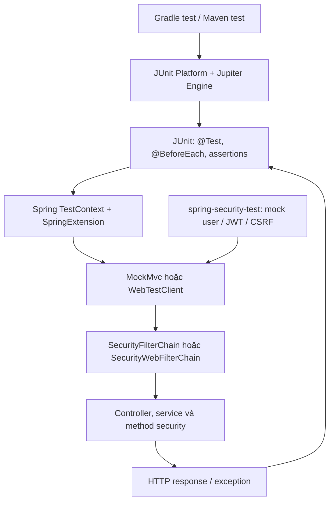

# Vai trò của `spring-security-test`, `spring-test` và bộ chạy kiểm thử

Khi kiểm thử Spring Security, một bài test HTTP thường cần **ba lớp công cụ phối hợp**: bộ chạy kiểm thử thực thi test; `spring-test` dựng môi trường Spring và mô phỏng lời gọi HTTP; `spring-security-test` tạo danh tính, quyền hạn và các điều kiện bảo mật để kiểm chứng quy tắc truy cập. Nếu thiếu hoặc lắp sai một lớp, bài test có thể chạy nhưng không đi qua cơ chế bảo vệ mà ứng dụng thực dùng.

Nội dung này thuộc chương **Phụ thuộc và phiên bản** của **SPRING_SECURITY_TESTING**: kiểm chứng xác thực, phân quyền và bảo vệ HTTP bằng `spring-security-test` trên ứng dụng **Servlet** và **Reactive**, với `MockMvc`, `WebTestClient`, `@WithMockUser`, `SecurityContext` và các tình huống JWT/OAuth2/OIDC giả lập.

## 1. Mục tiêu học tập

Sau bài này, người học có thể:

1. Giải thích ranh giới trách nhiệm của `spring-test`, `spring-security-test`, Spring Security ở ứng dụng và JUnit Jupiter.
2. Chọn đúng phụ thuộc cho Spring Boot 3.x, Spring Boot 4.x hoặc dự án Spring không dùng Boot; hiểu vì sao không nên gán phiên bản tùy ý cho từng thư viện.
3. Thiết lập bài test Servlet với `MockMvc`, bài test Reactive với `WebTestClient` và bảo đảm bộ lọc bảo mật thực sự được tham gia xử lý.
4. Phân biệt test mô phỏng người dùng/JWT với test xác thực thông tin đăng nhập hoặc chữ ký token thực tế.
5. Nhận diện lỗi cấu hình khiến bài test trả `200`, `401`, `403` hoặc `302` ngoài dự kiến.

## 2. Bức tranh tổng thể: ai làm việc gì?



| Thành phần | Vai trò chính | Ví dụ điển hình | Không tự làm được |
|---|---|---|---|
| `org.springframework:spring-test` | TestContext, tạo và tái sử dụng `ApplicationContext`, mock Servlet API, `MockMvc`, `WebTestClient`, các tiện ích test của Spring | `SpringExtension`, `@ContextConfiguration`, `MockMvc` | Không tự cung cấp `@WithMockUser`, `jwt()`, `csrf()` của Spring Security |
| `org.springframework.security:spring-security-test` | Hỗ trợ kiểm thử riêng cho Spring Security: tạo `SecurityContext`, principal, authorities, CSRF và các request/response security matcher | `@WithMockUser`, `user()`, `jwt()`, `mockJwt()`, `authenticated()` | Không thay thế bộ lọc/security configuration của ứng dụng, không chạy test |
| `spring-security-config` và `spring-security-web` (hoặc các module tương ứng) | Cấu hình và thực thi xác thực, phân quyền, bộ lọc Servlet/Reactive trong ứng dụng | `SecurityFilterChain`, `SecurityWebFilterChain`, `@EnableMethodSecurity` | Không cung cấp toàn bộ công cụ mock và chạy test |
| JUnit Platform + Jupiter Engine | Phát hiện, lập lịch và thực thi test; gọi lifecycle, báo kết quả | `@Test`, `@BeforeEach`, `@ParameterizedTest` | Không dựng Spring context hay thêm danh tính bảo mật nếu không tích hợp Spring |
| `spring-boot-starter-test` | Gom các phụ thuộc kiểm thử phổ biến theo phiên bản Boot quản lý | JUnit Jupiter, assertion libraries, mocking và hỗ trợ Boot test | Không nên mặc định coi nó đã cung cấp toàn bộ API của `spring-security-test` |
| Mockito, AssertJ, Reactor Test (khi cần) | Mock cộng tác viên, diễn đạt điều kiện kiểm tra, kiểm thử chuỗi bất đồng bộ | `Mockito`, `assertThat`, `StepVerifier` | Không thay thế kiểm thử security filter chain thực tế |

**Cách nhớ:** JUnit quyết định *khi nào test chạy*; `spring-test` cung cấp *môi trường và kênh gọi hệ thống*; `spring-security-test` cung cấp *dữ liệu và công cụ kiểm thử bảo mật*; Spring Security của ứng dụng quyết định *có cho phép request hay không*.

## 3. `spring-test`: nền tảng kiểm thử Spring và HTTP

### 3.1. Spring TestContext Framework

TestContext tổ chức vòng đời test dựa trên Spring: tải cấu hình, tạo `ApplicationContext`, tiêm bean vào lớp test, quản lý giao dịch cho test khi cấu hình phù hợp và **cache context** giữa các test có cấu hình tương thích. Với JUnit Jupiter, cầu nối là `SpringExtension`.

```java
@ExtendWith(SpringExtension.class)
@ContextConfiguration(classes = TestConfiguration.class)
class ExampleSpringTest {
    @Autowired
    SomeService service;

    @Test
    void serviceIsAvailable() {
        assertNotNull(service);
    }
}
```

`@SpringBootTest`, `@WebMvcTest` và `@WebFluxTest` của Spring Boot đã tích hợp hỗ trợ Spring TestContext/JUnit Jupiter tương ứng; thông thường không cần viết thêm `@ExtendWith(SpringExtension.class)` cho chúng. Đây là **một kết nối giữa bộ chạy test và Spring context**, không phải cơ chế giả lập người dùng.

### 3.2. `MockMvc` cho Servlet / Spring MVC

`MockMvc` nằm trong `spring-test` và gửi request qua hạ tầng Spring MVC (gồm `DispatcherServlet`) **mà không cần khởi động HTTP server**. Nó có thể thực thi `Filter`, kiểm tra status, header, JSON body và handler. Để kiểm chứng security, `MockMvc` phải được lắp với **Spring Security filter chain**.

Ví dụ khi tự tạo `MockMvc` từ `WebApplicationContext`:

```java
import static org.springframework.security.test.web.servlet.setup.SecurityMockMvcConfigurers.springSecurity;
import static org.springframework.test.web.servlet.setup.MockMvcBuilders.webAppContextSetup;

// context là WebApplicationContext đã có cấu hình Spring MVC và Security.
MockMvc mvc = webAppContextSetup(context)
        .apply(springSecurity())
        .build();
```

`springSecurity()` ở đây là API **của `spring-security-test`**. Nó tích hợp `FilterChainProxy` và bộ xử lý bối cảnh bảo mật với `MockMvc`. Nếu chỉ gọi `MockMvcBuilders.standaloneSetup(controller).build()`, bạn **chưa tự động có** toàn bộ security filter chain và không thể dùng status của test đó để kết luận endpoint được bảo vệ.

Trong Spring Boot, `@AutoConfigureMockMvc` hay `@WebMvcTest` có thể thiết lập `MockMvc` và các filter được phát hiện trong context; vẫn cần xác nhận `SecurityFilterChain` mong muốn thực sự được nạp. Các lát cắt test (slice) chỉ tải một phần cấu hình nên có thể khác một `@SpringBootTest` đầy đủ.

### 3.3. `WebTestClient` cho Reactive / Spring WebFlux

`WebTestClient` cũng thuộc API kiểm thử Spring. Nó có thể gắn vào một controller, `ApplicationContext` hoặc kết nối HTTP đến server đang chạy. Với WebFlux, nó thực thi request qua chuỗi `WebFilter` dạng Reactive; nếu bài test cần kiểm chứng security, chuỗi `SecurityWebFilterChain` và cấu hình tích hợp security của client phải được áp dụng.

```java
import static org.springframework.security.test.web.reactive.server.SecurityMockServerConfigurers.springSecurity;

// context là ApplicationContext của ứng dụng WebFlux đã có Spring Security.
WebTestClient client = WebTestClient.bindToApplicationContext(context)
        .apply(springSecurity())
        .configureClient()
        .build();
```

Khi dùng Spring Boot WebFlux với `@SpringBootTest` và `@AutoConfigureWebTestClient`, Boot có thể dựng sẵn client tương ứng. `WebTestClient` không chỉ dành cho Reactive: nó cũng có thể thử ứng dụng Spring MVC qua adapter hoặc gửi HTTP thực đến một server. Vì vậy, hãy phân biệt **kiểu client dùng trong test** với **Servlet/Reactive stack của ứng dụng đang được kiểm chứng**.

## 4. `spring-security-test`: tạo tình huống bảo mật có kiểm soát

Thư viện này cung cấp tiện ích để tập trung kiểm tra **chính sách** thay vì phải gọi login server, dựng session hoặc tạo chữ ký JWT cho mọi test.

| Nhu cầu test | Công cụ tiêu biểu | Ý nghĩa |
|---|---|---|
| Chạy một test method với người dùng giả lập | `@WithMockUser`, `@WithAnonymousUser`, `@WithUserDetails`, `@WithSecurityContext` | Chuẩn bị `SecurityContext` qua cơ chế tích hợp Spring TestContext |
| Tạo người dùng trên từng request Servlet | `SecurityMockMvcRequestPostProcessors.user()` | Tạo principal và authorities cho request `MockMvc` |
| Gắn CSRF cho request Servlet | `csrf()`, `csrf().useInvalidToken()` | Kiểm tra bộ lọc chống CSRF với token hợp lệ/không hợp lệ |
| Mô phỏng Bearer authentication | Servlet `jwt()`, `opaqueToken()`; Reactive `mockJwt()`, `mockOpaqueToken()` | Tạo authentication tương ứng để kiểm tra phân quyền |
| Mô phỏng OAuth2 Login/OIDC Login | Servlet `oauth2Login()`, `oidcLogin()`; Reactive `mockOAuth2Login()`, `mockOidcLogin()` | Kiểm tra ứng dụng khi một principal OAuth2/OIDC đã được xác thực |
| Xác minh kết quả bảo mật trong `MockMvc` | `authenticated()`, `unauthenticated()` | Kiểm tra trạng thái xác thực, khi có tích hợp SecurityContext đúng cách |

### 4.1. `@WithMockUser` và `SecurityContext`

```java
@Test
@WithMockUser(username = "linh", roles = "ADMIN")
void adminCanReadReports() throws Exception {
    mvc.perform(get("/api/reports"))
       .andExpect(status().isOk());
}
```

Khi Spring TestContext được kết nối, `@WithMockUser` chuẩn bị một `Authentication` có trạng thái xác thực và đưa vào `SecurityContext` để code đang được test nhìn thấy. Mặc định, `@WithMockUser` dùng username `user` và role `USER`. `roles = "ADMIN"` sinh authority `ROLE_ADMIN`; còn `authorities = "SCOPE_reports.read"` sử dụng **đúng** authority đã viết, không thêm tiền tố.

Đừng nhầm `@WithMockUser` với kiểm chứng password: annotation này **không** gọi login endpoint, `PasswordEncoder`, identity provider hoặc cơ chế xác minh mật khẩu. Trong các tình huống cần principal có dữ liệu lấy từ ứng dụng, `@WithUserDetails` dùng bean `UserDetailsService`; khi cần danh tính đặc thù, có thể viết `@WithSecurityContext` riêng.

### 4.2. Tạo security context theo từng request với `MockMvc`

Giả sử endpoint `GET /api/reports` yêu cầu `ROLE_ADMIN` và API phản hồi `401` cho người chưa đăng nhập bằng cấu hình HTTP Basic/Bearer:

```java
import static org.springframework.security.test.web.servlet.request.SecurityMockMvcRequestPostProcessors.user;
import static org.springframework.test.web.servlet.request.MockMvcRequestBuilders.get;
import static org.springframework.test.web.servlet.result.MockMvcResultMatchers.status;

@Test
void accessMatrix() throws Exception {
    mvc.perform(get("/api/reports"))
       .andExpect(status().isUnauthorized()); // Không có danh tính

    mvc.perform(get("/api/reports").with(user("an").roles("USER")))
       .andExpect(status().isForbidden());    // Đăng nhập nhưng thiếu quyền

    mvc.perform(get("/api/reports").with(user("binh").roles("ADMIN")))
       .andExpect(status().isOk());           // Đủ quyền
}
```

Các kết quả trong ví dụ phụ thuộc **cấu hình cụ thể** của ứng dụng; nếu ứng dụng bật form login, request ẩn danh có thể bị chuyển hướng `302` sang trang đăng nhập. Vì thế, không nên mặc định mọi endpoint ẩn danh luôn trả `401`.

### 4.3. CSRF và JWT không phải cùng một vấn đề

Với endpoint `POST /api/reports` dùng xác thực dựa trên cookie/session và **CSRF đang bật**, `spring-security-test` có thể gửi token hợp lệ hoặc không hợp lệ:

```java
import static org.springframework.security.test.web.servlet.request.SecurityMockMvcRequestPostProcessors.csrf;

@Test
void csrfPolicy() throws Exception {
    mvc.perform(post("/api/reports").with(user("binh").roles("ADMIN")))
       .andExpect(status().isForbidden());

    mvc.perform(post("/api/reports")
            .with(user("binh").roles("ADMIN"))
            .with(csrf()))
       .andExpect(status().isCreated());
}
```

`status().isCreated()` giả định controller trả `201 Created` khi thành công. Test này chứng minh filter xử lý CSRF theo cấu hình hiện có; nó **không** chứng minh ứng dụng frontend biết lấy và gửi token đúng quy trình. Với API stateless dùng Bearer token, chính sách CSRF có thể khác và phải kiểm tra theo mô hình đe dọa của ứng dụng.

Khi endpoint Resource Server dùng scope trong JWT, ta có thể mô phỏng danh tính JWT:

```java
import static org.springframework.security.test.web.servlet.request.SecurityMockMvcRequestPostProcessors.jwt;
import org.springframework.security.core.authority.SimpleGrantedAuthority;

@Test
void reportScopeCanExport() throws Exception {
    mvc.perform(get("/api/export")
            .with(jwt().authorities(
                new SimpleGrantedAuthority("SCOPE_reports.read"))))
       .andExpect(status().isOk());
}
```

Giả định endpoint `/api/export` yêu cầu `SCOPE_reports.read`. `jwt()` chèn authentication phù hợp vào luồng test; nó **không** thử xác thực chữ ký JWT, khóa JWK, `issuer`, `audience` hoặc phản hồi của hệ thống cấp token. Muốn kiểm chứng đường đi thực của Bearer token, gửi header `Authorization` và cấu hình JWT decoder (hoặc mock một decoder có chủ đích); với E2E, tích hợp identity provider/test issuer phù hợp.

### 4.4. Bài test Reactive với `mockUser()` hoặc `mockJwt()`

Trong Spring WebFlux, security context gắn với **Reactor Context**, không nên giả định `ThreadLocal SecurityContextHolder` có cách truyền giống Servlet. Các mutator của `spring-security-test` cung cấp một `SecurityContext` tương ứng cho luồng request:

```java
import static org.springframework.security.test.web.reactive.server.SecurityMockServerConfigurers.mockUser;
import static org.springframework.security.test.web.reactive.server.SecurityMockServerConfigurers.mockJwt;

@Test
void adminCanReadReactiveReport() {
    client.mutateWith(mockUser("linh").roles("ADMIN"))
          .get().uri("/api/reports")
          .exchange()
          .expectStatus().isOk();
}

@Test
void scopeCanReadReactiveExport() {
    client.mutateWith(mockJwt()
              .authorities(new SimpleGrantedAuthority("SCOPE_reports.read")))
          .get().uri("/api/export")
          .exchange()
          .expectStatus().isOk();
}
```

Ví dụ giả định `client` đã liên kết với Spring Security thông qua `.apply(springSecurity())` hoặc cấu hình Boot tương đương. Với luồng `Mono`/`Flux` cần xác minh kết quả xử lý bất đồng bộ ngoài HTTP, có thể dùng `reactor-test` và `StepVerifier`; đó là công cụ cho luồng Reactive, không phải thư viện giả lập xác thực.

## 5. Bộ chạy kiểm thử: JUnit, Maven/Gradle và SpringExtension

Một bài test Spring Security thường có chuỗi thực thi như sau:

1. **Maven Surefire** (`mvn test`) hoặc **Gradle Test task** (`gradle test`) khởi động quy trình test.
2. **JUnit Platform** tìm test và ủy quyền cho **Jupiter TestEngine** chạy các test viết bằng JUnit Jupiter.
3. **JUnit Jupiter** gọi `@BeforeEach`, `@Test`, `@AfterEach`, các điều kiện và assertions. Nó hỗ trợ mở rộng qua `@ExtendWith`.
4. **`SpringExtension`** nối JUnit với Spring TestContext: tạo hoặc tái sử dụng context, tiêm bean và gọi các `TestExecutionListener`.
5. Cơ chế kiểm thử Spring Security nhận các annotation như `@WithMockUser` và chuẩn bị bối cảnh bảo mật; request đi qua `MockMvc`/`WebTestClient` để tạo kết quả thực của security chain.

Đối với JUnit Jupiter, dùng `org.junit.jupiter.api.Test` và `@ExtendWith(SpringExtension.class)` khi cần tích hợp Spring theo cách thủ công. Cú pháp cũ `@RunWith(SpringRunner.class)` thuộc **JUnit 4**; không trộn hai cơ chế nếu chưa có nhu cầu chạy test cũ qua Vintage Engine. Trong dự án Spring Boot, các annotation test của Boot đã mang tích hợp cần thiết với SpringExtension.

Với Gradle, cấu hình điển hình của JUnit Platform:

```groovy
tasks.named('test') {
    useJUnitPlatform()
}
```

Nếu chạy bằng Maven, cần plugin Surefire đủ mới để hỗ trợ JUnit Platform; dùng phiên bản do Spring Boot parent/BOM cùng cấu hình plugin quản lý nếu dự án theo Boot. **JUnit là bộ chạy và API kiểm thử; Mockito là thư viện tạo mock đối tượng**, không nên coi Mockito thay thế JUnit hoặc security test infrastructure.

## 6. Khai báo phụ thuộc và quản lý phiên bản

### 6.1. Dự án Spring Boot 3.x (Spring Framework 6.x, Spring Security 6.x)

Trong ứng dụng Spring MVC dùng Gradle Groovy DSL:

```groovy
dependencies {
    implementation 'org.springframework.boot:spring-boot-starter-web'
    implementation 'org.springframework.boot:spring-boot-starter-security'

    testImplementation 'org.springframework.boot:spring-boot-starter-test'
    testImplementation 'org.springframework.security:spring-security-test'
}
```

`spring-boot-starter-test` đưa vào hạ tầng test phổ biến (gồm hỗ trợ Spring Test, JUnit, Mockito/AssertJ theo phiên bản Boot); `spring-security-test` được khai báo riêng để có các helper bảo mật. Nếu ứng dụng sử dụng WebFlux, thay `spring-boot-starter-web` bằng `spring-boot-starter-webflux` và kiểm thử bằng `WebTestClient`. Khi dùng các loại JWT/OAuth2/OIDC, ứng dụng cần các module Security OAuth2 phù hợp với chức năng thực tế, ví dụ Resource Server và JOSE khi cần xử lý JWT.

Tương đương Maven, phần phụ thuộc test cốt lõi là:

```xml
<dependency>
    <groupId>org.springframework.boot</groupId>
    <artifactId>spring-boot-starter-test</artifactId>
    <scope>test</scope>
</dependency>
<dependency>
    <groupId>org.springframework.security</groupId>
    <artifactId>spring-security-test</artifactId>
    <scope>test</scope>
</dependency>
```

### 6.2. Dự án Spring Boot 4.x (Spring Framework 7.x, Spring Security 7.x)

Spring Boot 4 phân tách các **test starter theo công nghệ** rõ hơn. Với ứng dụng Spring MVC, cách khai báo minh họa trong Gradle Kotlin DSL là:

```kotlin
dependencies {
    implementation("org.springframework.boot:spring-boot-starter-webmvc")
    implementation("org.springframework.boot:spring-boot-starter-security")

    testImplementation("org.springframework.boot:spring-boot-starter-test")
    testImplementation("org.springframework.boot:spring-boot-starter-webmvc-test")
    testImplementation("org.springframework.boot:spring-boot-starter-security-test")
}

tasks.test {
    useJUnitPlatform()
}
```

Với WebFlux, chọn `spring-boot-starter-webflux` và `spring-boot-starter-webflux-test` thay cho các starter Web MVC ở trên. **`spring-boot-starter-security-test` là starter của Boot 4.x**, cung cấp hạ tầng kiểm thử Security phù hợp với hệ sinh thái Boot; thư viện lõi của Spring Security vẫn là `org.springframework.security:spring-security-test`. Khi chuyển từ Boot 3.x lên 4.x, cần kiểm tra lại các package của annotation auto-configuration test vì có các thay đổi tổ chức module (ví dụ vị trí `@WebMvcTest` và `@AutoConfigureWebTestClient`). Không sao chép import của Boot 3.x vào Boot 4.x mà không kiểm tra.

### 6.3. Dự án Spring Framework không dùng Boot

Khi không có các starter, bạn thường phải chủ động thêm những nhóm phụ thuộc tương ứng:

```kotlin
dependencies {
    testImplementation("org.springframework:spring-test")
    testImplementation("org.springframework.security:spring-security-test")
    testImplementation("org.junit.jupiter:junit-jupiter")
    testRuntimeOnly("org.junit.platform:junit-platform-launcher")
}
```

Đoạn trên chỉ minh họa **những phụ thuộc test**, giả định ứng dụng đã có các module `spring-context`, `spring-webmvc` hoặc `spring-webflux` và Spring Security runtime cần thiết. Một dự án thực tế còn cần áp dụng dependency management/BOM phù hợp để giải quyết **phiên bản**; không thể dán nguyên đoạn và coi là một build độc lập. Các test dùng `WebTestClient` phải có các thư viện web/reactive cần thiết trên classpath.

### 6.4. Quy tắc căn chỉnh phiên bản

| Nhóm phiên bản ứng dụng | Hệ sinh thái tương ứng | Cách chọn test dependencies |
|---|---|---|
| Spring Boot **3.x** | Spring Framework 6.x, Spring Security 6.x | `spring-boot-starter-test` + `spring-security-test`, dùng phiên bản do Boot quản lý |
| Spring Boot **4.x** | Spring Framework 7.x, Spring Security 7.x | `spring-boot-starter-test`, starter test theo stack và `spring-boot-starter-security-test` |
| Spring Framework **không dùng Boot** | Framework và Security phải thuộc các dòng tương thích | Dùng BOM/dependency constraints có chủ đích; tự chọn `spring-test`, `spring-security-test`, JUnit, plugin build |

**Nguyên tắc:** chọn **một dòng Spring Boot được hỗ trợ**, để dependency management của dòng đó quyết định phiên bản `spring-test`, `spring-security-test` và các thư viện liên quan. Không nên tự ghép `spring-security-test` 7.x vào ứng dụng Security 6.x, hoặc ép `spring-test` 7.x chạy với Framework 6.x. Trong mọi dòng, đặt các thư viện dùng riêng cho test ở `testImplementation`/`<scope>test</scope>`; không đưa chúng vào artifact triển khai production nếu không có lý do đặc biệt.

Lệnh kiểm tra cây phụ thuộc khi nghi ngờ có nhiều phiên bản:

```bash
# Gradle: xem version được chọn trong cấu hình testRuntimeClasspath
./gradlew dependencyInsight --dependency spring-security-test --configuration testRuntimeClasspath
./gradlew dependencyInsight --dependency spring-test --configuration testRuntimeClasspath

# Maven: xem dependency tree của project
./mvnw dependency:tree
```

Đầu ra sẽ chỉ ra dependency trực tiếp, dependency bắc cầu và phiên bản cuối cùng được giải quyết. Đây là cách đáng tin cậy hơn việc suy đoán rằng một starter chắc chắn đã chứa mọi API cần thiết.

## 7. Chọn cấp độ kiểm thử và bộ công cụ

| Mục tiêu | Kiểu test đề xuất | Phụ thuộc/công cụ trọng tâm | Điều gì được kiểm tra? |
|---|---|---|---|
| Hàm xử lý dữ liệu không cần Spring | Unit test thuần | JUnit + AssertJ/Mockito | Logic Java; không khẳng định filter/security context hoạt động |
| Quy tắc method security | Spring test với bean được proxy | Spring TestContext + `spring-security-test`, `@EnableMethodSecurity` trong cấu hình cần thiết | `@PreAuthorize`/`@PostAuthorize` và quyền trên method đang được Spring quản lý |
| HTTP Servlet / MVC | `@WebMvcTest` hoặc `@SpringBootTest` + `MockMvc` | `spring-test` + `spring-security-test` + security filter chain | HTTP status, CSRF, quyền truy cập qua Servlet filters |
| HTTP Reactive / WebFlux | `@WebFluxTest` hoặc `@SpringBootTest` + `WebTestClient` | `spring-test` + `spring-security-test` + reactive security chain | Reactive request, authorities và xử lý HTTP trên WebFilter |
| Login, JWT decoder, OAuth2/OIDC flow hoặc tích hợp toàn hệ thống | Integration/E2E trên HTTP server thật và các thành phần cần thiết | Test framework + runtime security + test server/identity provider phù hợp | Giao thức xác thực, cookie/header, token validation và hành vi ở ranh giới hệ thống |

`@WebMvcTest` và `@WebFluxTest` thường nhanh hơn vì chỉ tải phần web cần thiết, nhưng có thể cần `@Import` cấu hình security riêng nếu slice chưa nạp đủ. `@SpringBootTest` tải nhiều bean hơn và phù hợp khi muốn kiểm chứng cấu hình gần thực tế; `webEnvironment = RANDOM_PORT` mới chạy server thật, còn chế độ mock mặc định không tự mở cổng HTTP.

### Ma trận tình huống HTTP nên có

Với một tài nguyên cần quyền `REPORT_READ`, ít nhất nên có các trường hợp độc lập:

| Tình huống | Kỳ vọng tiêu biểu | Điều kiện phải làm rõ |
|---|---|---|
| Không gửi danh tính | Bị chặn (`401` hoặc chuyển hướng `302`) | API dùng Basic/Bearer hay form login? |
| Có danh tính nhưng không có quyền | `403 Forbidden` | Security chain có chạy và authority map đúng không? |
| Có đúng quyền | `200 OK` hoặc status thành công của endpoint | Controller/handler đã hoạt động đúng không? |
| Request thay đổi dữ liệu thiếu CSRF | `403` nếu CSRF áp dụng | Có sử dụng session/cookie và bật CSRF cho route này không? |
| JWT thiếu scope/claim | Bị chặn theo chính sách | Test đang dùng mock JWT hay token thật qua decoder? |

`401` nghĩa là chưa có xác thực hợp lệ theo entry point hiện tại; `403` thường biểu thị principal đã được nhận diện nhưng thiếu quyền, hoặc request bị một filter khác (chẳng hạn CSRF) từ chối. **Chỉ nhìn status không đủ để kết luận nguyên nhân**: khi fail, xem filter chain, response header, security debug log và cấu hình `AuthenticationEntryPoint`/`AccessDeniedHandler`.

## 8. Các lỗi thường gặp và cách sửa

1. **Có `spring-boot-starter-test` nhưng IDE không nhận `@WithMockUser`:** thiếu `spring-security-test` (Boot 3.x) hoặc starter kiểm thử Security tương ứng (Boot 4.x). Kiểm tra `testCompileClasspath` rồi khai báo đúng test dependency.
2. **`MockMvc` luôn trả `200` cho request đáng lẽ bị chặn:** kiểm tra `MockMvc` có kết nối `springSecurity()`/bộ lọc bảo mật không. Với `standaloneSetup`, cần tích hợp filter rõ ràng hoặc chuyển sang test có `WebApplicationContext` phù hợp.
3. **Test trả `401` thay vì `403`:** người dùng giả lập có thể chưa gắn vào context của request, hoặc cơ chế entry point khác dự kiến. Kiểm tra `SecurityFilterChain`, authorities, loại authentication và vị trí thực hiện kiểm tra.
4. **`@WithMockUser(roles = "ADMIN")` không thỏa `hasAuthority("ADMIN")`:** annotation tạo `ROLE_ADMIN`. Dùng `hasRole("ADMIN")`, hoặc thay bằng `authorities = "ADMIN"` nếu chính sách kiểm tra chính xác authority `ADMIN`.
5. **`POST` bị `403` dù có đúng role:** trong ứng dụng Servlet dùng CSRF, cần kiểm tra token. Thêm `.with(csrf())` cho ca hợp lệ và một ca thiếu/invalid token để chứng minh bảo vệ hoạt động.
6. **Test JWT xanh nhưng API với token thật lỗi:** `jwt()`/`mockJwt()` đã bỏ qua việc ký và giải mã token. Bổ sung test decoder, validator hoặc integration/E2E có token thật phù hợp.
7. **Reactive test không nhìn thấy principal:** kiểm tra `WebTestClient` đã liên kết security của WebFlux và dùng `mockUser()`/`mockJwt()` đúng chỗ. Không truyền `SecurityContext` bằng giả định ThreadLocal như Servlet.
8. **Nâng Spring Boot xong gặp `NoClassDefFoundError`/`NoSuchMethodError`:** in dependency tree; loại bỏ phiên bản Spring Framework/Security bị ép thủ công và dùng lại bộ phiên bản Boot quản lý. Kiểm tra tên starter test mới và package import sau khi nâng lên Boot 4.x.

## 9. Bài tập thực hành nhỏ

Giả sử ứng dụng có các quy tắc: `GET /api/public` cho phép mọi người; `GET /api/reports` yêu cầu role `ADMIN`; `POST /api/reports` yêu cầu role `ADMIN` và bảo vệ CSRF khi dùng cookie/session; một endpoint Resource Server yêu cầu `SCOPE_reports.read`.

Hãy xây dựng một bộ test theo thứ tự:

1. Tạo test Servlet (`MockMvc`) hoặc Reactive (`WebTestClient`) theo stack của dự án và xác nhận security chain được lắp vào.
2. Viết một ca anonymous, một ca thiếu quyền và một ca đủ quyền cho `/api/reports`; kiểm tra status theo cơ chế xác thực thật của ứng dụng.
3. Nếu dùng Servlet với CSRF, thử `POST` không token, token sai và token hợp lệ.
4. Với endpoint JWT, dùng mock JWT có và không có `SCOPE_reports.read`. Ghi rõ những thành phần chưa được kiểm thử (chữ ký, issuer, audience, network).
5. Chạy toàn bộ bằng `./gradlew test` hoặc `./mvnw test`, đọc report và dùng dependency tree khi có lỗi classpath.

**Tiêu chí hoàn thành:** mỗi test đều nêu rõ danh tính được giả lập như thế nào, đi qua chuỗi bảo mật nào, quyền nào được kiểm tra và status/behavior nào được mong đợi. Một bài test xanh chỉ có ý nghĩa trong **phạm vi cơ chế mà nó thực sự thực thi**.

## 10. Tài liệu tham khảo chính thức

- [Spring Security — Servlet Testing](https://docs.spring.io/spring-security/reference/servlet/test/index.html): `@WithMockUser`, tích hợp `MockMvc`, test JWT/CSRF.
- [Spring Security — Integrating MockMvc and Spring Security](https://docs.spring.io/spring-security/reference/servlet/test/mockmvc/setup.html): sử dụng `SecurityMockMvcConfigurers.springSecurity()`.
- [Spring Security — Reactive Test Support](https://docs.spring.io/spring-security/reference/reactive/test/index.html): hỗ trợ kiểm thử WebFlux.
- [Spring Framework — Spring MVC Testing](https://docs.spring.io/spring-framework/reference/testing/spring-mvc-test-framework.html) và [WebTestClient](https://docs.spring.io/spring-framework/reference/testing/webtestclient.html): hạ tầng HTTP của `spring-test`.
- [Spring Framework — SpringExtension](https://docs.spring.io/spring-framework/reference/testing/testcontext-framework/support-classes.html): tích hợp JUnit Jupiter với TestContext.
- [Spring Boot — Testing](https://docs.spring.io/spring-boot/reference/testing/index.html) và [Build Systems](https://docs.spring.io/spring-boot/reference/using/build-systems.html): starter, hỗ trợ test và dependency management.

> Các đoạn code là ví dụ độc lập cho từng tình huống và có giả định rõ về endpoint, chính sách Security và cấu hình test. Khi đưa vào dự án thực tế, cần thêm import tương ứng và dùng đúng API/package của dòng Spring Boot đang chạy.
