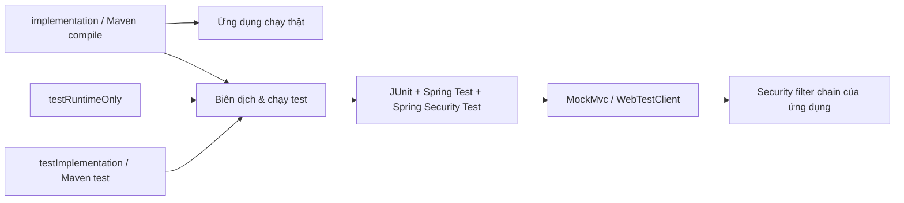

# Khai báo phụ thuộc kiểm thử bằng Maven hoặc Gradle

Một bài kiểm thử Spring Security thường bắt đầu từ tệp `pom.xml`, `build.gradle` hoặc `build.gradle.kts`: các phụ thuộc phải đủ để **chạy JUnit**, **tạo môi trường HTTP của Spring** và **giả lập danh tính/quyền hạn của Spring Security**. Khai báo sai phạm vi hoặc trộn các phiên bản Spring dễ dẫn đến lỗi biên dịch, lỗi tải lớp, hoặc test chạy nhưng không kiểm chứng được chuỗi bảo mật mong muốn.

Đây là bài thuộc chương **Phụ thuộc và phiên bản** của mô-đun **SPRING_SECURITY_TESTING**. Mục tiêu thực hành của mô-đun là kiểm chứng xác thực, phân quyền và bảo vệ HTTP trên **Servlet (Spring MVC)** và **Reactive (Spring WebFlux)** bằng `MockMvc`, `WebTestClient`, `@WithMockUser`, `SecurityContext` và các tiện ích JWT/OAuth2/OIDC giả lập.

> **Nguyên tắc xuyên suốt:** chọn **dòng Spring Boot đang dùng**, xác định ứng dụng là **MVC hay WebFlux**, thêm **starter ứng dụng** và **phụ thuộc test** tương ứng, sau đó để cơ chế dependency management căn chỉnh phiên bản. Những ví dụ dưới đây là phần khai báo **trong một dự án Spring Boot đã có parent hoặc plugin/BOM phù hợp**; không phải toàn bộ tệp build có thể chạy độc lập.

## 1. Học xong bài này cần làm được gì?

- Thêm đúng phụ thuộc test cho ứng dụng Spring Boot 3.x và 4.x dùng Maven hoặc Gradle.
- Phân biệt `implementation`/`compile` và `testImplementation`/`test`, cùng `testRuntimeOnly` khi cần.
- Chuẩn bị classpath cho `@WithMockUser`, `MockMvc`, `WebTestClient`, `csrf()`, `jwt()`, `mockJwt()`, và các tình huống OAuth2/OIDC.
- Chạy test qua JUnit Platform bằng Maven Surefire hoặc Gradle Test task.
- Kiểm tra dependency tree, xác định thư viện bị thiếu hoặc có phiên bản không tương thích.

## 2. Từ mục tiêu test đến tọa độ Maven

Các dependency chính cần nhận diện:

| Mục đích | Maven `groupId:artifactId` | Phạm vi nên dùng |
|---|---|---|
| Ứng dụng MVC với Spring Boot 3.x | `org.springframework.boot:spring-boot-starter-web` | Runtime ứng dụng (`implementation`) |
| Ứng dụng MVC với Spring Boot 4.x | `org.springframework.boot:spring-boot-starter-webmvc` | Runtime ứng dụng |
| Ứng dụng WebFlux | `org.springframework.boot:spring-boot-starter-webflux` | Runtime ứng dụng |
| Cấu hình và chạy Spring Security thông thường | `org.springframework.boot:spring-boot-starter-security` | Runtime ứng dụng |
| Test phổ biến: Spring Test, JUnit Jupiter, AssertJ, Mockito… | `org.springframework.boot:spring-boot-starter-test` | Test |
| API test Spring Security (Boot 3.x) | `org.springframework.security:spring-security-test` | Test |
| Test Security theo starter của Boot 4.x | `org.springframework.boot:spring-boot-starter-security-test` | Test |
| Test MVC theo starter của Boot 4.x | `org.springframework.boot:spring-boot-starter-webmvc-test` | Test |
| Test WebFlux theo starter của Boot 4.x | `org.springframework.boot:spring-boot-starter-webflux-test` | Test |
| OAuth2 Resource Server trong ứng dụng | Boot 3.x: `spring-boot-starter-oauth2-resource-server`; Boot 4.x: `spring-boot-starter-security-oauth2-resource-server` | Runtime ứng dụng nếu thực sự dùng Resource Server |
| OAuth2 Client/OIDC Login trong ứng dụng | Boot 3.x: `spring-boot-starter-oauth2-client`; Boot 4.x: `spring-boot-starter-security-oauth2-client` | Runtime ứng dụng nếu thực sự dùng login/client |

**Tại sao cần cả starter web và starter security?** Starter web chứa hạ tầng xử lý HTTP; starter security đưa vào cấu hình bảo mật của ứng dụng. Phụ thuộc test cung cấp công cụ điều khiển và xác nhận hành vi của chúng. Thêm `spring-security-test` riêng mà không cấu hình chuỗi bảo mật của ứng dụng **không** biến mọi request test thành request có bảo vệ.

### 2.1. Nhận biết `spring-test` và `spring-security-test`

`spring-test` thuộc Spring Framework, chứa TestContext, `MockMvc` và `WebTestClient`. `spring-security-test` thuộc Spring Security, chứa `@WithMockUser`, `SecurityMockMvcRequestPostProcessors.user()`, `csrf()`, `jwt()`, cùng các cấu hình/mutator cho Reactive như `mockJwt()`. JUnit Platform/Jupiter thực thi test và báo kết quả; Mockito tạo mock cho đối tượng Java. Chúng phối hợp nhưng **không thay thế cho nhau**.

Trong Spring Boot 3.x, cách dùng thông thường là `spring-boot-starter-test` **và** `spring-security-test`. Sang Spring Boot 4.x, hệ sinh thái Boot có các test starter chuyên trách, gồm `spring-boot-starter-security-test`, `spring-boot-starter-webmvc-test` và `spring-boot-starter-webflux-test`.

## 3. Spring Boot 3.x với Maven

Ví dụ ứng dụng REST xây dựng bằng **Spring MVC + Spring Security**, đã có `spring-boot-starter-parent` của Boot 3.x (hoặc đã import BOM và cấu hình build plugin tương ứng). Trong `pom.xml`, thêm:

```xml
<dependencies>
    <!-- Chạy Spring MVC và các Servlet endpoint của ứng dụng -->
    <dependency>
        <groupId>org.springframework.boot</groupId>
        <artifactId>spring-boot-starter-web</artifactId>
    </dependency>

    <!-- Chuỗi filter, cấu hình xác thực và phân quyền -->
    <dependency>
        <groupId>org.springframework.boot</groupId>
        <artifactId>spring-boot-starter-security</artifactId>
    </dependency>

    <!-- JUnit Jupiter, Spring TestContext, MockMvc, assertions, Mockito... -->
    <dependency>
        <groupId>org.springframework.boot</groupId>
        <artifactId>spring-boot-starter-test</artifactId>
        <scope>test</scope>
    </dependency>

    <!-- @WithMockUser, csrf(), jwt(), springSecurity()... -->
    <dependency>
        <groupId>org.springframework.security</groupId>
        <artifactId>spring-security-test</artifactId>
        <scope>test</scope>
    </dependency>
</dependencies>
```

**Tại sao không khai báo `<version>` cho mỗi dependency?** `spring-boot-starter-parent` hoặc `spring-boot-dependencies` BOM quản lý phiên bản tương thích của Framework, Security, JUnit và các module liên quan. Cần xác định phiên bản Boot ở một nơi; việc thêm thủ công `spring-test` hoặc `spring-security-test` phiên bản khác dòng có thể làm classpath không nhất quán.

Nếu ứng dụng là **Reactive**, thay dependency `spring-boot-starter-web` bằng:

```xml
<dependency>
    <groupId>org.springframework.boot</groupId>
    <artifactId>spring-boot-starter-webflux</artifactId>
</dependency>
```

Giữ `spring-boot-starter-security`, `spring-boot-starter-test`, `spring-security-test`. Khi muốn test `Mono`/`Flux` trực tiếp bằng `StepVerifier`, thêm dependency sau nếu classpath chưa có:

```xml
<dependency>
    <groupId>io.projectreactor</groupId>
    <artifactId>reactor-test</artifactId>
    <scope>test</scope>
</dependency>
```

`WebTestClient` đến từ Spring Test; tính năng giả lập người dùng/token Reactive đến từ `spring-security-test`. `reactor-test` phục vụ xác nhận tín hiệu Reactive, không phải thay thế các helper bảo mật.

## 4. Spring Boot 3.x với Gradle

Với dự án Gradle Groovy DSL (`build.gradle`) đã dùng plugin Spring Boot 3.x và cấu hình dependency management:

```groovy
dependencies {
    implementation 'org.springframework.boot:spring-boot-starter-web'
    implementation 'org.springframework.boot:spring-boot-starter-security'

    testImplementation 'org.springframework.boot:spring-boot-starter-test'
    testImplementation 'org.springframework.security:spring-security-test'

    // Đảm bảo JUnit Platform launcher có trên runtime test nếu cần.
    testRuntimeOnly 'org.junit.platform:junit-platform-launcher'
}

tasks.named('test', Test) {
    useJUnitPlatform()
}
```

Nếu dùng Gradle Kotlin DSL (`build.gradle.kts`), cùng cấu hình viết thành:

```kotlin
dependencies {
    implementation("org.springframework.boot:spring-boot-starter-web")
    implementation("org.springframework.boot:spring-boot-starter-security")

    testImplementation("org.springframework.boot:spring-boot-starter-test")
    testImplementation("org.springframework.security:spring-security-test")
    testRuntimeOnly("org.junit.platform:junit-platform-launcher")
}

tasks.test {
    useJUnitPlatform()
}
```

Đối với WebFlux, trong một trong hai đoạn trên hãy **thay** dependency web bằng `spring-boot-starter-webflux`. Nếu sử dụng `StepVerifier`, thêm `testImplementation 'io.projectreactor:reactor-test'` (Groovy) hoặc `testImplementation("io.projectreactor:reactor-test")` (Kotlin).

**Không đặt `spring-security-test` ở `implementation` chỉ để code test biên dịch.** Mã giả lập principal, JWT hoặc CSRF chỉ thuộc test source set; đưa thư viện vào `testImplementation` giữ artifact ứng dụng gọn và tách rõ phụ thuộc sản xuất với phụ thuộc kiểm thử.

## 5. Spring Boot 4.x: chọn test starter theo stack

Boot 4.x sử dụng Spring Framework 7.x và Spring Security 7.x. Các starter được tổ chức chi tiết hơn, kể cả starter test cho từng mảng. Do đó, không nên chuyển nguyên cấu hình Boot 3.x sang 4.x mà không rà lại tọa độ của starter và package chứa annotation test.

### 5.1. Maven cho Spring MVC + Security trên Boot 4.x

Trong `pom.xml` của dự án đã sử dụng parent/BOM Boot 4.x:

```xml
<dependencies>
    <dependency>
        <groupId>org.springframework.boot</groupId>
        <artifactId>spring-boot-starter-webmvc</artifactId>
    </dependency>
    <dependency>
        <groupId>org.springframework.boot</groupId>
        <artifactId>spring-boot-starter-security</artifactId>
    </dependency>

    <!-- Hạ tầng test chung: Spring Boot Test, JUnit, assertions... -->
    <dependency>
        <groupId>org.springframework.boot</groupId>
        <artifactId>spring-boot-starter-test</artifactId>
        <scope>test</scope>
    </dependency>
    <!-- Test dành riêng cho MVC: MockMvc, annotation cấu hình... -->
    <dependency>
        <groupId>org.springframework.boot</groupId>
        <artifactId>spring-boot-starter-webmvc-test</artifactId>
        <scope>test</scope>
    </dependency>
    <!-- Test dành riêng cho Security: @WithMockUser, csrf(), jwt()... -->
    <dependency>
        <groupId>org.springframework.boot</groupId>
        <artifactId>spring-boot-starter-security-test</artifactId>
        <scope>test</scope>
    </dependency>
</dependencies>
```

`spring-boot-starter-security-test` của Boot không có nghĩa là `spring-security-test` đã biến mất: đó vẫn là thư viện lõi cấp Spring Security. Starter làm nhiệm vụ kết hợp các phụ thuộc theo cơ chế quản lý của Boot.

Với WebFlux, thay `spring-boot-starter-webmvc` và `spring-boot-starter-webmvc-test` bằng `spring-boot-starter-webflux` và `spring-boot-starter-webflux-test`. Trong ứng dụng chỉ dùng một web stack, tránh tự thêm cả MVC và WebFlux starter vì có thể khiến Boot chọn kiểu ứng dụng khác mong đợi.

### 5.2. Gradle cho Spring MVC + Security trên Boot 4.x

Ví dụ `build.gradle.kts` của dự án đã dùng plugin Boot 4.x và dependency management tương ứng:

```kotlin
dependencies {
    implementation("org.springframework.boot:spring-boot-starter-webmvc")
    implementation("org.springframework.boot:spring-boot-starter-security")

    testImplementation("org.springframework.boot:spring-boot-starter-test")
    testImplementation("org.springframework.boot:spring-boot-starter-webmvc-test")
    testImplementation("org.springframework.boot:spring-boot-starter-security-test")
    testRuntimeOnly("org.junit.platform:junit-platform-launcher")
}

tasks.test {
    useJUnitPlatform()
}
```

Bản Groovy DSL tương đương:

```groovy
dependencies {
    implementation 'org.springframework.boot:spring-boot-starter-webmvc'
    implementation 'org.springframework.boot:spring-boot-starter-security'

    testImplementation 'org.springframework.boot:spring-boot-starter-test'
    testImplementation 'org.springframework.boot:spring-boot-starter-webmvc-test'
    testImplementation 'org.springframework.boot:spring-boot-starter-security-test'
    testRuntimeOnly 'org.junit.platform:junit-platform-launcher'
}

tasks.named('test', Test) {
    useJUnitPlatform()
}
```

Với WebFlux, thay đúng hai dependency MVC bằng cặp `spring-boot-starter-webflux` và `spring-boot-starter-webflux-test`. Nếu cần test Resource Server hoặc OAuth2 Client phức tạp, Boot 4 còn cung cấp các starter test chuyên biệt tương ứng; chỉ thêm những nhóm mà chức năng ứng dụng thực sự dùng.

### 5.3. Bảng chuyển đổi nhanh từ Boot 3.x sang Boot 4.x

| Chức năng | Boot 3.x | Boot 4.x |
|---|---|---|
| Web MVC trong ứng dụng | `spring-boot-starter-web` | `spring-boot-starter-webmvc` |
| WebFlux trong ứng dụng | `spring-boot-starter-webflux` | `spring-boot-starter-webflux` |
| Framework/JUnit/test chung | `spring-boot-starter-test` | `spring-boot-starter-test` |
| Security test | `org.springframework.security:spring-security-test` | `spring-boot-starter-security-test` |
| MVC test theo stack | Chủ yếu từ `spring-boot-starter-test` và cấu hình web | `spring-boot-starter-webmvc-test` |
| WebFlux test theo stack | Chủ yếu từ `spring-boot-starter-test` và các phụ thuộc web/reactive | `spring-boot-starter-webflux-test` |

Khi nâng cấp, cần kiểm tra **import Java** của `@WebMvcTest`, `@WebFluxTest`, `@AutoConfigureMockMvc` và `@AutoConfigureWebTestClient`: Boot 4 tách nhiều API tự cấu hình test sang module/package chuyên trách. Tên class có thể giữ nguyên nhưng đường dẫn import thay đổi.

## 6. JWT, OAuth2 và OIDC: khai báo theo khả năng thật của ứng dụng

`spring-security-test`/Security test starter giúp giả lập token hoặc người dùng đã đăng nhập. Nhưng muốn **ứng dụng thật** chạy Resource Server, OAuth2 Login hay OIDC, phải khai báo các module bảo mật cho đường đi ấy.

### 6.1. Resource Server xác thực Bearer JWT

Nếu ứng dụng Boot 3.x có endpoint bảo vệ bằng `oauth2ResourceServer(oauth2 -> oauth2.jwt(...))` thì thêm dependency runtime tương ứng, bên cạnh các dependency ở mục 3 hoặc 4:

```xml
<!-- Spring Boot 3.x -->
<dependency>
    <groupId>org.springframework.boot</groupId>
    <artifactId>spring-boot-starter-oauth2-resource-server</artifactId>
</dependency>
```

Ở Boot 4.x, tọa độ starter runtime được đặt tên theo nhóm Security:

```xml
<!-- Spring Boot 4.x -->
<dependency>
    <groupId>org.springframework.boot</groupId>
    <artifactId>spring-boot-starter-security-oauth2-resource-server</artifactId>
</dependency>
```

Gradle khai báo tương ứng:

```kotlin
// Boot 3.x
implementation("org.springframework.boot:spring-boot-starter-oauth2-resource-server")

// Boot 4.x: dùng dòng này thay cho dòng ở trên
implementation("org.springframework.boot:spring-boot-starter-security-oauth2-resource-server")
```

Có hai hướng test khác nhau:

- **Policy/authorization test:** dùng `jwt()` với `MockMvc` hoặc `mockJwt()` với `WebTestClient` để cung cấp một `JwtAuthenticationToken` có sẵn; kiểm tra authority `SCOPE_...`, status được phép hoặc bị từ chối.
- **Token validation/integration test:** gửi header `Authorization: Bearer ...` và chạy qua decoder, validator, JWKS/issuer cấu hình cho môi trường test. Các helper mock JWT **không** chứng minh chữ ký, hạn dùng hoặc audience được kiểm tra đúng.

### 6.2. OAuth2 Client / OIDC Login

Nếu ứng dụng thật làm OAuth2 Client hoặc OIDC Login:

```groovy
// Boot 3.x
implementation 'org.springframework.boot:spring-boot-starter-oauth2-client'

// Boot 4.x: thay dòng ở trên
implementation 'org.springframework.boot:spring-boot-starter-security-oauth2-client'
```

Sau đó dùng hỗ trợ như Servlet `oauth2Login()`/`oidcLogin()` hoặc Reactive `mockOAuth2Login()`/`mockOidcLogin()` từ Spring Security Test để kiểm tra quyền của principal. Đó là test trạng thái đã đăng nhập; việc trao đổi authorization code, xác nhận ID token với nhà cung cấp và redirect callback cần bài integration riêng.

Nếu dự án **không dùng** JWT, OAuth2 hoặc OIDC, không cần thêm các runtime starter này chỉ vì bài test dùng `@WithMockUser`.

## 7. Nếu không dùng Spring Boot

Dự án Spring Framework thuần phải cấu hình hạ tầng và phiên bản cụ thể hơn. Ví dụ Gradle Kotlin DSL dưới đây chỉ hiển thị **phần dependency test**; giả định ứng dụng đã có Spring Context/WebMVC hoặc WebFlux và Spring Security runtime, cùng BOM/dependency constraints cho các version được chọn:

```kotlin
dependencies {
    testImplementation("org.springframework:spring-test")
    testImplementation("org.springframework.security:spring-security-test")

    testImplementation("org.junit.jupiter:junit-jupiter")
    testRuntimeOnly("org.junit.platform:junit-platform-launcher")

    // Nếu test Reactor Publisher bằng StepVerifier
    testImplementation("io.projectreactor:reactor-test")
}

tasks.test {
    useJUnitPlatform()
}
```

Tương đương Maven (khi đã quản lý phiên bản bằng `dependencyManagement` hoặc parent thích hợp):

```xml
<dependencies>
    <dependency>
        <groupId>org.springframework</groupId>
        <artifactId>spring-test</artifactId>
        <scope>test</scope>
    </dependency>
    <dependency>
        <groupId>org.springframework.security</groupId>
        <artifactId>spring-security-test</artifactId>
        <scope>test</scope>
    </dependency>
    <dependency>
        <groupId>org.junit.jupiter</groupId>
        <artifactId>junit-jupiter</artifactId>
        <scope>test</scope>
    </dependency>
</dependencies>
```

Đối với Maven ngoài Boot, cấu hình `maven-surefire-plugin` phiên bản hỗ trợ JUnit Platform và đảm bảo các phụ thuộc compile/runtime của Spring Web hiện diện. Không kết luận dự án đã đầy đủ chỉ vì các đoạn phụ thuộc test trên không có lỗi cú pháp.

## 8. Phạm vi phụ thuộc: đặt ở đâu và tại sao?



| Maven | Gradle | Ý nghĩa |
|---|---|---|
| Mặc định (`compile`), hoặc phạm vi thích hợp của ứng dụng | `implementation` | Thư viện cần ở ứng dụng chạy thật; test thường cũng nhìn thấy |
| `<scope>test</scope>` | `testImplementation` | Thư viện phục vụ biên dịch và chạy test, không đóng gói vào runtime chính |
| Không có scope tương đương trực tiếp trong mô hình Maven thông thường | `testRuntimeOnly` | Chỉ cần lúc chạy test, điển hình JUnit Platform launcher |
| `<scope>runtime</scope>` | `runtimeOnly` | Chỉ cần khi chạy ứng dụng; không dùng để khai báo test helper |

Phân biệt **test compile classpath** và **test runtime classpath**: thiếu API như `@WithMockUser` khi biên dịch thường do sai `testImplementation`; lỗi `ClassNotFoundException` lúc chạy có thể do lớp chỉ có ở compile nhưng không có runtime, do exclusion hoặc version conflict.

## 9. Smoke test sau khi khai báo dependency

Chỉ thấy dependency trong IDE chưa đủ. Hãy viết một test nhỏ để biết JUnit và Spring Security Test đã thực sự được sử dụng.

### 9.1. MVC / Servlet — `@WithMockUser` và `MockMvc`

Ví dụ Java sau áp dụng cho ứng dụng **Boot 3.x** có endpoint `GET /api/admin/reports` yêu cầu role `ADMIN`, và dùng HTTP Basic/Bearer để anonymous nhận `401`. `@SpringBootTest` tạo context ứng dụng; `@AutoConfigureMockMvc` cung cấp `MockMvc` cùng filter chain có trong context:

```java
import org.junit.jupiter.api.Test;
import org.springframework.beans.factory.annotation.Autowired;
import org.springframework.boot.test.autoconfigure.web.servlet.AutoConfigureMockMvc;
import org.springframework.boot.test.context.SpringBootTest;
import org.springframework.security.test.context.support.WithMockUser;
import org.springframework.test.web.servlet.MockMvc;

import static org.springframework.test.web.servlet.request.MockMvcRequestBuilders.get;
import static org.springframework.test.web.servlet.result.MockMvcResultMatchers.status;

@SpringBootTest
@AutoConfigureMockMvc
class AdminReportSecurityTest {

    @Autowired
    MockMvc mvc;

    @Test
    void anonymousIsRejected() throws Exception {
        mvc.perform(get("/api/admin/reports"))
           .andExpect(status().isUnauthorized());
    }

    @Test
    @WithMockUser(username = "an", roles = "USER")
    void regularUserIsForbidden() throws Exception {
        mvc.perform(get("/api/admin/reports"))
           .andExpect(status().isForbidden());
    }

    @Test
    @WithMockUser(username = "binh", roles = "ADMIN")
    void adminIsAllowed() throws Exception {
        mvc.perform(get("/api/admin/reports"))
           .andExpect(status().isOk());
    }
}
```

Khi sang Boot 4.x, sử dụng starter MVC test ở mục 5 và cập nhật import của annotation Boot theo package của phiên bản đang chạy. Với form login, test anonymous có thể nhận **`302`** (redirect), nên status mong đợi phải theo cấu hình ứng dụng thật. `@WithMockUser` tạo `SecurityContext`, không kiểm thử password hoặc giao thức login.

Nếu tự dựng `MockMvc` bằng `MockMvcBuilders.webAppContextSetup(context)`, cần tích hợp Spring Security test bằng `.apply(SecurityMockMvcConfigurers.springSecurity())` khi phù hợp; nếu dùng `standaloneSetup(controller)` thì security filters không tự xuất hiện.

### 9.2. WebFlux / Reactive — `WebTestClient` và `mockJwt()`

Ví dụ ứng dụng WebFlux có endpoint `GET /api/reports` yêu cầu `SCOPE_reports.read`. Khi client liên kết context và Reactive security chain, có thể kiểm tra:

```java
import org.junit.jupiter.api.Test;
import org.springframework.beans.factory.annotation.Autowired;
import org.springframework.boot.test.context.SpringBootTest;
import org.springframework.boot.test.autoconfigure.web.reactive.AutoConfigureWebTestClient;
import org.springframework.security.core.authority.SimpleGrantedAuthority;
import org.springframework.test.web.reactive.server.WebTestClient;

import static org.springframework.security.test.web.reactive.server.SecurityMockServerConfigurers.mockJwt;

@SpringBootTest
@AutoConfigureWebTestClient
class ReportScopeSecurityTest {

    @Autowired
    WebTestClient client;

    @Test
    void missingScopeIsForbidden() {
        client.mutateWith(mockJwt().authorities(
                    new SimpleGrantedAuthority("SCOPE_other")))
              .get().uri("/api/reports")
              .exchange()
              .expectStatus().isForbidden();
    }

    @Test
    void validScopeIsAllowed() {
        client.mutateWith(mockJwt().authorities(
                    new SimpleGrantedAuthority("SCOPE_reports.read")))
              .get().uri("/api/reports")
              .exchange()
              .expectStatus().isOk();
    }
}
```

Giả định Resource Server/Reactive security đã được cấu hình và context chứa chính sách yêu cầu scope. Nếu cấu hình `WebTestClient` thủ công thay vì dùng auto-configuration của Boot, thường cần `WebTestClient.bindToApplicationContext(context).apply(springSecurity()).configureClient().build()`. Test mock JWT chỉ kiểm tra quyết định phân quyền trong context, không kiểm tra xác minh token thật.

## 10. Chạy Maven/Gradle và đọc lỗi classpath

### 10.1. Lệnh chạy test

Từ thư mục gốc dự án:

```bash
# Maven Wrapper, macOS/Linux
./mvnw test

# Gradle Wrapper, macOS/Linux
./gradlew test

# Chỉ chạy một lớp test ở Maven
./mvnw -Dtest=AdminReportSecurityTest test

# Chỉ chạy một lớp test ở Gradle
./gradlew test --tests "*AdminReportSecurityTest"
```

Trên Windows PowerShell/CMD, dùng `.\mvnw.cmd test` và `.\gradlew.bat test` (hoặc `.\gradlew test` nếu wrapper hỗ trợ trong shell đang dùng). Wrapper là cách đơn giản để mọi máy sử dụng phiên bản Maven/Gradle được dự án quy định. Khi cần tự cấu hình Maven ngoài Boot, phải chọn phiên bản Maven Surefire hỗ trợ JUnit Platform; Gradle cần `useJUnitPlatform()` cho bộ test Jupiter.

### 10.2. Xác định dependency thực tế được giải quyết

```bash
# Maven: cây dependency của test classpath
./mvnw dependency:tree -Dscope=test

# Gradle: các thành phần có mặt khi chạy test
./gradlew dependencies --configuration testRuntimeClasspath

# Gradle: xem lý do chọn phiên bản của một thư viện
./gradlew dependencyInsight --dependency spring-security-test --configuration testRuntimeClasspath

./gradlew dependencyInsight --dependency spring-test --configuration testRuntimeClasspath
```

Các lệnh này giúp tìm phiên bản trùng, library bị loại bởi exclusion hoặc starter bị bỏ sót. Với Maven, `help:effective-pom` còn giúp kiểm tra parent, dependency management và plugin. Với Gradle, kiểm tra cả version catalog và các BOM/platform đang được áp dụng nếu không thấy version trong chính tệp `build.gradle`.

### 10.3. Những lỗi điển hình

| Dấu hiệu | Nguyên nhân có thể | Việc cần kiểm tra |
|---|---|---|
| `package org.springframework.security.test... does not exist` | Chưa có Spring Security Test trên **test compile classpath** | Boot 3.x: `spring-security-test`; Boot 4.x: Security test starter; scope của dependency |
| `package org.springframework.test.web.servlet... does not exist` | Thiếu hỗ trợ `spring-test`/MVC test | Starter test và starter MVC test phù hợp với dòng Boot |
| Không tìm thấy `@AutoConfigureMockMvc` sau upgrade | Tổ chức module/package của Boot đã đổi | Cập nhật webmvc test starter và Java import tương ứng |
| `No tests found` / JUnit không phát hiện test | Thiếu Jupiter engine/launcher, dùng sai `@Test`, chưa bật JUnit Platform | `spring-boot-starter-test`, `useJUnitPlatform()`, Surefire và import `org.junit.jupiter.api.Test` |
| `NoClassDefFoundError` hoặc `NoSuchMethodError` | Trộn phiên bản Framework/Security hoặc thiếu thư viện lúc runtime | Dependency tree, BOM/parent, dependency exclusions |
| Anonymous nhận `200` ngoài dự kiến | Security chain không tham gia test hoặc chính sách cho phép endpoint | Filter setup, security configuration được nạp trong slice |
| Anonymous nhận `302` thay `401` | Cấu hình form login/redirect | Authentication entry point và kết quả HTTP thực tế |
| `POST` nhận `403` mặc dù đủ role | CSRF còn bật hoặc authority không đúng | Viết ca `csrf()` hợp lệ/sai token và kiểm tra role mapping |
| Test `jwt()` xanh nhưng token thật bị từ chối | Mock đã bỏ qua xác minh JWT | Bổ sung test dùng decoder/JWK/issuer/audience thật hoặc thành phần test chuyên dụng |

## 11. Checklist áp dụng vào dự án

Trước khi coi cấu hình phụ thuộc đã xong, hãy tự trả lời:

1. Dự án đang dùng **Spring Boot 3.x hay 4.x**? Nếu không dùng Boot, đã có BOM/versions tương thích chưa?
2. Ứng dụng chạy **MVC/Servlet** hay **WebFlux/Reactive**? Các starter app/test có cùng stack không?
3. Thư viện security runtime có phù hợp với mục tiêu (`SecurityFilterChain`, `SecurityWebFilterChain`, Resource Server hoặc OAuth2 Client) không?
4. `spring-security-test` hoặc Security test starter có mặt trong **test** classpath, và JUnit Platform/Jupiter có chạy được không?
5. `MockMvc` hoặc `WebTestClient` có thực sự đi qua security filter chain mong muốn, thay vì chỉ gọi handler trực tiếp?
6. Bộ ca test đã có cả người dùng **đủ quyền**, **thiếu quyền**, và **chưa xác thực**? Với `POST` có CSRF, đã có ca token hợp lệ và token không hợp lệ?
7. Nếu dùng mock JWT/OIDC, đã nêu rõ rằng test này chưa xác minh signature, issuer, audience và giao thức tương tác với identity provider chưa?

**Bài tập cuối bài:** lấy một dự án Spring Boot đang dùng; chuyển cấu hình test từ Maven sang Gradle hoặc ngược lại, giữ nguyên một lớp test `@WithMockUser` và một lớp `jwt()`/`mockJwt()` nếu ứng dụng dùng Resource Server. Chạy test, so sánh dependency tree và giải thích vì sao các dependency phải nằm ở `test`/`testImplementation` thay vì `implementation`.

## 12. Tài liệu chính thức để đối chiếu

- [Spring Boot 3.5 — Testing](https://docs.spring.io/spring-boot/3.5/reference/testing/index.html): `spring-boot-starter-test` và hạ tầng test thông dụng trong dòng Boot 3.x.
- [Spring Boot 4 — Testing](https://docs.spring.io/spring-boot/4.0/reference/testing/index.html): các module test chuyên trách của Boot 4.x.
- [Spring Boot 4 — Build Systems](https://docs.spring.io/spring-boot/4.0/reference/using/build-systems.html): dependency management và danh sách starter ứng dụng/test.
- [Spring Security — Project Modules and Dependencies](https://docs.spring.io/spring-security/reference/modules.html): mô-đun `spring-security-test` và các mô-đun bảo mật liên quan.
- [Spring Security — Servlet Test Support](https://docs.spring.io/spring-security/reference/servlet/test/index.html): `@WithMockUser`, MockMvc security integration, CSRF, JWT.
- [Spring Security — Reactive Test Support](https://docs.spring.io/spring-security/reference/reactive/test/index.html): `WebTestClient`, `mockUser()`, `mockJwt()`.
- [Gradle — Testing in Java & JVM Projects](https://docs.gradle.org/current/userguide/java_testing.html) và [Maven Surefire — JUnit Platform](https://maven.apache.org/surefire/maven-surefire-plugin/examples/junit-platform.html): chạy và phát hiện JUnit tests.

> Các ví dụ dùng những endpoint và chính sách quyền giả định để minh họa việc kiểm tra dependency. Khi áp dụng, cần điều chỉnh thành endpoint, cấu hình CSRF, entry point, roles/scopes và phiên bản Boot cụ thể của ứng dụng.
