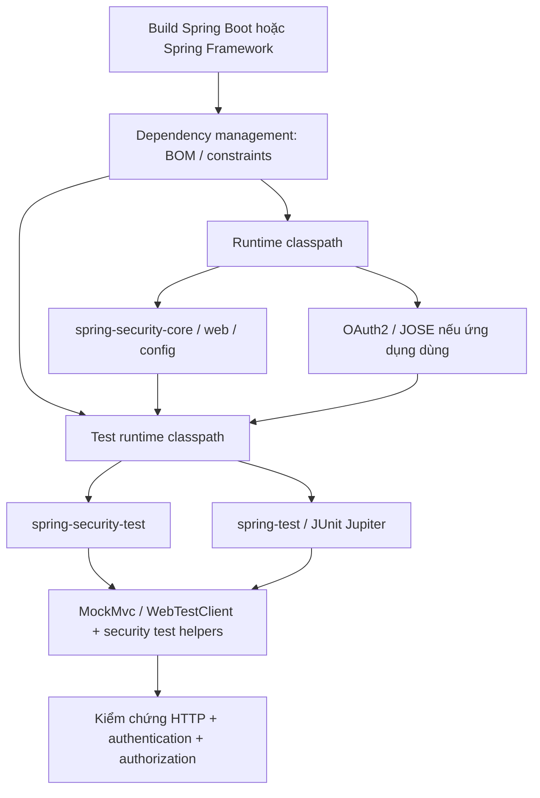
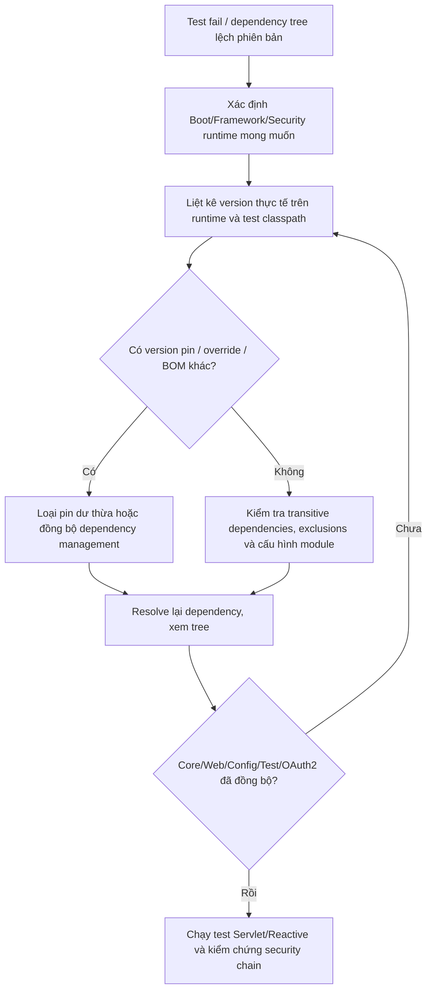

# Giữ phiên bản Spring Security Test phù hợp với runtime

Trong dự án Spring, kiểm thử bảo mật chỉ đáng tin khi **thư viện test** và **các module Spring Security mà ứng dụng chạy thật** tương thích với nhau. Ví dụ, một ứng dụng đang dùng `spring-security-web` và `spring-security-core` thuộc dòng 6.x không nên vô tình kéo `spring-security-test` 7.x vào classpath test. Dù một số lỗi xuất hiện ngay khi biên dịch, các lỗi khác chỉ phát sinh lúc chạy test hoặc khiến bộ kiểm thử không phản ánh đúng cấu hình của ứng dụng.

Bài này thuộc chương **Phụ thuộc và phiên bản** của mô-đun **SPRING_SECURITY_TESTING**. Mô-đun hướng dẫn kiểm chứng xác thực, phân quyền và bảo vệ HTTP thực tế bằng `spring-security-test` trên cả **Servlet (Spring MVC)** lẫn **Reactive (Spring WebFlux)**: `MockMvc`, `WebTestClient`, `@WithMockUser`, `SecurityContext`, JWT/OAuth2/OIDC giả lập và các ca được phép hoặc bị từ chối. Để những bài kiểm thử ấy có ý nghĩa, trước tiên phải kiểm soát được phiên bản mà Maven hoặc Gradle thực sự chọn.

## 1. Mục tiêu và nguyên tắc cốt lõi

Sau bài học, bạn có thể:

1. Phân biệt **phiên bản khai báo** trong build file với **phiên bản cuối cùng được resolve** trong classpath.
2. Hiểu mối quan hệ giữa `spring-security-test`, `spring-security-core`, `spring-security-web`, `spring-security-config`, các module OAuth2, `spring-test` và Spring Framework.
3. Dùng **Spring Boot BOM** hoặc **Spring Security BOM** để quản lý một bộ phiên bản nhất quán trên Maven/Gradle.
4. Đọc dependency tree, phát hiện phiên bản bị trộn và sửa nguồn gây xung đột mà không chỉ che lỗi bằng một `<version>` tùy ý.
5. Xác nhận sau khi sửa rằng các test phân quyền Servlet/Reactive vẫn thực thi qua chuỗi bảo mật mong muốn.

**Quy tắc làm việc:** dùng **cùng một phiên bản Spring Security đã resolve** cho `spring-security-test` và các module Security runtime tương ứng, trừ khi có lý do tương thích được tài liệu chính thức xác nhận. Trên dự án Spring Boot, cách đơn giản nhất là **để Boot quản lý phiên bản tất cả các module Spring**, rồi kiểm tra classpath sau khi build.

## 2. Hiểu hai loại classpath trước khi kiểm tra phiên bản

Một dự án Spring MVC có thể cần `spring-security-web` để lọc request, `spring-security-config` để khai báo chính sách, `spring-security-core` để biểu diễn `Authentication` và `GrantedAuthority`. Nếu hỗ trợ JWT Resource Server hoặc OIDC, ứng dụng còn có thể dùng `spring-security-oauth2-resource-server`, `spring-security-oauth2-jose` hoặc `spring-security-oauth2-client`.

Trong khi đó, các test sử dụng thêm `spring-security-test` (ví dụ: `@WithMockUser`, `SecurityMockMvcRequestPostProcessors.jwt()`, `SecurityMockServerConfigurers.mockJwt()`). Thư viện test phải tương tác với **các kiểu dữ liệu và API bảo mật của runtime**.



**Điều phải so khớp:** Maven `test` classpath và Gradle `testRuntimeClasspath` thường chứa cả dependency runtime của ứng dụng **lẫn** thư viện kiểm thử. Vì vậy, chỉ nhìn dòng `testImplementation` trong build file chưa đủ để biết bạn đang thử bằng phiên bản nào.

| Thành phần | Mục đích | Điều kiện tương thích cần nhớ |
|---|---|---|
| `spring-security-core` | `Authentication`, `SecurityContext`, authorities và logic bảo mật chung | Đồng bộ với các module Security khác |
| `spring-security-web` và `spring-security-config` | Filter chain, cấu hình authorization và bảo vệ HTTP | Không trộn major/minor tùy ý với `core` |
| `spring-security-test` | Giả lập principal/token/CSRF, tích hợp `MockMvc` và `WebTestClient` | Chọn cùng phiên bản với bộ Security runtime |
| `spring-security-oauth2-*` | Resource Server, OAuth2 Client, JOSE, OIDC tùy chức năng | Nên thuộc cùng dòng/phiên bản Security |
| `spring-test` | Spring TestContext, `MockMvc`, `WebTestClient` | Phải tương thích với Spring Framework mà ứng dụng dùng |
| JUnit Jupiter / JUnit Platform | Phát hiện và thực thi test | Phải có API/engine/launcher và plugin build phù hợp |

## 3. Dòng phiên bản: điều gì tương thích với điều gì?

Các dòng sau là **quy tắc nhận diện hệ sinh thái**, không phải danh sách phiên bản patch cố định:

| Nền tảng của ứng dụng | Spring Framework | Spring Security runtime / test | Khuyến nghị |
|---|---|---|---|
| **Spring Boot 3.x** | Dòng **6.x** | Dòng **6.x** | Để BOM Boot 3.x căn chỉnh `spring-test` và `spring-security-*` |
| **Spring Boot 4.x** | Dòng **7.x** | Dòng **7.x** | Để BOM Boot 4.x căn chỉnh và dùng test starter theo stack |
| **Spring Framework thuần** | Dòng do nhóm dự án chọn | Dòng tương thích với Framework | Quản lý Framework BOM **và** Security BOM có chủ đích, kiểm tra cây dependency |

**Không chỉ nhìn số major.** Hai module Security đều 6.x nhưng thuộc các minor/patch khác nhau có thể vẫn chạy, song việc trộn phiên bản không có chủ đích làm tăng rủi ro lỗi nhị phân hoặc hành vi khác nhau. Tốt nhất hãy để toàn bộ `org.springframework.security:spring-security-*` về **cùng phiên bản cụ thể** do BOM quản lý. Khi cần lệch patch vì lý do đặc biệt, hãy ghi rõ lý do và test lại cả những luồng bảo mật phụ thuộc API ấy.

**Không gán quy tắc “cùng major là chắc chắn chạy”.** Ví dụ Boot 3.x với Framework 6.x và một thư viện Security 7.x có thể bị thiếu API/đòi hỏi Framework mới; giải pháp là sử dụng một bộ phiên bản đã được dự án/nhà phát hành hỗ trợ, không ép riêng `spring-security-test` lên bản mới nhất.

### 3.1. Khai báo phiên bản khác với phiên bản đã resolve

Giả sử `build.gradle.kts` có dòng:

```kotlin
testImplementation("org.springframework.security:spring-security-test")
```

Dòng này **không** tự cho biết test sẽ chạy với Security 6.x hay 7.x. Phiên bản có thể đến từ `spring-boot-dependencies` BOM, Gradle platform, convention plugin hoặc dependency constraints.

Ngược lại, một dự án có thể khai báo:

```kotlin
testImplementation("org.springframework.security:spring-security-test:7.0.0")
```

Dòng trên **ép/pin một phiên bản cho riêng dependency test** theo cấu hình resolution hiện tại; nếu ứng dụng vẫn dùng Security 6.x, build có nguy cơ bị trộn hai dòng. Trong Gradle, dependency conflict resolution còn có thể chọn phiên bản khác với phiên bản ghi ở một dependency, nên **phải kiểm tra kết quả cuối cùng**, không suy ra chỉ từ build file.

## 4. Cách an toàn trong Spring Boot 3.x

### 4.1. Maven: để Spring Boot parent hoặc BOM quản lý

Ví dụ ứng dụng MVC với Spring Security và kiểm thử bằng `MockMvc`, khi dự án đã đặt parent Boot 3.x phù hợp:

```xml
<dependencies>
    <dependency>
        <groupId>org.springframework.boot</groupId>
        <artifactId>spring-boot-starter-web</artifactId>
    </dependency>
    <dependency>
        <groupId>org.springframework.boot</groupId>
        <artifactId>spring-boot-starter-security</artifactId>
    </dependency>

    <dependency>
        <groupId>org.springframework.boot</groupId>
        <artifactId>spring-boot-starter-test</artifactId>
        <scope>test</scope>
    </dependency>
    <dependency>
        <groupId>org.springframework.security</groupId>
        <artifactId>spring-security-test</artifactId>
        <scope>test</scope>
    </dependency>
</dependencies>
```

Ở đây **không khai báo riêng `<version>`** cho `spring-security-test`. Boot quản lý Security runtime và test theo một nhóm phiên bản nhất quán. Để dùng Reactive, ứng dụng thay `spring-boot-starter-web` bằng `spring-boot-starter-webflux` nhưng giữ nguyên nguyên tắc căn chỉnh Security.

Cần phân biệt hai cách quản lý Maven:

- **Có `spring-boot-starter-parent`:** kế thừa dependency management và plugin management của Boot; thường không cần phiên bản cho các thư viện được Boot quản lý.
- **Không dùng parent, chỉ import `spring-boot-dependencies` BOM:** vẫn được quản lý phiên bản dependency nhưng **không tự kế thừa toàn bộ cấu hình plugin** như parent; nếu đổi phiên bản framework, không nên cho rằng một property tự định nghĩa trong POM sẽ tự ghi đè được mọi giá trị của BOM đã import.

### 4.2. Gradle: dùng BOM/plugin quản lý cùng một tập dependency

Ví dụ `build.gradle` trong dự án đã dùng plugin Boot 3.x và dependency management tương ứng:

```groovy
dependencies {
    implementation 'org.springframework.boot:spring-boot-starter-web'
    implementation 'org.springframework.boot:spring-boot-starter-security'

    testImplementation 'org.springframework.boot:spring-boot-starter-test'
    testImplementation 'org.springframework.security:spring-security-test'
    testRuntimeOnly 'org.junit.platform:junit-platform-launcher'
}

tasks.named('test', Test) {
    useJUnitPlatform()
}
```

Nếu dự án dùng **Gradle native platform** thay vì dependency-management plugin, có thể khai báo `platform("org.springframework.boot:spring-boot-dependencies:<boot-version>")` trong các configuration phù hợp. Chỉ dùng một cách quản lý nhất quán, xác minh rằng nó áp dụng cho **test** nữa, tránh một BOM cho ứng dụng và bộ constraint khác cho bài test.

## 5. Spring Boot 4.x: starter test mới, nguyên tắc căn chỉnh không đổi

Boot 4.x chuyển sang Framework 7.x/Security 7.x và đưa ra nhiều starter test theo công nghệ. Ví dụ Maven trên ứng dụng **MVC**:

```xml
<dependencies>
    <dependency>
        <groupId>org.springframework.boot</groupId>
        <artifactId>spring-boot-starter-webmvc</artifactId>
    </dependency>
    <dependency>
        <groupId>org.springframework.boot</groupId>
        <artifactId>spring-boot-starter-security</artifactId>
    </dependency>

    <dependency>
        <groupId>org.springframework.boot</groupId>
        <artifactId>spring-boot-starter-test</artifactId>
        <scope>test</scope>
    </dependency>
    <dependency>
        <groupId>org.springframework.boot</groupId>
        <artifactId>spring-boot-starter-webmvc-test</artifactId>
        <scope>test</scope>
    </dependency>
    <dependency>
        <groupId>org.springframework.boot</groupId>
        <artifactId>spring-boot-starter-security-test</artifactId>
        <scope>test</scope>
    </dependency>
</dependencies>
```

Với **WebFlux**, dùng `spring-boot-starter-webflux` và `spring-boot-starter-webflux-test` thay cặp starter MVC. `spring-boot-starter-security-test` là **starter của Boot**; thư viện Spring Security bên dưới vẫn là `org.springframework.security:spring-security-test`.

Cùng cấu hình qua Gradle Kotlin DSL (`build.gradle.kts`), giả định plugin và BOM Boot 4.x đã được áp dụng:

```kotlin
dependencies {
    implementation("org.springframework.boot:spring-boot-starter-webmvc")
    implementation("org.springframework.boot:spring-boot-starter-security")

    testImplementation("org.springframework.boot:spring-boot-starter-test")
    testImplementation("org.springframework.boot:spring-boot-starter-webmvc-test")
    testImplementation("org.springframework.boot:spring-boot-starter-security-test")
    testRuntimeOnly("org.junit.platform:junit-platform-launcher")
}

tasks.test {
    useJUnitPlatform()
}
```

**Tránh mang theo `spring-security-test:6.x` có version pin từ Boot 3.x.** Khi nâng cấp Boot, xóa những override không còn cần thiết, chuyển sang starter test đúng dòng Boot 4.x và để dependency management lựa chọn phiên bản. Các annotation kiểm thử Boot có thể đã chuyển package/module; nếu import biên dịch lỗi, kiểm tra API tương ứng của phiên bản Boot, không giải quyết bằng cách kéo starter test cũ vào classpath.

## 6. Spring Security không dùng Boot: dùng BOM cho cả runtime lẫn test

Nếu tự cấu hình Spring Framework, bạn cần quản lý phiên bản của **ít nhất hai họ** thư viện: `org.springframework` và `org.springframework.security`. Spring Security cung cấp **`spring-security-bom`** để đồng bộ các module Security; Spring Framework cung cấp **`spring-framework-bom`** để đồng bộ `spring-test`, `spring-web`, `spring-context` và các module Framework.

### 6.1. Maven với dependencyManagement

Ví dụ cấu trúc POM sau minh họa việc chọn **hai phiên bản tương thích**; thay các giá trị `6.x.y` bằng phiên bản **cụ thể** có thật trong cùng dòng được hỗ trợ trước khi chạy build:

```xml
<properties>
    <spring-framework.version>6.x.y</spring-framework.version>
    <spring-security.version>6.x.y</spring-security.version>
</properties>

<dependencyManagement>
    <dependencies>
        <dependency>
            <groupId>org.springframework</groupId>
            <artifactId>spring-framework-bom</artifactId>
            <version>${spring-framework.version}</version>
            <type>pom</type>
            <scope>import</scope>
        </dependency>
        <dependency>
            <groupId>org.springframework.security</groupId>
            <artifactId>spring-security-bom</artifactId>
            <version>${spring-security.version}</version>
            <type>pom</type>
            <scope>import</scope>
        </dependency>
    </dependencies>
</dependencyManagement>

<dependencies>
    <!-- Các module Spring Web/Security runtime do ứng dụng sử dụng -->
    <dependency>
        <groupId>org.springframework.security</groupId>
        <artifactId>spring-security-web</artifactId>
    </dependency>
    <dependency>
        <groupId>org.springframework.security</groupId>
        <artifactId>spring-security-config</artifactId>
    </dependency>

    <!-- Chỉ dùng trong test -->
    <dependency>
        <groupId>org.springframework</groupId>
        <artifactId>spring-test</artifactId>
        <scope>test</scope>
    </dependency>
    <dependency>
        <groupId>org.springframework.security</groupId>
        <artifactId>spring-security-test</artifactId>
        <scope>test</scope>
    </dependency>
</dependencies>
```

Nếu là Framework/Security 7.x, hãy chọn **cặp BOM 7.x tương thích**, không thay riêng Security BOM thành 7.x trong khi giữ Framework BOM 6.x. Với Spring Framework không dùng Boot còn phải thêm các dependency runtime web/context phù hợp và cấu hình JUnit Jupiter/runner riêng; ví dụ trên tập trung vào quản lý version, **không phải một POM hoàn chỉnh**.

### 6.2. Gradle với platform

Trong Gradle có thể dùng hỗ trợ Maven BOM của `platform(...)`:

```kotlin
val frameworkVersion = "6.x.y" // Thay bằng phiên bản Framework cụ thể
val securityVersion = "6.x.y"  // Thay bằng phiên bản Security tương thích

dependencies {
    implementation(platform("org.springframework:spring-framework-bom:$frameworkVersion"))
    implementation(platform("org.springframework.security:spring-security-bom:$securityVersion"))

    implementation("org.springframework.security:spring-security-web")
    implementation("org.springframework.security:spring-security-config")

    testImplementation("org.springframework:spring-test")
    testImplementation("org.springframework.security:spring-security-test")
    testImplementation("org.junit.jupiter:junit-jupiter")
    testRuntimeOnly("org.junit.platform:junit-platform-launcher")
}

tasks.test {
    useJUnitPlatform()
}
```

Ví dụ minh họa Gradle Java plugin, trong đó test configurations kế thừa runtime dependencies phù hợp. Nếu sử dụng convention plugin phức tạp, Java platform/constraints hoặc các module riêng cho test, cần kiểm tra BOM đã đi vào **cấu hình test** cần thiết. Với `enforcedPlatform`, phải cân nhắc tác động ép version đến các dependency khác, nhất là trong thư viện được tái sử dụng; đừng dùng nó như cách sửa mặc định cho mọi xung đột.

## 7. Nhận diện lệch phiên bản trong thực tế

### 7.1. Bốn tình huống điển hình

| Hiện tượng trong dependency tree | Rủi ro | Hành động |
|---|---|---|
| `spring-security-test:7.x`, `spring-security-core:6.x`, `spring-security-web:6.x` | Khác major; API/bytecode không tương thích | Đồng bộ bằng BOM tương ứng với runtime |
| `spring-security-test:6.5.a`, `spring-security-core:6.5.b`, `spring-security-config:6.5.b` | Patch khác nhau; có thể chạy nhưng không có lợi khi lệch ngoài ý muốn | Bỏ version pin và dùng cùng bản Security |
| `spring-test:7.x`, ứng dụng Spring Framework `6.x` | Xung đột API Spring TestContext/WebMvc | Quay lại Framework BOM tương thích |
| `spring-security-oauth2-resource-server:6.4.x` cùng `spring-security-test/core/web:6.5.x` | API/behavior của OAuth2 khác bộ đang test | Kiểm tra toàn bộ module `org.springframework.security`, không chỉ `spring-security-test` |

Các chuỗi `6.5.a`, `6.5.b`, `7.x` trong bảng là **ký hiệu minh họa**, không phải phiên bản phát hành cụ thể.

### 7.2. Dấu hiệu khi chạy test

- **Lỗi biên dịch** như `cannot find symbol`, method không tồn tại hoặc không tìm thấy `SecurityMockMvcRequestPostProcessors`: kiểm tra test dependency và version API.
- **Lỗi khởi tạo/lúc chạy** như `NoSuchMethodError`, `NoClassDefFoundError`, `ClassCastException`: thường đáng kiểm tra dependency resolution, loại trừ module hoặc thư viện bị ép version. Đây không phải bằng chứng tuyệt đối rằng nguyên nhân là version; cần đọc tên class/method trong stack trace.
- **Context không khởi động** sau khi nâng Boot/Security: kiểm tra bản Framework, Security, thay đổi auto-configuration và API đã bị loại bỏ.
- **`@WithMockUser` không làm request được chấp nhận** hoặc một test `jwt()` thất bại: trước hết xác nhận test đang dùng security chain đúng và policy đúng; lỗi cấu hình/authority có thể hoàn toàn độc lập với version.
- **`401`, `403`, `302` khác dự kiến**: đọc security entry point, CSRF và quyền thực; không sửa phiên bản chỉ dựa vào status.

## 8. Kiểm tra Maven: nhìn phiên bản được giải quyết

Đứng trong thư mục dự án có `pom.xml` và chạy:

```bash
# Xem dependency của cả test
./mvnw dependency:tree -Dscope=test

# Xem parent / dependency management / plugin sau khi Maven hợp nhất POM
./mvnw help:effective-pom

# Thực thi test
./mvnw test
```

Trên Windows có thể dùng `.\mvnw.cmd test` và các mục tiêu Maven tương tự.

Trong kết quả `dependency:tree`, tập trung các artifact:

```text
org.springframework.security:spring-security-core
org.springframework.security:spring-security-web
org.springframework.security:spring-security-config
org.springframework.security:spring-security-test
org.springframework.security:spring-security-oauth2-resource-server
org.springframework.security:spring-security-oauth2-jose
org.springframework:spring-test
org.springframework:spring-web
org.springframework:spring-context
```

Mục tiêu kiểm tra:

1. **`spring-security-test` có mặt trong scope `test`** khi bài test dùng API Security Test.
2. Các `spring-security-*` đã resolve về **cùng phiên bản** theo BOM mà dự án chọn.
3. Các `org.springframework:*` thuộc **cùng dòng Framework** mà Boot/runtime sử dụng.
4. Không còn dependency trực tiếp/trung gian bị override ngoài ý muốn trong effective POM.

Maven có thể ghi chú `omitted for conflict` hoặc `omitted for duplicate` tùy cấu hình phiên bản plugin và độ chi tiết; nếu thấy nhiều version đã được đề xuất nhưng chỉ một version được chọn, hãy đọc đường dẫn dependency để truy ra nguồn khai báo. Đừng nhầm tất cả node hiển thị trong tree là các JAR cùng được tải.

### 8.1. Nếu project Maven dùng nhiều module

Kiểm tra **module có source test thực sự**, vì module con có thể có `dependencyManagement`, dependency trực tiếp hoặc exclusions khác với parent. Dự án đa module có thể build root thành công nhưng một module test vẫn mang phiên bản Security riêng. Khi cần, chạy `dependency:tree` và `test` tại module được chọn bằng `-pl` hoặc trong thư mục module.

## 9. Kiểm tra Gradle: runtimeClasspath và testRuntimeClasspath

```bash
# Phiên bản mà ứng dụng sẽ dùng khi chạy
./gradlew dependencies --configuration runtimeClasspath

# Phiên bản test sẽ thực sự thấy
./gradlew dependencies --configuration testRuntimeClasspath

# Vì sao Gradle chọn một phiên bản Security cụ thể
./gradlew dependencyInsight --dependency spring-security-core --configuration testRuntimeClasspath
./gradlew dependencyInsight --dependency spring-security-test --configuration testRuntimeClasspath

# Kiểm tra Spring Framework mà test dùng
./gradlew dependencyInsight --dependency spring-test --configuration testRuntimeClasspath

# Chạy test
./gradlew test
```

Với Gradle, dấu `->` trong báo cáo dependency thường biểu thị **phiên bản được yêu cầu đã chuyển thành phiên bản được chọn**, ví dụ một dependency yêu cầu version cũ nhưng conflict resolution/BOM làm Gradle chọn phiên bản mới. `dependencyInsight` cho biết các đường dẫn, constraint hoặc quy tắc dẫn đến lựa chọn. Hãy xem cả `runtimeClasspath` **và** `testRuntimeClasspath`; hai cấu hình có thể khác khi test thêm version pin hoặc test fixtures.

Ví dụ **giả định**:

```text
runtimeClasspath:
  org.springframework.security:spring-security-core:6.5.x

testRuntimeClasspath:
  org.springframework.security:spring-security-test:7.0.x
  org.springframework.security:spring-security-core:6.5.x -> 7.0.x
```

Ví dụ này thể hiện test có thể làm **thay đổi version được chọn** so với runtime của ứng dụng. Một bài test chạy trên tập JAR khác production có thể cho cảm giác an toàn giả. Từ đó, hãy loại bỏ khai báo gây lệch, áp dụng BOM đúng cho các configuration và kiểm tra lại.

**Chú ý:** không gõ các chuỗi `6.5.x`, `7.0.x` vào file build. Chúng chỉ dùng để minh họa đường đi của version resolution.

## 10. Quy trình xử lý khi phát hiện xung đột

Có thể dùng một quy trình lặp lại cho Maven và Gradle:



**Ưu tiên sửa theo thứ tự:**

1. Xác định bản Boot hiện tại (hoặc cặp Spring Framework/Security được hỗ trợ với dự án không dùng Boot).
2. Xóa các khai báo version cá biệt không còn cần thiết, đặc biệt ở `spring-security-test`, `spring-security-core`, `spring-security-web` và `spring-test`.
3. Tập trung dependency management ở một nơi: Boot BOM/parent, hoặc Framework và Security BOM có chủ đích.
4. Kiểm tra lại **phiên bản resolved** trong từng module và từng configuration test.
5. Chạy test, xem stack trace nếu còn lỗi; kiểm chứng cả HTTP security behavior thay vì chỉ chờ biên dịch thành công.

Nếu cần nâng Spring Security để nhận bản vá bảo mật: **ưu tiên nâng Spring Boot lên một bản phát hành đã tích hợp bản vá** khi có thể. Nếu phải override tạm thời, kiểm tra thông báo tương thích, áp dụng thay đổi đồng bộ cho toàn bộ module Security liên quan, cân nhắc yêu cầu phiên bản Framework, rồi chạy đầy đủ test bảo mật. Không pin mỗi `spring-security-test` chỉ vì nó là dependency dễ nhìn thấy trong log.

## 11. Test xác nhận sau khi căn chỉnh phiên bản

Phiên bản đồng nhất là điều kiện cần nhưng chưa đủ: phải xác nhận test thật sự đi qua Security filter chain.

### 11.1. Servlet — `MockMvc` với `@WithMockUser`

Ví dụ dưới đây giả định ứng dụng Boot 3.x đã có `SecurityFilterChain`, endpoint `GET /api/admin/reports` yêu cầu `ROLE_ADMIN` và controller trả `200` nếu được phép. Với Boot 4.x, dùng starter test phù hợp và cập nhật package của các annotation Boot:

```java
import org.junit.jupiter.api.Test;
import org.springframework.beans.factory.annotation.Autowired;
import org.springframework.boot.test.autoconfigure.web.servlet.AutoConfigureMockMvc;
import org.springframework.boot.test.context.SpringBootTest;
import org.springframework.security.test.context.support.WithMockUser;
import org.springframework.test.web.servlet.MockMvc;

import static org.springframework.test.web.servlet.request.MockMvcRequestBuilders.get;
import static org.springframework.test.web.servlet.result.MockMvcResultMatchers.status;

@SpringBootTest
@AutoConfigureMockMvc
class ReportSecurityTest {

    @Autowired
    MockMvc mvc;

    @Test
    @WithMockUser(roles = "USER")
    void deniedForRegularUser() throws Exception {
        mvc.perform(get("/api/admin/reports"))
           .andExpect(status().isForbidden());
    }

    @Test
    @WithMockUser(roles = "ADMIN")
    void allowedForAdmin() throws Exception {
        mvc.perform(get("/api/admin/reports"))
           .andExpect(status().isOk());
    }
}
```

Một ca **anonymous** nên được thêm vào để chứng minh resource không truy cập được khi chưa xác thực. Status có thể là `401` với HTTP Basic/Bearer hoặc `302` với form login; đó là quyết định của cấu hình security runtime. Nếu tạo `MockMvc` thủ công từ context, áp dụng tích hợp `springSecurity()` để gắn filter chain và `SecurityContext` vào request.

### 11.2. Servlet JWT — kiểm tra quyền theo scope

```java
import static org.springframework.security.test.web.servlet.request.SecurityMockMvcRequestPostProcessors.jwt;

// Thêm vào lớp test có MockMvc được gắn SecurityFilterChain.
@Test
void missingScopeIsForbidden() throws Exception {
    mvc.perform(get("/api/reports")
            .with(jwt().authorities(
                new SimpleGrantedAuthority("SCOPE_other"))))
       .andExpect(status().isForbidden());
}
```

Đây là một phương thức minh họa đặt trong lớp test đã có `MockMvc` và các import cho `@Test`, `SimpleGrantedAuthority`, `get` và `status` ở phần trước; khi đưa vào ứng dụng cần cung cấp các import tương ứng.

Ở đây `jwt()` giả lập một `JwtAuthenticationToken`; test không chứng minh token đã được ký/giải mã đúng. Để kiểm chứng đường đi thực của Resource Server, cần test riêng với header Bearer và decoder/validator tương ứng.

### 11.3. Reactive — `WebTestClient` với `mockJwt()`

Trên WebFlux, `SecurityContext` gắn với Reactor Context. Khi test đã có `WebTestClient` liên kết **Reactive security chain** (ví dụ dùng `bindToApplicationContext(context).apply(springSecurity())`), có thể kiểm tra:

```java
import static org.springframework.security.test.web.reactive.server.SecurityMockServerConfigurers.mockJwt;

// Giả định client và endpoint /api/reports đã được cấu hình.
@Test
void reportNeedsScope() {
    client.mutateWith(mockJwt().authorities(
                new SimpleGrantedAuthority("SCOPE_reports.read")))
          .get().uri("/api/reports")
          .exchange()
          .expectStatus().isOk();
}
```

Test này xác nhận scope mapping và authorization khi authentication đã được mô phỏng. Đối với OAuth2/OIDC login giả lập, `oauth2Login()`, `oidcLogin()`, `mockOAuth2Login()` và `mockOidcLogin()` cũng phụ thuộc API của `spring-security-test`; vì vậy cần đồng bộ test library với Security OAuth2 runtime, đặc biệt sau nâng phiên bản.

## 12. Checklist trước khi kết thúc nâng cấp

| Câu hỏi | Điều kiện đạt |
|---|---|
| Dự án đang ở Boot 3.x, Boot 4.x hay Spring Framework thuần? | Có nguồn quản lý phiên bản rõ ràng |
| `spring-security-core/web/config/test` thuộc dòng nào? | Cùng một phiên bản đã resolve, hoặc có ngoại lệ được xác minh |
| Các module `spring-security-oauth2-*` đang dùng thuộc dòng nào? | Không bị bỏ sót khỏi quá trình đồng bộ |
| `spring-test` và `spring-web` đang ở dòng Framework nào? | Tương thích với Framework runtime/Boot |
| Maven/Gradle đã quản lý cả classpath ứng dụng lẫn classpath test chưa? | Đọc được `dependency:tree` hoặc `dependencyInsight` chứng minh version cuối cùng |
| Test Servlet có filter chain, test WebFlux có reactive security chain? | Có ca được phép và ca bị từ chối phản ánh policy thật |
| Test JWT/OIDC giả lập được dùng đúng phạm vi? | Không nhầm mock authentication với kiểm thử chữ ký/token flow thật |

**Bài tập thực hành:** trên một dự án mẫu đang dùng Boot 3.x, ghi lại phiên bản thực tế của `spring-security-core`, `spring-security-web`, `spring-security-test` và `spring-test`. Sau đó kiểm tra output của `dependencyInsight` (Gradle) hoặc `dependency:tree` (Maven), tìm xem có version override nào không và xác nhận các test phân quyền vẫn chạy sau khi đưa bộ phiên bản về cùng BOM. Lặp lại quy trình trên dự án WebFlux hoặc Boot 4.x để quan sát sự khác biệt trong starter test nhưng giữ nguyên nguyên tắc đồng bộ.

## 13. Tài liệu tham khảo chính thức

- [Spring Boot — Build Systems và Dependency Management](https://docs.spring.io/spring-boot/reference/using/build-systems.html): Boot cung cấp bộ dependency được kiểm chứng và BOM tương ứng cho Maven/Gradle.
- [Spring Security — Getting Spring Security](https://docs.spring.io/spring-security/reference/getting-spring-security.html): cách chọn module, căn chỉnh bằng Security BOM khi không dùng Boot và lưu ý về Spring Framework.
- [Spring Security — Project Modules and Dependencies](https://docs.spring.io/spring-security/reference/modules.html): danh sách các module runtime và `spring-security-test`.
- [Spring Security — Servlet Testing](https://docs.spring.io/spring-security/reference/servlet/test/index.html): `MockMvc`, `@WithMockUser`, `jwt()`, `csrf()`.
- [Spring Security — Reactive Testing](https://docs.spring.io/spring-security/reference/reactive/test/index.html): `WebTestClient`, `mockUser()`, `mockJwt()`.
- [Spring Boot 4 — Build Systems](https://docs.spring.io/spring-boot/4.0/reference/using/build-systems.html): các starter test theo mảng của Boot 4.x.
- [Gradle — Viewing Dependencies](https://docs.gradle.org/current/userguide/viewing_debugging_dependencies.html) và [Maven — Dependency Plugin](https://maven.apache.org/plugins/maven-dependency-plugin/tree-mojo.html): kiểm tra những version thực sự được giải quyết trong build.

> Khi chẩn đoán một lỗi security test, hãy **tách hai câu hỏi**: “Các module trên classpath có tương thích không?” và “Test có thực thi đúng security chain và policy mong muốn không?”. Trả lời cả hai mới giúp kết quả test đáng tin cậy.
