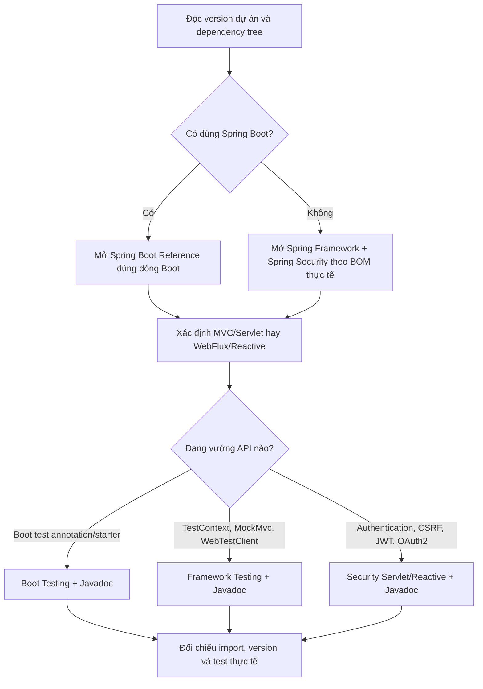
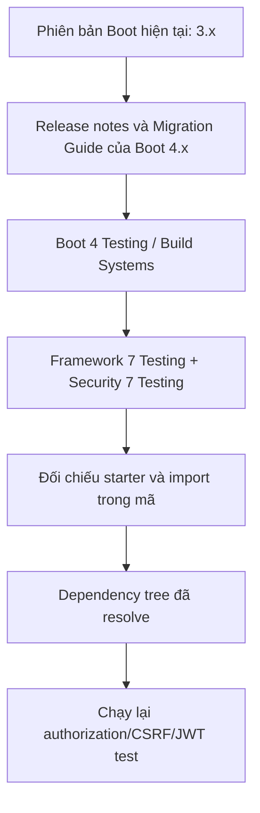

# Chọn tài liệu theo Spring Boot, Spring Framework và Spring Security

Khi viết test bảo mật, người học thường tìm kiếm `@WithMockUser`, `MockMvc`, `WebTestClient` hay `jwt()` rồi sao chép ví dụ đầu tiên xuất hiện. Cách này dễ sai vì Spring có **nhiều bộ tài liệu khác nhau**: Spring Boot quản lý cách dựng ứng dụng và test context; Spring Framework cung cấp hạ tầng HTTP/test; Spring Security định nghĩa xác thực, phân quyền, bộ lọc và tiện ích giả lập trong `spring-security-test`. Mỗi bộ tài liệu lại có **phiên bản** riêng.

Bài thuộc chương **Phụ thuộc và phiên bản** của mô-đun **SPRING_SECURITY_TESTING**. Mục tiêu của mô-đun là kiểm chứng xác thực, phân quyền và bảo vệ HTTP thực tế bằng `spring-security-test` trên **Servlet** và **Reactive**, với `MockMvc`, `WebTestClient`, `@WithMockUser`, `SecurityContext`, JWT/OAuth2/OIDC giả lập, cùng các ca kiểm thử được phép hoặc bị từ chối.

Bài này tập trung vào câu hỏi: **mở bộ tài liệu nào, ở phiên bản nào, để giải quyết chính xác vấn đề trong test hiện tại?** Chúng ta sẽ đi từ phiên bản thực tế của dự án đến đường dẫn tài liệu và ví dụ đúng với stack.

## 1. Kết quả cần đạt

Sau khi học, bạn có thể:

1. Phân biệt phạm vi tài liệu **Spring Boot**, **Spring Framework**, **Spring Security** và **JUnit/Gradle/Maven**.
2. Xác định dòng Spring Boot, Spring Framework, Spring Security, cũng như phiên bản **thực tế được resolve trong test classpath**.
3. Chọn tài liệu theo **Servlet/MVC** hoặc **Reactive/WebFlux** và theo kiểu xác thực (session, JWT Resource Server, OAuth2 Login, OIDC).
4. Đối chiếu ví dụ API, package, import và dependency của **đúng dòng phiên bản**, đặc biệt khi chuyển Boot 3.x sang Boot 4.x.
5. Đánh giá giới hạn của một ví dụ test: nó kiểm tra rule phân quyền, HTTP filter, token validation hay toàn bộ luồng đăng nhập?

## 2. Ba bộ tài liệu Spring giải quyết ba lớp vấn đề

Đầu tiên, cần nhận diện **thành phần sở hữu API**. Đó là cách nhanh nhất để chọn tài liệu.

| Bộ tài liệu | Giải thích điều gì? | Từ khóa/API nên tìm tại đây | Thường cần khi |
|---|---|---|---|
| **Spring Boot Reference** | Starter, auto-configuration, test slice, tạo `ApplicationContext` và cấu hình `@SpringBootTest` | `spring-boot-starter-test`, `@WebMvcTest`, `@WebFluxTest`, `@AutoConfigureMockMvc`, `@AutoConfigureWebTestClient` | Dựng test Spring Boot, cần xác định bean/filter nào được nạp |
| **Spring Framework Reference** | Spring TestContext, JUnit Jupiter extension, `MockMvc`, `WebTestClient`, các cách dựng HTTP test client | `SpringExtension`, `MockMvcBuilders`, `WebTestClient.bindToApplicationContext`, `WebApplicationContext` | Hiểu test context, request/response hoặc cơ chế mô phỏng Servlet/Reactive |
| **Spring Security Reference** | Xác thực, phân quyền, filter chain, method security, CSRF, JWT/OAuth2/OIDC và test helper | `@WithMockUser`, `@WithSecurityContext`, `springSecurity()`, `user()`, `csrf()`, `jwt()`, `mockJwt()`, `oidcLogin()` | Tạo danh tính/authorities giả lập, kiểm chứng HTTP security |
| **API Javadoc** của từng dự án | Chữ ký hàm, package, tham số, kiểu trả về chính xác cho một bản phát hành | FQCN, overloaded method, JavaDoc `Since`/`Deprecated` | Ví dụ tài liệu không biên dịch hoặc API thay đổi khi nâng phiên bản |
| **JUnit, Maven, Gradle Reference** | Phát hiện/chạy test và dependency resolution | `@Test`, `useJUnitPlatform()`, Maven Surefire, dependency tree | Test không được phát hiện hoặc các phiên bản bị trộn trên classpath |

Ví dụ phân biệt:

- `@WithMockUser` thuộc **Spring Security Test**, nên tìm phần *Testing* của Spring Security.
- `MockMvc.perform(...).andExpect(...)` thuộc **Spring Framework Test**, nên tìm phần *MockMvc* của Spring Framework.
- `@AutoConfigureMockMvc` thuộc **Spring Boot Test**, nên tìm phần *Testing Spring Boot Applications* của Boot.
- Cách thực thi `@Test` phụ thuộc **JUnit Jupiter**; cách chạy nó bằng Gradle/Maven thuộc **build tool**.
- Cơ chế áp dụng `SecurityFilterChain` hoặc `SecurityWebFilterChain` thuộc **Spring Security runtime**, phải đọc phần Servlet hoặc Reactive tương ứng.

Mỗi câu hỏi thường cần **một tài liệu chính và một tài liệu bổ trợ**. Chẳng hạn “`@WithMockUser` không có hiệu lực trong `MockMvc`” cần đồng thời đọc hướng dẫn tích hợp **Spring Security Test + MockMvc** và cách Boot dựng **web test context**.

## 3. Chọn theo phiên bản của dự án, không theo nhãn “latest”

Các trang `docs.spring.io` không kèm phiên bản cụ thể thường hiển thị tài liệu hiện hành của dòng được chọn trên website. Nếu project vẫn chạy dòng cũ, đọc tài liệu hiện hành có thể dẫn tới khác biệt **starter**, **annotation import**, **API method** và **nguyên tắc auto-configuration**.

### 3.1. Nhận diện các họ phiên bản

| Dự án đang sử dụng | Spring Framework tương ứng | Spring Security tương ứng | Bộ tài liệu nên ưu tiên |
|---|---|---|---|
| **Spring Boot 3.x** | **6.x** | **6.x** | Boot 3.x + Framework 6.x + Security 6.x |
| **Spring Boot 4.x** | **7.x** | **7.x** | Boot 4.x + Framework 7.x + Security 7.x |
| **Không dùng Spring Boot** | Do dự án chọn | Do dự án chọn, phải tương thích Framework | Reference + Javadoc của từng phiên bản được resolve |

Bảng thể hiện **các dòng tương thích ở cấp major**. Không suy ngược rằng mọi bản Framework 6.x đều dùng tốt với mọi bản Security 6.x: từng phiên bản cụ thể phải được kiểm chứng bằng dependency management, release notes và yêu cầu tương thích.

Ví dụ phổ biến: Boot **3.5.x** gắn với hệ sinh thái Framework **6.2.x** và Security **6.5.x**; Boot **4.0.x** gắn với Framework **7.0.x** và Security **7.0.x**. **Phiên bản patch thực tế không nên tự đoán từ bảng này**; hãy kiểm tra parent/BOM và dependency resolution trong build.

### 3.2. Luồng ra quyết định khi tìm tài liệu



**Không lựa chọn theo kết quả tìm kiếm đầu tiên** nếu trang đó ghi Spring Security 7.x trong khi classpath của dự án đang là 6.x. Hãy sử dụng **version selector** trên trang tài liệu và xác minh heading/URL sau khi chuyển phiên bản.

## 4. Xác định phiên bản chính xác từ Maven hoặc Gradle

Để chọn tài liệu, cần phân biệt ba dữ kiện: phiên bản Boot mà dự án yêu cầu; phiên bản Framework/Security mà BOM quản lý; **phiên bản mà test classpath thực sự được resolve**.

### 4.1. Maven

Trong `pom.xml` dự án có thể kế thừa Spring Boot parent:

```xml
<parent>
    <groupId>org.springframework.boot</groupId>
    <artifactId>spring-boot-starter-parent</artifactId>
    <version>3.5.0</version>
    <relativePath/>
</parent>
```

Đây là **ví dụ minh họa**, không phải đề nghị dùng đúng bản `3.5.0`. Nếu project dùng parent riêng, có thể import `spring-boot-dependencies` trong `dependencyManagement` và không có parent Boot trực tiếp.

Để xác nhận cấu hình có hiệu lực, dùng:

```bash
# Xem POM hiệu lực, gồm parent, dependencyManagement và plugin
./mvnw help:effective-pom

# Xem dependency trong phạm vi test
./mvnw dependency:tree -Dscope=test

# Chạy bộ test
./mvnw test
```

Ở Windows, wrapper thường là `.\mvnw.cmd`. Trong output, tìm `spring-security-core`, `spring-security-web`, `spring-security-config`, `spring-security-test`, `spring-test`, và các module OAuth2 nếu có.

Nếu Maven quản lý `spring-security-test` đúng cách thì phiên bản được chọn cần nhất quán với `spring-security-core/web/config` đang đi vào test classpath. Đối với framework thuần không dùng Boot, kiểm tra các BOM `spring-framework-bom` và `spring-security-bom`.

### 4.2. Gradle

Trong `build.gradle.kts`, plugin có thể khai báo phiên bản Spring Boot:

```kotlin
plugins {
    id("org.springframework.boot") version "3.5.0"
    id("io.spring.dependency-management") version "1.1.7"
    java
}
```

Các giá trị trên chỉ là **minh họa cấu trúc**, không có nghĩa mọi project phải chọn các bản đó. Một build khác có thể sử dụng Gradle `platform("org.springframework.boot:spring-boot-dependencies:...")`, version catalog hoặc convention plugin để kiểm soát phụ thuộc.

Kiểm tra classpath hiệu lực:

```bash
# Runtime của ứng dụng
./gradlew dependencies --configuration runtimeClasspath

# Runtime của bộ test
./gradlew dependencies --configuration testRuntimeClasspath

# Lý do Gradle chọn phiên bản thư viện
./gradlew dependencyInsight --dependency spring-security-test --configuration testRuntimeClasspath
./gradlew dependencyInsight --dependency spring-security-core --configuration testRuntimeClasspath
./gradlew dependencyInsight --dependency spring-test --configuration testRuntimeClasspath
```

Kết quả `dependencyInsight` chỉ ra dependency nào yêu cầu phiên bản nào, constraint/BOM đã áp dụng ra sao, và cuối cùng Gradle chọn phiên bản gì. **Dấu `->` trong dependency report thường chỉ phiên bản được thay thế bằng phiên bản đã resolve**. Vì thế, một dependency có vẻ khai báo `6.x` trong build file có thể chạy bằng `7.x` nếu bị dependency constraint khác chi phối.

### 4.3. Bản ghi phiên bản để chọn tài liệu

Trước khi bắt đầu đọc docs, nên ghi nhanh:

```text
Ứng dụng          : Spring Boot 3.5.x
Web stack         : Spring MVC / Servlet
Spring Framework  : spring-test 6.2.x (resolved)
Spring Security   : spring-security-test 6.5.x (resolved)
HTTP test client  : MockMvc
Kiểu bảo mật      : HTTP Basic + roles, CSRF trên request thay đổi dữ liệu
Bộ tài liệu       : Boot 3.5 / Framework 6.2 / Security 6.5
```

Các dấu `x` tượng trưng cho phiên bản patch **phải điền từ build thực tế**. Với môi trường Reactive, thay stack thành `Spring WebFlux / Reactive`, client thành `WebTestClient` và tra đúng phần **Reactive** của Spring Security.

## 5. Chọn đúng địa chỉ tài liệu Spring

Các URL bên dưới giúp định hướng đến **bộ tài liệu có gắn dòng phiên bản**, không yêu cầu bạn luôn dùng chính các phiên bản minh họa ấy.

### 5.1. Spring Boot Reference

| Dòng ứng dụng | Tài liệu tham khảo | Nội dung nên xem |
|---|---|---|
| Boot 3.5 | [Spring Boot 3.5 — Testing](https://docs.spring.io/spring-boot/3.5/reference/testing/index.html) | `spring-boot-starter-test`, TestContext và các tiện ích test |
| Boot 3.5 | [Testing Spring Boot Applications](https://docs.spring.io/spring-boot/3.5/reference/testing/spring-boot-applications.html) | `@SpringBootTest`, `@WebMvcTest`, `@AutoConfigureMockMvc`, server mock/real |
| Boot 4.0 | [Spring Boot 4.0 — Testing](https://docs.spring.io/spring-boot/4.0/reference/testing/index.html) | Các test starter mới, module test theo stack |
| Boot 4.0 | [Spring Boot 4.0 — Build Systems](https://docs.spring.io/spring-boot/4.0/reference/using/build-systems.html) | Starter và dependency management |
| Mọi dòng tương ứng | Spring Boot release notes / migration guide trên [trang tài liệu Spring Boot](https://docs.spring.io/spring-boot/) | Thay đổi starter, tên package, API bị loại bỏ |

Khi project là Boot 3.3 hoặc 3.4, hãy **chọn đúng dòng Boot đó bằng version selector** thay vì cứ đọc ví dụ Boot 3.5. Nếu một đường dẫn cụ thể của dòng cũ đã đổi tên mục, đi từ trang chủ của dòng ấy và tìm theo tên tính năng.

### 5.2. Spring Framework Reference

| Dòng Framework | Tài liệu | Nên tìm |
|---|---|---|
| Framework 6.2 | [Testing — Framework 6.2](https://docs.spring.io/spring-framework/reference/6.2/testing.html) | TestContext, JUnit Jupiter, `MockMvc`, `WebTestClient` |
| Framework 7.0 | [Testing — Framework 7.0](https://docs.spring.io/spring-framework/reference/7.0/testing.html) | Các API test của Framework 7, bao gồm những client mới |
| Dòng mà dự án dùng | [Spring Framework API](https://docs.spring.io/spring-framework/docs/) | Javadoc của `org.springframework.test.*`, `org.springframework.web.*` |

Tại Framework Reference, phân biệt **MockMvc** (mô phỏng pipeline MVC), **WebTestClient** (API client dùng cho Reactive hoặc gắn vào server/test adapter) và những HTTP test client khác mà Framework mới cung cấp. Sự tồn tại của một client mới trong docs Framework 7 **không chứng minh** project Framework 6 đã có cùng API.

### 5.3. Spring Security Reference

| Dòng Security | Tài liệu | Phạm vi |
|---|---|---|
| Security 6.5 | [Servlet Test — MockMvc setup](https://docs.spring.io/spring-security/reference/6.5/servlet/test/mockmvc/setup.html) | Gắn `springSecurity()` vào `MockMvc` |
| Security 6.5 | [Servlet Test — Authentication](https://docs.spring.io/spring-security/reference/6.5/servlet/test/mockmvc/authentication.html) | `user()`, `@WithMockUser`, `SecurityContext` |
| Security 6.5 | [Method Security Test](https://docs.spring.io/spring-security/reference/6.5/servlet/test/method.html) | `@WithMockUser` trên method test |
| Security 7.0 | [Reactive Test — WebTestClient setup](https://docs.spring.io/spring-security/reference/7.0/reactive/test/web/setup.html) | `springSecurity()` với reactive client |
| Security 7.0 | [Reactive Test — Authentication](https://docs.spring.io/spring-security/reference/7.0/reactive/test/web/authentication.html) | `@WithMockUser` và `mockUser()` trên WebFlux |
| Mọi dòng tương ứng | [Spring Security Reference](https://docs.spring.io/spring-security/reference/) | Chọn phiên bản, phần Servlet/Reactive, JWT, OAuth2, CSRF |

Các trang Security có thể hiển thị thông báo kiểu **“latest stable version”** khác với phiên bản bạn đang xem. Thông báo đó chỉ hướng tới bản mới hơn, **không phải lệnh nâng toàn bộ phụ thuộc trong dự án**. Nếu classpath vẫn là 6.5.x thì tiếp tục dùng bản docs 6.5 để hiểu API hiện có.

## 6. Chọn tài liệu theo tình huống thực tế

Một cách tra cứu hiệu quả là bắt đầu từ **câu hỏi cụ thể** thay vì tên thư viện.

| Tình huống gặp phải | Mở tài liệu chính | Mở thêm khi cần |
|---|---|---|
| Không biết khai báo `spring-security-test` ở đâu | Boot Testing / Build Systems đúng phiên bản | Security Getting Started và tài liệu Maven/Gradle |
| `@WithMockUser` không nhận quyền | Security Test → Method/Authentication | Framework TestContext nếu test listener/context không chạy |
| `MockMvc` luôn trả `200` dù endpoint phải bị bảo vệ | Security Servlet Test → MockMvc setup | Boot `@AutoConfigureMockMvc`, `@WebMvcTest` |
| `POST` trả `403` dù role đúng | Security Servlet Test → CSRF | Runtime Security → CSRF, exception handling |
| `jwt()` có authority nhưng test `403` | Security Servlet Test → OAuth2 / JWT | Runtime Resource Server → JwtAuthenticationConverter |
| `mockJwt()` không có hiệu lực trong `WebTestClient` | Security Reactive Test → WebTestClient setup | Framework WebTestClient, Boot WebFlux test |
| `@WebMvcTest` không nạp bean hoặc filter cần thiết | Boot Testing → Test Slices | Framework TestContext và Security filter configuration |
| OAuth2 Login/OIDC principal thiếu claim | Security Servlet/Reactive Test → OAuth2 Login / OIDC | Security Runtime → OAuth2 Client/OIDC |
| Test API không biên dịch sau nâng Boot | Boot migration và phiên bản hóa Java API | Spring Framework/Security Javadoc đúng phiên bản |
| Test không được JUnit tìm thấy | JUnit Platform/Jupiter | Gradle Testing hoặc Maven Surefire |

Lưu ý: **một HTTP status không chỉ ra đủ nguyên nhân**. Với ứng dụng có form login, request anonymous có thể bị `302` redirect; với HTTP Basic/Bearer thường có `401`; principal đã đăng nhập nhưng thiếu authority hoặc request sai CSRF có thể bị `403`. Để xác nhận logic, đọc cả tài liệu **authorization/exception handling/CSRF** của Security runtime.

## 7. Ví dụ 1: tra cứu để kiểm thử Spring MVC bằng MockMvc

Giả sử ứng dụng Boot 3.5.x, Spring MVC và Spring Security yêu cầu:

- `GET /api/reports`: phải có `ROLE_ADMIN`.
- `POST /api/reports`: phải có `ROLE_ADMIN` và token CSRF nếu CSRF áp dụng cho request đó.
- Có cấu hình security phù hợp với authentication entry point của ứng dụng.

**Bước 1 — Boot:** tra `@SpringBootTest`, `@AutoConfigureMockMvc` và `@WebMvcTest` trong [Testing Spring Boot Applications 3.5](https://docs.spring.io/spring-boot/3.5/reference/testing/spring-boot-applications.html). Tại đây cần biết test đang tải **toàn ứng dụng** hay **web slice**; một web slice có thể thiếu bean hoặc cấu hình bạn tưởng được nạp.

**Bước 2 — Framework:** tra `MockMvc` trong tài liệu Testing của Framework 6.2: request đi qua Spring MVC test pipeline, controller được gọi như thế nào, assertion dựa trên status/body ra sao.

**Bước 3 — Security:** tra `@WithMockUser`, `csrf()` và [MockMvc Security setup 6.5](https://docs.spring.io/spring-security/reference/6.5/servlet/test/mockmvc/setup.html). Khi dựng `MockMvc` thủ công từ `WebApplicationContext`, có thể cần cấu hình `.apply(springSecurity())` để đưa filter chain vào bài test.

Đoạn minh họa dưới đây dùng import Boot **3.x** và giả định context thực đã chứa `SecurityFilterChain`, controller cùng chính sách trên:

```java
import org.junit.jupiter.api.Test;
import org.springframework.beans.factory.annotation.Autowired;
import org.springframework.boot.test.autoconfigure.web.servlet.AutoConfigureMockMvc;
import org.springframework.boot.test.context.SpringBootTest;
import org.springframework.security.test.context.support.WithMockUser;
import org.springframework.test.web.servlet.MockMvc;

import static org.springframework.security.test.web.servlet.request.SecurityMockMvcRequestPostProcessors.csrf;
import static org.springframework.test.web.servlet.request.MockMvcRequestBuilders.get;
import static org.springframework.test.web.servlet.request.MockMvcRequestBuilders.post;
import static org.springframework.test.web.servlet.result.MockMvcResultMatchers.status;

@SpringBootTest
@AutoConfigureMockMvc
class ReportAuthorizationTest {

    @Autowired MockMvc mvc;

    @Test
    @WithMockUser(roles = "USER")
    void normalUserCannotRead() throws Exception {
        mvc.perform(get("/api/reports"))
           .andExpect(status().isForbidden());
    }

    @Test
    @WithMockUser(roles = "ADMIN")
    void adminCanRead() throws Exception {
        mvc.perform(get("/api/reports"))
           .andExpect(status().isOk());
    }

    @Test
    @WithMockUser(roles = "ADMIN")
    void writeRequiresCsrf() throws Exception {
        mvc.perform(post("/api/reports"))
           .andExpect(status().isForbidden());
        mvc.perform(post("/api/reports").with(csrf()))
           .andExpect(status().isCreated());
    }
}
```

`isCreated()` giả định controller trả HTTP `201` khi tạo tài nguyên. Nếu logic ứng dụng trả `200` hoặc `204`, phải thay assertion tương ứng. Ca không CSRF chỉ có ý nghĩa khi Security của endpoint thực sự bật kiểm tra CSRF; nếu API stateless vô hiệu CSRF có chủ đích thì kỳ vọng này không phù hợp.

**Điểm cần kiểm tra khi copy code:** import `@AutoConfigureMockMvc` thuộc Boot, `MockMvc` thuộc Framework, `@WithMockUser` và `csrf()` thuộc Security, `@Test` thuộc JUnit. Một tìm kiếm API của **chỉ** Spring Security sẽ không giải quyết được lỗi package của annotation Boot.

## 8. Ví dụ 2: tra cứu để kiểm thử Spring WebFlux bằng WebTestClient

Giả sử ứng dụng dùng **WebFlux** và các endpoint Resource Server cần authority `SCOPE_reports.read`. Luồng tra cứu là:

1. **Boot đúng phiên bản:** cách dùng `@WebFluxTest`, `@AutoConfigureWebTestClient` hoặc `@SpringBootTest` để dựng client và context.
2. **Framework đúng phiên bản:** cách liên kết `WebTestClient` với `ApplicationContext` bằng `bindToApplicationContext`, và các assertion trên `exchange()`.
3. **Security → Reactive Test:** cách `mockJwt()` gắn authentication vào reactive request, cũng như cấu hình `springSecurity()` cho client.
4. **Security → Reactive Resource Server:** cách JWT scope được ánh xạ thành `GrantedAuthority`, vai trò `SecurityWebFilterChain` và `ReactiveJwtDecoder`.

Khi tự dựng client với context có reactive security chain, cấu hình thường theo mẫu:

```java
import static org.springframework.security.test.web.reactive.server.SecurityMockServerConfigurers.springSecurity;

WebTestClient client = WebTestClient.bindToApplicationContext(context)
        .apply(springSecurity())
        .configureClient()
        .build();
```

Ví dụ test với client đã được gắn Security của WebFlux:

```java
import org.junit.jupiter.api.Test;
import org.springframework.security.core.authority.SimpleGrantedAuthority;
import org.springframework.test.web.reactive.server.WebTestClient;

import static org.springframework.security.test.web.reactive.server.SecurityMockServerConfigurers.mockJwt;

class ReportScopeTest {
    private WebTestClient client; // Khởi tạo bằng context + springSecurity() như trên.

    @Test
    void wrongScopeIsDenied() {
        client.mutateWith(mockJwt().authorities(
                    new SimpleGrantedAuthority("SCOPE_other")))
              .get().uri("/api/reports")
              .exchange()
              .expectStatus().isForbidden();
    }

    @Test
    void rightScopeIsAllowed() {
        client.mutateWith(mockJwt().authorities(
                    new SimpleGrantedAuthority("SCOPE_reports.read")))
              .get().uri("/api/reports")
              .exchange()
              .expectStatus().isOk();
    }
}
```

Đoạn mã là **mảnh bài test minh họa**, `client` phải được khởi tạo trước khi chạy, và endpoint được giả định có cấu hình phân quyền theo scope. Có thể dùng auto-configuration của Boot để cung cấp `WebTestClient` tương ứng; khi dùng Boot 4.x phải tra **package annotation và starter WebFlux test ở tài liệu Boot 4**, không sao chép import Boot 3.x.

**Giới hạn quan trọng:** `mockJwt()` giả lập danh tính đã được xác thực; nó không thử JWK, chữ ký, `iss`, `aud` hoặc expiration thông qua decoder thật. Nếu yêu cầu là “token thật có được chấp nhận không?”, cần tìm **Resource Server JWT validation** và viết integration test riêng với `Authorization: Bearer ...`.

## 9. Tránh nhầm Servlet với Reactive chỉ vì API trông giống nhau

Spring Security phân biệt rõ hai luồng triển khai bảo mật:

| Câu hỏi | Servlet / Spring MVC | Reactive / Spring WebFlux |
|---|---|---|
| Chuỗi bảo mật | `SecurityFilterChain`, Servlet filters | `SecurityWebFilterChain`, WebFilters |
| Request test điển hình | `MockMvc` | `WebTestClient` |
| Gắn test security thủ công | `MockMvcBuilders...apply(springSecurity())` | `WebTestClient.bindToApplicationContext(...).apply(springSecurity())` |
| Gắn user mỗi request | `user("linh")` trong MockMvc `.with(...)` | `mockUser("linh")` trong `mutateWith(...)` |
| Gắn JWT giả lập | `jwt()` trong MockMvc `.with(...)` | `mockJwt()` trong WebTestClient `mutateWith(...)` |
| SecurityContext | Gắn với cơ chế Servlet/`SecurityContextHolder` | Truyền qua **Reactor Context** cho pipeline Reactive |
| Chỗ cần tra | **Servlet → Testing** | **Reactive → Testing** |

`WebTestClient` cũng có thể được dùng với ứng dụng Servlet thông qua adapter hoặc gửi HTTP đến server đang chạy. Vì vậy, hãy xác định stack từ **ứng dụng và security chain**, không chỉ từ class client mà test import.

Nếu cả MVC lẫn WebFlux cùng hiện diện trong một ứng dụng Spring Boot, cấu hình mặc định có thể ưu tiên **MVC**. Tài liệu Boot đúng phiên bản có phần giải thích về cách nhận diện web application type. Chọn tài liệu Reactive chỉ khi app thực sự chạy Reactive.

## 10. Chọn tài liệu JWT/OAuth2/OIDC theo câu hỏi cần kiểm thử

Tại Spring Security Reference, các nội dung **Resource Server**, **OAuth2 Client/OAuth2 Login** và **OIDC Login** khác nhau về protocol và data model:

| Nhu cầu | Tìm ở Security runtime | Tìm ở Security Test | Test giả lập xác nhận gì? |
|---|---|---|---|
| Endpoint Resource Server nhận JWT | OAuth2 Resource Server → JWT | Servlet `jwt()` hoặc Reactive `mockJwt()` | Phân quyền dựa trên `JwtAuthenticationToken` / authorities được cung cấp |
| Endpoint Resource Server nhận opaque token | OAuth2 Resource Server → Opaque Token | `opaqueToken()` / `mockOpaqueToken()` | Phân quyền theo token authentication giả lập |
| Ứng dụng dùng OAuth2 Login | OAuth2 Client → Login | `oauth2Login()` / `mockOAuth2Login()` | Xử lý authorization với principal đăng nhập giả lập |
| Ứng dụng dùng OIDC Login | OAuth2 Login / OIDC | `oidcLogin()` / `mockOidcLogin()` | Quyền và claim của principal OIDC đã đăng nhập giả lập |
| Cần kiểm tra chữ ký, issuer, audience, JWKS | JWT decoder/validation, Resource Server setup | Integration test với decoder/validator | Token thật được kiểm tra theo chính sách xác thực |

Một câu hỏi tốt để định vị tài liệu là: **“Tôi muốn thử quyết định phân quyền sau khi danh tính đã được xác thực, hay muốn thử cả bước xác thực danh tính?”** Với mục tiêu thứ nhất, test helper của Spring Security thường là đủ. Với mục tiêu thứ hai, phải dùng tài liệu runtime và tạo bài test đưa request qua decoder/authentication provider tương ứng.

Khi đọc ví dụ `@WithMockUser(roles = "ADMIN")`, nhớ rằng role `ADMIN` thường tạo authority `ROLE_ADMIN`. Nếu chính sách dùng `hasAuthority("ADMIN")` hoặc scope `SCOPE_reports.read`, cần cấu hình authorities trực tiếp theo đúng chuỗi mà security rule dùng. Tra **Authorization** cùng phiên bản Security để biết chính xác phép so khớp.

## 11. Đọc Javadoc khi trang hướng dẫn chưa đủ

Reference guide cho thấy **ý tưởng và luồng sử dụng**; Javadoc cho biết **khai báo API** cụ thể. Khi code mẫu không biên dịch, làm theo thứ tự:

1. Xác định **FQCN (fully qualified class name)** của class/annotation được dùng, chẳng hạn `org.springframework.security.test.context.support.WithMockUser`.
2. Tìm artifact sở hữu class đó, ví dụ `spring-security-test`; tra version của artifact trong test classpath.
3. Mở Javadoc **đúng phiên bản** để kiểm tra method overload, tham số, package, API `@Deprecated` hoặc ghi chú `Since`.
4. Đối chiếu imports trong ví dụ của Reference với imports thực tế mà IDE gợi ý.
5. Nếu class thuộc Boot auto-configuration, mở **Boot Javadoc**, ngay cả khi lớp test đang kiểm tra Spring Security.

Ví dụ lỗi `Cannot resolve symbol AutoConfigureMockMvc` sau khi nâng cấp Boot có thể xuất phát từ việc **module test hoặc package đã thay đổi**. Việc gắn thêm một phiên bản cũ của `spring-boot-test-autoconfigure` chỉ để khôi phục import có thể tạo xung đột phiên bản. Hãy tìm annotation trong Boot Testing/Javadoc đúng dòng và dùng starter test thích hợp.

Tương tự, không thêm `spring-security-test` 7.x vào app Security 6.x chỉ vì một ví dụ Spring Security mới có phương thức bạn đang tìm. Hãy kiểm tra migration guide và mức hỗ trợ của phiên bản ứng dụng trước.

## 12. Khi nâng cấp Boot 3.x lên 4.x, phải đọc gì trước?

Việc nâng phiên bản có thể thay đổi **artifact/starter**, **package của annotation**, **hành vi mặc định**, **API bị deprecate/loại bỏ** và **yêu cầu phiên bản JDK**. Quy trình đọc tài liệu nên là:



### 12.1. Khác biệt tiêu biểu

| Khía cạnh | Cách nhìn ở Boot 3.x | Cách kiểm chứng khi lên Boot 4.x |
|---|---|---|
| MVC starter | Thường `spring-boot-starter-web` | Tra starter mới `spring-boot-starter-webmvc` trong Boot 4 Build Systems |
| Test MVC | `spring-boot-starter-test` kết hợp web dependency | Tra `spring-boot-starter-webmvc-test` |
| Security test | Thêm `org.springframework.security:spring-security-test` | Tra starter `spring-boot-starter-security-test` |
| Test WebFlux | Boot + WebFlux + `spring-security-test` | Tra `spring-boot-starter-webflux-test` và Security test starter |
| Test annotation | Các import trong Boot 3 package `org.springframework.boot.test.autoconfigure...` | Kiểm tra các package test chuyên trách của Boot 4 |
| Framework/Security | Dòng Framework 6 / Security 6 | Dòng Framework 7 / Security 7, chọn docs và Javadoc tương ứng |
| Security rule | Cấu hình FilterChain/authority trong project | Đọc migration guide của Security và xác minh quy tắc thực tế |

Không nhất thiết phải thay đổi từng bài test: nhiều API như `@WithMockUser`, `csrf()`, `jwt()` vẫn có ý nghĩa tương tự giữa các dòng. Tuy nhiên, **sự giống nhau của tên API không bảo đảm import và cấu hình xung quanh giống nhau**.

### 12.2. Hai lỗi tìm tài liệu dễ gặp

**Trường hợp A — Ví dụ trong Security 7.0 nhưng project Security 6.5**

Một developer sao chép cú pháp mới, compiler báo method không tồn tại. Cách xử lý là kiểm tra Javadoc của `spring-security-test` **6.5.x**, tìm API tương đương được hỗ trợ. Nếu tính năng chỉ có ở 7.x thì lập kế hoạch nâng cả stack theo release/migration notes; không sửa bằng cách pin riêng test dependency.

**Trường hợp B — Ví dụ Boot 3.x khi project đã lên Boot 4.0**

Các class có thể vẫn cùng tên, nhưng starter hoặc package đã thay đổi. Cách xử lý là mở **Boot 4.0 Testing** và **Boot 4.0 Javadoc** trước, xác định class trong module đúng. Sau đó mới kiểm tra tích hợp Security 7.0 với Framework 7.0.

## 13. Xác minh độ tin cậy của một hướng dẫn tìm được trên web

Không phải mọi bài viết về Spring Security Testing đều sai, nhưng độ phù hợp phụ thuộc **ngữ cảnh**. Trước khi áp dụng một đoạn code, đánh giá các điểm:

| Dấu hiệu trong bài hướng dẫn | Cần hỏi |
|---|---|
| Dùng `@RunWith(SpringRunner.class)` | Đây có phải bài JUnit 4 cũ? Dự án đang dùng JUnit Jupiter `@Test` và `SpringExtension` chưa? |
| Dùng `WebSecurityConfigurerAdapter` | Đây có phải cấu hình Security từ các dòng cũ, không còn phù hợp với project hiện tại? |
| Chỉ cấu hình `MockMvcBuilders.standaloneSetup(...)` | Test có thực sự lắp Spring Security filter chain không? |
| Nói cứ có `@WithMockUser` là kiểm tra login thành công | Annotation có kiểm tra mật khẩu/session/token thật không? |
| Mặc định mọi anonymous request trả `401` | Ứng dụng có dùng form login và trả `302` không? |
| Mặc định mọi `POST` có role sẽ thành công | CSRF có đang bật cho endpoint không? |
| Dùng `jwt()` rồi kết luận chữ ký JWT hợp lệ | Test có đi qua decoder và validator không? |
| Không ghi phiên bản Boot/Security | API và dependency trong bài có khớp project không? |
| Chỉ có ảnh chụp IDE, không có import hoặc build file | Có xác định được class thuộc artifact/version nào không? |

**Thứ tự nguồn nên ưu tiên:** (1) dependency resolution và cấu hình của **chính dự án**, (2) **Reference/Javadoc đúng phiên bản** từ Spring, (3) release notes/migration guide cho các thay đổi phiên bản, (4) bài hướng dẫn bên ngoài để tham khảo ý tưởng. Khi có mâu thuẫn, dùng tài liệu chính thức đúng phiên bản và thử nghiệm trong project để phân xử.

## 14. Thực hành: lập “bản đồ tài liệu” cho một bộ test bảo mật

Giả sử nhiệm vụ là viết test cho dịch vụ quản lý báo cáo, có ba loại endpoint:

- `GET /api/reports` yêu cầu role `ANALYST`.
- `POST /api/reports` yêu cầu role `ADMIN` và tuân thủ CSRF khi áp dụng.
- `GET /api/export` trên Resource Server yêu cầu `SCOPE_reports.export`.

Hãy điền bảng sau từ build của dự án. Không tự điền `latest`:

| Cần xác định | Giá trị thực tế cần tìm | Bộ tài liệu cần mở |
|---|---|---|
| Spring Boot version | Parent, plugin hoặc BOM thực tế | Boot Testing cùng dòng |
| Spring Framework version | `spring-test`, `spring-webmvc` hoặc `spring-webflux` | Framework Testing cùng dòng |
| Spring Security version | `spring-security-core`, `spring-security-web`, `spring-security-test` | Security Testing cùng dòng |
| Web application type | MVC/Servlet hay WebFlux/Reactive | Boot web stack + Framework web testing |
| Security chain | `SecurityFilterChain` hay `SecurityWebFilterChain` | Security Servlet hoặc Reactive |
| Authentication | Basic/form login, JWT Resource Server, OAuth2/OIDC | Security runtime + Security Test cùng mảng |
| Bộ chạy test | JUnit Jupiter, Maven/Gradle | JUnit + build tool reference |

Sau đó thực hiện:

1. Tìm đúng API để giả lập principal có `ROLE_ANALYST` và principal thiếu quyền; viết test **được phép** và **bị từ chối**.
2. Tra CSRF theo **Servlet/Reactive** đúng stack; viết test `POST` có và không có CSRF nếu chính sách ứng dụng yêu cầu.
3. Tra `jwt()` hoặc `mockJwt()` theo stack; viết test có và thiếu `SCOPE_reports.export`.
4. Ghi bên cạnh mỗi test tên tài liệu đã dùng: *Boot Testing*, *Framework MockMvc/WebTestClient*, *Security Servlet/Reactive Test* hoặc *Security Resource Server*.
5. Cuối cùng, mô tả **cái test không kiểm tra**, ví dụ password login, JWT signature, OAuth2 authorization code redirect hay giao thức với Identity Provider.

**Tiêu chí đạt:** người học nêu được phiên bản thực tế của dependency, chọn đúng trang docs có cùng dòng phiên bản, có import/API thích hợp, và chứng minh test thực thi qua security chain tương ứng.

## 15. Tài liệu tham khảo có phiên bản

Các liên kết dưới đây là điểm vào chính thức; hãy thay sang dòng phiên bản thực tế của dự án bằng bộ chọn trên trang tài liệu.

### Spring Boot

- [Spring Boot 3.5 — Testing](https://docs.spring.io/spring-boot/3.5/reference/testing/index.html) và [Testing Spring Boot Applications](https://docs.spring.io/spring-boot/3.5/reference/testing/spring-boot-applications.html).
- [Spring Boot 4.0 — Testing](https://docs.spring.io/spring-boot/4.0/reference/testing/index.html) và [Build Systems](https://docs.spring.io/spring-boot/4.0/reference/using/build-systems.html).

### Spring Framework

- [Spring Framework 6.2 — Testing](https://docs.spring.io/spring-framework/reference/6.2/testing.html).
- [Spring Framework 7.0 — Testing](https://docs.spring.io/spring-framework/reference/7.0/testing.html).

### Spring Security

- [Spring Security 6.5 — MockMvc security setup](https://docs.spring.io/spring-security/reference/6.5/servlet/test/mockmvc/setup.html).
- [Spring Security 6.5 — Running a Test as a User](https://docs.spring.io/spring-security/reference/6.5/servlet/test/mockmvc/authentication.html).
- [Spring Security 7.0 — WebTestClient security setup](https://docs.spring.io/spring-security/reference/7.0/reactive/test/web/setup.html).
- [Spring Security 7.0 — Reactive authentication tests](https://docs.spring.io/spring-security/reference/7.0/reactive/test/web/authentication.html).
- [Spring Security Reference — phiên bản hiện hành và bộ chọn phiên bản](https://docs.spring.io/spring-security/reference/).

### Công cụ build và JUnit

- [Gradle — Viewing Dependencies](https://docs.gradle.org/current/userguide/viewing_debugging_dependencies.html).
- [Maven Dependency Plugin — dependency:tree](https://maven.apache.org/plugins/maven-dependency-plugin/tree-mojo.html).
- [JUnit 5 User Guide](https://junit.org/junit5/docs/current/user-guide/).

> Khi trả lời câu hỏi “Tài liệu nào đúng?”, hãy dựa trên **artifact có trong classpath**, **dòng phiên bản thực tế**, **stack MVC/Servlet hay WebFlux/Reactive** và **điều muốn kiểm thử**. Bốn thông tin này quyết định ví dụ `spring-security-test` nào đủ điều kiện áp dụng.
