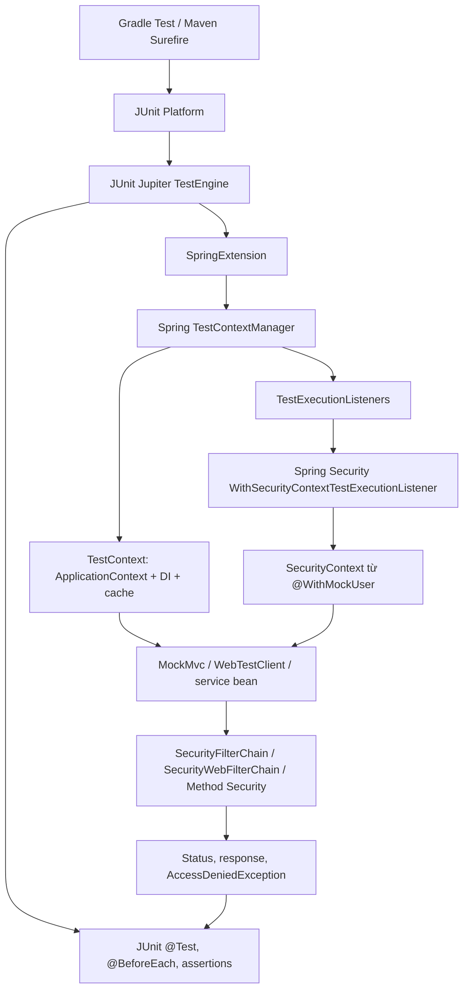

# JUnit Jupiter, SpringExtension và TestContext Framework

Một bài kiểm thử Spring Security có thể viết rất ngắn:

```java
@Test
@WithMockUser(roles = "ADMIN")
void adminCanAccess() throws Exception {
    mvc.perform(get("/api/admin"))
       .andExpect(status().isOk());
}
```

Tuy nhiên, đoạn này chỉ hoạt động đúng khi **JUnit Jupiter phát hiện và thực thi test**, **SpringExtension kết nối JUnit với Spring TestContext Framework**, và **Spring Security Test tạo bối cảnh xác thực** cho lời gọi đang kiểm thử. Nếu bài test được chạy nhưng Spring context hoặc security filter chain không tham gia, kết quả HTTP có thể khiến ta hiểu sai mức độ an toàn của ứng dụng.

Bài học thuộc chương **Phụ thuộc và phiên bản** của mô-đun **SPRING_SECURITY_TESTING**. Phạm vi mô-đun là kiểm chứng xác thực, phân quyền và bảo vệ HTTP bằng `spring-security-test` trên ứng dụng **Servlet** và **Reactive**, sử dụng `MockMvc`, `WebTestClient`, `@WithMockUser`, `SecurityContext`, JWT/OAuth2/OIDC giả lập cùng các trường hợp được phép và bị từ chối. Để thực hành các kỹ thuật này, trước hết cần nắm rõ cách **hạ tầng chạy test**, **Spring context** và **Spring Security Test** liên kết với nhau.

## 1. Mục tiêu học tập

Sau bài này, người học có thể:

1. Phân biệt JUnit Platform, JUnit Jupiter, `SpringExtension`, TestContext Framework và Spring Security Test.
2. Khai báo các dependency và đăng ký `SpringExtension` đúng cách, hoặc nhận biết khi Spring Boot đã đăng ký sẵn.
3. Giải thích chính xác thứ tự chạy `@BeforeEach`, test, `@AfterEach`, các callback TestContext và thời điểm `@WithMockUser` tạo `SecurityContext`.
4. Viết test method security sử dụng `@SpringJUnitConfig`, test Servlet bằng `MockMvc` và test Reactive bằng `WebTestClient`.
5. Nhận biết các tình huống gây lỗi do context cache, test slice, listener, cấu hình filter chain hoặc sai phiên bản thư viện.

## 2. Bức tranh tổng thể: ai chịu trách nhiệm gì?



| Thành phần | Nằm ở đâu? | Nhiệm vụ | Không tự đảm nhiệm |
|---|---|---|---|
| **JUnit Platform** | JUnit | Khởi động, khám phá và giao bài test cho các engine phù hợp | Không tạo Spring context |
| **JUnit Jupiter** | JUnit | API `@Test`, lifecycle `@BeforeEach`, assertions, `TestEngine`, extension model | Không dựng bean Security |
| **`SpringExtension`** | `spring-test` | Cầu nối các callback Jupiter với `TestContextManager` | Không tự cấu hình toàn bộ hệ thống web/security |
| **Spring TestContext Framework** | `spring-test` | Tải/cached `ApplicationContext`, dependency injection, test transactions, listeners, profiles | Không cung cấp mọi mock security principal |
| **Spring Security Test** | `spring-security-test` | `@WithMockUser`, `@WithUserDetails`, request post-processor, security mutator, authentication assertions | Không phát hiện/chạy JUnit test; không thay thế runtime security chain |
| **Spring Security runtime** | `spring-security-core/web/config`, các module OAuth2 khi cần | Quyết định request hoặc method có được truy cập hay không | Không tạo mock principal cho test |
| **Spring Boot Test** | Các Spring Boot test module/starter | Tự cấu hình test context, slice, `MockMvc` hoặc `WebTestClient` theo ứng dụng | Không bảo đảm mọi slice nạp đúng security rule bạn đang muốn thử |

Một cách nhớ bằng câu hỏi:

- **Ai chạy test?** JUnit Jupiter, do Platform và build tool kích hoạt.
- **Ai dựng các bean cần kiểm thử?** Spring TestContext, được kết nối qua `SpringExtension`.
- **Ai tạo người dùng đăng nhập giả lập?** Spring Security Test.
- **Ai quyết định `200`, `401`, `403` hay `302`?** Hệ thống security và HTTP configuration thực sự có mặt trong context đang chạy.

## 3. JUnit Platform và JUnit Jupiter trong một dự án Spring

JUnit 5 trở đi tổ chức hệ sinh thái theo **Platform**, **Jupiter** và **Vintage**. JUnit Jupiter cung cấp API viết test và engine chạy Jupiter tests; Platform dùng các `TestEngine` để phát hiện và thực thi test. Vintage Engine chỉ cần thiết nếu dự án còn test JUnit 3/4, không phải phụ thuộc bắt buộc cho bài test mới.

```java
import org.junit.jupiter.api.BeforeEach;
import org.junit.jupiter.api.Test;

import static org.junit.jupiter.api.Assertions.assertEquals;

class PlainJupiterTest {
    private int counter;

    @BeforeEach
    void reset() {
        counter = 0;
    }

    @Test
    void increments() {
        counter++;
        assertEquals(1, counter);
    }
}
```

Đoạn trên cần **JUnit Jupiter**, nhưng **không cần SpringExtension** vì không dùng `ApplicationContext`, dependency injection hay Spring-managed proxy.

### 3.1. Các annotation JUnit Jupiter thường gặp

| Annotation/API | Tác dụng | Ví dụ liên quan đến Spring Security |
|---|---|---|
| `@Test` | Đánh dấu một test case | Một ca được cấp quyền, một ca bị từ chối |
| `@BeforeEach` | Chuẩn bị trước mỗi test | Reset dữ liệu test, chuẩn bị request fixtures |
| `@AfterEach` | Dọn tài nguyên do test cấp phát | Dọn state ngoài Spring context |
| `@BeforeAll` / `@AfterAll` | Chuẩn bị/dọn một lần cho lớp test | Khởi tạo tài nguyên bên ngoài |
| `@ParameterizedTest` | Chạy cùng logic với nhiều dữ liệu | Ma trận role/authority và status |
| `@Nested` | Gom các test theo ngữ cảnh | Nhóm test anonymous, user, admin |
| `assertThrows(...)` | Khẳng định ngoại lệ | Kiểm tra `AccessDeniedException` của method security |
| `@ExtendWith(...)` | Đăng ký extension | Đăng ký `SpringExtension` khi không có annotation tổng hợp |

Không nhầm `org.junit.jupiter.api.Test` với `org.junit.Test` của JUnit 4. `@RunWith(SpringRunner.class)` là cách tích hợp JUnit 4; với JUnit Jupiter dùng `@ExtendWith(SpringExtension.class)` hoặc annotation Spring tổng hợp tương ứng.

### 3.2. Maven/Gradle phải thực sự kích hoạt JUnit Platform

Với Gradle Groovy DSL:

```groovy
tasks.named('test', Test) {
    useJUnitPlatform()
}
```

Với Gradle Kotlin DSL:

```kotlin
tasks.test {
    useJUnitPlatform()
}
```

Maven dùng **Maven Surefire Plugin** phiên bản có hỗ trợ JUnit Platform để chạy các test được tìm thấy trong Maven `test` phase. Trong dự án Spring Boot dùng parent/plugin management phù hợp, cấu hình JUnit/Jupiter và plugin thường đã được cung cấp hoặc quản lý. Trong dự án Framework thuần, bạn cần chủ động cấu hình phiên bản engine/launcher và plugin.

## 4. `SpringExtension`: cầu nối giữa Jupiter và TestContext

`SpringExtension` nằm trong package:

```java
org.springframework.test.context.junit.jupiter.SpringExtension
```

Nó triển khai các extension callback của JUnit Jupiter và ủy quyền cho `TestContextManager`. Khi đó, Spring có thể:

- Tạo hoặc lấy lại `ApplicationContext` đã cache cho test có cấu hình tương thích.
- Inject bean vào lớp test và hỗ trợ resolve các tham số test phù hợp.
- Áp dụng các `TestExecutionListener` để xử lý dependency injection, giao dịch test và bối cảnh bảo mật.
- Thực hiện các callback trước/sau test method hoặc trước/sau khi thực thi chính thân method.

### 4.1. Đăng ký thủ công khi dùng Spring Framework

Ví dụ dùng `@ExtendWith` kết hợp `@ContextConfiguration`:

```java
import org.junit.jupiter.api.Test;
import org.junit.jupiter.api.extension.ExtendWith;
import org.springframework.beans.factory.annotation.Autowired;
import org.springframework.context.annotation.Bean;
import org.springframework.context.annotation.Configuration;
import org.springframework.test.context.ContextConfiguration;
import org.springframework.test.context.junit.jupiter.SpringExtension;

import static org.junit.jupiter.api.Assertions.assertEquals;

@ExtendWith(SpringExtension.class)
@ContextConfiguration(classes = ServiceTest.Config.class)
class ServiceTest {
    @Autowired GreetingService service;

    @Test
    void usesSpringBean() {
        assertEquals("hello", service.greet());
    }

    @Configuration
    static class Config {
        @Bean
        GreetingService greetingService() {
            return new GreetingService();
        }
    }

    static class GreetingService {
        String greet() {
            return "hello";
        }
    }
}
```

Nếu bỏ `@ExtendWith(SpringExtension.class)` ở ví dụ thuần JUnit này, JUnit vẫn có thể phát hiện `@Test` nhưng Spring **không được kết nối** để inject `@Autowired`; bài test có thể nhận `null` hoặc không có Spring context như mong đợi.

### 4.2. Annotation tổng hợp giúp cấu hình ngắn hơn

Với Spring Framework, đoạn trên có thể thay hai annotation:

```java
@ExtendWith(SpringExtension.class)
@ContextConfiguration(classes = ServiceTest.Config.class)
```

bằng một annotation:

```java
@SpringJUnitConfig(classes = ServiceTest.Config.class)
```

Import:

```java
import org.springframework.test.context.junit.jupiter.SpringJUnitConfig;
```

`@SpringJUnitConfig` kết hợp đăng ký `SpringExtension` và `@ContextConfiguration`. Khi cần `WebApplicationContext` cho Servlet/MVC, có `@SpringJUnitWebConfig` là annotation tổng hợp tương ứng với web context. Trong ứng dụng Spring Boot, thường dùng `@SpringBootTest`, `@WebMvcTest` hoặc `@WebFluxTest` thay vì tự khai báo cấu hình TestContext từ đầu.

### 4.3. Các annotation Boot đã kết nối SpringExtension

Trong các lớp test Spring Boot, thông thường:

```java
@SpringBootTest
class FullApplicationTest { /* ... */ }

@WebMvcTest(ReportController.class)
class MvcSliceTest { /* ... */ }

@WebFluxTest(ReportHandler.class)
class WebFluxSliceTest { /* ... */ }
```

Các annotation test Spring Boot tích hợp Spring TestContext và JUnit Jupiter. Không cần thêm `@ExtendWith(SpringExtension.class)` chỉ để một test Boot kiểu này được inject bean. Tuy nhiên, các test slice **nạp tập bean giới hạn**, nên phải xác minh cấu hình Security mà test cần có thật sự được nạp.

Tên import annotation của Spring Boot có thể khác giữa **Boot 3.x** và **Boot 4.x** do cách tổ chức module/test starter. Luôn dùng tài liệu đúng phiên bản thay vì cố giữ package cũ sau khi nâng cấp.

## 5. TestContext Framework xử lý những gì?

TestContext Framework không phải là `ApplicationContext` duy nhất. Nó là hạ tầng quản lý context và vòng đời kiểm thử, thường gồm:

- **`TestContextManager`:** điều phối các sự kiện theo vòng đời test.
- **`TestContext`:** nắm metadata của test và cung cấp quyền truy cập context hiện hành.
- **Context loaders/bootstrappers:** xác định cách tải Spring `ApplicationContext`.
- **`TestExecutionListener`:** móc thêm hành vi trước/sau test, như dependency injection hoặc tạo security context.
- **Context cache:** tái sử dụng context có cấu hình tương thích để tránh khởi động Spring nhiều lần.

Ví dụ về metadata thường ảnh hưởng đến cấu hình context:

```java
@SpringBootTest
@ActiveProfiles("test")
@TestPropertySource(properties = {
    "feature.reports.enabled=true"
})
class ReportIntegrationTest {
    // Tải context theo profile và property chỉ định.
}
```

Hai lớp test có context configuration giống nhau có cơ hội dùng lại context. Đổi profile, property, classes được import hoặc một số customizer có thể tạo **khóa cache khác** và buộc Spring tải một context khác.

### 5.1. Cache context, cô lập dữ liệu và `@DirtiesContext`

Context cache giúp test nhanh hơn, nhưng cũng khiến các bean singleton và trạng thái trong context có thể được dùng lại giữa những bài test. Vì vậy:

1. Nên thiết kế bean, fixture và dữ liệu test để **không làm bẩn trạng thái dùng chung**.
2. Khi thực sự thay đổi chính context (ví dụ cấu hình hoặc trạng thái singleton không thể reset an toàn), cân nhắc `@DirtiesContext` để buộc Spring bỏ context khỏi cache.
3. Không đánh dấu `@DirtiesContext` trên tất cả test theo thói quen: việc dựng lại context liên tục khiến suite chậm.
4. Test có `@Transactional` có thể được Spring TestContext quản lý giao dịch và rollback mặc định trong trường hợp thread-bound transaction phù hợp; **không mặc định** áp dụng sự bảo đảm đó cho mọi luồng Reactive, thread khác hoặc HTTP server thật.

`@WithMockUser` tạo bối cảnh xác thực **cho bài test** theo cơ chế listener, không phải thao tác thay đổi bean singleton và thường không đòi hỏi `@DirtiesContext`.

### 5.2. TestContextListener và custom listeners

Một số test dùng `@TestExecutionListeners` để tự đăng ký listener:

```java
@TestExecutionListeners(
    listeners = MyExtraListener.class,
    mergeMode = TestExecutionListeners.MergeMode.MERGE_WITH_DEFAULTS
)
```

`MERGE_WITH_DEFAULTS` giữ lại các listener mặc định và thêm listener tùy chỉnh. Ngược lại, thay thế toàn bộ listener mặc định mà không hiểu hệ quả có thể làm mất dependency injection, transaction management hoặc **listener thiết lập `SecurityContext`**.

Trước khi tự quản lý listener, hãy kiểm tra xem Spring/Spring Security đã đăng ký listener cần thiết hay chưa; thông thường khi test có SpringExtension và `spring-security-test` đúng classpath, các listener của Spring Security được tải theo cơ chế mặc định.

## 6. Vòng đời một test Jupiter có SpringExtension

Để hiểu vì sao `SecurityContext` có hoặc không có ở `@BeforeEach`, cần phân biệt hai loại callback:

- **Callback JUnit Jupiter:** `@BeforeEach`, `@Test`, `@AfterEach`.
- **Callback Spring TestContext:** `beforeTestMethod`, `beforeTestExecution`, `afterTestExecution`, `afterTestMethod`.

Thứ tự khái quát cho **một test method**:

| Thứ tự | Sự kiện | Cơ chế |
|---|---|---|
| 1 | Chuẩn bị test instance, inject các dependency | `SpringExtension` → TestContext |
| 2 | `beforeTestMethod` | TestContext listeners, **trước** `@BeforeEach` |
| 3 | `@BeforeEach` | JUnit Jupiter |
| 4 | `beforeTestExecution` | TestContext listeners, **sau** `@BeforeEach`, ngay trước thân test |
| 5 | `@Test` | JUnit Jupiter thực thi test |
| 6 | `afterTestExecution` | TestContext listeners, **trước** `@AfterEach` |
| 7 | `@AfterEach` | JUnit Jupiter |
| 8 | `afterTestMethod` | TestContext listeners, **sau** `@AfterEach` |

Ở cấp lớp còn có `beforeTestClass`, `afterTestClass` và các hook `@BeforeAll`/`@AfterAll` của JUnit. Tùy test instance lifecycle và extension bổ sung, quá trình tạo test instance có khác biệt; bảng trên mô tả **mối quan hệ giữa các callback quanh mỗi method**.

### 6.1. `@WithMockUser` chuẩn bị `SecurityContext` khi nào?

Spring Security Test cung cấp `WithSecurityContextTestExecutionListener`. Nó nhận các annotation như `@WithMockUser`, tạo một `Authentication` theo annotation và đặt vào `SecurityContext` để logic được test nhìn thấy.

**Mặc định**, `@WithMockUser` dùng `setupBefore = TestExecutionEvent.TEST_METHOD`, nghĩa là context được thiết lập ở sự kiện `beforeTestMethod` **trước `@BeforeEach`**:

```java
import org.junit.jupiter.api.BeforeEach;
import org.junit.jupiter.api.Test;
import org.springframework.security.core.Authentication;
import org.springframework.security.core.context.SecurityContextHolder;
import org.springframework.security.test.context.support.WithMockUser;

import static org.junit.jupiter.api.Assertions.assertEquals;

class ExampleWithSpringTestContext {

    @BeforeEach
    void examineAuthentication() {
        Authentication authentication =
                SecurityContextHolder.getContext().getAuthentication();

        // Với @WithMockUser mặc định và Spring TestContext hoạt động:
        // authentication có thể đã được thiết lập ở thời điểm này.
    }

    @Test
    @WithMockUser(username = "lan", roles = "ADMIN")
    void mockUserIsAvailable() {
        assertEquals("lan",
            SecurityContextHolder.getContext()
                .getAuthentication().getName());
    }
}
```

**Lưu ý:** khung code trên nhằm minh họa vòng đời; để chạy độc lập, lớp test cần `@SpringJUnitConfig`, `@SpringBootTest` hoặc `@ExtendWith(SpringExtension.class)` kèm context configuration phù hợp. Chỉ thêm dependency `spring-security-test` và annotation `@WithMockUser` vào một test Jupiter thuần **chưa đủ** để kích hoạt TestContext listener.

Nếu cần thiết lập context **sau `@BeforeEach`**, bạn có thể chọn:

```java
import org.springframework.security.test.context.support.TestExecutionEvent;

@Test
@WithMockUser(
    username = "lan",
    roles = "ADMIN",
    setupBefore = TestExecutionEvent.TEST_EXECUTION
)
void contextPreparedImmediatelyBeforeTestBody() {
    // TestContext listener chuẩn bị context tại beforeTestExecution.
}
```

Trong trường hợp này, đừng kỳ vọng `@BeforeEach` đã nhìn thấy mock authentication từ annotation; thời điểm thiết lập là **sau** `@BeforeEach`. Đây là một lỗi thường gặp khi test fixture đọc `SecurityContextHolder` quá sớm.

### 6.2. `@WithMockUser` có thể đặt ở class hoặc method

```java
@WithMockUser(username = "defaultUser", roles = "USER")
class ReportsTest {

    @Test
    void usesClassDefault() { /* ... */ }

    @Test
    @WithMockUser(username = "admin", roles = "ADMIN")
    void overridesAtMethod() { /* ... */ }
}
```

Đặt annotation ở class áp dụng mock user mặc định cho các test method phù hợp; annotation ở method có thể ghi đè. Điều này có ích để giảm lặp trong bộ test quyền, nhưng nên đặt tên test rõ ràng để không bỏ sót các trường hợp anonymous/denied.

### 6.3. Những giới hạn của mock authentication

`@WithMockUser` **không** gọi endpoint đăng nhập, không kiểm tra mật khẩu bằng `PasswordEncoder`, không giải mã chữ ký JWT và không gọi nhà cung cấp OIDC. Nó tạo authentication phục vụ kiểm thử **hành vi sau khi người dùng đã được xác thực**.

- `roles = "ADMIN"` tạo authority `ROLE_ADMIN`, phù hợp với `hasRole("ADMIN")`.
- `authorities = "SCOPE_reports.read"` tạo đúng chuỗi authority, thường dùng với rule `hasAuthority("SCOPE_reports.read")`.
- Nếu cần principal thật từ `UserDetailsService`, cân nhắc `@WithUserDetails`.
- Nếu principal chứa tenant, claim hoặc kiểu authentication đặc thù, cân nhắc `@WithSecurityContext` với factory tùy chỉnh.

## 7. Ví dụ đầy đủ: kiểm thử method security nhờ SpringExtension

Ví dụ này không cần web server. Nó kiểm chứng Spring proxy có thực sự áp dụng `@PreAuthorize` lên một bean trong `ApplicationContext`.

Giả định các dependency runtime của ứng dụng đã có Spring Context, Spring Security Config và Core; các dependency test có JUnit Jupiter, `spring-test`, `spring-security-test`. Trong dự án Boot, các starter sẽ đưa vào các module runtime tương ứng.

```java
import org.junit.jupiter.api.Test;
import org.springframework.beans.factory.annotation.Autowired;
import org.springframework.context.annotation.Bean;
import org.springframework.context.annotation.Configuration;
import org.springframework.security.access.AccessDeniedException;
import org.springframework.security.access.prepost.PreAuthorize;
import org.springframework.security.config.annotation.method.configuration.EnableMethodSecurity;
import org.springframework.security.test.context.support.WithMockUser;
import org.springframework.test.context.junit.jupiter.SpringJUnitConfig;

import static org.junit.jupiter.api.Assertions.assertEquals;
import static org.junit.jupiter.api.Assertions.assertThrows;

@SpringJUnitConfig(classes = MethodSecurityTest.Config.class)
class MethodSecurityTest {

    @Autowired
    ReportService reportService;

    @Test
    @WithMockUser(authorities = "SCOPE_reports.read")
    void readerCanRead() {
        assertEquals("report", reportService.read());
    }

    @Test
    @WithMockUser(authorities = "SCOPE_other")
    void userWithoutScopeCannotRead() {
        assertThrows(AccessDeniedException.class,
                () -> reportService.read());
    }

    @Configuration
    @EnableMethodSecurity
    static class Config {
        @Bean
        ReportService reportService() {
            return new ReportService();
        }
    }

    static class ReportService {
        @PreAuthorize("hasAuthority('SCOPE_reports.read')")
        public String read() {
            return "report";
        }
    }
}
```

Tại sao ví dụ này có giá trị?

1. `@SpringJUnitConfig` đăng ký `SpringExtension` và chỉ định Spring configuration.
2. `@Configuration` cùng `@Bean` tạo `ReportService` **do Spring quản lý**.
3. `@EnableMethodSecurity` bật cơ chế áp dụng rule `@PreAuthorize` lên Spring-managed bean.
4. `@WithMockUser` tạo authentication với authority cụ thể **trước khi gọi method**.
5. JUnit `assertThrows` xác minh lời gọi bị từ chối khi thiếu scope.

Nếu tự tạo `new ReportService()` trong test rồi gọi trực tiếp, lời gọi đó **không đi qua Spring proxy** và rule method security có thể không được áp dụng. Test như vậy không chứng minh `@PreAuthorize` hoạt động.

## 8. JUnit + Spring TestContext trong bài test HTTP Servlet

Với ứng dụng Spring MVC, `MockMvc` kiểm thử đường đi qua Spring MVC và, khi cấu hình đúng, qua **Spring Security filter chain**. `@SpringBootTest` tạo context ứng dụng, còn `@AutoConfigureMockMvc` cung cấp client test MVC.

Ví dụ **Spring Boot 3.x** giả định `GET /api/admin/reports` yêu cầu `ROLE_ADMIN`, người không đủ quyền nhận `403` và controller trả `200` khi được phép:

```java
import org.junit.jupiter.api.Test;
import org.springframework.beans.factory.annotation.Autowired;
import org.springframework.boot.test.autoconfigure.web.servlet.AutoConfigureMockMvc;
import org.springframework.boot.test.context.SpringBootTest;
import org.springframework.security.test.context.support.WithMockUser;
import org.springframework.test.web.servlet.MockMvc;

import static org.springframework.test.web.servlet.request.MockMvcRequestBuilders.get;
import static org.springframework.test.web.servlet.result.MockMvcResultMatchers.status;

@SpringBootTest
@AutoConfigureMockMvc
class AdminReportHttpTest {

    @Autowired
    MockMvc mvc;

    @Test
    @WithMockUser(roles = "USER")
    void ordinaryUserIsForbidden() throws Exception {
        mvc.perform(get("/api/admin/reports"))
           .andExpect(status().isForbidden());
    }

    @Test
    @WithMockUser(roles = "ADMIN")
    void adminIsAllowed() throws Exception {
        mvc.perform(get("/api/admin/reports"))
           .andExpect(status().isOk());
    }
}
```

Khi chuyển sang Spring Boot 4.x, sử dụng các **test starter** phù hợp với Boot 4 (ví dụ MVC test và Security test starter) và kiểm tra lại **package import** của `@AutoConfigureMockMvc`. Khái niệm TestContext và `@WithMockUser` vẫn cần thiết dù packaging thay đổi.

### 8.1. Vì sao `SpringExtension` chưa đủ để bảo đảm HTTP security?

`SpringExtension` chỉ nối test tới Spring context; nó không tự lắp security filter vào mọi cấu hình `MockMvc`.

Nếu tự xây dựng `MockMvc` từ một `WebApplicationContext`, cần đảm bảo security filter chain và integration setup phù hợp:

```java
import static org.springframework.security.test.web.servlet.setup.SecurityMockMvcConfigurers.springSecurity;
import static org.springframework.test.web.servlet.setup.MockMvcBuilders.webAppContextSetup;

MockMvc mvc = webAppContextSetup(webApplicationContext)
        .apply(springSecurity())
        .build();
```

Với `MockMvcBuilders.standaloneSetup(controller)`, filter chain **không tự xuất hiện**. Một test `@WithMockUser` chạy xanh trong standalone setup có thể chỉ chứng minh controller hoạt động, chưa chứng minh endpoint được Spring Security bảo vệ.

### 8.2. Annotation cấp method và thông tin cấp request

`@WithMockUser` tạo bối cảnh xác thực gắn với vòng đời test method. Nếu muốn thử nhiều danh tính **trong cùng một test**, Spring Security Test cung cấp request post-processor:

```java
import static org.springframework.security.test.web.servlet.request.SecurityMockMvcRequestPostProcessors.user;

@Test
void compareRolesWithinOneTest() throws Exception {
    mvc.perform(get("/api/admin/reports")
            .with(user("lan").roles("USER")))
       .andExpect(status().isForbidden());

    mvc.perform(get("/api/admin/reports")
            .with(user("minh").roles("ADMIN")))
       .andExpect(status().isOk());
}
```

Cả hai cách cần môi trường HTTP được tích hợp Security đúng. `user()` chỉ tạo principal/authorities của request; nó không kiểm thử password login. Nếu endpoint sử dụng CSRF cho `POST` hoặc các method thay đổi dữ liệu, kết hợp thêm `csrf()` và một ca thiếu/sai token theo chính sách của ứng dụng.

## 9. JUnit + TestContext trong ứng dụng Reactive

Với WebFlux, luồng request chạy trên Reactor và `SecurityContext` được truyền qua **Reactor Context**. Vì vậy, không nên suy luận rằng mọi bước Reactive đều đọc cùng `ThreadLocal SecurityContextHolder` như Servlet.

Spring Security Test có hỗ trợ riêng cho Reactive: các test context listener phù hợp và những `WebTestClient` mutator như `mockUser()`, `mockJwt()`, `mockOAuth2Login()`, `mockOidcLogin()`.

Khi dựng client theo `ApplicationContext` có reactive security chain:

```java
import static org.springframework.security.test.web.reactive.server.SecurityMockServerConfigurers.springSecurity;

WebTestClient client = WebTestClient.bindToApplicationContext(context)
        .apply(springSecurity())
        .configureClient()
        .build();
```

Sau đó kiểm thử một principal giả lập theo request:

```java
import static org.springframework.security.test.web.reactive.server.SecurityMockServerConfigurers.mockUser;

@Test
void adminCanReadReactiveReport() {
    client.mutateWith(mockUser("minh").roles("ADMIN"))
          .get().uri("/api/admin/reports")
          .exchange()
          .expectStatus().isOk();
}
```

Đây là ví dụ gắn vào **client đã được khởi tạo và liên kết với security chain**; endpoint, quyền và cấu hình WebFlux do ứng dụng cung cấp. Khi kiểm thử JWT Resource Server, thay bằng `mockJwt()` cùng authorities phù hợp. Những mutator này tập trung vào **phân quyền sau xác thực**, không tự xác minh chữ ký hoặc issuer của token thật.

### 9.1. `@WithMockUser` có dùng được với Reactive không?

Có thể sử dụng các annotation test security trong môi trường Reactive nếu **TestContext và listener Reactive security** được cấu hình phù hợp. Spring Security cung cấp cơ chế truyền authentication vào Reactor Context cho các bài test hỗ trợ Reactive. Tuy nhiên, để kiểm thử request `WebTestClient`, cách dùng `client.mutateWith(mockUser(...))` hoặc `mockJwt()` thường thể hiện rõ danh tính gắn với từng request và tránh nhầm với `ThreadLocal`.

Nếu `@WithMockUser` hoạt động trên MVC nhưng request Reactive vẫn thiếu authentication, hãy kiểm tra **client setup**, **reactive security filter chain** và **Reactive TestExecutionListener** thay vì chỉ cố gắng gọi `SecurityContextHolder.setContext` trên test thread.

## 10. Khai báo dependency cho Jupiter, Spring Test và Security Test

Trong Spring Boot, thường **không tự pin** phiên bản JUnit, `spring-test` hoặc `spring-security-test` độc lập với các dependency runtime. Để Spring Boot BOM chọn tập phiên bản phù hợp và chỉ bổ sung những starter/test libraries cần thiết.

### 10.1. Spring Boot 3.x — Maven

Ví dụ ứng dụng MVC:

```xml
<dependencies>
    <dependency>
        <groupId>org.springframework.boot</groupId>
        <artifactId>spring-boot-starter-web</artifactId>
    </dependency>
    <dependency>
        <groupId>org.springframework.boot</groupId>
        <artifactId>spring-boot-starter-security</artifactId>
    </dependency>

    <dependency>
        <groupId>org.springframework.boot</groupId>
        <artifactId>spring-boot-starter-test</artifactId>
        <scope>test</scope>
    </dependency>
    <dependency>
        <groupId>org.springframework.security</groupId>
        <artifactId>spring-security-test</artifactId>
        <scope>test</scope>
    </dependency>
</dependencies>
```

`spring-boot-starter-test` tập hợp JUnit Jupiter, Spring Test và các thư viện test thông dụng; `spring-security-test` bổ sung phần mock authentication và security testing. Nếu ứng dụng là WebFlux, thay `spring-boot-starter-web` bằng `spring-boot-starter-webflux`.

### 10.2. Spring Boot 3.x — Gradle Kotlin DSL

```kotlin
dependencies {
    implementation("org.springframework.boot:spring-boot-starter-web")
    implementation("org.springframework.boot:spring-boot-starter-security")

    testImplementation("org.springframework.boot:spring-boot-starter-test")
    testImplementation("org.springframework.security:spring-security-test")
    testRuntimeOnly("org.junit.platform:junit-platform-launcher")
}

tasks.test {
    useJUnitPlatform()
}
```

Giả định dự án đã áp dụng plugin Boot và BOM/dependency management phù hợp. Không đưa `spring-security-test` vào `implementation` nếu chỉ dùng cho mã test. Trong Gradle Groovy DSL, dùng `testImplementation 'org.springframework.security:spring-security-test'` thay cho cú pháp Kotlin.

### 10.3. Spring Boot 4.x

Spring Boot 4.x tách các **test starter** theo stack và tính năng. Ví dụ với ứng dụng MVC, dùng bộ dependency test phù hợp:

```kotlin
dependencies {
    implementation("org.springframework.boot:spring-boot-starter-webmvc")
    implementation("org.springframework.boot:spring-boot-starter-security")

    testImplementation("org.springframework.boot:spring-boot-starter-test")
    testImplementation("org.springframework.boot:spring-boot-starter-webmvc-test")
    testImplementation("org.springframework.boot:spring-boot-starter-security-test")
    testRuntimeOnly("org.junit.platform:junit-platform-launcher")
}
```

Với WebFlux, chọn `spring-boot-starter-webflux` và `spring-boot-starter-webflux-test`. Bộ test starter vẫn dựa trên các API Spring Test, Security Test và JUnit, nhưng classpath/annotation package có thể khác Boot 3.x. Dùng tài liệu Boot 4 đúng phiên bản để kiểm tra import.

### 10.4. Spring Framework không dùng Boot

Khi không dùng Boot, khai báo trực tiếp `spring-test`, `spring-security-test` và Jupiter, đồng thời **quản lý phiên bản** bằng Framework/Security BOM hoặc dependency constraints tương thích:

```kotlin
dependencies {
    // Các runtime dependency của Spring Framework và Spring Security
    // đã được dự án khai báo ở cấu hình riêng.

    testImplementation("org.springframework:spring-test")
    testImplementation("org.springframework.security:spring-security-test")
    testImplementation("org.junit.jupiter:junit-jupiter")
    testRuntimeOnly("org.junit.platform:junit-platform-launcher")
}
tasks.test {
    useJUnitPlatform()
}
```

Đây chỉ là **các dependency liên quan đến kiểm thử**, chưa phải một file build độc lập. Cần thêm Spring Context/Web, Security Config/Web và dependency management tương ứng với ứng dụng.

## 11. Phân biệt `@SpringBootTest`, web slice và test thuần

Chọn loại test quyết định mức độ Spring/TestContext chuẩn bị:

| Loại test | Hạ tầng được nạp | Nên dùng để kiểm tra |
|---|---|---|
| JUnit thuần, không SpringExtension | Không cần `ApplicationContext` | Logic Java độc lập, utility |
| `@SpringJUnitConfig` | Một Spring context theo cấu hình được chỉ định | Service, method security trên bean proxy |
| `@WebMvcTest` | Lát cắt web MVC và test infrastructure | Controller, MVC mapping, authorization khi security configuration phù hợp được nạp |
| `@WebFluxTest` | Lát cắt WebFlux | Handler/controller Reactive và policy trong context của slice |
| `@SpringBootTest` | Context rộng hơn, gần cấu hình ứng dụng | Luồng kết hợp service, filter, cấu hình phân quyền |
| `@SpringBootTest(webEnvironment = RANDOM_PORT)` | Chạy HTTP server trên cổng ngẫu nhiên | Integration test qua network boundary thật |

`@SpringBootTest` mặc định không nhất thiết mở HTTP server thực; với `MockMvc`, test thường chạy trên hạ tầng mô phỏng Servlet. Ngược lại, `RANDOM_PORT` chạy server thật và có thể tác động đến transaction boundaries, cookie/session hoặc cách authentication được truyền.

**Không tự suy ra một test slice đã có mọi filter của ứng dụng.** Nếu test bảo mật phản ánh sai quy tắc production, kiểm tra các `@Import`, cấu hình `SecurityFilterChain`/`SecurityWebFilterChain`, bean được mock và chế độ auto-configuration.

## 12. Lỗi thường gặp và cách chẩn đoán

| Triệu chứng | Khả năng gây ra | Việc nên kiểm tra |
|---|---|---|
| `@Test` không được phát hiện | Dùng nhầm JUnit 4 annotation, thiếu Jupiter engine/launcher hoặc chưa bật Platform | Import `org.junit.jupiter.api.Test`, `useJUnitPlatform()`, Maven Surefire |
| `@Autowired` vẫn `null` trong test thuần Jupiter | Chưa đăng ký `SpringExtension` hoặc test không có Spring context | Dùng `@SpringJUnitConfig` hay annotation test Boot phù hợp |
| `@WithMockUser` không đặt authentication | Spring TestContext listener chưa hoạt động; thiếu dependency; listeners bị thay thế | `spring-security-test`, `SpringExtension`, `@TestExecutionListeners` |
| `@BeforeEach` không nhìn thấy mock user | `setupBefore = TEST_EXECUTION` thiết lập context sau `@BeforeEach` | Chọn `TEST_METHOD` mặc định nếu fixture cần authentication sớm |
| Test `@PreAuthorize` luôn cho phép | Gọi đối tượng `new` thay vì bean proxy hoặc thiếu `@EnableMethodSecurity` | Inject bean từ Spring và kiểm tra proxy/config |
| `MockMvc` trả `200` dù thiếu quyền | Security filter chain chưa tham gia request hoặc đang cho phép route | `springSecurity()`, security auto-configuration, policy loaded |
| Anonymous trả `302` thay `401` | Form login redirect thay vì HTTP Basic/Bearer entry point | Authentication entry point thực tế |
| `POST` trả `403` mặc dù đủ role | CSRF có thể đang từ chối | Thử token hợp lệ/không hợp lệ, kiểm tra CSRF policy |
| WebFlux không có principal dù test thread có `SecurityContextHolder` | Reactive pipeline dùng Reactor Context | Reactive security setup và `mockUser()`/`mockJwt()` |
| Lỗi `NoSuchMethodError` hoặc `NoClassDefFoundError` | Có thể do lệch phiên bản Framework/Security/JUnit | Maven dependency tree hoặc Gradle dependencyInsight |
| Test suite chậm sau khi thêm `@DirtiesContext` | Context cache bị vô hiệu hóa thường xuyên | Chỉ dirty context khi cần, reset state test phù hợp |

### 12.1. Lệnh kiểm tra nhanh

```bash
# Maven: toàn bộ dependency trong phạm vi test
./mvnw dependency:tree -Dscope=test

# Gradle: phiên bản thư viện được chọn cho test
./gradlew dependencies --configuration testRuntimeClasspath
./gradlew dependencyInsight --dependency spring-security-test --configuration testRuntimeClasspath
./gradlew dependencyInsight --dependency spring-test --configuration testRuntimeClasspath

# Chạy test
./mvnw test
./gradlew test
```

Với PowerShell/CMD trên Windows, dùng wrapper `.\mvnw.cmd` hoặc `.\gradlew.bat` tương ứng. Nếu `spring-security-test` không cùng dòng với `spring-security-core`/`spring-security-web`, hoặc `spring-test` lệch Spring Framework runtime, cần căn chỉnh lại bằng BOM của Boot (hoặc Framework/Security BOM khi không dùng Boot).

## 13. Bài tập thực hành: từ JUnit thuần đến test có SecurityContext

Giả sử ứng dụng có `ReportService.read()` yêu cầu `SCOPE_reports.read`; Servlet endpoint `GET /api/reports` yêu cầu `ROLE_ADMIN`; Reactive endpoint `GET /api/export` yêu cầu `SCOPE_reports.export`.

Làm tuần tự:

1. **Bài 1 — Jupiter thuần:** viết `@Test` dùng `assertEquals` cho một hàm xử lý dữ liệu không có Spring. Giải thích tại sao test không cần `SpringExtension`.
2. **Bài 2 — TestContext:** tạo `@SpringJUnitConfig` chứa bean `ReportService`, inject bean và dùng `@WithMockUser` để có một ca được phép, một ca `AccessDeniedException`. Bảo đảm `@EnableMethodSecurity` thực sự hoạt động.
3. **Bài 3 — Lifecycle:** tạo `@BeforeEach` ghi lại principal; so sánh thời điểm thấy authentication giữa `TEST_METHOD` và `TEST_EXECUTION`. Không chia sẻ `SecurityContext` tự tạo giữa các test để tránh rò rỉ.
4. **Bài 4 — HTTP Servlet:** với `MockMvc` tích hợp filter chain, kiểm tra anonymous, role không đủ và role đủ. Nếu dùng CSRF cho request thay đổi dữ liệu, thêm trường hợp token không hợp lệ và token hợp lệ.
5. **Bài 5 — Reactive:** dùng `WebTestClient` đã gắn reactive security chain, so sánh `mockUser()` hoặc `mockJwt()` có và thiếu authority. Xác định sự khác nhau giữa authentication trong Reactor Context và ThreadLocal.
6. **Bài 6 — Runtime validation:** nếu ứng dụng dùng JWT Resource Server hoặc OIDC, nêu riêng điều mà các ca mock authentication **chưa kiểm chứng**: chữ ký, decoder, issuer/audience, OAuth2/OIDC handshake.

**Tiêu chí đạt:** với từng test, người học chỉ rõ **ai chạy test (JUnit)**, **ai cung cấp Spring context (TestContext/SpringExtension)**, **ai tạo danh tính giả lập (Spring Security Test)** và **phần cấu hình bảo mật nào đưa ra quyết định**.

## 14. Tài liệu tham khảo

- [JUnit Jupiter User Guide](https://docs.junit.org/current/user-guide/): Platform, Jupiter, extensions, lifecycle.
- [Spring Framework — TestContext Framework](https://docs.spring.io/spring-framework/reference/testing/testcontext-framework.html): `TestContextManager`, context cache, `TestExecutionListener`.
- [Spring Framework — JUnit Jupiter integration](https://docs.spring.io/spring-framework/reference/testing/testcontext-framework/support-classes.html): `SpringExtension`, `@SpringJUnitConfig`.
- [Spring Framework — Context caching](https://docs.spring.io/spring-framework/reference/testing/testcontext-framework/ctx-management/caching.html): cache key và `@DirtiesContext`.
- [Spring Security — Testing](https://docs.spring.io/spring-security/reference/servlet/test/index.html): `@WithMockUser`, SecurityContext listeners, MockMvc testing.
- [Spring Security — Running a Test as a User](https://docs.spring.io/spring-security/reference/servlet/test/method.html): `@WithMockUser`, `@WithUserDetails`, `setupBefore`.
- [Spring Security — Reactive Test Support](https://docs.spring.io/spring-security/reference/reactive/test/index.html): Reactive testing và `WebTestClient` mutators.
- [Spring Boot — Testing](https://docs.spring.io/spring-boot/reference/testing/index.html): `@SpringBootTest`, test slices, auto-configuration và starter test.

> **Ghi nhớ để áp dụng:** một bài test Spring Security cần được kiểm chứng ở **hai lớp độc lập**: cơ chế chạy và thiết lập test (`JUnit Jupiter → SpringExtension → TestContext`) phải hoạt động; đồng thời các request/service call phải thực sự đi qua chính sách Security đang muốn thử. Thiếu một trong hai thì kết quả test có thể không trả lời đúng câu hỏi bảo mật.
