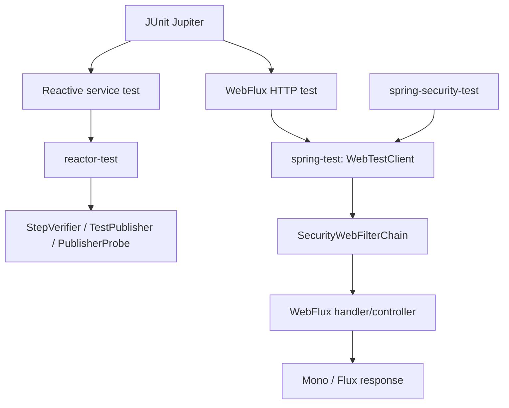

# Phụ thuộc bổ sung cho Reactor Test và kiểm thử WebFlux

Ứng dụng Spring WebFlux thường trả về `Mono<T>` hoặc `Flux<T>`. Khi kiểm thử, ta cần phân biệt hai việc: **xác minh chuỗi dữ liệu Reactive** và **gửi HTTP request qua ứng dụng WebFlux**. `reactor-test` cung cấp `StepVerifier`, `TestPublisher` và `PublisherProbe` để kiểm tra publisher; `WebTestClient` thuộc Spring Test để gọi endpoint; `spring-security-test` bổ sung các công cụ giả lập user/JWT/CSRF và tích hợp với Security WebFilter chain.

Ba nhóm công cụ phối hợp nhưng không thay thế nhau. Có `reactor-test` không có nghĩa test đã chạy qua WebFlux router hoặc Spring Security. Có `WebTestClient` cũng không tự động cung cấp các API của `StepVerifier`. Bài này hướng dẫn chọn và khai báo đúng phụ thuộc, sau đó kết hợp chúng để kiểm thử Reactive service, HTTP endpoint và chính sách bảo mật.

Nội dung thuộc chương **Phụ thuộc và phiên bản** của mô-đun **SPRING_SECURITY_TESTING**. Mô-đun tập trung kiểm chứng xác thực, phân quyền và bảo vệ HTTP bằng `spring-security-test` trên Servlet và Reactive, với `MockMvc`, `WebTestClient`, `@WithMockUser`, `SecurityContext`, JWT/OAuth2/OIDC giả lập và các ca được phép hoặc bị từ chối.

## 1. Mục tiêu học tập

Sau bài này, người học có thể:

1. Phân biệt `reactor-test`, `spring-test` và `spring-security-test`.
2. Khai báo `reactor-test` đúng scope trong Maven/Gradle và để BOM quản lý phiên bản cùng `reactor-core`.
3. Dùng `StepVerifier` để xác minh tín hiệu `onNext`, `onError`, `onComplete`, cancellation và backpressure.
4. Dùng `withVirtualTime` để kiểm tra operator có thời gian mà không phải chờ thời gian thực.
5. Dùng `TestPublisher` để chủ động phát dữ liệu/lỗi và `PublisherProbe` để xác minh nhánh publisher đã được subscribe.
6. Dùng `WebTestClient` với `@WebFluxTest` hoặc `@SpringBootTest` để kiểm thử HTTP.
7. Kết hợp `mockUser()`, `mockJwt()` và `springSecurity()` để kiểm thử authorization trong Reactive pipeline.
8. Nhận diện lỗi thường gặp do thiếu dependency, chọn sai web stack, thiếu security chain hoặc hiểu nhầm Reactor Context.

## 2. Ba lớp công cụ: publisher, HTTP và security

| Công cụ | Artifact / package chính | Vai trò | Dùng khi |
|---|---|---|---|
| **Reactor Test** | `io.projectreactor:reactor-test`; `reactor.test.*` | Xác minh chuỗi `Mono`/`Flux`, điều khiển nguồn phát, thời gian ảo và kiểm tra nhánh publisher | Test service/operator Reactive trực tiếp |
| **Spring Test** | `org.springframework:spring-test`; `org.springframework.test.web.reactive.server.WebTestClient` | Dựng test context và gửi request HTTP qua WebFlux test infrastructure hoặc server thật | Test endpoint, status, header và response body |
| **Spring Security Test** | `org.springframework.security:spring-security-test`; `org.springframework.security.test.web.reactive.server.SecurityMockServerConfigurers` | Tạo principal/JWT/OAuth2/CSRF giả lập và tích hợp Security vào `WebTestClient` | Test authentication, authorization và bảo vệ request |
| **JUnit Jupiter** | `org.junit.jupiter:junit-jupiter` | Phát hiện/chạy test method và assertion lifecycle | Tất cả test Java viết bằng JUnit 5 |
| **Mockito** | `org.mockito:mockito-core` | Mock collaborator như repository/client | Cô lập logic service hoặc controller |

`reactor-test` kiểm tra **publisher-level behavior**. `WebTestClient` kiểm tra **HTTP-level behavior**. `spring-security-test` chuẩn bị danh tính và cấu hình hỗ trợ kiểm thử bảo mật.

Sơ đồ quan hệ:



**Chọn đúng công cụ theo câu hỏi:**

- “Publisher có phát đúng giá trị, lỗi và tín hiệu kết thúc không?” → `StepVerifier`.
- “Nhánh `switchIfEmpty` có thực sự được gọi không?” → `PublisherProbe`.
- “Tôi muốn tự phát dữ liệu theo từng bước để kiểm tra backpressure hoặc lỗi?” → `TestPublisher`.
- “Endpoint có trả `403` cho user thiếu quyền không?” → `WebTestClient` + Spring Security Test.
- “JWT giả lập có đủ scope để đi qua rule không?” → `mockJwt()` + `WebTestClient`.

`StepVerifier` không chạy HTTP filter chain. `WebTestClient` không thay thế việc kiểm tra publisher ở mức service. Nếu mục tiêu là xác minh cả hai lớp, hãy viết các test riêng ở đúng ranh giới.

## 3. Khi nào cần thêm `reactor-test`?

Các kiểu `Mono`, `Flux` và operator cơ bản thuộc Reactor Core. Các tiện ích chuyên dụng để kiểm thử nằm trong artifact riêng `reactor-test`.

| API | Package | Chức năng |
|---|---|---|
| `StepVerifier` | `reactor.test.StepVerifier` | Viết kịch bản expectation cho các tín hiệu của publisher |
| `StepVerifierOptions` | `reactor.test.StepVerifierOptions` | Đặt tên scenario, cấu hình verifier |
| `TestPublisher` | `reactor.test.publisher.TestPublisher` | Chủ động phát `onNext`, `onError`, `onComplete` |
| `PublisherProbe` | `reactor.test.publisher.PublisherProbe` | Theo dõi subscription, request, cancellation của nhánh publisher |
| `VirtualTimeScheduler` | `reactor.test.scheduler.VirtualTimeScheduler` | Điều khiển đồng hồ ảo cho operator dựa trên scheduler |

Nếu test source import `reactor.test.StepVerifier` nhưng compiler báo không tìm thấy package, cần bổ sung `reactor-test` vào **test classpath**. Dependency runtime `spring-boot-starter-webflux` cung cấp Reactor Core cho ứng dụng nhưng không nên được coi là bằng chứng rằng toàn bộ API kiểm thử Reactor đã có mặt.

`WebTestClient` lại đến từ `spring-test` và có thể được Spring Boot auto-configure trong WebFlux test. Chỉ test HTTP đơn thuần không nhất thiết cần `StepVerifier`; thêm `reactor-test` khi test cần các API của Reactor Test.

## 4. Khai báo dependency trên Spring Boot 3.x

### 4.1. Maven

Ví dụ ứng dụng Spring Boot 3.x sử dụng WebFlux và Spring Security:

```xml
<dependencies>
    <!-- Runtime: WebFlux và Reactor Core -->
    <dependency>
        <groupId>org.springframework.boot</groupId>
        <artifactId>spring-boot-starter-webflux</artifactId>
    </dependency>

    <!-- Runtime: Reactive Spring Security -->
    <dependency>
        <groupId>org.springframework.boot</groupId>
        <artifactId>spring-boot-starter-security</artifactId>
    </dependency>

    <!-- Test infrastructure, JUnit Jupiter, Spring Test, Mockito... -->
    <dependency>
        <groupId>org.springframework.boot</groupId>
        <artifactId>spring-boot-starter-test</artifactId>
        <scope>test</scope>
    </dependency>

    <!-- Security mockUser(), mockJwt(), csrf() cho WebTestClient -->
    <dependency>
        <groupId>org.springframework.security</groupId>
        <artifactId>spring-security-test</artifactId>
        <scope>test</scope>
    </dependency>

    <!-- StepVerifier, TestPublisher, PublisherProbe -->
    <dependency>
        <groupId>io.projectreactor</groupId>
        <artifactId>reactor-test</artifactId>
        <scope>test</scope>
    </dependency>
</dependencies>
```

Nếu project có Spring Boot parent hoặc import `spring-boot-dependencies` BOM, không cần tự gắn version riêng cho `reactor-test`. Boot quản lý phiên bản Reactor tương thích với bộ dependency của ứng dụng.

### 4.2. Gradle Kotlin DSL

```kotlin
dependencies {
    implementation("org.springframework.boot:spring-boot-starter-webflux")
    implementation("org.springframework.boot:spring-boot-starter-security")

    testImplementation("org.springframework.boot:spring-boot-starter-test")
    testImplementation("org.springframework.security:spring-security-test")
    testImplementation("io.projectreactor:reactor-test")
    testRuntimeOnly("org.junit.platform:junit-platform-launcher")
}

tasks.test {
    useJUnitPlatform()
}
```

Với Groovy DSL (`build.gradle`):

```groovy
dependencies {
    implementation 'org.springframework.boot:spring-boot-starter-webflux'
    implementation 'org.springframework.boot:spring-boot-starter-security'

    testImplementation 'org.springframework.boot:spring-boot-starter-test'
    testImplementation 'org.springframework.security:spring-security-test'
    testImplementation 'io.projectreactor:reactor-test'
    testRuntimeOnly 'org.junit.platform:junit-platform-launcher'
}

tasks.named('test', Test) {
    useJUnitPlatform()
}
```

Các ví dụ giả định plugin Spring Boot/dependency management đã được áp dụng. Đặt `reactor-test` trong `testImplementation`, không phải `implementation`, vì đây là thư viện phục vụ test.

## 5. Spring Boot 4.x: starter WebFlux test theo module

Boot 4 tách các test starter theo công nghệ. Với ứng dụng WebFlux, bộ khai báo thường gồm:

- `spring-boot-starter-webflux` cho runtime.
- `spring-boot-starter-webflux-test` cho hạ tầng test WebFlux.
- `spring-boot-starter-security-test` cho Spring Security Test.
- `spring-boot-starter-test` cho các thư viện kiểm thử chung.
- `io.projectreactor:reactor-test` khi test sử dụng `StepVerifier`, `TestPublisher` hoặc `PublisherProbe`.

Maven:

```xml
<dependencies>
    <dependency>
        <groupId>org.springframework.boot</groupId>
        <artifactId>spring-boot-starter-webflux</artifactId>
    </dependency>
    <dependency>
        <groupId>org.springframework.boot</groupId>
        <artifactId>spring-boot-starter-security</artifactId>
    </dependency>

    <dependency>
        <groupId>org.springframework.boot</groupId>
        <artifactId>spring-boot-starter-test</artifactId>
        <scope>test</scope>
    </dependency>
    <dependency>
        <groupId>org.springframework.boot</groupId>
        <artifactId>spring-boot-starter-webflux-test</artifactId>
        <scope>test</scope>
    </dependency>
    <dependency>
        <groupId>org.springframework.boot</groupId>
        <artifactId>spring-boot-starter-security-test</artifactId>
        <scope>test</scope>
    </dependency>
    <dependency>
        <groupId>io.projectreactor</groupId>
        <artifactId>reactor-test</artifactId>
        <scope>test</scope>
    </dependency>
</dependencies>
```

Gradle Kotlin DSL:

```kotlin
dependencies {
    implementation("org.springframework.boot:spring-boot-starter-webflux")
    implementation("org.springframework.boot:spring-boot-starter-security")

    testImplementation("org.springframework.boot:spring-boot-starter-test")
    testImplementation("org.springframework.boot:spring-boot-starter-webflux-test")
    testImplementation("org.springframework.boot:spring-boot-starter-security-test")
    testImplementation("io.projectreactor:reactor-test")
    testRuntimeOnly("org.junit.platform:junit-platform-launcher")
}

tasks.test {
    useJUnitPlatform()
}
```

Boot BOM quản lý phiên bản của starter và Reactor. Dù starter WebFlux test có thể đưa một số test infrastructure vào classpath, khai báo trực tiếp `reactor-test` giúp thể hiện rõ test source sử dụng API Reactor nào và bảo đảm dependency được quản lý có chủ đích.

### 5.1. Boot 3.x và Boot 4.x khác nhau ở đâu?

| Thành phần | Boot 3.x | Boot 4.x |
|---|---|---|
| WebFlux runtime | `spring-boot-starter-webflux` | `spring-boot-starter-webflux` |
| Test WebFlux | `spring-boot-starter-test` cùng WebFlux test infrastructure | `spring-boot-starter-webflux-test` |
| Test Security | `org.springframework.security:spring-security-test` | `spring-boot-starter-security-test` |
| Reactor Test | `io.projectreactor:reactor-test` | `io.projectreactor:reactor-test` |
| Test client | `WebTestClient` từ Spring Test | `WebTestClient` từ Spring Test, được Boot test starter cấu hình |

Khi nâng Boot, kiểm tra package của `@WebFluxTest`, `@AutoConfigureWebTestClient` và các annotation Boot test khác theo đúng dòng. Các API của Reactor như `StepVerifier` vẫn thuộc `reactor-test`; chúng không chuyển thành API của Boot.

## 6. Dự án không dùng Spring Boot

Với Spring Framework thuần, khai báo các dependency trực tiếp và quản lý version bằng BOM/constraints tương thích:

```kotlin
dependencies {
    implementation("org.springframework:spring-webflux")
    implementation("org.springframework.security:spring-security-web")
    implementation("org.springframework.security:spring-security-config")

    testImplementation("org.springframework:spring-test")
    testImplementation("org.springframework.security:spring-security-test")
    testImplementation("io.projectreactor:reactor-test")
    testImplementation("org.junit.jupiter:junit-jupiter")
    testRuntimeOnly("org.junit.platform:junit-platform-launcher")
}

tasks.test {
    useJUnitPlatform()
}
```

Ví dụ trên chỉ tập trung vào các thư viện liên quan. Ứng dụng thực tế còn cần Reactor Core, Spring Context và các module runtime khác phù hợp. Nên dùng BOM của Spring Framework, Spring Security và Reactor để tránh `reactor-test` lệch version với `reactor-core`.

## 7. `StepVerifier`: kiểm tra tín hiệu Mono/Flux

Reactive stream là chuỗi tín hiệu, không phải một giá trị trả về đồng bộ. `StepVerifier` subscribe vào publisher, so sánh các tín hiệu nhận được với expectation đã khai báo, rồi kích hoạt xác minh bằng `verify()` hoặc shortcut như `verifyComplete()`.

Ví dụ service trả danh sách mã báo cáo dưới dạng `Flux<String>`:

```java
Flux<String> reportCodes() {
    return Flux.just("Q1", "Q2", "Q3");
}
```

Test:

```java
import org.junit.jupiter.api.Test;
import reactor.core.publisher.Flux;
import reactor.test.StepVerifier;

class ReportServiceTest {

    @Test
    void emitsReportsInOrder() {
        Flux<String> result = Flux.just("Q1", "Q2", "Q3");

        StepVerifier.create(result)
                .expectNext("Q1")
                .expectNext("Q2")
                .expectNext("Q3")
                .verifyComplete();
    }
}
```

### 7.1. Kiểm tra lỗi

```java
@Test
void emitsAccessError() {
    Mono<String> result =
            Mono.error(new IllegalStateException("access denied"));

    StepVerifier.create(result)
            .expectErrorMessage("access denied")
            .verify();
}
```

Có thể kiểm tra kiểu ngoại lệ bằng `expectError(IllegalStateException.class)`, hoặc kiểm tra điều kiện chi tiết với `expectErrorSatisfies`:

```java
StepVerifier.create(result)
        .expectErrorSatisfies(error -> {
            assertThat(error)
                    .isInstanceOf(IllegalStateException.class)
                    .hasMessage("access denied");
        })
        .verify();
```

### 7.2. Kiểm tra cancellation và backpressure

`StepVerifier` có thể điều khiển demand để xác minh publisher không phát quá số phần tử mà subscriber yêu cầu:

```java
@Test
void emitsOnlyWhenRequested() {
    StepVerifier.create(Flux.range(1, 3), 0)
            .expectSubscription()
            .thenRequest(1)
            .expectNext(1)
            .thenRequest(1)
            .expectNext(2)
            .thenCancel()
            .verify();
}
```

Test này bắt đầu với demand bằng 0, yêu cầu từng phần tử và cuối cùng cancel. Nó hữu ích khi kiểm tra publisher tự viết hoặc operator có liên quan đến backpressure. Không cần viết test backpressure cho mọi service đơn giản; chỉ tập trung vào nơi hành vi demand là một phần hợp đồng của API.

### 7.3. Đặt timeout cho verify

Các phương thức `verify()` mặc định có thể chờ không giới hạn. Nếu publisher không phát tín hiệu kết thúc, test có thể treo. Có thể đặt timeout cho từng test:

```java
StepVerifier.create(result)
        .expectNext("Q1")
        .expectComplete()
        .verify(Duration.ofSeconds(2));
```

Hoặc dùng `verify(Duration)` sau terminal expectation. Việc đặt timeout mặc định toàn cục bằng `StepVerifier.setDefaultTimeout(...)` cũng có thể áp dụng cho suite, nhưng đó là state dùng chung; hãy reset nếu test thay đổi cấu hình này.

## 8. Virtual time: kiểm tra delay mà không chờ thời gian thật

Các operator như `Mono.delay`, `Flux.interval`, `delayElements`, `timeout` phụ thuộc scheduler và thời gian. Nếu test chờ một khoảng dài theo thời gian thực, suite sẽ chậm. `StepVerifier.withVirtualTime` tạo môi trường scheduler ảo để test chủ động tiến đồng hồ.

```java
@Test
void emitsAfterOneDayWithoutWaitingOneDay() {
    StepVerifier.withVirtualTime(
                    () -> Mono.delay(Duration.ofDays(1)))
            .expectSubscription()
            .expectNoEvent(Duration.ofDays(1))
            .expectNext(0L)
            .verifyComplete();
}
```

**Publisher phải được tạo bên trong Supplier** của `withVirtualTime`. Không tạo `Mono.delay(...)` trước rồi trả biến đã tạo từ lambda, vì scheduler ảo có thể chưa được kích hoạt lúc operator được khởi tạo.

Ví dụ sai:

```java
Mono<Long> delayed = Mono.delay(Duration.ofHours(1));

StepVerifier.withVirtualTime(() -> delayed)
        .thenAwait(Duration.ofHours(1))
        .expectNext(0L)
        .verifyComplete();
```

Ví dụ đúng:

```java
StepVerifier.withVirtualTime(() -> Mono.delay(Duration.ofHours(1)))
        .thenAwait(Duration.ofHours(1))
        .expectNext(0L)
        .verifyComplete();
```

Dùng `expectNoEvent` khi muốn khẳng định không có tín hiệu nào trong khoảng thời gian; nó tính cả subscription là event, vì vậy thường đặt `expectSubscription()` trước. Dùng `thenAwait` khi chỉ cần tiến đồng hồ và chờ publisher phát tín hiệu.

Virtual time không điều khiển được mọi scheduler tùy biến hoặc timer đã khởi tạo bên ngoài supplier. Nếu code tạo scheduler riêng, kiểm tra cách truyền scheduler vào operator và cung cấp scheduler ảo tương ứng.

## 9. `TestPublisher`: chủ động điều khiển dữ liệu đầu vào

`TestPublisher` là publisher dành cho test, cho phép test phát `onNext`, `onComplete` hoặc `onError` vào đúng thời điểm cần thiết. Nó phù hợp khi test một operator hoặc service cần phản ứng với dữ liệu đến chậm, lỗi giữa chừng hay cancellation.

```java
@Test
void handlesValuesAndCompletion() {
    TestPublisher<String> source = TestPublisher.create();

    Flux<String> result = source.flux()
            .map(String::toUpperCase);

    StepVerifier.create(result)
            .then(() -> source.emit("a", "b"))
            .expectNext("A", "B")
            .verifyComplete();
}
```

Có thể điều khiển tín hiệu riêng biệt:

```java
@Test
void handlesLateError() {
    TestPublisher<String> source = TestPublisher.create();

    StepVerifier.create(source.flux())
            .then(() -> source.next("first"))
            .expectNext("first")
            .then(() -> source.error(new IllegalStateException("upstream failed")))
            .expectErrorMessage("upstream failed")
            .verify();
}
```

### 9.1. Kiểm tra demand và subscriber

```java
@Test
void sourceReceivesDemand() {
    TestPublisher<String> source = TestPublisher.create();

    StepVerifier.create(source.flux(), 0)
            .then(() -> source.assertSubscribers(1))
            .thenRequest(1)
            .then(() -> source.next("one"))
            .expectNext("one")
            .thenCancel()
            .verify();

    source.assertWasCancelled();
}
```

`TestPublisher.create()` tạo publisher tuân thủ Reactive Streams. API `createNoncompliant(...)` cho phép mô phỏng publisher vi phạm một số quy tắc, chẳng hạn phát vượt demand hoặc phát null. Chỉ dùng nguồn không tuân thủ khi đang kiểm tra khả năng chống lỗi của operator hoặc adapter; không dùng nó như nguồn mặc định cho test thông thường.

## 10. `PublisherProbe`: xác minh nhánh xử lý đã được sử dụng

Một số publisher có thể cùng phát ra `Mono.empty()`, vì vậy chỉ kiểm tra output không đủ biết nhánh nào đã chạy. `PublisherProbe` theo dõi publisher có được subscribe, request hoặc cancel hay không.

Ví dụ service có fallback khi repository không tìm thấy dữ liệu:

```java
@Test
void fallbackIsUsedWhenPrimaryIsEmpty() {
    PublisherProbe<String> fallback =
            PublisherProbe.of(Mono.just("fallback"));

    Mono<String> result = Mono.<String>empty()
            .switchIfEmpty(fallback.mono());

    StepVerifier.create(result)
            .expectNext("fallback")
            .verifyComplete();

    fallback.assertWasSubscribed();
    fallback.assertWasRequested();
}
```

Nếu nhánh fallback không nên chạy:

```java
@Test
void fallbackIsNotUsedWhenPrimaryHasValue() {
    PublisherProbe<String> fallback =
            PublisherProbe.of(Mono.just("fallback"));

    Mono<String> result = Mono.just("primary")
            .switchIfEmpty(fallback.mono());

    StepVerifier.create(result)
            .expectNext("primary")
            .verifyComplete();

    fallback.assertWasNotSubscribed();
}
```

`PublisherProbe` hữu ích để kiểm tra đường đi điều khiển. Nó không thay thế assertion về dữ liệu đầu ra; nên kiểm tra cả kết quả publisher lẫn trạng thái probe.

## 11. Kiểm tra Reactor Context và Reactive SecurityContext

Trong ứng dụng Reactive, thông tin theo request được truyền qua **Reactor Context**. Spring Security WebFlux dùng cơ chế này để cung cấp `SecurityContext` cho pipeline. Không nên dựa vào giả định rằng `SecurityContextHolder` kiểu ThreadLocal luôn chứa user hiện tại như trong Servlet.

Có thể đọc authentication từ `ReactiveSecurityContextHolder` bên trong publisher:

```java
Mono<String> currentUsername =
        ReactiveSecurityContextHolder.getContext()
                .map(context -> context.getAuthentication().getName());
```

Trong unit test, có thể đặt authentication vào Reactor Context:

```java
@Test
void readsAuthenticationFromReactorContext() {
    Authentication authentication =
            new UsernamePasswordAuthenticationToken(
                    "linh", "n/a", List.of(new SimpleGrantedAuthority("ROLE_USER")));

    Mono<String> currentUsername =
            ReactiveSecurityContextHolder.getContext()
                    .map(context -> context.getAuthentication().getName());

    StepVerifier.create(currentUsername.contextWrite(
                    ReactiveSecurityContextHolder.withAuthentication(authentication)))
            .expectNext("linh")
            .verifyComplete();
}
```

Đây là test publisher-level cho cách đọc Reactor Context. Nó không chạy WebFlux Security WebFilter chain. Để xác minh request HTTP được xác thực và phân quyền, dùng `WebTestClient` cùng `spring-security-test` như phần tiếp theo.

## 12. Kiểm thử HTTP WebFlux bằng WebTestClient

`WebTestClient` thuộc Spring Test. Với ứng dụng WebFlux, nó có thể gắn vào `ApplicationContext` hoặc gửi request đến server thật. Khi dùng mock environment, không cần mở cổng HTTP.

### 12.1. WebFlux test slice

`@WebFluxTest` nạp hạ tầng WebFlux và giới hạn phạm vi bean được scan. Nó thường phù hợp khi muốn kiểm tra một controller/handler. Nếu controller cần service collaborator, cung cấp mock bean bằng API phù hợp với phiên bản Spring đang dùng.

**Security configuration tùy chỉnh cần được import rõ ràng.** WebFlux test slice không tự động phát hiện mọi bean `SecurityWebFilterChain` trong ứng dụng. Có thể dùng `@Import(SecurityConfig.class)` hoặc test context rộng hơn khi cần kiểm tra chính sách thật.

Ví dụ khung test Boot 3.x:

```java
import org.junit.jupiter.api.Test;
import org.springframework.beans.factory.annotation.Autowired;
import org.springframework.boot.test.autoconfigure.web.reactive.WebFluxTest;
import org.springframework.context.annotation.Import;
import org.springframework.security.test.context.support.WithMockUser;
import org.springframework.test.web.reactive.server.WebTestClient;

@WebFluxTest(ReportController.class)
@Import(ReactiveSecurityConfig.class)
class ReportControllerTest {

    @Autowired
    WebTestClient client;

    @Test
    @WithMockUser(roles = "ANALYST")
    void analystCanReadReports() {
        client.get()
                .uri("/api/reports")
                .exchange()
                .expectStatus().isOk();
    }
}
```

Với Boot 4.x, kiểm tra package của `@WebFluxTest` và starter test theo module WebFlux. Ví dụ import theo Boot 4:

```java
import org.springframework.boot.webflux.test.autoconfigure.WebFluxTest;
```

Chỉ dùng import tương ứng với version trong dự án; không trộn package Boot 3.x và Boot 4.x trong cùng một lớp.

### 12.2. Gắn Security support vào WebTestClient thủ công

Khi tự tạo client từ `ApplicationContext`, tích hợp security bằng `springSecurity()`:

```java
import static org.springframework.security.test.web.reactive.server.SecurityMockServerConfigurers.springSecurity;

WebTestClient client = WebTestClient.bindToApplicationContext(context)
        .apply(springSecurity())
        .configureClient()
        .build();
```

Đảm bảo context chứa `SecurityWebFilterChain` đang được kiểm thử. Nếu dùng Boot auto-configuration và inject `WebTestClient`, hãy kiểm tra cấu hình security có được nạp; không cần áp dụng configurer thủ công thêm một lần nếu client đã được cấu hình phù hợp.

## 13. Kết hợp WebTestClient với Spring Security Test

Spring Security Test cung cấp các mutator Reactive trong:

```java
org.springframework.security.test.web.reactive.server.SecurityMockServerConfigurers
```

Các helper phổ biến:

| Helper | Ý nghĩa |
|---|---|
| `mockUser("lan")` | Gắn user giả lập vào Reactive exchange |
| `mockJwt()` | Gắn JWT authentication giả lập |
| `mockOpaqueToken()` | Gắn opaque-token authentication giả lập |
| `mockOAuth2Login()` | Mô phỏng OAuth2 Login |
| `mockOidcLogin()` | Mô phỏng OIDC Login |
| `csrf()` | Thêm CSRF token cho request |
| `springSecurity()` | Tích hợp Spring Security vào WebTestClient builder |

### 13.1. Kiểm tra role với mockUser

```java
import static org.springframework.security.test.web.reactive.server.SecurityMockServerConfigurers.mockUser;

@Test
void regularUserCannotAccessAdminEndpoint() {
    client.mutateWith(mockUser("lan").roles("USER"))
            .get().uri("/api/admin/reports")
            .exchange()
            .expectStatus().isForbidden();
}

@Test
void adminCanAccessAdminEndpoint() {
    client.mutateWith(mockUser("minh").roles("ADMIN"))
            .get().uri("/api/admin/reports")
            .exchange()
            .expectStatus().isOk();
}
```

Giả định endpoint yêu cầu `ROLE_ADMIN` và response thành công là `200`. `mockUser()` không thực hiện login thật; nó tạo authentication phục vụ test authorization.

### 13.2. Kiểm tra scope với mockJwt

```java
import org.springframework.security.core.authority.SimpleGrantedAuthority;

import static org.springframework.security.test.web.reactive.server.SecurityMockServerConfigurers.mockJwt;

@Test
void jwtWithRequiredScopeCanExport() {
    client.mutateWith(mockJwt().authorities(
                    new SimpleGrantedAuthority("SCOPE_reports.export")))
            .get().uri("/api/export")
            .exchange()
            .expectStatus().isOk();
}

@Test
void jwtWithoutRequiredScopeIsDenied() {
    client.mutateWith(mockJwt().authorities(
                    new SimpleGrantedAuthority("SCOPE_other")))
            .get().uri("/api/export")
            .exchange()
            .expectStatus().isForbidden();
}
```

Các test này kiểm tra authorization với một JWT authentication giả lập. Chúng **không** xác minh chữ ký token, JWK, issuer, audience, expiration hoặc kết nối identity provider. Muốn kiểm tra token thật, cần test riêng đi qua `ReactiveJwtDecoder` và validator, hoặc integration test với issuer/JWK test phù hợp.

### 13.3. CSRF cho request thay đổi dữ liệu

Khi ứng dụng WebFlux bật CSRF cho endpoint POST, có thể thêm token bằng mutator:

```java
import static org.springframework.security.test.web.reactive.server.SecurityMockServerConfigurers.csrf;

client.mutateWith(mockUser("admin").roles("ADMIN"))
        .mutateWith(csrf())
        .post().uri("/api/reports")
        .exchange()
        .expectStatus().isCreated();
```

Để chứng minh CSRF đang bảo vệ endpoint, viết thêm ca thiếu token hoặc token sai và xác nhận bị từ chối. Không mặc định rằng mọi API stateless Bearer token đều bật CSRF; expectation phải khớp cấu hình thực tế.

## 14. Chọn cấp độ kiểm thử cho WebFlux

| Mục tiêu | Công cụ phù hợp | Những gì được kiểm tra |
|---|---|---|
| Logic map/filter/flatMap của service | JUnit + `StepVerifier` | Giá trị, lỗi, completion, cancellation và demand |
| Delay/retry/timeout | `StepVerifier.withVirtualTime` | Thời gian logic mà không chờ thật |
| Nhánh fallback hoặc publisher thay thế | `PublisherProbe` | Publisher nào được subscribe/request |
| Nguồn dữ liệu phát theo kịch bản | `TestPublisher` | Tín hiệu đến muộn, lỗi, backpressure |
| HTTP endpoint, status, body | `WebTestClient` | WebFlux handler/router và HTTP behavior |
| HTTP authentication/authorization | `WebTestClient` + `spring-security-test` | SecurityWebFilterChain, principal, authority và response |
| Token validation thật | Integration test với decoder/issuer | Chữ ký, claim, issuer, audience, expiration và cấu hình xác thực |

Không cần dùng `StepVerifier` để kiểm tra status của endpoint HTTP; `WebTestClient` đã có `expectStatus()`, `expectHeader()`, `expectBody()`. Ngược lại, không dùng `WebTestClient` chỉ để kiểm tra một `Flux` thuần không đi qua web stack.

## 15. Lỗi thường gặp và cách khắc phục

| Triệu chứng | Nguyên nhân có thể | Cách kiểm tra |
|---|---|---|
| Không tìm thấy `reactor.test.StepVerifier` | Thiếu `reactor-test` trong test classpath | Thêm `testImplementation`/`<scope>test</scope>` |
| `WebTestClient` không resolve | Thiếu Spring Test/WebFlux test infrastructure | Kiểm tra `spring-test` hoặc WebFlux test starter |
| `mockUser()`/ `mockJwt()` không resolve | Thiếu Spring Security Test hoặc import sai package | Kiểm tra `spring-security-test` và `SecurityMockServerConfigurers` |
| WebFlux slice trả `200` khi thiếu quyền | Security config không được nạp hoặc chain không tham gia | `@Import(ReactiveSecurityConfig.class)`, kiểm tra `springSecurity()` |
| Test dùng WebFlux nhưng Boot dựng MVC context | Cả MVC và WebFlux cùng có trên classpath; MVC được ưu tiên | Chỉ giữ web stack cần thiết hoặc đặt `spring.main.web-application-type=reactive` cho test phù hợp |
| `@WebFluxTest` không tìm thấy functional route | Slice không tự phát hiện mọi `RouterFunction` | Import router hoặc dùng `@SpringBootTest` |
| Test treo ở `verify()` | Publisher không kết thúc hoặc thiếu demand/tín hiệu | Dùng `verify(Duration)`, kiểm tra subscription/request và terminal event |
| Virtual time không chạy | Publisher/operator được tạo trước khi virtual scheduler được cài | Tạo toàn bộ timed publisher trong Supplier |
| Test kỳ vọng user qua `SecurityContextHolder` nhưng không thấy | Reactive Security dùng Reactor Context | Dùng `ReactiveSecurityContextHolder` hoặc WebTestClient mutator |
| JWT mock xanh nhưng token thật bị từ chối | Mock bỏ qua bước decoder/validator | Viết integration test với decoder/token thật |
| Test context không khởi động sau nâng Boot | Starter/package test thay đổi | Kiểm tra WebFlux test starter, annotation package và dependency tree |

### 15.1. Kiểm tra dependency đã resolve

Maven:

```bash
./mvnw dependency:tree -Dscope=test
```

Gradle:

```bash
./gradlew dependencies --configuration testRuntimeClasspath
./gradlew dependencyInsight --dependency reactor-test --configuration testRuntimeClasspath
./gradlew dependencyInsight --dependency reactor-core --configuration testRuntimeClasspath
./gradlew dependencyInsight --dependency spring-security-test --configuration testRuntimeClasspath
```

Kiểm tra `reactor-test` và `reactor-core` được quản lý bởi cùng BOM hoặc dependency constraints. Không pin `reactor-test` một version tùy ý cao hơn Reactor Core mà ứng dụng đang dùng.

## 16. Bài tập thực hành

Giả sử ứng dụng WebFlux có:

- `GET /api/reports` yêu cầu `ROLE_ANALYST`.
- `GET /api/export` yêu cầu `SCOPE_reports.export`.
- `ReportService.streamReports()` trả về `Flux<Report>`.
- `ReportService.findReport(id)` trả về `Mono<Report>` và có thể phát `Mono.empty()`.

Thực hiện theo thứ tự:

1. Khai báo `reactor-test` trong test scope và xác minh `StepVerifier` có thể import.
2. Viết test `streamReports()` xác nhận thứ tự phần tử và completion.
3. Viết test cho trường hợp `findReport(id)` phát `Mono.empty()`, dùng `PublisherProbe` để kiểm tra fallback.
4. Viết test retry/delay bằng `withVirtualTime`, bảo đảm publisher được tạo trong Supplier.
5. Dùng `@WebFluxTest` và `WebTestClient` để kiểm tra user có/không có role.
6. Dùng `mockJwt()` để kiểm tra scope export; ghi rõ test này không xác minh chữ ký JWT.
7. Nếu endpoint POST có CSRF, kiểm tra request thiếu token và có token.
8. Xác minh test slice đã import `SecurityWebFilterChain` và kết quả đi qua security filter thực tế.

**Tiêu chí hoàn thành:** người học phân biệt được test publisher với test HTTP, khai báo đúng dependency, sử dụng đúng API cho Reactor/WebFlux/Security và có cả ca được phép lẫn bị từ chối.

## 17. Tài liệu tham khảo chính thức

- [Reactor Reference — Testing](https://projectreactor.io/docs/core/release/reference/testing.html): `StepVerifier`, virtual time, `TestPublisher`, `PublisherProbe`.
- [Reactor Test API — StepVerifier](https://projectreactor.io/docs/test/release/api/reactor/test/StepVerifier.html): API expectation, timeout và `withVirtualTime`.
- [Reactor Test API — TestPublisher](https://projectreactor.io/docs/test/release/api/reactor/test/publisher/TestPublisher.html): điều khiển tín hiệu và kiểm tra demand.
- [Reactor Test API — PublisherProbe](https://projectreactor.io/docs/test/release/api/reactor/test/publisher/PublisherProbe.html): kiểm tra subscription, request và cancellation.
- [Spring Boot 3.5 — Testing Spring Boot Applications](https://docs.spring.io/spring-boot/3.5/reference/testing/spring-boot-applications.html): `@WebFluxTest`, `WebTestClient`, test slice và cấu hình Security.
- [Spring Boot 4.0 — Build Systems](https://docs.spring.io/spring-boot/4.0/reference/using/build-systems.html): `spring-boot-starter-webflux-test` và các starter test theo module.
- [Spring Security — Reactive Test Support](https://docs.spring.io/spring-security/reference/reactive/test/index.html): WebTestClient và các mutator Reactive.
- [Spring Security — WebTestClient Security Setup](https://docs.spring.io/spring-security/reference/reactive/test/web/setup.html): áp dụng `springSecurity()`.
- [Spring Security — Testing Authentication](https://docs.spring.io/spring-security/reference/reactive/test/web/authentication.html): `mockUser()`, `@WithMockUser` và kiểm tra authentication.

> **Ghi nhớ:** `reactor-test` xác minh publisher; `WebTestClient` kiểm thử HTTP WebFlux; `spring-security-test` giả lập authentication và tích hợp security chain. Chọn đúng lớp test giúp kết quả phản ánh đúng hành vi mà bạn muốn kiểm chứng.
