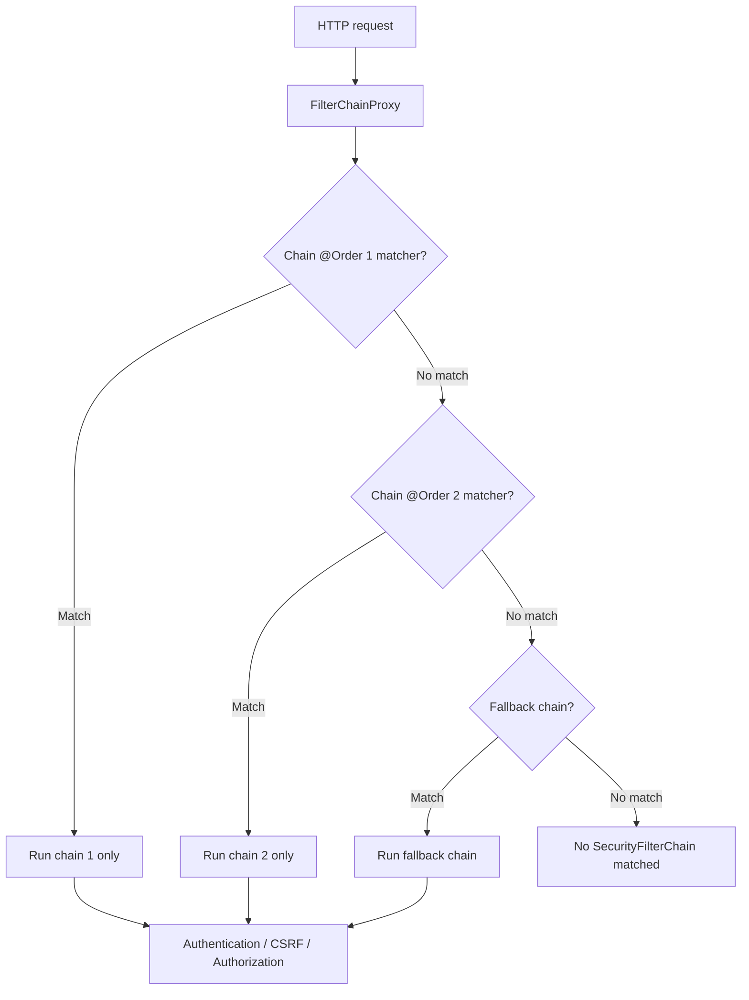

# Không trộn mô hình SecurityFilterChain với cấu hình legacy không tương thích

Spring Security đã chuyển từ mô hình cấu hình tập trung qua lớp kế thừa `WebSecurityConfigurerAdapter` sang mô hình khai báo các bean `SecurityFilterChain`. Trong giai đoạn chuyển tiếp, một dự án cũ có thể vẫn biên dịch với adapter, nhưng nếu thêm bean chain mới mà không hiểu cách Spring chọn chain, ứng dụng có thể tạo nhiều chuỗi lọc chồng lấn, rule bị che khuất hoặc endpoint không được bảo vệ như dự kiến. Từ Spring Security 6.0, `WebSecurityConfigurerAdapter` đã bị loại bỏ; code legacy không còn tương thích sẽ không thể biên dịch.

Bài này hướng dẫn nhận diện và chuyển đổi cấu hình an toàn: phân biệt cấu hình Servlet và Reactive, hiểu cách `FilterChainProxy` chọn chuỗi đầu tiên khớp request, tổ chức nhiều chain có chủ đích, di chuyển authentication/method security, và viết test để phát hiện cấu hình trùng lặp hoặc bỏ sót.

Nội dung thuộc chương **Phụ thuộc và phiên bản** của mô-đun **SPRING_SECURITY_TESTING**. Mô-đun kiểm chứng xác thực, phân quyền và bảo vệ HTTP bằng `spring-security-test` trên ứng dụng Servlet và Reactive, sử dụng `MockMvc`, `WebTestClient`, `@WithMockUser`, `SecurityContext`, JWT/OAuth2/OIDC giả lập và các ca được phép hoặc bị từ chối.

## 1. Mục tiêu học tập

Sau bài này, người học có thể:

1. Nhận diện cấu hình legacy và xác định phiên bản Spring Security còn hỗ trợ nó.
2. Chuyển `WebSecurityConfigurerAdapter` thành bean `SecurityFilterChain` mà không làm mất authentication hoặc authorization rule.
3. Phân biệt `securityMatcher()` chọn **chain** với `requestMatchers()` chọn **authorization rule** trong chain.
4. Tổ chức nhiều `SecurityFilterChain` theo thứ tự và phạm vi rõ ràng.
5. Tránh trộn Servlet `HttpSecurity` với Reactive `ServerHttpSecurity`.
6. Di chuyển `AuthenticationManagerBuilder`, `WebSecurityCustomizer` và method security theo đúng mục đích.
7. Dùng MockMvc/WebTestClient và Spring Security Test để phát hiện chain bị che khuất, thiếu fallback hoặc rule không còn được áp dụng.

## 2. Vì sao mô hình cấu hình đã thay đổi?

Ở các thế hệ Spring Security cũ, ứng dụng thường kế thừa `WebSecurityConfigurerAdapter` rồi override các phương thức `configure(HttpSecurity)`, `configure(WebSecurity)` hoặc `configure(AuthenticationManagerBuilder)`. Cách làm này gom nhiều trách nhiệm vào một lớp cấu hình.

Spring Security 5.7 đánh dấu `WebSecurityConfigurerAdapter` deprecated để chuyển sang cấu hình dựa trên bean; Spring Security 5.8 cung cấp giai đoạn chuyển tiếp và hướng dẫn migration; từ Spring Security 6.0, adapter đã bị loại bỏ. Với Security 6.x/7.x, cấu hình Servlet nên khai báo một hoặc nhiều bean `SecurityFilterChain`.

| Dòng Spring Security | Tình trạng của `WebSecurityConfigurerAdapter` | Hướng xử lý |
|---|---|---|
| 5.6 trở xuống | Mô hình cũ còn được hỗ trợ | Có thể duy trì trong ứng dụng cũ; cân nhắc chuyển đổi có kế hoạch |
| 5.7–5.8 | Deprecated / giai đoạn chuyển tiếp | Chuyển dần sang bean `SecurityFilterChain` và các bean authentication |
| 6.x | Đã bị loại bỏ | Phải dùng mô hình bean-based |
| 7.x | Không còn API adapter | Dùng cấu hình hiện hành của Servlet hoặc Reactive |

Không suy ra phiên bản Security chỉ từ mã nguồn. Với Spring Boot, kiểm tra BOM và dependency tree; với Spring Framework thuần, kiểm tra các module `spring-security-*` thực tế đã resolve.

### 2.1. Dấu hiệu nhận diện cấu hình legacy

Một lớp có các dấu hiệu sau thường được viết theo mô hình cũ:

- `extends WebSecurityConfigurerAdapter`.
- Override `configure(HttpSecurity http)`.
- Override `configure(WebSecurity web)`.
- Override `configure(AuthenticationManagerBuilder auth)`.
- Gọi `authorizeRequests()`, `antMatchers()` hoặc `mvcMatchers()`.
- Tổ chức toàn bộ cấu hình trong một lớp adapter thay vì khai báo bean chain.

Ví dụ:

```java
@Configuration
@EnableWebSecurity
public class LegacySecurityConfig extends WebSecurityConfigurerAdapter {

    @Override
    protected void configure(HttpSecurity http) throws Exception {
        http
            .authorizeRequests()
                .antMatchers("/public/**").permitAll()
                .antMatchers("/admin/**").hasRole("ADMIN")
                .anyRequest().authenticated()
            .and()
            .formLogin();
    }
}
```

Đoạn này không tương thích với Spring Security 6.x vì adapter đã bị loại bỏ. Chuyển đổi không chỉ là xóa `extends`: phải chuyển từng trách nhiệm của adapter sang đúng bean hoặc cấu hình mới.

## 3. Mô hình bean-based cho Servlet

Với Servlet/Spring MVC, điểm vào chính là `HttpSecurity`. Cấu hình được xây dựng thành một bean `SecurityFilterChain`:

```java
@Configuration
@EnableWebSecurity
public class SecurityConfig {

    @Bean
    SecurityFilterChain applicationSecurity(HttpSecurity http) throws Exception {
        http
            .authorizeHttpRequests(authorize -> authorize
                .requestMatchers("/public/**").permitAll()
                .requestMatchers("/admin/**").hasRole("ADMIN")
                .anyRequest().authenticated()
            )
            .formLogin(Customizer.withDefaults());

        return http.build();
    }
}
```

Các import chính:

```java
import org.springframework.context.annotation.Bean;
import org.springframework.context.annotation.Configuration;
import org.springframework.security.config.Customizer;
import org.springframework.security.config.annotation.web.builders.HttpSecurity;
import org.springframework.security.config.annotation.web.configuration.EnableWebSecurity;
import org.springframework.security.web.SecurityFilterChain;
```

Trong Spring Boot, auto-configuration thường đã kích hoạt cấu hình web security; `@EnableWebSecurity` có thể không cần khai báo lại. Trong ứng dụng Spring Security thuần, cần cấu hình hạ tầng phù hợp để bean chain được đăng ký vào `FilterChainProxy`.

**Điểm cần giữ nguyên khi migration:** tất cả rule cần thiết phải được chuyển sang chain mới. Khi ứng dụng khai báo bean `SecurityFilterChain`, cấu hình bảo mật web mặc định của Spring Boot thường lùi lại. Đừng giả định Boot sẽ tự thêm một chain mặc định để bảo vệ các URL mà chain tùy chỉnh không đề cập.

### 3.1. Ánh xạ trách nhiệm từ adapter sang bean

| Cấu hình legacy | Cách chuyển đổi thường dùng | Ghi chú |
|---|---|---|
| `configure(HttpSecurity)` | Một hoặc nhiều bean `SecurityFilterChain` | Mỗi chain gọi `http.build()` |
| `configure(WebSecurity)` | `WebSecurityCustomizer` nếu thật sự cần bỏ qua Security filter; thường ưu tiên `permitAll` trong chain | Bỏ qua filter có tác động khác với cho phép truy cập |
| `configure(AuthenticationManagerBuilder)` | Bean `UserDetailsService`, `PasswordEncoder`, `AuthenticationProvider` hoặc cấu hình authentication chuyên biệt | Không bê nguyên builder override sang code mới |
| `authenticationManagerBean()` | Lấy `AuthenticationManager` qua `AuthenticationConfiguration` khi ứng dụng thật sự cần expose bean | Không expose chỉ vì adapter cũ từng có method này |
| `@EnableGlobalMethodSecurity` | `@EnableMethodSecurity` | Kiểm tra riêng pre/post, secured và JSR-250 |

## 4. Phân biệt chain matcher và authorization matcher

Đây là nguyên nhân phổ biến nhất khiến nhiều chain bị cấu hình sai.

- `securityMatcher(...)` xác định **request nào thuộc SecurityFilterChain này**.
- `requestMatchers(...)` nằm trong `authorizeHttpRequests` và xác định **quyền nào áp dụng cho request sau khi chain đã được chọn**.

Ví dụ:

```java
@Bean
@Order(1)
SecurityFilterChain apiSecurity(HttpSecurity http) throws Exception {
    http
        .securityMatcher("/api/**")
        .authorizeHttpRequests(authorize -> authorize
            .requestMatchers("/api/public/**").permitAll()
            .anyRequest().hasRole("API_USER")
        )
        .httpBasic(Customizer.withDefaults());

    return http.build();
}
```

Trong ví dụ này, `securityMatcher("/api/**")` giới hạn chain cho request bắt đầu bằng `/api/`. Bên trong chain đó, `/api/public/**` được phép truy cập ẩn danh; các request API còn lại cần role `API_USER`.

Nếu viết `requestMatchers("/api/**").hasRole("API_USER")` nhưng không giới hạn chain, rule đó chỉ là một authorization rule trong chain đang áp dụng; nó không tạo một chain riêng.

### 4.1. Cách Spring chọn một chain

`FilterChainProxy` duyệt danh sách `SecurityFilterChain` theo thứ tự. Với một request, **chain đầu tiên có matcher khớp sẽ được chọn**. Các chain sau không tiếp tục được thử chỉ vì request bị từ chối ở chain đầu tiên.

Điều đó dẫn đến ba hệ quả:

1. Chain có phạm vi hẹp nên đặt trước chain tổng quát.
2. Chain cuối cùng thường là fallback cho các request còn lại.
3. Nếu không chain nào khớp, request không đi qua các filter bảo mật của những chain đó.

Sơ đồ:



### 4.2. Ví dụ nhiều chain có chủ đích

Một ứng dụng có API dùng HTTP Basic và trang quản trị dùng form login có thể khai báo:

```java
@Configuration
class MultiChainSecurityConfig {

    @Bean
    @Order(1)
    SecurityFilterChain apiChain(HttpSecurity http) throws Exception {
        http
            .securityMatcher("/api/**")
            .authorizeHttpRequests(authorize -> authorize
                .requestMatchers("/api/public/**").permitAll()
                .anyRequest().hasRole("API_ADMIN")
            )
            .httpBasic(Customizer.withDefaults());

        return http.build();
    }

    @Bean
    @Order(2)
    SecurityFilterChain browserChain(HttpSecurity http) throws Exception {
        http
            .authorizeHttpRequests(authorize -> authorize
                .requestMatchers("/assets/**").permitAll()
                .requestMatchers("/admin/**").hasRole("ADMIN")
                .anyRequest().authenticated()
            )
            .formLogin(Customizer.withDefaults());

        return http.build();
    }
}
```

Chain API chỉ chọn `/api/**`. Chain trình duyệt không khai báo `securityMatcher`, vì vậy nó là chain tổng quát cho các request chưa được chain API xử lý. Thứ tự `@Order(1)` và `@Order(2)` thể hiện ý định rõ ràng.

**Không phải cứ có nhiều bean SecurityFilterChain là sai.** Nhiều chain là thiết kế hợp lệ khi các phạm vi được phân chia có chủ đích. Lỗi xảy ra khi chain tổng quát đứng trước chain chuyên biệt, matcher chồng lấn ngoài ý muốn hoặc không có fallback.

### 4.3. Lỗi hai chain đều khớp mọi request

Ví dụ nguy hiểm:

```java
@Bean
@Order(1)
SecurityFilterChain firstChain(HttpSecurity http) throws Exception {
    http.authorizeHttpRequests(auth -> auth.anyRequest().permitAll());
    return http.build();
}

@Bean
@Order(2)
SecurityFilterChain adminChain(HttpSecurity http) throws Exception {
    http.authorizeHttpRequests(auth -> auth
        .requestMatchers("/admin/**").hasRole("ADMIN")
        .anyRequest().authenticated());
    return http.build();
}
```

Chain thứ nhất không giới hạn bằng `securityMatcher`, do đó có thể khớp mọi request. Chain thứ hai sẽ không được chọn cho các request đã khớp chain đầu. Rule ADMIN trong chain thứ hai không bảo vệ được `/admin/**`.

Cách sửa: giới hạn chain thứ nhất bằng matcher cụ thể, hoặc gộp các rule vào một chain nếu không cần chính sách/filter riêng. Luôn giữ một chain fallback có cấu hình xác thực và authorization rõ ràng.

## 5. Không trộn adapter legacy và bean chain một cách vô tình

Trong giai đoạn Spring Security 5.7/5.8, adapter cũ vẫn có thể tồn tại để hỗ trợ chuyển đổi. Tuy nhiên, khi dự án vừa có lớp kế thừa `WebSecurityConfigurerAdapter`, vừa khai báo bean `SecurityFilterChain`, hai nguồn cấu hình có thể cùng đóng góp các chain vào `FilterChainProxy`.

Điều đó không có nghĩa mọi trường hợp cùng tồn tại đều lập tức lỗi. Vấn đề là **thứ tự và phạm vi của các chain** có thể không còn rõ ràng. Một adapter cũ với cấu hình tổng quát có thể bắt request trước chain mới; ngược lại, chain mới tổng quát có thể che cấu hình adapter.

Quy tắc migration:

- Trong một ứng dụng Servlet, chọn một mô hình cấu hình nhất quán cho các chain.
- Khi chuyển adapter, chuyển toàn bộ rule của nó sang bean chain rồi xóa adapter cũ.
- Nếu buộc phải duy trì hai nguồn trong giai đoạn chuyển tiếp, ghi rõ matcher và thứ tự của từng chain, đồng thời viết test xác nhận request đi qua chính sách mong đợi.
- Không dùng coexistence như một cách “thêm rule” mà không hiểu `FilterChainProxy` chọn chain đầu tiên.

Từ Spring Security 6.0, lớp adapter đã bị loại bỏ nên không còn lựa chọn duy trì mô hình cũ trong cùng classpath.

## 6. Chuyển AuthenticationManagerBuilder và user configuration

Adapter cũ thường override:

```java
@Override
protected void configure(AuthenticationManagerBuilder auth) throws Exception {
    auth.inMemoryAuthentication()
        .withUser("admin")
        .password("{noop}secret")
        .roles("ADMIN");
}
```

Với cấu hình bean-based, khai báo các thành phần authentication thành bean theo nhu cầu:

```java
@Configuration
class UserAuthenticationConfig {

    @Bean
    PasswordEncoder passwordEncoder() {
        return PasswordEncoderFactories.createDelegatingPasswordEncoder();
    }

    @Bean
    UserDetailsService userDetailsService(PasswordEncoder encoder) {
        UserDetails admin = User.withUsername("admin")
            .password(encoder.encode("change-me"))
            .roles("ADMIN")
            .build();

        return new InMemoryUserDetailsManager(admin);
    }
}
```

Ví dụ minh họa cấu hình user in-memory cho môi trường test/demo. Không dùng mật khẩu mẫu trong production. Khi ứng dụng dùng LDAP, JDBC, custom authentication provider hoặc OAuth2 Resource Server, hãy cấu hình provider/module tương ứng thay vì tạo `UserDetailsService` không liên quan.

Nếu ứng dụng cần inject trực tiếp `AuthenticationManager`, có thể lấy từ `AuthenticationConfiguration`:

```java
@Bean
AuthenticationManager authenticationManager(
        AuthenticationConfiguration configuration) throws Exception {
    return configuration.getAuthenticationManager();
}
```

Chỉ expose bean này khi một thành phần ứng dụng thực sự cần gọi nó. Nếu HTTP Basic/form login đã sử dụng cấu hình authentication tự động từ các bean phù hợp, không cần tạo thêm một `AuthenticationManager` chỉ để bắt chước method `authenticationManagerBean()` của adapter cũ.

## 7. Chuyển WebSecurity sang WebSecurityCustomizer — và khi nào không nên ignore

Adapter cũ có thể override `configure(WebSecurity)`:

```java
@Override
public void configure(WebSecurity web) {
    web.ignoring().antMatchers("/assets/**");
}
```

Trong mô hình mới, có thể khai báo `WebSecurityCustomizer`:

```java
@Bean
WebSecurityCustomizer webSecurityCustomizer() {
    return web -> web.ignoring().requestMatchers("/assets/**");
}
```

Tuy nhiên, **ignore khác với permitAll**:

- `permitAll()` cho phép truy cập qua Security chain; các filter khác trong chain vẫn có cơ hội xử lý request.
- `web.ignoring()` loại request khỏi Spring Security filter chain; các filter như security headers hoặc các xử lý bảo mật khác không chạy cho request đó.

Với static resource thông thường, cân nhắc dùng `permitAll()` trong `SecurityFilterChain`:

```java
.authorizeHttpRequests(authorize -> authorize
    .requestMatchers("/assets/**", "/favicon.ico").permitAll()
    .anyRequest().authenticated()
)
```

Chỉ dùng `ignoring` khi thật sự muốn bỏ qua toàn bộ Security filter chain và đã đánh giá tác động. Không chuyển `web.ignoring().antMatchers(...)` sang `web.ignoring().requestMatchers(...)` một cách máy móc mà không xem lại mục tiêu bảo vệ.

## 8. Method security là cấu hình riêng, không thay thế HTTP chain

Một nhầm lẫn khác là cho rằng có `SecurityFilterChain` nghĩa là các annotation `@PreAuthorize` tự động được kích hoạt. Hai cơ chế có phạm vi khác nhau:

- `SecurityFilterChain` bảo vệ request HTTP ở tầng Servlet.
- `@EnableMethodSecurity` bật authorization tại method của Spring-managed bean.
- Với Reactive, method security có thể dùng cùng các annotation method security, nhưng context được truyền theo Reactive pipeline.

Cấu hình legacy:

```java
@EnableGlobalMethodSecurity(prePostEnabled = true)
class LegacyMethodSecurityConfig {
}
```

Cấu hình mới:

```java
@EnableMethodSecurity
class MethodSecurityConfig {
}
```

Nếu ứng dụng dùng `@Secured` hoặc JSR-250 `@RolesAllowed`, bật rõ các tùy chọn phù hợp:

```java
@EnableMethodSecurity(
    securedEnabled = true,
    jsr250Enabled = true
)
```

Đừng bỏ cấu hình method security khi chuyển adapter. Nếu trước đây nó nằm chung một lớp cấu hình, hãy di chuyển sang cấu hình rõ ràng và viết test service riêng để chứng minh `@PreAuthorize` hoạt động qua Spring AOP proxy.

## 9. Servlet và Reactive là hai mô hình khác nhau

`SecurityFilterChain` là mô hình Servlet. WebFlux dùng `SecurityWebFilterChain` với `ServerHttpSecurity`. Không thay một loại bằng loại kia chỉ bằng đổi tên class.

| Khía cạnh | Servlet / Spring MVC | Reactive / Spring WebFlux |
|---|---|---|
| Chain bean | `SecurityFilterChain` | `SecurityWebFilterChain` |
| Builder | `HttpSecurity` | `ServerHttpSecurity` |
| Cấu hình kích hoạt | `@EnableWebSecurity` khi cần | `@EnableWebFluxSecurity` khi cần |
| HTTP test | `MockMvc` | `WebTestClient` |
| Chain matcher | `securityMatcher(...)` | `securityMatcher(...)` trên ServerHttpSecurity |
| Authorization DSL | `authorizeHttpRequests(...)` | `authorizeExchange(...)` |
| Path matcher | `requestMatchers(...)` | `pathMatchers(...)` |
| Security context | Thường dùng `SecurityContextHolder` theo cơ chế Servlet | Truyền qua Reactor Context |

Ví dụ cấu hình Reactive:

```java
@Configuration
@EnableWebFluxSecurity
class ReactiveSecurityConfig {

    @Bean
    SecurityWebFilterChain reactiveChain(ServerHttpSecurity http) {
        return http
            .authorizeExchange(exchange -> exchange
                .pathMatchers("/public/**").permitAll()
                .pathMatchers("/admin/**").hasRole("ADMIN")
                .anyExchange().authenticated()
            )
            .httpBasic(Customizer.withDefaults())
            .build();
    }
}
```

Ứng dụng Reactive không sử dụng `WebSecurityConfigurerAdapter`. Nếu thấy adapter trong một ví dụ được gắn nhãn WebFlux, hãy kiểm tra lại: đó có thể là ví dụ Servlet hoặc bài viết đang trộn hai stack.

Trong ứng dụng Boot có cả starter MVC và WebFlux, Boot có thể chọn kiểu ứng dụng Servlet theo điều kiện classpath. Nếu mục tiêu là WebFlux, kiểm tra dependency và `spring.main.web-application-type=reactive` trong cấu hình phù hợp; không chỉ nhìn thấy `WebTestClient` trong test rồi kết luận ứng dụng đang Reactive.

## 10. Test để phát hiện chain bị che khuất hoặc bỏ sót

Một cấu hình mới chỉ nên được coi là chuyển đổi thành công khi test xác nhận các URL quan trọng vẫn có hành vi đúng. Hãy tạo ma trận request đại diện cho từng chain.

Giả sử:

- `/api/admin/**` thuộc API chain, cần role `API_ADMIN`.
- `/api/public/**` được truy cập công khai.
- `/admin/**` thuộc browser chain, cần role `ADMIN`.
- API dùng HTTP Basic; browser dùng form login.

### 10.1. Test MVC bằng MockMvc

```java
@SpringBootTest
@AutoConfigureMockMvc
class SecurityChainsTest {

    @Autowired
    MockMvc mvc;

    @Test
    void publicApiIsAllowedAnonymously() throws Exception {
        mvc.perform(get("/api/public/status"))
            .andExpect(status().isOk());
    }

    @Test
    void apiUserWithoutAdminRoleIsForbidden() throws Exception {
        mvc.perform(get("/api/admin/reports")
                .with(user("analyst").roles("API_USER")))
            .andExpect(status().isForbidden());
    }

    @Test
    void apiAdminCanAccessApiAdminRoute() throws Exception {
        mvc.perform(get("/api/admin/reports")
                .with(user("admin").roles("API_ADMIN")))
            .andExpect(status().isOk());
    }

    @Test
    @WithMockUser(roles = "USER")
    void browserUserCannotAccessAdminPage() throws Exception {
        mvc.perform(get("/admin/reports"))
            .andExpect(status().isForbidden());
    }
}
```

Đây là ví dụ khung; cần import static `user()`, `get()`, `status()` và cấu hình controller tương ứng. `user()` và `@WithMockUser` giả lập authentication để kiểm tra authorization; chúng không kiểm tra password hoặc HTTP Basic handshake thực tế.

Nếu muốn kiểm tra HTTP Basic thật, gửi header Basic phù hợp hoặc dùng request post-processor `httpBasic(...)` của Spring Security Test. Với form login, kiểm tra redirect và session/cookie bằng test riêng.

### 10.2. Phân biệt 401, 403 và CSRF trong test

- Anonymous với API Basic/Bearer thường nhận `401`, tùy entry point.
- Anonymous với form login thường nhận `302` redirect đến trang login.
- Đã xác thực nhưng thiếu authority thường nhận `403`.
- Request POST thiếu CSRF token có thể nhận `403` trước khi authorization rule được đánh giá.

Khi muốn kiểm tra authorization cho POST, gửi CSRF token hợp lệ để cô lập rule quyền:

```java
import static org.springframework.security.test.web.servlet.request.SecurityMockMvcRequestPostProcessors.csrf;

mvc.perform(post("/api/admin/reports")
        .with(user("analyst").roles("API_USER"))
        .with(csrf()))
    .andExpect(status().isForbidden());
```

Viết ca thiếu token riêng để xác nhận CSRF đang hoạt động. Không kết luận chain sai chỉ vì một request POST bị 403; xác định filter nào đã từ chối request.

### 10.3. Bật log để quan sát chain được chọn

Trong môi trường test/debug, có thể tăng log:

```properties
logging.level.org.springframework.security.web.FilterChainProxy=TRACE
```

Log giúp quan sát request được so khớp với các chain và filter nào được thực thi. Không bật TRACE lâu dài trong production vì log có thể rất nhiều và chứa thông tin nhạy cảm về request/security flow.

## 11. Các lỗi cấu hình phổ biến

| Dấu hiệu | Nguyên nhân | Cách khắc phục |
|---|---|---|
| Không biên dịch được `WebSecurityConfigurerAdapter` trên Security 6 | Adapter đã bị loại bỏ | Chuyển sang bean `SecurityFilterChain` |
| URL admin được phép dù chain admin có rule chặn | Chain tổng quát đứng trước và khớp request trước | Chỉnh `@Order` và `securityMatcher` |
| Chain API không chạy | Matcher của chain không khớp path thực tế | Kiểm tra context path, servlet path, matcher và request test |
| Request không đi qua chain nào | Thiếu chain fallback hoặc matcher không bao phủ URL | Thêm chain tổng quát cuối cùng hoặc mở rộng phạm vi có chủ đích |
| Rule `requestMatchers` dường như bị bỏ qua | Request đã được chain khác xử lý | Kiểm tra thứ tự và matcher ở cấp chain |
| Thêm `SecurityFilterChain` làm URL khác mất cấu hình mặc định | Boot default chain đã back off | Khai báo rõ các rule cho mọi URL cần bảo vệ |
| Static resource không có security header | Đang dùng `web.ignoring()` | Cân nhắc `permitAll()` để request vẫn qua filter chain |
| Không xác thực được sau migration | `AuthenticationManagerBuilder` cũ chưa được chuyển | Khai báo UserDetailsService/PasswordEncoder/AuthenticationProvider phù hợp |
| `@PreAuthorize` không còn tác dụng | Method security chưa được bật hoặc bean không qua proxy | Kiểm tra `@EnableMethodSecurity`, bean Spring-managed và proxy |
| Dùng Servlet config cho WebFlux | Nhầm `HttpSecurity` với `ServerHttpSecurity` | Dùng `SecurityWebFilterChain` và `WebTestClient` |
| Test 403 không rõ do role hay CSRF | Request POST thiếu token | Thêm `csrf()` cho ca authorization và test CSRF riêng |

## 12. Quy trình migration an toàn

Khi chuyển một dự án từ adapter cũ sang bean-based, làm theo trình tự:

1. **Ghi lại phiên bản:** xác định Spring Boot, Spring Security và Spring Framework đã resolve.
2. **Liệt kê mọi adapter:** tìm tất cả lớp kế thừa `WebSecurityConfigurerAdapter`, kể cả test configuration.
3. **Phân nhóm trách nhiệm:** HTTP rules, authentication provider, WebSecurity ignore, method security và session/CSRF.
4. **Thiết kế chain:** quyết định một chain hay nhiều chain; ghi matcher, order và fallback cho từng chain.
5. **Chuyển cấu hình HTTP:** đưa từng `configure(HttpSecurity)` vào `SecurityFilterChain`, giữ lại rule order, CSRF, login, logout, CORS và session policy.
6. **Chuyển authentication:** thay `AuthenticationManagerBuilder` bằng bean/Provider phù hợp; chỉ expose AuthenticationManager nếu có consumer.
7. **Chuyển WebSecurity ignore:** đánh giá từng URL, ưu tiên `permitAll` nếu vẫn muốn security filters chạy.
8. **Chuyển method security:** dùng `@EnableMethodSecurity` và giữ test trên bean proxy.
9. **Xóa adapter cũ:** tránh để hai mô hình cùng đóng góp chain không có chủ đích.
10. **Chạy ma trận test:** anonymous, authenticated thiếu quyền, đủ quyền, CSRF, từng path thuộc từng chain.
11. **Quan sát log và dependency tree:** xác nhận đúng chain được chọn và không trộn version.

Không xóa adapter trước khi đã chuyển hết cấu hình của nó. Nếu migration diễn ra theo nhiều pull request trong giai đoạn Security 5.7/5.8, ghi rõ phần nào vẫn thuộc adapter và phần nào đã chuyển sang bean chain; không để hai cấu hình cùng bao phủ một path mà không có test.

## 13. Checklist review cấu hình

Trước khi merge một thay đổi Security configuration, reviewer nên kiểm tra:

| Câu hỏi | Điều kiện đạt |
|---|---|
| Phiên bản có còn hỗ trợ adapter legacy không? | Không dùng adapter trên Security 6+ |
| Có đồng thời adapter cũ và bean chain mới không? | Nếu có trong giai đoạn chuyển, matcher/order và phạm vi đã được giải thích, test chứng minh |
| Mỗi chain có matcher rõ ràng không? | Chain chuyên biệt có phạm vi hẹp; chain fallback được xác định |
| Có hiểu khác biệt `securityMatcher` và `requestMatchers` không? | Một cái chọn chain, một cái chọn authorization rule |
| Thứ tự chain có đúng không? | Chain hẹp trước, tổng quát sau |
| Mọi route cần bảo vệ đều thuộc một chain không? | Có fallback hoặc matcher bao phủ đầy đủ |
| Có dùng `web.ignoring()` không? | Đã đánh giá vì sao không dùng `permitAll()` |
| Authentication đã được chuyển đủ chưa? | UserDetailsService/provider/password encoder phù hợp |
| Method security còn bật không? | `@EnableMethodSecurity` và test proxy hoạt động |
| Servlet/Reactive có bị trộn không? | Builder, chain, client và context đúng stack |
| Test có cả allowed và denied không? | Có anonymous, thiếu quyền, đủ quyền và CSRF khi áp dụng |

## 14. Bài tập thực hành

Một ứng dụng cũ có lớp `LegacySecurityConfig extends WebSecurityConfigurerAdapter` với các rule:

- `/public/**`: cho phép mọi người.
- `/api/**`: yêu cầu role `API_USER`.
- `/admin/**`: yêu cầu role `ADMIN`.
- Các URL khác: yêu cầu authentication.
- `/assets/**`: đang được thêm vào `web.ignoring()`.

Ứng dụng được nâng lên Spring Security 6.x. Hãy thực hiện:

1. Chuyển cấu hình cũ sang một bean `SecurityFilterChain`.
2. Đánh giá `/assets/**`: chuyển sang `permitAll()` nếu vẫn muốn security headers/filter chạy, hoặc ghi rõ lý do nếu tiếp tục ignore bằng `WebSecurityCustomizer`.
3. Viết test anonymous cho `/public/**`, test thiếu quyền cho `/api/**`, test đúng role cho `/admin/**`.
4. Nếu tách API và browser thành hai chain, đặt `@Order`, `securityMatcher` và fallback rõ ràng.
5. Tạo một test request thuộc path API và một request thuộc browser để chứng minh chain tương ứng được chọn.
6. Bật TRACE log trong môi trường test để đối chiếu matcher khi có kết quả bất ngờ.
7. Kiểm tra method security sau migration và xác nhận bean được gọi qua proxy.

**Tiêu chí hoàn thành:** không còn API adapter đã bị loại bỏ; mọi path có chain phù hợp; rule không bị chain khác che; authentication, authorization và CSRF giữ đúng hành vi; test có cả ca được phép và bị từ chối.

## 15. Tài liệu tham khảo chính thức

- [Spring Security — Java Configuration](https://docs.spring.io/spring-security/reference/servlet/configuration/java.html): cấu hình bean `SecurityFilterChain`.
- [Spring Security — Multiple HttpSecurity Instances](https://docs.spring.io/spring-security/reference/servlet/configuration/java.html#_multiple_httpsecurity_instances): nhiều chain, matcher và thứ tự.
- [Spring Security 5.8 — Preparing for 6.0](https://docs.spring.io/spring-security/reference/5.8/migration/index.html): lộ trình chuyển đổi từ API cũ.
- [Spring Security — Authorize HTTP Requests](https://docs.spring.io/spring-security/reference/servlet/authorization/authorize-http-requests.html): `authorizeHttpRequests` và request authorization.
- [Spring Security — Reactive Configuration](https://docs.spring.io/spring-security/reference/reactive/configuration/webflux.html): `ServerHttpSecurity` và `SecurityWebFilterChain`.
- [Spring Security — Method Security](https://docs.spring.io/spring-security/reference/servlet/authorization/method-security.html): `@EnableMethodSecurity` và method authorization.
- [Spring Security — Testing](https://docs.spring.io/spring-security/reference/servlet/test/index.html): tích hợp `MockMvc`, authentication và authorization test.
- [Spring Security — Reactive Testing](https://docs.spring.io/spring-security/reference/reactive/test/index.html): tích hợp `WebTestClient` và Reactive security test.
- [Spring Boot — Security](https://docs.spring.io/spring-boot/reference/web/spring-security.html): auto-configuration và cách Boot xử lý custom SecurityFilterChain.

> **Ghi nhớ:** một request chỉ đi qua chain đầu tiên khớp với nó. Vì vậy, migration an toàn không chỉ là đổi `WebSecurityConfigurerAdapter` thành `SecurityFilterChain`; phải xác định rõ phạm vi từng chain, thứ tự, authentication provider và test chứng minh mỗi route vẫn được bảo vệ như mong đợi.
