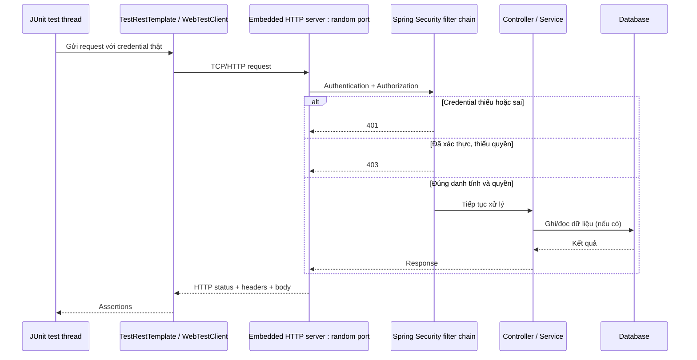

# @SpringBootTest với máy chủ chạy trên cổng ngẫu nhiên

Trong kiểm thử Spring Security, một test chạy xanh với `MockMvc` hoặc `WebTestClient.bindToApplicationContext(...)` có thể chứng minh rất tốt **các filter và authorization rule trong ApplicationContext**. Tuy nhiên, đôi khi ta cần kiểm tra một mức tích hợp khác: ứng dụng **thật sự khởi động HTTP server**, client tạo kết nối tới một cổng TCP đang lắng nghe, gửi credential qua mạng và nhận response với status, body, headers, cookies theo cấu hình hiện hành.

Spring Boot hỗ trợ kịch bản này bằng:

```java
@SpringBootTest(
    webEnvironment = SpringBootTest.WebEnvironment.RANDOM_PORT
)
```

Đây là chủ đề của bài **“@SpringBootTest với máy chủ chạy trên cổng ngẫu nhiên”** thuộc module **SPRING_SECURITY_TESTING**. Bài học tập trung vào kiểm chứng xác thực, phân quyền và HTTP security thực tế bằng Spring Security trên **Servlet** và **Reactive**, làm rõ vai trò của `TestRestTemplate`, `WebTestClient`, `@LocalServerPort`, `@WithMockUser` và các helper JWT/OAuth2/OIDC của `spring-security-test`.

Sau khi học, bạn có thể viết một bộ kiểm thử `200/401/403` đi qua HTTP server thật, phân biệt nó với test mock authentication, xử lý trạng thái CSRF/session chính xác, và hiểu vì sao `@Transactional` đặt trên phương thức test **không tự rollback** thay đổi dữ liệu thực hiện trong luồng HTTP server.

## 1. RANDOM_PORT thay đổi điều gì trong một bài kiểm thử?

Với `@SpringBootTest(webEnvironment = RANDOM_PORT)`, Spring Boot khởi tạo một **ApplicationContext đầy đủ** cho ứng dụng web và khởi động embedded server trên một cổng được hệ điều hành chọn tự động.



Các yếu tố đáng chú ý:

- `@SpringBootTest` là **full-context test**, không phải controller slice như `@WebMvcTest` hoặc `@WebFluxTest`.
- `RANDOM_PORT` khởi động một server thật: request được gửi qua HTTP thay vì gọi trực tiếp `DispatcherServlet` hoặc WebFlux handler trong test process.
- `@LocalServerPort` đọc cổng được cấp cho **ApplicationContext của test**, không phải cổng ứng dụng cố định trong production.
- `TestRestTemplate` (đối với Servlet/Spring MVC) hoặc `WebTestClient.bindToServer()` (đối với WebFlux) tạo request mạng có thể quan sát được.
- Server và test chạy trong **các thread khác nhau**; các cơ chế chỉ gắn với thread test không được coi là credential của HTTP client.
- Một server thật **chưa** đồng nghĩa với môi trường end-to-end đầy đủ: database, Kafka, OAuth2 Authorization Server, proxy hoặc các dịch vụ khác có thể vẫn được mock hay thay bằng test fixture.

### 1.1. Phân biệt MOCK và RANDOM_PORT

| Thiết lập | Có embedded HTTP server? | Full context hay slice? | Client test thường dùng |
| --- | :---: | --- | --- |
| `@WebMvcTest` + `MockMvc` | Không | MVC slice | `MockMvc` |
| `@WebFluxTest` + `WebTestClient` | Không | WebFlux slice | `WebTestClient` in-process |
| `@SpringBootTest(webEnvironment = MOCK)` + `MockMvc` | Không bắt buộc mở cổng | Full context | `MockMvc` |
| `@SpringBootTest(webEnvironment = RANDOM_PORT)` | Có | Full context | `TestRestTemplate` hoặc `WebTestClient` qua HTTP |
| `@SpringBootTest(webEnvironment = DEFINED_PORT)` | Có, cổng cấu hình | Full context | HTTP client bên ngoài hoặc test client |

**Hai trục cần tách riêng:** *full context so với slice* và *in-process so với real HTTP*. Chúng không đồng nghĩa. Full context có thể chạy với `MOCK`; còn `RANDOM_PORT` cho biết thật sự có server lắng nghe.

## 2. Vì sao phải dùng cổng ngẫu nhiên?

Nếu nhiều test suite hoặc hai CI worker cùng cố khởi động ứng dụng ở `8080`, một bên có thể thất bại vì `Address already in use`. Khi chọn `RANDOM_PORT`, Spring Boot yêu cầu cổng động (`server.port=0`), server nhận một cổng còn trống lúc bind.

```java
@SpringBootTest(
    webEnvironment = SpringBootTest.WebEnvironment.RANDOM_PORT
)
class SecurityHttpIT {

    @LocalServerPort
    int port;

    @Test
    void serverIsRunning() {
        assertThat(port).isGreaterThan(0);
    }
}
```

`@LocalServerPort` nằm trong package `org.springframework.boot.test.web.server.LocalServerPort` ở các phiên bản Spring Boot 3.x. Với Spring Boot cũ hơn, package có thể khác; hãy dùng API tương ứng dependency thực tế.

**Không tự đoán port** hoặc đọc `server.port` rồi nghĩ đó là cổng thực đã bind. Với `server.port=0`, giá trị cấu hình vẫn là `0`, còn `@LocalServerPort` phản ánh cổng runtime.

Khi sử dụng `TestRestTemplate` được Spring Boot cung cấp trong `RANDOM_PORT`, bạn có thể gọi URL tương đối như `"/api/reports/42"`. Khi tự dựng `WebTestClient.bindToServer()`, cần truyền `baseUrl("http://localhost:" + port)` hoặc URL server đã được cấu hình cụ thể.

### 2.1. RANDOM_PORT không có nghĩa một port mới cho mọi method

Spring Test có **ApplicationContext cache**. Khi nhiều test class sử dụng cùng cấu hình context, chúng có thể dùng chung context và cùng embedded server/port. Port được cấp ở **lúc server khởi động**, không nhất thiết đổi ở mọi phương thức `@Test`.

Nếu một bài test sửa dữ liệu, singleton state hoặc mock configuration có thể ảnh hưởng bài khác, giải pháp là **cô lập dữ liệu và test fixture**, không phải phụ thuộc vào việc port luôn đổi. Chỉ dùng `@DirtiesContext` khi thật sự cần đóng và tạo lại context, vì thao tác này làm suite chậm đáng kể.

## 3. Ví dụ Servlet: Spring MVC, HTTP Basic và quyền truy cập API

Ví dụ đầu tiên dùng Spring Boot 3.x, Java 17+, Spring MVC và Spring Security. Ta tạo một API chỉ cho phép người có authority `SCOPE_reports.read` truy cập.

Các dependency Gradle chính:

```groovy
dependencies {
    implementation 'org.springframework.boot:spring-boot-starter-web'
    implementation 'org.springframework.boot:spring-boot-starter-security'

    testImplementation 'org.springframework.boot:spring-boot-starter-test'
    testImplementation 'org.springframework.security:spring-security-test'
}
```

Ví dụ giả định application class `@SpringBootApplication` nằm ở package cha của controller và security configuration. Đừng khai báo cả các configuration Servlet và Reactive của hai ví dụ trong cùng một test context: chúng là **hai phương án riêng**.

### 3.1. Controller phản ánh người đã được xác thực

```java
@RestController
class ReportsController {

    @GetMapping("/api/public")
    Map<String, String> publicEndpoint() {
        return Map.of("result", "public");
    }

    @GetMapping("/api/reports/{id}")
    Map<String, String> report(
            @PathVariable String id,
            Principal principal) {

        return Map.of(
            "reportId", id,
            "requestedBy", principal.getName()
        );
    }

    @PostMapping("/api/reports")
    @ResponseStatus(HttpStatus.CREATED)
    Map<String, String> createReport(
            @RequestBody Map<String, String> body,
            Principal principal) {

        return Map.of(
            "createdBy", principal.getName(),
            "title", body.getOrDefault("title", "")
        );
    }
}
```

Ở đây `Principal` của request cho biết danh tính được Spring Security đưa vào request sau xác thực. Không nên tin một header tùy ý như `X-User` để kết luận người gọi là ai nếu chưa có cơ chế xác thực/chữ ký đáng tin cậy cho header đó.

### 3.2. SecurityFilterChain chạy thực trong HTTP server

```java
@Configuration
class ReportsSecurityConfig {

    @Bean
    SecurityFilterChain securityFilterChain(HttpSecurity http)
            throws Exception {

        return http
            .authorizeHttpRequests(auth -> auth
                .requestMatchers(HttpMethod.GET, "/api/public")
                    .permitAll()
                .requestMatchers(HttpMethod.GET, "/api/reports/**")
                    .hasAuthority("SCOPE_reports.read")
                .requestMatchers(HttpMethod.POST, "/api/reports")
                    .hasAuthority("SCOPE_reports.write")
                .anyRequest().denyAll()
            )
            .httpBasic(Customizer.withDefaults())
            .build();
    }
}
```

Cấu hình cố ý dùng **HTTP Basic** vì dễ tạo credential thật cho test HTTP; nó không cần OAuth2 server. `httpBasic()` chọn entry point thích hợp để request chưa xác thực nhận `401` với `WWW-Authenticate`. User có password đúng nhưng thiếu authority sẽ nhận `403`.

**CSRF mặc định vẫn bật** cho các request làm thay đổi trạng thái như `POST`. Ta sẽ kiểm thử hành vi này riêng ở mục 5, thay vì tắt CSRF chỉ để test qua.

### 3.3. Dùng test-only user store, không dùng account production

Bên trong test class, có thể import `@TestConfiguration` cung cấp user và password kiểm thử. Ví dụ:

```java
@TestConfiguration(proxyBeanMethods = false)
class TestAccounts {

    @Bean
    PasswordEncoder testPasswordEncoder() {
        return new BCryptPasswordEncoder();
    }

    @Bean
    UserDetailsService testUsers(PasswordEncoder encoder) {
        UserDetails alice = User.withUsername("alice")
            .password(encoder.encode("alice-secret"))
            .authorities(
                new SimpleGrantedAuthority("SCOPE_reports.read")
            )
            .build();

        UserDetails bob = User.withUsername("bob")
            .password(encoder.encode("bob-secret"))
            .authorities(
                new SimpleGrantedAuthority("SCOPE_inventory.read")
            )
            .build();

        UserDetails editor = User.withUsername("editor")
            .password(encoder.encode("editor-secret"))
            .authorities(
                new SimpleGrantedAuthority("SCOPE_reports.write")
            )
            .build();

        return new InMemoryUserDetailsManager(
            alice, bob, editor
        );
    }
}
```

`TestAccounts` cần nằm trong test source set và chỉ được `@Import` ở các test tương ứng. Nếu ứng dụng production đã có một `UserDetailsService` hoặc `AuthenticationProvider` tự định nghĩa, phải thiết kế test profile/bean override rõ ràng; **không** giả định import test store luôn thay thế provider của production.

Ở phạm vi ví dụ học thuật này, ứng dụng không có authentication provider cạnh tranh, nên các HTTP Basic credential trên được kiểm tra bởi `DaoAuthenticationProvider` dùng `UserDetailsService`/`PasswordEncoder`.

## 4. SpringBootTest RANDOM_PORT + TestRestTemplate: kiểm tra 200/401/403

Tạo một class integration test trong test source set:

```java
@SpringBootTest(
    webEnvironment = SpringBootTest.WebEnvironment.RANDOM_PORT
)
@Import(TestAccounts.class)
class ReportsHttpSecurityIT {

    @LocalServerPort
    int port;

    @Autowired
    TestRestTemplate rest;

    @Test
    void anonymousRequestGets401() {
        ResponseEntity<String> response =
            rest.getForEntity("/api/reports/r-1", String.class);

        assertThat(response.getStatusCode())
            .isEqualTo(HttpStatus.UNAUTHORIZED);

        assertThat(response.getHeaders()
            .getFirst(HttpHeaders.WWW_AUTHENTICATE))
            .contains("Basic");
    }

    @Test
    void wrongPasswordGets401() {
        ResponseEntity<String> response =
            rest.withBasicAuth("alice", "incorrect-password")
                .getForEntity("/api/reports/r-1", String.class);

        assertThat(response.getStatusCode())
            .isEqualTo(HttpStatus.UNAUTHORIZED);
    }

    @Test
    void authenticatedUserWithoutAuthorityGets403() {
        ResponseEntity<String> response =
            rest.withBasicAuth("bob", "bob-secret")
                .getForEntity("/api/reports/r-1", String.class);

        assertThat(response.getStatusCode())
            .isEqualTo(HttpStatus.FORBIDDEN);
    }

    @Test
    void authorizedUserGets200AndOwnPrincipal() {
        ResponseEntity<Map> response =
            rest.withBasicAuth("alice", "alice-secret")
                .getForEntity("/api/reports/r-1", Map.class);

        assertThat(response.getStatusCode())
            .isEqualTo(HttpStatus.OK);

        assertThat(response.getBody())
            .containsEntry("reportId", "r-1")
            .containsEntry("requestedBy", "alice");
    }

    @Test
    void publicEndpointDoesNotRequireCredentials() {
        ResponseEntity<Map> response =
            rest.getForEntity("/api/public", Map.class);

        assertThat(response.getStatusCode())
            .isEqualTo(HttpStatus.OK);
        assertThat(response.getBody())
            .containsEntry("result", "public");
    }
}
```

`TestRestTemplate` thuộc `org.springframework.boot.test.web.client.TestRestTemplate`. Trong bài test `RANDOM_PORT` của Spring Boot với Spring MVC, nó thường được auto-configured với base URI của embedded server. `TestRestTemplate` cũng được thiết kế để **không ném exception cho status 4xx/5xx** theo mặc định, giúp ta assert chính xác `401` hoặc `403`.

Test này thật sự đi qua:

```text
JUnit -> TestRestTemplate -> TCP/HTTP -> embedded Servlet container
      -> Spring Security filter chain -> DispatcherServlet
      -> Controller -> HTTP response -> JUnit assertion
```

Dù user store chỉ chứa fixture, **authentication provider vẫn kiểm tra password thực sự**; `alice-secret` đúng, `incorrect-password` sai. Test không dùng `@WithMockUser` để giả lập `SecurityContext`.

### 4.1. Đặt assertion ở cả status và identity

Nếu chỉ kiểm tra `200 OK`, một lỗi vô tình cấu hình `permitAll()` hoặc bỏ filter có thể khiến test xanh. Bộ kiểm thử nên có đủ:

- Người dùng **không có credential** → `401`.
- Người dùng có credential **sai** → `401`.
- Người dùng có credential **đúng nhưng thiếu quyền** → `403`.
- Người dùng có credential và authority **đúng** → `200`, cùng response thể hiện principal mong đợi.
- Endpoint công khai → `200` không cần credential.

Các ca đối chứng này giúp phân biệt lỗi authentication, authorization và endpoint routing.

### 4.2. Xác minh URL và port

`@LocalServerPort` giúp kiểm tra cổng đã được cấp, nhưng `TestRestTemplate` không đòi bạn tự ghép URL. Nếu tạo một `RestClient`, `HttpClient` hoặc `WebTestClient` bằng tay, phải đưa vào URL runtime:

```java
String baseUrl = "http://localhost:" + port;

assertThat(port).isPositive();
```

Không cố định `8080`. Khi test chạy trong container/CI có mạng khác, `localhost` ở đây là máy nơi embedded server đang chạy; nó **không** tự trỏ đến một service nằm ở container khác.

## 5. Test CSRF với request HTTP thực

Spring Security bảo vệ các phương thức gây thay đổi trạng thái, như `POST`, bằng CSRF theo mặc định trong một web app có cơ chế browser/session. Với filter chain ở mục 3, ngay cả user đã xác thực bằng HTTP Basic và có authority ghi cũng có thể nhận `403` nếu request không có CSRF token.

```java
@Test
void authenticatedWriterWithoutCsrfTokenGets403() {
    ResponseEntity<String> response =
        rest.withBasicAuth("editor", "editor-secret")
            .postForEntity(
                "/api/reports",
                Map.of("title", "Year-end"),
                String.class
            );

    assertThat(response.getStatusCode())
        .isEqualTo(HttpStatus.FORBIDDEN);
}
```

**Diễn giải đúng:** `403` trên request `POST` chưa chứng minh user thiếu `SCOPE_reports.write`. Nó có thể xảy ra **trước khi authorization manager đánh giá authority**, vì `CsrfFilter` từ chối request thiếu token.

Để kiểm thử `POST` thành công qua HTTP server thật, cần thực hiện trình tự thực tế:

1. Lấy CSRF token theo thiết kế của ứng dụng, chẳng hạn qua một trang/form hoặc endpoint test chuyên biệt làm phát sinh `CsrfToken`.
2. Giữ đúng **session cookie hoặc CSRF cookie** mà server trả về.
3. Gửi `POST` với CSRF token ở header/form field được repository cấu hình yêu cầu, đồng thời gửi credential và cookie tương ứng.
4. Assert status, response body và tác dụng phụ được phép.

Không nên sao chép `csrf()` của `SecurityMockMvcRequestPostProcessors` hoặc `SecurityMockServerConfigurers` rồi kỳ vọng nó tự tạo HTTP cookie hợp lệ cho server khác. Các helper này hướng đến **kiểm thử in-process**, không phải credential thực được HTTP server phát hành.

Nếu API production thực sự **stateless** và chỉ dùng Bearer token trong header mà không tự động nhận credential từ cookie/browser, ứng dụng có thể chọn chính sách tắt CSRF phù hợp. Khi đó test phải phản ánh cấu hình được phê duyệt; đừng tắt `csrf` trong security chain test trong khi production vẫn bật, vì như vậy test mất khả năng bắt cấu hình sai.

## 6. Vì sao @WithMockUser không thay thế Basic/Bearer credential trong RANDOM_PORT?

Một nhầm lẫn phổ biến:

```java
@SpringBootTest(
    webEnvironment = SpringBootTest.WebEnvironment.RANDOM_PORT
)
class MisleadingTest {

    @Autowired TestRestTemplate rest;

    @Test
    @WithMockUser(username = "alice")
    void doesNotAuthenticateTheRemoteHttpRequest() {
        ResponseEntity<String> response =
            rest.getForEntity("/api/reports/r-1", String.class);

        // Với chain HTTP Basic, request qua mạng vẫn anonymous.
        assertThat(response.getStatusCode())
            .isEqualTo(HttpStatus.UNAUTHORIZED);
    }
}
```

`@WithMockUser` thiết lập authentication giả ở **phạm vi Spring Security Test trên test thread**. Nhưng `TestRestTemplate` phát một HTTP request mới; server tiếp nhận request đó trong luồng xử lý riêng và phải tự xác thực dựa trên credential **thực sự đi qua wire**. Annotation trên test method không tự biến thành HTTP Basic header hay session cookie.

Tương tự:

- `MockMvcRequestPostProcessors.user(...)` áp dụng lên request `MockMvc`, không áp dụng cho `TestRestTemplate`.
- `MockMvcRequestPostProcessors.jwt()` tạo sẵn `JwtAuthenticationToken` trong request in-process, không sinh JWT được ký.
- `SecurityMockServerConfigurers.mockUser()`, `mockJwt()`, `mockOpaqueToken()` và `mockOidcLogin()` dùng cho security context trong test `WebTestClient` in-process; không phải quy trình HTTP login/JWT validation thực trên server bên ngoài.

**Quy tắc:** khi dùng `RANDOM_PORT` và HTTP client thật, gửi **HTTP Basic header, Bearer token đã ký hợp lệ, cookie/session hợp lệ hoặc luồng OAuth2/OIDC login thật** theo thiết kế của ứng dụng.

Đây là lý do một test trên `MockMvc` dùng `jwt()` trả `200` nhưng test qua mạng với `Authorization: Bearer garbage` thường nhận `401` khi JWT decoder thật từ chối.

## 7. Biến thể WebFlux: RANDOM_PORT + WebTestClient.bindToServer()

Đối với Spring WebFlux, có thể dùng cùng `@SpringBootTest(webEnvironment = RANDOM_PORT)` nhưng một `WebTestClient` **gọi server thật**. Đây là phương án độc lập với ví dụ Servlet, không nên nhét cả `SecurityFilterChain` Servlet và `SecurityWebFilterChain` Reactive vào cùng context.

Giả sử ứng dụng WebFlux có controller:

```java
@RestController
class ReactiveReportsController {

    @GetMapping("/reactive/reports/{id}")
    Mono<Map<String, String>> report(
            @PathVariable String id,
            Mono<Principal> principal) {

        return principal.map(p -> Map.of(
            "reportId", id,
            "requestedBy", p.getName()
        ));
    }
}
```

Security configuration tương ứng:

```java
@Configuration(proxyBeanMethods = false)
@EnableWebFluxSecurity
class ReactiveReportsSecurityConfig {

    @Bean
    SecurityWebFilterChain security(ServerHttpSecurity http) {
        return http
            .authorizeExchange(exchange -> exchange
                .pathMatchers(HttpMethod.GET, "/reactive/reports/**")
                    .hasAuthority("SCOPE_reports.read")
                .anyExchange().denyAll()
            )
            .httpBasic(Customizer.withDefaults())
            .build();
    }
}
```

Test fixture accounts cho reactive authentication:

```java
@TestConfiguration(proxyBeanMethods = false)
class ReactiveTestAccounts {

    @Bean
    PasswordEncoder reactiveTestPasswordEncoder() {
        return new BCryptPasswordEncoder();
    }

    @Bean
    MapReactiveUserDetailsService reactiveUsers(
            PasswordEncoder encoder) {

        UserDetails alice = User.withUsername("alice")
            .password(encoder.encode("alice-secret"))
            .authorities("SCOPE_reports.read")
            .build();

        UserDetails bob = User.withUsername("bob")
            .password(encoder.encode("bob-secret"))
            .authorities("SCOPE_inventory.read")
            .build();

        return new MapReactiveUserDetailsService(alice, bob);
    }
}
```

### 7.1. Kết nối HTTP client với cổng ngẫu nhiên

```java
@SpringBootTest(
    webEnvironment = SpringBootTest.WebEnvironment.RANDOM_PORT,
    properties = "spring.main.web-application-type=reactive"
)
@Import(ReactiveTestAccounts.class)
class ReactiveReportsHttpIT {

    @LocalServerPort
    int port;

    private WebTestClient http;

    @BeforeEach
    void createClient() {
        http = WebTestClient.bindToServer()
            .baseUrl("http://localhost:" + port)
            .responseTimeout(Duration.ofSeconds(5))
            .build();
    }

    @Test
    void anonymousRequestGets401() {
        http.get()
            .uri("/reactive/reports/r-1")
            .exchange()
            .expectStatus().isUnauthorized();
    }

    @Test
    void validPasswordAndAuthorityGet200() {
        http.get()
            .uri("/reactive/reports/r-1")
            .headers(h ->
                h.setBasicAuth("alice", "alice-secret"))
            .exchange()
            .expectStatus().isOk()
            .expectBody()
            .jsonPath("$.reportId").isEqualTo("r-1")
            .jsonPath("$.requestedBy").isEqualTo("alice");
    }

    @Test
    void validPasswordButWrongAuthorityGets403() {
        http.get()
            .uri("/reactive/reports/r-1")
            .headers(h ->
                h.setBasicAuth("bob", "bob-secret"))
            .exchange()
            .expectStatus().isForbidden();
    }

    @Test
    void invalidPasswordGets401() {
        http.get()
            .uri("/reactive/reports/r-1")
            .headers(h ->
                h.setBasicAuth("alice", "wrong-secret"))
            .exchange()
            .expectStatus().isUnauthorized();
    }
}
```

Ở đây `WebTestClient.bindToServer()` xây dựng HTTP client gọi port runtime. Các phương thức `headers(h -> h.setBasicAuth(...))` thực sự gửi header `Authorization: Basic ...`. Nó **không** cần `.apply(springSecurity())`, bởi client không bind in-process với WebFlux ApplicationContext.

Một cách khác là dùng `@AutoConfigureWebTestClient` cùng `@SpringBootTest(RANDOM_PORT)` trong ứng dụng WebFlux để Spring Boot tạo sẵn client cấu hình phù hợp. Dùng `bindToServer()` trong ví dụ nhằm làm rõ ranh giới thực sự qua HTTP và tránh nhầm với `bindToApplicationContext(...)`.

Nếu dự án chứa cả Spring MVC và WebFlux dependency, Spring Boot thường chọn Servlet theo classpath. Thuộc tính `spring.main.web-application-type=reactive` ở đây chỉ phù hợp khi ứng dụng có WebFlux server và không phụ thuộc các bean Servlet. Hai ví dụ Servlet/Reactive phải được tổ chức thành **hai cấu hình ứng dụng hoặc test context độc lập**.

### 7.2. Phân biệt ba kiểu WebTestClient

| Cách dựng WebTestClient | Request xử lý tại đâu? | Có thể dùng `mockUser()/mockJwt()` để giả authentication? |
| --- | --- | --- |
| `bindToController(...)` | Test WebFlux controller in-process | Chỉ khi các security filter được cấu hình phù hợp; không tự có policy production |
| `bindToApplicationContext(ctx).apply(springSecurity())` | WebFlux context in-process | Có, với Spring Security Test |
| `bindToServer().baseUrl("http://localhost:...")` | Server nhận HTTP thực | Không như một cơ chế xác thực phía server; phải gửi credential thực |

Khi chọn đúng kiểu client, test sẽ mô tả đúng phạm vi bảo đảm: **HTTP transport + authentication thực qua server** hay **mô phỏng authentication để kiểm tra policy**.

## 8. Kiểm tra JWT qua RANDOM_PORT: cần token thật, không phải jwt() helper

Nếu API production là OAuth2 Resource Server JWT, HTTP Basic chỉ là ví dụ khởi động dễ quan sát. Khi chuyển sang JWT, bạn vẫn dùng `RANDOM_PORT` nhưng thay security chain bằng:

```java
http.oauth2ResourceServer(oauth2 ->
    oauth2.jwt(Customizer.withDefaults())
);
```

và cần một `JwtDecoder` (Servlet) hoặc `ReactiveJwtDecoder` (WebFlux) phù hợp.

Ví dụ **chỉ phần HTTP request** với một compact JWT đã ký trong test:

```java
HttpHeaders headers = new HttpHeaders();
headers.setBearerAuth(signedJwtFromTestKey);

HttpEntity<Void> request = new HttpEntity<>(headers);

ResponseEntity<String> response = rest.exchange(
    "/api/reports/r-1",
    HttpMethod.GET,
    request,
    String.class
);

assertThat(response.getStatusCode())
    .isEqualTo(HttpStatus.OK);
```

Đoạn này thuộc **test class Resource Server JWT riêng**, không dùng lại `ReportsSecurityConfig` HTTP Basic ở mục 3. `signedJwtFromTestKey` phải là JWS compact thực sự được ký bằng private key test, trong khi decoder thật tin public key tương ứng.

Một bộ kiểm thử JWT qua HTTP nên có các ca:

| Token hoặc tình huống | Kết quả thường gặp |
| --- | --- |
| Token ký bởi khóa test tin cậy, claims và scope đúng | `200` |
| Không có Bearer token | `401` |
| Chữ ký không khớp khóa tin cậy | `401` |
| Token đã hết hạn (ngoài mức clock skew) | `401` |
| `issuer`/`audience` sai, nếu validator được cấu hình | `401` |
| Token đã xác thực nhưng thiếu scope | `403` |

Trong test xác minh mật mã, **không mock `JwtDecoder`/`ReactiveJwtDecoder`**. Nếu decoder bị Mockito thay thế, bạn chỉ chứng minh HTTP filter gọi decoder interface và xử lý kết quả mock, không chứng minh chữ ký được xác minh.

Test có thể dùng một `@TestConfiguration` đăng ký `NimbusJwtDecoder` hoặc `NimbusReactiveJwtDecoder` thật với public key test, còn token được ký bằng Nimbus JOSE + JWT. Khi cần xác minh JWKS retrieval/rotation, hãy dùng fake JWKS HTTP server thay vì hard-code public key. Điều này tránh gọi Identity Provider production trong CI.

## 9. OAuth2/OIDC và opaque token: “máy chủ thật” chưa đủ để chứng minh IdP thật

Một ứng dụng có thể khởi động thật ở random port nhưng vẫn dùng các fake phụ trợ:

- **Opaque token:** `OpaqueTokenIntrospector` hoặc `ReactiveOpaqueTokenIntrospector` gọi một WireMock endpoint trả `active:true/false`. Test xác minh HTTP introspection **đã được gửi**, không chứng minh token được nhà cung cấp production cấp hoặc thu hồi.
- **OAuth2/OIDC login:** fake Authorization Server cung cấp authorization endpoint, token endpoint, JWKS và callback; test kiểm tra `state`, `nonce`, session cookies, code exchange và ID token verification theo cấu hình. Chỉ `mockOidcLogin()` không đi qua các bước này.
- **OAuth2 Client outbound:** ứng dụng gọi downstream bằng access token; WireMock kiểm tra request nhận được `Authorization: Bearer ...` và đúng registration. Test với `RANDOM_PORT` cho inbound app không tự kiểm tra outbound header.
- **JWT:** decoder thực kiểm tra chữ ký và claims; mock JWT principal không phải bằng chứng xác thực.

**Định nghĩa “end-to-end” phải nói rõ hai đầu.** Test HTTP thật từ client tới ứng dụng đảm bảo transport và security chain của ứng dụng được thực thi; nếu mọi dependency ngoài ứng dụng vẫn bị mock, nó là **application integration test qua HTTP**, không phải chứng minh cả hệ thống nhiều dịch vụ đã vận hành production.

### 9.1. WireMock/Testcontainers nên đặt ở đâu?

Có thể khởi động fake Authorization Server hoặc downstream API trước khi Spring context được xây dựng, sau đó truyền URL động bằng `@DynamicPropertySource`:

```java
@DynamicPropertySource
static void externalEndpoints(DynamicPropertyRegistry registry) {
    registry.add(
        "external.reports.base-url",
        fakeDownstream::baseUrl
    );
}
```

Đoạn này minh họa việc thay URL cho một dependency ngoài; `fakeDownstream` phải là test server đã được khởi động trước lúc context dùng property, có lifecycle/cleanup rõ ràng.

Nếu dùng Testcontainers database, có thể cấu hình JDBC/R2DBC properties qua `@DynamicPropertySource` hoặc cơ chế Spring Boot `@ServiceConnection` phù hợp phiên bản. Điều quan trọng là các tài nguyên test phải độc lập và dữ liệu được kiểm soát, không trỏ nhầm tới production.

## 10. Bẫy transaction: @Transactional trên test không rollback HTTP server

Đây là khác biệt rất quan trọng giữa test in-process và test qua cổng thật.

```java
@SpringBootTest(
    webEnvironment = SpringBootTest.WebEnvironment.RANDOM_PORT
)
@Transactional
class MisleadingRollbackIT {

    @Autowired TestRestTemplate rest;

    @Test
    void writesMaySurviveTestRollback() {
        // POST chạy trong server thread và transaction của ứng dụng.
        rest.postForEntity(
            "/api/reports",
            Map.of("title", "Created over HTTP"),
            String.class
        );

        // Rollback transaction của test thread không nhất thiết
        // rollback transaction đã commit ở server thread.
    }
}
```

`@Transactional` đặt trên method/class test thường tạo transaction gắn với **test thread**. Request HTTP thật được xử lý trên **server thread** (hoặc reactive pipeline riêng). Nó có transaction riêng và có thể **commit trước khi test kết thúc**.

Hậu quả:

- Test A tạo report và tin rằng `@Transactional` sẽ xóa nó sau test, nhưng dữ liệu vẫn tồn tại.
- Test B chạy sau nhìn thấy report còn sót và trả sai kết quả.
- Test suite có thể xanh khi chạy riêng, đỏ khi chạy song song hoặc ngược thứ tự.
- Một `@DirtiesContext` tạo lại Spring context **không tự xóa** dữ liệu đã commit vào database bên ngoài.

Cách làm đúng là quản lý dữ liệu test một cách tường minh:

1. Dùng database riêng cho bài test, có thể qua Testcontainers với database/schema tách biệt.
2. Seed dữ liệu bất biến rõ ràng hoặc cấp ID/người dùng riêng cho từng test.
3. Dọn dữ liệu bằng repository/SQL cleanup phù hợp sau test, hoặc reset database/transaction ở đúng lớp sở hữu dữ liệu.
4. Khi cần test transaction atomicity, quan sát **state cuối cùng ở database** qua một đường đọc độc lập sau HTTP response.
5. Chỉ dùng `@Transactional` trên test như cơ chế rollback nếu bạn hiểu chắc execution cùng transaction; không mang giả định này từ `MockMvc` sang `RANDOM_PORT`.

Với test reactive R2DBC, điểm cốt lõi vẫn vậy: transaction của request/subscription phải được kiểm soát trong ứng dụng, không tự nối vào test thread chỉ vì JUnit có annotation `@Transactional`.

## 11. Cookies, session, redirect, CSRF và header cần kiểm tra như HTTP client

Một HTTP integration test phải mô phỏng **giao thức thực**, không chỉ security context:

| Tình huống | Thứ client cần gửi/giữ | Assertion nên có |
| --- | --- | --- |
| HTTP Basic | `Authorization: Basic ...` | `401/403/200` và `WWW-Authenticate` |
| JWT Resource Server | `Authorization: Bearer <compact-jws>` | Chữ ký/claims đúng hoặc sai, `401/403/200` |
| Opaque Resource Server | Bearer token raw | Introspection request, `active` và scope |
| Form login | Form credentials, session cookie | Redirect, `Set-Cookie`, truy cập sau login |
| OIDC login | Session, `state`, `code`, `nonce`/ID token | Callback, token exchange và trạng thái đăng nhập |
| CSRF | Cookie/session tương ứng và CSRF header/form field | POST thiếu token bị từ chối, POST đúng token được xử lý |
| OAuth2 client gọi downstream | App giữ authorized client/token hợp lệ | HTTP downstream nhận exact Bearer header |
| CORS | `Origin` và preflight headers | `Access-Control-Allow-*` phù hợp với policy |

### 11.1. Đừng để HTTP client tự che mất redirect

Một số HTTP client tự theo `302`/`303` đến trang login; test có thể chỉ nhìn response cuối `200` của trang login rồi tưởng endpoint bảo vệ đã cho phép. Khi kiểm thử chính xác luồng form/OIDC, hãy cấu hình client **không tự follow redirect** hoặc ghi nhận từng response trung gian, rồi assert `Location`, cookies và authentication state.

`TestRestTemplate` có thể có behavior khác với HTTP client khác về redirect/cookies, tùy request factory; chọn cấu hình minh bạch theo điều cần kiểm chứng.

### 11.2. Tách từng request identity

Một client dùng mặc định `Authorization` hoặc cookie từ Alice có thể làm request của Bob vô tình chạy dưới danh tính Alice. Nên tạo request riêng với credential khác nhau; ví dụ:

```java
rest.withBasicAuth("alice", "alice-secret")
    .getForEntity("/api/reports/r-1", String.class);

rest.withBasicAuth("bob", "bob-secret")
    .getForEntity("/api/reports/r-1", String.class);
```

Với session/OIDC, giữ **cookie jar riêng** cho mỗi người dùng. Một bộ kiểm thử tốt có ít nhất hai danh tính có quyền khác nhau và một client anonymous.

## 12. Lỗi thường gặp và cách chẩn đoán

| Triệu chứng | Nguyên nhân khả dĩ | Hướng kiểm tra |
| --- | --- | --- |
| `Connection refused` hoặc test truy cập sai ứng dụng | Hard-code `8080` thay vì runtime port, server chưa khởi động | `@LocalServerPort`, base URL, application logs |
| Test có `@WithMockUser` nhưng HTTP vẫn `401` | Authentication giả chỉ nằm trên test thread | Gửi Basic/Bearer/cookie thực |
| `WebTestClient.mutateWith(mockJwt())` không giúp server nhận JWT | Mutator hướng đến in-process security context | Gửi JWT compact ký thật qua Bearer header |
| Test `POST` nhận `403` dù quyền đúng | Thiếu CSRF, không nhất thiết thiếu authority | Kiểm tra CSRF policy/cookie/header |
| Server trả redirect thay vì `401` | Form/OAuth2 login entry point đang hoạt động | Kiểm tra `Location` và filter chain |
| JWT test `200` nhưng decoder bị mock | Không thực hiện cryptographic verification | Dùng decoder thật và test chữ ký sai |
| Test tạo dữ liệu rồi bài khác thấy còn | HTTP server transaction không thuộc rollback của test thread | Dọn DB rõ ràng hoặc cô lập test database |
| Port thay đổi không theo từng `@Test` | ApplicationContext được cache | Thiết kế test không phụ thuộc port mới ở mỗi method |
| Test Servlet lại dùng WebFlux handler | Classpath/web application type không phù hợp | Xác định Servlet vs Reactive; tách configuration |
| `401/403` pass nhưng endpoint public ngoài ý muốn | Chỉ có negative test hoặc rule matcher chưa đúng | Thêm `200` có credential đúng và kiểm tra principal |
| Test chạy xanh dù DB thật bị sai | Service/repository vẫn bị mock | Xác định boundary; bổ sung test DB integration |
| Test chậm/flake khi chạy nhiều lần | Network fake server, dynamic port, clock, cache và shared data | Cô lập fixtures, timeout rõ ràng, cleanup, tránh port cố định |

### 12.1. Quy trình debug một test 401 bất ngờ

1. Xác minh đúng URL `http://localhost:<runtime-port>` và đúng endpoint.
2. Đọc status và `WWW-Authenticate`/`Location`; phân biệt Basic, Bearer và form login.
3. Kiểm tra HTTP header thực sự được gửi. `@WithMockUser` không tự tạo header.
4. Xem request khớp `SecurityFilterChain` nào, có nhiều matcher/`@Order` không.
5. Nếu dùng JWT, xác minh decoder thực, khóa và validators; nếu dùng opaque, xem introspection endpoint.
6. Nếu dùng client session, kiểm tra cookie được giữ qua các request.
7. Cuối cùng mới xem controller/service, bởi một request chưa qua authentication có thể chưa chạm đến nghiệp vụ.

Không nên tạm thời `permitAll()`, tắt filter, hoặc trả principal giả để “sửa” một integration test nếu mục tiêu là kiểm tra authentication thật.

## 13. Thiết kế bộ test theo lớp, không ép mọi thứ vào một ca

Đối với một module Spring Security Testing, có thể tổ chức:

- **Unit/security policy tests:** `@WithMockUser`, `jwt()`, `mockJwt()`, mock service; chạy nhanh, kiểm tra rules/claims ở tầng ứng dụng.
- **MVC/WebFlux slices:** `@WebMvcTest`/`@WebFluxTest` cùng security configuration được `@Import`; kiểm tra controller, filter và HTTP mapping in-process.
- **Full-context HTTP tests:** `@SpringBootTest(RANDOM_PORT)` với `TestRestTemplate` hoặc `WebTestClient.bindToServer()`; kiểm tra real HTTP, entry points, authentication, authorization và headers.
- **External dependency integration:** WireMock/Testcontainers hoặc Authorization Server thử nghiệm; kiểm tra token, DB, OAuth2/OIDC protocol, outbound request.
- **Hệ thống staging/end-to-end thực:** kiểm chứng các thành phần triển khai và môi trường tích hợp cụ thể, có tài khoản/test data được kiểm soát.

Tại mỗi lớp, mô tả **đầu nào là thật, đầu nào là fixture**. Ví dụ “HTTP real server với in-memory user store” chính xác hơn “đã kiểm chứng toàn hệ thống IAM”.

### 13.1. Ma trận tối thiểu để bàn giao

| Test | Kiểu client | Credential | Kỳ vọng | Bằng chứng |
| --- | --- | --- | --- | --- |
| Public GET | `TestRestTemplate` | Không có | `200` | Route công khai |
| Protected GET anonymous | `TestRestTemplate` | Không có | `401` | Authentication entry point |
| Protected GET sai password | `TestRestTemplate` | Basic sai | `401` | Password authentication thật |
| Protected GET thiếu authority | `TestRestTemplate` | Basic đúng, scope sai | `403` | Authorization rule |
| Protected GET có authority | `TestRestTemplate` | Basic đúng, scope đúng | `200` + principal | Authentication + controller |
| POST thiếu CSRF | HTTP client thực | Basic đúng, CSRF thiếu | `403` | CSRF filter còn hoạt động |
| Reactive GET đủ scope | `WebTestClient.bindToServer` | Basic đúng | `200` | Reactive chain qua HTTP |
| JWT ký bằng khóa không tin cậy | HTTP client thực | Bearer JWS | `401` | Signature verification nếu decoder thật |
| JWT đã ký, thiếu scope | HTTP client thực | Bearer JWS | `403` | Xác thực qua, phân quyền chặn |

## 14. Bài thực hành

1. Tạo một ứng dụng Spring MVC có `/api/public` và `/api/reports/{id}` như mục 3. Cấu hình HTTP Basic và authority `SCOPE_reports.read`.
2. Viết `@SpringBootTest(webEnvironment = RANDOM_PORT)`, inject `@LocalServerPort` và `TestRestTemplate`. Không sử dụng cổng cố định.
3. Tạo `TestAccounts` dùng `InMemoryUserDetailsManager` với Alice có quyền và Bob thiếu quyền. Kiểm tra `200/401/403`, password sai và body trả đúng username.
4. Thử thêm `@WithMockUser` lên phương thức gửi HTTP request **không có Basic header**. Giải thích vì sao server vẫn coi request là anonymous.
5. Tạo endpoint `POST` và kiểm tra thiếu CSRF bị từ chối. Nếu muốn xác minh POST thành công, lấy CSRF token/cookie theo giao thức thật của ứng dụng.
6. Lặp lại kiểm thử trong một ứng dụng WebFlux độc lập, dùng `WebTestClient.bindToServer().baseUrl("http://localhost:" + port)` và `headers(h -> h.setBasicAuth(...))`.
7. Nếu sử dụng JWT, dùng một test profile cấu hình decoder thật với public key test, tạo compact JWS ký đúng và sai. Kiểm tra `200`, `401` và `403` qua HTTP; không dùng `mockJwt()` trong ca xác minh chữ ký.
8. Nếu endpoint ghi database, tạo một bản ghi bằng HTTP rồi đọc lại sau response. Xác minh không phụ thuộc vào rollback của `@Transactional` ở JUnit thread; dọn dữ liệu sau mỗi test.

**Tiêu chí hoàn thành:** bạn có một bộ test thật sự khởi động server trên cổng ngẫu nhiên, dùng HTTP client gửi credential qua network, kiểm tra kết quả xác thực/phân quyền và response headers/body, đồng thời mô tả chính xác ranh giới với các helper in-process của `spring-security-test` và các dependency giả lập.

## Tài liệu tham khảo

- [Spring Boot — Testing Spring Boot Applications](https://docs.spring.io/spring-boot/reference/testing/spring-boot-applications.html): `@SpringBootTest`, `RANDOM_PORT`, client HTTP, context và lưu ý transaction.
- [Spring Boot — TestRestTemplate](https://docs.spring.io/spring-boot/reference/testing/spring-boot-applications.html#testing.spring-boot-applications.with-running-server): gọi embedded server và xử lý response lỗi.
- [Spring Security — MockMvc Security Tests](https://docs.spring.io/spring-security/reference/servlet/test/mockmvc/index.html): setup `MockMvc` và các request post-processors.
- [Spring Security — WebTestClient Setup](https://docs.spring.io/spring-security/reference/reactive/test/web/setup.html): `bindToApplicationContext(...).apply(springSecurity())`.
- [Spring Security — Reactive WebFlux Security](https://docs.spring.io/spring-security/reference/reactive/configuration/webflux.html): `SecurityWebFilterChain` và `ServerHttpSecurity`.
- [Spring Security — CSRF](https://docs.spring.io/spring-security/reference/servlet/exploits/csrf.html): tại sao request thay đổi trạng thái cần CSRF protection.
- [Spring Security — OAuth2 Resource Server JWT](https://docs.spring.io/spring-security/reference/servlet/oauth2/resource-server/jwt.html): Bearer token và `JwtDecoder` thật.
