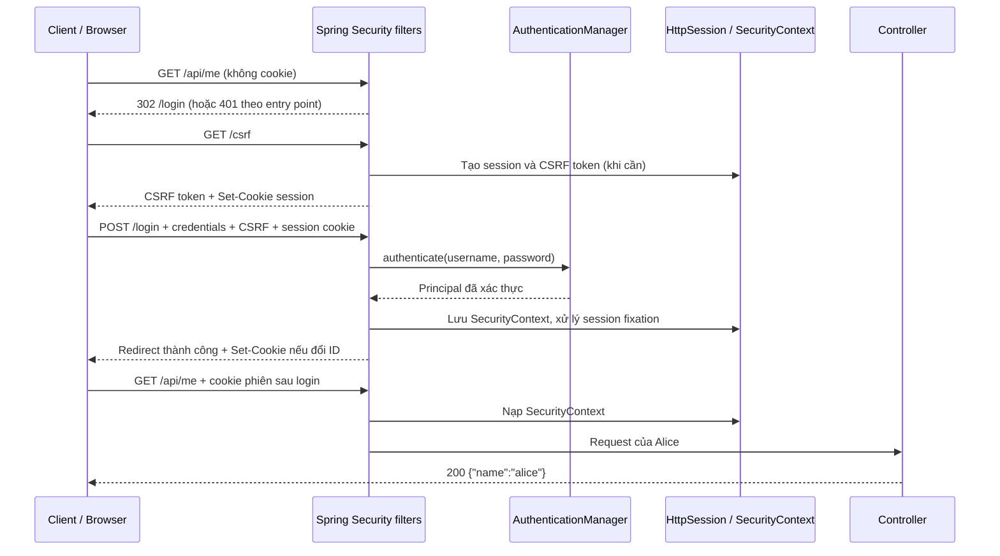
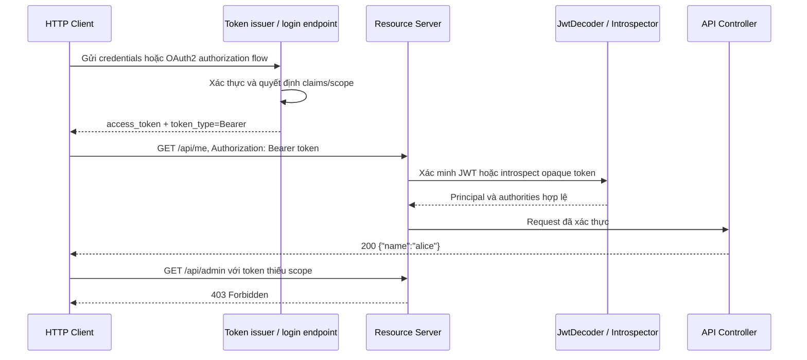

# Đăng nhập, nhận phiên hoặc token rồi truy cập tài nguyên

Một bài kiểm thử chỉ gọi `GET /api/me` với `@WithMockUser` hoặc `with(jwt())` rồi nhận HTTP 200 chứng minh **phân quyền với một danh tính đã được giả lập**. Nó chưa chứng minh rằng ứng dụng có thể nhận credentials, đăng nhập, trả phiên hoặc token cho client và dùng bằng chứng xác thực đó ở **request tiếp theo**.

Đó chính là mục tiêu của chương **Tích hợp đầu cuối** trong module `SPRING_SECURITY_TESTING`: kết nối nhiều request thành một **hành trình xác thực và truy cập tài nguyên**. Trên Servlet ta có thể dùng `MockMvc` để chạy filter chain và controller trong bộ nhớ, hoặc dùng `WebTestClient.bindToServer()` để gửi HTTP qua mạng. Với ứng dụng WebFlux, `WebTestClient` cũng là công cụ trung tâm, nhưng phải phân biệt mock-server và live-server.

Bài học tập trung vào hai dạng bằng chứng đăng nhập phổ biến:

- **Session cookie:** Client gửi username/password đến endpoint đăng nhập; server xác thực, lưu ngữ cảnh trong phiên và cấp cookie. Những request sau gửi lại cookie để truy cập tài nguyên được bảo vệ.
- **Bearer access token:** Client lấy token qua cơ chế phát hành phù hợp; ở những request sau, client gửi `Authorization: Bearer ...`. Resource server xác minh token hoặc introspection rồi quyết định quyền.

Cần test cả **hành vi thành công** và **những chỗ phải bị từ chối**: chưa đăng nhập, sai credentials, thiếu CSRF, cookie không hợp lệ, token sai/hết hạn, đủ xác thực nhưng thiếu authority và logout/thu hồi.

> **Điểm mấu chốt:** Một hành trình tích hợp không được giả định request thứ hai đã xác thực chỉ vì request thứ nhất trả 200 hay 302. Phải chứng minh **cookie hoặc token được lấy từ phản hồi phù hợp, được gửi lại ở request mới, và được filter chain chấp nhận**.

## 1. Xác định “đầu cuối” đến đâu trước khi viết test

Từ “end-to-end” thường được dùng cho nhiều phạm vi. Hãy ghi rõ **ranh giới thực thi** trong tên và mô tả test.

| Tầng kiểm thử | Cách thực thi | Thành phần được kiểm tra | Điều chưa chứng minh |
| --- | --- | --- | --- |
| Authorization test bằng helper | `MockMvc.with(user())`, `with(jwt())` hoặc `WebTestClient.mutateWith(mockUser())` | Controller, method security, URL rules với principal giả | Credentials, session issuance, token validation |
| Servlet integration trong bộ nhớ | `@SpringBootTest + @AutoConfigureMockMvc` | Spring MVC, Servlet filters, authentication provider, session logic | Kết nối socket, TLS, reverse proxy, browser cookie policy |
| WebFlux integration trong bộ nhớ | `bindToApplicationContext(...).apply(springSecurity())` | WebFilter chain, handler và Reactive security | Kết nối HTTP thật |
| Live HTTP integration | `@SpringBootTest(RANDOM_PORT)` + `bindToServer()` | Server đang chạy, HTTP headers, cookies, filters, controllers | Hạ tầng production chưa được đưa vào môi trường test |
| Browser/IdP end-to-end | Browser automation + IdP test hoặc môi trường kiểm thử | Redirect, cookies, OAuth2/OIDC callback, frontend và hạ tầng nằm trong tuyến | Chính sách ở production nếu dùng môi trường khác |

Một bài `MockMvc` chạy đầy đủ filter chain là **integration test hợp lệ**, dù không có TCP. Nhưng không nên ghi “đã kiểm thử cookie qua trình duyệt và TLS” nếu chỉ gọi `.session(mockSession)`. Ngược lại, một HTTP test kết nối tới embedded server không tự xác minh hành vi `SameSite` của browser thật, vì test client có thể chủ động gửi mọi cookie.

### 1.1. Định nghĩa bằng chứng thành công

Với **session**, cần có quan hệ:

1. Bắt đầu chưa xác thực → tài nguyên được bảo vệ từ chối hoặc chuyển đến login.
2. Lấy CSRF token và session ban đầu nếu server yêu cầu.
3. Gửi credentials hợp lệ qua login endpoint.
4. Nhận kết quả thành công và session/cookie tương ứng.
5. Gửi **request mới** với session/cookie đã cấp → đọc tài nguyên được bảo vệ dưới đúng người dùng.
6. Người dùng đó truy cập tài nguyên vượt quyền → bị từ chối.
7. Sau logout, session cũ không còn được coi là phiên đã đăng nhập.

Với **token**, cần có quan hệ:

1. Gửi credentials hoặc hoàn thành flow cấp token theo thiết kế.
2. Nhận token từ response, không tự dựng authentication trực tiếp trong request.
3. Gửi `Authorization: Bearer <token>` ở request mới.
4. Resource server xác minh token và tạo principal/authorities.
5. Token thiếu/sai/bị sửa/hết hạn → bị từ chối; token hợp lệ nhưng thiếu scope → bị từ chối vì không đủ quyền.

Các quan hệ giữa request là trọng tâm, không phải chỉ đếm số assertion HTTP 200.

## 2. Hai hành trình xác thực khác nhau

### 2.1. Form login và session



Tại đây cookie thường chỉ mang **session identifier**; authentication nằm ở server-side session hoặc nơi lưu session được cấu hình. Cookie không phải một mật khẩu hay bản sao trực tiếp của `Authentication`.

### 2.2. Phát hành và dùng Bearer token



Ở dạng Bearer token, **request thứ hai không cần session login** nếu API được cấu hình stateless. Điều quan trọng là token được **kiểm tra lại ở resource server**. Nếu chỉ dùng `with(jwt())` hoặc `mockJwt()`, bước decoder có thể bị bỏ qua theo chủ đích của helper.

## 3. Ứng dụng Servlet minh họa form login có session

Phần này là một ứng dụng Spring Boot Servlet **độc lập**. Phần JWT ở phía sau là một ứng dụng demo khác để tránh trộn cấu hình session/form login với stateless Bearer resource server trong cùng một `SecurityFilterChain`.

Với Spring Boot 3.x/Spring Security 6.x, các dependency cơ bản:

```groovy
dependencies {
    implementation 'org.springframework.boot:spring-boot-starter-web'
    implementation 'org.springframework.boot:spring-boot-starter-security'

    testImplementation 'org.springframework.boot:spring-boot-starter-test'
    testImplementation 'org.springframework.security:spring-security-test'

    // Chỉ cần cho bài test HTTP live dùng WebTestClient trên MVC app:
    testImplementation 'org.springframework.boot:spring-boot-starter-webflux'
}
```

Khi `spring-boot-starter-web` và WebFlux cùng có mặt, Spring Boot thường chọn MVC nếu không đặt web application type khác. Nếu cần bảo đảm một bài test đang dùng Servlet, hãy kiểm tra cấu hình dự án thay vì suy ra chỉ từ sự hiện diện của `WebTestClient`.

### 3.1. Cấu hình bảo mật và user fixture

```java
import org.springframework.context.annotation.Bean;
import org.springframework.context.annotation.Configuration;
import org.springframework.security.config.Customizer;
import org.springframework.security.config.annotation.web.builders.HttpSecurity;
import org.springframework.security.core.userdetails.User;
import org.springframework.security.core.userdetails.UserDetailsService;
import org.springframework.security.crypto.bcrypt.BCryptPasswordEncoder;
import org.springframework.security.crypto.password.PasswordEncoder;
import org.springframework.security.provisioning.InMemoryUserDetailsManager;
import org.springframework.security.web.SecurityFilterChain;

@Configuration
class SessionDemoSecurityConfig {

    @Bean
    SecurityFilterChain securityFilterChain(HttpSecurity http)
            throws Exception {

        return http
            .authorizeHttpRequests(auth -> auth
                .requestMatchers("/login", "/csrf", "/app/home")
                    .permitAll()
                .requestMatchers("/api/admin").hasRole("ADMIN")
                .requestMatchers("/api/**").authenticated()
                .anyRequest().permitAll()
            )
            .formLogin(form ->
                form.defaultSuccessUrl("/app/home", true))
            .logout(Customizer.withDefaults())
            .build();
    }

    @Bean
    PasswordEncoder passwordEncoder() {
        return new BCryptPasswordEncoder();
    }

    @Bean
    UserDetailsService users(PasswordEncoder encoder) {
        return new InMemoryUserDetailsManager(
            User.withUsername("alice")
                .password(encoder.encode("correct"))
                .roles("USER")
                .build(),
            User.withUsername("admin")
                .password(encoder.encode("admin-correct"))
                .roles("USER", "ADMIN")
                .build()
        );
    }
}
```

Các password trong ví dụ chỉ là fixture. Cấu hình giữ nguyên **CSRF protection mặc định** cho form login. `/api/admin` yêu cầu role `ADMIN`, còn `/api/me` yêu cầu authentication. Một Alice đăng nhập thành công vẫn phải bị 403 khi vào `/api/admin`.

Không tắt CSRF cho toàn ứng dụng chỉ để tiện test form login. Client browser cần gửi token CSRF và cookie thuộc **cùng session** nếu repository đang gắn token với session.

### 3.2. Controller kiểm tra danh tính và cung cấp CSRF token cho test

```java
import java.util.Map;

import jakarta.servlet.http.HttpServletRequest;
import org.springframework.security.core.Authentication;
import org.springframework.security.web.csrf.CsrfToken;
import org.springframework.web.bind.annotation.GetMapping;
import org.springframework.web.bind.annotation.RestController;

@RestController
class SessionDemoController {

    @GetMapping("/app/home")
    String home() {
        return "ready";
    }

    @GetMapping("/api/me")
    Map<String, String> me(Authentication authentication) {
        return Map.of("name", authentication.getName());
    }

    @GetMapping("/api/admin")
    String admin() {
        return "admin-only";
    }

    // Chỉ dùng làm fixture cho ví dụ HTTP login trong môi trường test.
    @GetMapping("/csrf")
    Map<String, String> csrf(HttpServletRequest request) {
        CsrfToken token = (CsrfToken) request.getAttribute(
            CsrfToken.class.getName());

        return Map.of(
            "parameterName", token.getParameterName(),
            "token", token.getToken()
        );
    }
}
```

Điểm đáng chú ý ở `/csrf`: đọc `token.getToken()` buộc token được hiện thực hóa khi ứng dụng sử dụng cơ chế deferred CSRF token. Trong Spring Security 6, giá trị trả tới client có thể là token đã được mã hóa che (masked token) theo `CsrfTokenRequestHandler`; browser có thể gửi nó dưới dạng **form parameter** do token cung cấp. Không tự so sánh chuỗi đó với raw token được lưu trong session.

Endpoint `/csrf` ở đây là **fixture học tập**. Trong ứng dụng thật, việc phát CSRF token cho SPA hay HTML page cần theo contract của frontend, response caching và cấu hình cookie/request handler. Không đưa access token hoặc session ID vào JSON trả về.

## 4. MockMvc: login thật qua filter rồi dùng lại HttpSession

Đầu tiên, kiểm tra hành trình Servlet mà không mở cổng mạng. Sử dụng `MockMvc` với **Spring Security filters được bật**.

```java
import org.junit.jupiter.api.Test;
import org.springframework.beans.factory.annotation.Autowired;
import org.springframework.boot.test.autoconfigure.web.servlet.AutoConfigureMockMvc;
import org.springframework.boot.test.context.SpringBootTest;
import org.springframework.mock.web.MockHttpSession;
import org.springframework.test.web.servlet.MockMvc;
import org.springframework.test.web.servlet.MvcResult;

import static org.assertj.core.api.Assertions.assertThat;
import static org.springframework.security.test.web.servlet.request
    .SecurityMockMvcRequestPostProcessors.csrf;
import static org.springframework.security.test.web.servlet.response
    .SecurityMockMvcResultMatchers.authenticated;
import static org.springframework.security.test.web.servlet.request
    .SecurityMockMvcRequestPostProcessors.user;
import static org.springframework.test.web.servlet.request
    .MockMvcRequestBuilders.get;
import static org.springframework.test.web.servlet.request
    .MockMvcRequestBuilders.post;
import static org.springframework.test.web.servlet.result
    .MockMvcResultMatchers.content;
import static org.springframework.test.web.servlet.result
    .MockMvcResultMatchers.jsonPath;
import static org.springframework.test.web.servlet.result
    .MockMvcResultMatchers.redirectedUrl;
import static org.springframework.test.web.servlet.result
    .MockMvcResultMatchers.redirectedUrlPattern;
import static org.springframework.test.web.servlet.result
    .MockMvcResultMatchers.status;

@SpringBootTest
@AutoConfigureMockMvc
class FormLoginSessionJourneyTest {

    @Autowired
    MockMvc mvc;

    @Test
    void loginCreatesSessionForFollowingProtectedRequests()
            throws Exception {

        // 1. Không có phiên đăng nhập: bị chuyển đến login.
        mvc.perform(get("/api/me"))
            .andExpect(status().is3xxRedirection())
            .andExpect(redirectedUrlPattern("**/login"));

        // 2. Gửi HTTP POST login qua chính security filters.
        MvcResult login = mvc.perform(post("/login")
                .with(csrf())
                .param("username", "alice")
                .param("password", "correct"))
            .andExpect(status().is3xxRedirection())
            .andExpect(redirectedUrl("/app/home"))
            .andExpect(authenticated().withUsername("alice"))
            .andReturn();

        // 3. Lấy session do quá trình login tạo/cập nhật.
        MockHttpSession session =
            (MockHttpSession) login.getRequest().getSession(false);
        assertThat(session).isNotNull();

        // 4. Request mới KHÔNG dùng with(user()).
        mvc.perform(get("/api/me").session(session))
            .andExpect(status().isOk())
            .andExpect(jsonPath("$.name").value("alice"));

        // 5. Alice đã xác thực nhưng thiếu ROLE_ADMIN.
        mvc.perform(get("/api/admin").session(session))
            .andExpect(status().isForbidden());
    }
}
```

**Vì sao đây là integration test tốt?** POST `/login` đi qua `UsernamePasswordAuthenticationFilter`, `AuthenticationManager`, `UserDetailsService` và `PasswordEncoder`, sau đó lưu authentication theo cấu hình session. Request GET tiếp theo dùng **session nhận từ login**, không được gắn sẵn `@WithMockUser`.

**Vì sao chưa phải browser test?** `.with(csrf())` là helper của Spring Security Test chèn CSRF token hợp lệ ở mức request MockMvc. Nó không chứng minh browser đã lấy CSRF token từ HTML/endpoint rồi gửi cookie qua mạng. Tương tự, `.session(session)` cung cấp mock session trực tiếp, không chứng minh header `Cookie` đã đi qua socket.

Có thể dùng `formLogin()` từ Spring Security Test để viết gọn ca POST login, nhưng khi mục tiêu là luồng đầu cuối, viết rõ request và giữ session giúp người đọc thấy được quan hệ giữa các bước.

### 4.1. Các ca thất bại không được bỏ qua

Bổ sung trong cùng test class:

```java
@Test
void incorrectPasswordCannotCreateLoggedInSession()
        throws Exception {
    mvc.perform(post("/login")
            .with(csrf())
            .param("username", "alice")
            .param("password", "wrong"))
        .andExpect(status().is3xxRedirection())
        .andExpect(redirectedUrl("/login?error"));

    // Không được kế thừa authentication từ request vừa thất bại.
    mvc.perform(get("/api/me"))
        .andExpect(status().is3xxRedirection());
}

@Test
void loginPostWithoutCsrfIsForbidden() throws Exception {
    mvc.perform(post("/login")
            .param("username", "alice")
            .param("password", "correct"))
        .andExpect(status().isForbidden());
}

@Test
void adminSessionCanReadAdminResource() throws Exception {
    MvcResult login = mvc.perform(post("/login")
            .with(csrf())
            .param("username", "admin")
            .param("password", "admin-correct"))
        .andExpect(redirectedUrl("/app/home"))
        .andReturn();

    MockHttpSession session =
        (MockHttpSession) login.getRequest().getSession(false);

    mvc.perform(get("/api/admin").session(session))
        .andExpect(status().isOk())
        .andExpect(content().string("admin-only"));
}
```

Ba tình huống khác nhau: password sai khiến **authentication failure** (form login mặc định thường redirect `/login?error`); thiếu CSRF thường trả **403 trước khi xử lý credentials**; admin hợp lệ có đủ quyền. Không dùng cùng một assertion 302 để kết luận success/failure, vì cả hai nhánh form login đều có thể trả redirect.

### 4.2. Logout và ngăn tái sử dụng phiên

Spring Security form login mặc định cung cấp POST `/logout` khi CSRF bật. Sau logout thành công, SecurityContext phải bị xóa và session thường bị invalidate theo `LogoutConfigurer`/handlers mặc định.

```java
@Test
void logoutInvalidatesAuthenticatedSession() throws Exception {
    MvcResult login = mvc.perform(post("/login")
            .with(csrf())
            .param("username", "alice")
            .param("password", "correct"))
        .andReturn();

    MockHttpSession session =
        (MockHttpSession) login.getRequest().getSession(false);

    mvc.perform(post("/logout")
            .session(session)
            .with(csrf()))
        .andExpect(status().is3xxRedirection())
        .andExpect(redirectedUrl("/login?logout"));

    assertThat(session.isInvalid()).isTrue();

    mvc.perform(get("/api/me"))
        .andExpect(status().is3xxRedirection());
}
```

Nếu ứng dụng dùng logout URL/handler khác, phải đổi assertions theo contract đó. Khi mock session đã bị invalidate, không nhất thiết nên đưa đối tượng session invalid trở lại một request MockMvc: hãy kiểm tra trạng thái invalid hoặc dùng live HTTP test gửi **cookie cũ** tới server và xác minh nó không còn xác thực được.

## 5. WebTestClient live HTTP: thực sự nhận và gửi lại JSESSIONID

Để kiểm tra **header/cookie qua mạng**, cần server thật tại một cổng và HTTP client kết nối tới cổng đó. Với MVC app ở phần 3, có thể dùng `WebTestClient.bindToServer()` nhờ test dependency WebFlux.

### 5.1. Thiết lập kết nối tới random port

```java
import java.time.Duration;

import org.junit.jupiter.api.BeforeEach;
import org.springframework.boot.test.context.SpringBootTest;
import org.springframework.boot.test.web.server.LocalServerPort;
import org.springframework.test.web.reactive.server.WebTestClient;

@SpringBootTest(
    webEnvironment = SpringBootTest.WebEnvironment.RANDOM_PORT
)
class FormLoginLiveHttpJourneyTest {

    @LocalServerPort
    int port;

    WebTestClient client;

    @BeforeEach
    void setUp() {
        client = WebTestClient.bindToServer()
            .baseUrl("http://localhost:" + port)
            .responseTimeout(Duration.ofSeconds(5))
            .build();
    }
}
```

Bây giờ test request sẽ đi từ HTTP client qua embedded server vào Spring Security Servlet filters, thay vì mô phỏng MVC request trong bộ nhớ. `localhost` và HTTP đủ cho một fixture cục bộ; chưa kiểm tra TLS, reverse proxy, load balancer hoặc browser cookie policy.

### 5.2. Một journey đầy đủ với CSRF và session fixation

Sau đây là phương thức test đặt trong class ở trên. Spring Security mặc định có thể **đổi session ID khi login thành công** để giảm nguy cơ session fixation. Vì vậy, hãy ưu tiên cookie mới nếu response login cấp lại cookie.

```java
import java.util.Map;

import org.junit.jupiter.api.Test;
import org.springframework.http.MediaType;
import org.springframework.http.ResponseCookie;
import org.springframework.test.web.reactive.server.EntityExchangeResult;
import org.springframework.web.reactive.function.BodyInserters;

import static org.assertj.core.api.Assertions.assertThat;

@Test
void clientLogsInThenReusesServerSessionCookie() {
    // 1. Chưa login thì /api/me chưa được phép.
    client.get()
        .uri("/api/me")
        .exchange()
        .expectStatus().is3xxRedirection();

    // 2. HTTP GET lấy CSRF token + session cookie thật.
    EntityExchangeResult<Map> csrfResponse = client.get()
        .uri("/csrf")
        .exchange()
        .expectStatus().isOk()
        .expectBody(Map.class)
        .returnResult();

    Map<?, ?> csrf = csrfResponse.getResponseBody();
    assertThat(csrf).isNotNull();

    String csrfParam = (String) csrf.get("parameterName");
    String csrfValue = (String) csrf.get("token");

    assertThat(csrfParam).isNotBlank();
    assertThat(csrfValue).isNotBlank();

    ResponseCookie initialSession =
        csrfResponse.getResponseCookies().getFirst("JSESSIONID");
    assertThat(initialSession).isNotNull();

    // 3. HTTP POST login với đúng cookie/session và CSRF form param.
    EntityExchangeResult<byte[]> loggedIn = client.post()
        .uri("/login")
        .cookie(initialSession.getName(), initialSession.getValue())
        .contentType(MediaType.APPLICATION_FORM_URLENCODED)
        .body(BodyInserters.fromFormData("username", "alice")
            .with("password", "correct")
            .with(csrfParam, csrfValue))
        .exchange()
        .expectStatus().is3xxRedirection()
        .expectHeader().valueEquals("Location", "/app/home")
        .expectBody()
        .returnResult();

    // 4. Ưu tiên session mới do server cấp sau login.
    ResponseCookie renewedSession =
        loggedIn.getResponseCookies().getFirst("JSESSIONID");

    ResponseCookie activeSession =
        renewedSession != null ? renewedSession : initialSession;

    // 5. Request mới: chỉ gửi cookie, KHÔNG gắn mock principal.
    client.get()
        .uri("/api/me")
        .cookie(activeSession.getName(), activeSession.getValue())
        .accept(MediaType.APPLICATION_JSON)
        .exchange()
        .expectStatus().isOk()
        .expectBody()
        .jsonPath("$.name").isEqualTo("alice");

    // 6. Có session Alice vẫn thiếu ROLE_ADMIN.
    client.get()
        .uri("/api/admin")
        .cookie(activeSession.getName(), activeSession.getValue())
        .exchange()
        .expectStatus().isForbidden();

    // 7. Bỏ cookie, request lại trở thành anonymous.
    client.get()
        .uri("/api/me")
        .exchange()
        .expectStatus().is3xxRedirection();
}
```

**Điều được kiểm chứng:**

- Server đã trả `Set-Cookie` chứa session identifier phù hợp.
- HTTP client đã gửi `Cookie: JSESSIONID=...` tới server ở những request tiếp theo.
- CSRF token phát ra từ request trước đã được gửi kèm **cùng session** khi đăng nhập.
- Server đã lưu/phục hồi authentication Alice và bảo vệ tài nguyên đúng role.
- Một request không có cookie không tự có quyền truy cập.

**Điều chưa được kiểm chứng:** Việc browser tự áp dụng `SameSite`, `Secure`, `HttpOnly`, gửi cookie theo Domain/Path hoặc theo redirect cross-origin. `WebTestClient.cookie(...)` chủ động gửi cookie, kể cả khi một browser thực tế có thể không gửi nó do policy. Muốn chứng minh browser behavior, cần browser automation với scheme/origin tương ứng.

### 5.3. Test live HTTP cho logout

Đối với logout, cần CSRF token hợp lệ của **session sau login**. Trong một số cấu hình Spring Security, CSRF token được đổi/xóa sau authentication thành công. Vì vậy đừng tự tái sử dụng vô điều kiện token từ trước login.

Một kịch bản đúng là:

1. Đăng nhập và giữ `activeSession` từ response login.
2. Gọi `GET /csrf` với cookie `activeSession` để lấy token đang hợp lệ cho session hiện tại.
3. Gửi `POST /logout` với cookie cùng session và CSRF token mới.
4. Assert redirect/logout response theo contract của ứng dụng.
5. Gửi `GET /api/me` bằng **cookie phiên cũ** và xác nhận không còn xác thực (thường redirect đến login).

Điểm số 5 đặc biệt quan trọng: nó chứng minh **session invalidation có hiệu lực khi client tái sử dụng cookie cũ**, chứ không chỉ chứng minh controller/logout handler có trả một HTTP 302.

### 5.4. Một số khác biệt cần điều chỉnh theo ứng dụng

- Trong Servlet session mặc định thường là `JSESSIONID`; trong WebFlux/WebSession thường là `SESSION`. Cookie name có thể thay đổi.
- Cookie sau login có thể được phát lại hoặc không tùy session fixation strategy và HTTP session state; chỉ lấy cookie mới **nếu server trả nó**.
- `XorCsrfTokenRequestAttributeHandler` và CSRF repository tùy biến quyết định cách token được gửi/đọc. Với token có dạng masked ở ví dụ, dùng form parameter do server trả. Nếu SPA dùng CSRF cookie + header, cần thực hiện đúng contract đó.
- Nếu ứng dụng dùng Redis/distributed sessions, live integration test phải cấu hình session store tương ứng. Session mock trong JVM không kiểm tra Redis replication hay TTL.
- Không log toàn bộ `JSESSIONID` hoặc credentials. Hạn chế in raw headers trong failure report CI.

## 6. Bearer token journey: lấy token rồi dùng trong request mới

Session login và Bearer token là **hai cơ chế khác nhau**. Với JWT Resource Server, không nên cố tạo một session đã đăng nhập rồi suy ra token cũng hợp lệ. Test cần chứng minh resource server thật sự giải mã/kiểm tra token.

Phần này giới thiệu một **ứng dụng demo riêng** có endpoint `POST /auth/token` nhận username/password, xác thực bằng `AuthenticationManager` và phát hành JWT được ký bằng key test. Đây là *fixture học tập* để thể hiện journey **credential → token response → Bearer HTTP header → protected resource**.

> Endpoint `/auth/token` tự xây trong ví dụ **không phải một OAuth2 Authorization Server hoàn chỉnh**, không thay thế các cơ chế chuẩn như Authorization Code + PKCE, client authentication, refresh token, consent, revocation hoặc OIDC. Trong hệ thống thật, nên dùng Authorization Server thích hợp; test sẽ nhận access token qua giao thức thực của hệ thống đó.

### 6.1. Dependencies bổ sung cho JWT

```groovy
dependencies {
    implementation 'org.springframework.boot:spring-boot-starter-web'
    implementation 'org.springframework.boot:spring-boot-starter-security'
    implementation 'org.springframework.boot:spring-boot-starter-oauth2-resource-server'
    implementation 'org.springframework.security:spring-security-oauth2-jose'

    testImplementation 'org.springframework.boot:spring-boot-starter-test'
    testImplementation 'org.springframework.security:spring-security-test'
}
```

Phần mã dưới đây dùng `NimbusJwtEncoder`/`NimbusJwtDecoder` và key RSA **chỉ được tạo trong fixture demo**. Không tạo một key mới trong mỗi lần khởi động của hệ thống thật nếu token còn cần xác minh qua nhiều instance/restart; production phải có quản lý key, `kid`, rotation và trust configuration.

### 6.2. Cấu hình stateless JWT Resource Server

```java
import java.security.KeyPair;
import java.security.KeyPairGenerator;
import java.security.NoSuchAlgorithmException;
import java.security.interfaces.RSAPublicKey;
import java.security.interfaces.RSAPrivateKey;

import com.nimbusds.jose.jwk.JWKSet;
import com.nimbusds.jose.jwk.RSAKey;
import com.nimbusds.jose.jwk.source.ImmutableJWKSet;

import org.springframework.context.annotation.Bean;
import org.springframework.context.annotation.Configuration;
import org.springframework.http.HttpMethod;
import org.springframework.security.authentication.AuthenticationManager;
import org.springframework.security.authentication.ProviderManager;
import org.springframework.security.authentication.dao.DaoAuthenticationProvider;
import org.springframework.security.config.Customizer;
import org.springframework.security.config.annotation.web.builders.HttpSecurity;
import org.springframework.security.config.http.SessionCreationPolicy;
import org.springframework.security.core.userdetails.User;
import org.springframework.security.core.userdetails.UserDetailsService;
import org.springframework.security.crypto.bcrypt.BCryptPasswordEncoder;
import org.springframework.security.crypto.password.PasswordEncoder;
import org.springframework.security.oauth2.jwt.JwtDecoder;
import org.springframework.security.oauth2.jwt.JwtEncoder;
import org.springframework.security.oauth2.jwt.JwtValidators;
import org.springframework.security.oauth2.jwt.NimbusJwtDecoder;
import org.springframework.security.oauth2.jwt.NimbusJwtEncoder;
import org.springframework.security.provisioning.InMemoryUserDetailsManager;
import org.springframework.security.web.SecurityFilterChain;

@Configuration
class JwtDemoSecurityConfig {

    static final String ISSUER =
        "https://issuer.example.test";

    @Bean
    SecurityFilterChain jwtApi(HttpSecurity http)
            throws Exception {
        return http
            .csrf(csrf -> csrf.disable()) // Fixture stateless, không cookie auth
            .sessionManagement(session -> session
                .sessionCreationPolicy(SessionCreationPolicy.STATELESS))
            .authorizeHttpRequests(auth -> auth
                .requestMatchers(HttpMethod.POST, "/auth/token")
                    .permitAll()
                .requestMatchers("/api/admin")
                    .hasAuthority("SCOPE_admin")
                .requestMatchers("/api/**")
                    .hasAuthority("SCOPE_profile")
                .anyRequest().denyAll()
            )
            .oauth2ResourceServer(oauth2 ->
                oauth2.jwt(Customizer.withDefaults()))
            .build();
    }

    @Bean
    PasswordEncoder passwordEncoder() {
        return new BCryptPasswordEncoder();
    }

    @Bean
    UserDetailsService users(PasswordEncoder encoder) {
        return new InMemoryUserDetailsManager(
            User.withUsername("alice")
                .password(encoder.encode("correct"))
                .roles("USER")
                .build()
        );
    }

    @Bean
    AuthenticationManager authenticationManager(
            UserDetailsService users,
            PasswordEncoder encoder) {

        DaoAuthenticationProvider provider =
            new DaoAuthenticationProvider();
        provider.setUserDetailsService(users);
        provider.setPasswordEncoder(encoder);

        return new ProviderManager(provider);
    }

    @Bean
    KeyPair testKeyPair() throws NoSuchAlgorithmException {
        KeyPairGenerator generator =
            KeyPairGenerator.getInstance("RSA");
        generator.initialize(2048);
        return generator.generateKeyPair();
    }

    @Bean
    JwtEncoder jwtEncoder(KeyPair testKeyPair) {
        RSAKey jwk = new RSAKey.Builder(
                (RSAPublicKey) testKeyPair.getPublic())
            .privateKey((RSAPrivateKey) testKeyPair.getPrivate())
            .keyID("test-key")
            .build();

        return new NimbusJwtEncoder(
            new ImmutableJWKSet<>(new JWKSet(jwk))
        );
    }

    @Bean
    JwtDecoder jwtDecoder(KeyPair testKeyPair) {
        NimbusJwtDecoder decoder = NimbusJwtDecoder
            .withPublicKey(
                (RSAPublicKey) testKeyPair.getPublic())
            .build();

        decoder.setJwtValidator(
            JwtValidators.createDefaultWithIssuer(ISSUER)
        );

        return decoder;
    }
}
```

**Ranh giới bảo mật của ví dụ:** Tắt CSRF ở đây chỉ dành cho **API stateless không sử dụng cookie để xác thực**. Đây không phải hướng dẫn tắt CSRF cho form login/session app ở phần trước. JWT decoder dùng **public key thật trong fixture**, và validator kiểm tra issuer/thời hạn theo cấu hình. Key chỉ tồn tại trong application context test, không phải IdP production.

Tùy phiên bản Spring Security, constructor API của `DaoAuthenticationProvider` có thể được cập nhật. Với Spring Security mới hỗ trợ constructor nhận `UserDetailsService`, có thể dùng constructor đó; điều cần bảo toàn là manager thực sự xác thực password qua provider, không chấp nhận credentials trực tiếp ở controller.

### 6.3. Token endpoint dùng AuthenticationManager

```java
import java.time.Instant;

import org.springframework.http.HttpStatus;
import org.springframework.http.ResponseEntity;
import org.springframework.security.authentication.AuthenticationManager;
import org.springframework.security.authentication.BadCredentialsException;
import org.springframework.security.authentication.UsernamePasswordAuthenticationToken;
import org.springframework.security.core.Authentication;
import org.springframework.security.oauth2.jose.jws.SignatureAlgorithm;
import org.springframework.security.oauth2.jwt.JwsHeader;
import org.springframework.security.oauth2.jwt.JwtClaimsSet;
import org.springframework.security.oauth2.jwt.JwtEncoder;
import org.springframework.security.oauth2.jwt.JwtEncoderParameters;
import org.springframework.web.bind.annotation.PostMapping;
import org.springframework.web.bind.annotation.RequestBody;
import org.springframework.web.bind.annotation.RestController;

record LoginRequest(String username, String password) {}
record TokenResponse(String tokenType, String accessToken) {}

@RestController
class DemoTokenController {

    private final AuthenticationManager manager;
    private final JwtEncoder encoder;

    DemoTokenController(
            AuthenticationManager manager,
            JwtEncoder encoder) {
        this.manager = manager;
        this.encoder = encoder;
    }

    @PostMapping("/auth/token")
    TokenResponse token(@RequestBody LoginRequest request) {
        Authentication authenticated = manager.authenticate(
            UsernamePasswordAuthenticationToken.unauthenticated(
                request.username(), request.password())
        );

        Instant now = Instant.now();
        JwtClaimsSet claims = JwtClaimsSet.builder()
            .issuer(JwtDemoSecurityConfig.ISSUER)
            .subject(authenticated.getName())
            .issuedAt(now)
            .expiresAt(now.plusSeconds(300))
            .claim("scope", "profile")
            .build();

        JwsHeader headers = JwsHeader
            .with(SignatureAlgorithm.RS256)
            .keyId("test-key")
            .build();

        String value = encoder.encode(
            JwtEncoderParameters.from(headers, claims))
            .getTokenValue();

        return new TokenResponse("Bearer", value);
    }
}
```

Đây là logic phát token tối thiểu để dạy hành trình HTTP. Password được xác minh qua `AuthenticationManager`/`DaoAuthenticationProvider`, không phải so sánh chuỗi trong controller. Với credentials sai, Spring Security cần có **exception handling phù hợp** cho API token endpoint (ví dụ một `@RestControllerAdvice` ánh xạ `BadCredentialsException` thành 401), thay vì để exception chưa xử lý thành 500. Trong bài test thành công bên dưới, credentials được giả định là hợp lệ; bài test âm tính phải dựa trên hợp đồng lỗi thực của endpoint.

### 6.4. API đọc principal do JWT decoder tạo

Đặt controller sau vào **ứng dụng JWT demo**, hoặc dùng lại controller `/api/me` đã viết nếu không chạy đồng thời cả hai demo:

```java
import java.util.Map;

import org.springframework.security.core.Authentication;
import org.springframework.web.bind.annotation.GetMapping;
import org.springframework.web.bind.annotation.RestController;

@RestController
class JwtResourceController {

    @GetMapping("/api/me")
    Map<String, String> me(Authentication authentication) {
        return Map.of("name", authentication.getName());
    }

    @GetMapping("/api/admin")
    String admin() {
        return "admin-only";
    }
}
```

Với JWT hợp lệ có `sub=alice`, Spring Security thường tạo `JwtAuthenticationToken` có `getName()` là subject. Claim `scope=profile` được mặc định ánh xạ thành authority `SCOPE_profile` trong Resource Server JWT. **Không** suy ra `ROLE_USER` của `UserDetailsService` tự chuyển thành JWT authority; các claims và mappings của resource server là nguồn authorization ở request Bearer.

## 7. MockMvc JWT journey: dùng token thật, không dùng jwt() helper

Ví dụ test sau gửi request đăng nhập, **đọc token value từ JSON response**, rồi gửi lại trong header Bearer của request mới.

```java
import com.fasterxml.jackson.databind.JsonNode;
import com.fasterxml.jackson.databind.ObjectMapper;

import org.junit.jupiter.api.Test;
import org.springframework.beans.factory.annotation.Autowired;
import org.springframework.boot.test.autoconfigure.web.servlet.AutoConfigureMockMvc;
import org.springframework.boot.test.context.SpringBootTest;
import org.springframework.http.HttpHeaders;
import org.springframework.http.MediaType;
import org.springframework.test.web.servlet.MockMvc;
import org.springframework.test.web.servlet.MvcResult;

import static org.assertj.core.api.Assertions.assertThat;
import static org.springframework.test.web.servlet.request
    .MockMvcRequestBuilders.get;
import static org.springframework.test.web.servlet.request
    .MockMvcRequestBuilders.post;
import static org.springframework.test.web.servlet.result
    .MockMvcResultMatchers.jsonPath;
import static org.springframework.test.web.servlet.result
    .MockMvcResultMatchers.status;

@SpringBootTest
@AutoConfigureMockMvc
class JwtTokenJourneyTest {

    @Autowired
    MockMvc mvc;

    @Autowired
    ObjectMapper json;

    @Test
    void tokenFromLoginAllowsNextRequestButNotAdmin()
            throws Exception {

        // 1. Lấy access token từ HTTP response của endpoint phát token.
        MvcResult issued = mvc.perform(post("/auth/token")
                .contentType(MediaType.APPLICATION_JSON)
                .content("""
                    {"username":"alice","password":"correct"}
                    """))
            .andExpect(status().isOk())
            .andExpect(jsonPath("$.tokenType").value("Bearer"))
            .andReturn();

        JsonNode payload =
            json.readTree(issued.getResponse().getContentAsString());

        String token = payload.path("accessToken").asText();
        assertThat(token).isNotBlank();

        // 2. Request mới gửi Bearer header thực qua MockMvc.
        mvc.perform(get("/api/me")
                .header(HttpHeaders.AUTHORIZATION,
                        "Bearer " + token))
            .andExpect(status().isOk())
            .andExpect(jsonPath("$.name").value("alice"));

        // 3. Không có Bearer token thì không được kế thừa login.
        mvc.perform(get("/api/me"))
            .andExpect(status().isUnauthorized());

        // 4. Token sai thì decoder/resource server từ chối.
        mvc.perform(get("/api/me")
                .header(HttpHeaders.AUTHORIZATION,
                        "Bearer not-a-jwt"))
            .andExpect(status().isUnauthorized());

        // 5. Token hợp lệ chỉ có SCOPE_profile, không có SCOPE_admin.
        mvc.perform(get("/api/admin")
                .header(HttpHeaders.AUTHORIZATION,
                        "Bearer " + token))
            .andExpect(status().isForbidden());
    }
}
```

**Điều được chứng minh:** login endpoint tạo token thật bằng signer test; request tiếp theo chứa Bearer token và được `BearerTokenAuthenticationFilter`/JWT authentication provider dùng `JwtDecoder` xác minh; URL rules đọc đúng scope; không có token hoặc token sai bị 401; token được xác thực nhưng không có scope admin bị 403.

**Điều chưa được chứng minh:** HTTP request thật tới IdP ngoài, OAuth2 Authorization Code Flow, PKCE, user consent hoặc JWK rotation production. Test này dùng endpoint phát JWT tự tạo **trong chính ứng dụng demo** và ký bằng key fixture. Nó là integration journey cấp token/tiêu thụ token qua filter chain **trong bộ nhớ**, không phải kiểm thử chuẩn OAuth2 authorization server.

### 7.1. Không dùng with(jwt()) khi đang test decoder

So sánh:

```java
// Authorization test nhanh: tạo sẵn JwtAuthenticationToken.
mvc.perform(get("/api/me")
        .with(jwt().jwt(j -> j.subject("alice"))
            .authorities(
                new SimpleGrantedAuthority("SCOPE_profile"))))
    .andExpect(status().isOk());

// Token journey: gửi JWT thực trong HTTP Authorization header.
mvc.perform(get("/api/me")
        .header(HttpHeaders.AUTHORIZATION,
                "Bearer " + issuedAccessToken))
    .andExpect(status().isOk());
```

Snippet đầu dùng static import `SecurityMockMvcRequestPostProcessors.jwt` và `SimpleGrantedAuthority`. Nó có ích cho authorization rules, nhưng **bỏ qua xác minh chữ ký/issuer/expiration bằng decoder**. Snippet thứ hai mới thích hợp khi acceptance criterion là “token được resource server xác minh”.

### 7.2. Kiểm thử token bị sửa chữ ký và hết hạn

Một token signed JWT có thể bị từ chối do sai chữ ký, `iss`, `aud` theo validators được cấu hình hoặc `exp` đã qua. Hãy có test riêng cho từng nhánh.

Ví dụ biến đổi một ký tự ở phần **signature** của token được cấp:

```java
String[] parts = token.split("\\.");
String signature = parts[2];

char replacement =
    signature.charAt(0) == 'A' ? 'B' : 'A';

String tampered =
    parts[0] + "." + parts[1] + "."
    + replacement + signature.substring(1);

mvc.perform(get("/api/me")
        .header(HttpHeaders.AUTHORIZATION,
                "Bearer " + tampered))
    .andExpect(status().isUnauthorized());
```

Đối với expiration, nên **phát hành token fixture có thời hạn đã qua** rồi gửi vào resource server thay vì `Thread.sleep(...)` nhiều phút. Cần tính đến **clock skew** mặc định của validator và dùng clock/validator test phù hợp; chỉ một JWT hết hạn vài giây chưa chắc bị từ chối nếu validator cho phép lệch đồng hồ.

Nếu ứng dụng cần kiểm tra `aud`, hãy cấu hình audience validator riêng và test token có audience sai. Không mặc định rằng mọi `NimbusJwtDecoder` tự kiểm tra audience đúng với mọi ứng dụng chỉ vì nó kiểm tra chữ ký.

### 7.3. Bổ sung API contract cho sai mật khẩu

Endpoint phát token là bề mặt xác thực riêng, nên cần trả lỗi có kiểm soát. Một cách minh họa trong ứng dụng demo:

```java
import java.util.Map;
import org.springframework.http.HttpStatus;
import org.springframework.http.ResponseEntity;
import org.springframework.security.authentication.BadCredentialsException;
import org.springframework.web.bind.annotation.ExceptionHandler;
import org.springframework.web.bind.annotation.RestControllerAdvice;

@RestControllerAdvice
class TokenLoginErrorHandler {

    @ExceptionHandler(BadCredentialsException.class)
    ResponseEntity<Map<String, String>> badCredentials() {
        return ResponseEntity.status(HttpStatus.UNAUTHORIZED)
            .body(Map.of("error", "invalid_credentials"));
    }
}
```

Khi đó, test có thể viết:

```java
mvc.perform(post("/auth/token")
        .contentType(MediaType.APPLICATION_JSON)
        .content("""
            {"username":"alice","password":"wrong"}
            """))
    .andExpect(status().isUnauthorized())
    .andExpect(jsonPath("$.error")
        .value("invalid_credentials"));
```

Với production, không tiết lộ chi tiết “username không tồn tại” hay “mật khẩu nào sai”; thêm rate limiting, lockout, audit, TLS, secret management và các yêu cầu bảo vệ credentials. Chỉ có một JWT issuer demo không phải cơ chế đăng nhập production hoàn chỉnh.

## 8. Khi token đến từ Authorization Server ngoài ứng dụng

Trong thực tế, token thường được phát hành bởi Authorization Server/IdP, còn API chỉ là Resource Server. Khi đó “đăng nhập, nhận token rồi truy cập tài nguyên” cần phân biệt **hai hệ thống**.

Với OAuth2/OIDC Authorization Code + PKCE, hành trình có thể là:

1. Browser truy cập `/oauth2/authorization/idp` để ứng dụng OAuth2 Client sinh `state` và `code_challenge` rồi redirect tới IdP.
2. Người dùng đăng nhập và chấp thuận tại IdP.
3. Browser được chuyển về `/login/oauth2/code/idp?code=...&state=...`, kèm đúng session/cookie.
4. Client kiểm tra `state`, gửi `POST /token` với authorization code, `redirect_uri` và `code_verifier` nếu PKCE áp dụng.
5. Authorization Server phát hành access token, và OIDC có thể phát hành ID token; client xác minh ID token theo cấu hình nếu dùng OIDC Login.
6. Ứng dụng dùng access token gọi API hoặc trả token theo một contract khác được thiết kế cẩn thận.
7. Resource Server xác minh Bearer token trước khi cho truy cập tài nguyên.

Khi làm integration test, có thể dùng **HTTP stub hoặc Authorization Server chạy cục bộ**:

- Kiểm tra redirect có đúng provider, client ID, `state` và PKCE challenge.
- Giữ session/state rồi mô phỏng callback.
- Quan sát HTTP POST `/token`; kiểm tra code, redirect URI, client authentication và verifier.
- Nếu có ID token, dùng JWT đã ký bằng **test JWK** và validator thật để kiểm tra chữ ký/issuer/audience/expiration/nonce theo cấu hình.
- Đưa access token có thể kiểm chứng được vào request mới tới resource server; kiểm tra 200/401/403.

**Không dùng `oauth2Login()` hoặc `oidcLogin()` để tuyên bố đã kiểm chứng redirect, token exchange hoặc ID token validation.** Những helper đó tạo sẵn authentication để test downstream authorization.

### 8.1. Test fixture JWT có thể thay cho live IdP ở mức nào?

Một JWT được ký bằng test private key và kiểm tra bằng `JwtDecoder` thật đủ để xác minh **Resource Server có đọc đúng Bearer token, xác thực chữ ký và thực thi claims/policy**. Nó không chứng minh một Authorization Server production đã kiểm tra user, cấp scope hay làm revocation.

Đối với **opaque access token**, cần `OpaqueTokenIntrospector` thực (với local HTTP stub nếu muốn kiểm tra giao tiếp introspection) để xác minh token. Việc `with(opaqueToken())` trả 200 chỉ chứng minh authorization với principal giả lập.

### 8.2. Không nhầm session OIDC login với Bearer token của API

Khi Spring Security OAuth2 Login hoàn thành, ứng dụng web thường tạo **browser session** và giữ `OAuth2AuthenticationToken`. Access token để gọi downstream API có thể được quản lý bởi `OAuth2AuthorizedClientRepository`, không nhất thiết được trả trực tiếp ra browser.

Vì vậy, có hai câu hỏi riêng:

- “Sau OIDC login, **browser session** có truy cập được `/ui/profile` không?” → kiểm tra callback, cookie và request kế tiếp.
- “**Resource Server API** có chấp nhận một access token do IdP cấp không?” → kiểm tra `Authorization: Bearer ...` và decoder/introspector.

Đừng giả định ID token phải được đưa vào Bearer header của API. ID token phục vụ xác thực danh tính của client, còn access token thường phục vụ truy cập tài nguyên.

## 9. WebFlux và WebTestClient: giữ nguyên ý nghĩa, thay công cụ

Với Spring WebFlux, `WebTestClient` hỗ trợ test security trong bộ nhớ hoặc qua HTTP:

```java
// WebFlux integration trong bộ nhớ:
WebTestClient inMemory = WebTestClient
    .bindToApplicationContext(context)
    .apply(springSecurity())
    .configureClient()
    .build();

// Live HTTP tới ứng dụng Spring Boot trên random port:
WebTestClient live = WebTestClient
    .bindToServer()
    .baseUrl("http://localhost:" + port)
    .build();
```

`springSecurity()` ở snippet trên là `SecurityMockServerConfigurers.springSecurity()`. Với WebFlux session, cookie thường có tên `SESSION` thay cho `JSESSIONID`, và CSRF token có thể được lưu qua `WebSessionServerCsrfTokenRepository` hoặc cấu hình khác.

Đối với app Reactive:

- Test session nên thực hiện login/callback qua đúng `SecurityWebFilterChain` và dùng lại cookie do server cấp.
- Test token nên gửi header Bearer để chạy `AuthenticationWebFilter`/JWT decoder hoặc opaque token introspector.
- `mockUser()`, `mockJwt()`, `mockOAuth2Login()`, `mockOidcLogin()` chỉ là dữ liệu giả lập phục vụ authorization/handler tests; không tự xác minh credentials, JWT signature, IdP callback hay token issuance.
- Authentication Reactive được truyền qua **Reactor Context**, khác với ThreadLocal của Servlet; một request thành công không có nghĩa background task tùy ý kế thừa danh tính.

Nếu môi trường có cả Servlet và WebFlux dependencies, phải xác nhận loại ứng dụng thật đang được test. Không dùng `SecurityMockServerConfigurers.mockUser()` để thay các post-processors chuyên cho Servlet MockMvc hoặc ngược lại.

## 10. Ma trận âm tính: kiểm chứng điều gì bị chặn?

Một hành trình hoàn chỉnh không chỉ ghi nhận “login thành công, GET trả 200”. Các ca thất bại làm rõ thành phần bảo vệ nào đang hoạt động.

| Hành trình | Input/điều kiện | Phản hồi điển hình | Thành phần cần chứng minh |
| --- | --- | --- | --- |
| Session | Chưa đăng nhập, GET bảo vệ | Redirect login hoặc 401 | Authorization entry point |
| Session | Sai password | Redirect `/login?error` hoặc error contract | AuthenticationManager/password provider |
| Session | POST login không CSRF | 403 | CsrfFilter/WebFilter |
| Session | Login đúng, cookie hợp lệ | 200 | Session persistence và SecurityContext |
| Session | Login đúng, request mới không cookie | Redirect login hoặc 401 | Không tự kế thừa authentication |
| Session | Alice vào URL admin | 403 | Authorization theo role |
| Session | Admin vào URL admin | 200 | Role đủ |
| Session | Cookie cũ sau logout | Redirect login hoặc 401 | Session invalidation |
| JWT Bearer | Không header | 401 | Resource Server entry point |
| JWT Bearer | Header token sai format | 401 | Bearer token parsing/decoder |
| JWT Bearer | JWT sửa chữ ký hoặc issuer sai | 401 nếu validator kiểm tra | JWT verification |
| JWT Bearer | JWT hợp lệ, thiếu scope admin | 403 | Authorization sau authentication |
| Opaque Bearer | Token inactive/revoked | 401 | Introspector |
| OAuth2/OIDC Client | Callback thiếu/sai state | Login failure | Authorization request repository |
| OAuth2/OIDC Client | Code exchange thất bại | Login failure | Token response client |
| OAuth2/OIDC Client | ID token sai chữ ký/claims | Login failure | ID token decoder/validator |

HTTP status là **kết quả**, không phải lý do duy nhất. Để phân biệt 401 do thiếu Bearer token và 401 do decoder từ chối, cần kiểm tra decoder/introspector đã được gọi hay chưa. Để phân biệt 403 do CSRF và 403 do role, xem method/CSRF token và authentication state. Đối với form login, 302 có thể là cả thành công lẫn thất bại: cần assert `Location` cụ thể.

## 11. Sai lầm thường gặp khi viết end-to-end integration test

### 11.1. Dùng @WithMockUser cho request sau login

`@WithMockUser`, `with(user())` hoặc `mockUser()` trực tiếp tạo authentication kiểm thử. Nếu dùng lại trong GET sau login, test vẫn có thể xanh khi session persistence bị lỗi hoàn toàn. Hãy để request thứ hai **chỉ mang session/cookie vừa được cấp**, không gắn sẵn principal.

### 11.2. Dùng jwt() rồi tuyên bố token đã được decoder xác minh

`with(jwt())` và `mockJwt()` bỏ qua xác minh chữ ký/claims ở mức decoder. Muốn kiểm tra **token thực được chấp nhận**, gửi Bearer header với token được ký theo trust configuration của test.

### 11.3. Dùng hai request mà không giữ đúng phiên

Một HTTP client không mặc nhiên lưu cookie như browser. Nếu login POST và GET bảo vệ không dùng cùng session cookie, server có thể coi request sau là anonymous. Hãy kiểm tra `Set-Cookie`, session rotation và việc gửi lại `Cookie`.

### 11.4. Không giữ CSRF token cùng session

Token CSRF lấy ở session A nhưng gửi với cookie session B sẽ có thể bị từ chối. Khi form login đổi session hoặc xoay CSRF token, cần lấy token mới cho những POST tiếp theo. Không tắt CSRF để tránh sửa fixture.

### 11.5. Đánh đồng session cookie với access token

Session cookie thường tham chiếu tới server-side state; JWT Bearer access token thường là credential được resource server xác minh ở mỗi request. Cách đăng xuất/thu hồi token và cách làm sạch state khác nhau. Gửi `JSESSIONID` không thay thế `Authorization: Bearer ...` nếu API chỉ hỗ trợ resource server stateless.

### 11.6. Chỉ test 200, không test request không có bằng chứng xác thực

Nếu URL vô tình bị `permitAll()`, một test GET trả 200 không phát hiện được lỗi. Phải có negative case không session/không Bearer token để xác nhận tài nguyên thực sự được bảo vệ.

### 11.7. Không tách 401 và 403

401 thường liên quan authentication thiếu hoặc không hợp lệ; 403 thường liên quan quyền không đủ **hoặc CSRF**. Đừng coi 403 là bằng chứng token bị từ chối khi một principal đã được xác thực; phải biết request đã qua authentication provider hay chưa.

### 11.8. Kết nối trực tiếp localhost nhưng tuyên bố đã thử proxy/TLS

Embedded server cục bộ không có nghĩa đã thử reverse proxy, load balancer, TLS termination, external session store, CDN hoặc policy cookie cross-origin. Khi yêu cầu bao gồm các thành phần đó, test phải đặt base URL qua tuyến hạ tầng tương ứng.

### 11.9. Reuse state giữa tests hoặc phụ thuộc thứ tự

Một session/token fixture của test trước không nên là tiền điều kiện vô hình cho test sau. Hãy tạo hành trình độc lập cho mỗi test, dùng random port, cô lập DB/cache/session state và dọn dữ liệu sau mỗi ca. Khi dùng live HTTP, `@Transactional` trong test method không nhất thiết rollback transaction chạy ở thread của server.

### 11.10. Ghi bí mật ra logs

Không log raw password, access token, refresh token, `Authorization` header đầy đủ, session ID hoặc private key. Assertion nên tập trung vào hiệu ứng bảo mật và các metadata cần thiết; nếu cần xem token tại local HTTP stub, hạn chế in nó vào báo cáo CI.

## 12. Chiến lược test cân bằng: nhanh, có bằng chứng, dễ bảo trì

Không cần biến mọi bài test thành browser test chạy qua IdP. Nên phân chia:

1. **Nhiều authorization tests nhanh:** dùng `@WithMockUser`, `with(jwt())`, `mockOAuth2Login()` hoặc các helper tương ứng để kiểm tra role/scope và logic controller.
2. **Một nhóm integration journeys qua filter chain:** dùng `MockMvc` hoặc WebFlux mock-server để xác nhận đăng nhập, lưu session, Bearer parsing, decoder/provider và các nhánh lỗi.
3. **Một nhóm live HTTP tests có chọn lọc:** dùng `RANDOM_PORT` + HTTP client để kiểm tra cookie/headers/CSRF qua network boundary.
4. **Một nhóm external protocol tests:** stub token endpoint/JWKS/introspection endpoint hoặc chạy IdP test khi cần kiểm tra OAuth2/OIDC, PKCE, signature và authorization server contracts.
5. **Browser E2E khi có yêu cầu frontend:** xác minh redirect, cookie attributes và các chính sách browser theo origin/scheme thực.

Không dùng helper để thay thế phần protocol mà helper được thiết kế để bỏ qua. Ngược lại, không nhất thiết chạy một full IdP/browser journey cho từng thay đổi nhỏ trong controller.

## 13. Bài thực hành

### Phần A — Session

Với ứng dụng Servlet ở mục 3, viết test theo chuỗi:

1. `GET /api/me` không cookie bị từ chối hoặc redirect tới login.
2. `POST /login` đúng credentials, kèm CSRF, được chuyển tới `/app/home`.
3. Lấy `MockHttpSession` từ login trong `MockMvc` hoặc lấy `Set-Cookie: JSESSIONID=...` khi chạy live HTTP.
4. `GET /api/me` với session/cookie đã cấp trả `{"name":"alice"}`.
5. `GET /api/admin` cùng session trả 403.
6. `POST /logout` với CSRF hợp lệ; cookie cũ không còn vào được tài nguyên.
7. Thêm các ca sai mật khẩu, thiếu CSRF, bỏ cookie và admin đăng nhập đúng.

### Phần B — Bearer token

Với ứng dụng JWT demo riêng:

1. `POST /auth/token` với credentials hợp lệ; lấy `accessToken` từ JSON.
2. `GET /api/me` với `Authorization: Bearer <accessToken>` trả Alice.
3. `GET /api/me` không header hoặc mang token lỗi trả 401.
4. `GET /api/admin` với token có `SCOPE_profile` nhưng thiếu `SCOPE_admin` trả 403.
5. Kiểm tra token bị sửa chữ ký và token đã hết hạn bị từ chối bởi decoder thật.
6. Thêm ca password sai tại token endpoint, assert hợp đồng lỗi đúng (không cấp token).

### Phần C — Nâng mức độ tích hợp

Đổi test session `MockMvc` thành live `WebTestClient.bindToServer()`. So sánh bằng chứng:

- `MockMvc.session(...)` cho thấy session integration **trong JVM**.
- `WebTestClient.cookie(...)` với giá trị từ `Set-Cookie` chứng minh HTTP request **qua mạng** đã dùng cookie thực.
- Browser automation mới có thể kiểm tra browser tự áp dụng SameSite/Secure/HttpOnly trong ngữ cảnh thật.

Cuối cùng, nếu hệ thống dùng OAuth2/OIDC bên ngoài, thay token endpoint demo bằng Authorization Server test: kiểm tra redirect/state/PKCE, callback, token exchange, ID token validation và request Bearer đến resource server. Ghi rõ server nào đã được stub và server nào chạy thật.

**Tiêu chí hoàn thành:** Bài test phải thể hiện một **chuỗi request có quan hệ nhân quả**: credentials được xác minh → server cấp session hoặc token → client giữ và gửi lại bằng chứng xác thực → server tái lập/kiểm tra authentication → authorization cho phép hoặc từ chối đúng. Đồng thời test phải chứng minh request **không có bằng chứng xác thực**, dùng **bằng chứng không hợp lệ** hoặc **thiếu quyền** không được truy cập tài nguyên ngoài policy.

