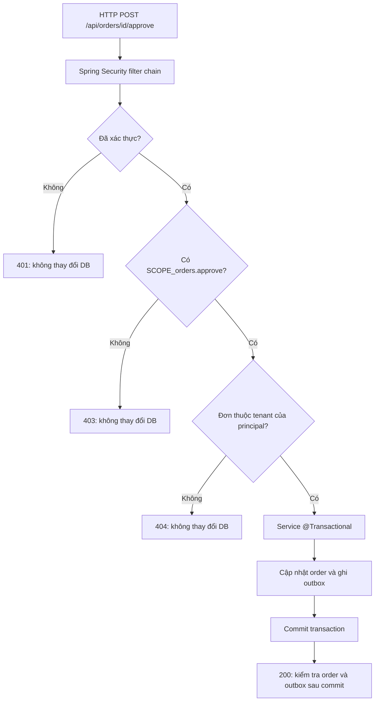

# Kết hợp kiểm tra tầng HTTP với tác dụng phụ trong kho dữ liệu

Trong chương **Tích hợp đầu cuối** của module **SPRING_SECURITY_TESTING**, một bài test bảo mật không nên dừng ở việc xác nhận HTTP `200`, `401` hoặc `403`. Với các endpoint ghi dữ liệu, câu hỏi quan trọng hơn là: **request được phép có thực sự ghi đúng dữ liệu không, và request bị từ chối có chắc chắn không tạo ra bất kỳ thay đổi trái phép nào không?** Một controller trả `403 Forbidden` nhưng đã cập nhật database trước khi kiểm tra quyền vẫn là lỗi bảo mật nghiêm trọng. Ngược lại, endpoint trả `200 OK` trong khi transaction bị rollback hoặc thao tác lưu không diễn ra cũng là lỗi nghiệp vụ mà test chỉ kiểm tra status có thể bỏ sót.

Bài học hướng dẫn kết hợp `spring-security-test` với **database integration test** trên ứng dụng **Servlet/MockMvc** và **Reactive/WebTestClient**. Người học kiểm chứng xác thực, phân quyền, `SecurityContext`, JWT/OAuth2/OIDC fixture, dữ liệu sau commit, trường hợp thiếu quyền hoặc truy cập chéo tenant, và tác dụng phụ như audit/outbox. Trọng tâm là những ca **được phép và bị từ chối** quan sát được ở cả HTTP **lẫn kho dữ liệu**; không cần tài khoản, khóa hoặc token của môi trường triển khai.

## 1. Hợp đồng kiểm thử gồm hai vế: HTTP và trạng thái bền vững

Ví dụ một API `POST /api/orders/{id}/approve` chỉ cho phép principal có authority `SCOPE_orders.approve`, đồng thời chỉ được phê duyệt đơn thuộc tenant của chính principal. Trạng thái đơn ban đầu là `PENDING`; khi phê duyệt thành công, trạng thái trở thành `APPROVED` và hệ thống ghi một bản ghi outbox `ORDER_APPROVED` để phát sự kiện sau commit.



Với chính sách minh họa trên, mỗi bài test có **hai nhóm assertion**:

| Tình huống | HTTP response | Trạng thái order sau request | Outbox sau request |
| --- | --- | --- | --- |
| Không có token | 401 | Vẫn `PENDING` | Không có sự kiện mới |
| Đã xác thực, thiếu `SCOPE_orders.approve` | 403 | Vẫn `PENDING` | Không có sự kiện mới |
| Đủ quyền, nhưng order thuộc tenant khác | 404 | Order của tenant khác vẫn `PENDING` | Không có sự kiện mới |
| JWT thiếu hoặc sai `tenant_id` bắt buộc | 403 theo policy minh họa | Không thay đổi order | Không có sự kiện mới |
| Đủ quyền, đúng tenant, order đang `PENDING` | 200, body trả `APPROVED` | Đã thành `APPROVED` **trong DB** | Chính xác một event liên quan |
| Gọi lại khi order đã `APPROVED` | 409 theo policy minh họa | Vẫn `APPROVED` | Không phát thêm event |

**Lưu ý:** mã `404` cho tài nguyên tenant khác là lựa chọn để tránh làm lộ sự tồn tại của ID. Hệ thống cũng có thể chọn `403`, nhưng phải áp dụng nhất quán. `401` trong bảng giả định API bearer-token với authentication entry point trả 401; ứng dụng dựa trên form login có thể chuyển hướng. Mục tiêu không phải ép mọi ứng dụng về cùng mã lỗi, mà là kiểm tra **cả hợp đồng HTTP lẫn hệ quả lưu trữ**.

## 2. Bốn tầng kiểm thử và những gì chúng chưa chứng minh

| Tầng test | Công cụ tiêu biểu | Có thể chứng minh | Chưa tự chứng minh |
| --- | --- | --- | --- |
| Unit test service | JUnit, Mockito | Nhánh nghiệp vụ, collaborator được gọi hay không | HTTP security filter, transaction và ghi database thật |
| Security test HTTP với principal giả | `MockMvc` + `jwt()`/`@WithMockUser`, hoặc `WebTestClient` + `mockJwt()` | Authentication/authorization trong pipeline ứng dụng và response | Chữ ký, expiry, issuer của token, kết quả commit nếu repository bị mock |
| HTTP + database integration | `@SpringBootTest`, `MockMvc`/`WebTestClient`, database test | HTTP status, method security, transaction, trạng thái lưu thực tế, outbox | Network/auth provider thực nếu dùng mock principal |
| HTTP qua server thật + provider/test token hợp lệ | Random port, HTTP client, JWT ký test hoặc IdP stub, database thật của test | Bộ lọc HTTP chạy qua socket, decoder/introspection, lưu bền vững và phản hồi | Không cần suy rộng đến tài khoản/provider production |

Để kiểm tra **tác dụng phụ trong kho dữ liệu**, đừng `@MockBean`/`@Mock` chính repository mà test cần quan sát. `verify(repository).save(...)` chỉ cho biết một lời gọi được tạo, **không xác nhận transaction đã commit, câu lệnh SQL chạy thành công, constraint được thỏa mãn hoặc dữ liệu đọc lại đúng**. Có thể mock một API bên ngoài không liên quan để cô lập môi trường, nhưng repository và transaction path thuộc phạm vi bài test nên là thật.

Một bộ kiểm thử bảo mật đầy đủ thường dùng nhiều tầng bổ sung nhau: test nhanh với mock principal cho authorization, test có database thật cho side effects, và một nhóm test ít hơn sử dụng bearer token ký bằng khóa test hoặc OIDC/OAuth2 provider stub để xác minh cơ chế authentication đầu-cuối.

## 3. Ví dụ domain: order và transactional outbox

Sử dụng Spring Data JPA trên Servlet. Hai entity dưới đây là bản rút gọn tập trung vào những thuộc tính cần kiểm chứng, với database thuộc **profile test**:

```java
@Entity
@Table(name = "purchase_orders")
class PurchaseOrder {
    @Id
    @GeneratedValue(strategy = GenerationType.IDENTITY)
    private Long id;

    @Column(nullable = false)
    private String tenantId;

    @Column(nullable = false)
    private String status;

    protected PurchaseOrder() {}

    PurchaseOrder(String tenantId) {
        this.tenantId = tenantId;
        this.status = "PENDING";
    }

    Long getId() { return id; }
    String getStatus() { return status; }
    void setStatus(String status) { this.status = status; }
}

@Entity
@Table(name = "approval_outbox")
class ApprovalOutbox {
    @Id
    @GeneratedValue(strategy = GenerationType.IDENTITY)
    private Long id;

    @Column(nullable = false)
    private Long orderId;

    @Column(nullable = false)
    private String tenantId;

    @Column(nullable = false)
    private String eventType;

    protected ApprovalOutbox() {}

    ApprovalOutbox(Long orderId, String tenantId, String eventType) {
        this.orderId = orderId;
        this.tenantId = tenantId;
        this.eventType = eventType;
    }

    Long getOrderId() { return orderId; }
    String getEventType() { return eventType; }
}
```

Repository thật cho test là Spring Data JPA bean, không phải Mockito stub:

```java
interface PurchaseOrderRepository extends JpaRepository<PurchaseOrder, Long> {
    Optional<PurchaseOrder> findByIdAndTenantId(Long id, String tenantId);
}

interface ApprovalOutboxRepository extends JpaRepository<ApprovalOutbox, Long> {
    long countByOrderId(Long orderId);
    List<ApprovalOutbox> findByOrderId(Long orderId);
}

record OrderView(Long id, String status) {}
```

Khi `PurchaseOrder` được nạp từ repository trong transaction, JPA dirty checking có thể persist việc `setStatus(...)` khi transaction flush/commit. `outbox.save(...)` thêm một bản ghi sự kiện **trong cùng transaction**. Lợi ích của outbox là hệ thống có thể phát sự kiện sau commit mà không phải gửi HTTP/message trực tiếp khi giao dịch chưa chắc thành công. Test bài này kiểm tra bản ghi outbox, **không mặc định đã kiểm chứng delivery tới broker**.

Nếu domain có nhiều loại trạng thái, nên dùng enum, version/optimistic locking và constraint DB tương ứng; ví dụ string `PENDING`/`APPROVED` chỉ để bài học dễ theo dõi.

## 4. Service: kiểm tra quyền, tenant và hai thay đổi trong cùng transaction

Một service có thể dùng `@PreAuthorize` cho authority, trong khi việc tìm order theo cả ID và tenant chặn truy cập chéo tenant:

```java
@Service
class OrderApprovalService {

    private final PurchaseOrderRepository orders;
    private final ApprovalOutboxRepository outbox;

    OrderApprovalService(PurchaseOrderRepository orders,
                         ApprovalOutboxRepository outbox) {
        this.orders = orders;
        this.outbox = outbox;
    }

    @Transactional
    @PreAuthorize("hasAuthority('SCOPE_orders.approve')")
    public OrderView approve(Long orderId, String tenantId) {
        PurchaseOrder order = orders.findByIdAndTenantId(orderId, tenantId)
            .orElseThrow(() -> new ResponseStatusException(
                HttpStatus.NOT_FOUND, "Order not found"));

        if ("APPROVED".equals(order.getStatus())) {
            throw new ResponseStatusException(
                HttpStatus.CONFLICT, "Order already approved");
        }

        order.setStatus("APPROVED");
        outbox.save(new ApprovalOutbox(
            order.getId(), tenantId, "ORDER_APPROVED"));

        return new OrderView(order.getId(), order.getStatus());
    }
}
```

`@PreAuthorize` chỉ hoạt động khi **method security được bật** và `OrderApprovalService` được gọi qua Spring proxy. `@Transactional` sử dụng transaction manager thực, và các lời gọi repository phải tham gia cùng transaction. Một lời gọi trực tiếp tới `new OrderApprovalService(...)` sẽ không chứng minh aspect security hay transaction hoạt động.

Ở đây, việc kiểm tra quyền xảy ra trước khi truy cập database từ thân method; tenant được áp dụng **ngay trong truy vấn** `findByIdAndTenantId`. Đây là một lớp bảo vệ chống lỗi IDOR/BOLA: principal có thể biết ID của order khác, nhưng không vì thế được đọc hoặc sửa order ấy. Đừng nhận `tenantId` từ request body và tin nó như một bằng chứng quyền sở hữu; dùng claim được xác thực hoặc tenant trong security context đã qua validation.

### Controller lấy tenant từ JWT đã xác thực

```java
@RestController
class OrderApprovalController {

    private final OrderApprovalService service;

    OrderApprovalController(OrderApprovalService service) {
        this.service = service;
    }

    @PostMapping("/api/orders/{id}/approve")
    OrderView approve(@PathVariable Long id,
                      @AuthenticationPrincipal Jwt jwt) {
        Object rawTenant = jwt.getClaim("tenant_id");
        if (!(rawTenant instanceof String tenantId) || tenantId.isBlank()) {
            throw new ResponseStatusException(
                HttpStatus.FORBIDDEN, "Invalid tenant claim");
        }
        return service.approve(id, tenantId);
    }
}
```

Trong ví dụ này, `Jwt` là principal của **OAuth2 Resource Server nhận bearer JWT**, không phải `OidcUser` của OAuth2 Login. Claim `tenant_id` đến từ một authentication đã được Spring Security thiết lập; phía production còn cần cấu hình **decoder và validation token thật** để không tin dữ liệu do client tự sửa. Bộ test dưới đây dùng `jwt()` để giả lập phần xác thực đó và kiểm chứng logic phía sau.

## 5. Security filter chain và cấu hình test cần thiết

Với API hoàn toàn stateless sử dụng bearer token (không dùng cookie/session để xác thực), một cấu hình Servlet minh họa:

```java
@Configuration
@EnableMethodSecurity
class OrderApiSecurityConfig {

    @Bean
    SecurityFilterChain apiSecurity(HttpSecurity http) throws Exception {
        return http
            .csrf(AbstractHttpConfigurer::disable)
            .sessionManagement(sessions -> sessions
                .sessionCreationPolicy(SessionCreationPolicy.STATELESS))
            .authorizeHttpRequests(auth -> auth
                .requestMatchers(HttpMethod.POST, "/api/orders/*/approve")
                    .authenticated()
                .anyRequest().denyAll())
            .oauth2ResourceServer(oauth -> oauth
                .jwt(Customizer.withDefaults()))
            .build();
    }
}
```

**Không tắt CSRF chỉ để test POST xanh.** Ví dụ này chủ động tắt CSRF vì contract giả định endpoint chỉ nhận bearer token qua `Authorization` và không dùng cookie-based authentication. Nếu ứng dụng thực dùng session/form login, hãy giữ CSRF protection và dùng `.with(csrf())` trong test thích hợp; nếu thiếu CSRF, request có thể bị 403 **trước khi** kiểm tra logic phân quyền mà bài học nhắm tới.

Với `@SpringBootTest` và `@AutoConfigureMockMvc`, Spring Security filters được áp dụng khi không chủ động tắt chúng. Khi tự xây `MockMvcBuilders`, phải cấu hình security đúng, thường với `.apply(springSecurity())`. Kiểm tra bằng ca anonymous 401 và thiếu quyền 403 để phát hiện filter chain bị bỏ qua.

## 6. MockMvc + database thật: kiểm tra kết quả thành công

Sử dụng database test độc lập, có schema/migration tương ứng và các Spring Data JPA repository thật. Đây là khung test **có các entity và service ở trên**:

```java
@SpringBootTest
@AutoConfigureMockMvc(addFilters = true)
class OrderApprovalIntegrationTest {

    @Autowired MockMvc mvc;
    @Autowired PurchaseOrderRepository orders;
    @Autowired ApprovalOutboxRepository outbox;

    // Chỉ cung cấp bean decoder cần để context khởi tạo.
    // Các request .with(jwt()) không thực thi JwtDecoder này.
    @MockBean JwtDecoder jwtDecoder;

    private PurchaseOrder tenantAOrder;
    private PurchaseOrder tenantBOrder;

    @BeforeEach
    void seedData() {
        outbox.deleteAll();
        orders.deleteAll();
        tenantAOrder = orders.saveAndFlush(new PurchaseOrder("tenant-a"));
        tenantBOrder = orders.saveAndFlush(new PurchaseOrder("tenant-b"));
    }

    @AfterEach
    void cleanUp() {
        outbox.deleteAll();
        orders.deleteAll();
    }

    @Test
    void authorizedRequestPersistsOrderAndOutbox() throws Exception {
        mvc.perform(post("/api/orders/{id}/approve", tenantAOrder.getId())
                .with(jwt().jwt(token -> token
                    .subject("fixture-approver")
                    .claim("tenant_id", "tenant-a"))
                    .authorities(new SimpleGrantedAuthority(
                        "SCOPE_orders.approve"))))
            .andExpect(status().isOk())
            .andExpect(jsonPath("$.id").value(tenantAOrder.getId()))
            .andExpect(jsonPath("$.status").value("APPROVED"));

        assertEquals("APPROVED", orders.findById(tenantAOrder.getId())
            .orElseThrow().getStatus());
        assertEquals("PENDING", orders.findById(tenantBOrder.getId())
            .orElseThrow().getStatus());

        assertEquals(1L, outbox.countByOrderId(tenantAOrder.getId()));
        assertEquals("ORDER_APPROVED", outbox
            .findByOrderId(tenantAOrder.getId()).get(0).getEventType());
        assertEquals(0L, outbox.countByOrderId(tenantBOrder.getId()));
    }
}
```

Các class/import thuộc Spring Boot Test, MockMvc, JUnit 5, Spring Data JPA và `spring-security-test`. `@MockBean JwtDecoder` là mẫu phổ biến ở Spring Boot 3.x; ở phiên bản hỗ trợ `@MockitoBean` có thể dùng annotation thay thế tương ứng. **Không mock repository**, vì mục tiêu là kiểm chứng SQL và commit thật. Mẫu này cũng cần dependency database test (ví dụ Testcontainers với PostgreSQL) và migration/schema chuẩn của dự án.

**Không đặt `@Transactional` ở cấp lớp test này** khi muốn quan sát trạng thái sau khi request/transaction đã kết thúc. Nếu test tự mở một transaction bao quanh toàn bộ phương thức, MockMvc đồng bộ đôi khi chạy trong cùng thread/transaction và nhìn thấy dữ liệu chưa commit; kết quả dương tính có thể che lỗi commit, đặc biệt khi về sau chuyển sang HTTP server thật hoặc xử lý bất đồng bộ. Việc seed/cleanup qua repository transaction độc lập và đọc lại sau request giúp chứng minh kết quả đã được lưu ngoài transaction xử lý request.

Ở test thành công, ngoài status `200`, kiểm tra cả **đúng order được sửa**, **order tenant khác không đổi** và **số lượng/nội dung outbox**. Điều này phát hiện bug ghi nhầm record, update hàng loạt hoặc phát event trùng mà HTTP body không thể hiện.

## 7. Các ca bị từ chối phải chứng minh không có thay đổi DB

Kiểm thử negative path với cùng dữ liệu ban đầu. Dùng helper assertion để tránh chỉ kiểm tra HTTP status:

```java
private void assertNoStorageChange() {
    assertEquals("PENDING", orders.findById(tenantAOrder.getId())
        .orElseThrow().getStatus());
    assertEquals("PENDING", orders.findById(tenantBOrder.getId())
        .orElseThrow().getStatus());
    assertEquals(0L, outbox.count());
}

@Test
void anonymousCannotApproveAndCannotWrite() throws Exception {
    mvc.perform(post("/api/orders/{id}/approve", tenantAOrder.getId()))
        .andExpect(status().isUnauthorized());

    assertNoStorageChange();
}

@Test
void authenticatedButMissingScopeCannotWrite() throws Exception {
    mvc.perform(post("/api/orders/{id}/approve", tenantAOrder.getId())
            .with(jwt().jwt(token -> token
                .subject("fixture-reader")
                .claim("tenant_id", "tenant-a"))
                .authorities(new SimpleGrantedAuthority(
                    "SCOPE_orders.read"))))
        .andExpect(status().isForbidden());

    assertNoStorageChange();
}

@Test
void approverFromOtherTenantCannotWrite() throws Exception {
    mvc.perform(post("/api/orders/{id}/approve", tenantBOrder.getId())
            .with(jwt().jwt(token -> token
                .subject("fixture-approver")
                .claim("tenant_id", "tenant-a"))
                .authorities(new SimpleGrantedAuthority(
                    "SCOPE_orders.approve"))))
        .andExpect(status().isNotFound());

    assertNoStorageChange();
}

@Test
void missingTenantClaimCannotWrite() throws Exception {
    mvc.perform(post("/api/orders/{id}/approve", tenantAOrder.getId())
            .with(jwt().jwt(token -> token
                .subject("fixture-approver"))
                .authorities(new SimpleGrantedAuthority(
                    "SCOPE_orders.approve"))))
        .andExpect(status().isForbidden());

    assertNoStorageChange();
}
```

Trong mỗi test, **hai order đều đang `PENDING` và outbox đang trống** do seed được thực hiện lại. Nếu database test chạy song song trên cùng schema, điều kiện này có thể không còn đúng; hãy cô lập database/schema hoặc dùng dữ liệu có khóa phân biệt để truy vấn theo từng test. Khi âm tính, assertion outbox rỗng còn chứng minh không chỉ trường trạng thái mà cả hệ quả downstream theo mô hình outbox chưa bị kích hoạt.

### Ca gọi lặp lại và tính idempotent

```java
@Test
void repeatedApprovalDoesNotDuplicateOutbox() throws Exception {
    RequestPostProcessor approver = jwt().jwt(token -> token
        .subject("fixture-approver")
        .claim("tenant_id", "tenant-a"))
        .authorities(new SimpleGrantedAuthority("SCOPE_orders.approve"));

    mvc.perform(post("/api/orders/{id}/approve", tenantAOrder.getId())
            .with(approver))
        .andExpect(status().isOk());

    mvc.perform(post("/api/orders/{id}/approve", tenantAOrder.getId())
            .with(jwt().jwt(token -> token
                .subject("fixture-approver")
                .claim("tenant_id", "tenant-a"))
                .authorities(new SimpleGrantedAuthority(
                    "SCOPE_orders.approve"))))
        .andExpect(status().isConflict());

    assertEquals("APPROVED", orders.findById(tenantAOrder.getId())
        .orElseThrow().getStatus());
    assertEquals(1L, outbox.countByOrderId(tenantAOrder.getId()));
}
```

Đây là một **chính sách minh họa**: lần gọi thứ hai trả `409 Conflict` mà không thêm event. Hệ thống thực có thể định nghĩa idempotent retry trả lại `200` hoặc `204`, nhưng vẫn phải không tạo side effect trùng. Với các request đồng thời, kiểm tra `status` bằng Java trước khi `save` chưa đủ tránh race; cần database constraint, optimistic locking hoặc cơ chế đồng bộ phù hợp, rồi viết concurrent test riêng.

## 8. Transaction rollback: không được nhầm “service đã chạy” với “đã commit”

`@Transactional` trong `OrderApprovalService` đảm bảo cập nhật order và ghi outbox cùng một giao dịch **nếu cả hai repository tham gia cùng transaction manager**. Nếu lỗi runtime xảy ra trước commit, transaction thường rollback. Một test chỉ `verify(outbox).save(...)` hoặc nhìn entity trong persistence context có thể không phát hiện lỗi commit, vi phạm unique constraint hoặc rollback xảy ra sau đó.

Nên có một ca tích hợp kiểm tra rollback bằng **điểm gây lỗi kiểm soát được** trong test, chẳng hạn: outbox write port có implementation test ném exception sau khi order đã thay đổi nhưng trước commit; database constraint fixture cố ý không thỏa; hoặc một service test riêng thực hiện hai thao tác rồi ném lỗi runtime. Không được tạo một endpoint bypass security chỉ để thử rollback trên production.

Ca rollback cần khẳng định theo trình tự:

1. Setup order `PENDING` bằng transaction fixture đã kết thúc.
2. Gửi HTTP request đã được xác thực/đủ quyền, cho đi tới service.
3. Buộc thao tác thứ hai thất bại sau khi order đã được sửa bên trong transaction.
4. Xác minh response lỗi **theo exception handler của ứng dụng**; không mặc định mọi failure đều thành HTTP 500.
5. Đọc lại database ở transaction mới: order vẫn `PENDING`, không có outbox mới.
6. Nếu có event publisher, chắc chắn **không phát event ngoài transaction** khi giao dịch rollback.

Nếu dùng mock để gây lỗi, chỉ mock **điểm tiêm lỗi nằm ngoài kho dữ liệu cần chứng minh**, hoặc một cổng ghi có chủ đích; vẫn phải để transaction và repository của order/outbox thực sự chạy. Không làm như sau:

```java
@MockBean PurchaseOrderRepository orders;

// verify(orders).save(any()) không phải bằng chứng database đã commit.
// Thay repository bằng mock còn loại bỏ mục tiêu kiểm thử rollback.
```

Với JPA, một entity managed có thể thay đổi trong bộ nhớ dù SQL chưa flush. Nếu test cần quan sát trạng thái bền vững, đọc lại bằng repository/`EntityManager` ở transaction mới và cân nhắc `flush`/`clear` khi test có persistence context riêng. Với request qua socket HTTP thật, transaction của server và transaction của test luôn là các phạm vi khác nhau; đặc biệt phải seed dữ liệu **đã commit** trước khi gửi request.

## 9. HTTP thật, mock authentication và ranh giới của `jwt()`

Trong các test MockMvc ở trên, `.with(jwt())` từ `SecurityMockMvcRequestPostProcessors` tạo ra một `JwtAuthenticationToken` đã được xác thực để kiểm tra **quy tắc sau xác thực**. Nó không chứng minh token JWT được ký đúng, còn hạn, có issuer/audience chính xác hoặc `JwtDecoder` thực hiện validation. Tương tự, `@WithMockUser` không chứng minh HTTP Basic/password hoạt động; `opaqueToken()` không gửi introspection; `oidcLogin()` không chạy Authorization Code flow.

Khi mục tiêu chuyển sang **xác thực qua HTTP thật**, có thể dùng:

- `@SpringBootTest(webEnvironment = RANDOM_PORT)` cùng `TestRestTemplate`, `WebTestClient.bindToServer()` hoặc HTTP client thích hợp để gửi request qua socket.
- JWT ký bằng **private key thử nghiệm** và decoder thật được cấu hình tin cậy **public key thử nghiệm**. Test hợp lệ/invalid signature/expired token riêng biệt.
- Opaque bearer token với **HTTP introspection stub**; OIDC Login với **OIDC provider stub** khi cần kiểm tra callback, issuer, nonce hoặc ID token.
- Database test qua Testcontainers hoặc một DB cô lập có cùng loại engine/schema/migration với production khi DB behavior/constraint đóng vai trò quan trọng.

Đặc biệt, `@WithMockUser`, `.with(jwt())`, `mockJwt()` và các post-processor phía test **không tự lan qua TCP sang server thật**. Nếu test dùng `RANDOM_PORT`, phải gửi credential/token fixture mà server có thể xác minh. Đừng dùng tài khoản hoặc access token của môi trường triển khai để làm integration test độc lập.

Một request HTTP thật thường chạy trên thread/transaction khác thread JUnit. Vì vậy không thể trông chờ test method có `@Transactional` rollback sẽ rollback luôn những thay đổi mà server đã commit. Cần cleanup dữ liệu bằng fixture/migration/schema riêng và chỉ xóa dữ liệu thuộc test.

## 10. Reactive: `WebTestClient` và hệ quả lưu bằng R2DBC

Với WebFlux, cách tiếp cận tương tự nhưng dùng **reactive repository** và reactive transaction, ví dụ R2DBC. Không dùng `EntityManager`/JPA blocking trong event loop; không gọi `.block()` từ handler WebFlux. Một service minh họa với `TransactionalOperator`:

```java
@Service
class ReactiveOrderApprovalService {

    private final ReactiveOrderRepository orders;
    private final ReactiveApprovalOutboxRepository outbox;
    private final TransactionalOperator tx;

    ReactiveOrderApprovalService(ReactiveOrderRepository orders,
            ReactiveApprovalOutboxRepository outbox,
            TransactionalOperator tx) {
        this.orders = orders;
        this.outbox = outbox;
        this.tx = tx;
    }

    @PreAuthorize("hasAuthority('SCOPE_orders.approve')")
    public Mono<ReactiveOrder> approve(String id, String tenantId) {
        return orders.findByIdAndTenantId(id, tenantId)
            .switchIfEmpty(Mono.error(new ResponseStatusException(
                HttpStatus.NOT_FOUND)))
            .flatMap(order -> {
                order.setStatus("APPROVED");
                return orders.save(order);
            })
            .flatMap(saved -> outbox.save(new ReactiveApprovalEvent(
                saved.getId(), tenantId, "ORDER_APPROVED"))
                .thenReturn(saved))
            .as(tx::transactional);
    }
}
```

`ReactiveOrderRepository`, `ReactiveApprovalOutboxRepository`, `ReactiveOrder` và `ReactiveApprovalEvent` là các thành phần domain cần khai báo tương ứng trong ứng dụng dùng Spring Data R2DBC; đoạn code tập trung vào **thứ tự publisher và transaction**. `@EnableReactiveMethodSecurity` phải được bật để `@PreAuthorize` chạy, và lời gọi phải đi qua Spring bean proxy. `TransactionalOperator` bao bọc toàn bộ publisher thao tác order/outbox, chứ không chỉ từng `save` riêng lẻ.

Đối với API WebFlux đã được bảo vệ bằng `SecurityWebFilterChain`, có thể kiểm thử request bằng `WebTestClient` với mock principal phù hợp:

```java
webTestClient.mutateWith(mockJwt().authorities(
        new SimpleGrantedAuthority("SCOPE_orders.approve")))
    .post().uri("/api/orders/{id}/approve", orderId)
    .exchange()
    .expectStatus().isOk()
    .expectBody()
    .jsonPath("$.status").isEqualTo("APPROVED");

StepVerifier.create(orders.findById(orderId))
    .assertNext(saved -> assertEquals("APPROVED", saved.getStatus()))
    .verifyComplete();
```

Ví dụ này giả định WebFlux controller, JSON response và repository đã được khai báo, dữ liệu đã seed và commit, security chain sử dụng JWT resource server, và `WebTestClient` được bind vào application context có `springSecurity()` hoặc client test được cấu hình tương đương. `mockJwt()` là mock cho **kiểm thử quyền**, không phải JWT decoder test. Nếu gọi qua HTTP server thật, cần thay mock bằng bearer JWT fixture hợp lệ.

Ở ca 401/403 hoặc tenant không khớp, đừng chỉ kiểm tra status: dùng `StepVerifier` đọc **order không đổi và không có event** từ reactive repository. `WebTestClient.expectBody(...)` tiêu thụ response, nhưng các publisher database kiểm tra sau đó vẫn phải được **subscribe** bằng `StepVerifier` hoặc một test harness tương đương. Chỉ tạo `Mono` rồi `assertNotNull` là dương tính giả vì truy vấn chưa được chạy.

### Lưu ý về lỗi và tác dụng phụ trong Reactive

Không gọi `.subscribe()` riêng bên trong controller/service cho thao tác ghi rồi trả `Mono.just("done")`: request có thể trả 200 trước khi database ghi thất bại; exception và transaction context có thể bị tách rời. Hãy kết hợp publisher bằng `flatMap`, `then` hoặc `TransactionalOperator` để HTTP response phụ thuộc vào kết quả ghi. Kiểm tra cả **completion và state sau request**, đặc biệt khi có retry/backpressure hoặc event được phát sau commit.

## 11. Chọn kho dữ liệu và cô lập bài test đúng cách

| Lựa chọn | Ưu điểm | Rủi ro hoặc giới hạn |
| --- | --- | --- |
| Database in-memory test | Nhanh, ít phụ thuộc môi trường | Khác SQL dialect/transaction isolation/constraint với DB triển khai |
| Testcontainers với engine production (PostgreSQL, MySQL...) | Hành vi transaction, lock, index, SQL gần production hơn | Khởi động chậm hơn; CI cần Docker/runtime tương ứng |
| Database test dùng chung | Dễ tái sử dụng môi trường | Dữ liệu test đụng nhau, dễ gây false positive hoặc cleanup nguy hiểm |
| Schema/database tách theo lớp test hoặc run | Giảm va chạm, dễ chạy song song | Cần cơ chế migration và lifecycle rõ ràng |

Một quy trình dữ liệu có thể tái lập:

1. Tạo schema bằng migration giống ứng dụng thật hoặc cơ chế schema test được kiểm soát.
2. Dùng ID/tenant fixture không trùng dữ liệu của test khác; seed trạng thái `PENDING` và outbox trống.
3. Commit dữ liệu seed trước khi gửi request tới server test.
4. Gửi request, assert HTTP status/body.
5. Đọc lại database ở transaction độc lập, assert bản ghi đúng và bản ghi không liên quan không đổi.
6. Dọn dữ liệu theo khóa fixture hoặc reset toàn bộ schema/database test chuyên dụng; không xóa dữ liệu dùng chung ngoài phạm vi test.

**Cảnh báo với `@Transactional` ở test:** khi dùng MockMvc đồng bộ, method test và request đôi khi chia sẻ thread/transaction; dữ liệu chưa commit có thể được nhìn thấy ngay trong test. Khi dùng `@SpringBootTest(RANDOM_PORT)`, async worker hoặc Reactive, transaction phía request thường không tham gia transaction của test. Đừng viết một test chỉ pass nhờ rollback tự động của test method rồi tuyên bố production commit/rollback đã được chứng minh.

Với các test yêu cầu kiểm tra `@Version`, unique constraint, FK, lock hoặc concurrent update, database cùng engine production thường đem lại bằng chứng tốt hơn H2 trong chế độ mặc định. Nhưng đừng phụ thuộc hệ thống staging/production để thử lỗi security hoặc race condition.

## 12. Những nguồn dương tính giả thường gặp

| Dấu hiệu trong test | Nguyên nhân có thể | Cách kiểm tra lại |
| --- | --- | --- |
| HTTP 200 nhưng DB không đổi | Repository bị mock, code chưa commit, async write tách khỏi response | Dùng repository thật, kiểm tra sau request và completion |
| HTTP 403 nhưng row đã đổi | Authorization xảy ra sau side effect hoặc lỗi async | Assert row và outbox không đổi cho mọi ca bị từ chối |
| Test pass dù token hết hạn | `.with(jwt())` hoặc `mockJwt()` bỏ qua decoder | Dùng JWT ký test và decoder thật cho nhóm validation |
| Có `save()` nhưng transaction rollback | Test chỉ `verify(repository).save` hoặc đọc entity trong persistence context | Đọc DB ở transaction mới sau request |
| Test vẫn xanh khi tenant khác | Chỉ kiểm tra `hasAuthority`, không ràng buộc record theo tenant | Dùng `findByIdAndTenantId`, test ID của tenant khác |
| Event gửi hai lần | Retry hoặc phê duyệt lặp tạo outbox trùng | Kiểm tra event count, unique constraint và concurrent test |
| Test chỉ xanh trên máy dev | Dùng database chung, data còn từ lượt chạy trước, timeout mơ hồ | Seed/cleanup độc lập, container DB, assertion bền vững |
| Request 403 trước khi tới permission rule | CSRF bật nhưng test thiếu token | Xác định CSRF policy, phân biệt filter CSRF với scope/role |
| WebTestClient 200 nhưng không thấy ghi R2DBC | Publisher ghi chưa được subscribe hoặc `.subscribe()` tách khỏi HTTP chain | Chain publisher, assert repository bằng `StepVerifier` |
| `@WithMockUser` không có tác dụng qua RANDOM_PORT | Security context ở thread test không tự vượt socket | Gửi Basic/Bearer fixture được server xác thực |

Một chỉ báo thực tiễn: khi cố tình bỏ `@PreAuthorize` hoặc thay `findByIdAndTenantId` bằng `findById`, **ít nhất một test âm tính phải thất bại**. Nếu toàn bộ bộ test vẫn xanh, nó chưa kiểm chứng hiệu quả các lớp bảo vệ mà người viết tin rằng đã có.

## 13. Bài thực hành: từ HTTP response tới dữ liệu đã commit

Xây API phê duyệt order như các mục trên, sử dụng database test cô lập, `SecurityFilterChain` với JWT resource server, `@EnableMethodSecurity`, `OrderApprovalService` có transaction và bảng outbox.

1. **Happy path:** tạo hai order thuộc hai tenant. Gửi JWT principal giả có `SCOPE_orders.approve`, `tenant_id=tenant-a` tới order A. Assert HTTP 200, order A `APPROVED`, order B vẫn `PENDING`, outbox đúng một event cho A.
2. **Chưa xác thực:** không gửi Bearer token, assert 401 theo entry point đang dùng và hai order/outbox không đổi.
3. **Thiếu quyền:** tạo principal đã xác thực chỉ có `SCOPE_orders.read`, assert 403 và không có bất kỳ thay đổi DB nào.
4. **IDOR/cross-tenant:** principal tenant A yêu cầu approve order B dù có scope. Assert 404 hoặc 403 theo contract, order B không đổi và outbox không phát event.
5. **Claim tenant không hợp lệ:** bỏ `tenant_id` hoặc đưa sai kiểu, xác minh controller/policy từ chối và DB không đổi.
6. **Request lặp:** approve một order hai lần. Assert response lần hai theo contract và outbox không tăng từ một lên hai event.
7. **Rollback:** buộc một bước transaction thất bại sau khi đã thay đổi entity trong bộ nhớ, rồi đọc lại database ở transaction mới để xác minh cả order/outbox rollback.
8. **Token validation riêng:** tạo một bài test HTTP qua server thật, ký bearer JWT bằng khóa RSA test, thử token hợp lệ, hết hạn và sai chữ ký; không sử dụng `.with(jwt())` để kiểm chứng decoder.
9. **Reactive đối chiếu:** với WebFlux/R2DBC, dùng WebTestClient kiểm tra status/body và `StepVerifier` kiểm tra bản ghi DB; ca 403 phải bảo đảm write publisher không chạy.
10. **Chạy lại trên CI:** seed/cleanup nhất quán, không phụ thuộc dữ liệu của lần chạy trước, không dùng credential, token hay database production.

### Tiêu chí hoàn thành

| Tiêu chí | Bằng chứng |
| --- | --- |
| Security HTTP có hiệu lực | Anonymous bị từ chối, principal thiếu quyền bị từ chối, đủ quyền nhận response thành công |
| Không ghi dữ liệu trái phép | Mọi ca 401/403/cross-tenant đều giữ nguyên order và không tạo outbox |
| Tác dụng phụ chính xác | Ca 200 cập nhật đúng order và đúng một event, order không liên quan không đổi |
| Có transaction thật | Kiểm tra commit ở happy path và rollback khi thao tác giữa transaction thất bại |
| Không có dương tính giả do mock | Dùng repository/database thật; mock principal được phân biệt với việc xác minh token thật |
| Hoạt động trên Reactive nếu có | Publisher được subscribe đúng, `TransactionalOperator` quản lý thao tác ghi, trạng thái R2DBC được đọc lại |
| Có thể tái lập | Database riêng/fixture riêng, migration chuẩn và cleanup an toàn trên CI |

## Ghi nhớ

**Kiểm thử tích hợp đầu cuối phải nhìn thấy cả HTTP lẫn dữ liệu đã lưu.** `200 OK` chưa đủ nếu DB không thay đổi đúng, còn `401/403` chưa đủ nếu transaction hoặc một nhánh async đã ghi dữ liệu trái phép. Với **SPRING_SECURITY_TESTING**, hãy gửi request qua Spring Security filter chain thật, dùng `MockMvc` hoặc `WebTestClient` đúng phạm vi, sau đó đọc lại repository/database và outbox để chứng minh tác dụng phụ. Dùng mock JWT/OAuth2/OIDC cho **kiểm thử quyền sau xác thực**, và thêm test có token/provider stub thật khi mục tiêu là kiểm chứng chính cơ chế xác thực. Một bộ test mạnh phải phát hiện được cả lỗi **cho phép sai người** lẫn lỗi **ghi sai dữ liệu**, đồng thời kiểm tra commit/rollback trên kho dữ liệu test cô lập.
