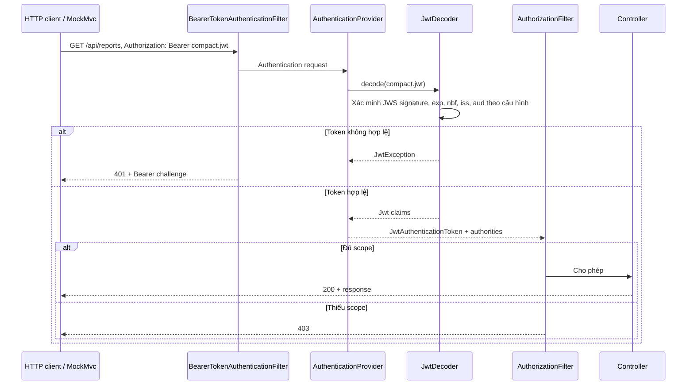
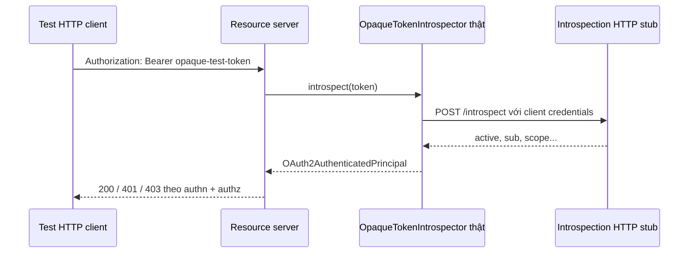

# Ứng dụng resource server xác minh token bằng thành phần thật

## 1. Bối cảnh: test trả 200 chưa chắc resource server đã xác minh JWT

Giả sử một API báo cáo chỉ cho phép người gọi có access token do một issuer tin cậy cấp, dành cho audience `reports-api` và chứa quyền `reports.read`. Trong một bài test dùng `spring-security-test`, chúng ta có thể viết:

```java
mvc.perform(get("/api/reports")
        .with(jwt().authorities(
            new SimpleGrantedAuthority("SCOPE_reports.read"))))
    .andExpect(status().isOk());
```

Đây là kiểm thử **authorization với Authentication giả lập** rất hữu ích. Nhưng `jwt()` của MockMvc tạo một `JwtAuthenticationToken` cho request; nó **không gửi compact JWT đi qua `JwtDecoder` thật**. Nếu decoder bị cấu hình sai public key, bỏ quên issuer/audience validator hoặc cho phép token hết hạn, test này vẫn có thể xanh.

Trong chương **Tích hợp đầu cuối** của module **SPRING_SECURITY_TESTING**, nhiệm vụ là nâng mức kiểm chứng: gửi **Bearer token có chữ ký thật** vào ứng dụng, cho `SecurityFilterChain`/`SecurityWebFilterChain` chạy, để **`JwtDecoder` hoặc `ReactiveJwtDecoder` thực sự phân tích, xác minh, kiểm tra claims**, sau đó mới áp dụng phân quyền HTTP. Bài kết hợp cách tư duy của Servlet/MockMvc và Reactive/WebTestClient; đồng thời chỉ rõ khi nào cần kiểm thử JWKS hoặc introspection qua HTTP.

Sau bài này, người học có thể:

1. Phân biệt unit test `jwt()`/`mockJwt()` với integration test chạy decoder thật.
2. Tạo cặp khóa RSA và ký compact JWT chỉ dành cho test; cung cấp public key cho decoder thực.
3. Kiểm thử đường đi HTTP Bearer token từ request đến `Authentication`, controller và HTTP authorization.
4. Kiểm tra các token hợp lệ, sai chữ ký, sai issuer/audience, hết hạn, không có token và thiếu scope bằng status 200/401/403.
5. Áp dụng cách tương đương trên WebFlux qua `ReactiveJwtDecoder` và WebTestClient.
6. Nêu ranh giới giữa test với public key cục bộ, test JWKS HTTP, test opaque-token introspection và E2E với authorization server hoàn chỉnh.

## 2. Luồng xác thực thực sự trên resource server

Resource server **nhận và kiểm tra access token** được gửi đến API; nó không nhất thiết là nơi **cấp token**. Với bearer JWT và Spring Security Servlet, đường đi điển hình:



Đường đi Reactive tương ứng dùng `SecurityWebFilterChain`, các authentication WebFilter, `ReactiveJwtDecoder` và Reactor Context. Nguyên tắc vẫn là **xác minh credential trước, quyết định quyền sau**.

| Lớp | Câu hỏi mà test trả lời | Thành phần thực phải tham gia |
| --- | --- | --- |
| Trích xuất token | Header Bearer có được nhận đúng không? | Resource-server authentication filter |
| Xác minh token | Chữ ký, issuer, thời hạn, audience có hợp lệ? | `JwtDecoder` / `ReactiveJwtDecoder` và validators |
| Chuyển claims thành quyền | `scope` thành `SCOPE_reports.read` như thế nào? | `JwtAuthenticationConverter` hoặc converter đã cấu hình |
| HTTP authorization | Đủ scope được 200, thiếu scope 403? | Security filter chain và authorization rules |
| Business/controller | Principal/claims đến được handler? | Controller/service thực |

**Cần phân biệt** 401 do token không được xác thực với 403 do một Authentication **đã hợp lệ** nhưng không đủ quyền. Không dùng `is4xxClientError()` để thay cho các assertion cụ thể này.

## 3. Thế nào là “thành phần thật” trong bài này?

Một bài kiểm thử có thể dùng dữ liệu giả nhưng vẫn chạy **thuật toán xác minh thật**. Ví dụ:

- Khóa RSA được tạo ngẫu nhiên trong test, **không phải khóa production**.
- JWT được `NimbusJwtEncoder` ký theo chuẩn JWS.
- `NimbusJwtDecoder` của Spring Security dùng public key tương ứng để kiểm tra chữ ký và chạy các `OAuth2TokenValidator` thực.
- Request gửi chuỗi `Authorization: Bearer <compact-token>`, không dùng `with(jwt())`, `mockJwt()` hay `@WithMockUser`.
- SecurityFilterChain và controller do Spring dựng từ application context, không bypass authorization bằng cách gọi thẳng method.

Điều này chứng minh **resource server xác minh được token theo cấu hình test**. Nó **chưa chứng minh** một IdP thật phát hành token, discovery metadata đúng, JWKS được tải qua mạng hoặc cơ chế rotation/revocation hoạt động, trừ khi test mở rộng để kiểm chứng chính những đường đi ấy.

### 3.1. So sánh ba cấp độ test

| Cấp độ | Cách chuẩn bị danh tính | Thành phần được chạy | Không nên kết luận |
| --- | --- | --- | --- |
| Test authorization nhanh | `with(jwt())` / `mockJwt()` | Authorization với Authentication giả | Decoder xác minh chữ ký, exp, issuer |
| Integration resource server | Bearer JWT ký thật + decoder thật | Authentication filter, decoder, validators, authority converter, HTTP authorization | IdP thật/JWKS remote chắc chắn hoạt động |
| Integration JWKS/IdP | JWT ký thật + JWKS/metadata hoặc introspection HTTP giả có kiểm soát | Kết nối HTTP lấy khóa/introspection + validation + HTTP authorization | Production IdP chắc chắn tương thích 100% |

Chọn cấp độ theo điều cần chứng minh. Bộ test chất lượng thường **kết hợp** kiểm thử authorization nhanh và một tập integration test xác minh credential thật, thay vì thay tất cả test bằng một hình thức.

## 4. Chuẩn bị thư viện và môi trường

Ví dụ Servlet sử dụng Java 17+ và Spring Boot 3.x/Spring Security 6.x. Gradle:

```groovy
dependencies {
    implementation 'org.springframework.boot:spring-boot-starter-web'
    implementation 'org.springframework.boot:spring-boot-starter-security'
    implementation 'org.springframework.boot:spring-boot-starter-oauth2-resource-server'

    testImplementation 'org.springframework.boot:spring-boot-starter-test'
    testImplementation 'org.springframework.security:spring-security-test'
}
```

Spring Security JWT dựa trên các module OAuth2 Resource Server và JOSE; dùng dependency management/BOM của Spring Boot để tránh trộn version. Với Spring Boot 4.x, một số web và test starter/package auto-configuration thay đổi; ví dụ dưới đây dùng import của Boot 3.x, cần chuyển import `@AutoConfigureMockMvc` và test starter theo Boot 4 khi áp dụng dự án tương ứng.

Trong tất cả mã mẫu:

- URI `https://issuer.example.test` là **giả định của test**, không gọi một IdP ngoài mạng.
- Key pair được tạo ở runtime; không sử dụng private key thực.
- Giá trị `reports-api` là audience mong đợi của resource server.
- Endpoint `GET /api/reports` yêu cầu `SCOPE_reports.read`.
- API ví dụ được bảo vệ bằng Bearer token truyền trong header; mẫu Servlet không dùng session/cookie để lưu xác thực.

## 5. Ứng dụng Servlet nhỏ nhưng chạy security thật

Tạo lớp application test với một `SecurityFilterChain` bảo vệ API. Để đoạn code tự chứa, dùng `@SpringBootConfiguration` và khai báo controller làm bean; không phụ thuộc component scan của project bên ngoài.

```java
import org.springframework.boot.SpringBootConfiguration;
import org.springframework.boot.autoconfigure.EnableAutoConfiguration;
import org.springframework.context.annotation.Bean;
import org.springframework.http.HttpMethod;
import org.springframework.security.config.Customizer;
import org.springframework.security.config.annotation.web.builders.HttpSecurity;
import org.springframework.security.config.http.SessionCreationPolicy;
import org.springframework.security.web.SecurityFilterChain;

@SpringBootConfiguration
@EnableAutoConfiguration
class DemoResourceServer {

    @Bean
    SecurityFilterChain apiSecurity(HttpSecurity http) throws Exception {
        return http
            .authorizeHttpRequests(auth -> auth
                .requestMatchers(HttpMethod.GET, "/api/reports")
                    .hasAuthority("SCOPE_reports.read")
                .anyRequest().denyAll())
            .oauth2ResourceServer(oauth2 ->
                oauth2.jwt(Customizer.withDefaults()))
            .sessionManagement(session ->
                session.sessionCreationPolicy(
                    SessionCreationPolicy.STATELESS))
            .csrf(csrf -> csrf.disable())
            .build();
    }

    @Bean
    ReportController reportController() {
        return new ReportController();
    }
}
```

Với endpoint chỉ sử dụng Bearer token theo header và **không tự động gửi credential bằng browser cookie**, việc vô hiệu hóa CSRF có thể phù hợp với kiến trúc API stateless cụ thể này. **Không sao chép `csrf.disable()` sang ứng dụng vẫn dùng cookie/session mà chưa đánh giá CSRF threat model.**

Controller trả một phần claims đã xác minh:

```java
import java.util.Map;
import org.springframework.security.core.annotation.AuthenticationPrincipal;
import org.springframework.security.oauth2.jwt.Jwt;
import org.springframework.web.bind.annotation.GetMapping;
import org.springframework.web.bind.annotation.RestController;

@RestController
class ReportController {

    @GetMapping("/api/reports")
    Map<String, String> report(@AuthenticationPrincipal Jwt jwt) {
        return Map.of(
            "subject", jwt.getSubject(),
            "tenant", jwt.getClaimAsString("tenant_id"));
    }
}
```

Endpoint này là probe cho test; các token hợp lệ của ví dụ đều có `sub` và `tenant_id`. Nếu API production có thể nhận claim thiếu/sai kiểu, phải xác thực schema hoặc xử lý tình huống đó một cách có kiểm soát, không để `Map.of` gây lỗi 500. `SCOPE_reports.read` chỉ là một kiểm tra quyền theo scope; nó **không tự ràng buộc** tenant trong token với tài nguyên của tenant. Ràng buộc tenant/owner cần rule riêng và negative test tương ứng.

## 6. Bộ khóa RSA, encoder và decoder thật trong test context

Đây là phần quan trọng nhất: **decoder phải thực sự được dùng**. Ta tạo một bean `KeyPair` cho application context, dùng private key để tạo JWT và public key cho `NimbusJwtDecoder`. Decoder kiểm tra issuer, thời hạn và audience.

```java
import java.security.GeneralSecurityException;
import java.security.KeyPair;
import java.security.KeyPairGenerator;
import java.security.interfaces.RSAPrivateKey;
import java.security.interfaces.RSAPublicKey;

import com.nimbusds.jose.jwk.JWKSet;
import com.nimbusds.jose.jwk.RSAKey;
import com.nimbusds.jose.jwk.source.ImmutableJWKSet;

import org.springframework.boot.test.context.TestConfiguration;
import org.springframework.context.annotation.Bean;
import org.springframework.security.oauth2.core.OAuth2Error;
import org.springframework.security.oauth2.core.OAuth2TokenValidator;
import org.springframework.security.oauth2.core.OAuth2TokenValidatorResult;
import org.springframework.security.oauth2.jwt.*;

@TestConfiguration(proxyBeanMethods = false)
class TestJwtKeys {
    static final String ISSUER = "https://issuer.example.test";
    static final String AUDIENCE = "reports-api";
    static final String KEY_ID = "test-kid";

    static KeyPair newKeyPair() throws GeneralSecurityException {
        KeyPairGenerator generator =
            KeyPairGenerator.getInstance("RSA");
        generator.initialize(2048);
        return generator.generateKeyPair();
    }

    static JwtEncoder signingEncoder(KeyPair keyPair) {
        RSAKey jwk = new RSAKey.Builder(
                (RSAPublicKey) keyPair.getPublic())
            .privateKey((RSAPrivateKey) keyPair.getPrivate())
            .keyID(KEY_ID)
            .build();
        return new NimbusJwtEncoder(
            new ImmutableJWKSet<>(new JWKSet(jwk)));
    }

    @Bean
    KeyPair testSigningKeys() throws GeneralSecurityException {
        return newKeyPair();
    }

    @Bean
    JwtEncoder jwtEncoder(KeyPair testSigningKeys) {
        return signingEncoder(testSigningKeys);
    }

    @Bean
    JwtDecoder jwtDecoder(KeyPair testSigningKeys) {
        NimbusJwtDecoder decoder = NimbusJwtDecoder
            .withPublicKey(
                (RSAPublicKey) testSigningKeys.getPublic())
            .build();

        OAuth2TokenValidator<Jwt> audienceValidator = jwt ->
            jwt.getAudience().contains(AUDIENCE)
                ? OAuth2TokenValidatorResult.success()
                : OAuth2TokenValidatorResult.failure(
                    new OAuth2Error(
                        "invalid_token",
                        "Token audience does not match this API",
                        null));

        decoder.setJwtValidator(
            new DelegatingOAuth2TokenValidator<>(
                JwtValidators.createDefaultWithIssuer(ISSUER),
                audienceValidator));
        return decoder;
    }
}
```

Các điểm cần hiểu:

- `NimbusJwtEncoder` tạo token JWS RSA bằng **private key của fixture**, không phải token từ `jwt()` helper.
- `NimbusJwtDecoder.withPublicKey(...)` dùng **public key** và thực hiện xác minh chữ ký thực. Key ID trong header không thay thế kiểm tra chữ ký.
- `JwtValidators.createDefaultWithIssuer(...)` áp dụng những validation mặc định như thời gian (`exp`/`nbf`) cùng issuer. Mức clock skew mặc định có thể cho phép một khoảng lệch thời gian; test expired nên cách xa mốc hiện tại.
- `audienceValidator` là kiểm tra **ứng dụng tự khai báo**. `aud` không tự động được đối chiếu với `reports-api` trong mọi cấu hình mặc định.
- Không mock bean `JwtDecoder` và không trả trước `Jwt` từ Mockito trong test xác minh thật.

Vì bean khóa được tạo theo `ApplicationContext`, các test method cùng context có thể dùng chung **trust root fixture** và tạo token riêng. Nếu cần kiểm tra khóa giả mạo, ta tạo **key pair thứ hai** trong chính test; decoder không tin cậy nó.

## 7. Ký compact JWT với claims có thể điều khiển

Để kiểm tra các trường hợp sai issuer/audience/expiry hoặc thiếu scope, sử dụng một helper phát hành JWT qua encoder thật:

```java
import java.time.Instant;
import java.util.List;
import java.util.UUID;
import org.springframework.security.oauth2.jose.jws.SignatureAlgorithm;
import org.springframework.security.oauth2.jwt.*;

final class TestTokens {
    private TestTokens() {}

    static String issue(
            JwtEncoder signer,
            String issuer,
            String audience,
            String scope,
            Instant issuedAt,
            Instant expiresAt) {

        JwtClaimsSet claims = JwtClaimsSet.builder()
            .issuer(issuer)
            .audience(List.of(audience))
            .subject("alice")
            .issuedAt(issuedAt)
            .expiresAt(expiresAt)
            .id(UUID.randomUUID().toString())
            .claim("tenant_id", "tenant-a")
            .claim("scope", scope)
            .build();

        JwsHeader header = JwsHeader
            .with(SignatureAlgorithm.RS256)
            .keyId(TestJwtKeys.KEY_ID)
            .build();

        return signer.encode(
            JwtEncoderParameters.from(header, claims))
            .getTokenValue();
    }
}
```

Token trả về ở đây là chuỗi có ba phần `header.payload.signature`. Để kiểm tra chữ ký, phải gửi **nguyên token này** trong header HTTP; không tạo `JwtAuthenticationToken` thủ công cho request.

Hai mốc thời gian nên lấy tại lúc test chạy:

```java
Instant now = Instant.now();
String valid = TestTokens.issue(
    jwtEncoder,
    TestJwtKeys.ISSUER,
    TestJwtKeys.AUDIENCE,
    "reports.read",
    now.minusSeconds(5),
    now.plusSeconds(300));
```

Không hardcode một ngày được gọi là “tương lai” rồi sử dụng vĩnh viễn: đến thời điểm đó token sẽ hết hạn và test trở nên không ổn định. Trong test đơn giản, một token có `exp` sau hiện tại vài phút là đủ; trong test clock skew, cấu hình clock/validator chuyên biệt.

## 8. MockMvc integration test: request phải mang Bearer token thật

Trong Spring Boot 3.x, kết hợp `@SpringBootTest` với `@AutoConfigureMockMvc`. Đưa cả application và test-key configuration vào context, để filter, decoder và controller cùng được Spring tạo:

```java
import java.security.KeyPair;
import java.time.Instant;

import org.junit.jupiter.api.Test;
import org.springframework.beans.factory.annotation.Autowired;
import org.springframework.boot.test.autoconfigure.web.servlet
    .AutoConfigureMockMvc;
import org.springframework.boot.test.context.SpringBootTest;
import org.springframework.http.HttpHeaders;
import org.springframework.security.oauth2.jwt.JwtEncoder;
import org.springframework.test.web.servlet.MockMvc;

import static org.assertj.core.api.Assertions.assertThat;
import static org.hamcrest.Matchers.startsWith;
import static org.springframework.test.web.servlet.request
    .MockMvcRequestBuilders.get;
import static org.springframework.test.web.servlet.result
    .MockMvcResultMatchers.*;

@SpringBootTest(classes = {
    DemoResourceServer.class, TestJwtKeys.class
})
@AutoConfigureMockMvc
class ResourceServerRealTokenTest {

    @Autowired MockMvc mvc;
    @Autowired JwtEncoder jwtEncoder;

    private String token(String issuer, String audience,
                         String scope, Instant issued, Instant expiry) {
        return TestTokens.issue(jwtEncoder, issuer, audience,
            scope, issued, expiry);
    }

    private String validToken(String scope) {
        Instant now = Instant.now();
        return token(
            TestJwtKeys.ISSUER,
            TestJwtKeys.AUDIENCE,
            scope,
            now.minusSeconds(5),
            now.plusSeconds(300));
    }

    @Test
    void trustedSignedTokenCanReachController() throws Exception {
        String token = validToken("reports.read");

        mvc.perform(get("/api/reports")
                .header(HttpHeaders.AUTHORIZATION,
                    "Bearer " + token))
            .andExpect(status().isOk())
            .andExpect(jsonPath("$.subject").value("alice"))
            .andExpect(jsonPath("$.tenant").value("tenant-a"));
    }

    @Test
    void missingBearerTokenIs401() throws Exception {
        mvc.perform(get("/api/reports"))
            .andExpect(status().isUnauthorized())
            .andExpect(header().string(
                HttpHeaders.WWW_AUTHENTICATE,
                startsWith("Bearer")));
    }

    @Test
    void malformedBearerTokenIs401() throws Exception {
        mvc.perform(get("/api/reports")
                .header(HttpHeaders.AUTHORIZATION,
                    "Bearer this-is-not-a-jwt"))
            .andExpect(status().isUnauthorized());
    }

    @Test
    void wrongIssuerIs401EvenWithValidSignature()
            throws Exception {
        Instant now = Instant.now();
        String token = token(
            "https://untrusted-issuer.example.test",
            TestJwtKeys.AUDIENCE,
            "reports.read",
            now.minusSeconds(5),
            now.plusSeconds(300));

        mvc.perform(get("/api/reports")
                .header(HttpHeaders.AUTHORIZATION,
                    "Bearer " + token))
            .andExpect(status().isUnauthorized());
    }

    @Test
    void wrongAudienceIs401EvenWithValidSignature()
            throws Exception {
        Instant now = Instant.now();
        String token = token(
            TestJwtKeys.ISSUER,
            "some-other-api",
            "reports.read",
            now.minusSeconds(5),
            now.plusSeconds(300));

        mvc.perform(get("/api/reports")
                .header(HttpHeaders.AUTHORIZATION,
                    "Bearer " + token))
            .andExpect(status().isUnauthorized());
    }

    @Test
    void expiredJwtIs401() throws Exception {
        Instant now = Instant.now();
        String token = token(
            TestJwtKeys.ISSUER,
            TestJwtKeys.AUDIENCE,
            "reports.read",
            now.minusSeconds(900),
            now.minusSeconds(300));

        mvc.perform(get("/api/reports")
                .header(HttpHeaders.AUTHORIZATION,
                    "Bearer " + token))
            .andExpect(status().isUnauthorized());
    }

    @Test
    void authenticatedJwtWithoutScopeIs403()
            throws Exception {
        String token = validToken("profile");

        mvc.perform(get("/api/reports")
                .header(HttpHeaders.AUTHORIZATION,
                    "Bearer " + token))
            .andExpect(status().isForbidden());
    }

    @Test
    void signatureFromAnotherPrivateKeyIs401()
            throws Exception {
        JwtEncoder rogueSigner =
            TestJwtKeys.signingEncoder(TestJwtKeys.newKeyPair());
        Instant now = Instant.now();
        String token = TestTokens.issue(
            rogueSigner,
            TestJwtKeys.ISSUER,
            TestJwtKeys.AUDIENCE,
            "reports.read",
            now.minusSeconds(5),
            now.plusSeconds(300));

        mvc.perform(get("/api/reports")
                .header(HttpHeaders.AUTHORIZATION,
                    "Bearer " + token))
            .andExpect(status().isUnauthorized());
    }
}
```

Không có dòng nào dùng `with(jwt())`, `with(authentication(...))` hay mock `JwtDecoder`. Mỗi request Bearer được đi qua authentication filter và decoder thực. Test sai chữ ký dùng **khóa khác** dù issuer, audience và scope đều có vẻ đúng; nếu API chấp nhận token đó, đây là lỗi bảo mật nghiêm trọng.

### 8.1. Vì sao thiếu scope là 403 nhưng audience sai là 401?

- **Sai issuer/audience/chữ ký/hạn:** decoder không tạo Authentication hợp lệ → resource server thường trả 401 và Bearer challenge.
- **Chữ ký và validators hợp lệ nhưng không có `SCOPE_reports.read`:** Authentication hợp lệ, `AuthorizationFilter` từ chối → thường trả 403.
- `scope` trong JWT thực được Spring Security chuyển thành authority với prefix `SCOPE_` theo converter mặc định. Nếu dự án sử dụng converter khác, phải kiểm tra mapping thực tế thay vì giả định tên authority luôn như ví dụ.

Khi kiểm tra 401/403, không mặc định mọi response phải có cùng body JSON. Resource server có thể chỉ trả status và `WWW-Authenticate`; schema lỗi JSON là phần cấu hình của ứng dụng.

## 9. Xác minh các assertion thực sự chạy qua decoder

Một bộ test có thể “xanh giả” khi filter chain bị vô hiệu hóa hoặc mock decoder vô tình thay bean thật. Hãy dùng **đối chứng bắt buộc**:

| Ca | Token | Expected status | Thành phần nào được xác minh |
| --- | --- | --- | --- |
| Thành công | RSA signed, issuer/audience/time/scope đúng | 200 | Signature + validators + authority |
| Không có Bearer | Không có header | 401 | Entry point/resource server |
| Token sai định dạng | Không parse được JWT | 401 | Bearer authentication / decoder |
| Sai chữ ký | Ký bằng private key khác | 401 | **JWS signature verification** |
| Sai issuer | Đúng khóa, sai `iss` | 401 | Issuer validator |
| Sai audience | Đúng khóa, sai `aud` | 401 | Audience validator ứng dụng |
| Hết hạn | `exp` xa trước hiện tại | 401 | Timestamp validator |
| Thiếu scope | Token hợp lệ, scope chỉ có `profile` | 403 | Authority mapping + HTTP authorization |

Nếu test thiếu các ca **sai chữ ký** và **sai issuer**, một ứng dụng vô tình bỏ qua một phần validation có thể vẫn vượt qua test happy path. Nếu thiếu ca **không có token**, một endpoint không được bảo vệ đúng matcher cũng có thể trả 200.

Không suy ra “đã gọi JwtDecoder” chỉ từ việc inject được bean. Một test thật phải chứng minh rằng request sai credential **bị từ chối qua chính HTTP pipeline**; có thể bổ sung metrics/spy cho mục đích chẩn đoán, nhưng tránh `@MockBean JwtDecoder`/`@MockitoBean JwtDecoder` vì điều đó thay thế thuật toán cần kiểm tra.

## 10. Trường hợp `nbf`, clock skew và kiểm chứng thời gian

JWT có thể có:

| Claim | Vai trò | Khi cần từ chối |
| --- | --- | --- |
| `iat` | Thời điểm phát hành | Không phải mọi decoder mặc định coi `iat` quá xa tương lai là lỗi; policy phải định nghĩa |
| `nbf` | Chỉ hợp lệ kể từ thời điểm này | `nbf` lớn hơn hiện tại ngoài ngưỡng clock skew |
| `exp` | Hết hiệu lực tại thời điểm này | `exp` đã qua ngoài ngưỡng clock skew |

Để test token hết hạn, đừng đặt `exp = now.minusSeconds(1)` rồi mong luôn 401: validator có thể cho phép lệch đồng hồ vài chục giây. Ở mục 8, `exp` lùi 300 giây và `iat` lùi 900 giây để tránh kết quả phụ thuộc clock skew mặc định.

Muốn test chính xác ngưỡng clock skew:

```java
NimbusJwtDecoder decoder =
    NimbusJwtDecoder.withPublicKey(publicKey).build();

OAuth2TokenValidator<Jwt> timeAndIssuer =
    new DelegatingOAuth2TokenValidator<>(
        new JwtTimestampValidator(Duration.ofSeconds(30)),
        new JwtIssuerValidator(TestJwtKeys.ISSUER));
decoder.setJwtValidator(timeAndIssuer);
```

Đây chỉ là **mẫu thay validator** khi tập trung vào thời gian; nếu ứng dụng còn yêu cầu audience, phải **giữ hoặc bổ sung audience validator** thay vì thay thế toàn bộ validators và vô tình bỏ bảo vệ. Một bài test đáng tin cậy kiểm soát được Clock hoặc dùng timestamp đủ cách biệt để tránh flake.

## 11. Khi nào phải dùng JWKS endpoint thay vì public key cố định?

Ví dụ dùng `NimbusJwtDecoder.withPublicKey(...)` đã chạy thuật toán xác minh chữ ký thật, nhưng **không tải JWKS qua HTTP**. Với ứng dụng production thường cấu hình `issuer-uri` hoặc `jwk-set-uri`, hành vi có thể phụ thuộc:

- Truy xuất metadata của issuer để tìm `jwks_uri`.
- Lấy JWK Set qua HTTPS và chọn khóa theo `kid`/`alg`.
- Cache key set, retry và cập nhật khi issuer rotate khóa.
- Xử lý JWKS sai định dạng, thiếu key, key hết hiệu lực hoặc không đúng thuật toán.

Khi mục tiêu là kiểm thử đúng quá trình đó, dùng **một HTTP stub server cục bộ** làm JWKS endpoint và decoder thật:

```java
// jwksUrl trỏ tới HTTP stub server cục bộ được tạo trong test.
NimbusJwtDecoder decoder =
    NimbusJwtDecoder.withJwkSetUri(jwksUrl).build();

OAuth2TokenValidator<Jwt> audienceCheck = jwt ->
    jwt.getAudience().contains("reports-api")
        ? OAuth2TokenValidatorResult.success()
        : OAuth2TokenValidatorResult.failure(
            new OAuth2Error("invalid_token", "wrong audience", null));

decoder.setJwtValidator(
    new DelegatingOAuth2TokenValidator<>(
        JwtValidators.createDefaultWithIssuer(
            "https://issuer.example.test"),
        audienceCheck));
```

Stub JWKS phải trả **public JWK Set** hợp lệ, ví dụ cấu trúc:

```json
{
  "keys": [
    {
      "kty": "RSA",
      "kid": "test-kid",
      "use": "sig",
      "alg": "RS256",
      "n": "<base64url-modulus-cua-khoa-test>",
      "e": "AQAB"
    }
  ]
}
```

Giá trị `n` ở đây là placeholder mô tả cấu trúc, **không phải một JWKS có thể dùng để xác minh JWT**. Trong test hãy xuất public key thực từ fixture:

```java
String publicJwksJson =
    new JWKSet(rsaJwk.toPublicJWK()).toString();
```

`rsaJwk` là `RSAKey` từ fixture đã tạo private/public key; đưa `publicJwksJson` vào response của một HTTP stub server như WireMock, MockWebServer hoặc server test khác. **Không publish `rsaJwk.toJSONString()` nếu nó chứa private key!**

### 11.1. Ma trận JWKS integration cần có

1. JWKS có public key đúng, `kid` khớp token → 200 khi token hợp lệ và có quyền.
2. JWKS có key khác với key đã ký → 401.
3. JWKS không có `kid` được yêu cầu → 401, tùy cơ chế refresh/cache.
4. JWKS trả dữ liệu sai hoặc lỗi HTTP → request không được coi là authenticated; ứng dụng áp dụng chính sách lỗi an toàn.
5. Thay khóa trong JWKS → sau sự kiện cache invalidation/refresh phù hợp, token mới hợp lệ và token cũ được xử lý theo chính sách.
6. Issuer metadata sai hoặc không truy cập được → phát hiện lỗi setup/discovery theo cấu hình.

Tránh test dựa vào một JWKS server thật trên Internet vì sẽ chậm, khó lặp lại và có thể chịu sự cố ngoài kiểm soát của CI. Khi kiểm tra rotation, chú ý cơ chế cache và TTL; không giả định đổi response stub là decoder lập tức tải khóa mới.

## 12. End-to-end theo nghĩa HTTP server thật: mở cổng hay không?

`@AutoConfigureMockMvc` chạy phần lớn ứng dụng Servlet security và controller mà không cần mở TCP port thật. Đây là **integration test qua HTTP mock request**, không phải bằng chứng rằng embedded Tomcat/Jetty, TLS, proxy hay load balancer đang hoạt động.

Nếu yêu cầu kiểm tra đường đi qua Servlet container thật, chọn `@SpringBootTest(webEnvironment = RANDOM_PORT)` và một HTTP client gửi **chuỗi Bearer JWT đã ký**:

```java
@SpringBootTest(
    classes = {DemoResourceServer.class, TestJwtKeys.class},
    webEnvironment = SpringBootTest.WebEnvironment.RANDOM_PORT)
class ResourceServerLiveHttpTest {

    @Autowired TestRestTemplate client;
    @Autowired JwtEncoder jwtEncoder;

    @Test
    void realHttpBearerIsVerified() {
        Instant now = Instant.now();
        String token = TestTokens.issue(
            jwtEncoder,
            TestJwtKeys.ISSUER,
            TestJwtKeys.AUDIENCE,
            "reports.read",
            now.minusSeconds(5),
            now.plusSeconds(300));

        HttpHeaders headers = new HttpHeaders();
        headers.setBearerAuth(token);
        ResponseEntity<String> response = client.exchange(
            "/api/reports",
            HttpMethod.GET,
            new HttpEntity<>(headers),
            String.class);

        assertThat(response.getStatusCode())
            .isEqualTo(HttpStatus.OK);
        assertThat(response.getBody())
            .contains("alice");
    }
}
```

Đoạn mã dùng các import chuẩn từ Spring Boot Test, Spring HTTP, JUnit và AssertJ tương ứng. Với Spring Boot 4.x, chọn HTTP test client và starter tương ứng phiên bản. Ưu điểm của live HTTP test là request đi qua embedded server; đổi lại tốn tài nguyên hơn và có thêm yếu tố transport cần quản lý.

Đừng gọi `with(jwt())` hoặc `mockJwt()` trên một client kết nối server thật rồi tưởng server từ xa nhận được Authentication của test. Server chỉ nhìn thấy bytes HTTP, vì vậy phải gửi `Authorization: Bearer <compact-token>`.

## 13. Resource server Reactive: cũng phải gửi Bearer JWT thật

Trên WebFlux, `SecurityWebFilterChain` sử dụng `ReactiveJwtDecoder`. Ví dụ cấu hình độc lập với ứng dụng Servlet ở các mục trước:

```java
import java.security.KeyPair;
import java.security.interfaces.RSAPublicKey;

import org.springframework.context.annotation.Bean;
import org.springframework.context.annotation.Configuration;
import org.springframework.security.config.Customizer;
import org.springframework.security.config.annotation.web.reactive
    .EnableWebFluxSecurity;
import org.springframework.security.config.web.server.ServerHttpSecurity;
import org.springframework.security.oauth2.jwt.*;
import org.springframework.security.web.server.SecurityWebFilterChain;

@Configuration
@EnableWebFluxSecurity
class ReactiveResourceServerConfig {

    @Bean
    SecurityWebFilterChain reactiveSecurity(ServerHttpSecurity http) {
        return http
            .authorizeExchange(auth -> auth
                .pathMatchers("/api/reports")
                    .hasAuthority("SCOPE_reports.read")
                .anyExchange().denyAll())
            .oauth2ResourceServer(oauth2 ->
                oauth2.jwt(Customizer.withDefaults()))
            .csrf(csrf -> csrf.disable())
            .build();
    }

    @Bean
    ReactiveJwtDecoder reactiveJwtDecoder(KeyPair testSigningKeys) {
        NimbusReactiveJwtDecoder decoder =
            NimbusReactiveJwtDecoder.withPublicKey(
                (RSAPublicKey) testSigningKeys.getPublic())
                .build();

        decoder.setJwtValidator(
            JwtValidators.createDefaultWithIssuer(
                TestJwtKeys.ISSUER));
        return decoder;
    }
}
```

Để bảo vệ audience giống Servlet, cần kết hợp thêm `OAuth2TokenValidator<Jwt>` cho `aud`; ví dụ ngắn trên mới khai báo issuer và validation mặc định. Không được nói rằng JWT có audience sai sẽ bị từ chối trừ khi Reactive decoder thực sự có audience validator.

Giả sử một WebFlux application context **chỉ chứa các bean Reactive phù hợp** và route `GET /api/reports` đã tồn tại, dùng WebTestClient:

```java
import static org.springframework.security.test.web.reactive.server
    .SecurityMockServerConfigurers.springSecurity;

WebTestClient client = WebTestClient
    .bindToApplicationContext(applicationContext)
    .apply(springSecurity())
    .configureClient()
    .build();

client.get().uri("/api/reports")
    .headers(headers -> headers.setBearerAuth(validCompactJwt))
    .exchange()
    .expectStatus().isOk();

client.get().uri("/api/reports")
    .headers(headers -> headers.setBearerAuth(badSignatureJwt))
    .exchange()
    .expectStatus().isUnauthorized();
```

Các biến `validCompactJwt` và `badSignatureJwt` là **chuỗi JWT thật** được ký theo helper ở mục 7 và key pair tương ứng trong context Reactive. `springSecurity()` gắn security WebFilters của mock-server WebFlux; **không** dùng `mockJwt()` trong test nhằm xác minh chữ ký. Nếu muốn HTTP/TCP đầy đủ, khởi chạy WebFlux app với random port và dùng `WebTestClient.bindToServer()`.

**Lưu ý:** Không nạp cả `DemoResourceServer` (Servlet) và `ReactiveResourceServerConfig` vào cùng một test context rồi giả định mỗi chain đều hoạt động. Đây là hai cấu hình **cho hai ứng dụng/test context riêng**, với web application type đúng (Servlet hoặc Reactive).

## 14. Opaque token: thành phần thật là introspector qua HTTP

JWT có chữ ký được resource server xác minh trực tiếp. Với **opaque bearer token**, resource server thường hỏi authorization server qua **token introspection endpoint** để biết token còn active và có scope gì.



Ví dụ bean introspector:

```java
@Bean
OpaqueTokenIntrospector introspector() {
    return SpringOpaqueTokenIntrospector
        .withIntrospectionUri(testIntrospectionUri)
        .clientId("test-resource-server")
        .clientSecret("test-only-secret")
        .build();
}
```

`testIntrospectionUri` phải trỏ đến **HTTP stub server do test khởi động**, không dùng endpoint production. Cấu hình SecurityFilterChain tương ứng:

```java
http.oauth2ResourceServer(oauth2 ->
    oauth2.opaqueToken(Customizer.withDefaults()));
```

Stub introspection có thể trả:

```json
{
  "active": true,
  "sub": "alice",
  "scope": "reports.read",
  "client_id": "test-client"
}
```

Test cần gửi raw opaque string (không dùng `opaqueToken()`/`mockOpaqueToken()` giả lập) rồi kiểm tra server stub nhận POST, sử dụng credentials test, và resource server thực hiện đúng các kết quả:

| Introspection response | Mục tiêu | Kỳ vọng |
| --- | --- | --- |
| `active: true` + `reports.read` | Authentication và scope hợp lệ | 200 |
| `active: true` + `profile` | Authentication hợp lệ nhưng thiếu quyền | 403 |
| `active: false` | Token không còn hợp lệ | 401 |
| JSON sai định dạng/HTTP lỗi | Không tạo Authentication thành công | Xử lý fail closed theo entry point/error policy |
| Không khớp client credentials | Phát hiện lỗi cấu hình introspection | Không coi token là hợp lệ |

Khi resource server dùng introspection, **không đương nhiên phải parse token như JWT**, kể cả token có hình dạng JWT. Cơ chế xác minh được chọn theo cấu hình `opaqueToken`/`jwt`. Test muốn chứng minh token bị thu hồi nên dùng introspection/revocation-aware flow hoặc kho trạng thái phù hợp; JWT offline verification không tự phát hiện revocation theo mặc định.

## 15. Các bẫy khiến test cho kết quả xanh giả

**1. Dùng `with(jwt())` để kiểm tra chữ ký.** Test helper tạo Authentication sẵn; chuyển sang request có header Bearer và decoder thật.

**2. Mock `JwtDecoder` rồi trả một `Jwt` fixture.** Kể cả request có header Bearer, hành vi thực vẫn dựa trên mock, không kiểm tra RSA signature/issuer/expiry. Chỉ mock decoder trong những test đang cố tình cô lập logic không thuộc JWT validation.

**3. Chỉ có happy path 200.** Nếu security chain bị tắt hoặc matcher quá rộng, endpoint có thể vẫn trả 200. Cần ca không token, sai chữ ký, sai issuer và thiếu scope.

**4. Ký token bằng cùng key rồi gọi là “sai chữ ký”.** Sửa payload sau khi ký hoặc dùng private key khác; kiểm tra decoder từ chối token được tạo đúng hình thức nhưng không được tin cậy.

**5. Kiểm tra audience bằng claim mà không cấu hình validator.** `aud` có trong payload không chứng minh resource server kiểm tra nó. Đăng ký audience validator như mục 6.

**6. Token hết hạn chỉ 1 giây.** Clock skew có thể khiến token vẫn hợp lệ. Đặt `exp` trước hiện tại đủ xa hoặc cấu hình clock test rõ ràng.

**7. Đọc `scope` bằng `jwt()` rồi tưởng converter production chạy.** Khi dùng `jwt().authorities(...)`, test đã gắn authorities sẵn. Dùng raw JWT để kiểm tra converter thực lấy scope.

**8. Kiểm tra “token hợp lệ” bằng 200 ở endpoint permitAll.** Endpoint công khai không chứng minh token đã được xác minh và quyền đã được kiểm tra. Dùng endpoint được bảo vệ cụ thể.

**9. Sai thứ tự matcher/security chain.** Chain catch-all hoặc rule `permitAll()` có thể bắt request trước rule bảo vệ. Đặt rule cụ thể trước và viết test anonymous để phát hiện.

**10. Khóa test khác decoder hiện hành.** Spring TestContext thường cache context. Nếu mỗi test thay key mà decoder giữ key cũ, token bị từ chối ngoài ý muốn. Để key pair bất biến theo context hoặc tạo context riêng có kiểm soát.

**11. JWKS stub thay public key nhưng cache chưa refresh.** Thay nội dung server stub không đảm bảo decoder sẽ lấy khóa ngay. Khi test rotation, kiểm soát cache/TTL và `kid`.

**12. Dùng token thật hoặc client secret thật trong CI.** Phải dùng khóa và credential giả, không ghi compact JWT/secret vào log hoặc attachment.

**13. Coi `@SpringBootTest(MOCK)` là E2E qua mạng thật.** MockMvc không mở TCP port. Khi cần kiểm chứng embedded server, dùng `RANDOM_PORT` và client HTTP.

**14. Dùng `mockJwt()` với `bindToServer()`.** Authentication của test không đi qua socket; server chỉ nhận headers/cookies/HTTP bytes.

**15. Nhầm status 403 với invalid signature.** Signature invalid phải bị chặn ở authentication, thường 401. 403 thường là credential hợp lệ nhưng không đủ quyền; CSRF policy cũng có thể gây 403 ở endpoint thay đổi trạng thái.

## 16. Ma trận kiểm thử nên đưa vào CI

| Nhóm | Ca | Kết quả | Mức kiểm chứng |
| --- | --- | --- | --- |
| Bearer parsing | Không header, header sai scheme, token không parse được | 401 | Authentication filter |
| JWS | RSA đúng khóa; RSA sai khóa | 200/401 | Decoder thật |
| Thời gian | JWT hợp lệ, expired, `nbf` tương lai | 200/401 | Timestamp validators |
| Issuer | Issuer đúng/sai | 200/401 | Issuer validator |
| Audience | Audience đúng/sai | 200/401 | Audience validator do app cung cấp |
| Authority | Scope `reports.read` / chỉ `profile` | 200/403 | Converter + authorization |
| HTTP status/header | 401 Bearer challenge, 403 thiếu scope | Đúng status và header theo policy | Entry point/denied handler |
| JWKS | Đúng key, sai `kid`, lỗi tải JWKS | Thành công/từ chối | Remote JWKS HTTP + decoder |
| Opaque | Introspection `active=true/false` | 200/401 | Introspector HTTP thật |
| Reactive | `ReactiveJwtDecoder` nhận JWT đúng/sai | 200/401 | SecurityWebFilterChain |
| Live HTTP | Raw Bearer qua random-port server | 200/401/403 | Embedded HTTP server |
| Isolation | Hai test/keys, no shared token | Kết quả độc lập | Fixture lifecycle |

### 16.1. Thứ tự chạy test tối ưu

Không cần biến tất cả bài test authorization thành integration test tốn chi phí ký RSA, khởi server và JWKS. Một chiến lược hiệu quả:

1. Nhiều test `jwt()`/`mockJwt()` cho các quy tắc phân quyền theo path, method và vai trò.
2. Một tập integration test nhỏ dùng raw signed JWT + decoder thật để khóa hợp đồng xác thực.
3. Test JWKS/introspection với HTTP stub khi sản phẩm thực sự phụ thuộc những thành phần đó.
4. Một số live HTTP smoke tests cho transport khi cần xác minh embedded server, TLS/proxy/cookie hoặc integration layer.

**Mục tiêu không phải là số lượng test nhiều nhất, mà là không có lỗ hổng kiểm chứng ở ranh giới “token đầu vào → authentication thật → authorization → controller”.**

## 17. Bài thực hành

**Bài 1 — Decoder thật.** Dựng `DemoResourceServer`, `TestJwtKeys`, `TestTokens` và test MockMvc như mục 5–8. Bắt buộc có 200, 401 do sai signature, 401 do sai issuer và 403 do thiếu scope.

**Bài 2 — Audience validator.** Tạm bỏ audience validator trong nhánh thử nghiệm và chạy ca wrong-audience. Ghi nhận vì sao ca đó phát hiện lỗi; khôi phục validator và bảo đảm test trả 401.

**Bài 3 — Timestamp/clock skew.** Tạo token hết hạn 5 phút, token có `nbf` tương lai 5 phút và token có hạn hợp lệ. Kiểm tra behavior của decoder thực; giải thích tác động clock skew.

**Bài 4 — Real JWKS.** Thay public-key decoder bằng `NimbusJwtDecoder.withJwkSetUri(jwksUrl)` với HTTP stub trả public JWK Set. Kiểm tra token có `kid` đúng, `kid` không tồn tại và key bị thay đổi. Không đưa private JWK lên stub.

**Bài 5 — WebFlux.** Tạo application context Reactive có `SecurityWebFilterChain` và `ReactiveJwtDecoder` dùng cùng public key fixture. Gửi Bearer JWT thật bằng WebTestClient, xác minh 200/401/403 và thêm audience validator.

**Bài 6 — Opaque introspection.** Khởi một introspection HTTP stub riêng cho mỗi test class hoặc test method. Cấu hình `SpringOpaqueTokenIntrospector` thật để gọi stub. Viết case `active=true` đủ/thiếu scope và `active=false`.

**Bài 7 — Live HTTP.** Chạy Servlet resource server trên random port và gửi compact JWT qua `TestRestTemplate` hoặc HTTP client tương ứng. So sánh kết quả với MockMvc, chỉ ra phần kiểm chứng tăng thêm.

**Bài 8 — Cross-tenant authorization.** Thêm tenant trong route và rule so `tenant_id`/subject với quyền truy cập. Viết JWT hợp lệ cho tenant A, kiểm tra không thể đọc dữ liệu tenant B. Một token hợp lệ về mật mã **không mặc nhiên** có quyền xem mọi tài nguyên.

Tiêu chí đạt: Các ca 401/403 có nguyên nhân rõ, **không mock decoder**, token thật được ký bằng fixture RSA, issuer/audience/time được validator thực kiểm tra, SecurityFilterChain/Reactive chain không bị bypass, và người học diễn giải được phần nào đã được chứng minh trong môi trường test.

## 18. Tài liệu tham khảo

- [Spring Security — OAuth 2.0 Resource Server JWT (Servlet)](https://docs.spring.io/spring-security/reference/servlet/oauth2/resource-server/jwt.html): `JwtDecoder`, JWK Set, validation issuer/timestamp/audience và claim conversion.
- [Spring Security — Testing OAuth2/Resource Server with MockMvc](https://docs.spring.io/spring-security/reference/servlet/test/mockmvc/oauth2.html): ý nghĩa và giới hạn của `jwt()` helper.
- [Spring Security — Bearer Tokens (Servlet)](https://docs.spring.io/spring-security/reference/servlet/oauth2/resource-server/bearer-tokens.html): Bearer processing.
- [Spring Security — Resource Server JWT (Reactive)](https://docs.spring.io/spring-security/reference/reactive/oauth2/resource-server/jwt.html): `ReactiveJwtDecoder` và `NimbusReactiveJwtDecoder`.
- [Spring Security — Testing OAuth2 on WebTestClient](https://docs.spring.io/spring-security/reference/reactive/test/web/oauth2.html): `mockJwt()` và các mock authentication khác.
- [Spring Security — WebTestClient Security Setup](https://docs.spring.io/spring-security/reference/reactive/test/web/setup.html): `springSecurity()` và hạ tầng mock WebFlux.
- [Spring Security — Opaque Token Resource Server (Servlet)](https://docs.spring.io/spring-security/reference/servlet/oauth2/resource-server/opaque-token.html): `SpringOpaqueTokenIntrospector` và introspection.
- [Spring Security — Opaque Token Resource Server (Reactive)](https://docs.spring.io/spring-security/reference/reactive/oauth2/resource-server/opaque-token.html): `ReactiveOpaqueTokenIntrospector`.
- [Spring Boot — Testing Spring Boot Applications](https://docs.spring.io/spring-boot/reference/testing/spring-boot-applications.html): `@SpringBootTest`, MockMvc/WebTestClient và test context.
- [RFC 6750 — OAuth 2.0 Bearer Token Usage](https://www.rfc-editor.org/rfc/rfc6750): header Bearer và challenge.
- [RFC 7519 — JSON Web Token](https://www.rfc-editor.org/rfc/rfc7519): `iss`, `sub`, `aud`, `exp`, `nbf`, `iat` và `jti`.
