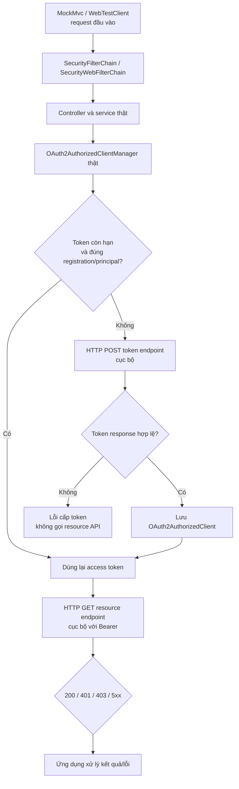

# Client OAuth2 dùng endpoint kiểm thử cục bộ có hợp đồng kiểm soát được

> **Chương:** Tích hợp đầu cuối  
> **Module:** `SPRING_SECURITY_TESTING`  
> **Mục tiêu:** Thiết lập OAuth2 client gọi token endpoint và resource API trong môi trường test cục bộ; kiểm tra chính xác request, response, quyền và lỗi theo hợp đồng thay vì giả lập luôn kết quả của OAuth2 client. Kết hợp `spring-security-test` với `MockMvc`/`WebTestClient`, `SecurityContext`, JWT/OAuth2/OIDC mock ở những lớp thích hợp, và các ca được phép/bị từ chối.

## 1. Tại sao cần endpoint cục bộ thay vì mock toàn bộ OAuth2 client?

Một hệ thống quản lý thanh toán có endpoint `GET /api/payments/{id}`. Khi nhận request, ứng dụng xác thực người gọi, rồi dùng **OAuth2 client** để lấy access token và gọi một Payments API bên ngoài. Bài test chỉ mock:

```java
when(authorizedClientManager.authorize(any()))
    .thenReturn(preparedAuthorizedClient);
```

...có thể giúp kiểm tra service gắn Bearer token vào outbound request. Nhưng nó **không kiểm tra** manager chọn đúng `ClientRegistration`, gửi `grant_type` gì, dùng `client_secret_basic` ra sao, đọc token response thế nào, lưu token còn hạn, hoặc báo lỗi khi authorization server từ chối.

Muốn kiểm chứng các bước ấy mà không phụ thuộc mạng và tài khoản IdP bên ngoài, ta dựng **các HTTP endpoint cục bộ với hợp đồng xác định trước**:

- Token endpoint, ví dụ `http://127.0.0.1:<port>/oauth/token`.
- Resource endpoint, ví dụ `http://127.0.0.1:<port>/payments/pay-7`.
- Các phản hồi token, quyền, mã HTTP, thời gian, timeout và lỗi đều do bài test điều khiển.
- Spring Security OAuth2 client manager, token response parser, HTTP client và phần mã nghiệp vụ cần kiểm chứng vẫn chạy thật.

Điểm quan trọng là **mock ở ranh giới HTTP**, không mock thành phần bảo mật mà ta muốn kiểm tra.

### 1.1. Luồng dữ liệu và ranh giới cần xác minh



Trong sơ đồ, **hai loại xác thực là hai việc khác nhau**. Request đầu vào có thể dùng session, Basic hoặc JWT của người dùng; request đầu ra là OAuth2 client xin token để gọi một hệ thống khác. `@WithMockUser`, `oauth2Login()` và `mockJwt()` có thể mô phỏng danh tính **đầu vào** nhưng không tự thực hiện token exchange **đầu ra**.

## 2. Xác định hợp đồng trước khi dựng stub

Trong ví dụ, ứng dụng dùng `client_credentials` với registration ID `payments-client`, client ID `integration-client` và scope `payments.read`. Đây là token đại diện **ứng dụng**, không phải token đại diện Alice hay Bob.

### 2.1. Hợp đồng token endpoint

| Thành phần | Hợp đồng của bài test | Assertion |
| --- | --- | --- |
| Địa chỉ | `POST /oauth/token` trên loopback, port ngẫu nhiên | Path và method chính xác |
| Content-Type request | `application/x-www-form-urlencoded` | Header và phần thân request |
| Grant | `grant_type=client_credentials` | Không tự gửi `refresh_token` |
| Xác thực client | `Authorization: Basic ...` theo `client_secret_basic` | Header Basic chứa credential **test** đúng |
| Scope | `payments.read` nếu client gửi tham số scope | Đúng scope mà registration yêu cầu |
| Thành công | HTTP 200, JSON `access_token`, `token_type=Bearer`, `expires_in` | Token được parse, expiry được áp dụng |
| Thất bại | HTTP 400/401, JSON `error` như `invalid_client` hoặc `invalid_scope` | Phát ra lỗi rõ ràng, không gọi Payments API |
| Tính ổn định | Thời gian có kiểm soát, endpoint cục bộ | Không phụ thuộc mạng/IdP production |

Một response thành công tối thiểu:

```http
HTTP/1.1 200 OK
Content-Type: application/json
Cache-Control: no-store

{
  "access_token": "access-v1-test",
  "token_type": "Bearer",
  "expires_in": 3600,
  "scope": "payments.read"
}
```

Trong test, `access-v1-test` chỉ là chuỗi marker. Không cần là JWT có chữ ký nếu resource endpoint stub chỉ kiểm tra đúng header Bearer. Nếu mục tiêu là **Resource Server xác minh JWT**, phải tạo JWT ký bằng test key và giữ `JwtDecoder`/`ReactiveJwtDecoder` thật trong một bài test khác.

### 2.2. Hợp đồng resource endpoint

| Phần của request/response | Ví dụ hợp đồng |
| --- | --- |
| Request | `GET /payments/pay-7` |
| Header xác thực | `Authorization: Bearer access-v1-test` |
| Response thành công | HTTP 200, JSON `{"id":"pay-7","status":"SETTLED"}` |
| Token sai/bị thu hồi | HTTP 401, `WWW-Authenticate: Bearer error="invalid_token"` |
| Quyền không đủ | HTTP 403, `WWW-Authenticate: Bearer error="insufficient_scope"` |
| Resource không tồn tại | HTTP 404; không được đánh đồng với lỗi token |
| Service tạm lỗi | HTTP 500/503 hoặc timeout, được phân loại riêng |

Kiểm tra **cả nội dung response lẫn HTTP request mà stub nhận được**. Một mock API trả 200 bất kể header Bearer sẽ khiến test không phát hiện service quên gắn access token.

## 3. Thành phần Spring Security được giữ thật

Trong Servlet, mô hình điển hình là:

| Thành phần | Cách xử lý trong test |
| --- | --- |
| `ClientRegistration` | Tạo thật nhưng dùng token URI trỏ tới mock server |
| `ClientRegistrationRepository` | `InMemoryClientRegistrationRepository` |
| `OAuth2AuthorizedClientService` | `InMemoryOAuth2AuthorizedClientService` hoặc test storage tương ứng |
| `OAuth2AuthorizedClientProvider` | Provider `clientCredentials()` thật |
| `OAuth2AuthorizedClientManager` | `AuthorizedClientServiceOAuth2AuthorizedClientManager` thật |
| `RestClient`/`WebClient` outbound | Client HTTP thật trỏ tới resource stub |
| Token endpoint và resource API | Dùng MockWebServer/WireMock HTTP stub |

Sử dụng service-based manager rất thuận tiện cho `client_credentials` chạy trong background hoặc một service không cần servlet request. Nếu ứng dụng lấy authorized client gắn với phiên đăng nhập người dùng, hãy kiểm thử manager và repository đúng **loại ngữ cảnh HTTP** của ứng dụng, không thay thế tùy tiện.

### 3.1. Dependency minh họa

```groovy
dependencies {
    implementation("org.springframework.boot:spring-boot-starter-web")
    implementation("org.springframework.boot:spring-boot-starter-security")
    implementation("org.springframework.boot:spring-boot-starter-oauth2-client")

    testImplementation("org.springframework.boot:spring-boot-starter-test")
    testImplementation("org.springframework.security:spring-security-test")
    testImplementation("com.squareup.okhttp3:mockwebserver:4.12.0")
}
```

Ví dụ dùng Java 17+ và Spring Boot 3.2+/Spring Framework 6.1+ để có `RestClient`. Phiên bản MockWebServer ở đây là minh họa, không áp đặt lên mọi repository; dùng phiên bản tương thích với bộ dependency của ứng dụng.

**Không chạy test với thông tin client production.** ID, secret và token trong ví dụ đều là chuỗi riêng cho test; port của mock server được hệ điều hành cấp ngẫu nhiên.

## 4. Viết service outbound thật, không nhúng token vào controller

Đầu tiên, mô hình JSON Payments API trả:

```java
public record PaymentView(String id, String status) {}
```

Một adapter dùng OAuth2 client manager trước khi gọi RestClient:

```java
public final class PaymentsGateway {
    private final OAuth2AuthorizedClientManager manager;
    private final RestClient restClient;

    public PaymentsGateway(
            OAuth2AuthorizedClientManager manager,
            RestClient restClient) {
        this.manager = manager;
        this.restClient = restClient;
    }

    public PaymentView findById(String paymentId) {
        OAuth2AuthorizeRequest request = OAuth2AuthorizeRequest
            .withClientRegistrationId("payments-client")
            .principal("payments-job")
            .build();

        OAuth2AuthorizedClient client = manager.authorize(request);
        if (client == null) {
            throw new IllegalStateException(
                "No OAuth2 provider authorized payments-client");
        }

        return restClient.get()
            .uri("/payments/{id}", paymentId)
            .headers(headers -> headers.setBearerAuth(
                client.getAccessToken().getTokenValue()))
            .retrieve()
            .body(PaymentView.class);
    }
}
```

Đoạn adapter dùng principal name kỹ thuật ổn định `payments-job` để authorized-client store có thể dùng lại token cho grant `client_credentials`. Không lấy principal name của người gọi vào đây nếu token thực tế là **token cấp cho ứng dụng**; ngược lại, khi dùng `authorization_code` cho từng người dùng, không được chuyển tất cả tài khoản thành một principal name chung.

`.uri("/payments/{id}", paymentId)` dùng URI template để encode tham số ID. Không ghép thẳng chuỗi đường dẫn từ input không tin cậy. Token chỉ được dùng trong header Bearer gửi đến resource endpoint đã cấu hình, không trả raw access token cho controller hoặc in trong log.

Lưu ý: `retrieve()` của `RestClient` mặc định ném exception cho 4xx/5xx. **Nó không tự bảo đảm xóa authorized client, refresh token hoặc retry** sau mọi lỗi downstream; cơ chế failure handler và retry phải được cấu hình riêng nếu cần.

## 5. Dựng hai MockWebServer có hợp đồng rõ ràng

Đặt token endpoint và Payments API trên hai HTTP stub độc lập. Việc tách hai server làm dễ phân biệt **số lần xin token** với **số lần gọi resource**, đồng thời giúp chứng minh không gọi downstream khi token endpoint lỗi.

### 5.1. Fixture tạo registration, manager và service

Đoạn dưới là bộ khung có thể đặt trong một lớp JUnit 5. Cần import các class thuộc `okhttp3.mockwebserver`, `org.springframework.security.oauth2.client`, `org.springframework.security.oauth2.core`, `org.springframework.web.client.RestClient` và JUnit; các static assertion dùng JUnit Jupiter.

```java
class PaymentsClientHttpContractIT {

    MockWebServer tokenServer;
    MockWebServer paymentsServer;

    ClientRegistration registration;
    InMemoryOAuth2AuthorizedClientService authorizedClients;
    PaymentsGateway gateway;

    @BeforeEach
    void startServersAndClient() throws IOException {
        tokenServer = new MockWebServer();
        paymentsServer = new MockWebServer();
        tokenServer.start();
        paymentsServer.start();

        registration = ClientRegistration
            .withRegistrationId("payments-client")
            .clientId("integration-client")
            .clientSecret("integration-secret")
            .clientAuthenticationMethod(
                ClientAuthenticationMethod.CLIENT_SECRET_BASIC)
            .authorizationGrantType(
                AuthorizationGrantType.CLIENT_CREDENTIALS)
            .tokenUri(tokenServer.url("/oauth/token").toString())
            .scope("payments.read")
            .build();

        ClientRegistrationRepository registrations =
            new InMemoryClientRegistrationRepository(registration);
        authorizedClients =
            new InMemoryOAuth2AuthorizedClientService(registrations);

        AuthorizedClientServiceOAuth2AuthorizedClientManager manager =
            new AuthorizedClientServiceOAuth2AuthorizedClientManager(
                registrations, authorizedClients);

        manager.setAuthorizedClientProvider(
            OAuth2AuthorizedClientProviderBuilder.builder()
                .clientCredentials()
                .build());

        RestClient http = RestClient.builder()
            .baseUrl(paymentsServer.url("/").toString())
            .build();
        gateway = new PaymentsGateway(manager, http);
    }

    @AfterEach
    void stopServers() throws IOException {
        tokenServer.shutdown();
        paymentsServer.shutdown();
    }
}
```

Mỗi bài test có **hai server mới**, storage mới và authorized-client manager mới; token cũ của test trước không thể tồn tại trong test sau. Nếu cần chia sẻ server qua nhiều test để tiết kiệm thời gian, phải reset dispatcher/queue, request count, authorized-client store và state theo cách kiểm soát được.

Tầng HTTP đi qua `MockWebServer` thật, nhưng chưa có `MockMvc` hoặc `WebTestClient` đầu vào. Vì thế đây là **integration test cho outbound OAuth2 client**, không phải end-to-end của toàn bộ ứng dụng web. Phần 10 bổ sung ranh giới HTTP đầu vào.

### 5.2. Test lấy token lần đầu và dùng lại token còn hạn

Thêm phương thức sau vào lớp `PaymentsClientHttpContractIT`:

```java
@Test
void tokenIsIssuedOnceAndReusedForSecondCall() throws Exception {
    tokenServer.enqueue(new MockResponse()
        .setResponseCode(200)
        .addHeader("Content-Type", "application/json")
        .setBody("""
            {
              "access_token": "access-v1-test",
              "token_type": "Bearer",
              "expires_in": 3600,
              "scope": "payments.read"
            }
            """));

    for (int i = 0; i < 2; i++) {
        paymentsServer.enqueue(new MockResponse()
            .setResponseCode(200)
            .addHeader("Content-Type", "application/json")
            .setBody("""
                {"id":"pay-7","status":"SETTLED"}
                """));
    }

    PaymentView first = gateway.findById("pay-7");
    PaymentView second = gateway.findById("pay-7");

    assertEquals("pay-7", first.id());
    assertEquals("SETTLED", first.status());
    assertEquals(first, second);

    assertEquals(1, tokenServer.getRequestCount());
    assertEquals(2, paymentsServer.getRequestCount());

    RecordedRequest tokenRequest =
        tokenServer.takeRequest(2, TimeUnit.SECONDS);
    assertNotNull(tokenRequest);
    assertEquals("POST", tokenRequest.getMethod());
    assertEquals("/oauth/token", tokenRequest.getPath());
    assertTrue(tokenRequest.getHeader("Content-Type")
        .startsWith("application/x-www-form-urlencoded"));
    assertTrue(tokenRequest.getBody().readUtf8()
        .contains("grant_type=client_credentials"));
    assertTrue(tokenRequest.getHeader("Authorization")
        .startsWith("Basic "));

    RecordedRequest outbound1 =
        paymentsServer.takeRequest(2, TimeUnit.SECONDS);
    RecordedRequest outbound2 =
        paymentsServer.takeRequest(2, TimeUnit.SECONDS);

    assertNotNull(outbound1);
    assertNotNull(outbound2);
    assertEquals("GET", outbound1.getMethod());
    assertEquals("/payments/pay-7", outbound1.getPath());
    assertEquals("Bearer access-v1-test",
        outbound1.getHeader("Authorization"));
    assertEquals("Bearer access-v1-test",
        outbound2.getHeader("Authorization"));
}
```

Tại đây có bốn loại bằng chứng:

1. **Hợp đồng token request:** đúng method, path, grant và client authentication.
2. **Hợp đồng token response:** Spring Security parse thành access token mà gateway sử dụng.
3. **Dùng lại token:** hai request tới Payments API nhưng chỉ một request tới token endpoint.
4. **Header outbound:** đúng Bearer token ở cả hai lần gọi; không chỉ kiểm tra một JSON được stub trả sẵn.

Với client credentials dùng HTTP Basic, có thể kiểm tra chính xác credential **test** bằng cách giải mã header Basic và so sánh với `integration-client:integration-secret`. Đừng ghi giá trị Authorization đã giải mã vào log của CI. Nếu registration dùng `client_secret_post` hoặc `private_key_jwt`, hợp đồng request **phải đổi theo phương thức xác thực đã cấu hình**, không ép tất cả client phải gửi Basic.

### 5.3. Test access token hết hạn thì lấy lại token

Để test hết hạn không cần chờ một giờ bằng `Thread.sleep(...)`. Seed authorized client có access token đã hết hạn vào store, cùng `registrationId` và `principalName` mà gateway sử dụng:

```java
@Test
void expiredClientCredentialsTokenTriggersNewGrant()
        throws Exception {
    Instant now = Instant.now();
    OAuth2AccessToken old = new OAuth2AccessToken(
        OAuth2AccessToken.TokenType.BEARER,
        "access-expired",
        now.minusSeconds(3600),
        now.minusSeconds(300));

    Authentication technicalPrincipal =
        new UsernamePasswordAuthenticationToken(
            "payments-job", "N/A", List.of());

    authorizedClients.saveAuthorizedClient(
        new OAuth2AuthorizedClient(
            registration, "payments-job", old),
        technicalPrincipal);

    tokenServer.enqueue(new MockResponse()
        .addHeader("Content-Type", "application/json")
        .setBody("""
            {
              "access_token": "access-v2-test",
              "token_type": "Bearer",
              "expires_in": 3600
            }
            """));
    paymentsServer.enqueue(new MockResponse()
        .addHeader("Content-Type", "application/json")
        .setBody("""
            {"id":"pay-7","status":"SETTLED"}
            """));

    gateway.findById("pay-7");

    RecordedRequest grant =
        tokenServer.takeRequest(2, TimeUnit.SECONDS);
    RecordedRequest downstream =
        paymentsServer.takeRequest(2, TimeUnit.SECONDS);
    assertNotNull(grant);
    assertNotNull(downstream);
    assertTrue(grant.getBody().readUtf8()
        .contains("grant_type=client_credentials"));
    assertEquals("Bearer access-v2-test",
        downstream.getHeader("Authorization"));

    OAuth2AuthorizedClient saved =
        authorizedClients.loadAuthorizedClient(
            "payments-client", "payments-job");
    assertEquals("access-v2-test",
        saved.getAccessToken().getTokenValue());
}
```

Lưu ý: provider client credentials có thể áp dụng **clock skew**, coi token sắp hết hạn như cần thay mới. Vì thế test token còn hạn ở mục 5.2 dùng `expires_in=3600` để tránh ranh giới, còn ca hết hạn seed token quá hạn nhiều phút. Với kiểm thử thời gian chính xác ở mốc giây, cân nhắc Clock/cấu hình provider thay vì test phụ thuộc tốc độ CI.

`client_credentials` thường **không có refresh token**; khi access token hết hạn, client gọi lại token endpoint bằng `grant_type=client_credentials`. Không biến ca này thành `grant_type=refresh_token` chỉ vì nhóm gọi chung là “gia hạn”.

## 6. Lỗi token endpoint: không được gọi resource API

Hợp đồng âm tính quan trọng: authorization server từ chối hoặc trả response không hợp lệ thì không gửi downstream request với token cũ hay chuỗi rỗng.

### 6.1. Sai client credentials

```java
@Test
void invalidClientStopsBeforeResourceCall() {
    tokenServer.enqueue(new MockResponse()
        .setResponseCode(401)
        .addHeader("Content-Type", "application/json")
        .setBody("""
            {
              "error": "invalid_client",
              "error_description": "Invalid test credentials"
            }
            """));

    OAuth2AuthorizationException failure =
        assertThrows(OAuth2AuthorizationException.class,
            () -> gateway.findById("pay-7"));

    assertEquals("invalid_client",
        failure.getError().getErrorCode());
    assertEquals(1, tokenServer.getRequestCount());
    assertEquals(0, paymentsServer.getRequestCount());
}
```

Test này không mock manager, do đó kiểm tra Spring Security thực sự nhận lỗi OAuth2 từ HTTP token response. Nếu phiên bản hoặc adapter ứng dụng bọc exception thành một domain exception, hãy assert **exception mà tầng service cam kết** và vẫn kiểm tra error code gốc trong cause.

Các lỗi cần thử bổ sung:

| Token endpoint trả | Điều cần xác nhận |
| --- | --- |
| `invalid_client` | Lỗi cấu hình/secret, không retry vô hạn |
| `unauthorized_client` | Client không được dùng grant này |
| `invalid_scope` | Không xin token thành công với scope không hợp lệ |
| HTTP 503 hoặc `temporarily_unavailable` | Phân loại lỗi tạm thời, retry có giới hạn nếu chính sách cho phép |
| Timeout | Có timeout thực, caller không treo mãi |
| JSON sai hoặc thiếu `access_token` | Response không được coi là token hợp lệ |
| `token_type` không được hỗ trợ | Không gắn nhầm token vào Bearer header |
| `expires_in` quá ngắn | Chính sách clock skew có thể xin token lại ngay; tránh vòng lặp |

Đặt thời gian phản hồi bằng `MockWebServer`/dispatcher khi test timeout; nhưng không dùng thời gian quá lớn gây chậm CI. Đặt timeout cho HTTP client dùng để gọi token endpoint theo cấu hình production/test rõ ràng; timeout của resource API **khác** timeout cấp token.

### 6.2. Từ chối scope trên resource API

Một resource server trả `403 insufficient_scope` có thể là dấu hiệu token hợp lệ nhưng không có quyền. Điều này **không đồng nghĩa** client chỉ cần refresh token là có thêm scope; phải kiểm tra cấu hình registration, sự chấp thuận/chính sách và quyền thật.

Ví dụ test downstream 403:

```java
@Test
void resourceForbiddenIsNotATokenEndpointFailure() {
    tokenServer.enqueue(new MockResponse()
        .setResponseCode(200)
        .addHeader("Content-Type", "application/json")
        .setBody("""
            {
              "access_token": "access-v1-test",
              "token_type": "Bearer",
              "expires_in": 3600
            }
            """));
    paymentsServer.enqueue(new MockResponse()
        .setResponseCode(403)
        .addHeader("WWW-Authenticate",
            "Bearer error=\"insufficient_scope\""));

    assertThrows(HttpClientErrorException.Forbidden.class,
        () -> gateway.findById("pay-7"));

    assertEquals(1, tokenServer.getRequestCount());
    assertEquals(1, paymentsServer.getRequestCount());
}
```

Đây là test hành vi mặc định của adapter dùng `RestClient.retrieve()`: downstream trả 403 thì exception được phát ra. Không tự suy ra sẽ có refresh/retry; adapter ví dụ chưa cấu hình cơ chế ấy.

### 6.3. Resource 401 invalid_token

```java
paymentsServer.enqueue(new MockResponse()
    .setResponseCode(401)
    .addHeader("WWW-Authenticate",
        "Bearer error=\"invalid_token\""));
```

Với token response thành công đã enqueue trước đó, test tương tự cần assert `HttpClientErrorException.Unauthorized`, xác nhận đúng một lần gọi downstream và không có vòng lặp vô hạn. Nếu hệ thống yêu cầu evict authorized client khi resource trả 401, phải **cấu hình failure handler hoặc adapter phát hiện lỗi và xóa token**; việc MockWebServer trả 401 tự nó không khiến `AuthorizedClientServiceOAuth2AuthorizedClientManager` biết resource server đã từ chối token.

Chính sách retry nên có giới hạn, phân biệt method có side effect và idempotency, tránh tự gửi lại POST thanh toán nhiều lần khi không biết request trước có được xử lý hay chưa.

## 7. Dùng Dispatcher khi hợp đồng cần bắt lỗi request ngay lập tức

Hàng đợi `enqueue(...)` thích hợp với kịch bản thứ tự xác định. Nhưng nó có thể trả cùng một response thành công ngay cả khi client gửi nhầm method/path. Với test cấp hợp đồng chặt hơn, dùng `Dispatcher`:

```java
tokenServer.setDispatcher(new Dispatcher() {
    @Override
    public MockResponse dispatch(RecordedRequest req) {
        if (!"POST".equals(req.getMethod()) ||
            !"/oauth/token".equals(req.getPath())) {
            return new MockResponse().setResponseCode(404);
        }

        String contentType = req.getHeader("Content-Type");
        if (contentType == null ||
            !contentType.startsWith(
                "application/x-www-form-urlencoded")) {
            return new MockResponse().setResponseCode(415);
        }

        String form = req.getBody().readUtf8();
        if (!form.contains("grant_type=client_credentials")) {
            return new MockResponse()
                .setResponseCode(400)
                .addHeader("Content-Type", "application/json")
                .setBody("{\"error\":\"unsupported_grant_type\"}");
        }

        String basic = req.getHeader("Authorization");
        if (basic == null || !basic.startsWith("Basic ")) {
            return new MockResponse()
                .setResponseCode(401)
                .addHeader("Content-Type", "application/json")
                .setBody("{\"error\":\"invalid_client\"}");
        }

        return new MockResponse()
            .setResponseCode(200)
            .addHeader("Content-Type", "application/json")
            .setBody("""
                {
                  "access_token": "access-v1-test",
                  "token_type": "Bearer",
                  "expires_in": 3600
                }
                """);
    }
});
```

**Đây là bản rút gọn** của dispatcher: nó chỉ kiểm tra sự tồn tại của header Basic, chưa giải mã client ID/secret; việc tìm chuỗi `grant_type=client_credentials` chỉ là kiểm tra minh họa, chưa phải parser form-urlencoded đầy đủ. Để thành test hợp đồng thực sự, parse form và so sánh credential đã giải mã đúng với giá trị test, kiểm tra scope được encode, và trả lỗi chuẩn cho mọi trường hợp sai. Không dùng dispatcher rút gọn này làm authorization server cho production.

Nếu có nhiều response phụ thuộc trạng thái, có thể tạo dispatcher với bộ đếm và cờ trạng thái để mô phỏng token v1 → revoked → token v2. Mỗi test nên có dispatcher/state riêng để tránh tương tác giữa các test song song.

## 8. Phân biệt kiểm thử client_credentials với authorization_code/OIDC

`client_credentials` minh họa rất tốt việc lấy token outbound vì không cần giả lập trình duyệt, session hoặc callback. Nhưng nếu ứng dụng là OAuth2/OIDC client **đăng nhập người dùng**, hợp đồng cần mở rộng.

| Cơ chế | Endpoint/hợp đồng phải kiểm thử | Khác biệt quan trọng |
| --- | --- | --- |
| `client_credentials` | Token endpoint, grant, client authentication, resource API | Token của ứng dụng, thường không có refresh token |
| `authorization_code` | Authorization endpoint, redirect, `state`, callback `code`, token endpoint | Phụ thuộc phiên người dùng và authorization response |
| Authorization code + PKCE | `code_challenge`/`code_verifier` và token request | Xác minh luồng ràng buộc code đúng client |
| OIDC login | Authorization code + ID Token/JWKS/UserInfo tùy cấu hình, `nonce`, issuer/audience | Principal là `OidcUser`, không chỉ một access token |
| Refresh token | `grant_type=refresh_token`, rotation/revocation, lưu token mới | Chỉ khi server đã cấp refresh token phù hợp |

### 8.1. Một kịch bản OIDC/authorization-code hoàn chỉnh

Để tích hợp callback thực với mock IdP cục bộ:

1. Cấu hình `ClientRegistration` trỏ authorization, token, JWKS và UserInfo endpoints của mock server; dùng issuer nhất quán.
2. Gọi `/oauth2/authorization/{registrationId}`, giữ session và authorization request; kiểm tra redirect chứa `state` và PKCE parameters nếu được cấu hình.
3. Gửi callback `/login/oauth2/code/{registrationId}?code=...&state=...` với **state tương ứng** trong cùng phiên.
4. Stub token endpoint trả access token và, với OIDC, một ID Token được ký bằng private key chỉ dùng cho test.
5. Dùng JWKS/public key cục bộ để client xác minh signature và các claim theo hợp đồng, gồm issuer/audience/thời gian/nonce khi áp dụng.
6. Để `OidcUserService` hoặc custom account mapper chạy thật; xác nhận principal và quyền nội bộ.
7. Gọi API sau login trong **cùng session** và kiểm tra kết quả được phép/bị từ chối.

Không thay toàn bộ bảy bước bằng `oidcLogin()` hoặc `mockOidcLogin()` rồi tuyên bố authorization code/ID Token đã được xác minh. Các helper này rất hữu ích để test **controller và authorization khi đã có principal**, nhưng cố ý bỏ qua giao thức.

Đồng thời, đừng dùng `@WithMockUser` để chứng minh refresh token của người dùng: test tạo sẵn authentication không cung cấp `OAuth2AuthorizedClient` đã được cấp bởi authorization server.

## 9. Giữ dữ liệu cục bộ đúng hợp đồng bảo mật

Một endpoint test kiểm soát được phải đủ **thực tế về cấu trúc**, dù không dùng token/secret thật.

### 9.1. Token, scope và principal phải khớp

Hợp đồng client credentials ở bài này dùng:

- `registrationId = payments-client`, `principalName = payments-job`.
- `scope = payments.read`.
- `access_token = access-v1-test` còn hạn; outbound header `Bearer access-v1-test`.
- Payments API chỉ chấp nhận token đó cho đường đọc.

Đừng viết stub `GET /payments/pay-7` trả 200 kể cả khi không có header, rồi dùng nó để tuyên bố OAuth2 client tích hợp thành công. Hãy có ca token thiếu/sai → `401`, scope thiếu → `403` (nếu API stub quản lý scope), và token hợp lệ → `200`.

Khi có người dùng, tenant và ownership, cần seed dữ liệu đối nghịch như Alice/tenant-a, Bob/tenant-a, Alice/tenant-b. Không nên để mock resource trả toàn bộ dữ liệu mà bỏ qua scope/tenant nếu mục tiêu là kiểm chứng cô lập.

### 9.2. Thời gian, refresh và concurrency

Các ca hữu ích:

- Access token còn hạn được dùng lại; token quá hạn được lấy mới.
- Token gần hết hạn đi qua quy tắc clock skew thật của provider.
- Với authorization_code, refresh token được gửi đúng grant và token rotation được lưu đúng; không giả định client_credentials có refresh token.
- Hai lần gọi đồng thời không làm lẫn token của registration/principal khác nhau.
- Token endpoint chậm hoặc trả 429 không gây retry vô hạn; lưu state và metric theo chính sách.
- Resource API bị thu hồi token trước hạn trả 401, ứng dụng có cách phát hiện và cấp lại/xóa authorized client có kiểm soát.

Trong một môi trường có nhiều instance ứng dụng, in-memory service chỉ dành cho test chức năng; nó không chứng minh khóa đồng bộ hay cache consistency giữa các instance. Nếu production dùng JDBC/Redis authorized-client store, cần kiểm thử thêm cơ chế persist/evict thực tế.

## 10. Kết hợp với MockMvc: bảo vệ HTTP đầu vào và token đầu ra

Hệ thống có thể chỉ cho người dùng có `ROLE_PAYMENTS_VIEWER` gọi endpoint nội bộ, nhưng token outbound vẫn được cấp cho ứng dụng bằng `client_credentials`. Cả hai hàng rào phải được kiểm tra.

### 10.1. Controller và SecurityFilterChain minh họa

```java
@RestController
class PaymentsController {
    private final PaymentsGateway gateway;

    PaymentsController(PaymentsGateway gateway) {
        this.gateway = gateway;
    }

    @GetMapping("/api/payments/{id}")
    PaymentView find(@PathVariable String id) {
        return gateway.findById(id);
    }
}

@Configuration
class ApiSecurity {
    @Bean
    SecurityFilterChain security(HttpSecurity http)
            throws Exception {
        return http
            .authorizeHttpRequests(auth -> auth
                .requestMatchers(
                    HttpMethod.GET, "/api/payments/**")
                    .hasRole("PAYMENTS_VIEWER")
                .anyRequest().denyAll())
            .httpBasic(Customizer.withDefaults())
            .build();
    }
}
```

Ở ví dụ này, endpoint nội bộ có thể được xác thực bằng HTTP Basic hoặc test identity. Client outbound dùng principal kỹ thuật `payments-job`. Không được suy luận rằng `@WithMockUser(username = "alice")` sẽ tự đổi token outbound sang token của Alice.

### 10.2. Test các trường hợp đầu vào

Khi lớp test dùng `@SpringBootTest`, `@AutoConfigureMockMvc(addFilters = true)`, một `PaymentsGateway` bean thật và hai mock HTTP servers:

```java
@Test
@WithMockUser(roles = "PAYMENTS_VIEWER")
void viewerCanReadViaRealOutboundClient() throws Exception {
    // Token server đã enqueue 200 + access token test.
    // Payments server đã enqueue 200 + JSON PaymentView.

    mvc.perform(get("/api/payments/pay-7"))
        .andExpect(status().isOk())
        .andExpect(jsonPath("$.id").value("pay-7"));

    // Kiểm tra RecordedRequest của cả token endpoint và
    // Payments API như ở mục 5, không chỉ assert HTTP 200.
}

@Test
@WithMockUser(roles = "GUEST")
void guestIsStoppedBeforeOutboundHttp() throws Exception {
    mvc.perform(get("/api/payments/pay-7"))
        .andExpect(status().isForbidden());

    assertEquals(0, tokenServer.getRequestCount());
    assertEquals(0, paymentsServer.getRequestCount());
}
```

Đây là **khung kiểm thử tích hợp ứng dụng**, không phải class chạy độc lập: `mvc`, hai server và các bean phải được tạo/inject trong fixture. Bài học chính là ở nhánh không đủ role, Spring Security filter chặn **trước** khi gọi manager/token endpoint/resource API. Ở nhánh được phép, phải kiểm tra cả HTTP response và outbound contract.

Test anonymous với cấu hình HTTP Basic có thể assert `401`; nếu ứng dụng dùng `oauth2Login()`, entry point có thể chuyển hướng `302`. Assert theo chính sách thực, không đặt mặc định mọi ứng dụng đều 401.

### 10.3. Dùng @DynamicPropertySource khi ứng dụng tạo ClientRegistration từ cấu hình

Nếu muốn dùng bean OAuth2 client của Spring Boot thay vì tự dựng registration trong test, có thể cấu hình:

```yaml
spring:
  security:
    oauth2:
      client:
        registration:
          payments-client:
            client-id: integration-client
            client-secret: integration-secret
            authorization-grant-type: client_credentials
            scope: payments.read
            provider: payments-provider
        provider:
          payments-provider:
            token-uri: http://localhost:0/placeholder
```

Giá trị URI placeholder không được gọi thật. Tại test, khởi động MockWebServer trước khi Spring ApplicationContext sử dụng thuộc tính rồi override token URI bằng `@DynamicPropertySource`:

```java
@DynamicPropertySource
static void registerOAuth2Endpoint(DynamicPropertyRegistry props) {
    props.add(
        "spring.security.oauth2.client.provider.payments-provider.token-uri",
        () -> tokenServer.url("/oauth/token").toString());
}
```

Đây là mảnh cấu hình: biến `tokenServer` là server **static** của lớp test, phải được start **trước** khi property supplier được đánh giá và shutdown sau khi cả lớp test hoàn tất. Không dùng `@BeforeEach` cho server chỉ được dùng trong `@DynamicPropertySource` nếu ApplicationContext khởi tạo trước đó; kiểm soát thứ tự lifecycle rõ ràng, ví dụ qua khởi tạo static/test extension.

Nếu ứng dụng cần nhiều registration, giữ registration ID và provider ID chính xác. Không để test ghi đè token URI của mọi client chung một cách vô ý rồi cho kết quả sai.

## 11. Bản Reactive: WebClient và ReactiveOAuth2AuthorizedClientManager

Trong WebFlux, thay service-based Servlet manager bằng `AuthorizedClientServiceReactiveOAuth2AuthorizedClientManager` và các repository/provider Reactive. Hợp đồng token endpoint và Payments API **không đổi**: chỉ cơ chế gọi không chặn thread là khác.

### 11.1. Cấu hình manager

```java
ReactiveClientRegistrationRepository registrations =
    new InMemoryReactiveClientRegistrationRepository(registration);

ReactiveOAuth2AuthorizedClientService savedClients =
    new InMemoryReactiveOAuth2AuthorizedClientService(registrations);

AuthorizedClientServiceReactiveOAuth2AuthorizedClientManager manager =
    new AuthorizedClientServiceReactiveOAuth2AuthorizedClientManager(
        registrations, savedClients);

manager.setAuthorizedClientProvider(
    ReactiveOAuth2AuthorizedClientProviderBuilder.builder()
        .clientCredentials()
        .build());
```

Đoạn code dùng cùng `registration` trỏ tokenServer cục bộ như mục 5; các type Reactive ở `org.springframework.security.oauth2.client`. Với WebFlux không có servlet request, service-based reactive manager có thể hoạt động từ background job; với OAuth2 client gắn với WebSession/login user, dùng manager/repository theo `ServerWebExchange` phù hợp.

### 11.2. Gateway Reactive không dùng block()

```java
public final class ReactivePaymentsGateway {
    private final ReactiveOAuth2AuthorizedClientManager manager;
    private final WebClient http;

    public ReactivePaymentsGateway(
            ReactiveOAuth2AuthorizedClientManager manager,
            WebClient http) {
        this.manager = manager;
        this.http = http;
    }

    public Mono<PaymentView> findById(String id) {
        OAuth2AuthorizeRequest request = OAuth2AuthorizeRequest
            .withClientRegistrationId("payments-client")
            .principal("payments-job")
            .build();

        return manager.authorize(request)
            .switchIfEmpty(Mono.error(
                new IllegalStateException(
                    "OAuth2 client could not be authorized")))
            .flatMap(client -> http.get()
                .uri("/payments/{id}", id)
                .headers(h -> h.setBearerAuth(
                    client.getAccessToken().getTokenValue()))
                .retrieve()
                .bodyToMono(PaymentView.class));
    }
}
```

WebClient được tạo với `WebClient.builder().baseUrl(paymentsServer.url("/").toString()).build()`. Không gọi `block()` trong WebFlux event loop; HTTP client và manager làm việc theo publisher. Kết quả lỗi token endpoint và lỗi resource server đi qua tín hiệu `onError`, nên test bằng `StepVerifier`:

```java
StepVerifier.create(reactiveGateway.findById("pay-7"))
    .assertNext(view -> {
        assertEquals("pay-7", view.id());
        assertEquals("SETTLED", view.status());
    })
    .verifyComplete();

assertEquals(1, tokenServer.getRequestCount());
assertEquals(1, paymentsServer.getRequestCount());
```

Đây là mảnh assertion đặt trong fixture có reactive manager, WebClient và phản hồi đã enqueue. Khi test error path, dùng `expectErrorMatches(...)` hoặc `expectErrorSatisfies(...)` để kiểm tra loại lỗi/nguyên nhân. Không dùng `@WithMockUser` để thay việc xin token trong manager nếu mục tiêu là kiểm chứng token endpoint.

### 11.3. WebTestClient bảo vệ HTTP đầu vào

Nếu có Reactive controller dùng gateway trên, cấu hình:

```java
WebTestClient webTestClient =
    WebTestClient.bindToApplicationContext(applicationContext)
        .apply(SecurityMockServerConfigurers.springSecurity())
        .configureClient()
        .build();
```

Sau đó cấp một principal thử nghiệm cho request đầu vào:

```java
webTestClient.mutateWith(
        SecurityMockServerConfigurers.mockUser("alice")
            .roles("PAYMENTS_VIEWER"))
    .get()
    .uri("/api/payments/pay-7")
    .exchange()
    .expectStatus().isOk()
    .expectBody()
    .jsonPath("$.id").isEqualTo("pay-7");
```

Tương tự MockMvc, test phải giữ `SecurityWebFilterChain` thật, bean gateway thật, token endpoint và Payments API cục bộ. `mockUser()` chứng minh **authorization đầu vào**, không chứng minh password/IdP thật. Nếu là resource server, `mockJwt()` có thể giả principal và scope; để chứng minh chữ ký JWT cần test token ký thật và `ReactiveJwtDecoder`.

Với `WebTestClient.bindToServer()` gọi một server qua TCP, mutator test identity không tự thay đổi SecurityContext của server. Muốn test qua network thật, gửi credential/cookie/Bearer token theo giao thức và giữ đúng session/token lifecycle.

## 12. Bảng ca kiểm thử hợp đồng tích hợp

| Ca | Trạng thái token endpoint | Trạng thái resource endpoint | Kết quả cần kiểm |
| --- | --- | --- | --- |
| Chưa có token | Cấp access-v1 | Nhận Bearer access-v1, trả 200 | Có đúng 1 POST /token và 1 GET resource |
| Token còn hạn | Không được gọi lần hai | Hai GET hợp lệ | Token được tái sử dụng trong authorized-client store |
| Token hết hạn | Cấp access-v2 | Chỉ nhận Bearer access-v2 | Manager cấp token mới đúng grant |
| `invalid_client` | 401/error JSON | Không gọi | Không dùng token giả/expired để đi tiếp |
| `invalid_scope` | 400/error JSON | Không gọi | Lỗi quyền/grant rõ, không retry mù |
| Token response thiếu field | 200 nhưng sai hợp đồng | Không gọi | Parser/client từ chối token không hợp lệ |
| Resource trả `401 invalid_token` | Đã cấp token | 401 | Phát hiện lỗi resource, eviction/retry theo chính sách |
| Resource trả `403 insufficient_scope` | Đã cấp token | 403 | Không coi refresh là cách nâng quyền |
| Resource trả 503 | Đã cấp token | 503 | Chính sách timeout/backoff riêng |
| Hai user authorization_code | Token riêng theo principal | Phản hồi theo owner | Không dùng authorized client của user khác |
| Inbound thiếu role | Không gọi | Không gọi | HTTP 403, không side effect |
| Inbound anonymous | Không gọi | Không gọi | HTTP 401/redirect theo entry point |
| Inbound đủ role | Token hợp lệ | 200 | HTTP 200 và outbound contract đúng |
| WebFlux Reactive | Token endpoint cục bộ | Resource endpoint cục bộ | `Mono` hoàn thành/lỗi đúng, không block event loop |

### 12.1. Bằng chứng chống “test xanh giả”

Một bài test contract chỉ đáng tin khi:

- **Token endpoint thật sự nhận request**, thay vì token được hardcode thẳng trong code nghiệp vụ.
- Resource endpoint kiểm tra Bearer header, chứ không trả thành công cho mọi request.
- Số lần gọi token endpoint/resource endpoint được assert; không chấp nhận retry hoặc token refresh phát sinh không mong muốn.
- `registrationId`, principal name và store được seed đúng, tránh chọn nhầm token.
- Authentication và authorization đầu vào vẫn đi qua filter chain khi đang test ranh giới HTTP của ứng dụng.
- Các ca âm tính xác nhận resource API **không được gọi** khi token endpoint hoặc inbound authorization thất bại.
- Timeout, cache và thời gian được quản lý có chủ đích, không phụ thuộc IdP production hoặc thứ tự test khác.

## 13. Lỗi thường gặp và cách khắc phục

| Hiện tượng | Nguyên nhân | Khắc phục |
| --- | --- | --- |
| Test xanh nhưng production lỗi token endpoint | Mock luôn `OAuth2AuthorizedClientManager` | Giữ manager/provider thật và dùng local HTTP token stub |
| Token endpoint stub bị gọi sai path | Registration token URI sai, prefix path khác | Assert RecordedRequest path/method, kiểm tra registration |
| Không có `Authorization: Basic ...` | Client authentication method khác Basic | Assert đúng phương thức được cấu hình, không ép Basic vô điều kiện |
| Token endpoint bị gọi cho mỗi GET | Store không lưu token, principal name thay đổi, expiry quá ngắn | Giữ principal kỹ thuật ổn định và kiểm tra storage/clock skew |
| HTTP 403 từ Payments API nhưng test nghĩ token hết hạn | Nhầm thiếu scope với `invalid_token` | Tách 401/403; không kỳ vọng refresh tự tạo thêm quyền |
| Đã stub trả 200 nhưng parser lỗi | JSON sai field, thiếu `token_type` hoặc content type | Giữ đúng OAuth2 token response contract |
| Test lỗi ngẫu nhiên ở CI | Dùng port cố định, chung MockWebServer queue, chia sẻ cache/token store | Port ngẫu nhiên và fixture độc lập |
| `@WithMockUser` có role nhưng outbound không lấy token | Tưởng principal giả tự điều khiển manager | Kiểm tra bean outbound manager và grant thực |
| Test không chứng minh đúng CSRF | Chỉ gửi GET hoặc đã tắt filter ở test | Với session-based POST, kiểm tra riêng CSRF cho phép/từ chối |
| WebFlux test chạy nhưng không có subscription | Chỉ tạo `Mono`, không subscribe | Dùng StepVerifier hoặc WebTestClient |
| `@DynamicPropertySource` dùng server chưa start | Thứ tự khởi tạo ApplicationContext và mock server sai | Khởi động server trước khi supplier được đánh giá |
| Dùng token của Alice cho Bob | Authorized client gắn sai principal/registration | Test hai users/two registrations và assert đúng token |
| Không thể chứng minh JWT signature | Dùng chuỗi `access-v1-test`/`mockJwt()` | Dựng JWS ký test key, giữ decoder/validator thật |

## 14. Bài thực hành

Xây dựng một service `PaymentsGateway` như bài học, sử dụng `OAuth2AuthorizedClientManager` thật và hai MockWebServer cục bộ. Từ một API Servlet hoặc Reactive, gọi một endpoint đích yêu cầu `payments.read`.

1. **Tạo hợp đồng:** Ghi rõ `POST /oauth/token`, `grant_type=client_credentials`, client authentication, token response và `GET /payments/{id}` với Bearer.
2. **Happy path:** Lấy token một lần, gọi Payments API hai lần và xác nhận token được dùng lại.
3. **Expired path:** Seed access token đã hết hạn; kiểm tra client xin mới bằng `client_credentials`, không gửi `refresh_token`.
4. **Failure path:** Stub `invalid_client`, `invalid_scope`, JSON token sai và timeout; assert không gửi request resource khi chưa có token hợp lệ.
5. **Downstream security:** Stub 401 `invalid_token` và 403 `insufficient_scope`; phân biệt xử lý lỗi và chính sách retry.
6. **Bảo vệ đầu vào:** Tích hợp `MockMvc` hoặc `WebTestClient` với filter chain thật. Test user đủ role được phép, thiếu role bị từ chối, anonymous bị từ chối/redirect.
7. **Quan sát hợp đồng:** Dùng `RecordedRequest` để kiểm tra grant, method, path, header Basic/Bearer và số lần gọi; không chỉ assert status.
8. **Biến thể OIDC:** Dựng local IdP trả authorization response/token/JWKS/UserInfo theo hợp đồng; kiểm chứng session, `state`, ID Token và mapping thay vì chỉ dùng `oidcLogin()`.
9. **Cô lập dữ liệu:** Mỗi test có token store và mock server state riêng; bổ sung ca hai registration hoặc hai principal để phát hiện dùng nhầm token.

**Tiêu chí đạt:** Bài test thật sự đi qua OAuth2 client manager/provider, token response parser và HTTP client; endpoint test cục bộ áp dụng hợp đồng xác định và có assertion trên request thực; các lỗi token endpoint, resource endpoint và HTTP inbound được phân loại; không có API ngoài mạng hoặc credential production nào tham gia.

**Ghi nhớ:** **Endpoint kiểm thử cục bộ** không chỉ là nơi trả sẵn JSON. Nó là **ranh giới hợp đồng** để chứng minh OAuth2 client đã gửi đúng grant, nhận/lưu/dùng đúng token và phản ứng đúng với lỗi, trong khi phần xác thực và phân quyền HTTP đầu vào vẫn được test bằng Spring Security. Khi ranh giới được kiểm soát và quan sát bằng request thực, bài tích hợp có giá trị cao hơn nhiều so với việc mock toàn bộ client rồi chỉ kiểm tra một response `200 OK`.
