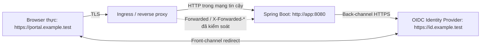
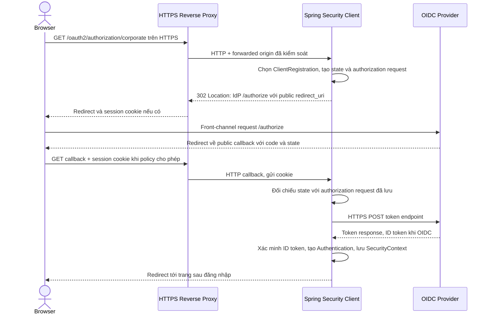
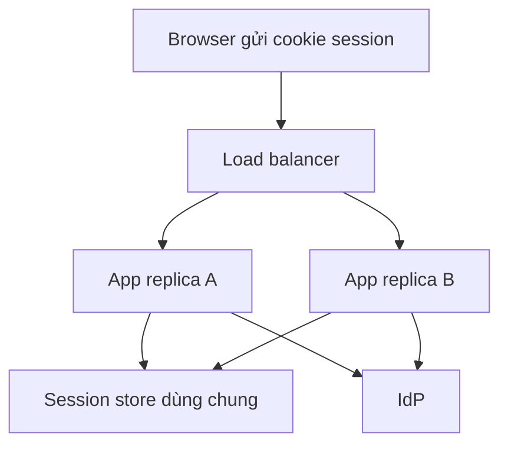
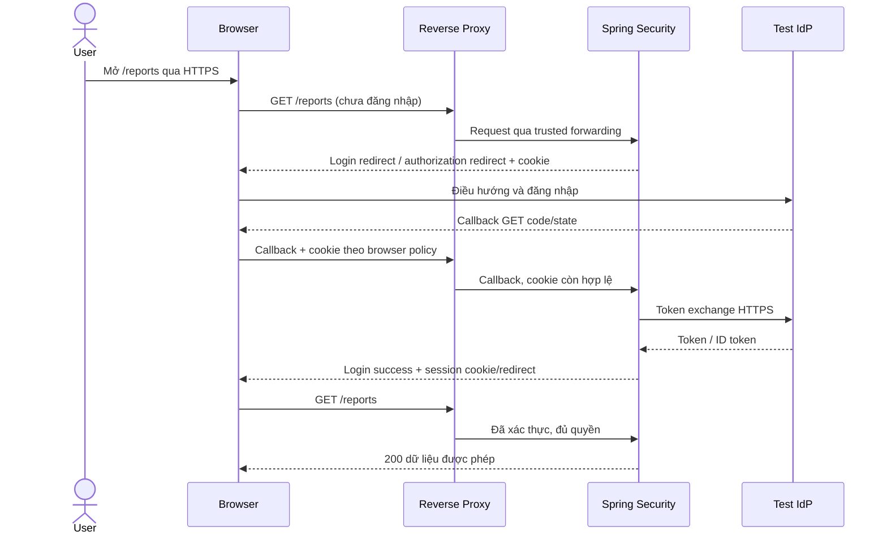

# Proxy, HTTPS, cookie và chuyển hướng trong môi trường gần triển khai

Một bài kiểm thử Spring Security có thể chạy xanh với `MockMvc` hoặc `WebTestClient` tại `http://localhost` nhưng đăng nhập lại thất bại khi đưa ứng dụng ra sau reverse proxy. Browser thực tế truy cập `https://portal.example.test`, trong khi backend nhìn thấy kết nối HTTP từ proxy; cookie phiên được tạo thiếu `Secure` hoặc sai `SameSite`; OAuth2/OIDC `redirect_uri` trỏ về `http://app:8080`; hoặc callback không mang theo cookie lưu authorization request nên kiểm tra `state` thất bại.

Đó không hẳn là lỗi của `@WithMockUser`, `jwt()`, `oidcLogin()` hay controller. Chúng là lỗi **tích hợp ở ranh giới browser, TLS, proxy, Spring Security và Identity Provider**. Muốn phát hiện, test cần tiến gần topology triển khai thật thay vì chỉ chèn principal giả rồi assert 200.

Bài thuộc chương **Tích hợp đầu cuối** của module **SPRING_SECURITY_TESTING**. Phạm vi module là kiểm chứng xác thực, phân quyền và bảo vệ HTTP thực tế bằng `spring-security-test` trên **Servlet** và **Reactive**: `MockMvc`, `WebTestClient`, `@WithMockUser`, `SecurityContext`, JWT/OAuth2/OIDC giả lập, cùng ca được phép/bị từ chối. Ở bài này, ta bổ sung kiểm thử **gần môi trường triển khai** nhằm xác minh URL công khai, HTTPS, cookie, callback, session và hành vi chuyển hướng.

## 1. Topology thực tế thay đổi những giả định nào?

Giả sử hệ thống có đường đi:



Trong topology này có **hai góc nhìn về URL**:

| Thuộc tính | Góc nhìn browser | Góc nhìn backend |
|---|---|---|
| Scheme | `https` | Có thể là `http` |
| Host | `portal.example.test` | `app` hoặc `localhost` |
| Port | Mặc định 443 | 8080 |
| Đường dẫn public | Ví dụ `/portal/login` | Có thể là `/login` nếu proxy strip prefix |
| Cookie | Browser áp dụng `Domain`, `Path`, `Secure`, `SameSite` | App/proxy phát `Set-Cookie` |
| OIDC callback | IdP điều hướng browser về URL public | Filter xử lý request sau proxy |

Nếu ứng dụng dùng địa chỉ nội bộ để xây dựng URL tuyệt đối, một redirect có thể hợp lệ về cú pháp nhưng **không thể truy cập từ browser** hoặc **không nằm trong allowlist của IdP**.

Ta cần kiểm chứng độc lập:

1. Proxy truyền đúng scheme, host, port và đường dẫn public **qua cơ chế tin cậy**.
2. Spring Security sinh redirect/callback URI theo public origin.
3. Cookies có thuộc tính bảo vệ phù hợp và browser gửi chúng trong những bước cần thiết.
4. Session và OAuth2 authorization request tồn tại qua redirect ra IdP rồi quay về.
5. Xác thực và phân quyền thực tế vẫn từ chối request thiếu credential/authority.
6. Đường dẫn/host do client cung cấp không trở thành open redirect hoặc trusted issuer tùy ý.

## 2. Reverse proxy, TLS termination và canonical public origin

**TLS termination** nghĩa là browser kết nối HTTPS đến proxy, nhưng proxy có thể kết nối HTTP đến ứng dụng ở mạng được bảo vệ.

```text
Browser URL  : https://portal.example.test/account
Proxy        : nhận TLS trên cổng 443
Backend URL  : http://app:8080/account
Public origin: https://portal.example.test
```

Backend cần biết public origin khi xây dựng `redirect_uri` cho OAuth2/OIDC Login, redirect từ trang đăng nhập, URL tuyệt đối, chính sách kênh bảo mật và cookie.

Reverse proxy thường truyền metadata của request trước khi proxy xử lý:

| Header | Ý nghĩa thường gặp | Rủi ro |
|---|---|---|
| `Forwarded: proto=https;host=portal.example.test` | Chuẩn mô tả scheme/host | Bị client giả mạo nếu proxy không sanitize |
| `X-Forwarded-Proto: https` | Scheme browser dùng | Sai thành `http` gây callback/HTTPS redirect sai |
| `X-Forwarded-Host: portal.example.test` | Host public | Host không kiểm soát gây host-header poisoning |
| `X-Forwarded-Port: 443` | Port public | Sai thành 8080 khiến callback mismatch |
| `X-Forwarded-Prefix: /portal` | Prefix public khi proxy rewrite | Prefix bị nhân đôi hoặc bị mất |
| `X-Forwarded-For` | Chuỗi IP qua proxies | Client có thể tự khai IP nếu trust chain sai |

**Ranh giới tin cậy:** Không đồng nghĩa request có `X-Forwarded-Proto: https` với browser đã dùng TLS. Header chỉ đáng tin khi reverse proxy **loại bỏ/ghi đè header đầu vào không đáng tin**, ứng dụng không có cổng nội bộ mở tùy ý và chỉ tin proxy do hệ thống quản lý.

Nếu ứng dụng có host allowlist hoặc canonical external URL cố định, xem đó là **ràng buộc độc lập** với việc xử lý forwarded headers. Không cho một `X-Forwarded-Host` bất kỳ tạo redirect sang host do attacker kiểm soát.

## 3. Cấu hình Spring Boot để hiểu forwarded headers

Một phương án Spring Boot phổ biến khi chạy sau reverse proxy:

```yaml
server:
  forward-headers-strategy: framework
```

Khi chọn chế độ này, Spring Framework xử lý metadata forwarding theo servlet/reactive stack tương ứng. Có môi trường dùng `native` dựa vào container hoặc hạ tầng. **Không bật nhiều lớp xử lý header chồng nhau** khi chưa kiểm chứng; URL có thể bị rewrite sai.

Điều kiện triển khai cần đi kèm:

- Chỉ ingress hoặc gateway tin cậy được gửi forwarded metadata đến backend.
- Proxy xóa những `Forwarded`/`X-Forwarded-*` ban đầu do client không tin cậy gửi, rồi thiết lập lại giá trị đúng.
- Cổng backend không public trực tiếp hoặc có network policy tương đương.
- HTTPS redirect được xử lý rõ tại edge hoặc tại app, tránh hai bên redirect lặp.
- Kiểm tra thông tin browser thấy qua proxy thật; không chỉ dựa vào log backend.

Không nên sửa redirect sai bằng cách hardcode một URL ở controller khi nguyên nhân gốc là trusted proxy headers bị bỏ qua. Cũng không nên tin mọi forwarded header chỉ để test “xanh”.

Ví dụ HTTP request **backend nhận từ proxy**:

```http
GET /oauth2/authorization/corporate HTTP/1.1
Host: app:8080
X-Forwarded-Proto: https
X-Forwarded-Host: portal.example.test
X-Forwarded-Port: 443
```

Trong test, việc chủ động gửi những header đó mô phỏng metadata được proxy cung cấp. Nó **chưa chứng minh proxy thật sanitize header hoặc browser thực sự dùng TLS**.

## 4. OAuth2/OIDC: redirect URI phải dùng origin công khai

Giả sử ứng dụng đăng ký client `corporate`:

```yaml
spring:
  security:
    oauth2:
      client:
        registration:
          corporate:
            provider: company-idp
            client-id: ${OIDC_CLIENT_ID}
            client-secret: ${OIDC_CLIENT_SECRET}
            client-authentication-method: client_secret_basic
            authorization-grant-type: authorization_code
            redirect-uri: "{baseUrl}/login/oauth2/code/{registrationId}"
            scope: [openid, profile, email]
        provider:
          company-idp:
            issuer-uri: https://id.example.test/realms/staff
```

Với public origin đúng:

```text
Login start:
  https://portal.example.test/oauth2/authorization/corporate
Public callback đăng ký tại IdP:
  https://portal.example.test/login/oauth2/code/corporate
Backend sau proxy nhận:
  http://app:8080/login/oauth2/code/corporate?code=...&state=...
```

**Public redirect URI và backend URL không phải một.** IdP phải chấp nhận URI browser truy cập, không phải `http://app:8080/...`. Sai scheme, hostname, port hoặc path đều có thể gây `redirect_uri_mismatch`.



Các dấu hiệu phân biệt lỗi:

| Triệu chứng | Nơi điều tra |
|---|---|
| IdP thông báo `redirect_uri_mismatch` | URI public trong request authorize và allowlist IdP |
| Redirect sang `http://app:8080` | Forwarded scheme/host/port, base URL |
| Callback đúng URL nhưng `invalid_state` | Session/cookie, SameSite, path/domain hoặc replica |
| State đúng nhưng token exchange lỗi | Code, client authentication, PKCE, TLS back-channel |
| Token đã cấp nhưng login thất bại | ID token, nonce, issuer/audience/JWKS, UserInfo |
| Login xong nhưng tài nguyên bị 403 | Authority/role mapping, HTTP/method security |

Đừng xem một `302` là bằng chứng OIDC login đã hoàn tất. `302` đầu tiên mới khởi tạo authorization request; `302` sau callback có thể là thành công **hoặc trang lỗi**, tùy `Location`.

## 5. Path prefix và rewrite: lỗi không chỉ ở scheme/host

Một triển khai có thể publish ứng dụng dưới `https://portal.example.test/app` trong khi proxy bỏ tiền tố `/app` khi gọi backend:

```text
Browser GET : /app/oauth2/authorization/corporate
Proxy       : rewrite /app/... -> /...
Backend GET : /oauth2/authorization/corporate
Expected public callback:
  https://portal.example.test/app/login/oauth2/code/corporate
```

Nếu Spring Security không biết external prefix, callback có thể bị tạo thiếu `/app`. Ngược lại, nếu proxy không strip prefix và ứng dụng cũng cấu hình context path `/app`, `X-Forwarded-Prefix: /app` áp dụng thêm có thể tạo `/app/app/...`.

Trước khi sửa cấu hình, cần xác định:

1. Browser gửi path gì?
2. Proxy giữ hay strip prefix?
3. Ứng dụng có `server.servlet.context-path`, WebFlux base path hoặc router prefix chưa?
4. Proxy phát `X-Forwarded-Prefix` không và framework xử lý nó thế nào?
5. Callback path trong `ClientRegistration` và tại IdP đã đăng ký là gì?

**Không giả định cả ba cơ chế** rewrite ở proxy, context path trong app và `X-Forwarded-Prefix` đều cần bật. Chọn một cấu hình nhất quán rồi test URL public thật. Chi tiết base path WebFlux tùy cách gắn router và phiên bản; hãy quan sát `Location` thay vì suy từ một property đơn lẻ.

## 6. Cookie phiên: Secure, HttpOnly, SameSite, Domain và Path

Trong các luồng login dựa vào session, Spring Security cần truy xuất authorization request đã lưu khi browser quay về callback. Session có thể được nhận dạng bằng cookie như `JSESSIONID` trên Servlet container, `SESSION` với một số cấu hình Spring Session/WebFlux, hoặc tên đã tùy chỉnh. **Không hardcode tên cookie** nếu ứng dụng cho phép nhiều triển khai.

| Thuộc tính | Tác dụng | Điều cần kiểm |
|---|---|---|
| `Secure` | Browser chỉ gửi cookie qua kết nối bảo mật phù hợp | Cookie phiên production trên HTTPS cần Secure |
| `HttpOnly` | JavaScript thông thường không đọc được cookie | Session cookie không cần JavaScript phải HttpOnly |
| `SameSite=Lax` | Hạn chế gửi cookie qua cross-site request, thường cho top-level safe navigation | Thích hợp với nhiều OIDC GET callbacks |
| `SameSite=Strict` | Hạn chế cross-site mạnh hơn | Có thể ngăn cookie tại callback từ IdP |
| `SameSite=None` | Cho phép sử dụng ở nhiều ngữ cảnh cross-site | Yêu cầu Secure và cân nhắc CSRF/third-party-cookie policy |
| `Path` | Giới hạn đường dẫn gửi cookie | Phải bao gồm callback và trang cần session |
| `Domain` | Phạm vi host/subdomain gửi cookie | Ưu tiên host-only nếu không cần chia sẻ subdomain |
| `Max-Age`/`Expires` | Thời gian browser giữ cookie | Cần khớp chính sách timeout/logout |

Ví dụ response header:

```http
Set-Cookie: JSESSIONID=test-session-id; Path=/; Secure; HttpOnly; SameSite=Lax
```

Đây là **session ID giả để minh họa**. Không đưa cookie/session thật vào log, screenshot, CI artifact hay tài liệu. Cookie có thể bị browser từ chối dù `Set-Cookie` trông hợp lệ, tùy chính sách ngữ cảnh và cấu hình client.

### SameSite và OIDC callback

Một vòng login tiêu chuẩn đưa browser từ ứng dụng sang IdP rồi quay lại:

- Với callback **GET** qua top-level navigation, `SameSite=Lax` thường gửi lại cookie session; ứng dụng tìm được authorization request tương ứng với `state`.
- Nếu IdP dùng `response_mode=form_post`, callback là một **cross-site POST** do trang IdP tạo. `SameSite=Lax` có thể khiến browser **không gửi cookie**, làm Spring không tìm được state/session.
- `SameSite=None; Secure` có thể cần cho những luồng cross-site POST nhất định, nhưng phải đánh giá rủi ro, CSRF và quy định cookie của browser. Không nới lỏng toàn bộ session cookie chỉ vì một test thất bại.
- Hai origin khác nhau có thể cùng site, và hai HTTPS/HTTP URL cùng hostname có thể bị xét khác site theo cơ chế schemeful same-site. **Same-origin và same-site không đồng nghĩa.**
- Browser có thể chặn third-party cookies hoặc cookie trong iframe ngay cả khi server đặt `SameSite=None`.

Một HTTP client đơn giản có thể gửi cookie với bất kỳ request nào khi được lập trình như vậy, nhưng **không mô phỏng đầy đủ chính sách SameSite của browser**. Test cookie attribute ở tầng HTTP và test chuyển hướng ở browser thật là hai bằng chứng khác nhau.

## 7. Cấu hình cookie ở Servlet và Reactive

Một phương án Spring Boot trên Servlet:

```yaml
server:
  forward-headers-strategy: framework
  servlet:
    session:
      cookie:
        secure: true
        http-only: true
        same-site: lax
```

Cần xác minh property names và behavior trên **phiên bản Spring Boot của dự án**. Với Spring Session, external session store, gateway và container tùy biến, nơi phát `Set-Cookie` hoặc session cookie serializer có thể khác.

Thuộc tính `secure: true` **không tự chứng minh browser đang dùng TLS**. Nó chỉ hướng dẫn phát cookie với cờ Secure. Hãy kiểm tra đường TLS public, redirect HTTP→HTTPS và cookie thật browser nhận.

Ở WebFlux, session cookie có thể được điều chỉnh bằng `WebSessionIdResolver`, ví dụ `CookieWebSessionIdResolver` và cấu hình cookie phù hợp. Không lấy nguyên property dưới `server.servlet.*` rồi coi là cấu hình Reactive session; hai stack có cơ chế session khác nhau.

### Cookie session khác cookie CSRF

Ứng dụng có thể phát thêm `XSRF-TOKEN` khi dùng `CookieCsrfTokenRepository`. SPA có thể cần đọc giá trị CSRF token bằng JavaScript để gửi lại trong header; trong trường hợp đó, policy `HttpOnly` của **cookie CSRF** có thể khác với **cookie session**.

Không vì SPA cần đọc CSRF cookie mà bỏ `HttpOnly` khỏi session cookie. `SameSite` là lớp bảo vệ bổ sung, không thay thế mọi cơ chế kiểm CSRF. Cookie prefix như `__Host-` cũng có những ràng buộc riêng (Secure, Path=/, không Domain, ngữ cảnh HTTPS) và phải được test trên browser nếu chọn sử dụng.

## 8. Session, state và SecurityContext qua nhiều lần redirect

Đối với một cấu hình OAuth2 Login lưu authorization request trong HTTP session, mỗi bước có dữ liệu khác nhau:

| Bước | Browser/app cần giữ | Lỗi dễ thấy |
|---|---|---|
| GET điểm bắt đầu đăng nhập | Application tạo authorization request có `state` và có thể PKCE/nonce | Không tạo session khi cần |
| Redirect đến IdP | Browser lưu cookie session từ ứng dụng | Cookie bị browser từ chối vì Domain/Path/Secure |
| Callback về ứng dụng | Cookie session **cũ** + `code`/`state` IdP trả lại | Session mismatch, `invalid_state` |
| Token exchange | ClientRegistration, code, redirect URI, PKCE verifier | `invalid_grant`/`invalid_client` |
| Hoàn tất login | Authentication/authorized client/SecurityContext theo policy | Session fixation, cookie mới không được browser chấp nhận |
| Request sau login | Cookie hoặc credential sau đăng nhập | User lại anonymous, redirect loop |

Với session-based authentication, cookie có thể **được thay** khi login thành công do session fixation protection. Vì vậy test không nên cố định một session ID phải sống từ đầu đến cuối. Kỳ vọng đúng là **user vẫn được xác thực với cookie mới mà browser nhận**.

Ngược lại, request callback **trước khi hoàn tất login** phải liên kết được với authorization request ban đầu để xác minh `state`. Nếu proxy/load balancer đưa các request vào hai replica nhưng dữ liệu session nằm trong bộ nhớ riêng mà không có sticky session hoặc shared store, callback có thể không tìm thấy authorization request.

### Nhiều replica và shared session



Môi trường nhiều replica cần một chiến lược state nhất quán: session store dùng chung, sticky sessions có ràng buộc phù hợp, hoặc một thiết kế authorization request repository khác được kiểm soát. Chỉ kiểm tra một instance trên máy lập trình không phát hiện được lỗi này.

Với các API Bearer JWT stateless, browser có thể không dùng session cookie, nhưng điều đó **không có nghĩa OAuth2 browser login cũng không cần state**. Không tắt lưu authorization request hoặc xác minh state chỉ để biến flow thành “stateless”.

## 9. Phân biệt redirect 302, 303, 307 và HTTPS upgrade

Các loại redirect có ý nghĩa khác nhau:

| Mã | Cách xử lý phổ biến | Điều cần lưu ý |
|---|---|---|
| `301` | Chuyển địa chỉ lâu dài; có thể bị cache | Cẩn trọng khi chuyển môi trường |
| `302` | Chuyển hướng thường gặp trong login | Browser có những quy tắc lịch sử khi đổi method |
| `303` | Browser thực hiện GET đến đích, hữu ích sau POST | Có thể tránh POST lặp khi điều hướng thành công |
| `307` | Giữ nguyên method và body của request | Không vô tình redirect POST chứa credential sang host khác |
| `308` | Redirect lâu dài, giữ method/body | Cần đặc biệt cân nhắc khi đổi scheme/host |

Không phải mọi `302` đều là OAuth2 authorization redirect; `Location` có thể trỏ về trang login, callback, trang lỗi, hoặc trang đã yêu cầu trước khi đăng nhập. **Assert status + Location + trạng thái phiên**, không chỉ `is3xxRedirection()`.

HTTPS upgrade thường được thực hiện ở ingress (HTTP → HTTPS). Nếu ứng dụng cũng ép HTTPS dựa vào kết nối backend HTTP nhưng không hiểu `X-Forwarded-Proto: https` đã được proxy xác minh, một request HTTPS ngoài browser có thể bị redirect mãi. Cần kiểm:

1. HTTP public request được chuyển sang HTTPS theo policy.
2. HTTPS public request **không** bị redirect lại sang chính nó.
3. `Location` không chứa internal host/port, và không chuyển sang host tùy ý.
4. Cookie phiên chỉ được browser gửi trên HTTPS theo policy.
5. HSTS được phát phù hợp sau khi hạ tầng HTTPS đã sẵn sàng (không đưa HSTS vào test như một cách thay thế TLS).

### Saved request và trang sau đăng nhập

Khi user vào `/reports` mà chưa login, Spring Security có thể lưu request ban đầu rồi đưa browser qua login. Sau callback thành công, một success handler có thể điều hướng trở lại `/reports`. Đây là redirect hợp lệ khác với URL của IdP.

Nếu ứng dụng nhận tham số `next` hoặc `returnUrl`, **không redirect trực tiếp tới URL tuyệt đối do client cung cấp**. Cần giới hạn đích đến theo allowlist/relative-path policy để tránh open redirect. Test phải có cả đường hợp lệ và trường hợp `next=https://evil.example.test` bị từ chối/chuẩn hóa theo contract; không để `Location` chứa domain do attacker lựa chọn.

## 10. Thiết kế các tầng kiểm thử: một helper không chứng minh mọi thứ

| Tầng | Công cụ ví dụ | Kiểm chứng phù hợp | Không tự chứng minh |
|---|---|---|---|
| Unit | Test URL builder, cookie policy, redirect validator | Chính sách trên dữ liệu xác định | Proxy TLS, browser cookie |
| Servlet HTTP integration | `MockMvc` + security filters | Redirect theo forwarded metadata, trạng thái request | Reverse proxy đã sanitize header |
| Reactive HTTP integration | `WebTestClient` bind application context | WebFilterChain, Reactor Context, redirect | Browser thực thi SameSite |
| OAuth2/OIDC callback integration | Mock IdP/token/JWKS server | State, callback, code exchange, ID token validation | TLS/browser thật nếu vẫn mock context |
| Live HTTPS integration | App sau proxy + HTTP client | Chứng chỉ, Location public, Set-Cookie, topology | Browser cookie policy hoàn chỉnh |
| Browser end-to-end | Browser automation + IdP thử nghiệm | Cookie được browser lưu/gửi, cross-site redirects, login/logout | Mọi IdP production và phiên bản browser |

Thứ tự này giúp test chạy nhanh ở tầng thấp nhưng vẫn có bằng chứng cho rủi ro chỉ xuất hiện ở triển khai. Không nhất thiết mỗi unit test đều khởi động proxy; các ca URL/cookie trọng yếu cần ít nhất một vòng tích hợp gần production.

`@WithMockUser`, `jwt()`/`mockJwt()` và `oidcLogin()`/`mockOidcLogin()` kiểm tra **authorization với principal giả**. Chúng **không** chạy browser redirect, lưu session qua IdP, gọi token endpoint/JWKS hoặc xác minh Secure/SameSite cookie từ browser. Test 200 với `oidcLogin()` không phải bằng chứng OIDC callback hoạt động dưới HTTPS proxy.

## 11. MockMvc: xác minh public redirect URI theo forwarded metadata

Giả sử test context có:

- `SecurityFilterChain` Servlet bật `oauth2Login()`.
- `ClientRegistrationRepository` đăng ký `corporate` với `authorizationUri` thử nghiệm cố định, không phụ thuộc discovery qua mạng.
- `server.forward-headers-strategy=framework` hoặc `ForwardedHeaderFilter` được gắn **đúng một lần**, để request trong MockMvc thực sự được diễn giải theo forwarded headers.

Kiểm URI công khai trong authorization request:

```java
import java.net.URI;
import java.net.URLDecoder;
import java.nio.charset.StandardCharsets;
import java.util.LinkedHashMap;
import java.util.Map;
import org.junit.jupiter.api.Test;
import org.springframework.beans.factory.annotation.Autowired;
import org.springframework.boot.test.autoconfigure.web.servlet.AutoConfigureMockMvc;
import org.springframework.boot.test.context.SpringBootTest;
import org.springframework.test.web.servlet.MockMvc;
import org.springframework.test.web.servlet.MvcResult;

import static org.assertj.core.api.Assertions.assertThat;
import static org.springframework.test.web.servlet.request
        .MockMvcRequestBuilders.get;
import static org.springframework.test.web.servlet.result
        .MockMvcResultMatchers.status;

@SpringBootTest(properties = {
    "server.forward-headers-strategy=framework"
})
@AutoConfigureMockMvc
class ForwardedOAuth2RedirectMvcTest {

    @Autowired MockMvc mvc;

    @Test
    void authorizationRedirectUsesPublicHttpsOrigin()
            throws Exception {
        MvcResult result = mvc.perform(
                get("/oauth2/authorization/corporate")
                    .header("X-Forwarded-Proto", "https")
                    .header("X-Forwarded-Host", "portal.example.test")
                    .header("X-Forwarded-Port", "443"))
            .andExpect(status().is3xxRedirection())
            .andReturn();

        String location = result.getResponse().getRedirectedUrl();
        assertThat(location).isNotNull();
        assertThat(location)
                .startsWith("https://id.example.test/");

        Map<String, String> query = queryForm(
                URI.create(location).getRawQuery());

        assertThat(query)
            .containsEntry("response_type", "code")
            .containsEntry("client_id", "portal-client")
            .containsEntry("redirect_uri",
                "https://portal.example.test/login/oauth2/code/corporate");
        assertThat(query.get("state")).isNotBlank();
    }

    private static Map<String, String> queryForm(String rawQuery) {
        Map<String, String> result = new LinkedHashMap<>();
        for (String parameter : rawQuery.split("&")) {
            String[] pair = parameter.split("=", 2);
            String key = URLDecoder.decode(
                pair[0], StandardCharsets.UTF_8);
            String value = URLDecoder.decode(
                pair.length == 2 ? pair[1] : "",
                StandardCharsets.UTF_8);
            result.put(key, value);
        }
        return result;
    }
}
```

Đây là **ví dụ test ghép vào ứng dụng có client registration và security chain nêu trên**: `portal-client`, `https://id.example.test/` và callback phải được cấu hình trong fixture. Để context không gọi IdP production, hãy dựng registration bằng Java với endpoint thử nghiệm hoặc metadata server giả lập.

Helper `queryForm(...)` giải mã raw query để so sánh URI đã percent-encode, thay vì assert thứ tự tham số trong `Location`. Parser này chỉ giữ giá trị cuối nếu tên trùng nhau; cần kiểm các tham số trùng thì dùng `MultiValueMap`. Không giải mã query hai lần vì ký tự `%` hoặc `+` có thể biến đổi ngoài ý muốn.

Việc gửi `X-Forwarded-Proto: https` trực tiếp từ MockMvc chỉ chứng minh ứng dụng **chấp nhận và diễn giải** header trong test. Nó **không** chứng minh proxy production đã tạo header từ TLS thật, gỡ header giả mạo hay áp host allowlist. Hãy gửi header giả mạo qua **public proxy entrypoint của môi trường test** để kiểm tra hành vi sanitize; đừng coi MockMvc là bằng chứng cho security policy của ingress.

## 12. MockMvc: giữ cùng session và state khi callback

Một integration test OAuth2/OIDC phải bắt đầu bằng request khởi tạo login, giữ session và state, rồi dùng **cùng session** cho callback:

```java
MvcResult start = mvc.perform(
        get("/oauth2/authorization/corporate")
            .header("X-Forwarded-Proto", "https")
            .header("X-Forwarded-Host", "portal.example.test"))
    .andExpect(status().is3xxRedirection())
    .andReturn();

String location = start.getResponse().getRedirectedUrl();
String state = queryForm(URI.create(location).getRawQuery())
        .get("state");
assertThat(state).isNotBlank();

MockHttpSession session =
        (MockHttpSession) start.getRequest().getSession(false);
assertThat(session).isNotNull();

// Trước callback, mock IdP phải được chuẩn bị:
// 1. Chấp nhận authorization code fixture.
// 2. Trả token response hợp lệ (OIDC cần ID token ký và JWKS test).
// 3. Cung cấp UserInfo khi cấu hình login cần.
MvcResult callback = mvc.perform(
        get("/login/oauth2/code/corporate")
            .param("code", "test-code-001")
            .param("state", state)
            .session(session)
            .header("X-Forwarded-Proto", "https")
            .header("X-Forwarded-Host", "portal.example.test"))
    .andReturn();

// Assert success/failure handler theo ứng dụng đã cấu hình.
// Sau login, dùng session/cookie thực tế của fixture để GET tài nguyên bảo vệ.
```

Đây là **khung test**, chưa tự tạo IdP mock. Một IdP test phải trả token/UserInfo/ID token hợp lệ, và callback phải đi qua security filter chain đúng. Không kết luận login thành công chỉ vì callback trả `302`.

Đối chứng cần có:

| Ca | Input thay đổi | Kỳ vọng |
|---|---|---|
| Callback đúng | Cùng session, state khớp, code hợp lệ | Tạo Authentication và phiên sau khi token/ID token hợp lệ |
| Callback thiếu session | Không còn authorization request | Không đăng nhập |
| Callback sai state | State bị thay đổi | Không trao đổi code như một request hợp lệ |
| State đúng nhưng token endpoint trả `invalid_grant` | Code không được chấp nhận | Login thất bại, không cấp quyền |
| ID token sai issuer/chữ ký/audience/nonce | Token response OIDC không hợp lệ | Không đăng nhập |
| Có session nhưng thiếu role | User đã xác thực, không đủ quyền | Không truy cập tài nguyên bảo vệ |

Kiểm SecurityContext bằng một endpoint chỉ trả dữ liệu khi có Authentication hợp lệ, hoặc đọc session phù hợp trong test context. Đừng chỉ nhìn `SecurityContextHolder` của **test thread** rồi mặc định đó là context của request server. Khi mock IdP có bảo vệ code một lần sử dụng, test thêm tình huống replay authorization code.

### Session fixation protection thay cookie sau login

Spring Security có thể đổi session ID trong lúc xác thực thành công để giảm session fixation. Vì vậy không assert một session ID phải **giữ nguyên** từ khi bắt đầu flow cho đến sau login. Hãy assert cookie mới (nếu có) được browser tiếp nhận và request tiếp theo vẫn xác thực được. Khi tích hợp với Spring Session hoặc container khác, cơ chế đổi ID/cookie cũng có thể khác.

## 13. Reactive: WebTestClient và WebSession không phải MockHttpSession

Trong WebFlux, Spring Security dùng `SecurityWebFilterChain` và WebSession. Test redirect với forwarded metadata:

```java
@Test
void reactiveLoginRedirectUsesExternalHttpsOrigin() {
    var response = webTestClient.get()
        .uri("/oauth2/authorization/corporate")
        .header("X-Forwarded-Proto", "https")
        .header("X-Forwarded-Host", "portal.example.test")
        .header("X-Forwarded-Port", "443")
        .exchange()
        .expectStatus().is3xxRedirection()
        .returnResult(Void.class);

    URI location = response.getResponseHeaders().getLocation();
    assertThat(location).isNotNull();
    assertThat(location.getHost()).isEqualTo("id.example.test");

    Map<String, String> params = queryForm(location.getRawQuery());
    assertThat(params.get("redirect_uri")).isEqualTo(
        "https://portal.example.test/login/oauth2/code/corporate");
}
```

Method trên là **đoạn ghép vào WebFlux test** có `ReactiveClientRegistrationRepository`, security web filters và config forwarding thích hợp; dùng lại `queryForm(...)` ở mục 11. Nó không dùng `MockMvc` Servlet. Nếu tự dựng WebTestClient từ application context, gắn Spring Security bằng configurer phù hợp như `springSecurity()`; một client bind thẳng controller có thể bỏ qua security.

### Giữ cookie WebSession giữa hai HTTP exchanges

```java
var startResult = webTestClient.get()
        .uri("/oauth2/authorization/corporate")
        .exchange()
        .expectStatus().is3xxRedirection()
        .returnResult(Void.class);

String state = queryForm(
        startResult.getResponseHeaders().getLocation().getRawQuery())
        .get("state");

ResponseCookie sessionCookie =
        startResult.getResponseCookies().getFirst("SESSION");
assertThat(sessionCookie).isNotNull();

// Mock IdP đã queue token response / UserInfo / ID token hợp lệ.
webTestClient.get()
        .uri(builder -> builder
            .path("/login/oauth2/code/corporate")
            .queryParam("code", "code-reactive-001")
            .queryParam("state", state)
            .build())
        .cookie(sessionCookie.getName(), sessionCookie.getValue())
        .exchange();
```

`SESSION` là tên thường gặp của WebSession mặc định, **không bắt buộc cho mọi dự án**; nếu cấu hình cookie khác, lấy tên đúng theo response. Import `org.springframework.http.ResponseCookie`, `java.net.URI` và các class test tương ứng.

Nếu test client có cookie jar hoặc được dùng lại trong nhiều test, phải cô lập trạng thái để không nhận nhầm session từ ca khác. Sau callback, kiểm success handler, SecurityContext và endpoint bảo vệ thay vì chỉ xem status trả về.

`webTestClient.mutateWith(mockOidcLogin())` gắn Authentication giả và **bỏ qua callback**, nên không dùng để kết luận cookie hoặc state đi qua IdP. WebTestClient tự nó cũng không mô phỏng đầy đủ quyết định gửi cookie `SameSite` của browser thật.

## 14. Live HTTPS integration: kiểm tra chính xác response qua proxy

Khi bắt đầu kiểm đường triển khai thật, hãy kết nối **địa chỉ public của môi trường test** qua HTTPS, không gọi cổng nội bộ. Một HTTP client cho phép xem riêng từng redirect và header:

```java
import java.net.URI;
import java.net.http.HttpClient;
import java.net.http.HttpRequest;
import java.net.http.HttpResponse;
import java.util.List;

import static org.assertj.core.api.Assertions.assertThat;

HttpClient client = HttpClient.newBuilder()
        .followRedirects(HttpClient.Redirect.NEVER)
        .build();

HttpRequest startRequest = HttpRequest.newBuilder(
        URI.create(
            "https://portal.example.test/oauth2/authorization/corporate"))
        .GET()
        .build();

HttpResponse<Void> response = client.send(
        startRequest,
        HttpResponse.BodyHandlers.discarding());

assertThat(response.statusCode()).isBetween(300, 399);

String location = response.headers()
        .firstValue("Location")
        .orElseThrow();
assertThat(location).startsWith(
        "https://id.example.test/");

List<String> cookies =
        response.headers().allValues("Set-Cookie");
// Nếu session cookie được phát tại bước này,
// kiểm Secure, HttpOnly, SameSite, Path/Domain theo contract.
```

Đoạn này là một **mẫu smoke test**, không thể chạy với tên miền `example.test` nếu chưa dựng DNS, TLS certificate và IdP giả lập cho môi trường test. Vì cần chứng minh TLS thực, không “sửa” lỗi chứng chỉ bằng cách tắt kiểm TLS hostname/certificate trong HTTP client. Dùng CA nội bộ được cài tin cậy trong môi trường thử nghiệm.

Chủ động dùng `Redirect.NEVER` để quan sát `Location` và `Set-Cookie` tại từng bước. Nếu HTTP client tự động follow mọi redirect, rất dễ chỉ thấy trang cuối và bỏ lỡ redirect sai origin, cookie được phát ở bước đầu, hoặc redirect loop.

### Test Secure/HttpOnly/SameSite cookie qua proxy

Khi endpoint tạo session và response thực sự phát cookie:

```java
assertThat(cookies).anySatisfy(setCookie -> {
    assertThat(setCookie).contains("Secure");
    assertThat(setCookie).contains("HttpOnly");
    assertThat(setCookie).contains("SameSite=Lax");
});
```

Đây là assertion minh họa cho contract **SameSite=Lax**; nếu ứng dụng dùng cookie khác hoặc flow cần `SameSite=None; Secure`, kỳ vọng phải thay theo policy đã được phê duyệt. Hãy parse cookie attributes đúng chuẩn khi test nghiêm túc; substring đơn giản có thể cho false positive nếu không kiểm rõ cookie name và thuộc tính riêng.

Một số container/session manager chỉ phát cookie khi session được tạo, chứ không phải trên mọi request. Trước khi assert `Set-Cookie`, phải chọn request thật sự tạo/cập nhật session; một response không có cookie ở endpoint public không tự là lỗi.

Điều live HTTP client vẫn **chưa** chứng minh: browser gửi cookie ở cross-site redirect theo `SameSite`, UI login hoạt động, JavaScript/cookie policies trong Chrome/Firefox/Safari, hoặc IdP có thể render trong iframe. Những tình huống này cần browser end-to-end.

## 15. Browser-level E2E: xác minh hành vi không thể mô phỏng bằng MockMvc

Một bài kiểm thử browser cấp cao dùng trình duyệt thật hoặc browser automation có thể quan sát:

1. Browser vào `https://portal.example.test/reports` khi chưa login.
2. Spring Security lưu saved request nếu cấu hình và chuyển người dùng vào login/IdP.
3. IdP thử nghiệm hiển thị giao diện đăng nhập, người dùng test đăng nhập.
4. Browser quay về đúng public callback với authorization code và state.
5. Browser **thực sự gửi session cookie** đến callback; request đúng Host/Path/Scheme.
6. Server đổi code lấy token, xác minh ID token nếu OIDC, tạo Authentication.
7. Browser nhận cookie sau login, theo redirect đến trang đã lưu.
8. `GET /reports` trả nội dung của user đã đăng nhập.
9. Một request không đủ quyền đến endpoint nhạy cảm bị từ chối (403 hoặc giao diện lỗi phù hợp).
10. Sau logout, cùng browser không còn truy cập được nội dung bảo vệ bằng session cũ.



Hãy kiểm tra **network trace** và cookie store của browser trong môi trường test nhưng **không xuất token, session ID hay authorization code vào artifact công khai**. Với test automation, nên chỉ lưu thông tin đã được lược bỏ: request path, redirect host/path, thuộc tính cookie, trạng thái có/không có Authentication.

Một browser test phải dùng **địa chỉ public qua proxy**, không điều hướng thẳng tới `http://app:8080`. Nếu test “thành công” bằng việc set cookie thủ công mà browser sẽ không bao giờ chấp nhận theo SameSite/Domain/Secure policy, kết quả đó chỉ xác nhận đường backend chứ chưa xác nhận luồng browser.

### Tách browser và IdP thử nghiệm khỏi production

Sử dụng IdP kiểm soát được với client registration, signing keys và test accounts riêng. Tài khoản production, client secret production hoặc access token người dùng thật không cần thiết cho bài test. Nếu môi trường dùng browser automation, hãy đưa secret test qua secret manager/CI variables; không nhúng chúng vào screenshot hoặc trace.

Khi IdP thử nghiệm hỗ trợ nhiều response mode, có thể tạo hai bài test độc lập:

- **Authorization Code + GET callback:** kỳ vọng session cookie được gửi với SameSite policy phù hợp; `state` khớp.
- **form_post callback:** quan sát browser có gửi session cookie trong cross-site POST không; nếu không, xác nhận nguyên nhân và lựa chọn giải pháp đã được phê duyệt thay vì tắt kiểm state.

## 16. Mô phỏng các lỗi mà môi trường localhost che giấu

| Tình huống | Test localhost dễ bỏ sót | Bằng chứng cần thu ở gần production |
|---|---|---|
| TLS terminated ở proxy | App nghĩ request dùng HTTP | Browser HTTPS và `redirect_uri` dùng HTTPS |
| Forwarded proto thiếu | `http://localhost` vẫn hoạt động | Public `Location` không rơi về HTTP |
| Forwarded host giả mạo | Direct MockMvc chấp nhận header bất kỳ | Proxy strip/overwrite header, không open redirect |
| Forwarded prefix sai | App chạy tại path gốc | Callback path đúng external prefix |
| Host/port sai | Local IDP chấp nhận localhost | Allowlist IdP khớp URI public chính xác |
| Cookie thiếu Secure | Local HTTP vẫn nhận cookie | `Set-Cookie` thực qua HTTPS và browser chỉ gửi an toàn |
| Cookie sai Domain/Path | Các endpoint local cùng host/path | Cookie xuất hiện trong callback request đúng đường dẫn |
| SameSite=Strict | Direct callback test tự gắn session | Browser cross-site GET callback không mất state |
| SameSite=Lax với form_post | HTTP test client tự gửi cookie trong POST | Browser có gửi cookie ở cross-site POST hay không |
| Session chỉ ở bộ nhớ replica A | Chỉ chạy một instance | Callback sang replica B vẫn tìm được state |
| Session fixation/rotation | Test giữ cứng một session ID | Browser nhận và dùng ID mới sau login |
| Redirect loop HTTP→HTTPS | Mock request không qua edge | HTTPS public request ổn định, không bị 302 vô hạn |
| Saved request sai đường dẫn | Truy cập thẳng trang login | Sau login quay về đúng path được phép |
| Open redirect qua `next` | Chỉ test redirect nội bộ | External URL độc hại bị chặn |
| Token/JWKS network | `mockOidcLogin()` bỏ qua IdP | Token/JWKS test được xác minh qua back-channel |
| Cookie logout sai Path | Unit test chỉ xóa session trong memory | Browser không gửi session cũ sau logout |

### Không nhầm CORS với browser redirect

OAuth2 Authorization Code thường dùng **top-level browser navigation** giữa application và IdP, không phải một `fetch()` cross-origin từ JavaScript. Do đó, lỗi browser không gửi cookie trong redirect **không tự động là lỗi CORS**.

CORS liên quan đến cross-origin HTTP request do script/API thực hiện và preflight khi điều kiện áp dụng. Mở `Access-Control-Allow-Origin: *` không làm cookie `SameSite=Lax` tự được gửi trong cross-site POST callback, và cũng không giải quyết redirect URI mismatch. Với API dùng credential/cookie qua XHR, CORS policy phải được cấu hình có chủ đích và không dùng wildcard origin kết hợp credentials một cách thiếu kiểm soát.

## 17. Test phân quyền sau login: phân biệt 401, 403 và redirect

Proxy/HTTPS/cookie chỉ là **đường vận chuyển**. Đường này hoạt động đúng chưa đảm bảo endpoint được phân quyền đúng. Khi test gần production, nên có ít nhất các ca:

| Trạng thái người dùng | Yêu cầu | Kỳ vọng theo cấu hình |
|---|---|---|
| Anonymous | `GET /reports` cần login | Redirect đến login/IdP hoặc 401 tùy entry point |
| Đăng nhập, thiếu `ROLE_REPORTS` | `GET /reports` | 403 hoặc trang access denied tương đương |
| Đăng nhập, có `ROLE_REPORTS` | `GET /reports` | 200, trả dữ liệu của đúng người dùng |
| Đăng nhập tenant A | `GET /tenants/B/reports` | Từ chối hoặc 404 che giấu theo domain policy |
| Session hết hạn | `GET /reports` với cookie cũ | Không lấy được dữ liệu bảo vệ |
| Đã logout | `GET /reports` với cookie cũ | Không được coi là authenticated |
| API Resource Server có JWT sai chữ ký | Bearer request | 401 tại authentication layer |
| API Resource Server JWT hợp lệ, thiếu scope | Bearer request | 403 theo authority policy |

Một request browser tới UI có thể nhận **302 đến trang login** khi chưa xác thực, trong khi REST API sử dụng Basic/Bearer entry point thường trả **401**. Đây là hai chính sách có thể hợp lệ. Điều cần chứng minh là user không được truy cập tài nguyên bảo vệ khi thiếu authentication, và thiếu quyền không bị nhầm với lỗi mạng/redirect.

`MockMvc`/`WebTestClient` vẫn rất hữu ích ở tầng authorization: sử dụng `@WithMockUser`, `jwt()`/`mockJwt()`, `oidcLogin()`/`mockOidcLogin()` để dựng principal có/không có authority. Tuy nhiên, sau đó vẫn cần một integration test qua đường proxy/cookie để chứng minh **principal thực được tạo và duy trì đúng**.

### CSRF và browser session

Với một ứng dụng dùng cookie làm phương tiện xác thực tự động của browser, cần kiểm chính sách CSRF cho các request thay đổi dữ liệu:

- Session hợp lệ và đủ authority **không mặc nhiên** có CSRF token hợp lệ.
- Một POST thiếu CSRF token có thể bị từ chối 403 trước controller.
- Một POST hợp lệ cần authority đúng **và** token CSRF theo cơ chế ứng dụng.
- Bearer API stateless với credential không được browser tự động gắn có thể có threat model khác; đừng kết luận mọi API đều phải có cùng cấu hình CSRF.

Cookie `SameSite` không thay thế kiểm CSRF cho mọi mô hình; một test login thành công không phải bằng chứng POST được bảo vệ.

## 18. Quy trình điều tra khi lỗi chỉ xảy ra sau triển khai

Khi test nội bộ pass nhưng production/staging thất bại, thu thông tin theo trình tự:

1. **Vẽ topology:** browser → edge TLS → proxy → backend → IdP. Ghi rõ public scheme/host/path và backend URL.
2. **Quan sát Location đầu tiên:** browser bắt đầu đăng nhập tại host nào, chuyển đến IdP nào, `redirect_uri` được encode thành giá trị gì?
3. **Đối chiếu allowlist:** URI gửi sang IdP phải trùng client registration đã phê duyệt.
4. **Kiểm cookie ở bước khởi tạo:** browser có nhận session cookie không; có bị cảnh báo Secure/SameSite/Domain/Path không?
5. **Kiểm callback:** method GET hay POST; cookie nào đã được gửi; `state` có tương ứng với authorization request ban đầu không?
6. **Kiểm phiên qua replicas:** authorization request và context có tồn tại ở backend nhận callback không?
7. **Kiểm back-channel:** token endpoint, TLS, client authentication, PKCE và ID token/JWKS/issuer; đừng đổ mọi lỗi vào cookie.
8. **Kiểm sau đăng nhập:** `Location` success, session cookie mới, SecurityContext, authorities, saved request và redirect loop.
9. **Kiểm negative cases:** anonymous/thiếu quyền/cross-tenant, callback sai state và cookie hết hạn vẫn bị từ chối.
10. **Kiểm trust boundary:** header forwarding giả mạo từ ngoài không đổi public origin hoặc redirect target; app không truy cập trực tiếp qua host nội bộ.

Không ghi toàn bộ `Cookie`, `Authorization`, `code`, `id_token` hoặc `client_secret` trong log để debug. Thay bằng correlation ID, registrationId, trạng thái cookie có/không có, HTTP status, public host đã chuẩn hóa và điểm thất bại trong flow.

## 19. Checklist nghiệm thu môi trường gần triển khai

Trước khi khẳng định luồng đăng nhập hoạt động:

1. Public HTTPS endpoint sử dụng chứng chỉ được browser/test client tin cậy; không bỏ qua certificate validation.
2. Proxy chỉ tin đúng header forwarding đã sanitize, backend không mở cổng trực tiếp trái chính sách.
3. `redirect_uri` dùng public scheme/host/port/prefix chính xác và được đăng ký ở IdP.
4. Chỉ có một đường giải thích forwarded headers rõ ràng, không rewrite hai lần.
5. Login start có `state`, PKCE khi phù hợp và authorization request được lưu đủ lâu cho callback.
6. Cookie phiên có `Secure`, `HttpOnly`, `Path`, `Domain`, `SameSite` theo policy; browser thực nhận và gửi lại.
7. GET callback và form_post callback (nếu dùng) được kiểm đúng theo browser cookie behavior.
8. Callback sai state/thiếu session không tạo authentication.
9. Token endpoint/JWKS/ID token được kiểm qua mock IdP hoặc test IdP thật; không thay hoàn toàn bằng `mockOidcLogin()`.
10. Session vẫn hoạt động qua các replicas hoặc có chiến lược lưu state đã được kiểm.
11. Redirect sau login không rơi về HTTP/internal hostname; không có redirect loop hoặc open redirect.
12. Login thành công tạo quyền đúng; request anonymous, thiếu quyền và cross-tenant bị từ chối.
13. Logout/session expiry khiến cookie cũ không còn mở tài nguyên bảo vệ.
14. Browser trace, log và CI artifacts không chứa secrets/tokens/cookie giá trị thật.

## 20. Bài thực hành tổng hợp

Một dịch vụ báo cáo có UI browser dùng OIDC Login và API nhận Bearer JWT. Bên ngoài là `https://portal.example.test/app`; bên trong một hoặc hai replica chạy HTTP sau proxy. IdP thử nghiệm là `https://id.example.test`, scope OIDC có `openid` và callback public phải là `https://portal.example.test/app/login/oauth2/code/corporate`.

Hãy hoàn thành:

1. Vẽ topology và xác định nơi TLS termination; ghi rõ public path prefix, backend path, trusted forwarding policy.
2. Cấu hình `ClientRegistration.redirectUri` và các thành phần proxy/base-path nhất quán. Viết `MockMvc` test parse `Location`, assert `redirect_uri` đúng URL public.
3. Chuyển bài test sang WebFlux/WebTestClient nếu ứng dụng Reactive; giải thích khác nhau giữa `MockHttpSession` và WebSession.
4. Khởi tạo login qua proxy thật với HTTP client không auto-follow redirect, kiểm public `Location`, chứng chỉ HTTPS và cookie attributes.
5. Dùng browser thật hoặc automation đăng nhập qua test IdP; xác minh cookie được gửi tại callback và session sau login hoạt động. Không tắt kiểm state.
6. Tạo một cấu hình IdP dùng GET callback và một cấu hình dùng form_post nếu hệ thống hỗ trợ; kiểm tác động của `SameSite=Lax` và chính sách cookie được chọn.
7. Chạy hai replica và điều hướng callback sang replica khác để phát hiện session store cục bộ.
8. Kiểm request anonymous bị redirect/chặn, user đã login thiếu quyền bị từ chối, user đủ quyền được phép, JWT sai chữ ký và cross-tenant đều bị chặn.
9. Gửi request với `X-Forwarded-Host` giả từ bên ngoài **qua proxy test**, xác minh proxy không cho nó thay public redirect host; thử tham số `next` trỏ ra ngoài và kiểm open-redirect policy.
10. Test HTTP→HTTPS upgrade, không redirect loop, logout, cookie/session expiry và truy cập lại URL đã lưu.
11. Lập bảng kết quả gồm URL public, redirect URI decode, trạng thái TLS, cookie flags, callback method, session persistence, HTTP status và điểm thất bại. Không lưu giá trị cookie hoặc code thật.

**Tiêu chí hoàn thành:** Có bằng chứng độc lập cho **đúng public origin qua trusted proxy**, **HTTPS và cookie browser thật**, **session/state qua callback**, **login/token verification**, và **authorization của request sau login**. Test localhost với `@WithMockUser`, `oidcLogin()` hoặc `mockJwt()` có ích ở tầng thấp, nhưng **không đủ** để tuyên bố luồng proxy–HTTPS–cookie–redirect đã sẵn sàng triển khai.
