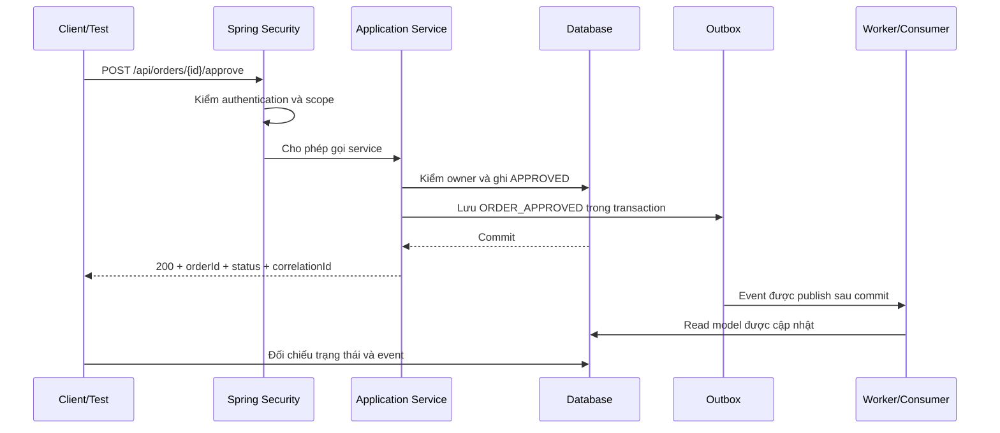
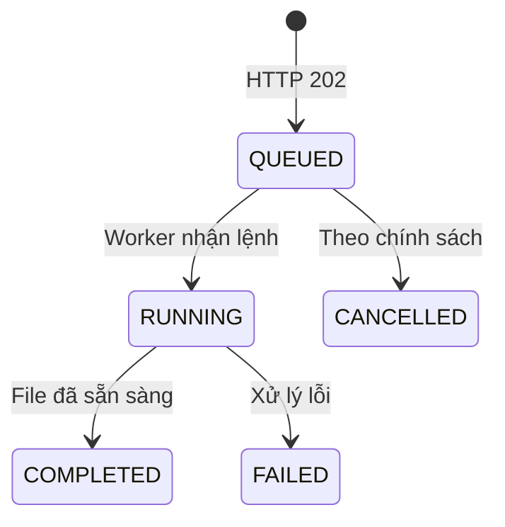

# Đối chiếu phản hồi phía máy khách với sự kiện hoặc trạng thái phía máy chủ

Một bài test `MockMvc` trả `200 OK` chưa bảo đảm trạng thái nghiệp vụ đã được commit vào database. Một API trả `202 Accepted` càng không có nghĩa job bất đồng bộ đã hoàn tất. Chiều ngược lại cũng nguy hiểm: request thiếu quyền nhận `403 Forbidden`, nhưng service có thể đã tạo job, phát message hoặc cập nhật dữ liệu **trước khi** bị từ chối. Do đó, bài kiểm thử tích hợp có giá trị phải đối chiếu **phản hồi HTTP mà máy khách thấy** với **sự kiện, transaction và trạng thái phía máy chủ thực sự xảy ra**.

Bài thuộc chương **Tích hợp đầu cuối** của module **SPRING_SECURITY_TESTING**, chuyên kiểm chứng xác thực, phân quyền và bảo vệ HTTP với `spring-security-test` trên Servlet và Reactive. Người học sử dụng `MockMvc`, `WebTestClient`, `@WithMockUser`, `SecurityContext`, JWT/OAuth2/OIDC giả lập và các ca được phép hoặc bị từ chối. Trong bài này, ta sẽ nối request và danh tính với HTTP status/body/header, state database, outbox, message broker và worker/consumer; đồng thời chỉ ra sự khác biệt giữa test mock principal với test Bearer token thật.

> **Bất biến:** Response thành công phải khớp trạng thái phía server theo hợp đồng; response bị từ chối không được để lại thay đổi nghiệp vụ trái phép. Sự kiện audit về truy cập bị từ chối vẫn có thể hợp lệ; đừng nhầm audit bảo mật với event nghiệp vụ thành công.

## 1. Hai phía cần đối chiếu trong mỗi ca kiểm thử

### 1.1. Máy khách thấy gì?

Ở ranh giới HTTP, client có thể quan sát:

- **Status code**: `200`, `201`, `202`, `204`, `401`, `403`, `404`, `409`, `5xx`...
- **Response body**: ID tài nguyên, kết quả, trạng thái, mã lỗi, thông tin job.
- **Response headers**: `Location`, `ETag`, `X-Correlation-ID`, `Retry-After`, cookie/session theo flow.
- **Thời gian hoàn tất**: response thành công trước timeout hay không, stream đóng hay vẫn đang phát.
- **Kết quả ở request sau**: đọc lại tài nguyên thấy điều gì, user khác có truy cập trái phép được không.

Một DTO chứa `status="APPROVED"` có thể được tạo **trước commit**; nếu transaction rollback, chỉ assert JSON là chưa đủ. Một body `{"status":"QUEUED"}` từ API trả `202` chỉ có nghĩa job được tiếp nhận nếu phía server cũng lưu **ý định xử lý** bền vững theo contract.

### 1.2. Máy chủ thực sự làm gì?

Tùy kiến trúc, server có thể:

- Chạy `SecurityFilterChain` hoặc `SecurityWebFilterChain` để xác thực và phân quyền.
- Kiểm object-level authorization theo owner/tenant bên trong service.
- Ghi database và commit transaction.
- Ghi row transactional outbox hoặc enqueue business command.
- Phát message lên broker; một consumer nhận và cập nhật read model.
- Tạo audit log khi request thành công hoặc bị từ chối.
- Gửi email, webhook, payment hoặc thay đổi cache.

Các hành động này **không luôn kết thúc cùng thời điểm** với response HTTP.



**Cần nói rõ mức đã kiểm:** thấy outbox row không chứng minh broker đã nhận; thấy broker message không chứng minh consumer hoàn tất; thấy `202` không chứng minh worker thành công.

## 2. Hợp đồng HTTP quyết định kỳ vọng trạng thái

| Response | Ý nghĩa trong thiết kế thông dụng | Bằng chứng phía server cần có |
|---|---|---|
| `200 OK` | Thao tác đồng bộ đã xử lý | State tương ứng được ghi/commit, body nhất quán |
| `201 Created` | Tài nguyên đã tạo | Resource tồn tại, `Location` và ID khớp |
| `202 Accepted` | Job/command được nhận | Job/command tồn tại; hoàn tất là bước sau |
| `204 No Content` | Thao tác thành công không có body | State đúng, body rỗng |
| `401 Unauthorized` | Chưa xác thực hợp lệ | Không phát sinh thao tác nghiệp vụ được bảo vệ |
| `403 Forbidden` | Có identity nhưng thiếu quyền | Không thay đổi tài nguyên trái phép |
| `404 Not Found` | Tài nguyên không thấy/được che theo policy | Không lộ dữ liệu của tenant khác |
| `409 Conflict` | Transition/version không hợp lệ | Không phát event success giả |
| Timeout hoặc `5xx` | Request thất bại hoặc trạng thái chưa rõ | Cần kiểm transaction, rollback, retry/idempotency |

Không suy luận rằng `5xx` hoặc **client timeout** đồng nghĩa server chưa commit: response có thể mất sau khi database đã commit. Nếu API cho phép retry, phải kiểm **idempotency** và trạng thái theo command ID.

### 2.1. Ví dụ response `202` đúng ý nghĩa

```http
POST /api/exports HTTP/1.1
Authorization: Bearer <access-token-test>
X-Correlation-ID: trace-export-001
Idempotency-Key: export-command-001
```

```http
HTTP/1.1 202 Accepted
Location: /api/exports/jobs/job-123
Content-Type: application/json

{"jobId":"job-123","status":"QUEUED"}
```

Ở thời điểm response, server nên đã lưu job `job-123` với `QUEUED`; file xuất cuối cùng **chưa chắc** tồn tại. Nếu muốn chứng minh end-to-end, test phải chờ worker cập nhật `COMPLETED`, kiểm đúng owner/tenant và event liên quan.

## 3. Correlation ID: nối response, row và event

Một request có thể tạo nhiều dấu vết:

```text
X-Correlation-ID = e2e-order-001
         |
         +-- HTTP 200 / body.orderId
         +-- orders[id].status=APPROVED
         +-- outbox[correlationId].type=ORDER_APPROVED
         +-- broker[correlationId].eventId
         +-- projection[orderId].status=APPROVED
```

Dùng ID cụ thể thay vì `findLatestEvent()` hoặc `repository.count()`, đặc biệt khi test chạy song song.

| Giá trị | Ý nghĩa | Có phải credential không? |
|---|---|---|
| `correlationId` | Truy vết một flow | Không |
| `requestId` | Một lần gọi HTTP | Không |
| `idempotencyKey` | Nhận diện một lệnh nghiệp vụ khi retry | Không; cần scope đúng actor/tenant |
| `orderId`/`jobId` | Nhận diện tài nguyên | Không |
| `eventId` | Dedupe event được giao nhiều lần | Không |
| `actorSubject` | Identity xác thực của người thực hiện | Phải xuất phát từ nguồn tin cậy |
| `tenantId` | Phạm vi sở hữu/quyền | Phải được xác minh |

Ví dụ:

```java
String cid = "e2e-" + UUID.randomUUID();
String idempotencyKey =
        "approve-" + UUID.randomUUID();
```

Nếu client được phép tự đặt correlation ID, server phải giới hạn format/độ dài. **Không bao giờ coi ID do client gửi là quyền xác thực hoặc vai trò**, và không tin `X-Actor-Id` để xây event `actorSubject`.

### 3.1. Một assertion quan hệ quan trọng hơn bốn assertion rời rạc

```text
response.orderId          == persistedOrder.id
response.status           == persistedOrder.status
response.correlationId    == outbox.correlationId
outbox.aggregateId        == persistedOrder.id
outbox.actorSubject       == authenticatedPrincipal.name
```

Một outbox event có type đúng nhưng thuộc order khác vẫn là lỗi. Một body đúng `status` nhưng mang `orderId` của tenant khác cũng là lỗi. Mục đích của bài test là **đối chiếu quan hệ nhân quả**.

## 4. Chọn đúng mức tích hợp và phạm vi bằng chứng

| Cấp | Công cụ | Có thể chứng minh | Chưa chứng minh |
|---|---|---|---|
| Unit | JUnit, mock service | Quy tắc cục bộ | HTTP/filter/DB |
| HTTP trong JVM | `MockMvc` + Spring context | Filter Servlet, controller/service/repository nếu giữ thật | Network socket, issuer/JWT nếu dùng mock principal |
| HTTP server thật | `@SpringBootTest(RANDOM_PORT)`, WebTestClient/TestRestTemplate | Serialization/network/filter và persistence trong môi trường test | Hệ thống bên ngoài nếu stub |
| Broker/consumer integration | Testcontainers, fake/sandbox broker | Publish/delivery/consumer tới mức được assert | Toàn hệ thống production |
| Browser/IdP E2E | Browser + sandbox IdP + application | Redirect/login/session và nghiệp vụ theo kịch bản | Chứng nhận OAuth2/OIDC toàn bộ giao thức |

`mockJwt()`/`jwt()` cung cấp authentication giả lập để test authorization, **không chạy JWT decoder xác minh chữ ký**. Khi cần chứng minh token sai bị chặn trước business logic, bổ sung test HTTP gửi Bearer JWT ký thật, dùng decoder/validators/converter của ứng dụng.

Kết quả `MockMvc` cùng database thật là **integration test có ích**, nhưng không phải E2E từ browser qua IdP tới message consumer nếu các phần ấy chưa chạy.

## 5. Kịch bản mẫu: phê duyệt đơn hàng

Giả sử API:

```http
POST /api/orders/{orderId}/approve
Authorization: Bearer <token>
X-Correlation-ID: e2e-order-123
```

Hợp đồng nghiệp vụ:

1. Cần authority `SCOPE_orders.approve`.
2. Chỉ owner (hoặc admin được xác định rõ theo policy) mới được approve.
3. Chỉ order `PENDING` mới chuyển sang `APPROVED`.
4. Khi thành công, ghi `APPROVED` và outbox `ORDER_APPROVED` **trong cùng transaction database**.
5. Response `200` trả order ID, trạng thái và correlation ID.
6. Với `401/403` hoặc `409`, không có transition/event báo approve thành công.
7. Một publisher có thể phát outbox sau commit; consumer cập nhật projection bất đồng bộ.

Response:

```json
{
  "orderId": "b16671d8-6c28-43ca-9321-a442e4e3b977",
  "status": "APPROVED",
  "correlationId": "e2e-order-123"
}
```

Outbox:

```json
{
  "eventId": "47bead34-fd05-46b9-ade3-a3d0d60da945",
  "eventType": "ORDER_APPROVED",
  "aggregateId": "b16671d8-6c28-43ca-9321-a442e4e3b977",
  "actorSubject": "alice",
  "correlationId": "e2e-order-123"
}
```

**Khác biệt:** Outbox là ý định phát sự kiện đã được ghi; `ORDER_APPROVED` ở broker là sự kiện đã publish; trạng thái read model là hiệu quả của consumer. Các tầng có thể dùng chung correlation ID nhưng có thời điểm hoàn tất khác nhau.

## 6. Service transaction và outbox

Mã minh họa một service Spring MVC dùng repository thật:

```java
@Service
public class OrderApprovalService {

    private final OrderRepository orders;
    private final OutboxRepository outbox;

    public OrderApprovalService(
            OrderRepository orders,
            OutboxRepository outbox) {
        this.orders = orders;
        this.outbox = outbox;
    }

    @Transactional
    public ApprovalReceipt approve(
            UUID orderId,
            String actorSubject,
            String correlationId) {

        OrderEntity order = orders.findById(orderId)
            .orElseThrow(() ->
                new ResponseStatusException(
                    HttpStatus.NOT_FOUND));

        if (!order.getOwnerSubject().equals(actorSubject)) {
            throw new AccessDeniedException(
                "Không có quyền với đơn hàng");
        }

        if (order.getStatus() != OrderStatus.PENDING) {
            throw new ResponseStatusException(
                HttpStatus.CONFLICT);
        }

        order.setStatus(OrderStatus.APPROVED);
        orders.save(order);

        outbox.save(OutboxEvent.orderApproved(
            UUID.randomUUID(),
            order.getId(),
            actorSubject,
            correlationId));

        return new ApprovalReceipt(
            order.getId(),
            OrderStatus.APPROVED,
            correlationId);
    }
}
```

Các model minh họa:

```java
public record ApprovalReceipt(
        UUID orderId,
        OrderStatus status,
        String correlationId) {}

public enum OrderStatus {
    PENDING, APPROVED, CANCELLED
}
```

Import tiêu biểu:

```java
import java.util.UUID;
import org.springframework.http.HttpStatus;
import org.springframework.security.access.AccessDeniedException;
import org.springframework.stereotype.Service;
import org.springframework.transaction.annotation.Transactional;
import org.springframework.web.server.ResponseStatusException;
```

`OrderEntity`, `OutboxEvent`, repositories và factory `orderApproved(...)` là các thành phần **cần được ứng dụng định nghĩa** theo schema thật; ví dụ thể hiện kiến trúc, không phải một project độc lập có thể chạy ngay.

### 6.1. Ranh giới transaction cần đúng trước khi test

- Order và outbox phải do **cùng transaction manager/tài nguyên hỗ trợ** quản lý nếu muốn commit nguyên tử.
- Một transaction Java **không tự bao trùm broker ngoài database**.
- Không publish business event ra broker trước commit nếu contract yêu cầu rollback không để lại event thành công.
- Nếu dùng JPA `@Version`, chỉ assert version đã persist **sau flush/commit**, không dựa vào DTO tạo trước flush.
- `@Transactional` phải được Spring proxy áp dụng đúng; self-invocation có thể bỏ qua transactional advice.
- Không tin rằng `ResponseEntity.ok(...)` tự bảo đảm transaction thành công nếu code tạo response và fire-and-forget các tác vụ ngoài transaction.

## 7. Controller trả chứng cứ cho client

```java
@RestController
@RequestMapping("/api/orders")
class OrderController {

    private final OrderApprovalService approvals;

    OrderController(OrderApprovalService approvals) {
        this.approvals = approvals;
    }

    @PostMapping("/{id}/approve")
    ResponseEntity<ApprovalReceipt> approve(
            @PathVariable UUID id,
            Authentication authentication,
            @RequestHeader("X-Correlation-ID")
                    String correlationId) {

        ApprovalReceipt receipt = approvals.approve(
            id,
            authentication.getName(),
            correlationId);

        return ResponseEntity.ok()
            .header("X-Correlation-ID", correlationId)
            .body(receipt);
    }
}
```

Import:

```java
import java.util.UUID;
import org.springframework.http.ResponseEntity;
import org.springframework.security.core.Authentication;
import org.springframework.web.bind.annotation.*;
```

Header correlation trong ví dụ là bắt buộc để đơn giản hóa đối chiếu. Trong production có thể tự tạo ID khi header thiếu; khi đó test phải bắt ID từ response. Với request bị chặn **trước controller**, không assert header do controller thêm nếu chưa có một correlation filter chạy trước security chain.

`authentication.getName()` cần lấy danh tính đã được Spring Security xác thực; không tin giá trị `actorSubject` do client đưa trong body/header.

## 8. SecurityFilterChain kiểm scope trước business service

Ví dụ API thuần Bearer stateless:

```java
@Bean
SecurityFilterChain apiSecurity(HttpSecurity http)
        throws Exception {

    return http
        .securityMatcher("/api/**")
        .csrf(AbstractHttpConfigurer::disable)
        .sessionManagement(session -> session
            .sessionCreationPolicy(
                SessionCreationPolicy.STATELESS))
        .authorizeHttpRequests(auth -> auth
            .requestMatchers(
                HttpMethod.POST,
                "/api/orders/{id}/approve")
                .hasAuthority("SCOPE_orders.approve")
            .anyRequest().authenticated())
        .oauth2ResourceServer(oauth2 -> oauth2
            .jwt(Customizer.withDefaults()))
        .build();
}
```

Import:

```java
import org.springframework.http.HttpMethod;
import org.springframework.security.config.Customizer;
import org.springframework.security.config.annotation.web.builders.HttpSecurity;
import org.springframework.security.config.annotation.web.configurers.AbstractHttpConfigurer;
import org.springframework.security.config.http.SessionCreationPolicy;
import org.springframework.security.web.SecurityFilterChain;
```

Chỉ tắt CSRF trong ví dụ vì **giả định API không dùng xác thực tự gửi bằng browser cookie** và đã phân tích threat model. Nếu ứng dụng dùng session/cookie, không sao chép cấu hình tắt CSRF. Khi test POST với CSRF bật, cần gửi `.with(csrf())` để tránh nhầm `403` do CSRF với từ chối do thiếu scope.

`hasAuthority("SCOPE_orders.approve")` là authorization ở mức endpoint. **Object-level authorization** nằm trong service: Alice có scope vẫn không được approve đơn của Bob. Hai tầng cần test riêng.

## 9. MockMvc integration: đọc lại DB và outbox sau response

Dependency cơ bản:

```groovy
dependencies {
    implementation 'org.springframework.boot:spring-boot-starter-web'
    implementation 'org.springframework.boot:spring-boot-starter-security'
    implementation 'org.springframework.boot:spring-boot-starter-oauth2-resource-server'
    implementation 'org.springframework.boot:spring-boot-starter-data-jpa'
    testImplementation 'org.springframework.boot:spring-boot-starter-test'
    testImplementation 'org.springframework.security:spring-security-test'
}
```

Với Testcontainers hoặc database test tương thích production, tạo hai order: của Alice và của Bob, cùng ở trạng thái `PENDING`.

```java
@SpringBootTest
@AutoConfigureMockMvc
class OrderApprovalSecurityIT {

    @Autowired MockMvc mvc;
    @Autowired OrderRepository orders;
    @Autowired OutboxRepository outbox;

    UUID aliceOrderId;
    UUID bobOrderId;

    @BeforeEach
    void seed() {
        outbox.deleteAll();
        orders.deleteAll();

        aliceOrderId = orders.save(
            OrderEntity.pendingFor("alice")
        ).getId();

        bobOrderId = orders.save(
            OrderEntity.pendingFor("bob")
        ).getId();
    }
}
```

Đây là skeleton test cho các ví dụ tiếp theo. `pendingFor(...)` và `findByCorrelationId(...)` là helper/method của domain. Nếu chạy nhiều test song song **trên cùng database**, không dùng `deleteAll()` bừa bãi: cô lập schema/container/namespace hoặc cleanup theo fixture ID.

**Cẩn trọng với `@Transactional` ở test class:** Trong MockMvc có thể có test-managed transaction, nhưng worker/consumer async hoặc server chạy cổng riêng dùng transaction khác. Nó có thể che commit thật hoặc làm dữ liệu rollback khi test kết thúc. Để chứng minh trạng thái đã commit, đọc lại DB từ một transaction độc lập sau response và cleanup có kiểm soát.

### 9.1. Ca dương: response, row và event phải khớp

```java
@Test
void approvalResponseMatchesStateAndOutbox()
        throws Exception {

    String cid = "approve-" + UUID.randomUUID();

    mvc.perform(post(
            "/api/orders/{id}/approve",
            aliceOrderId)
            .with(jwt()
                .jwt(j -> j.subject("alice"))
                .authorities(
                    new SimpleGrantedAuthority(
                        "SCOPE_orders.approve")))
            .header("X-Correlation-ID", cid))
        .andExpect(status().isOk())
        .andExpect(header().string(
            "X-Correlation-ID", cid))
        .andExpect(jsonPath("$.orderId")
            .value(aliceOrderId.toString()))
        .andExpect(jsonPath("$.status")
            .value("APPROVED"))
        .andExpect(jsonPath("$.correlationId")
            .value(cid));

    OrderEntity persisted = orders
        .findById(aliceOrderId).orElseThrow();

    assertThat(persisted.getStatus())
        .isEqualTo(OrderStatus.APPROVED);

    assertThat(outbox.findByCorrelationId(cid))
        .singleElement()
        .satisfies(event -> {
            assertThat(event.getEventType())
                .isEqualTo("ORDER_APPROVED");
            assertThat(event.getAggregateId())
                .isEqualTo(aliceOrderId);
            assertThat(event.getActorSubject())
                .isEqualTo("alice");
            assertThat(event.getCorrelationId())
                .isEqualTo(cid);
        });
}
```

Static imports:

```java
import static org.assertj.core.api.Assertions.assertThat;
import static org.springframework.security.test.web.servlet.request
    .SecurityMockMvcRequestPostProcessors.jwt;
import static org.springframework.test.web.servlet.request
    .MockMvcRequestBuilders.post;
import static org.springframework.test.web.servlet.result
    .MockMvcResultMatchers.header;
import static org.springframework.test.web.servlet.result
    .MockMvcResultMatchers.jsonPath;
import static org.springframework.test.web.servlet.result
    .MockMvcResultMatchers.status;
```

Test này xác minh cả response, persisted state và outbox cùng một lần approve. `jwt()` chuẩn bị authentication trực tiếp nên **chỉ** kiểm flow từ authenticated request tới persistence; chưa chứng minh JWT decoder thực sự chấp nhận token ký hợp lệ.

### 9.2. Thiếu scope: 403 và không ghi state

```java
@Test
void missingScopeCannotChangeOrderOrOutbox()
        throws Exception {

    String cid = "deny-scope-" + UUID.randomUUID();

    mvc.perform(post(
            "/api/orders/{id}/approve",
            aliceOrderId)
            .with(jwt()
                .jwt(j -> j.subject("alice"))
                .authorities(
                    new SimpleGrantedAuthority(
                        "SCOPE_orders.read")))
            .header("X-Correlation-ID", cid))
        .andExpect(status().isForbidden());

    assertThat(orders.findById(aliceOrderId)
        .orElseThrow().getStatus())
        .isEqualTo(OrderStatus.PENDING);

    assertThat(outbox.findByCorrelationId(cid))
        .isEmpty();
}
```

Một status `403` đơn độc có thể đến từ CSRF hoặc security matcher khác; ca scope hợp lệ `200` với cùng endpoint giúp xác nhận nguyên nhân.

### 9.3. Đủ scope nhưng sai owner: object-level authorization

```java
@Test
void aliceCannotApproveBobsOrder()
        throws Exception {

    String cid = "deny-owner-" + UUID.randomUUID();

    mvc.perform(post(
            "/api/orders/{id}/approve",
            bobOrderId)
            .with(jwt()
                .jwt(j -> j.subject("alice"))
                .authorities(
                    new SimpleGrantedAuthority(
                        "SCOPE_orders.approve")))
            .header("X-Correlation-ID", cid))
        .andExpect(status().isForbidden());

    assertThat(orders.findById(bobOrderId)
        .orElseThrow().getStatus())
        .isEqualTo(OrderStatus.PENDING);

    assertThat(outbox.findByCorrelationId(cid))
        .isEmpty();
}
```

Nếu sản phẩm cố ý che tài nguyên người khác bằng `404`, thay expected status theo contract. Dù status là `403` hay `404`, hậu điều kiện quan trọng là không ghi/order event của Bob.

Thêm ca Bob dùng đúng scope approve order của Bob thành công để bắt lỗi “mọi order đều bị từ chối” vốn khiến negative test xanh giả.

### 9.4. Không credential: 401 và không tạo event

```java
@Test
void anonymousRequestDoesNotApprove()
        throws Exception {

    String cid = "deny-anon-" + UUID.randomUUID();

    mvc.perform(post(
            "/api/orders/{id}/approve",
            aliceOrderId)
            .header("X-Correlation-ID", cid))
        .andExpect(status().isUnauthorized());

    assertThat(orders.findById(aliceOrderId)
        .orElseThrow().getStatus())
        .isEqualTo(OrderStatus.PENDING);

    assertThat(outbox.findByCorrelationId(cid))
        .isEmpty();
}
```

Không đặt `@WithMockUser` trong ca cần request vô danh. Nếu hệ thống bật HTTP Basic, session, CSRF hoặc entry point tùy biến, kiểm các rule ấy đúng với cấu hình và tách nguyên nhân trả status.

### 9.5. Conflict: không phát event success giả

```java
@Test
void alreadyApprovedOrderIsNotApprovedAgain()
        throws Exception {

    OrderEntity order = orders
        .findById(aliceOrderId).orElseThrow();
    order.setStatus(OrderStatus.APPROVED);
    orders.save(order);

    String cid = "conflict-" + UUID.randomUUID();

    mvc.perform(post(
            "/api/orders/{id}/approve",
            aliceOrderId)
            .with(jwt()
                .jwt(j -> j.subject("alice"))
                .authorities(
                    new SimpleGrantedAuthority(
                        "SCOPE_orders.approve")))
            .header("X-Correlation-ID", cid))
        .andExpect(status().isConflict());

    assertThat(outbox.findByCorrelationId(cid))
        .isEmpty();
}
```

Một số API chọn lệnh approve idempotent và trả `200` thay `409`; test phải theo contract. Ở cả hai trường hợp, cần tránh **tạo side effect phê duyệt mới không mong muốn** khi retry.

## 10. Security audit khác business event

Một request bị từ chối có thể vẫn tạo audit:

```text
SECURITY_ACCESS_DENIED
actorSubject=alice
resourceId=bob-order-id
correlationId=deny-owner-...
```

Đây là hoạt động hợp lệ nếu chính sách yêu cầu. Điều không được xảy ra:

```text
ORDER_APPROVED
actorSubject=alice
aggregateId=bob-order-id
```

| Kênh | Có thể xuất hiện khi bị từ chối? | Test đúng |
|---|---|---|
| Authentication failure audit | Có | Ghi loại lỗi, không lộ credential |
| Access denied audit | Có | Actor và resource theo policy |
| Business outbox `ORDER_APPROVED` | Không | Không có row cho command bị từ chối |
| Payment/email/job business | Không | Không có enqueue/side effect trái phép |
| Tracing/metrics | Có | Không nhầm là sự kiện success |
| DB Order `APPROVED` | Không | Giữ `PENDING` ở resource bị từ chối |

Không dùng `verifyNoInteractions(auditPublisher)` để chứng minh request không vào nghiệp vụ nếu ứng dụng chủ động audit các request bị từ chối. Đo **business command gateway** hoặc order/outbox.

### 10.1. Chống giả danh actor qua header

Nếu request gửi:

```http
X-Actor-Id: admin
Authorization: Bearer <token-cua-alice>
```

Server phải lấy `actorSubject` từ authentication thực, không tin `X-Actor-Id`. Một test có thể xác nhận event vẫn là actor Alice, hoặc request bị từ chối nếu policy cấm header ấy. Với OIDC, định danh ổn định thường nên gắn với `issuer + subject`, không dựa chỉ vào email tự khai báo.

## 11. Kiểm request HTTP thật và JWT ký thật

`MockMvc` kiểm HTTP stack trong JVM nhưng không mở socket. Nếu muốn quan sát request qua network thật, dùng:

```java
@SpringBootTest(
    webEnvironment =
        SpringBootTest.WebEnvironment.RANDOM_PORT)
class OrderApprovalRealHttpIT {

    @LocalServerPort
    int port;

    WebTestClient http;

    @BeforeEach
    void bind() {
        http = WebTestClient.bindToServer()
            .baseUrl("http://localhost:" + port)
            .responseTimeout(Duration.ofSeconds(3))
            .build();
    }
}
```

`WebTestClient.bindToServer()` có thể gửi HTTP tới **Servlet server hoặc Reactive server** đang chạy. Với Spring Boot WebFlux, nó là công cụ tích hợp đặc biệt thuận tiện; với Spring MVC, có thể dùng `TestRestTemplate` nếu dự án thích.

### 11.1. Positive token thật, rồi đọc lại state

```java
String cid = "real-http-" + UUID.randomUUID();

String signedJwt = testTokens.validJwt(
        "alice", Set.of("orders.approve"));

http.post()
    .uri("/api/orders/{id}/approve", aliceOrderId)
    .headers(h -> h.setBearerAuth(signedJwt))
    .header("X-Correlation-ID", cid)
    .exchange()
    .expectStatus().isOk()
    .expectHeader().valueEquals(
        "X-Correlation-ID", cid)
    .expectBody()
    .jsonPath("$.orderId")
        .isEqualTo(aliceOrderId.toString())
    .jsonPath("$.status")
        .isEqualTo("APPROVED");
```

`testTokens` là helper ký JWT test; không phải `jwt()` mock. Giữ `JwtDecoder` hoặc `ReactiveJwtDecoder`, validators issuer/audience/time và authorities converter đúng cấu hình ứng dụng. JWKS của IdP có thể được giả lập bằng server cục bộ có public key của fixture.

Sau request, test đọc DB/outbox **đúng datasource của server đang chạy** và assert tương tự mục 9. Nếu server là process/container khác, không giả định repository autowired ở test process nhìn thấy cùng database; cần cổng quan sát đã định rõ.

### 11.2. Token sai: trạng thái cũng phải không đổi

Tạo các case độc lập:

- JWT ký bằng private key lạ, claims còn hạn và issuer/audience đúng → `401`.
- JWT ký đúng nhưng issuer sai → `401` nếu issuer validator thật.
- JWT ký đúng nhưng audience sai → `401` nếu audience validator thật.
- JWT ký đúng và đủ identity nhưng thiếu scope → `403`.
- JWT ký đúng, đủ scope nhưng owner sai → `403`/`404` theo policy.

Với mỗi ca, assert order không đổi và không có event nghiệp vụ. Một token sai đồng thời cả chữ ký/issuer/audience chỉ chứng minh request bị từ chối, **không phân biệt được validator nào hoạt động**.

## 12. `202 Accepted`: chờ worker và read model bằng điều kiện

Giả sử endpoint tạo job xuất báo cáo:



**Bước 1: kiểm việc tiếp nhận**

```java
MvcResult result = mvc.perform(
        post("/api/exports")
            .with(jwt()
                .jwt(j -> j.subject("alice"))
                .authorities(
                    new SimpleGrantedAuthority(
                        "SCOPE_exports.create")))
            .header("X-Correlation-ID", cid))
    .andExpect(status().isAccepted())
    .andExpect(jsonPath("$.status")
        .value("QUEUED"))
    .andReturn();

JobAccepted accepted = objectMapper.readValue(
    result.getResponse().getContentAsString(),
    JobAccepted.class);

assertThat(jobRepository.findById(accepted.jobId()))
    .isPresent()
    .get()
    .extracting(ExportJob::getOwnerSubject)
    .isEqualTo("alice");
```

`JobAccepted`, `ExportJob`, repositories và endpoint là ví dụ hợp đồng. API trả `202` chỉ nên khẳng định job được ghi nhận. Nếu chưa có row/command bền vững, response có thể tạo kỳ vọng sai cho client.

**Bước 2: đợi kết quả bên server**

```java
await()
    .atMost(Duration.ofSeconds(5))
    .pollInterval(Duration.ofMillis(50))
    .untilAsserted(() -> {
        ExportJob job = jobRepository
            .findById(accepted.jobId())
            .orElseThrow();

        assertThat(job.getStatus())
            .isEqualTo(ExportStatus.COMPLETED);
        assertThat(job.getCorrelationId())
            .isEqualTo(cid);
        assertThat(job.getOwnerSubject())
            .isEqualTo("alice");
    });
```

Import:

```java
import static org.awaitility.Awaitility.await;
import java.time.Duration;
```

`untilAsserted` dừng ngay khi điều kiện đạt và fail nếu vượt deadline. Đừng dùng `Thread.sleep(5000)` hoặc poll lại endpoint **tạo job**; chỉ poll status/repository bằng các operation đọc.

### 12.1. Lắng nghe event đúng correlation ID

```java
await()
    .atMost(Duration.ofSeconds(5))
    .untilAsserted(() ->
        assertThat(eventSink.events())
            .anySatisfy(event -> {
                assertThat(event.getEventType())
                    .isEqualTo("EXPORT_COMPLETED");
                assertThat(event.getCorrelationId())
                    .isEqualTo(cid);
                assertThat(event.getJobId())
                    .isEqualTo(accepted.jobId());
            }));
```

Collector/consumer test phải đăng ký **trước khi** request tạo event, hoặc dùng durable subscription có offset. Nếu đăng ký sau lúc publish, test có thể bỏ lỡ event dù hệ thống đúng.

**Phạm vi bằng chứng:** Outbox row tồn tại không chứng minh broker đã nhận; broker nhận không chứng minh consumer đã ghi projection. Muốn assert cả hai, phải quan sát cả hai ranh giới.

## 13. Test từ chối không tạo tác dụng phụ bất đồng bộ

Đây là phép kiểm yếu:

```java
mvc.perform(post("/api/exports")
        .with(user("mallory").roles("GUEST"))
        .with(csrf()))
    .andExpect(status().isForbidden());

assertThat(jobRepository.count()).isZero();
```

Một worker có thể chưa ghi job ở thời điểm test kiểm. Test có nguy cơ **âm tính giả**: `403` đúng nhưng message tạo job trái phép đã được enqueue.

### 13.1. Kiểm không enqueue tại cổng nghiệp vụ

Nếu tất cả job phải đi qua `ExportCommandGateway`:

```java
mvc.perform(post("/api/exports")
        .with(user("mallory").roles("GUEST"))
        .with(csrf()))
    .andExpect(status().isForbidden());

verifyNoInteractions(exportCommandGateway);
```

Đây là skeleton: cổng phải thực sự là **điểm duy nhất** phát job trong flow. Nếu có security audit, không kiểm `verifyNoInteractions` với audit gateway vì audit denial là hợp lệ.

### 13.2. Chờ sự vắng mặt trong cửa sổ có ý nghĩa

```java
await()
    .during(Duration.ofMillis(300))
    .atMost(Duration.ofSeconds(2))
    .pollInterval(Duration.ofMillis(25))
    .until(() ->
        outbox.findByCorrelationId(denyCid).isEmpty());
```

Cách này đo rằng trạng thái “không có event” giữ đúng trong **cửa sổ quan sát**. Nó không chứng minh event không thể xuất hiện sau cửa sổ. Cửa sổ phải có căn cứ từ contract/worker latency. Đối với rủi ro bảo mật cao, hãy phối hợp với kiểm “không enqueue” hoặc test-controlled gate.

### 13.3. Test-controlled gate thay cho ngủ đoán trước

Một fake worker có thể giữ command trong queue cho tới khi test mở gate:

1. Đăng ký fake/collector trước request.
2. Gửi request thiếu quyền.
3. Assert cổng enqueue chưa nhận command với correlation ID đó.
4. Mở gate, chờ mọi command **đã nhận** xử lý xong.
5. Đọc DB/outbox, khẳng định không có thay đổi từ request bị từ chối.

Cách này giảm phụ thuộc thời gian thực và giúp chứng minh upstream authorization đã ngăn lệnh trái phép.

## 14. Transactional outbox, rollback và sự cố publish

Một anti-pattern nếu hệ thống đòi tính nhất quán:

```java
order.setStatus(APPROVED);
orders.save(order);
messagePublisher.publish("ORDER_APPROVED", orderId);
```

Nếu event ra broker nhưng DB rollback, consumer có thể xử lý một đơn không thực sự approved. Nếu DB commit nhưng publish lỗi, client nhận success còn consumer không biết về thay đổi. Một transaction annotation **không tự bao phủ broker ngoài database**.

Transactional outbox:

```text
BEGIN DB TRANSACTION
  update orders set status = APPROVED
  insert outbox(eventId, ORDER_APPROVED, orderId, actor, cid)
COMMIT
       |
       v
Publisher đọc outbox sau commit
       |
       v
Broker (có thể retry/delivery nhiều lần)
       |
       v
Consumer idempotent / read model
```

Các ca cần tách:

| Lỗi được tạo | Response theo contract | DB order | Outbox | Consumer |
|---|---|---|---|---|
| Không lỗi | Thành công | APPROVED | Có event | Sau đó nhận |
| Repository lỗi trước commit | `5xx`/lỗi phù hợp | Rollback | Rollback | Không có success event |
| Outbox insert lỗi | Không báo approve thành công | Rollback | Không có event | Không có |
| Broker tạm thời lỗi sau commit | Response có thể đã thành công | APPROVED | Event pending/retry | Nhận sau |
| Consumer lỗi | HTTP không nhất thiết đổi | APPROVED | Có event | Retry/DLQ theo policy |
| Event bị phát lại | Không cần request mới | APPROVED | Có event cũ | Không nhân đôi nghiệp vụ |

Không viết test giả định một lỗi broker sau commit sẽ rollback database nếu kiến trúc không hỗ trợ distributed transaction. Test phải xác minh **bảo đảm mà hệ thống thực sự công bố**.

## 15. Idempotency: client retry không được nhân đôi nghiệp vụ

Client có thể mất response sau khi server commit; gửi lại request với cùng `Idempotency-Key`. Nếu API hỗ trợ idempotency, test cần kiểm:

- Cùng actor/tenant và cùng key nhận **cùng command/job** hoặc kết quả theo contract.
- Không tạo hai outbox events success cho một transition logic.
- Không tạo hai khoản thanh toán/email/export chỉ vì retry.
- Key phải được scope theo actor/tenant và endpoint, tránh client của tenant khác dùng lại key làm lộ kết quả.
- Nếu payload đổi nhưng key cũ, xử lý conflict theo policy.

| Tình huống | Kỳ vọng |
|---|---|
| Request đầu tiên key A | Một transition/job |
| Retry key A, payload giống | Không nhân đôi side effect |
| Retry key A, payload khác | Xung đột/vi phạm hợp đồng |
| Request key B khi order đã approved | `409` hoặc kết quả idempotent theo policy |
| Broker giao event trùng `eventId` | Consumer dedupe, state cuối không đổi |
| Hai tenant trùng chuỗi key | Không trộn dữ liệu giữa tenant |

Không đồng nhất correlation ID (dùng trace) với idempotency key (dùng chống xử lý lặp). Với message broker at-least-once, số lần publish vật lý có thể lớn hơn một; test nên assert **tác dụng nghiệp vụ cuối** thay vì cứng nhắc `times(1)` nếu retry là hợp lệ.

## 16. Reactive WebFlux: HTTP và state cùng một reactive chain

Trong WebFlux, security context thuộc Reactor Context của subscription. Nếu service tự gọi `.subscribe()` để phát outbox rồi trả `Mono.just(success)`, response có thể xuất hiện trước khi write hoàn tất, và lỗi phát event bị tách khỏi request.

Controller:

```java
@RestController
@RequestMapping("/api/reactive/orders")
class ReactiveOrderController {

    private final ReactiveOrderService service;

    ReactiveOrderController(
            ReactiveOrderService service) {
        this.service = service;
    }

    @PostMapping("/{id}/approve")
    Mono<ResponseEntity<ApprovalReceipt>> approve(
            @PathVariable UUID id,
            Mono<Principal> principal,
            @RequestHeader("X-Correlation-ID")
                String cid) {

        return principal
            .flatMap(p -> service.approve(
                id, p.getName(), cid))
            .map(receipt -> ResponseEntity.ok()
                .header("X-Correlation-ID", cid)
                .body(receipt));
    }
}
```

Nếu dùng R2DBC và `ReactiveTransactionManager` cùng database, service có thể compose:

```java
public Mono<ApprovalReceipt> approve(
        UUID id, String actor, String cid) {

    return orders.findById(id)
        .switchIfEmpty(Mono.error(
            new ResponseStatusException(
                HttpStatus.NOT_FOUND)))
        .flatMap(order -> {
            if (!order.getOwnerSubject().equals(actor)) {
                return Mono.error(
                    new AccessDeniedException(
                        "Không phải owner"));
            }

            if (order.getStatus() != OrderStatus.PENDING) {
                return Mono.error(
                    new ResponseStatusException(
                        HttpStatus.CONFLICT));
            }

            order.setStatus(OrderStatus.APPROVED);

            return orders.save(order)
                .flatMap(saved -> outbox.save(
                    OutboxEvent.orderApproved(
                        UUID.randomUUID(),
                        saved.getId(),
                        actor,
                        cid))
                    .thenReturn(new ApprovalReceipt(
                        saved.getId(),
                        OrderStatus.APPROVED,
                        cid)));
        })
        .as(transactionalOperator::transactional);
}
```

`transactionalOperator` phải áp dụng transaction trên **cùng nguồn dữ liệu** của orders/outbox. Đừng dùng:

```java
outbox.save(event).subscribe(); // Tách subscription, mất ranh giới
return Mono.just(receipt);
```

Nếu API cố ý async fire-and-forget, trả `202` khi enqueue bền vững và test worker riêng; không gọi `200` “đã hoàn thành” trước khi công việc thực sự hoàn tất.

### 16.1. WebTestClient mock JWT để kiểm policy và state

```java
client.mutateWith(
        mockJwt()
            .jwt(j -> j.subject("alice"))
            .authorities(
                new SimpleGrantedAuthority(
                    "SCOPE_orders.approve")))
    .post()
    .uri("/api/reactive/orders/{id}/approve",
         aliceOrderId)
    .header("X-Correlation-ID", cid)
    .exchange()
    .expectStatus().isOk()
    .expectBody()
    .jsonPath("$.status")
        .isEqualTo("APPROVED");
```

Static import:

```java
import static org.springframework.security.test.web.reactive.server
    .SecurityMockServerConfigurers.mockJwt;
```

Đây là test bind vào Spring Security test runtime, không phải một HTTP client đang gọi server từ xa với context giả lập. Sau response, dùng repository reactive để assert:

```java
StepVerifier.create(orders.findById(aliceOrderId))
    .assertNext(order ->
        assertThat(order.getStatus())
            .isEqualTo(OrderStatus.APPROVED))
    .expectComplete()
    .verify(Duration.ofSeconds(2));

StepVerifier.create(
        outbox.findByCorrelationId(cid).collectList())
    .assertNext(events -> {
        assertThat(events).hasSize(1);
        assertThat(events.get(0).getActorSubject())
            .isEqualTo("alice");
        assertThat(events.get(0).getAggregateId())
            .isEqualTo(aliceOrderId);
    })
    .expectComplete()
    .verify(Duration.ofSeconds(2));
```

Nếu read model cập nhật **trễ**, một lần subscribe ngay sau response có thể không thấy trạng thái. Khi đó dùng polling với một publisher mới mỗi lần hoặc chờ event cụ thể; không cố biến immediate query thành khẳng định eventual consistency.

### 16.2. WebFlux JWT thật

Để kiểm chữ ký/issuer/audience thật, gửi header Bearer tới `@SpringBootTest(RANDOM_PORT)` qua:

```java
http.post()
    .uri("/api/reactive/orders/{id}/approve",
         aliceOrderId)
    .headers(h -> h.setBearerAuth(signedJwt))
    .header("X-Correlation-ID", cid)
    .exchange()
    .expectStatus().isOk();
```

`ReactiveJwtDecoder`/validators/converter production phải chạy thật; JWKS server hoặc introspection endpoint có thể giả lập ở loopback. Ca token sai cần assert **không có event, không đổi DB**; không chỉ status `401`.

## 17. OAuth2/OIDC Login: session và tài khoản cũng là server state

Với Servlet OAuth2/OIDC Client, test:

```java
mvc.perform(get("/api/profile")
        .with(oidcLogin().idToken(t ->
            t.claim("sub", "alice"))))
    .andExpect(status().isOk())
    .andExpect(jsonPath("$.subject")
        .value("alice"));
```

Test này kiểm logic của một `OidcUser` **đã được giả lập**. Nó không thực hiện authorization-code redirect, kiểm `state`/PKCE, token endpoint, ID token signature hoặc OIDC `nonce`.

Khi mục tiêu là **E2E login thực**, phải chạy flow với authorization server test/sandbox, giữ session/cookie, đổi code, xác minh token rồi đối chiếu:

- Client nhận redirect/callback đúng và có session được xác thực.
- `SecurityContext`/`OAuth2AuthorizedClient` gắn đúng principal.
- Record local account liên kết theo `(issuer, subject)` chứ không gán nhầm email.
- Event `ACCOUNT_LINKED` chỉ phát khi flow hợp lệ; login thất bại không tạo local account trái phép.
- Logout/session expiration đúng như contract khi request tiếp theo được gửi.

Một test mock OIDC có thể nằm trong suite nhanh; test flow thật là suite riêng, không thay thế cho nhau.

## 18. GET bị từ chối: bảo mật còn là không rò rỉ dữ liệu

Không chỉ request ghi mới cần đối chiếu. Giả sử Alice muốn đọc order của Bob:

```java
mvc.perform(get("/api/orders/{id}", bobOrderId)
        .with(jwt()
            .jwt(j -> j.subject("alice"))
            .authorities(
                new SimpleGrantedAuthority(
                    "SCOPE_orders.read"))))
    .andExpect(status().isForbidden())
    .andExpect(content().string(
        not(containsString("BOB_PRIVATE_MARKER"))));
```

Đoạn này giả định có endpoint GET và policy từ chối bằng `403`. Một ứng dụng có thể trả `404` để che resource. Dù vậy, phải kiểm body/header không lộ dữ liệu của Bob, database giữ nguyên owner và cache/read-model không trả nhầm dữ liệu của tenant khác.

Có thể chạy request Bob với cùng URL và scope hợp lệ để chứng minh resource tồn tại và endpoint có thể hoạt động khi đúng quyền. Đối chứng này phát hiện lỗi “mọi GET đều bị từ chối” làm negative test xanh giả.

## 19. Những sai lầm phổ biến và bằng chứng bổ sung

| Test xanh nhưng... | Rủi ro thật | Bằng chứng cần thêm |
|---|---|---|
| `200 APPROVED` | DB rollback | Query state từ transaction độc lập |
| `200 APPROVED` | Event sai order | So aggregateId/correlationId |
| `202 QUEUED` | Chưa lưu job | Query job theo jobId |
| `403` | Đã enqueue trước auth | Spy/fake business gateway |
| `401` | Custom filter vẫn gọi controller | Assert service không được gọi |
| `404` | Body vẫn lộ tên/metadata Bob | Check body/header/sanitization |
| `409` | Đã phát success event | Assert không có business event mới |
| Retry `200` | Hai job/payment | Kiểm idempotency và state cuối |
| Outbox có event | Consumer chưa nhận | Test broker/consumer riêng |
| WebFlux `200` | `.subscribe()` tách rời bị lỗi sau response | Compose publisher, đo effect |
| Token thiếu scope trả `403` | CSRF đang chặn mọi POST | Test đúng scope với CSRF phù hợp |
| `MockMvc.with(jwt())` trả `200` | Decoder production sai | Test Bearer JWT ký thật |
| DB record tồn tại | Thuộc test khác | Correlation ID và tenant riêng |
| Event đếm `>=1` | Event thuộc user khác | So actor/aggregate/correlation |

Với các điều kiện phủ định, ưu tiên **chứng minh không phát command từ nguồn**. Một snapshot DB tức thời chỉ cung cấp bằng chứng đến thời điểm đọc; không chứng minh worker sẽ không ghi trái phép vài trăm mili giây sau.

## 20. Ma trận bài test đầy đủ

| ID | Request / actor | Client | Server state | Event |
|---|---|---|---|---|
| E01 | Alice, scope approve, order Alice | `200` | APPROVED | `ORDER_APPROVED` đúng ID |
| E02 | Alice thiếu scope | `403` | PENDING | Không có success event |
| E03 | Request không credential | `401` | PENDING | Không có success event |
| E04 | Alice đủ scope, order Bob | `403/404` | Order Bob không đổi | Không có success event |
| E05 | Bob đúng owner và scope | `200` | APPROVED | Actor Bob |
| E06 | Order đã approved | `409`/idempotent theo contract | Không chuyển lại | Không event mới ngoài contract |
| E07 | JWT chữ ký sai | `401` | Không đổi | Không có success event |
| E08 | JWT audience sai | `401` nếu validator bắt buộc | Không đổi | Không có success event |
| E09 | Lỗi DB trước commit | Error theo contract | Rollback | Outbox rollback |
| E10 | Outbox insert lỗi | Không trả success | Rollback | Không có event |
| E11 | Broker tạm lỗi sau commit | Có thể đã `200` | APPROVED | Outbox pending/retry |
| E12 | Consumer retry cùng event | Không cần HTTP mới | Projection đúng | Không nhân đôi nghiệp vụ |
| E13 | Export được phép | `202` + jobId | QUEUED | Job command tồn tại |
| E14 | Worker hoàn tất | GET status COMPLETED | Result đúng owner | Completion event |
| E15 | Export bị từ chối | `401/403` | Không có job | Không enqueue |
| E16 | Client timeout rồi retry | Theo idempotency contract | Một command logic | Không có side effect trùng |
| E17 | Hai tenant trùng resource-like ID | Không vượt tenant | Dữ liệu độc lập | Event đúng tenant |
| E18 | OIDC mock user | Profile xử lý đúng | Local record khớp fixture | Không chứng minh login flow |
| E19 | OIDC login thật thất bại | Login không thành công | Không tạo session/account trái phép | Có thể có security audit |
| E20 | Alice/Bob song song | Response theo mỗi user | Không trộn owner | Correlation IDs tách biệt |

Mỗi test nên có fixtures riêng, rõ actor/tenant/ID. Đối với request bị từ chối, kiểm cả response lẫn hậu điều kiện; với event cuối, kiểm trạng thái sau khi consumer xử lý thay vì chỉ nhận một message bất kỳ.

## 21. Tổ chức suite và cô lập dữ liệu

Gợi ý cấu trúc (không phải yêu cầu tạo file trong bước này):

```text
src/test/java/.../orders/
  OrderPolicyTest.java
  OrderApprovalMockMvcIT.java
  OrderApprovalRealHttpIT.java
  OrderOutboxDeliveryIT.java
  OrderProjectionConsumerIT.java
  OrderApprovalBrowserE2E.java
```

Định nghĩa phạm vi cho từng lớp:

- `OrderPolicyTest`: owner/scope/transition logic.
- `OrderApprovalMockMvcIT`: Spring filter + controller/service + database/outbox.
- `OrderApprovalRealHttpIT`: JWT thật qua network + security chain + persistence.
- `OrderOutboxDeliveryIT`: publisher, broker test và consumer contract.
- `OrderProjectionConsumerIT`: event được xử lý đúng hoặc dedupe.
- `OrderApprovalBrowserE2E`: browser/IdP sandbox khi cần login flow thật.

Dữ liệu test nên cô lập theo container/schema/namespace, không `deleteAll()` trên database dùng chung bởi suite song song. Collector phải đăng ký trước khi trigger event; cleanup executor, queue, listener và task còn pending sau test. Đừng đặt credentials production trong fixture/log. Polling phải là thao tác **đọc**, không gọi lặp endpoint tạo business command.

## 22. Chẩn đoán khi response và state không khớp

**HTTP `200` nhưng DB/outbox không đúng:**

1. Test và server có đang nhìn cùng datasource/schema?
2. Test có transaction riêng chưa commit, bị rollback sau request?
3. `@Transactional` có được gọi qua proxy của Spring?
4. Outbox có cùng transaction manager với order không?
5. Có phát event trước commit?
6. Actor có lấy đúng từ `Authentication` đã xác minh không?
7. Correlation ID có thuộc request hiện tại?
8. Có đọc projection/eventual read model quá sớm?
9. Có consumer/publisher bị retry hoặc dead-letter?
10. Có test khác chạy song song sửa cùng ID?

**HTTP `401/403` nhưng DB bị đổi:**

1. Security matcher/filter chain có bảo vệ đúng route?
2. Tác dụng phụ có được tạo trước authorization?
3. Có custom filter set `401` rồi vẫn gọi `doFilter`?
4. Có service tự tách `subscribe()`/`@Async` và chạy sau response?
5. Có event listener được kích hoạt trước transaction rollback?
6. Có test lấy nhầm row/event do dùng `findLatest()`?
7. Có business rule kiểm owner **sau** lúc save không?

Khi debug, ghi correlation ID, aggregate ID, state transition và exception type; không ghi access token, refresh token, mật khẩu, private key, session cookie hoặc dữ liệu bí mật của người dùng.

## 23. Bài thực hành tổng hợp

**Bối cảnh:** `POST /api/exports` yêu cầu `SCOPE_exports.create`; request hợp lệ trả `202 Accepted` + jobId, worker tạo file rồi cập nhật `COMPLETED`. Request thiếu quyền không được enqueue job.

### Phần A — Có quyền

1. Tạo Alice với scope hợp lệ và correlation ID riêng.
2. Gửi request bằng `MockMvc` hoặc `WebTestClient`.
3. Assert `202`, body `jobId` và `QUEUED`, header correlation nếu contract hỗ trợ.
4. Đọc repository theo jobId, assert owner/tenant/correlation.
5. Await job `COMPLETED` với deadline hữu hạn.
6. Assert event `EXPORT_COMPLETED` đúng jobId, actor và correlation ID.

### Phần B — Bị từ chối

1. Thử request không token; assert `401`.
2. Thử token hợp lệ thiếu scope; assert `403`.
3. Thử tenant khác; assert status phù hợp và không lộ dữ liệu.
4. Với từng ca, assert không có job/command/business event gắn correlation ID.
5. Nếu việc enqueue có thể trễ, dùng fake gate/spy cổng phát command hoặc quan sát cửa sổ có cơ sở.
6. Dùng ca dương cùng route để chứng minh mọi request không bị chặn nhầm.

### Phần C — HTTP thật và retry

1. Chạy app ở random port và gửi JWT ký thật, giữ decoder/validators production.
2. Token sai chữ ký/issuer/audience nhận `401`, không tạo job.
3. Giả lập mất response rồi retry với idempotency key cũ.
4. Assert không tạo hai job logic; các event duplicate không gây tác động kép.
5. Viết báo cáo nêu ranh giới nào thật, ranh giới nào stub, những kết luận nào chưa được chứng minh.

### Câu hỏi tự kiểm tra

**1.** `202 Accepted` chứng minh worker đã tạo file chưa? **Chưa**; nó xác nhận việc nhận job theo hợp đồng. Cần chờ trạng thái/hiệu quả cuối.

**2.** Vì sao `403` + DB count bằng 0 ngay sau response là bằng chứng yếu? Vì một tác vụ bất đồng bộ có thể ghi sau đó. Cần kiểm không enqueue hoặc pipeline có kiểm soát.

**3.** Vì sao assert event type chưa đủ? Vì event có thể thuộc request/actor/tài nguyên khác; cần so event ID, aggregate ID và correlation ID.

**4.** `MockMvc.with(jwt())` kiểm chữ ký JWT thật chưa? **Không.** Nó dựng authentication giả lập; cần HTTP Bearer ký thật và decoder production.

**5.** Outbox row tồn tại đã chứng minh consumer xử lý chưa? **Không.** Cần quan sát broker/consumer/projection riêng.

**6.** Audit `ACCESS_DENIED` có phải side effect trái phép? **Không mặc định**; audit bảo mật khác event business success.

**7.** Client timeout có nghĩa server chắc chắn rollback không? **Không.** Server có thể commit rồi response mất. Cần trạng thái/idempotency để giải quyết.

## 24. Checklist trước CI

- [ ] Assert status, body, headers phù hợp hợp đồng, không chỉ `isOk()`.
- [ ] Có đối chứng dương cho mỗi nhóm `401/403/404`.
- [ ] Đọc lại state từ persistence phù hợp sau response/commit.
- [ ] Outbox/event đúng aggregate ID, actor, correlation ID.
- [ ] Phân biệt security audit và business event.
- [ ] Kiểm quyền owner/tenant ngoài role/scope tổng quát.
- [ ] Không mô tả mock JWT/OIDC là decoder/login-flow test thật.
- [ ] Token thật cần đi qua HTTP Bearer, decoder/validators production.
- [ ] `202` được tách khỏi kết quả `COMPLETED` của worker.
- [ ] Mọi phép chờ async có timeout hữu hạn và điều kiện gắn đúng ID.
- [ ] Negative tests chứng minh không enqueue/không thay đổi state.
- [ ] Transaction state/outbox nguyên tử khi kiến trúc yêu cầu.
- [ ] Retry/idempotency/event duplicate được kiểm nếu có trong contract.
- [ ] Dữ liệu và event collector được cô lập theo test.
- [ ] Không dùng `@Transactional` bừa bãi để che commit thực.
- [ ] Không ghi secrets hoặc tokens production vào fixture/log.
- [ ] Cleanup worker/listener/queue sau test, kể cả khi fail timeout.
- [ ] Báo cáo ghi rõ phạm vi thật và các boundary được giả lập.

## 25. Tài liệu đối chiếu

- [Spring Security — Testing with MockMvc](https://docs.spring.io/spring-security/reference/servlet/test/mockmvc/index.html)
- [Spring Security — Testing OAuth2 with MockMvc](https://docs.spring.io/spring-security/reference/servlet/test/mockmvc/oauth2.html)
- [Spring Security — Testing WebFlux](https://docs.spring.io/spring-security/reference/reactive/test/web/index.html)
- [Spring Security — Reactive OAuth2 Testing](https://docs.spring.io/spring-security/reference/reactive/test/web/oauth2.html)
- [Spring Framework — WebTestClient](https://docs.spring.io/spring-framework/reference/testing/webtestclient.html)
- [Spring Framework — Transactional Test Management](https://docs.spring.io/spring-framework/reference/testing/testcontext-framework/tx.html)
- [Spring Security — OAuth2 Resource Server JWT (Servlet)](https://docs.spring.io/spring-security/reference/servlet/oauth2/resource-server/jwt.html)
- [Spring Security — OAuth2 Resource Server JWT (Reactive)](https://docs.spring.io/spring-security/reference/reactive/oauth2/resource-server/jwt.html)
- [Awaitility — Usage](https://github.com/awaitility/awaitility/wiki/Usage)
- [Project Reactor — StepVerifier](https://projectreactor.io/docs/core/release/reference/testing.html)
- [Transactional Outbox Pattern](https://microservices.io/patterns/data/transactional-outbox.html)

**Kết luận:** HTTP response chỉ là một nửa bằng chứng của bài test tích hợp. Để chứng minh tính đúng đắn và an toàn, hãy nối status/body/header với state đã commit, outbox, event được tiêu thụ và danh tính thực hiện **trên cùng tài nguyên và correlation ID**. Với `401/403`, chứng minh không có side effect nghiệp vụ trái phép; với `202`, tách nhận việc và hoàn tất; với JWT/OIDC, chỉ kết luận trong phạm vi mock hay xác thực thật đã chạy. Khi các tầng được đối chiếu nhất quán, kết quả test mới đáng tin để phát hiện lỗi phân quyền và sai lệch dữ liệu trong hệ thống.
