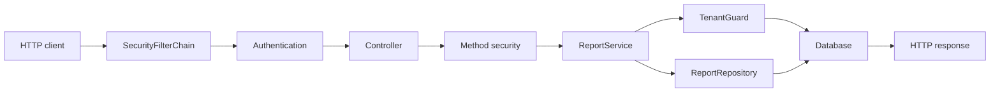
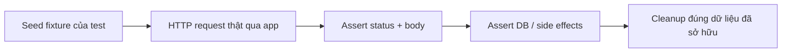

# Giữ một tập ca đại diện để kiểm tra kết nối giữa các tầng đã được unit test

Trong chương **Tích hợp đầu cuối** của module **SPRING_SECURITY_TESTING**, chúng ta kiểm chứng xác thực, phân quyền và bảo vệ HTTP thực tế bằng `spring-security-test` trên ứng dụng Servlet và Reactive. `MockMvc`, `WebTestClient`, `@WithMockUser`, `SecurityContext` và JWT/OAuth2/OIDC giả lập giúp tạo các ca truy cập được phép hoặc bị từ chối. Nhưng **một tập unit test xanh chưa đủ chứng minh những thành phần đó đã được nối với nhau đúng cách khi nhận HTTP request**.

Ví dụ: unit test cho `TenantGuard` xác nhận người dùng Alice không được truy cập tenant B; unit test cho `ReportService` xác nhận phương thức trả đúng báo cáo; test controller dùng mock service trả `200`. Cả ba có thể PASS, trong khi ứng dụng thực vẫn có lỗi: quên `@EnableMethodSecurity`, gọi service ngoài Spring proxy, dùng nhầm `SecurityFilterChain`, bộ chuyển đổi role sai hoặc repository truy vấn thiếu điều kiện tenant. Một ca tích hợp đi từ **HTTP → xác thực → phân quyền → controller → service → database → response** sẽ bắt được những lỗi nối tầng đó.

Bài học không khuyến nghị sao chép hàng trăm unit test thành hàng trăm end-to-end test. Ta sẽ giữ **một tập ca đại diện nhỏ, có chủ đích, cho mỗi ranh giới quan trọng**, đồng thời xác định mức kiểm chứng của chúng: vertical integration test trong một ứng dụng, kiểm thử HTTP server thật hay end-to-end có cả dịch vụ ngoài.

## 1. “Đại diện” là chọn rủi ro tích hợp, không chọn ngẫu nhiên

Hãy hình dung một API báo cáo nhiều tenant:



Từng ô có thể đã được unit test riêng. Test tích hợp trả lời các câu hỏi khác:

- Request thật có đi qua đúng security filter chain và authentication entry point?
- `Authentication` có được truyền tới rule `@PreAuthorize` trên Spring proxy thực?
- Quyền được đánh giá với **đúng principal, đúng tenant và đúng resource ID**?
- Repository có đọc/ghi đúng dữ liệu, hay chỉ một mock trả kết quả “đẹp”?
- Một request bị từ chối có để lại side effect trong database không?
- HTTP response có status/body đúng, kể cả nhánh 401, 403 và 404?

Một ca đại diện tốt phải vượt qua **ít nhất một ranh giới chưa được chứng minh bởi unit test**. Ví dụ dùng `@WithMockUser` để kiểm tra policy service có thể có ích, nhưng không chứng minh HTTP Basic đã xác thực mật khẩu; dùng `.with(jwt())` không chứng minh JWT decoder kiểm tra chữ ký.

## 2. Phân tầng test và ranh giới thực sự được kiểm tra

| Lớp test | Thành phần thật | Thành phần giả lập | Lỗi có thể phát hiện |
| --- | --- | --- | --- |
| Unit test authorization/service | Một class hoặc hàm | Dependency mock/stub | Toán tử điều kiện, role/scope, tenant rule, exception logic |
| MVC slice test (`@WebMvcTest`) | Controller, MVC và các filter được nạp trong slice | Service/repository thường mock | Mapping URL, serialization, một số HTTP security rule |
| **Vertical integration test** | `SecurityFilterChain`, controller, method security, service, repository, DB test | Có thể chỉ giả lập IdP/dịch vụ ngoài | Wiring, proxy, quyền thực sự, data isolation, HTTP 200/401/403/404 |
| HTTP server integration test | Server thật trên cổng ngẫu nhiên, filter chain và DB | Có thể dùng test IdP/HTTP server giả | Session/cookie, networking, serialization, behavior giữa client và server thread |
| Full end-to-end test | App + IdP/authorization server + API ngoài + hạ tầng cần thiết | Tối thiểu, tùy mục tiêu | Redirect/login thực, token exchange, trust boundary liên hệ nhiều hệ thống |

**Thuật ngữ:** `MockMvc` với `@SpringBootTest` và database thật của test kiểm tra đường xử lý ứng dụng **từ đầu request đến tầng persistence**, nhưng không mở cổng mạng và không tự gọi IdP thực. Trong bài này gọi đó là **vertical integration test**, không đánh đồng với một full E2E qua tất cả dịch vụ ngoài.

Nguyên tắc phân công công việc:

1. Unit test kiểm tra **nhiều tổ hợp input và edge case**: đủ loại claim, quyền, role, tenant, exception.
2. Integration test giữ **một số đường đi đại diện** chứng minh các tầng kết nối đúng.
3. Full E2E chỉ thêm cho các trust boundary không thể chứng minh ở mức thấp hơn: đăng nhập OIDC thực, giao thức introspection, gateway, callback hoặc kết nối đối tác.

## 3. Chọn bộ ca tối thiểu theo quyết định bảo mật

Giả sử API có quy tắc:

- `GET /public/ping` công khai.
- `GET /api/tenants/{tenantId}/reports/{id}` yêu cầu đăng nhập, role `REPORT_READER` và membership của người dùng trong tenant được yêu cầu.
- `POST /api/tenants/{tenantId}/reports` áp dụng cùng policy, có thêm yêu cầu CSRF theo cấu hình Servlet ví dụ.
- Chỉ báo cáo thuộc đúng tenant mới được đọc; bản ghi không tồn tại trả `404`.

Tập đại diện được lựa chọn:

| Ca | Người gọi / dữ liệu | Kỳ vọng | Ranh giới được kiểm tra |
| --- | --- | --- | --- |
| R1 — Public | Không credential, gọi `/public/ping` | `200` | Matcher `permitAll` và MVC handler |
| R2 — Anonymous | Không credential, gọi tài nguyên bảo vệ | `401` | HTTP authentication entry point chặn trước service |
| R3 — Có danh tính, thiếu role | `guest` có `ROLE_GUEST` | `403` | Method security chạy thật, không bị bỏ qua |
| R4 — Đúng role, sai tenant | `alice` có role nhưng yêu cầu tenant B | `403` | Principal được truyền vào `TenantGuard` dùng database |
| R5 — Hợp lệ | `alice` đọc báo cáo tenant A | `200` và JSON đúng | HTTP → security → service → repository → DB |
| R6 — Bản ghi không tồn tại | `alice` đọc ID không có trong tenant A | `404` | Repository và mapping exception |
| R7 — Ghi trái phép | `alice` tạo bản ghi tenant B, có CSRF hợp lệ | `403` và không phát sinh row | Authorization phải chặn **trước side effect** |
| R8 — Ghi hợp lệ | `alice` tạo bản ghi tenant A, có CSRF hợp lệ | `201` và row tồn tại | Security + nghiệp vụ + ghi DB + response |
| R9 — ID thuộc tenant khác | `alice` yêu cầu tenant A nhưng ID báo cáo thuộc tenant B | `404`, không lộ dữ liệu | Repository phải lọc cả tenant và ID |

Không cần nhân R4 thành hàng chục giá trị tenant nếu `TenantGuard` đã có unit test đầy đủ. R4 ở tầng tích hợp chỉ xác nhận **method security thực sự gọi guard với dữ liệu chính xác**. Đây là cách giảm trùng lặp nhưng vẫn giữ khả năng phát hiện lỗi dây nối.

## 4. Chuẩn bị một ứng dụng mẫu xuyên suốt nhiều tầng

Ví dụ sau dùng Spring Boot 3.x, Spring Security 6.x, Java 17+, JUnit 5, `spring-security-test`, Spring MVC và JDBC. HTTP Basic được chọn để thử **authentication filter thật** mà không cần triển khai IdP cho bài học về lựa chọn ca đại diện. Sau đó ta sẽ so sánh với JWT/OAuth2 và WebFlux.

Các dependency minh họa (Gradle Groovy, phiên bản do Spring Boot BOM quản lý):

```gradle
dependencies {
    implementation "org.springframework.boot:spring-boot-starter-web"
    implementation "org.springframework.boot:spring-boot-starter-security"
    implementation "org.springframework.boot:spring-boot-starter-jdbc"

    testImplementation "org.springframework.boot:spring-boot-starter-test"
    testImplementation "org.springframework.security:spring-security-test"
    testRuntimeOnly "com.h2database:h2"
}
```

Các lớp trong mục 4–7 giả định cùng package `example.securitytesting` và có thể được đặt vào các file Java tương ứng. Test dùng database H2 in-memory **chỉ dành cho kiểm thử**; không sửa database production. Data setup, cleanup nằm ngay trong test class nên không cần sinh thêm script/file để hiểu ví dụ.

### 4.1. Record dữ liệu và repository thật

```java
package example.securitytesting;

public record ReportView(long id, String tenantId, String title) {}

public record NewReport(long id, String title) {}
```

Hai record trên là các kiểu DTO; trong dự án Java thật, đặt mỗi public top-level record trong một file Java cùng tên hoặc thay bằng các kiểu được tổ chức hợp lệ trong project.

Repository dùng `JdbcTemplate` và lọc **cả `id` lẫn `tenant_id`** để ngăn đọc nhầm báo cáo giữa các tenant:

```java
package example.securitytesting;

import java.util.Optional;
import org.springframework.jdbc.core.JdbcTemplate;
import org.springframework.stereotype.Repository;

@Repository
class ReportRepository {

    private final JdbcTemplate jdbc;

    ReportRepository(JdbcTemplate jdbc) {
        this.jdbc = jdbc;
    }

    Optional<ReportView> find(long id, String tenantId) {
        return jdbc.query(
                "SELECT id, tenant_id, title FROM report_record "
                    + "WHERE id = ? AND tenant_id = ?",
                (rs, row) -> new ReportView(
                        rs.getLong("id"),
                        rs.getString("tenant_id"),
                        rs.getString("title")),
                id, tenantId).stream().findFirst();
    }

    void insert(long id, String tenantId, String title) {
        jdbc.update(
                "INSERT INTO report_record (id, tenant_id, title) "
                    + "VALUES (?, ?, ?)",
                id, tenantId, title);
    }
}
```

Việc repository lọc tenant giúp bảo vệ ở tầng dữ liệu, bổ sung cho method security. Không nên chỉ kiểm tra URL rồi thực hiện `SELECT ... WHERE id = ?` mà bỏ qua tenant.

### 4.2. Guard đọc membership thật từ database

```java
package example.securitytesting;

import org.springframework.jdbc.core.JdbcTemplate;
import org.springframework.stereotype.Component;

@Component("tenantGuard")
class TenantGuard {

    private final JdbcTemplate jdbc;

    TenantGuard(JdbcTemplate jdbc) {
        this.jdbc = jdbc;
    }

    public boolean isMember(String username, String tenantId) {
        Integer count = jdbc.queryForObject(
                "SELECT COUNT(*) FROM tenant_membership "
                    + "WHERE username = ? AND tenant_id = ?",
                Integer.class, username, tenantId);
        return count != null && count > 0;
    }
}
```

Trong sản phẩm thực tế, membership có thể gắn với `userId` bất biến thay vì username, có trạng thái hoạt động và hiệu lực theo thời gian. Điều cần giữ trong bài test là **guard sử dụng cùng danh tính đã được xác thực**, không dùng header `X-User` do client tự gửi.

### 4.3. Service thực với method security

```java
package example.securitytesting;

import org.springframework.http.HttpStatus;
import org.springframework.security.access.prepost.PreAuthorize;
import org.springframework.security.core.parameters.P;
import org.springframework.stereotype.Service;
import org.springframework.web.server.ResponseStatusException;

@Service
class ReportService {

    private final ReportRepository reports;

    ReportService(ReportRepository reports) {
        this.reports = reports;
    }

    @PreAuthorize(
        "hasAuthority('ROLE_REPORT_READER') and "
        + "@tenantGuard.isMember(authentication.name, #tenantId)")
    public ReportView read(
            @P("tenantId") String tenantId, long reportId) {
        return reports.find(reportId, tenantId)
                .orElseThrow(() -> new ResponseStatusException(
                        HttpStatus.NOT_FOUND, "Report not found"));
    }

    @PreAuthorize(
        "hasAuthority('ROLE_REPORT_READER') and "
        + "@tenantGuard.isMember(authentication.name, #tenantId)")
    public ReportView create(
            @P("tenantId") String tenantId, NewReport request) {
        reports.insert(request.id(), tenantId, request.title());
        return new ReportView(
                request.id(), tenantId, request.title());
    }
}
```

Ở đây `@P("tenantId")` làm tên tham số của expression ổn định, kể cả khi compiler không phát metadata tên tham số theo cách test mong đợi. `@PreAuthorize` chỉ có hiệu lực nếu bật method security và method được gọi **qua Spring bean proxy**. Đó chính là ranh giới mà unit test gọi `new ReportService(...)` khó có thể chứng minh.

### 4.4. Controller và security filter chain thật

```java
package example.securitytesting;

import org.springframework.http.HttpStatus;
import org.springframework.http.ResponseEntity;
import org.springframework.web.bind.annotation.GetMapping;
import org.springframework.web.bind.annotation.PathVariable;
import org.springframework.web.bind.annotation.PostMapping;
import org.springframework.web.bind.annotation.RequestBody;
import org.springframework.web.bind.annotation.RestController;

@RestController
class ReportController {

    private final ReportService reports;

    ReportController(ReportService reports) {
        this.reports = reports;
    }

    @GetMapping("/public/ping")
    String ping() {
        return "pong";
    }

    @GetMapping("/api/tenants/{tenantId}/reports/{id}")
    ReportView find(
            @PathVariable("tenantId") String tenantId,
            @PathVariable("id") long id) {
        return reports.read(tenantId, id);
    }

    @PostMapping("/api/tenants/{tenantId}/reports")
    ResponseEntity<ReportView> create(
            @PathVariable("tenantId") String tenantId,
            @RequestBody NewReport request) {
        return ResponseEntity.status(HttpStatus.CREATED)
                .body(reports.create(tenantId, request));
    }
}
```

```java
package example.securitytesting;

import org.springframework.context.annotation.Bean;
import org.springframework.context.annotation.Configuration;
import org.springframework.security.config.Customizer;
import org.springframework.security.config.annotation.method.configuration.EnableMethodSecurity;
import org.springframework.security.config.annotation.web.builders.HttpSecurity;
import org.springframework.security.config.annotation.web.configuration.EnableWebSecurity;
import org.springframework.security.core.userdetails.User;
import org.springframework.security.core.userdetails.UserDetailsService;
import org.springframework.security.provisioning.InMemoryUserDetailsManager;
import org.springframework.security.web.SecurityFilterChain;

@Configuration
@EnableWebSecurity
@EnableMethodSecurity
class ApiSecurity {

    @Bean
    SecurityFilterChain filterChain(HttpSecurity http) throws Exception {
        return http
                .authorizeHttpRequests(auth -> auth
                        .requestMatchers("/public/ping").permitAll()
                        .requestMatchers("/api/**").authenticated()
                        .anyRequest().denyAll())
                .httpBasic(Customizer.withDefaults())
                .build();
    }

    @Bean
    UserDetailsService users() {
        return new InMemoryUserDetailsManager(
                User.withUsername("alice")
                        .password("{noop}pw")
                        .roles("REPORT_READER").build(),
                User.withUsername("bob")
                        .password("{noop}pw")
                        .roles("REPORT_READER").build(),
                User.withUsername("guest")
                        .password("{noop}pw")
                        .roles("GUEST").build());
    }
}
```

Kết nối bảo mật được thiết kế thành **hai tầng**:

- Filter chain yêu cầu có authentication hợp lệ cho `/api/**`, nên request chưa đăng nhập dừng ở HTTP `401`.
- Method security yêu cầu đồng thời `ROLE_REPORT_READER` **và** membership trong tenant; người đã đăng nhập nhưng không đủ quyền bị chặn `403`.

Với các request ghi, Spring Security Servlet bật CSRF mặc định; vì vậy test POST phải dùng `csrf()` nếu mục tiêu là kiểm tra role/tenant thay vì cố ý kiểm tra thiếu CSRF. Mật khẩu `{noop}` và user mẫu chỉ thuộc môi trường test, tuyệt đối không sử dụng trong production.

## 5. Một integration test thực sự đi qua các tầng

Ví dụ test này chạy **toàn bộ Spring Security, controller, service và JdbcTemplate thật**, dùng H2 in-memory thay cho database production. Không mock `ReportService` hoặc `TenantGuard`: ta muốn phát hiện trường hợp guard không được nối vào method security.

```java
package example.securitytesting;

import static org.junit.jupiter.api.Assertions.assertEquals;
import static org.springframework.security.test.web.servlet.request
        .SecurityMockMvcRequestPostProcessors.csrf;
import static org.springframework.security.test.web.servlet.request
        .SecurityMockMvcRequestPostProcessors.httpBasic;
import static org.springframework.test.web.servlet.request.MockMvcRequestBuilders.get;
import static org.springframework.test.web.servlet.request.MockMvcRequestBuilders.post;
import static org.springframework.test.web.servlet.result.MockMvcResultMatchers.content;
import static org.springframework.test.web.servlet.result.MockMvcResultMatchers.jsonPath;
import static org.springframework.test.web.servlet.result.MockMvcResultMatchers.status;

import org.junit.jupiter.api.AfterEach;
import org.junit.jupiter.api.BeforeEach;
import org.junit.jupiter.api.Test;
import org.springframework.beans.factory.annotation.Autowired;
import org.springframework.boot.SpringBootConfiguration;
import org.springframework.boot.autoconfigure.EnableAutoConfiguration;
import org.springframework.boot.test.autoconfigure.web.servlet.AutoConfigureMockMvc;
import org.springframework.boot.test.context.SpringBootTest;
import org.springframework.context.annotation.Import;
import org.springframework.http.MediaType;
import org.springframework.jdbc.core.JdbcTemplate;
import org.springframework.test.web.servlet.MockMvc;

@SpringBootTest(
    classes = ReportFlowIT.TestApp.class,
    properties = "spring.datasource.generate-unique-name=true")
@AutoConfigureMockMvc
class ReportFlowIT {

    @SpringBootConfiguration
    @EnableAutoConfiguration
    @Import({
        ApiSecurity.class,
        TenantGuard.class,
        ReportRepository.class,
        ReportService.class,
        ReportController.class
    })
    static class TestApp {}

    @Autowired
    MockMvc mvc;

    @Autowired
    JdbcTemplate jdbc;

    @BeforeEach
    void seed() {
        jdbc.execute(
            "CREATE TABLE IF NOT EXISTS tenant_membership ("
                + "username VARCHAR(80) NOT NULL, "
                + "tenant_id VARCHAR(80) NOT NULL, "
                + "PRIMARY KEY (username, tenant_id))");
        jdbc.execute(
            "CREATE TABLE IF NOT EXISTS report_record ("
                + "id BIGINT PRIMARY KEY, "
                + "tenant_id VARCHAR(80) NOT NULL, "
                + "title VARCHAR(200) NOT NULL)");

        jdbc.update("DELETE FROM report_record");
        jdbc.update("DELETE FROM tenant_membership");
        jdbc.update(
                "INSERT INTO tenant_membership(username, tenant_id) "
                    + "VALUES (?, ?)",
                "alice", "tenant-a");
        jdbc.update(
                "INSERT INTO tenant_membership(username, tenant_id) "
                    + "VALUES (?, ?)",
                "bob", "tenant-b");
        jdbc.update(
                "INSERT INTO report_record(id, tenant_id, title) "
                    + "VALUES (?, ?, ?)",
                101L, "tenant-a", "A report");
        jdbc.update(
                "INSERT INTO report_record(id, tenant_id, title) "
                    + "VALUES (?, ?, ?)",
                202L, "tenant-b", "B report");
    }

    @AfterEach
    void clean() {
        jdbc.update("DELETE FROM report_record");
        jdbc.update("DELETE FROM tenant_membership");
    }

    @Test
    void r1_publicRoute_choAnonymous() throws Exception {
        mvc.perform(get("/public/ping"))
            .andExpect(status().isOk())
            .andExpect(content().string("pong"));
    }

    @Test
    void r2_chuaDangNhap_tra401() throws Exception {
        mvc.perform(get("/api/tenants/tenant-a/reports/101"))
            .andExpect(status().isUnauthorized());
    }

    @Test
    void r3_daDangNhapNhungThieuRole_tra403() throws Exception {
        mvc.perform(get("/api/tenants/tenant-a/reports/101")
                .with(httpBasic("guest", "pw")))
            .andExpect(status().isForbidden());
    }

    @Test
    void r4_duRoleNhungSaiTenant_tra403() throws Exception {
        mvc.perform(get("/api/tenants/tenant-b/reports/202")
                .with(httpBasic("alice", "pw")))
            .andExpect(status().isForbidden());
    }

    @Test
    void r5_dungRoleDungTenant_tra200VaJson() throws Exception {
        mvc.perform(get("/api/tenants/tenant-a/reports/101")
                .with(httpBasic("alice", "pw")))
            .andExpect(status().isOk())
            .andExpect(jsonPath("$.id").value(101))
            .andExpect(jsonPath("$.tenantId").value("tenant-a"))
            .andExpect(jsonPath("$.title").value("A report"));
    }

    @Test
    void r6_coQuyenNhungKhongCoBanGhi_tra404()
            throws Exception {
        mvc.perform(get("/api/tenants/tenant-a/reports/999")
                .with(httpBasic("alice", "pw")))
            .andExpect(status().isNotFound());
    }

    @Test
    void r7_ghiSaiTenant_tra403VaKhongPhatSinhDuLieu()
            throws Exception {
        int before = countReport(303);

        mvc.perform(post("/api/tenants/tenant-b/reports")
                .with(httpBasic("alice", "pw"))
                .with(csrf())
                .contentType(MediaType.APPLICATION_JSON)
                .content("{\"id\":303,\"title\":\"Forbidden\"}"))
            .andExpect(status().isForbidden());

        assertEquals(before, countReport(303));
    }

    @Test
    void r8_ghiHopLe_tra201VaLuuDuLieu()
            throws Exception {
        mvc.perform(post("/api/tenants/tenant-a/reports")
                .with(httpBasic("alice", "pw"))
                .with(csrf())
                .contentType(MediaType.APPLICATION_JSON)
                .content("{\"id\":304,\"title\":\"New report\"}"))
            .andExpect(status().isCreated())
            .andExpect(jsonPath("$.id").value(304))
            .andExpect(jsonPath("$.tenantId").value("tenant-a"));

        assertEquals(1, countReport(304));
    }

    @Test
    void r9_dungTenantNhungIdThuocTenantKhac_tra404()
            throws Exception {
        // Alice thuộc tenant-a nhưng report 202 là của tenant-b.
        // Method security cho qua tenant-a; repository phải lọc tenant.
        mvc.perform(get("/api/tenants/tenant-a/reports/202")
                .with(httpBasic("alice", "pw")))
            .andExpect(status().isNotFound());
    }

    private int countReport(long id) {
        Integer count = jdbc.queryForObject(
                "SELECT COUNT(*) FROM report_record WHERE id = ?",
                Integer.class, id);
        return count == null ? 0 : count;
    }
}
```

**Giới hạn của ví dụ:** dữ liệu H2 dùng các ID cố định, phù hợp khi chạy các method tuần tự trong context test riêng. Nếu chạy song song nhiều test/class cùng database, cần namespace hoặc transaction/cleanup phù hợp để không xóa fixture của nhau. `spring.datasource.generate-unique-name=true` giúp context tạo tên embedded database riêng; nó không thay thế cô lập dữ liệu **giữa các method cùng context**.

Những API như `MockMvcRequestBuilders.get/post`, `SecurityMockMvcRequestPostProcessors.httpBasic/csrf` và `jsonPath` đến từ Spring Test/Spring Security Test. `@AutoConfigureMockMvc` mặc định tích hợp security filters trong Spring Boot context phù hợp. Vì test không thay controller/service/guard bằng mock, nó có thể phát hiện lỗi proxy `@PreAuthorize`, bean naming, JDBC mapping và đường chuyển đổi lỗi `404`.

## 6. Vì sao chỉ chín ca này đã có giá trị?

Các test trên cố ý kiểm tra **điểm cắt tích hợp**, không tái lập toàn bộ unit test:

1. **R1–R2** chứng minh route công khai và route bảo vệ được chọn đúng. Nếu thiếu filter chain, R2 sẽ lộ vấn đề.
2. **R3** cho thấy `@EnableMethodSecurity` và Spring proxy tham gia thực sự. Nếu chỉ kiểm tra `authenticated()` trên filter chain, người `guest` vẫn được vào service; R3 sẽ phát hiện.
3. **R4** kết nối `authentication.name` với `TenantGuard` và dữ liệu membership. Một lỗi tên bean `tenantGuard`, SpEL `#tenantId` hoặc mapping principal có thể làm test thất bại.
4. **R5** chứng minh đường cho phép hoạt động từ HTTP đến repository và trả JSON đúng tenant.
5. **R6** phân biệt người có quyền nhưng không tìm thấy dữ liệu với lỗi thiếu quyền; tránh biến mọi lỗi thành `403`.
6. **R7** chứng minh một request trái tenant không tạo bản ghi dù đã có CSRF hợp lệ. Đây là kiểm tra **invariant**, mạnh hơn chỉ assert `403`.
7. **R8** chứng minh phương thức ghi thật được nối đúng, transaction/database nhận bản ghi và response trả trạng thái `201`.
8. **R9** xác minh repository vẫn lọc đúng tenant **sau khi method security cho phép**. Nếu chỉ truy vấn theo ID, dữ liệu của tenant B có thể bị lộ qua URL khai báo tenant A.

Nếu `ReportService` đã có unit test kiểm tra mười trường hợp tenant, không cần thêm mười integration test tương ứng. Chỉ giữ thêm khi mỗi trường hợp đi qua **một cơ chế tích hợp khác**: method security, converter từ token, custom filter, transaction khác, external API hoặc exception handler khác.

### Một mutation suy nghĩ hữu ích

Để tự đánh giá sức mạnh bộ test, tưởng tượng các thay đổi sai sau:

| Thay đổi lỗi | Ca nào nên đỏ? |
| --- | --- |
| Xóa `@EnableMethodSecurity` | R3, R4, R7 có thể cho qua request sai quyền |
| Bỏ `.httpBasic(...)` hoặc filter chain không được áp dụng | R2, R5 hoặc các ca dùng credential |
| Thay `authentication.name` thành username cố định | R4 hoặc test khác principal |
| Repository bỏ điều kiện `tenant_id` | R9 phát hiện dù `TenantGuard` đã cho phép tenant A |
| Controller gọi nhầm service hoặc sai ID | R5 hoặc R6 |
| Viết DB trước khi kiểm tra tenant | R7 |
| Quên CSRF trong POST test | R8 trả `403` dù logic quyền có thể đúng |

Không cần thực sự sửa code production để thử các đột biến trên trong STEP 4. Đây là phương pháp thiết kế test: mỗi ca nên có một **loại hồi quy cụ thể** mà nó ngăn chặn.

## 7. Chọn credential giả hay kiểm thử cơ chế xác thực thật?

Trong `SPRING_SECURITY_TESTING` có nhiều cách dựng danh tính; không nên trộn mục tiêu của chúng:

| Phương pháp test | Có chạy auth filter thật? | Tốt cho mục tiêu nào? |
| --- | --- | --- |
| `.with(user("alice"))` hoặc `@WithMockUser` | Thường đưa authentication giả vào test | Rule role, method security, mapping principal → service |
| `.with(jwt())` | Tạo `JwtAuthenticationToken` giả, không chạy JWT decoder | JWT claims, scope/authority đã được cấp, rule tenant |
| `.with(opaqueToken())` | Tạo principal opaque giả, không gọi introspection | Quyết định phân quyền với attributes/authority cho sẵn |
| `.with(httpBasic("alice","pw"))` | Gửi HTTP Basic header để filter xác thực với `UserDetailsService` test | Wiring Basic authentication, credential đúng/sai và permission |
| Gửi Bearer JWT đã ký qua `Authorization` | Chạy resource server decoder nếu được cấu hình | Chữ ký, issuer/audience/exp, mapping claims, HTTP auth |
| OIDC login với IdP giả | Chạy cơ chế client login tùy mức tích hợp | Redirect, state/nonce, code exchange, ID token validation |

Ví dụ bài này dùng HTTP Basic thật để không phụ thuộc mạng ngoài và chứng minh một điểm cắt authentication. Với API production dùng Bearer JWT, nên có **ít nhất một** integration test gửi token đã ký bằng test key tới `JwtDecoder`/resource server chain thực, thay vì coi `.with(jwt())` là tương đương.

Không cần kiểm tra mọi tổ hợp JWT claim bằng token có chữ ký nếu unit test validator và converter đã bao phủ chúng. Một ca **JWT hợp lệ được phép**, một ca **chữ ký/issuer/token không hợp lệ bị 401**, và một ca **valid token thiếu quyền bị 403** thường là bộ khởi đầu tốt ở ranh giới Bearer decoder → authorization. Bổ sung ca theo chính sách rủi ro thực tế, ví dụ tenant hoặc audience đặc biệt.

## 8. Những mock nào nên giữ và những mock nào không nên dùng?

Không phải integration test lúc nào cũng phải chạy mọi hệ thống:

- **Giữ thật** `SecurityFilterChain`, controller, method security, service và repository khi mục tiêu là xác minh dây nối giữa các tầng đó.
- **Mock/stub ở ranh giới ngoài ứng dụng**, ví dụ HTTP API đối tác, email sender, hệ thống thu phí hoặc IdP. Dùng HTTP mock server thay vì mock toàn bộ service nếu muốn xác minh request outbound.
- Với các bài về authorization server, có thể chạy local IdP/test introspection endpoint hoặc cung cấp decoder/introspector phù hợp để kiểm tra trust boundary; không dùng token production.
- Với các trường hợp dữ liệu, dùng H2 hoặc database container phù hợp. Nếu production phụ thuộc PostgreSQL-specific SQL, row-level security hay behavior transaction khác H2, một tập integration test nhỏ với **PostgreSQL Testcontainers** có giá trị hơn chỉ thay thế mọi thứ bằng H2.

**Anti-pattern:** gắn `@MockBean`/`@MockitoBean` vào `ReportService` hoặc `TenantGuard` của ví dụ rồi tuyên bố “đã test bảo mật tenant đầu cuối”. Khi đó test không biết guard được gọi đúng, SpEL dùng đúng username hay database đã được ràng buộc tenant.

**Anti-pattern ngược lại:** khởi động mọi dependency production cho từng test nhỏ. Nếu mục tiêu là một rule `hasRole`, MockMvc/WebTestClient với principal giả và service mock có thể đủ. Chỉ trả chi phí integration khi nó kiểm chứng thêm một ranh giới có rủi ro.

## 9. Cô lập dữ liệu và tránh test thất thường

Tập ca đại diện cần **lặp lại được**, đặc biệt khi chạy toàn bộ suite hoặc CI:



Trong ví dụ, `@BeforeEach` reset hai bảng trong **database test** rồi seed membership/record; `@AfterEach` dọn lại. Các method không phụ thuộc thứ tự chạy.

Những điểm cần xem xét:

- `@Transactional` trên test không bảo đảm rollback tác vụ chạy ở transaction khác, nhất là `@SpringBootTest(webEnvironment = RANDOM_PORT)`, background executor hoặc `REQUIRES_NEW`.
- `@DirtiesContext` evict Spring context cache; nó **không tự xóa** row đã commit trong database ngoài, Redis hoặc message broker.
- Không dùng `DELETE FROM` một bảng dùng chung giữa nhiều test worker. Dùng schema/database riêng, fixture có test-run ID hoặc cơ chế điều phối không chạy song song.
- CSRF trên POST cần được cung cấp khi test điều kiện quyền; thiếu `csrf()` có thể trả `403` trước khi method security được gọi.
- Không tái sử dụng `MockHttpSession` hoặc `SecurityContext` của người dùng trước trong test anonymous.
- Nếu test có gửi message hoặc gọi API đối tác, cần assert không phát side effect khi `403`, ngoài việc kiểm tra database.

Không nên dùng `Thread.sleep(...)` để đợi xử lý. Với `Callable`, `DeferredResult` hoặc Reactive pipeline, dùng API kiểm thử async/`StepVerifier` để đồng bộ hóa một cách xác định.

## 10. Khi cần mở rộng sang HTTP server thật

`MockMvc` không mở cổng mạng, do đó không xác minh mọi thuộc tính của container, proxy, cookie hoặc TLS. Một lớp kiểm thử mỏng khác có thể dùng:

```java
@SpringBootTest(
    webEnvironment = SpringBootTest.WebEnvironment.RANDOM_PORT)
class ReportNetworkIT {
    // Dùng TestRestTemplate, RestClient hoặc HTTP client thử nghiệm.
    // Lấy cổng ngẫu nhiên; gửi HTTP Basic/Bearer qua mạng thật.
    // Seed và cleanup dữ liệu theo transaction của SERVER, không
    // giả định transaction test ở client sẽ rollback write từ server.
}
```

Giữ rất ít smoke test có giá trị mạng: xác thực token/cookie end-to-end, redirect/callback, header từ reverse proxy, security headers hoặc behavior thật của servlet container. Không cần lặp toàn bộ R1–R9 qua network nếu ranh giới mạng không bổ sung rủi ro tương ứng.

Với một hệ thống có nhiều service, phải xác định từ “end-to-end” bao gồm những gì: gateway, identity provider, API backend, database, broker hay bên thứ ba. Tài liệu và tên test nên mô tả phạm vi thực, tránh khẳng định một `MockMvc` test đã chứng minh khả năng tương tác của mọi hệ thống production.

## 11. Biến thể Reactive: cùng chiến lược, khác hạ tầng

Ứng dụng WebFlux sử dụng `WebTestClient`, `SecurityWebFilterChain` và `ReactiveSecurityContextHolder`. Bộ ca đại diện vẫn gồm anonymous `401`, đã xác thực thiếu authority `403`, đủ quyền `200` và kiểm tra dữ liệu/side effect; nhưng **không dùng `MockMvc`** để kiểm tra Reactor context.

Ví dụ kiểm tra HTTP rule với WebTestClient đã gắn WebFlux security:

```java
import static org.springframework.security.test.web.reactive.server
        .SecurityMockServerConfigurers.mockUser;
import static org.springframework.security.test.web.reactive.server
        .SecurityMockServerConfigurers.springSecurity;

WebTestClient client = WebTestClient.bindToApplicationContext(context)
        .apply(springSecurity())
        .configureClient()
        .build();

client.get().uri("/api/reports")
    .exchange()
    .expectStatus().isUnauthorized();

client.mutateWith(mockUser("guest").roles("GUEST"))
    .get().uri("/api/reports")
    .exchange().expectStatus().isForbidden();

client.mutateWith(mockUser("alice").roles("REPORT_READER"))
    .get().uri("/api/reports")
    .exchange().expectStatus().isOk();
```

Đây là **đoạn minh họa**, yêu cầu WebFlux context có `/api/reports` và rule tương ứng. `mockUser()` kiểm tra authorization với principal giả; nếu muốn xác minh HTTP Basic/Bearer authentication trong Reactive, hãy gửi header tới `SecurityWebFilterChain` với `ReactiveAuthenticationManager`/decoder thật của test.

Nếu repository dùng R2DBC, transaction reactive và Reactor context cần được kiểm tra trong stack đó. `@Transactional` kiểu JPA không tự bao trùm giao dịch reactive; test dữ liệu nên dùng `R2dbcEntityTemplate`/reactive repository, `StepVerifier` và chiến lược seed/cleanup phù hợp. Đừng coi một `WebTestClient` test chỉ mock service là bằng chứng rằng query R2DBC đã lọc tenant đúng.

## 12. Khi nào tăng số integration test?

Chỉ thêm ca nếu có **một đường tích hợp hoặc trust boundary mới** có khả năng lỗi:

| Sự thay đổi trong hệ thống | Ca nên bổ sung |
| --- | --- |
| Thêm `SecurityFilterChain` riêng cho `/admin/**` | Một ca cho phép và một ca từ chối trên chain mới; xác minh matcher/priority |
| Bổ sung JWT decoder/claim converter tùy biến | Một Bearer token test thật để chứng minh converter được nối và fail closed |
| Thêm method security theo owner/tenant | Một ca khác tenant/owner đi từ HTTP đến dữ liệu và một ca hợp lệ |
| Thêm lệnh ghi, event hoặc message khi request thành công | Một ca được phép và một ca bị từ chối chứng minh không side effect |
| Thêm OAuth2/OIDC login hoặc introspection | Một ca kiểm tra giao thức/issuer/subject quan trọng với IdP test |
| Thêm cache quyền hoặc session | Một ca hết hạn/thu hồi hoặc chuyển principal để xác minh state isolation |
| Thêm backend database có behavior riêng | Một ca DB integration với engine tương ứng |
| Thêm WebFlux chain/Reactive principal | Một ca WebTestClient đi qua reactive security và data layer |

Nếu chỉ thay đổi logic so sánh role trong `TenantGuard`, trước tiên cập nhật unit test; không nhất thiết thêm mười integration test mới.

### Bộ tiêu chí để bỏ bớt ca trùng lặp

Một ca có thể bị loại khỏi tầng tích hợp khi:

- Nó đi qua **chính xác cùng đường filter/service/repository** với ca khác, chỉ thay một giá trị đã được unit test đầy đủ.
- Nó không tăng độ bao phủ trust boundary, authorization decision hoặc side effect.
- Nó thường thất bại vì setup dữ liệu/network mà không giúp định vị lỗi rõ hơn.
- Nó kéo thêm dependency production trong khi một test nhỏ hơn chứng minh chính xác cùng hợp đồng.

Ngược lại, đừng bỏ ca âm tính `401/403` chỉ vì happy path `200` đã xanh. Chính những ca âm tính thường phát hiện cấu hình bảo mật bị nới lỏng hoặc bypass method security.

## 13. Những hiểu lầm dễ dẫn tới “tích hợp xanh giả”

**“Unit test guard đã PASS nên HTTP chắc chắn được bảo vệ.”** Chưa chắc: service có thể bị gọi ngoài proxy, quên `@EnableMethodSecurity` hoặc controller dùng method khác. Giữ một ca HTTP thiếu quyền để chứng minh wiring.

**“Dùng `@WebMvcTest` với `@MockitoBean ReportService` là end-to-end.”** Không phải qua service hoặc database. Hãy gọi đó là MVC slice test và bổ sung vertical test nếu mục tiêu cần kiểm tra dữ liệu thật.

**“`.with(jwt())` đã kiểm chứng token thật.”** Nó tạo authentication giả cho test. Khi mục tiêu là decoder/issuer/audience/signature, phải gửi signed Bearer JWT qua request và dùng decoder thật/test key.

**“`403` đã đủ chứng minh không có lỗi quyền.”** Cần kiểm tra request bị từ chối **không thay đổi dữ liệu hoặc phát event**. Nếu lỗi đến từ CSRF thay vì tenant policy, `403` đơn lẻ có thể che khuất sai sót.

**“Cứ thêm integration test là an toàn hơn.”** Quá nhiều ca trùng lặp làm suite chậm, dễ flaky và khó tìm nguyên nhân. Chọn theo ranh giới mới thay vì tổ hợp mọi input.

**“`@DirtiesContext` xóa sạch dữ liệu.”** Context được dựng lại nhưng row/queue/cache ngoài context có thể vẫn tồn tại. Phải cleanup theo hệ thống sở hữu state.

**“HTTP 404 nghĩa là phân quyền đúng.”** 404 có thể do handler không khớp, record không tồn tại hoặc API cố tình ẩn tài nguyên trái quyền. Test phải biết nguyên nhân mong đợi và assert body/DB khi cần.

**“Một test với H2 phản ánh mọi đặc tính production DB.”** SQL, transaction isolation, row-level security hoặc constraint của PostgreSQL có thể khác. Khi các tính năng này là ranh giới bảo mật, nên có một tập nhỏ chạy với database engine tương ứng.

**“MockMvc có nghĩa đã kiểm thử server ngoài.”** MockMvc không mở network port. Với TLS, proxy, cookie, redirect nhiều ứng dụng hoặc callback, cần network/system test riêng.

## 14. Checklist thiết kế tập ca đại diện

- Đã liệt kê các ranh giới cần chứng minh: **HTTP authentication → authorization → controller → service → repository/data**.
- Biết tầng nào được unit test và không lặp lại mọi tổ hợp input ở integration test.
- Có ít nhất một ca **không credential**, một ca **đã xác thực thiếu quyền**, một ca **đủ quyền** cho policy quan trọng.
- Với tài nguyên theo tenant/owner, có ca dùng **đúng role nhưng sai tenant/owner** đi đến policy thực.
- Với request ghi, có ca bị từ chối và assert không có side effect; cấp CSRF khi cần cô lập lỗi authorization.
- Có một ca hợp lệ xác minh JSON/body và dữ liệu thực được đọc/ghi đúng.
- Test không mock tầng mà nó tuyên bố cần kiểm tra: không mock guard nếu đang chứng minh guard được gọi từ method security.
- Dữ liệu fixture có thể reset, không rò giữa method/class hoặc worker CI; không dùng credential production.
- Biết rõ mình đang chạy **MVC slice**, **vertical integration**, **HTTP server integration** hay **full E2E**.
- Nếu ứng dụng dùng Bearer JWT/OAuth2/OIDC, giữ ít nhất một ca trên trust boundary xác thực thật tương ứng với rủi ro của hệ thống.
- Với WebFlux, dùng `WebTestClient` và reactive security/repository thật khi cần chứng minh dây nối Reactive.
- Chỉ thêm test mới khi phát sinh **rủi ro tích hợp mới**, không biến integration suite thành bản sao đắt đỏ của unit suite.

**Kết luận:** một tập integration test nhỏ nhưng có chủ đích sẽ chứng minh rằng các phần đã được unit test **thực sự kết nối đúng trong ứng dụng chạy với Spring Security**. Giá trị của tập ca không nằm ở số lượng mà ở khả năng phát hiện bypass authentication, thiếu method-security proxy, sai tenant, lỗi persistence và side effect xảy ra trước khi phân quyền. Giữ các ca đại diện ổn định và nâng mức kiểm thử lên HTTP server/full E2E chỉ khi có ranh giới mới cần kiểm chứng.
