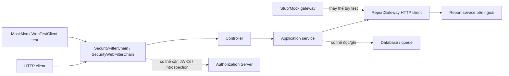
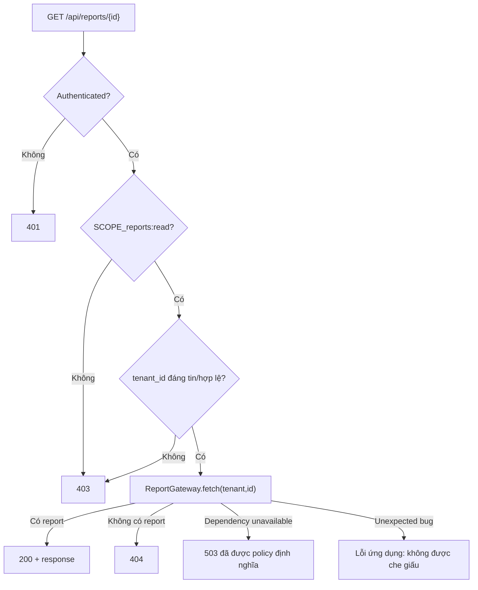
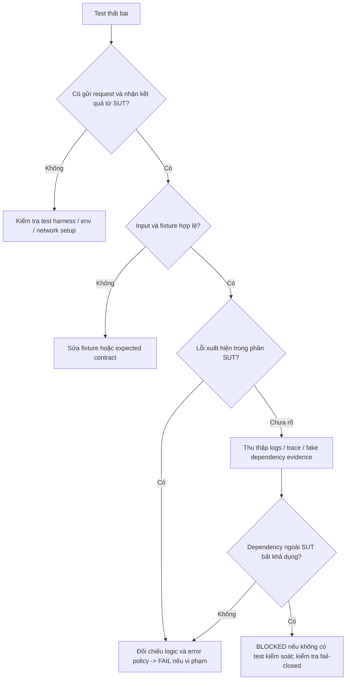

# Phân biệt lỗi ứng dụng với lỗi hạ tầng ngoài phạm vi bộ kiểm thử

## 1. Vấn đề: test thất bại nhưng thành phần nào thực sự sai?

Trong một hệ thống Spring Security, yêu cầu đến `GET /api/reports/42` có thể đi qua nhiều thành phần: bộ lọc bảo mật, controller, service, cơ sở dữ liệu, một HTTP service khác và đôi khi cả nhà cung cấp danh tính. Khi test trả về `401`, `403`, `500` hay timeout, ta chưa thể kết luận ngay mã nguồn ứng dụng bị lỗi.

Một số tình huống dễ nhầm lẫn:

- Người gọi đã đăng nhập nhưng thiếu `SCOPE_reports:read`, nên ứng dụng trả **403** đúng chính sách.
- Người gọi có quyền, nhưng code controller truy cập một object `null`, nên xảy ra **lỗi ứng dụng**.
- API có quyền truy cập nhưng dịch vụ báo cáo bên ngoài không sẵn sàng; đó là **sự cố dependency**, và việc ứng dụng xử lý sự cố có đúng hợp đồng hay không là một câu hỏi khác.
- Test `MockMvc` với `jwt()` trả 200, nhưng truy cập HTTP thật bị 401 vì cấu hình `JwtDecoder` hoặc JWKS endpoint; đây là **khoảng trống về phạm vi kiểm thử**, không phải bằng chứng MockMvc “sai”.
- Máy chạy test không khởi động được container database hoặc không phân giải DNS môi trường kiểm thử; không thể vì thế coi tính năng đã FAIL về mặt nghiệp vụ, cũng không thể ghi nhận PASS.

Chủ đề thuộc chương **Tích hợp đầu cuối** của module **SPRING_SECURITY_TESTING**: kiểm chứng xác thực, phân quyền và bảo vệ HTTP bằng `spring-security-test` trên Servlet/Reactive, từ `MockMvc` và `WebTestClient` đến `@WithMockUser`, `SecurityContext`, JWT/OAuth2/OIDC giả lập và các ca được phép/bị từ chối.

Mục tiêu ở đây là **chẩn đoán đúng tầng lỗi**, **xác định ranh giới mà mỗi bộ test thật sự bao phủ** và **không dùng sự cố bên ngoài để che giấu bug của ứng dụng**.

Sau bài, bạn sẽ có thể:

1. Phân loại lỗi nghiệp vụ, phân quyền, lỗi implementation, lỗi tích hợp và lỗi môi trường/hạ tầng.
2. Giải thích vì sao HTTP status **không đủ** để xác định nguyên nhân gốc.
3. Xây dựng test `MockMvc`/`WebTestClient` với dependency stub để tiêm lỗi có kiểm soát.
4. Viết hợp đồng phản hồi khi upstream timeout, không sẵn sàng hoặc trả dữ liệu sai.
5. Phân biệt test HTTP qua mock exchange với test `RANDOM_PORT` và test thực sự gọi hạ tầng.
6. Trình bày bằng chứng cần có trước khi gắn nhãn **PASS**, **FAIL**, **BLOCKED/INCONCLUSIVE**.
7. Giữ nguyên nguyên tắc **fail closed** khi dịch vụ xác minh quyền hoặc token gặp lỗi.
8. Xây dựng ma trận fault injection, kiểm tra side effect và quy trình phân tích sự cố lặp lại được.

## 2. Xác định ranh giới hệ thống trước khi đọc stack trace

Giả sử API báo cáo sử dụng JWT Bearer và gọi một report service nội bộ:



**System under test (SUT)** là phần ta chủ động muốn kiểm chứng. Định nghĩa SUT phải xuất hiện trong mục tiêu test:

- Nếu SUT là **controller + security chain**, report service có thể được thay bằng stub.
- Nếu SUT là **gateway HTTP client**, cần kiểm tra request thật ra fake HTTP server và response/error mapping.
- Nếu SUT là **toàn ứng dụng HTTP**, phải chạy server, gửi credential theo giao thức và kiểm tra các dependency được cấu hình cho môi trường test.
- Nếu mục tiêu là **E2E liên hệ nhiều dịch vụ thật**, phải khai báo nhà cung cấp danh tính, database, report service, DNS/TLS và những yếu tố không kiểm soát được.

Không dùng cùng từ “integration test” để che mờ những khác biệt trên. `MockMvc` chạy filter chain Servlet trong test context là một test tích hợp hữu ích, nhưng nó **không chứng minh** port HTTP, reverse proxy, DNS, TLS hoặc Authorization Server production hoạt động.

### 2.1. Phân loại nguồn thất bại

| Nhóm | Ví dụ | Dấu hiệu và người chịu trách nhiệm |
|---|---|---|
| Từ chối đúng nghiệp vụ | 404 vì bản ghi không thuộc tenant; 409 vì dữ liệu xung đột | Có contract rõ, dữ liệu đầu vào vi phạm điều kiện |
| Từ chối đúng bảo mật | 401 anonymous; 403 authenticated thiếu quyền | Security chain/policy hoạt động như kỳ vọng |
| Lỗi logic ứng dụng | NullPointerException, query bỏ tenant, sai mapping, trả 200 khi chưa đủ quyền | Lỗi trong phần SUT, cần sửa code/test |
| Lỗi adapter/tích hợp | Parse sai response upstream; dùng endpoint sai; thiếu timeout | Thường vẫn thuộc trách nhiệm ứng dụng tích hợp |
| Sự cố dependency | Connection refused, timeout, upstream 503, database unavailable | Hạ tầng bên ngoài SUT đang lỗi; ứng dụng vẫn phải xử lý an toàn |
| Lỗi môi trường test | Container engine không chạy, DNS nội bộ lỗi, port đã bị chiếm, thiếu secret test | Có thể chặn kiểm thử; không mặc định là bug nghiệp vụ |
| Lỗi bộ test/fixture | Mock không được inject, JWT mock thiếu claim, seed DB bị test khác xóa | Phải sửa thiết lập hoặc test, không quy lỗi cho tính năng |
| Lỗi contract giữa hệ thống | Upstream thay JSON schema, JWKS rotate trái chính sách, response sai chuẩn | Cần xác định bên nào vi phạm hợp đồng, không chỉ nhìn host phát lỗi |

Một sự cố có thể thuộc **nhiều nhóm đồng thời**. Ví dụ report service downtime là lỗi dependency, nhưng ứng dụng không đặt timeout và treo request vô hạn là **lỗi trong cách ứng dụng xử lý sự cố**. Không có quy tắc “lỗi hạ tầng thì ứng dụng đương nhiên đúng”.

### 2.2. Ba kết luận cần tách bạch

- **PASS:** đúng mục tiêu, đúng tiền điều kiện, có assertion chứng minh hành vi, test đã thực thi.
- **FAIL:** tiền điều kiện hợp lệ và test chứng minh hệ thống dưới test vi phạm hợp đồng.
- **BLOCKED / INCONCLUSIVE:** không có đủ điều kiện hoặc bằng chứng để kiểm chứng hợp đồng; ví dụ fake service không khởi động, network ngoài phạm vi không truy cập được.

Không đổi một test `FAIL` thành `PASS` chỉ bằng `catch(Exception ignored)`, `@Disabled` hoặc xóa assertion. Tương tự, nếu test bị chặn bởi hạ tầng, không kết luận rằng một lỗi phân quyền đã được sửa.

## 3. HTTP status là biểu hiện, không phải chẩn đoán nguyên nhân

| Status/hiện tượng | Trong một API Security có thể chỉ ra | Điều **không thể** suy ra chỉ từ status |
|---|---|---|
| `200` | Request được xử lý thành công | Dữ liệu đúng owner/tenant; không có leak; token được verify mật mã |
| `302` | Form/OAuth2 login redirect hoặc redirect ứng dụng | Người dùng đã đăng nhập thành công |
| `400` | Request/validation sai | Chắc chắn không có lỗi ở phía server |
| `401` | Chưa xác thực, bearer token không được chấp nhận | User không tồn tại; JWKS/IdP hoàn toàn khỏe |
| `403` | Có authentication nhưng thiếu quyền; có thể lỗi CSRF | Mọi 403 đều do role/scope |
| `404` | Không tìm thấy hoặc không được tiết lộ đối tượng | Record không tồn tại vật lý |
| `409` | Xung đột dữ liệu/trạng thái | Database down |
| `500` | Lỗi xử lý chưa được ánh xạ | Chắc chắn là bug Java; không liên quan dependency |
| `502` | Gateway nhận phản hồi upstream không hợp lệ theo contract | Đúng status mặc định của mọi WebClient exception |
| `503` | Service tạm thời không sẵn sàng theo policy | Bằng chứng duy nhất là mạng đang hỏng |
| `504` | Gateway hết thời gian chờ upstream | Mọi timeout trong ứng dụng tự trả 504 |
| Timeout phía client | Không nhận response kịp thời | Request có/không có side effect hay bị deadlock |

`502`, `503`, `504` là các status hữu ích **khi ứng dụng hoặc gateway định nghĩa rõ việc ánh xạ lỗi**. Spring Security và Spring MVC/WebFlux không bảo đảm mọi exception hạ tầng tự động trở thành đúng một mã như vậy. Nếu chưa có error handler, `MockMvc` thậm chí có thể ném exception cho test thay vì tạo một response 500.

### 3.1. Không đánh đồng authentication failure với sự cố Identity Provider

Ví dụ trong OAuth2 Resource Server:

- JWT sai chữ ký, hết hạn hoặc sai issuer → token phải bị từ chối; thường **401**.
- JWT đã được xác minh nhưng không có `SCOPE_reports:read` → thường **403**.
- JWKS endpoint tạm thời lỗi và decoder chưa có khóa cần thiết → không thể tự xem token là hợp lệ. Kết quả HTTP cụ thể tùy decoder, cache, handler và cấu hình.
- Với opaque token, introspection trả `active: false` khác với introspection service timeout.
- Với browser OAuth2 Login, callback/token exchange thất bại có thể đi qua `AuthenticationFailureHandler` và chuyển hướng đến trang lỗi, **không nhất thiết trả 401**.

Sự cố của Authorization Server không được dẫn đến fallback kiểu “bỏ qua chữ ký” hoặc “cấp quyền từ token chưa kiểm tra”. Nhưng việc IdP không sẵn sàng cũng không có nghĩa mọi request JWT đã được xác minh với khóa cache sẵn đều phải thất bại.

## 4. Tổ chức các tầng kiểm thử để không tuyên bố quá phạm vi

| Tầng | Công cụ | Có thể chứng minh | Chưa chứng minh |
|---|---|---|---|
| Unit service | JUnit, Mockito | Quy tắc nghiệp vụ, mapping lỗi, không gọi dependency sai | Servlet/Reactive security filter, HTTP thật |
| MockMvc + security chain | `@SpringBootTest`/`@WebMvcTest`, `MockMvc` | Security Servlet và kết quả controller trong mock request | TCP/TLS/proxy, token decoder khi dùng `jwt()` mock, upstream nếu đã stub |
| WebTestClient mock-context | `bindToApplicationContext(...).apply(springSecurity())` | Reactive filters, controller, Mono errors, method security | HTTP server live, DNS/TLS, JWT decoder nếu dùng `mockJwt()` |
| Live HTTP với fake dependencies | `RANDOM_PORT` + HTTP fake/DB test | Server binding, serialization, HTTP exchange, gateway/client mapping | Chất lượng thật của dependency production |
| Contract test với stub thật | WireMock/MockWebServer/test DB | HTTP request/response contract, status, timeout, parser | Tương thích với version production nếu contract đã đổi |
| Cross-service E2E | Deployment test environment và dependency được xác định | Hành vi nhiều thành phần khi môi trường đủ điều kiện | Tính ổn định ngoài thời điểm test; mọi tình huống lỗi |

### 4.1. “Spring Security test” thường có chủ đích bỏ qua bước nào?

`with(jwt())` (Servlet) và `mutateWith(mockJwt())` (Reactive) có thể tạo sẵn `JwtAuthenticationToken`. Chúng **không gọi decoder và không chứng minh** chữ ký, `iss`, `aud`, `exp`, JWKS discovery hay HTTP bearer parsing.

`with(oauth2Login())`, `with(oidcLogin())`, `mockOAuth2Login()` và `mockOidcLogin()` cũng tạo authentication đã đăng nhập; chúng không đi qua authorization redirect, `state`, token endpoint và kiểm chứng ID Token thật.

`@WithMockUser` kiểm tra behavior với user/authorities giả lập; nó không chứng minh rằng ứng dụng đã xác thực đúng mật khẩu hoặc principal thực tế mang claims JWT cần thiết.

Chính vì vậy, một test 200 ở tầng mock **có giá trị trong phạm vi của nó**, nhưng không phải giấy bảo đảm rằng E2E với hạ tầng thật sẽ luôn 200.

## 5. Thiết kế hợp đồng lỗi cho một API mẫu

Xét `GET /api/reports/{id}`. Chính sách ứng dụng:

1. Phải có authentication dạng bearer JWT và authority `SCOPE_reports:read`.
2. Principal phải mang `tenant_id` hợp lệ; không dùng tenant tùy ý từ query/header.
3. Application gọi `ReportGateway` bằng tenant và report ID, để dependency không được truy vấn dữ liệu ngoài phạm vi.
4. Nếu report có và cho phép đọc → **200**.
5. Nếu report không tồn tại trong phạm vi → **404**.
6. Nếu report service tạm thời unavailable → trả **503** theo *hợp đồng riêng của ứng dụng*, không lộ host/token/stack trace.
7. Nếu một lỗi lập trình chưa được xử lý → coi là **FAIL** khi test hợp đồng kỳ vọng khác; không gắn nhãn “hạ tầng” nếu chưa có bằng chứng.



Ở ví dụ này, `503` là **quyết định thiết kế có thể test được**, không phải tuyên bố rằng mọi Spring HTTP client mặc định đều trả 503.

## 6. Servlet: triển khai tối thiểu để tiêm lỗi có kiểm soát

Ví dụ dùng Java 17+, Spring Boot 3 (với các API security của Spring Security 6) và JUnit 5. Để dùng `@MockitoBean` trong ví dụ test, cần phiên bản Spring Framework có annotation này (như Spring Framework 6.2 / Spring Boot tương ứng). Nếu dự án dùng bản cũ hơn, áp dụng cơ chế override bean tương thích; không đổi API một cách máy móc.

### 6.1. Các dependency chính

```kotlin
// build.gradle.kts (minh họa)
dependencies {
    implementation("org.springframework.boot:spring-boot-starter-web")
    implementation("org.springframework.boot:spring-boot-starter-security")
    implementation("org.springframework.boot:spring-boot-starter-oauth2-resource-server")
    // Chỉ cần nếu adapter Servlet bên dưới chọn WebClient.
    implementation("org.springframework:spring-webflux")

    testImplementation("org.springframework.boot:spring-boot-starter-test")
    testImplementation("org.springframework.security:spring-security-test")
    // Dùng khi chạy StepVerifier trong ví dụ Reactive.
    testImplementation("io.projectreactor:reactor-test")
}
```

### 6.2. Gateway interface và dữ liệu

```java
record ReportView(long id, String title) {}

interface ReportGateway {
    Optional<ReportView> fetch(String tenantId, long reportId);
}

final class UpstreamUnavailableException extends RuntimeException {
    UpstreamUnavailableException(String message) {
        super(message);
    }

    UpstreamUnavailableException(String message, Throwable cause) {
        super(message, cause);
    }
}
```

`ReportGateway` là ranh giới với dependency. Trong test controller ta có thể thay gateway bằng bean mock; trong test HTTP client ta sẽ dùng **implementation thật của gateway** và fake upstream HTTP server.

Không trả exception trực tiếp ra JSON client. Thông báo nội bộ có thể chứa endpoint hoặc stack trace để chẩn đoán, nhưng response public nên dùng thông điệp an toàn.

### 6.3. Controller và mapping lỗi của application

```java
@RestController
@RequestMapping("/api/reports")
class ReportController {

    private final ReportGateway gateway;

    ReportController(ReportGateway gateway) {
        this.gateway = gateway;
    }

    @GetMapping("/{id}")
    ResponseEntity<ReportView> get(
            @PathVariable long id,
            @AuthenticationPrincipal Jwt jwt) {

        Object tenantClaim = jwt.getClaim("tenant_id");
        if (!(tenantClaim instanceof String tenant)
                || tenant.isBlank()) {
            throw new AccessDeniedException(
                "Required tenant claim is missing");
        }

        return gateway.fetch(tenant, id)
            .map(ResponseEntity::ok)
            .orElseGet(() -> ResponseEntity.notFound().build());
    }
}
```

```java
@RestControllerAdvice
class ReportErrorHandler {

    @ExceptionHandler(UpstreamUnavailableException.class)
    ResponseEntity<ProblemDetail> serviceUnavailable(
            UpstreamUnavailableException exception) {

        ProblemDetail body = ProblemDetail.forStatus(
            HttpStatus.SERVICE_UNAVAILABLE);
        body.setTitle("Dependency unavailable");
        body.setDetail(
            "Report data is temporarily unavailable");

        return ResponseEntity.status(
            HttpStatus.SERVICE_UNAVAILABLE).body(body);
    }
}
```

Cách xử lý trên giữ **khác biệt có chủ đích**:

- `Optional.empty()` được định nghĩa là report không có trong phạm vi → 404.
- `UpstreamUnavailableException` là lỗi external report service → 503.
- `AccessDeniedException` cho claim tenant không hợp lệ → 403 theo security exception handling.
- Các exception lập trình khác **không bị catch-all biến thành 503**.

Trong một sản phẩm thực, cần có logging/observability ở tầng phù hợp; log có correlation ID và nguyên nhân kỹ thuật đủ dùng, nhưng không trả token, client secret hoặc endpoint nội bộ ra response public.

### 6.4. SecurityFilterChain cho Bearer API

```java
@Configuration
@EnableWebSecurity
class ReportSecurity {

    @Bean
    SecurityFilterChain filterChain(HttpSecurity http)
            throws Exception {
        return http
            .authorizeHttpRequests(auth -> auth
                .requestMatchers(HttpMethod.GET, "/api/reports/**")
                    .hasAuthority("SCOPE_reports:read")
                .anyRequest().denyAll()
            )
            .oauth2ResourceServer(oauth2 ->
                oauth2.jwt(Customizer.withDefaults()))
            .sessionManagement(session ->
                session.sessionCreationPolicy(
                    SessionCreationPolicy.STATELESS))
            .csrf(AbstractHttpConfigurer::disable)
            .build();
    }
}
```

API này chỉ sử dụng bearer header nên ví dụ chọn stateless và tắt CSRF; không áp dụng nguyên cấu hình cho browser app có session/cookie. Nếu test context cần một `JwtDecoder` bean để khởi tạo Resource Server, cung cấp bean test-only; các phép thử `with(jwt())` vẫn bỏ qua decoder.

## 7. MockMvc: cô lập đúng nguyên nhân và bảo đảm quyền trước khi gọi gateway

### 7.1. Test bean JWT decoder chỉ dành cho môi trường mock

```java
@TestConfiguration
class TestJwtDecoderConfig {

    @Bean
    JwtDecoder jwtDecoder() {
        return token -> {
            throw new BadJwtException(
                "Real JWT validation has a separate test");
        };
    }
}
```

Bean này **không** được đưa vào production. Mục tiêu là cấu hình Resource Server cho test context, không cho phép một signed token bất kỳ đi qua nhầm đường thật. Với `jwt()` request post-processor, test tạo trực tiếp authentication đã xác thực.

### 7.2. Test security và lỗi gateway một cách độc lập

```java
@SpringBootTest
@AutoConfigureMockMvc
@Import(TestJwtDecoderConfig.class)
class ReportMvcContractTest {

    @Autowired
    MockMvc mvc;

    @MockitoBean
    ReportGateway gateway;

    private static RequestPostProcessor reader(String tenant) {
        return jwt()
            .jwt(token -> token
                .subject("alice")
                .claim("tenant_id", tenant))
            .authorities(
                new SimpleGrantedAuthority(
                    "SCOPE_reports:read"));
    }

    @Test
    void validUserAndHealthyGatewayReturn200()
            throws Exception {
        given(gateway.fetch("alpha", 42L))
            .willReturn(Optional.of(
                new ReportView(42L, "monthly-report")));

        mvc.perform(get("/api/reports/42")
                .with(reader("alpha")))
            .andExpect(status().isOk())
            .andExpect(jsonPath("$.title")
                .value("monthly-report"));

        then(gateway).should().fetch("alpha", 42L);
    }

    @Test
    void reportNotFoundReturns404()
            throws Exception {
        given(gateway.fetch("alpha", 42L))
            .willReturn(Optional.empty());

        mvc.perform(get("/api/reports/42")
                .with(reader("alpha")))
            .andExpect(status().isNotFound());
    }

    @Test
    void upstreamFailureUsesExplicit503Contract()
            throws Exception {
        given(gateway.fetch("alpha", 42L))
            .willThrow(new UpstreamUnavailableException(
                "Connection refused: internal-report-host"));

        mvc.perform(get("/api/reports/42")
                .with(reader("alpha")))
            .andExpect(status().isServiceUnavailable())
            .andExpect(jsonPath("$.title")
                .value("Dependency unavailable"))
            .andExpect(jsonPath("$.detail")
                .value("Report data is temporarily unavailable"));
    }

    @Test
    void missingScopeReturns403WithoutGatewayCall()
            throws Exception {
        mvc.perform(get("/api/reports/42")
                .with(jwt()
                    .jwt(token -> token
                        .subject("bob")
                        .claim("tenant_id", "alpha"))
                    .authorities(
                        new SimpleGrantedAuthority(
                            "SCOPE_profile"))))
            .andExpect(status().isForbidden());

        then(gateway).shouldHaveNoInteractions();
    }

    @Test
    void anonymousReturns401WithoutGatewayCall()
            throws Exception {
        mvc.perform(get("/api/reports/42"))
            .andExpect(status().isUnauthorized());

        then(gateway).shouldHaveNoInteractions();
    }

    @Test
    void missingTenantClaimReturns403()
            throws Exception {
        mvc.perform(get("/api/reports/42")
                .with(jwt()
                    .jwt(token -> token.subject("alice"))
                    .authorities(
                        new SimpleGrantedAuthority(
                            "SCOPE_reports:read"))))
            .andExpect(status().isForbidden());

        then(gateway).shouldHaveNoInteractions();
    }
}
```

Các import chính: `@SpringBootTest`, `@AutoConfigureMockMvc`, `@Import`, `@MockitoBean`, `@Autowired`, `@Test`, `MockMvc`, `RequestPostProcessor`, `SimpleGrantedAuthority`, `Optional` và static imports `SecurityMockMvcRequestPostProcessors.jwt`, `MockMvcRequestBuilders.get`, `MockMvcResultMatchers.status/jsonPath`, `BDDMockito.given/then`. `@MockitoBean` nằm trong `org.springframework.test.context.bean.override.mockito.MockitoBean` ở các bản Spring Framework hỗ trợ.

**Các assertion chứng minh được gì?**

- `401`/`403` và `shouldHaveNoInteractions()` chứng minh request không đủ quyền **không được gọi dependency**.
- `200` với data và đúng `tenantId` chứng minh controller chuyển đúng bối cảnh danh tính đã mock.
- `404` chứng minh application phân biệt “không có report trong phạm vi” với “upstream lỗi”.
- `503` chứng minh **hành vi ứng dụng khi gateway ném exception đã biết**, **không chứng minh** mạng đã thật sự gián đoạn.

Nếu một ca `@MockitoBean` luôn trả `Optional.empty()` mặc định, test 404 có thể PASS dù bạn quên stub. Dùng `given(...)` tường minh và verify gateway call để giảm false positive.

### 7.3. Không gán lỗi ứng dụng thành unavailable một cách tùy tiện

Một test đối chứng hữu ích là ép gateway ném `IllegalStateException`, rồi xác minh rằng nó **không bị handler chuyên biệt biến thành `503`**. Với `MockMvc`, exception không được Spring MVC xử lý có thể được ném về phía test (không nhất thiết tạo response `500` để assert). Nếu yêu cầu contract là mọi lỗi chưa xử lý phải trả JSON 500, hãy triển khai global handler phù hợp và test qua HTTP thực; tránh thêm catch-all trả 503 cho mọi exception.

Một rule sai:

```java
// Không dùng: che cả bug ứng dụng thành "lỗi hạ tầng".
try {
    return gateway.fetch(tenant, id);
} catch (Exception anyException) {
    throw new UpstreamUnavailableException("network failed");
}
```

Trong code này, `IllegalArgumentException`, lỗi mapping và các bug khác đều bị dán nhãn network. Nếu cần ánh xạ, hãy bắt **exception cụ thể của client/dependency** hoặc dùng kiểu lỗi/domain exception được adapter định nghĩa rõ.

## 8. Test adapter HTTP thật bằng upstream giả lập

Test `ReportMvcContractTest` mock toàn bộ `ReportGateway`. Để chứng minh kết nối/mapping của adapter, cần một lớp test riêng chạy **implementation HTTP client thật** nhưng thay Authorization Server/report service bằng endpoint fake kiểm soát được.

### 8.1. Một adapter WebClient minh họa

```java
final class HttpReportGateway implements ReportGateway {

    private final WebClient client;

    HttpReportGateway(WebClient client) {
        this.client = client;
    }

    @Override
    public Optional<ReportView> fetch(
            String tenantId, long reportId) {

        return client.get()
            .uri(uriBuilder -> uriBuilder
                .path("/reports/{id}")
                .queryParam("tenant", tenantId)
                .build(reportId))
            .retrieve()
            .onStatus(
                status -> status.value() == 404,
                response -> Mono.just(
                    new ReportMissingFromUpstreamException()))
            .onStatus(
                HttpStatusCode::is5xxServerError,
                response -> Mono.just(
                    new UpstreamUnavailableException(
                        "Upstream returned 5xx")))
            .bodyToMono(ReportView.class)
            .map(Optional::of)
            .onErrorResume(
                ReportMissingFromUpstreamException.class,
                error -> Mono.just(Optional.empty()))
            .onErrorMap(
                WebClientRequestException.class,
                error -> new UpstreamUnavailableException(
                    "Upstream transport unavailable", error))
            // Adapter đồng bộ này chỉ là ví dụ cô lập.
            .blockOptional()
            .orElse(Optional.empty());
    }
}
```

Đoạn minh họa trên **cố ý dùng WebClient theo kiểu blocking trong adapter Servlet đồng bộ**, không dùng `blockOptional()` trong WebFlux event-loop. Với triển khai thực, nên chọn HTTP client đồng bộ cho adapter Servlet hoặc cô lập blocking trên executor chuyên dụng với timeout rõ ràng; nếu dùng WebClient, cấu hình timeouts và retry theo chính sách của dự án.

`ReportMissingFromUpstreamException` là exception nội bộ ví dụ, cần định nghĩa đơn giản là `RuntimeException`; adapter ánh xạ 404 upstream thành `Optional.empty()` **chỉ nếu contract của dependency bảo đảm 404 có nghĩa report không tồn tại trong phạm vi**. Không tự biến 403 upstream thành 404 hay ngược lại nếu chưa có hợp đồng.

**Điểm cần sửa khi đưa vào production:** `blockOptional()` không tự giới hạn thời gian chờ. Adapter phải đặt connection/response timeout cụ thể hoặc dùng `blockOptional(Duration)` có giới hạn hợp lý ở tầng blocking phù hợp. Nếu không, một dependency treo sẽ giữ thread vô hạn dù bộ test controller với stub luôn PASS.

### 8.2. Dùng fake HTTP endpoint, không phụ thuộc report service thật

Có thể dùng **MockWebServer**, **WireMock** hoặc một fake HTTP server tương đương. Ví dụ với MockWebServer:

```java
MockWebServer fake = new MockWebServer();
fake.start();

try {
    fake.enqueue(new MockResponse()
        .setResponseCode(503)
        .addHeader("Content-Type", "application/json")
        .setBody("{\"error\":\"temporarily_unavailable\"}"));

    String fakeBaseUrl = fake.url("/").toString();

    // Kiểm tra implementation HTTP thật của gateway:
    ReportGateway gateway = new HttpReportGateway(
        WebClient.builder().baseUrl(fakeBaseUrl).build());

    assertThatThrownBy(() -> gateway.fetch("alpha", 42L))
        .isInstanceOf(UpstreamUnavailableException.class);

    RecordedRequest recorded = fake.takeRequest(
        2, TimeUnit.SECONDS);

    assertThat(recorded).isNotNull();
    assertThat(recorded.getMethod()).isEqualTo("GET");
    assertThat(recorded.getPath())
        .startsWith("/reports/42?");
} finally {
    fake.shutdown();
}
```

Ví dụ cần dependency `mockwebserver` ở test scope với phiên bản tương thích với project, cùng `MockWebServer`, `MockResponse`, `RecordedRequest`, `WebClient`, `TimeUnit` và AssertJ `assertThatThrownBy`. Đặt đoạn mã trong một JUnit test phù hợp. Nó kiểm chứng **HTTP client adapter** phát request và ánh xạ response 503 thành exception; muốn khẳng định API của ứng dụng cũng trả 503, cần chạy thêm HTTP test với chính adapter này được inject vào controller. Không gọi `takeRequest()` trước khi có request phát sinh, vì như vậy sẽ timeout và không có bằng chứng về adapter.

Khi dùng test full application context, có thể cấp base URL thông qua property của test (ví dụ `reports.upstream.base-url`) và `@DynamicPropertySource` trước khi Spring dựng client; không hardcode cổng fake server. Test cần khởi động fake server đúng vòng đời và cleanup sau khi hoàn thành.

### 8.3. Tiêm lỗi ở từng ranh giới

| Fault injection | Trong fake HTTP server | Assertion thích hợp |
|---|---|---|
| Healthy upstream | 200 + JSON hợp lệ | API 200, body đúng |
| Resource không có | 404 theo upstream contract | API 404 theo policy |
| Upstream bị quá tải | 503 + body/headers hợp lệ | Adapter ném `UpstreamUnavailableException`; API 503 theo handler |
| Connection refused | Cổng fake chưa mở hoặc fake đóng đúng lúc | Adapter nhận transport exception, không trả 200 |
| Response treo | Delay response lớn hơn timeout | Kết thúc có giới hạn; không giữ request vô thời hạn |
| JSON sai schema | 200 với payload thiếu/sai kiểu | Báo lỗi contract/serialization; không trả data giả hợp lệ |
| TLS/certificate lỗi | Fake HTTPS với trust store test | Không bỏ verify certificate trong production để làm test pass |
| Authentication upstream lỗi | Fake 401/403 | Phân biệt credential của ứng dụng gọi upstream và token người dùng |

Một test có fake upstream **là integration test của adapter**, không chứng minh dịch vụ upstream thật sẽ tuân thủ mọi contract. Nếu production upstream thay API version hoặc authentication protocol, cần cập nhật contract test và quy trình release của cả hai bên.

## 9. Reactive: WebTestClient với Mono.just, Mono.empty và Mono.error

Với WebFlux, gateway nên trả `Mono<ReportView>` thay vì chặn event-loop bằng `block()`.

### 9.1. Reactive gateway, controller và lỗi

```java
interface ReactiveReportGateway {
    Mono<ReportView> fetch(String tenantId, long reportId);
}

@RestController
@RequestMapping("/api/reports")
class ReactiveReportController {

    private final ReactiveReportGateway gateway;

    ReactiveReportController(ReactiveReportGateway gateway) {
        this.gateway = gateway;
    }

    @GetMapping("/{id}")
    Mono<ResponseEntity<ReportView>> get(
            @PathVariable long id,
            @AuthenticationPrincipal Jwt jwt) {

        Object tenantClaim = jwt.getClaim("tenant_id");
        if (!(tenantClaim instanceof String tenant)
                || tenant.isBlank()) {
            return Mono.error(new AccessDeniedException(
                "Required tenant claim is missing"));
        }

        return gateway.fetch(tenant, id)
            .map(ResponseEntity::ok)
            .defaultIfEmpty(
                ResponseEntity.notFound().build());
    }
}
```

`@RestControllerAdvice` có thể xử lý cùng `UpstreamUnavailableException` cho WebFlux controller, nếu được nạp trong context. Một `Mono.error(new UpstreamUnavailableException(...))` được nối đúng reactive chain sẽ được chuyển thành response `503` theo handler ở mục 6.3.

Security chain Reactive tương ứng:

```java
@Configuration
@EnableWebFluxSecurity
class ReactiveReportSecurity {

    @Bean
    SecurityWebFilterChain filterChain(ServerHttpSecurity http) {
        return http
            .authorizeExchange(auth -> auth
                .pathMatchers(
                    HttpMethod.GET, "/api/reports/**")
                    .hasAuthority("SCOPE_reports:read")
                .anyExchange().denyAll()
            )
            .oauth2ResourceServer(oauth2 ->
                oauth2.jwt(Customizer.withDefaults()))
            .httpBasic(
                ServerHttpSecurity.HttpBasicSpec::disable)
            .formLogin(
                ServerHttpSecurity.FormLoginSpec::disable)
            .csrf(ServerHttpSecurity.CsrfSpec::disable)
            .build();
    }
}
```

Với test `mockJwt()`, ứng dụng cũng cần một bean `ReactiveJwtDecoder` hoặc cấu hình decoder/JWK thích hợp để dựng resource-server chain; đặt decoder fake ở test context nếu các JWT authentication luôn được mock. Không đưa decoder fake vào production.

### 9.2. Tiêm signal khác nhau trong test

```java
@SpringBootTest(
    webEnvironment = SpringBootTest.WebEnvironment.MOCK)
@AutoConfigureWebTestClient
class ReactiveReportContractTest {

    @Autowired
    WebTestClient client;

    @MockitoBean
    ReactiveReportGateway gateway;

    private WebTestClient asReader(String tenant) {
        return client.mutateWith(mockJwt()
            .jwt(jwt -> jwt
                .subject("alice")
                .claim("tenant_id", tenant))
            .authorities(
                new SimpleGrantedAuthority(
                    "SCOPE_reports:read")));
    }

    @Test
    void healthyDependencyReturns200() {
        given(gateway.fetch("alpha", 42L))
            .willReturn(Mono.just(
                new ReportView(42L, "monthly-report")));

        asReader("alpha")
            .get().uri("/api/reports/42")
            .exchange()
            .expectStatus().isOk()
            .expectBody()
            .jsonPath("$.title")
            .isEqualTo("monthly-report");
    }

    @Test
    void missingReportReturns404() {
        given(gateway.fetch("alpha", 42L))
            .willReturn(Mono.empty());

        asReader("alpha")
            .get().uri("/api/reports/42")
            .exchange()
            .expectStatus().isNotFound();
    }

    @Test
    void dependencyErrorUsesAppContract503() {
        given(gateway.fetch("alpha", 42L))
            .willReturn(Mono.error(
                new UpstreamUnavailableException(
                    "controlled failure")));

        asReader("alpha")
            .get().uri("/api/reports/42")
            .exchange()
            .expectStatus().isEqualTo(503)
            .expectBody()
            .jsonPath("$.title")
            .isEqualTo("Dependency unavailable");
    }

    @Test
    void missingScopeReturns403BeforeGateway() {
        client.mutateWith(mockJwt()
                .jwt(jwt -> jwt
                    .subject("bob")
                    .claim("tenant_id", "alpha"))
                .authorities(
                    new SimpleGrantedAuthority(
                        "SCOPE_profile")))
            .get().uri("/api/reports/42")
            .exchange()
            .expectStatus().isForbidden();

        then(gateway).shouldHaveNoInteractions();
    }
}
```

Để chạy ví dụ Reactive như **một ứng dụng riêng**, dùng `spring-boot-starter-webflux` thay cho `spring-boot-starter-web`, nạp `ReactiveReportSecurity`, `ReactiveReportController`, `ReportErrorHandler` và một test-only `ReactiveJwtDecoder`; bảo đảm application type là WebFlux nếu classpath có cả MVC. Test trên dùng `@MockitoBean` theo phiên bản hỗ trợ và `SecurityMockServerConfigurers.mockJwt` (static import).

`Mono.just`, `Mono.empty` và `Mono.error` cho phép mô phỏng **ba nhánh rõ ràng** mà không gọi network. Tuy vậy, chúng **không kiểm tra timeout/circuit breaker thực** vì gateway đã được mock.

### 9.3. Không “nuốt” lỗi reactive

Ví dụ nguy hiểm:

```java
// Không dùng: upstream lỗi nhưng lại trả dữ liệu mặc định
// khiến caller nghĩ report tồn tại và đã được xác minh.
return gateway.fetch(tenant, id)
    .onErrorResume(error ->
        Mono.just(new ReportView(id, "unverified-report")));
```

Nếu gateway thất bại, không được âm thầm tạo một report được xem là đã xác minh. Fallback phải có thiết kế riêng, dữ liệu an toàn theo policy và test minh chứng; đặc biệt không fallback cho các quyết định xác thực/phân quyền.

Với `Mono.error(...)`, exception phải đi qua reactive chain. Không tự gọi `subscribe()` bên trong controller để chạy gateway ngoài pipeline rồi trả 200 ngay lập tức.

## 10. Timeout: kiểm tra nguyên nhân riêng với mã HTTP

Trong một pipeline Reactive, có thể đặt giới hạn rõ ràng:

```java
Mono<ReportView> withTimeout =
    gateway.fetch("alpha", 42L)
        .timeout(Duration.ofSeconds(2));
```

Nếu upstream không phát tín hiệu kịp, Reactor phát lỗi `TimeoutException`. **Lỗi này không mặc định trở thành HTTP 504**. Để trả 504 hoặc 503, ứng dụng phải ánh xạ exception theo contract đã định nghĩa.

Ví dụ unit test kiểm tra timeout như một **reactive signal**:

```java
@Test
void timeoutIsObservableWithoutRealWaiting() {
    Mono<ReportView> neverCompletes = Mono.never();

    StepVerifier.withVirtualTime(
            () -> neverCompletes.timeout(
                Duration.ofSeconds(2)))
        .thenAwait(Duration.ofSeconds(2))
        .expectError(TimeoutException.class)
        .verify();
}
```

`StepVerifier` cần dependency `reactor-test` ở test scope. Nếu muốn kiểm tra **HTTP 503/504**, hãy dùng test WebTestClient riêng với mapping lỗi thực của ứng dụng.

### 10.1. Retry phải có giới hạn và đúng loại lỗi

Không retry tùy tiện cho mọi exception:

- Kết quả `404` của report không phải lỗi hạ tầng; retry có thể không cần thiết.
- Authentication/authorization failure **không được** retry để bỏ qua policy.
- Request ghi POST/PATCH/DELETE có thể có side effect trước khi response timeout; retry thiếu idempotency có nguy cơ tạo bản ghi hoặc thanh toán lặp.
- Retry network có thể phù hợp cho một số thao tác đọc idempotent nhưng cần giới hạn số lần, backoff, tổng timeout và khả năng chịu tải của upstream.
- Circuit breaker và cache có thể cải thiện resilience, nhưng không thay đổi nghĩa vụ không cấp quyền từ một token chưa được xác minh.

Với lỗi hạ tầng xuất hiện ngoài dự kiến khi chạy E2E, đừng chỉ tăng timeout vô hạn để “ổn định test”; cần chứng minh hệ thống đáp ứng contract của điều kiện lỗi và có thời hạn chờ hữu hạn.

## 11. JWT, OAuth2, OIDC: khi nào lỗi đến từ hạ tầng định danh?

Luồng đăng nhập và xác minh token có thể phụ thuộc các endpoint bên ngoài:

| Tình huống | Tầng cần kiểm tra | Kết luận chỉ từ test mock? |
|---|---|---|
| `@WithMockUser` truy cập được endpoint | Authorization policy với principal giả | Không chứng minh username/password login |
| `with(jwt())` hoặc `mockJwt()` được phép | Rule authority và principal trong app | Không chứng minh issuer, signature, JWKS |
| Bearer JWT thật thiếu quyền → 403 | Decoder + converter + rule, nếu token hợp lệ | Cần test bearer HTTP thật |
| JWKS chưa tải được | Decoder/network/cache, cấu hình key | Không thể suy từ mockJwt |
| Opaque introspection trả `active: false` | Token bị từ chối | Phân biệt với service không sẵn sàng |
| Introspection timeout | Network/AS availability, timeout/retry | Không được tự cấp authentication |
| OAuth2 login redirect sai `redirect_uri` | Cấu hình OAuth2 Client | Kiểm tra Location của authorization request thật |
| OAuth2 code exchange thất bại | Token endpoint, client credentials, handler | Mock login bỏ qua bước này |
| OIDC ID Token `iss`/`aud`/`nonce` sai | Validation của OIDC login | MockOidcLogin không kiểm chứng giao thức |

Ví dụ: production báo 401 nhưng test `mockJwt()` trả 200. Cách chẩn đoán hợp lý là hỏi **request thật có Bearer token hợp lệ không**, decoder có tải được JWKS không, issuer/audience và authority converter có đúng không. Đừng vội sửa rule `hasAuthority(...)` vì mock đã chứng minh rule hoạt động với authentication được dựng sẵn.

### 11.1. Bằng chứng nên giữ khi IdP gặp lỗi

- Timestamp và correlation/request ID.
- Registration id / issuer được cấu hình **không chứa secret**.
- Loại lỗi: token invalid, lỗi JWT decoder, lỗi HTTP client/timeout, TLS trust, metadata/JWKS unavailable.
- Có hay không cache khóa ký còn sử dụng được.
- Test dùng `jwt()` mock hay bearer token thật qua header.
- Mã lỗi bên ngoài được chuẩn hóa, không ghi raw access token, authorization code, client secret hoặc cookie.

Một lỗi từ IdP là sự cố external dependency; nhưng nếu ứng dụng **chấp nhận token chưa xác minh** hoặc để người dùng tenant A đọc được dữ liệu tenant B trong lúc IdP lỗi, đó vẫn là lỗi ứng dụng nghiêm trọng.

## 12. Cơ sở dữ liệu, queue, DNS, TLS và container: các lớp ngoài phạm vi test

Không chỉ OAuth2 mới phụ thuộc hạ tầng. Một test tích hợp có thể fail vì:

- Database chưa sẵn sàng, migration thiếu hoặc connection pool đã cạn.
- Broker Kafka/RabbitMQ không khởi động, topic/queue chưa tạo hoặc ACL sai.
- Cache Redis không kết nối được.
- DNS phân giải sai host của report service.
- Proxy/network policy chặn request, certificate HTTPS hết hạn hoặc trust store test thiếu chứng chỉ.
- Container runtime không chạy, image chưa pull được, test port bị chiếm.
- Clock skew làm token hết hạn sớm; time service hoặc fixed test clock không đồng nhất.

Các lỗi này có thể nằm ngoài **logic nghiệp vụ đang được unit test**, nhưng vẫn ảnh hưởng hệ thống tích hợp. Phân loại phải dựa trên **evidence và phạm vi SUT**, không dựa trên mong muốn “đây không phải code của tôi”.

### 12.1. Database không sẵn sàng: test gì, không test gì?

Nếu test service mock repository, ta có thể tiêm `DataAccessResourceFailureException` và kiểm tra application có rollback/fail closed/đưa ra response an toàn. Nhưng test đó không chứng minh DB production hoạt động.

Nếu test thật dùng Testcontainers PostgreSQL, container không start là vấn đề **test infrastructure readiness**. Cần báo `BLOCKED` hoặc infra failure với lý do, không ghi “authorization PASS”. Ngược lại, khi container chạy khỏe nhưng một query thiếu `tenant_id` làm trả dữ liệu người khác, đó là **FAIL chức năng bảo mật**, bất kể DB khỏe.

### 12.2. @Transactional trong test live HTTP không bảo đảm cleanup

Với `MockMvc` chạy trong test context, một số test giao dịch có thể cùng tham gia transaction theo cấu hình. Nhưng với `@SpringBootTest(webEnvironment = RANDOM_PORT)`, request được server thực thi trên thread/transaction khác test. `@Transactional` trên test method **không tự động rollback** mọi thay đổi đã commit trong server.

Do đó test E2E ghi dữ liệu cần database/schema/tenant riêng hoặc cleanup xác thực; không để side effect của test trước làm sai kết quả test sau.

## 13. Live HTTP: vì sao RANDOM_PORT không nhận mock authentication?

`WebTestClient` có thể gửi request qua **mock WebFlux exchange** hoặc qua server HTTP thật. `MockMvc` thì thực thi Servlet request trong môi trường mock, không mở TCP listener tương ứng.

Đối với live HTTP:

```java
@SpringBootTest(
    webEnvironment = SpringBootTest.WebEnvironment.RANDOM_PORT
)
class LiveBearerHttpTest {

    @LocalServerPort
    int port;

    @Test
    void anonymousIsRejectedOverHttp() {
        WebTestClient live = WebTestClient.bindToServer()
            .baseUrl("http://localhost:" + port)
            .build();

        live.get()
            .uri("/api/reports/42")
            .exchange()
            .expectStatus().isUnauthorized();
    }
}
```

Nếu server là ứng dụng Servlet Spring MVC, `WebTestClient.bindToServer()` vẫn là một HTTP client hợp lệ; cần có thư viện WebTestClient trong test classpath. `RANDOM_PORT` xác nhận **server HTTP được mở**, nhưng vẫn chưa kiểm tra reverse proxy/TLS production.

Muốn kiểm tra một user được xác thực qua live HTTP, **gửi credential theo giao thức thật**:

```java
live.get()
    .uri("/api/reports/42")
    .headers(h -> h.setBearerAuth(signedTestJwt))
    .exchange()
    .expectStatus().isOk();
```

`signedTestJwt` ở đây phải là token thử nghiệm thực sự được decoder trong server test context tin cậy và có authorities/tenant tương ứng. Không tự tạo một chuỗi bất kỳ rồi mong server chấp nhận. `mutateWith(mockJwt())` chỉ gắn authentication vào **mock exchange**; nó không truyền `SecurityContext` qua TCP đến server.

### 13.1. Kỳ vọng khác nhau ở từng tầng là hợp lý

Một bài test thường có thể cho kết quả:

- `MockMvc.with(jwt())` → 200: authorization logic pass cho principal đã mock.
- Live HTTP với Bearer JWT sai chữ ký → 401: decoder từ chối đúng.
- Live HTTP với JWT hợp lệ thiếu quyền → 403: rule từ chối đúng.
- Live HTTP với JWT hợp lệ đủ quyền nhưng upstream 503 → API 503 theo error handler: auth pass, dependency unavailable.
- Live HTTP với JWT hợp lệ đủ quyền và upstream healthy nhưng API trả dữ liệu tenant khác → **lỗi bảo mật ứng dụng**, không thể quy cho hạ tầng.

Những kết quả trên không mâu thuẫn: mỗi test đang đi qua một chuỗi trách nhiệm khác nhau.

## 14. Ma trận kiểm thử E2E có kiểm soát

Định nghĩa trước **fault**, **assertion** và **ranh giới**:

| Case | Authentication / dependency | Expected behavior | Loại kiểm thử |
|---|---|---|---|
| 1 | Anonymous, gateway healthy | 401; gateway không được gọi | Security chain |
| 2 | JWT có scope sai | 403; gateway không được gọi | Authorization |
| 3 | JWT đủ scope nhưng thiếu tenant | 403; gateway không được gọi | Identity validation |
| 4 | JWT đủ scope/tenant, gateway 200 | API 200, dữ liệu đúng tenant | Controller/service contract |
| 5 | JWT đủ scope, gateway trả 404 hợp lệ | API 404 theo policy | Missing resource |
| 6 | JWT đủ scope, gateway ném unavailable | API 503, message an toàn | Controlled failure mapping |
| 7 | Gateway trả 200 JSON sai schema | Không coi payload chưa xác minh là report hợp lệ | Adapter contract |
| 8 | Gateway timeout | Kết thúc hữu hạn; đúng policy 503/504 | Resilience |
| 9 | Network connection refused | Không trả 200 giả; có telemetry an toàn | Transport failure |
| 10 | JWKS offline và không có key trong cache | Token chưa thể verify phải bị từ chối/không cấp quyền | Authentication integration |
| 11 | JWT chữ ký sai | 401 qua decoder thật | Token validation |
| 12 | JWT hợp lệ nhưng tenant khác | 404/403 theo object policy; không lộ dữ liệu | Tenant isolation |
| 13 | Database down khi truy vấn | Không phát sinh mutation không kiểm soát; error policy rõ | Data dependency failure |
| 14 | Testcontainers không khởi động | BLOCKED/infra failure; không kết luận tính năng | Test environment readiness |
| 15 | Controller ném unexpected bug | Không bị biến thành `503 upstream` | Error classification |
| 16 | Task ghi rồi response timeout | Verify DB/event sau lỗi và idempotency nếu retry | Side-effect correctness |

Không nhất thiết mọi bộ test phải chạy cả 16 case. Quan trọng là biết **case nào chưa được bao phủ**, ghi nhận bằng chứng và không tuyên bố E2E pass khi mới test một lớp mock.

## 15. Triaging: kiểm tra từ biên ngoài vào lõi ứng dụng

Khi một test thất bại, có thể theo trình tự:

1. **Xác định scope của test:** `MockMvc`, mock `WebTestClient`, live `RANDOM_PORT`, fake upstream hay production-like E2E?
2. **Đọc assertion đã fail:** status, header, body, timeout, exception từ test runner; test đã thực sự được gửi request chưa?
3. **Kiểm tra tiền điều kiện:** service/container đang chạy không, DB đã seed chưa, fake port/property trỏ đúng không, secret/clock ổn không?
4. **Kiểm tra identity:** anonymous, `@WithMockUser`, `jwt()`/`mockJwt()` hay bearer thực? Principal có đúng subject/tenant/scope không?
5. **Xác nhận request đi qua tầng nào:** filter chain, controller, method security, gateway, fake server, DB.
6. **Tìm nguyên nhân kỹ thuật:** authentication exception, access denied, `ConnectException`, timeout, DNS, TLS, lỗi decode payload, bug application.
7. **Đối chiếu contract:** 401/403/404/503/500 nào được định nghĩa; có side effect trước khi fail không?
8. **Lặp lại có kiểm soát:** stub/fake dependency để cô lập nhánh lỗi; nếu cần test live hạ tầng, báo rõ yếu tố môi trường.
9. **Ghi kết luận có chứng cứ:** PASS, FAIL hoặc BLOCKED/INCONCLUSIVE; nêu cái đã chứng minh và cái chưa chứng minh.

### 15.1. Sơ đồ quyết định ngắn



### 15.2. Một ví dụ kết luận tốt và một kết luận sai

Kết luận **có giá trị**:

> Trong test `MockMvc`, user Alice có `SCOPE_reports:read` và tenant alpha, gateway stub ném `UpstreamUnavailableException`. API trả 503 và body không lộ host. **PASS** cho contract mapping lỗi gateway. Chưa kiểm chứng DNS, TLS hoặc report service production.

Kết luận **không đủ**:

> Test 503 nên tất cả lỗi đều do report service, chức năng đã đúng.

Để khẳng định dependency thật sự lỗi, cần log/trace hoặc fake server evidence. Một status 503 cũng có thể do ứng dụng tự phát sai.

## 16. Observability: chứng cứ không chứa secret

Trong test và môi trường vận hành, nên gắn một correlation ID theo request và giữ các trường an toàn:

| Nên ghi | Không nên ghi |
|---|---|
| Request/correlation ID | Raw `Authorization` header |
| Endpoint template, không phải dữ liệu nhạy cảm trong path | Access token, refresh token, ID Token |
| Phần xử lý: security, controller, gateway, DB | Client secret, password, session cookie |
| Loại exception và mã lỗi chuẩn hóa | Toàn bộ claims PII hoặc OAuth2 authorization code |
| Upstream service identifier, latency band, attempt count | Nội dung credentials của upstream |
| HTTP status của app và upstream khi có | Full URL có query chứa token/secret |
| Test scope, fixture ID an toàn, môi trường test | Bản ghi user/tenant bí mật đưa vào log công khai |

Có thể dùng tracing spans cho request, gateway và DB để xác định lỗi xuất hiện tại hop nào; nhưng tracing không thay thế assertion về 401/403 hoặc dữ liệu tenant đúng. Log có exception từ downstream **không tự chứng minh** code ứng dụng đã xử lý lỗi đúng.

### 16.1. Bằng chứng cho lỗi timeout

Nếu log chỉ ghi “request timeout”, cần phân biệt:

- Client HTTP gửi request có bị timeout ở bước kết nối hay lúc chờ response?
- Server đã nhận request và có thể thực hiện side effect chưa?
- Timeout được cấu hình ở report gateway, reverse proxy hay test runner?
- Có retry không, và request có idempotent không?
- Có correlation ID giữa caller và upstream không?

Đặc biệt với **POST/PATCH/DELETE**, không retry khi chưa biết giao dịch đầu tiên đã commit chưa, trừ khi API hỗ trợ idempotency key hoặc cơ chế xử lý lặp được thiết kế đúng.

## 17. Các lỗi thường gặp khi đánh giá kết quả kiểm thử

| Dấu hiệu | Cách hiểu sai | Cách kiểm tra đúng |
|---|---|---|
| Test `jwt()` pass, live Bearer fail | “Security Test không đáng tin” | Mock không chạy decoder; test chữ ký/issuer/audience riêng |
| MockMvc ném exception chưa xử lý | “Chắc chắn HTTP 500 đã được trả” | Kiểm tra MVC exception resolver; thử live HTTP nếu cần |
| Upstream fake trả 503, app trả 503 | “Đã test network production” | Mới xác minh adapter/error policy với fake |
| `@MockitoBean` không được inject | “Gateway thực lỗi” | Xác định bean thật sự được filter/controller gọi |
| Endpoint 200 khi upstream lỗi | “Resilience hoạt động” | Kiểm tra có fail-open hoặc dữ liệu giả không được phép |
| Timeout không ổn định trên CI | “Tăng sleep là đủ” | Phân biệt startup/readiness, fixed clock và timeout contract |
| 401 từ introspection endpoint | “Access token user sai” | Có thể là client credential gọi introspection sai |
| 404 với tenant khác | “Đã an toàn” | Positive control bản ghi tồn tại, test side effects và các endpoint khác |
| Testcontainers không chạy | “Nghiệp vụ FAIL” | Ghi infra BLOCKED, kiểm tra môi trường và rerun có kiểm soát |
| JWT verifier không tải được JWKS | “Tắt signature validation cho đỡ lỗi” | Giữ fail closed; sửa key endpoint/trust/cache/test setup |
| Exception bất kỳ map thành 503 | “Thông báo lỗi thân thiện” | Catch đúng loại, đừng che bug programming |
| Test report bị xóa nhưng API trả 503 | “DB chắc chắn rollback” | Kiểm tra DB sau request, transaction boundary và event side effects |

## 18. Bài thực hành tổng hợp

Dùng API báo cáo với policy `SCOPE_reports:read` và `tenant_id` ở các mục trước. Mỗi ca phải ghi rõ **lớp test**, **điều kiện tiên quyết**, **fault injection**, **expected HTTP/error signal** và **điều chưa được chứng minh**.

1. **Authentication:** anonymous GET `/api/reports/42` → 401, verify gateway không được gọi.
2. **Authorization:** mock JWT có `SCOPE_profile` → 403, verify gateway không được gọi.
3. **Identity:** mock JWT đủ scope nhưng không có tenant → 403, không query dependency.
4. **Healthy:** mock gateway trả report thuộc tenant alpha → 200 với title đúng, verify tham số tenant.
5. **Not found:** mock gateway trả `Optional.empty()`/`Mono.empty()` → 404.
6. **Dependency unavailable:** fake gateway phát `UpstreamUnavailableException` → response 503 có message an toàn, không lộ host, token hoặc stack trace.
7. **Unexpected app bug:** phát `IllegalStateException`; xác nhận không bị ánh xạ giả thành `UpstreamUnavailableException`; ghi hành vi handler thực tế.
8. **HTTP adapter:** thay Mockito bằng gateway HTTP thật kết nối MockWebServer/WireMock; fake trả 200, 404, 503, body JSON sai và delayed response; kiểm tra mapping theo contract.
9. **Timeout:** đặt thời gian chờ hữu hạn và test bằng StepVerifier virtual time hoặc fake HTTP server; chứng minh request không treo mãi.
10. **Live HTTP:** chạy `RANDOM_PORT`, gửi bearer JWT thử nghiệm được ký bởi key mà decoder tin cậy; kiểm tra 401 với token sai, 403 khi thiếu scope, 200 khi đủ scope/dependency healthy.
11. **JWKS/IdP:** mô phỏng key endpoint chưa sẵn sàng; giữ nguyên chính sách không chấp nhận token chưa verify; phân biệt với token hợp lệ có key cache.
12. **DB và side effect:** ép repository lỗi sau một request ghi; xác nhận bản ghi/event không bị thay đổi trái phép hoặc contract compensating transaction đã được thiết kế.
13. **Infra BLOCKED:** thử tình huống container DB không khởi động; lập báo cáo không kết luận feature PASS hay FAIL, kèm ranh giới ảnh hưởng và evidence.
14. **Servlet vs Reactive:** viết cùng ma trận `200/401/403/404/503` bằng `MockMvc` và `WebTestClient` trong hai ứng dụng mẫu riêng, nêu sự khác nhau ở filter/context và API của test helper.
15. **Bảo mật kết quả:** xác nhận error body không tiết lộ access token, client secret, URL nội bộ hoặc dữ liệu tenant khác.

### Checklist trước khi công bố “E2E PASS”

- [ ] Đã nêu rõ System Under Test và những dependency bị mock/fake.
- [ ] Request đã thực sự đi qua HTTP server nếu test tự nhận là live HTTP.
- [ ] Không dùng `jwt()`/`mockJwt()` rồi tuyên bố đã verify chữ ký JWT.
- [ ] Quy tắc 401/403 được kiểm tra độc lập với sự cố gateway.
- [ ] Các ca upstream 404, unavailable và timeout có mapping khác nhau theo contract.
- [ ] Lỗi application bất ngờ không bị catch-all gắn nhầm nhãn hạ tầng.
- [ ] Có bằng chứng request đi đúng gateway/tenant và không có dữ liệu ngoài phạm vi.
- [ ] Đã xác nhận trạng thái database/side effects với thao tác ghi.
- [ ] Kết quả bị chặn bởi hạ tầng được ghi BLOCKED/INCONCLUSIVE, không tự đổi thành PASS.
- [ ] Không làm suy yếu authentication, TLS hoặc authorization để vượt qua test lỗi.
- [ ] Logs/trace có correlation ID và không chứa credential nhạy cảm.
- [ ] Những giới hạn chưa bao phủ được báo rõ, tránh khẳng định quá phạm vi bộ test.

**Tiêu chí hoàn thành:** Một bộ kiểm thử tích hợp được đánh giá đúng khi nó **chứng minh rõ hành vi của phần ứng dụng nằm trong phạm vi test**, phân biệt **401/403 do xác thực/phân quyền**, **lỗi nghiệp vụ/logic**, **lỗi adapter** và **sự cố dependency**, đồng thời không cấp quyền khi hạ tầng xác minh token/quyền không sẵn sàng. Test `MockMvc` hoặc `WebTestClient` với mock authentication và fake gateway có thể PASS dù production DNS, JWKS hay database đang lỗi; kết luận phải nêu đúng giới hạn đó. Ngược lại, hạ tầng ngoài phạm vi gặp sự cố không phải lý do để bỏ qua contract xử lý lỗi, che giấu bug ứng dụng hoặc báo PASS khi chưa kiểm chứng được.
