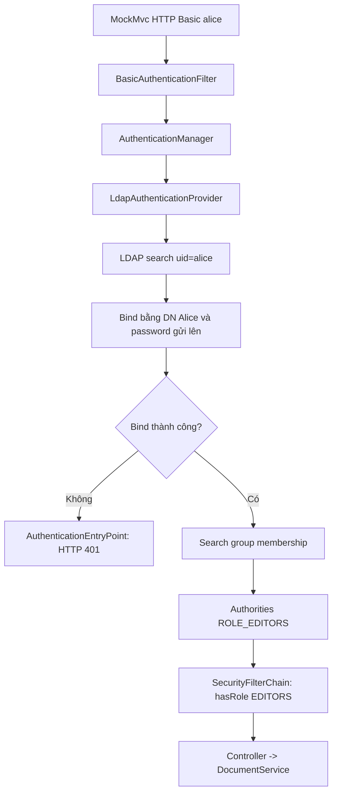

# Xác thực LDAP với dữ liệu và máy chủ kiểm thử độc lập

Một ca kiểm thử dùng `@WithMockUser(username = "alice")` có thể nhận HTTP 200 dù máy chủ LDAP không chạy, DN người dùng cấu hình sai, password không hợp lệ hoặc ánh xạ nhóm LDAP sang authority bị lỗi. Đó không phải lỗi của `@WithMockUser`: công cụ này cố ý **giả lập Authentication** để kiểm thử các tầng phía sau. Nhưng khi mục tiêu là chứng minh **ứng dụng thật sự xác thực qua LDAP**, phải có một directory server có thể nhận LDAP bind/search và một bộ dữ liệu riêng cho kiểm thử.

Bài học thuộc chương **Cơ chế chuyên biệt** của module **SPRING_SECURITY_TESTING**. Module phục vụ mục tiêu kiểm chứng xác thực, phân quyền và bảo vệ HTTP thực tế bằng `spring-security-test` trên ứng dụng Servlet và Reactive, sử dụng MockMvc, WebTestClient, `@WithMockUser`, SecurityContext, JWT/OAuth2/OIDC giả lập, các ca được phép và bị từ chối. Bài này đi sâu vào trường hợp chuyên biệt **LDAP authentication**, nơi yêu cầu thử không chỉ là HTTP 401/403 mà còn là **user search, bind với password, ánh xạ group membership và cô lập directory giữa các lần chạy test**.

## 1. Vì sao cần LDAP server riêng cho kiểm thử?

LDAP (Lightweight Directory Access Protocol) cho phép ứng dụng tra cứu và xác thực thông tin trong một directory. Ứng dụng Spring Security có thể dùng LDAP để tìm DN của người dùng rồi thực hiện **bind** dưới danh tính đó; sau khi thành công, nó đọc thông tin nhóm nhằm hình thành `GrantedAuthority`.

Nếu chỉ có mock principal, những sai sót này có thể không lộ ra:

- URL/port LDAP cấu hình sai; server không sẵn sàng.
- DN gốc `dc=example,dc=test`, user search base hoặc filter `(uid={0})` sai.
- Người dùng tồn tại nhưng nhập sai password; bind phải bị từ chối.
- LDAP user không thuộc nhóm editors, nhưng ứng dụng vô tình cấp `ROLE_EDITORS`.
- Người dùng được tạo ở test trước không bị xóa, khiến test người dùng không tồn tại vô tình thành công.
- Hai test chạy song song dùng cùng một server/port/entry và ghi đè trạng thái của nhau.

**Nguyên tắc:** LDAP test server cần nằm trong vòng đời của test suite/context, chỉ dùng dữ liệu giả, không nối tới LDAP công ty, Active Directory thật hay endpoint production.

| Cấp kiểm thử | Có thực hiện LDAP bind/search? | Phù hợp kiểm tra |
| --- | --- | --- |
| `@WithMockUser` / `user(...)` trong MockMvc | **Không** | Controller, URL authorization và logic nghiệp vụ với identity giả lập |
| Mock `AuthenticationManager` hoặc `LdapAuthenticationProvider` | **Không** có kiểm chứng directory thật | Cách web layer xử lý success/failure mà provider trả về |
| Gọi `LdapAuthenticationProvider.authenticate(...)` với server test | **Có** | User search, password bind, nhóm và authorities |
| MockMvc dùng `httpBasic(...)` với LDAP provider thật trong test | **Có** | HTTP filters → AuthenticationManager → LDAP → authorization → controller |
| MockMvc form login với LDAP provider thật và session | **Có** | Login endpoint, CSRF, session persistence, authorized/denied request |
| Kiểm thử tích hợp với hạ tầng LDAP tương đương production | **Có** | TLS, referrals, schema chuyên biệt, LDAP HA, hiệu năng, tương thích AD |

**Lựa chọn phù hợp:** bắt đầu với **embedded LDAP server** cho integration test chạy offline, nhanh và có thể tái tạo. Những tính chất đặc thù của Microsoft Active Directory, OpenLDAP production, TLS hoặc nested groups cần các test tương thích riêng với máy chủ thích hợp.

## 2. Luồng xác thực thật cần được nhìn thấy trong test

Trong bài này, API có hai đường dẫn:

- `GET /api/me`: yêu cầu người dùng đã xác thực, trả về username và trạng thái có quyền editor.
- `POST /api/documents`: yêu cầu authority `ROLE_EDITORS`, tạo một tài liệu qua `DocumentService`.

Dữ liệu thử:

| LDAP user | DN | Password fixture | Nhóm | Quyền dự kiến |
| --- | --- | --- | --- | --- |
| Alice | `uid=alice,ou=people,dc=example,dc=test` | `alice-test-password` | `cn=editors,ou=groups,...` | `ROLE_EDITORS` |
| Bob | `uid=bob,ou=people,dc=example,dc=test` | `bob-test-password` | `cn=readers,ou=groups,...` | `ROLE_READERS` |
| Charlie | Không có entry | Bất kỳ | Không | Không xác thực |

Một request Basic với Alice đi qua:



Ở nhánh password sai, LDAP bind thất bại: không được phép gọi controller/service. Ở nhánh Bob, LDAP bind **thành công** nhưng thiếu `ROLE_EDITORS`: đó là lỗi **authorization 403**, không phải authentication 401. Kiểm thử phải phân biệt được hai nhánh này.

## 3. Công nghệ và phụ thuộc cho bài thực hành

Ví dụ minh họa dành cho **Spring Security 6.x + Spring Boot 3.x + Java 17+**, Servlet Spring MVC, JUnit 5 và Mockito. Dùng **UnboundID LDAP SDK In-Memory Directory Server** chạy trong JVM test, không mở dịch vụ bên ngoài.

Ví dụ Gradle:

```groovy
dependencies {
    implementation 'org.springframework.boot:spring-boot-starter-web'
    implementation 'org.springframework.boot:spring-boot-starter-security'
    implementation 'org.springframework.security:spring-security-ldap'

    testImplementation 'org.springframework.boot:spring-boot-starter-test'
    testImplementation 'org.springframework.security:spring-security-test'
    testImplementation 'com.unboundid:unboundid-ldapsdk'
}
```

Nếu dự án sử dụng Spring Boot BOM để quản lý dependency versions, nên để BOM quyết định những phiên bản được quản lý; với thư viện không được BOM quản lý trong phiên bản dự án, cần khai báo version tương thích trong build thực tế.

**Phân vai:**

- `spring-security-ldap` cung cấp các thành phần tích hợp LDAP authentication/authorities cho Spring Security.
- `unboundid-ldapsdk` cung cấp một directory server nhúng cho fixture test.
- `spring-security-test` hỗ trợ MockMvc `httpBasic()`, `csrf()`, `@WithMockUser` và các security request builders.
- `spring-boot-starter-test` cung cấp JUnit/Mockito/MockMvc và test context.
- Dữ liệu LDAP và password đều **giả**; không cần bất kỳ tài khoản/secret production nào.

Không chạy server nhúng cho production; không vô tình xuất bản port LDAP ra mọi network interface.

## 4. Cấu trúc dữ liệu LDAP fixture (LDIF)

LDAP dùng **Distinguished Name (DN)** để định vị entry. Ví dụ base DN là `dc=example,dc=test`, với hai Organizational Unit: `ou=people` và `ou=groups`.

```ldif
dn: dc=example,dc=test
objectClass: top
objectClass: domain
dc: example

dn: ou=people,dc=example,dc=test
objectClass: top
objectClass: organizationalUnit
ou: people

dn: ou=groups,dc=example,dc=test
objectClass: top
objectClass: organizationalUnit
ou: groups

dn: uid=alice,ou=people,dc=example,dc=test
objectClass: top
objectClass: inetOrgPerson
uid: alice
cn: Alice Test
sn: Test
userPassword: alice-test-password

dn: uid=bob,ou=people,dc=example,dc=test
objectClass: top
objectClass: inetOrgPerson
uid: bob
cn: Bob Test
sn: Test
userPassword: bob-test-password

dn: cn=editors,ou=groups,dc=example,dc=test
objectClass: top
objectClass: groupOfUniqueNames
cn: editors
uniqueMember: uid=alice,ou=people,dc=example,dc=test

dn: cn=readers,ou=groups,dc=example,dc=test
objectClass: top
objectClass: groupOfUniqueNames
cn: readers
uniqueMember: uid=bob,ou=people,dc=example,dc=test
```

**Quan hệ chính:**

- Người dùng được tìm trong `ou=people` bằng filter như `(uid={0})`.
- Nhóm nằm trong `ou=groups`, objectClass `groupOfUniqueNames` dùng attribute `uniqueMember` trỏ đến **DN đầy đủ** của người dùng.
- Nếu `DefaultLdapAuthoritiesPopulator` lấy vai trò từ `cn`, viết hoa và thêm prefix `ROLE_`, nhóm `editors` trở thành `ROLE_EDITORS` (không phải `ROLE_EDITOR`).
- Người dùng Alice có thể **bind thành công** nhưng vẫn không có `ROLE_READERS`, vì chỉ thuộc editors.

LDIF này dùng dữ liệu minh họa dễ đọc. Password plaintext chỉ nên xuất hiện trong **fixture test cô lập**; production cần tuân thủ cơ chế lưu trữ/xác minh password và chính sách directory thực.

## 5. Khởi tạo UnboundID LDAP server nhúng và cổng ngẫu nhiên

Để làm bài học tự chứa, có thể tạo các entry trực tiếp bằng Java thay vì phải lưu một tệp `.ldif` thật trong project. Cách này còn giúp fixture được khởi tạo trong mỗi application context test một cách rõ ràng.

```java
import java.net.InetAddress;
import com.unboundid.ldap.sdk.Attribute;
import com.unboundid.ldap.sdk.Entry;
import com.unboundid.ldap.sdk.LDAPException;
import com.unboundid.ldap.listener.InMemoryDirectoryServer;
import com.unboundid.ldap.listener.InMemoryDirectoryServerConfig;
import com.unboundid.ldap.listener.InMemoryListenerConfig;

final class TestLdapDirectory implements AutoCloseable {
    private final InMemoryDirectoryServer server;

    TestLdapDirectory() throws Exception {
        var config = new InMemoryDirectoryServerConfig(
            "dc=example,dc=test");
        config.setListenerConfigs(
            InMemoryListenerConfig.createLDAPConfig(
                "test", InetAddress.getByName("127.0.0.1"), 0, null));
        config.addAdditionalBindCredentials(
            "cn=Directory Manager", "manager-test-password");

        server = new InMemoryDirectoryServer(config);
        server.startListening();

        add("dc=example,dc=test",
            new Attribute("objectClass", "top", "domain"),
            new Attribute("dc", "example"));

        add("ou=people,dc=example,dc=test",
            new Attribute("objectClass", "top", "organizationalUnit"),
            new Attribute("ou", "people"));

        add("ou=groups,dc=example,dc=test",
            new Attribute("objectClass", "top", "organizationalUnit"),
            new Attribute("ou", "groups"));

        add("uid=alice,ou=people,dc=example,dc=test",
            new Attribute("objectClass", "top", "inetOrgPerson"),
            new Attribute("uid", "alice"),
            new Attribute("cn", "Alice Test"),
            new Attribute("sn", "Test"),
            new Attribute("userPassword", "alice-test-password"));

        add("uid=bob,ou=people,dc=example,dc=test",
            new Attribute("objectClass", "top", "inetOrgPerson"),
            new Attribute("uid", "bob"),
            new Attribute("cn", "Bob Test"),
            new Attribute("sn", "Test"),
            new Attribute("userPassword", "bob-test-password"));

        add("cn=editors,ou=groups,dc=example,dc=test",
            new Attribute("objectClass", "top", "groupOfUniqueNames"),
            new Attribute("cn", "editors"),
            new Attribute("uniqueMember",
                "uid=alice,ou=people,dc=example,dc=test"));

        add("cn=readers,ou=groups,dc=example,dc=test",
            new Attribute("objectClass", "top", "groupOfUniqueNames"),
            new Attribute("cn", "readers"),
            new Attribute("uniqueMember",
                "uid=bob,ou=people,dc=example,dc=test"));
    }

    private void add(String dn, Attribute... attributes)
            throws LDAPException {
        server.add(new Entry(dn, attributes));
    }

    String ldapUrl() {
        return "ldap://127.0.0.1:" + server.getListenPort()
            + "/dc=example,dc=test";
    }

    @Override
    public void close() {
        server.shutDown(true);
    }
}
```

Trong ví dụ:

1. `InMemoryDirectoryServerConfig` giới hạn dữ liệu dưới base DN thử nghiệm.
2. `InetAddress.getByName("127.0.0.1")` giới hạn listener vào IPv4 loopback, đồng nhất với URL từ `ldapUrl()`; port `0` yêu cầu OS cấp **cổng rảnh**. Cách chỉ rõ IPv4 tránh việc một máy tự chọn IPv6 `::1` nhưng URL test lại kết nối `127.0.0.1`.
3. `addAdditionalBindCredentials` tạo một tài khoản quản trị fixture cho thao tác search. Đây chỉ là credential nội bộ của test, **không phải user Alice/Bob**.
4. User và nhóm được tạo dưới DN tương ứng; không phụ thuộc database hoặc directory bên ngoài.
5. `close()` dừng listener để giải phóng tài nguyên sau test context.

Các LDAP SDK có quy tắc schema riêng; khi fixture nhập thất bại do vi phạm objectClass/attribute, **nên sửa LDIF/Entry hợp lệ** thay vì luôn tắt kiểm tra schema để test xanh giả.

### Vì sao không dùng cổng LDAP cố định?

Nếu hai tiến trình CI cùng dùng `localhost:8389`, một tiến trình có thể bind thất bại hoặc tệ hơn nối nhầm server do tiến trình kia mở. Với port do OS cấp ngẫu nhiên, test đọc `server.getListenPort()` **sau khi server đã khởi động** rồi cung cấp địa chỉ đó cho Spring Security. Điều này phù hợp hơn khi chạy nhiều test độc lập hoặc song song.

**Cảnh báo:** Cổng ngẫu nhiên không tự tạo isolation về dữ liệu nếu nhiều test cố tình chia sẻ **cùng một server bean**. Khi các test cần thêm/xóa LDAP entry, phải có fixture độc lập, ID riêng và cleanup tương ứng.

## 6. Nối Spring Security LDAP tới server kiểm thử

Chúng ta chọn mô hình **bind authentication**:

- Dùng một LDAP context source có quyền search để tìm người dùng.
- Dùng `FilterBasedLdapUserSearch` với `(uid={0})` để tìm đúng DN.
- `BindAuthenticator` thử bind như người dùng với password được cung cấp.
- `DefaultLdapAuthoritiesPopulator` tìm nhóm có `uniqueMember` bằng DN của user và đưa `cn` thành authority.
- `LdapAuthenticationProvider` kết hợp các bước, cung cấp `Authentication` đã xác thực.

Test configuration:

```java
import org.springframework.boot.test.context.TestConfiguration;
import org.springframework.context.annotation.Bean;
import org.springframework.security.authentication.AuthenticationProvider;
import org.springframework.security.ldap.DefaultSpringSecurityContextSource;
import org.springframework.security.ldap.authentication.BindAuthenticator;
import org.springframework.security.ldap.authentication.LdapAuthenticationProvider;
import org.springframework.security.ldap.search.FilterBasedLdapUserSearch;
import org.springframework.security.ldap.userdetails.DefaultLdapAuthoritiesPopulator;

@TestConfiguration(proxyBeanMethods = false)
class EmbeddedLdapTestConfiguration {

    @Bean(destroyMethod = "close")
    TestLdapDirectory testLdapDirectory() throws Exception {
        return new TestLdapDirectory();
    }

    @Bean
    DefaultSpringSecurityContextSource ldapContextSource(
            TestLdapDirectory fixture) throws Exception {
        var source = new DefaultSpringSecurityContextSource(
            fixture.ldapUrl());
        source.setUserDn("cn=Directory Manager");
        source.setPassword("manager-test-password");
        source.afterPropertiesSet();
        return source;
    }

    @Bean
    AuthenticationProvider ldapAuthenticationProvider(
            DefaultSpringSecurityContextSource contextSource) {

        var userSearch = new FilterBasedLdapUserSearch(
            "ou=people", "(uid={0})", contextSource);

        var bind = new BindAuthenticator(contextSource);
        bind.setUserSearch(userSearch);

        var authorities = new DefaultLdapAuthoritiesPopulator(
            contextSource, "ou=groups");
        authorities.setGroupSearchFilter("(uniqueMember={0})");
        authorities.setGroupRoleAttribute("cn");
        authorities.setRolePrefix("ROLE_");
        authorities.setConvertToUpperCase(true);
        authorities.setSearchSubtree(true);

        return new LdapAuthenticationProvider(bind, authorities);
    }
}
```

Cấu hình `FilterBasedLdapUserSearch` có tham số thay thế `{0}` được framework xử lý theo cơ chế tìm LDAP; **không** nên tự nối trực tiếp chuỗi user input thành một LDAP filter vì có nguy cơ LDAP injection.

**Phân biệt DN đầy đủ và đường dẫn tương đối:** URL context source đã gắn base DN `dc=example,dc=test`. Vì vậy search base là `ou=people` và `ou=groups`, không cần lặp lại toàn bộ DN. Việc cấu hình base hai lần có thể làm tìm user thất bại dù fixture đúng.

### Bind authentication khác password comparison

`BindAuthenticator` yêu cầu directory kiểm tra password qua một lần bind dưới DN của user. Nó **không đồng nghĩa** với việc tải `userPassword` từ LDAP rồi gọi `PasswordEncoder.matches` cục bộ. Spring Security còn có cách kiểm tra password qua LDAP password comparison, nhưng cơ chế đó có yêu cầu cấu hình và quyền truy cập khác.

Khi mục tiêu là xác minh credential thật được chấp nhận bởi LDAP server, test phải để `LdapAuthenticationProvider` gọi server. Không mock provider trả `Authentication` thành công nếu đang kiểm tra hành vi bind.

## 7. SecurityFilterChain cho HTTP Basic và form login

Ví dụ cấu hình dưới dùng cùng LDAP provider cho hai lối vào:

1. `Authorization: Basic ...` để thử xác thực mỗi request bằng `httpBasic()`.
2. `POST /login` với form username/password và session để thử login persistence.

Để kết quả dễ xác minh, test cấu hình form login success thành `204 No Content`, failure thành `401`; mọi endpoint API chưa xác thực nhận `401`, không redirect. Đây là **contract của cấu hình kiểm thử**, không phải trạng thái mặc định duy nhất của mọi ứng dụng Spring Security.

```java
import org.springframework.context.annotation.Bean;
import org.springframework.context.annotation.Configuration;
import org.springframework.http.HttpStatus;
import org.springframework.http.HttpMethod;
import org.springframework.security.authentication.AuthenticationProvider;
import org.springframework.security.config.Customizer;
import org.springframework.security.config.annotation.web.builders.HttpSecurity;
import org.springframework.security.web.SecurityFilterChain;
import org.springframework.security.web.authentication.HttpStatusEntryPoint;

@Configuration
class LdapHttpSecurity {

    @Bean
    SecurityFilterChain ldapChain(
            HttpSecurity http,
            AuthenticationProvider ldapAuthenticationProvider)
            throws Exception {

        return http
            .authenticationProvider(ldapAuthenticationProvider)
            .authorizeHttpRequests(auth -> auth
                .requestMatchers(HttpMethod.GET, "/api/me")
                    .authenticated()
                .requestMatchers(HttpMethod.POST, "/api/documents")
                    .hasRole("EDITORS")
                .anyRequest().denyAll())
            .httpBasic(Customizer.withDefaults())
            .formLogin(form -> form
                .loginProcessingUrl("/login")
                .successHandler((request, response, authentication) ->
                    response.setStatus(HttpStatus.NO_CONTENT.value()))
                .failureHandler((request, response, exception) ->
                    response.sendError(HttpStatus.UNAUTHORIZED.value())))
            .exceptionHandling(exception -> exception
                .authenticationEntryPoint(
                    new HttpStatusEntryPoint(HttpStatus.UNAUTHORIZED)))
            // Không tắt CSRF: POST /login và /api/documents
            // đều phải gửi token CSRF hợp lệ trong ví dụ.
            .build();
    }
}
```

`hasRole("EDITORS")` tương ứng `ROLE_EDITORS`, đúng với mapping từ nhóm `cn=editors`. Nếu bạn kiểm tra `ROLE_EDITOR` số ít, bài test Alice bị 403 dù LDAP bind và group search đều đúng.

### Phải chú ý lựa chọn AuthenticationProvider

Nếu application context đăng ký thêm những provider khác (in-memory, JDBC, custom), một test có thể nhận `200` từ **provider khác** thay vì LDAP. Để chứng minh integration với LDAP, test environment nên có configuration xác thực rõ ràng, có dấu hiệu nhận biết kết quả group/entry từ directory, và ca password sai phải thất bại.

Trong dự án có nhiều `SecurityFilterChain`, kiểm tra đường dẫn `/login`, `/api/me` và `/api/documents` thuộc chain đúng. Nếu một chain khác bắt request trước, kết quả 401/403 sẽ không chứng minh thành phần LDAP đang được dùng.

## 8. Controller và collaborator cho MockMvc

Không trả password, access token hoặc toàn bộ LDAP attributes cho client. Endpoint demo chỉ trả tên principal và cờ quyền editor:

```java
import java.util.Map;
import org.springframework.http.HttpStatus;
import org.springframework.http.ResponseEntity;
import org.springframework.security.core.Authentication;
import org.springframework.web.bind.annotation.*;

record NewDocument(String title) {}
record DocumentReceipt(String id) {}

interface DocumentService {
    DocumentReceipt create(String title, String owner);
}

@RestController
@RequestMapping("/api")
class LdapDemoController {
    private final DocumentService documents;

    LdapDemoController(DocumentService documents) {
        this.documents = documents;
    }

    @GetMapping("/me")
    Map<String, Object> me(Authentication authentication) {
        boolean editor = authentication.getAuthorities().stream()
            .anyMatch(a -> a.getAuthority().equals("ROLE_EDITORS"));

        return Map.of(
            "username", authentication.getName(),
            "editor", editor
        );
    }

    @PostMapping("/documents")
    ResponseEntity<DocumentReceipt> createDocument(
            @RequestBody NewDocument input,
            Authentication authentication) {
        DocumentReceipt receipt = documents.create(
            input.title(), authentication.getName());
        return ResponseEntity.status(HttpStatus.CREATED).body(receipt);
    }
}
```

Với Alice, expected `username=alice` và `editor=true`. Với Bob, `username=bob` và `editor=false`.

**Quan trọng:** controller đang được bảo vệ ở HTTP layer. Nếu request bị chặn tại security filter, `DocumentService` không được gọi. Nếu có thêm `@PreAuthorize` trong service, cần test riêng cho method security, vì controller có thể đã gọi proxy service trước khi interceptor từ chối phần thân.

## 9. Kiểm thử LDAP thật qua MockMvc HTTP Basic

Dưới đây là một lớp integration test mẫu. Để không vô tình nạp cấu hình LDAP production khi test, có thể tạo **Spring Boot configuration tối thiểu** chỉ import security config và controller đã trình bày:

```java
import org.springframework.boot.SpringBootConfiguration;
import org.springframework.boot.autoconfigure.EnableAutoConfiguration;
import org.springframework.context.annotation.Import;

@SpringBootConfiguration
@EnableAutoConfiguration
@Import({LdapHttpSecurity.class, LdapDemoController.class})
class LdapDemoTestApplication {
}
```

`EmbeddedLdapTestConfiguration` được import riêng vào lớp test để cấp server LDAP nhúng và provider. Mẫu dưới dùng `@MockitoBean` của Spring Framework **6.2+** (tương ứng Spring Boot **3.4+**); nếu dự án dùng bản cũ hơn, hãy thay annotation mock-bean theo phiên bản đang sử dụng.

```java
import org.junit.jupiter.api.Test;
import org.springframework.beans.factory.annotation.Autowired;
import org.springframework.boot.test.autoconfigure.web.servlet.AutoConfigureMockMvc;
import org.springframework.boot.test.context.SpringBootTest;
import org.springframework.context.annotation.Import;
import org.springframework.http.MediaType;
import org.springframework.test.context.bean.override.mockito.MockitoBean;
import org.springframework.test.web.servlet.MockMvc;

import static org.mockito.Mockito.*;
import static org.springframework.security.test.web.servlet.request
    .SecurityMockMvcRequestPostProcessors.httpBasic;
import static org.springframework.security.test.web.servlet.request
    .SecurityMockMvcRequestPostProcessors.csrf;
import static org.springframework.test.web.servlet.request.MockMvcRequestBuilders.*;
import static org.springframework.test.web.servlet.result.MockMvcResultMatchers.*;

@SpringBootTest(classes = LdapDemoTestApplication.class)
@AutoConfigureMockMvc
@Import(EmbeddedLdapTestConfiguration.class)
class LdapAuthenticationIntegrationTest {

    private static final String VALID_JSON = """
        {"title":"Quarterly report"}
        """;

    @Autowired MockMvc mvc;

    @MockitoBean DocumentService documents;

    @Test
    void aliceWithCorrectPasswordIsAuthenticatedFromLdap()
            throws Exception {
        mvc.perform(get("/api/me")
                .with(httpBasic("alice", "alice-test-password")))
            .andExpect(status().isOk())
            .andExpect(jsonPath("$.username").value("alice"))
            .andExpect(jsonPath("$.editor").value(true));

        verifyNoInteractions(documents);
    }

    @Test
    void bobCanBindButIsNotAnEditor() throws Exception {
        mvc.perform(get("/api/me")
                .with(httpBasic("bob", "bob-test-password")))
            .andExpect(status().isOk())
            .andExpect(jsonPath("$.username").value("bob"))
            .andExpect(jsonPath("$.editor").value(false));

        verifyNoInteractions(documents);
    }

    @Test
    void aliceWithWrongPasswordGets401() throws Exception {
        mvc.perform(get("/api/me")
                .with(httpBasic("alice", "wrong-password")))
            .andExpect(status().isUnauthorized());

        verifyNoInteractions(documents);
    }

    @Test
    void unknownUserGets401() throws Exception {
        mvc.perform(get("/api/me")
                .with(httpBasic("charlie", "whatever")))
            .andExpect(status().isUnauthorized());

        verifyNoInteractions(documents);
    }

    @Test
    void anonymousRequestGets401() throws Exception {
        mvc.perform(get("/api/me"))
            .andExpect(status().isUnauthorized());

        verifyNoInteractions(documents);
    }
}
```

Các phương thức nằm cùng lớp test để sử dụng lại `mvc` và `documents`. Khi không có interaction nào tới `DocumentService` ở các GET/401 test, `verifyNoInteractions` là một kiểm tra bổ sung; đối với GET `/api/me`, điều quan trọng hơn là **giá trị principal và quyền ánh xạ từ LDAP**.

### Vì sao `httpBasic()` phù hợp cho test này?

`httpBasic("alice", "...")` thêm header HTTP Basic vào request. Nó **không** tạo sẵn `Authentication` như `@WithMockUser`. Với security filter chain và LDAP provider thật, username/password được chuyển đến `AuthenticationManager` và LDAP bind/search để xác thực. Đây là khác biệt trọng yếu so với `.with(user("alice"))`.

**Giới hạn:** HTTP Basic không kiểm tra hành vi form login/session; nó chỉ chứng minh cơ chế authentication thông qua HTTP Basic đang sử dụng provider được cấu hình.

## 10. Kiểm tra đúng 403 và 201: không nhầm xác thực với phân quyền

Thêm các test vào `LdapAuthenticationIntegrationTest` để kiểm tra `POST /api/documents`, với CSRF token hợp lệ để không bị chặn bởi CSRF trước khi xét authority.

```java
@Test
void bobIsAuthenticatedButCannotCreateDocuments() throws Exception {
    mvc.perform(post("/api/documents")
            .with(httpBasic("bob", "bob-test-password"))
            .with(csrf())
            .contentType(MediaType.APPLICATION_JSON)
            .content(VALID_JSON))
        .andExpect(status().isForbidden());

    verifyNoInteractions(documents);
}

@Test
void aliceCanCreateDocumentWithEditorGroup() throws Exception {
    when(documents.create("Quarterly report", "alice"))
        .thenReturn(new DocumentReceipt("doc-100"));

    mvc.perform(post("/api/documents")
            .with(httpBasic("alice", "alice-test-password"))
            .with(csrf())
            .contentType(MediaType.APPLICATION_JSON)
            .content(VALID_JSON))
        .andExpect(status().isCreated())
        .andExpect(jsonPath("$.id").value("doc-100"));

    verify(documents, times(1))
        .create("Quarterly report", "alice");
    verifyNoMoreInteractions(documents);
}

@Test
void wrongPasswordMustNeverCallDocumentService() throws Exception {
    mvc.perform(post("/api/documents")
            .with(httpBasic("alice", "bad-password"))
            .with(csrf())
            .contentType(MediaType.APPLICATION_JSON)
            .content(VALID_JSON))
        .andExpect(status().isUnauthorized());

    verifyNoInteractions(documents);
}
```

Các ca này xác minh hai trục riêng:

- **Authentication 401:** wrong password → LDAP bind thất bại, service không được gọi.
- **Authorization 403:** Bob bind thành công nhưng chỉ có `ROLE_READERS`, thiếu `ROLE_EDITORS` → service không được gọi.
- **Happy path 201:** Alice bind thành công, LDAP group mapping đúng, service gọi một lần với owner `alice`.

**Không bỏ `csrf()` trong test Bob thiếu quyền.** Với CSRF đang bật, POST không có token cũng nhận 403, nhưng đó là **403 do CSRF**, không chứng minh LDAP group mapping hay rule editor.

## 11. Kiểm tra thất bại CSRF như một ca độc lập

Một người dùng có password hợp lệ và đủ `ROLE_EDITORS` vẫn có thể bị chặn vì không có CSRF token. Hãy chứng minh bằng test riêng:

```java
@Test
void validEditorWithoutCsrfGets403() throws Exception {
    mvc.perform(post("/api/documents")
            .with(httpBasic("alice", "alice-test-password"))
            .contentType(MediaType.APPLICATION_JSON)
            .content(VALID_JSON))
        .andExpect(status().isForbidden());

    verifyNoInteractions(documents);
}
```

Trong ứng dụng có CSRF filter ở trước bước authentication, request này có thể bị chặn **trước cả LDAP bind**. Vì vậy không nên dùng test thiếu CSRF như bằng chứng LDAP password đúng.

Muốn kiểm tra **login endpoint** với CSRF bật, luôn gửi `.with(csrf())` trong test success/failure của `POST /login`. Một login thiếu CSRF trả 403 không chứng minh user/password sai.

## 12. Form login với LDAP và phiên độc lập

HTTP Basic gửi credential trong từng request. Để kiểm tra form login cùng `HttpSession`, hãy gửi request vào `POST /login`, giữ session trả về rồi gửi request khác **không có `httpBasic()` hoặc `user()`**. Như vậy test mới chứng minh authentication được lưu và khôi phục theo cơ chế session.

Ví dụ helper trong lớp `LdapAuthenticationIntegrationTest`:

```java
import org.springframework.mock.web.MockHttpSession;
import org.springframework.test.web.servlet.MvcResult;

import static org.junit.jupiter.api.Assertions.assertNotNull;
import static org.springframework.security.test.web.servlet.request
    .SecurityMockMvcRequestPostProcessors.csrf;

private MockHttpSession login(String username, String password)
        throws Exception {
    MvcResult result = mvc.perform(post("/login")
            .with(csrf())
            .param("username", username)
            .param("password", password))
        .andExpect(status().isNoContent())
        .andReturn();

    MockHttpSession session =
        (MockHttpSession) result.getRequest().getSession(false);
    assertNotNull(session, "Successful form login should have a session");
    return session;
}

@Test
void aliceFormLoginCanUseSessionOnNextRequest() throws Exception {
    MockHttpSession aliceSession =
        login("alice", "alice-test-password");

    // Không cung cấp lại username/password ở request thứ hai.
    mvc.perform(get("/api/me").session(aliceSession))
        .andExpect(status().isOk())
        .andExpect(jsonPath("$.username").value("alice"))
        .andExpect(jsonPath("$.editor").value(true));
}

@Test
void wrongPasswordFormLoginGets401() throws Exception {
    mvc.perform(post("/login")
            .with(csrf())
            .param("username", "alice")
            .param("password", "wrong-password"))
        .andExpect(status().isUnauthorized());
}
```

Vì `SecurityFilterChain` mẫu cấu hình success handler trả `204` và failure handler trả `401`, các assertions trên có contract rõ. Với form login mặc định của Spring Security, **success thường redirect** và **failure thường redirect**, nên các status sẽ khác.

### Kiểm tra Alice/Bob với session riêng

```java
@Test
void twoSessionsHoldDifferentLdapPrincipals() throws Exception {
    MockHttpSession aliceSession =
        login("alice", "alice-test-password");
    MockHttpSession bobSession =
        login("bob", "bob-test-password");

    mvc.perform(get("/api/me").session(aliceSession))
        .andExpect(status().isOk())
        .andExpect(jsonPath("$.username").value("alice"));

    mvc.perform(get("/api/me").session(bobSession))
        .andExpect(status().isOk())
        .andExpect(jsonPath("$.username").value("bob"));

    // Gọi lại Alice sau Bob: không được bị đổi danh tính.
    mvc.perform(get("/api/me").session(aliceSession))
        .andExpect(status().isOk())
        .andExpect(jsonPath("$.username").value("alice"));
}
```

Chỉ dùng chung session **khi chủ đích là kiểm tra session persistence**. Không khai báo static `MockHttpSession` cho toàn bộ suite, vì một lần logout hoặc một request dưới danh tính khác có thể làm test kế tiếp phụ thuộc thứ tự chạy.

## 13. Server độc lập không đồng nghĩa dữ liệu tự reset giữa mọi test

Spring Test thường cache `ApplicationContext` để tăng tốc. Do đó bean `TestLdapDirectory` được tạo **theo application context**, không nhất thiết được khởi tạo lại cho từng `@Test`. Điều này có thể hoàn toàn phù hợp nếu các test chỉ **đọc** bộ fixture cố định Alice/Bob.

Nếu test có thao tác tạo/xóa user hoặc sửa group membership, phải áp dụng một trong các chiến lược:

| Chiến lược | Khi phù hợp | Điều cần xác minh |
| --- | --- | --- |
| Fixture LDIF/Entry bất biến cho cả context | Nhiều ca read/authentication | Không test nào sửa directory |
| Tạo user với UID duy nhất cho mỗi test | Test bổ sung user, đổi mật khẩu | Xóa đúng DN sau test, không va chạm UID |
| Reset/snapshot server trước mỗi test | Test cần sửa nhiều entry | Data và index được khôi phục đúng, không chạy song song trên cùng server |
| Một server/context riêng cho nhóm test | Isolation cao, ít test | Không tái sử dụng fixture mutable ngoài dự kiến |
| Container OpenLDAP/AD test riêng | Cần features không được embedded server mô phỏng | Tách port, schema, volume, credentials |

**Anti-pattern:**

```java
@Test
void testA_createsCharlieInLdap() { /* add uid=charlie */ }

@Test
void testB_assertsCharlieDoesNotExist() { /* phụ thuộc testA */ }
```

Một test “user không tồn tại phải bị 401” chỉ đáng tin nếu fixture bảo đảm user đó không có entry **ngay tại thời điểm test bắt đầu**. Nếu dữ liệu có thể thay đổi, hãy tạo identity mới với UID ngẫu nhiên/định danh sở hữu bởi test và cleanup có kiểm soát.

Không dùng `@DirtiesContext` ở mọi method như cách dọn directory mặc định; việc khởi tạo lại context rất tốn thời gian. Chỉ dùng khi không thể hoàn nguyên trạng thái một cách đáng tin. Dọn chính xác LDAP entry, session và token fixture thường tốt hơn.

## 14. Tránh kết nối nhầm LDAP production hoặc server của test khác

Một bài kiểm thử LDAP có thể **gây tác động tới hệ thống ngoài ý muốn** nếu URL hoặc credentials bị lấy từ cấu hình production.

Các biện pháp quan trọng:

1. Server được bind vào địa chỉ loopback, port do OS cấp, không được expose trên public interface.
2. `DefaultSpringSecurityContextSource` lấy URL trực tiếp từ **fixture bean test**, không từ biến môi trường production nếu test dự kiến offline.
3. DN, username và password chỉ dùng namespace giả như `dc=example,dc=test`.
4. Không tải LDIF do người dùng thật cung cấp; dữ liệu cá nhân hoặc credential production không có chỗ trong bộ fixture.
5. Thêm test canary: không khởi động fixture (trong nhánh thử nghiệm) thì LDAP authentication phải thất bại, thay vì tự kết nối sang directory khác.
6. Không ghi giá trị password, bind credentials hoặc thông tin nhạy cảm vào log test.
7. Khi chạy parallel, mỗi server có cổng riêng và không chia sẻ dữ liệu mutable.
8. Có timeout kết nối/đọc LDAP trong cấu hình phù hợp để test fail nhanh, tránh treo CI khi server không khởi động.

Không dùng embedded LDAP server để khẳng định chính sách TLS, certificate validation, failover và Active Directory group membership của production đã đúng. Các đặc tính đó cần môi trường integration chuyên biệt.

## 15. MockUser không đủ để chứng minh LDAP bind

Một ca sau có thể nhận 200 **mà không hề gọi LDAP**:

```java
import org.springframework.security.test.context.support.WithMockUser;

@Test
@WithMockUser(username = "alice", roles = "EDITORS")
void mockUserOnlyTestsControllerAndAuthorization() throws Exception {
    mvc.perform(get("/api/me"))
        .andExpect(status().isOk())
        .andExpect(jsonPath("$.username").value("alice"))
        .andExpect(jsonPath("$.editor").value(true));
}
```

Ca này vẫn hữu ích để kiểm tra controller và Spring Security sau khi đã có một `Authentication`. Nhưng nó **không chứng minh**:

- Alice tồn tại trong LDAP.
- Alice bind được với `alice-test-password`.
- Dữ liệu nhóm `cn=editors` được LDAP trả về và ánh xạ đúng.
- LDAP server đã được khởi động và kết nối đúng URL.
- Credential sai bị từ chối.

Ngược lại:

```java
mvc.perform(get("/api/me")
        .with(httpBasic("alice", "wrong-password")))
    .andExpect(status().isUnauthorized());
```

Khi filter chain dùng LDAP provider thật, ca thứ hai mới đi qua luồng password authentication. Đừng dùng `.with(user("alice"))` để kiểm thử password hoặc group mapping.

## 16. Kiểm thử LDAP provider trực tiếp khi cần phân tích lỗi sâu

Nếu một test MockMvc trả 401 nhưng khó xác định nguyên nhân, kiểm thử trực tiếp `LdapAuthenticationProvider` giúp cô lập user search và bind khỏi tầng HTTP:

```java
import org.junit.jupiter.api.Test;
import org.springframework.beans.factory.annotation.Autowired;
import org.springframework.security.authentication.AuthenticationProvider;
import org.springframework.security.authentication.UsernamePasswordAuthenticationToken;
import org.springframework.security.core.Authentication;
import org.springframework.security.core.AuthenticationException;

import static org.junit.jupiter.api.Assertions.*;

class LdapProviderAssertions {
    @Autowired AuthenticationProvider ldapAuthenticationProvider;

    @Test
    void validAliceCredentialsAreAccepted() {
        Authentication result = ldapAuthenticationProvider.authenticate(
            UsernamePasswordAuthenticationToken.unauthenticated(
                "alice", "alice-test-password"));

        assertNotNull(result);
        assertTrue(result.isAuthenticated());
        assertEquals("alice", result.getName());
        assertTrue(result.getAuthorities().stream()
            .anyMatch(a -> a.getAuthority().equals("ROLE_EDITORS")));
    }

    @Test
    void invalidCredentialsAreRejected() {
        assertThrows(AuthenticationException.class,
            () -> ldapAuthenticationProvider.authenticate(
                UsernamePasswordAuthenticationToken.unauthenticated(
                    "alice", "wrong-password")));
    }
}
```

Đây là **mẫu các phương thức assertion**; khi chạy trong dự án, đặt chúng vào một Spring Test class có import `EmbeddedLdapTestConfiguration` (ví dụ cùng lớp `LdapAuthenticationIntegrationTest`), để provider được inject từ đúng context. Không tạo một instance provider rời rồi bỏ qua context source đang trỏ đến fixture.

Test provider trực tiếp giúp khoanh vùng: nếu nó thất bại, xem LDAP URL, base DN, userSearch filter, password, group membership. Nếu provider thành công nhưng MockMvc thất bại, kiểm tra authentication filter, security matcher, entry point, CSRF, session và web authorization.

## 17. Những lỗi LDAP phổ biến và cách chẩn đoán

| Biểu hiện | Nguyên nhân có thể | Kiểm tra hoặc sửa |
| --- | --- | --- |
| Cả Alice và Bob đều nhận 401 | Server chưa listening, URL sai, bind/search DN sai | Port fixture, root DN, account search, LDAP connection |
| Username đúng, password sai vẫn nhận 200 | Test vô tình dùng `@WithMockUser`/`user()` hoặc provider khác | Dùng `httpBasic` và kiểm tra AuthenticationProvider của chain |
| Alice bind được nhưng `editor=false` | Group search base/filter sai, `uniqueMember` không trùng DN user | Kiểm tra `ou=groups`, `(uniqueMember={0})`, group attribute `cn` |
| Alice nhận 403 dù thuộc editors | Mapping dùng `ROLE_EDITORS`, rule lại đòi `ROLE_EDITOR` | So khớp chữ hoa/prefix/số ít-số nhiều |
| Bob nhận 200 ở endpoint editor | Cấp role mặc định quá rộng, filter chain sai | Test Bob với LDAP thật, verify service không được gọi khi 403 |
| POST bị 403 dù Alice có editor | CSRF token chưa được gửi | Thêm `.with(csrf())` vào ca phân quyền, test CSRF riêng |
| Form login sai password nhận 302 thay vì 401 | Failure handler mặc định redirect | Assert theo flow thực hoặc cấu hình failure handler minh họa |
| Test chạy riêng được, chạy suite không được | Directory entries/port/session dùng chung hoặc stale context | Port ngẫu nhiên, fixture bất biến/cleanup, session riêng |
| CI fail do port collision | Gán LDAP port cố định | Dùng port 0, lấy cổng từ listener đã khởi động |
| MockMvc trả lỗi không đi qua provider | `@AutoConfigureMockMvc(addFilters=false)`, standalone setup, sai chain | Bật filters, dùng `springSecurity()` khi build thủ công |
| Lỗi user search khi UID chứa ký tự đặc biệt | LDAP filter tự nối từ input gây escaping sai | Dùng placeholder/framework LDAP filter escaping |
| Test pass nhưng production AD fail | Khác schema, referrals, nested groups, TLS hoặc account state | Bổ sung integration test với hạ tầng tương đương AD |

### Phân biệt `uid` và `DN`

LDAP user search nhận `alice` và tìm entry `uid=alice,ou=people,dc=example,dc=test`. BindAuthenticator sử dụng **DN tìm thấy** để kiểm chứng password. Không suy luận username luôn là full DN, hoặc group membership luôn dựa vào giá trị username ngắn. Nếu nhóm dùng `uniqueMember`, giá trị cần so khớp với **DN**.

### Lưu ý password và account policy

UnboundID in-memory server có thể không mô phỏng đầy đủ password policy của một LDAP enterprise: khóa tài khoản sau nhiều lần sai, thời hạn password, bắt đổi password, MFA, referrals hoặc nested group. Hãy xem những tính năng đó là **giới hạn mô phỏng**, không phải đã được chứng minh chỉ vì LDAP bind cơ bản hoạt động.

## 18. Phân biệt test Servlet LDAP với Reactive WebFlux

Ví dụ chính dùng **Servlet** với `MockMvc`, `HttpSecurity` và `LdapAuthenticationProvider`. Trong WebFlux, pipeline HTTP dùng `SecurityWebFilterChain`, `ServerHttpSecurity` và các giao diện xác thực Reactive.

Điểm cần phân biệt:

- `WebTestClient.mutateWith(mockUser(...))` đưa authentication giả lập vào mock Reactive context; nó **không** gọi LDAP.
- Một Reactive authentication manager có thể phải phối hợp tác vụ I/O LDAP vốn là blocking API; không gọi LDAP blocking trên event-loop Reactor tùy tiện.
- Để kiểm thử flow LDAP thật trên WebFlux, phải có thiết kế authentication manager tích hợp phù hợp (và chuyển blocking work ra scheduler thích hợp khi cần), sau đó gửi HTTP Basic/form credential qua WebTestClient hoặc server thực.
- Không sao chép `OncePerRequestFilter`, `HttpSecurity` và các test của Servlet vào ứng dụng Reactive rồi mặc định chúng sẽ bảo vệ WebFlux.

Ví dụ chỉ để kiểm tra **authorization Reactive sau xác thực**, không kiểm tra LDAP:

```java
WebTestClient editorClient = baseClient.mutateWith(
    mockUser("alice").roles("EDITORS"));

editorClient.get().uri("/api/me")
    .exchange()
    .expectStatus().isOk();
```

Nếu cần chứng minh LDAP bind từ WebFlux, test phải đi qua implementation thực sự phát lệnh bind tới **LDAP test server**. Không đánh đồng test này với mô phỏng MockUser.

## 19. Ma trận kiểm thử nên đưa vào CI

| Kịch bản | Có LDAP bind/search thật? | HTTP expected | Service ghi dữ liệu |
| --- | --- | --- | --- |
| Alice Basic đúng password | Có | 200 ở `/api/me`, editor=true | Không áp dụng |
| Bob Basic đúng password | Có | 200 ở `/api/me`, editor=false | Không áp dụng |
| Alice sai password | Có, bind thất bại | 401 | Không gọi |
| Charlie không tồn tại | Có, user search không có entry | 401 | Không gọi |
| Anonymous | Không có credential | 401 theo entry point | Không gọi |
| Bob tạo tài liệu, CSRF hợp lệ | Có, bind thành công | 403 do thiếu editors | Không gọi |
| Alice tạo tài liệu, CSRF hợp lệ | Có, bind thành công | 201 | Gọi một lần |
| Alice tạo tài liệu, thiếu CSRF | Không nên dùng để suy ra LDAP | 403 do CSRF | Không gọi |
| Alice form login đúng | Có | 204 theo custom handler | Không áp dụng |
| Alice form login sai | Có, bind thất bại | 401 theo custom handler | Không áp dụng |
| Alice và Bob ở session riêng | Có ở lúc login | 200, trả từng username đúng | Không áp dụng |
| `@WithMockUser("alice")` | **Không** | 200 nếu đã gắn user | Chỉ chứng minh mock security context |

Để tránh suite không ổn định, không sửa LDAP fixture cố định trong các ca Basic/form login; các test cần tạo user hay nhóm mới nên có fixture và cleanup riêng.

## 20. Bài thực hành và tiêu chí hoàn thành

Hãy mở rộng ví dụ thành API `POST /api/payroll/export` chỉ cho nhóm `cn=payroll-admins`.

1. Tạo một OU và group LDAP giả có tên `payroll-admins`, thêm Alice vào nhóm và không thêm Bob. Giữ toàn bộ dữ liệu trong LDAP test server độc lập.
2. Cấu hình Spring Security LDAP để `groupOfUniqueNames` + `uniqueMember` tạo ra authority `ROLE_PAYROLL_ADMINS`; dùng `hasRole("PAYROLL_ADMINS")` để bảo vệ endpoint.
3. Test Alice với password đúng và CSRF hợp lệ: request thành công, `PayrollExportService` gọi đúng một lần.
4. Test Bob với password đúng và CSRF hợp lệ: response 403, `PayrollExportService` **không gọi**. Đây là ca authorization, không phải password failure.
5. Test Alice với password sai: response 401, service không gọi.
6. Test người dùng không tồn tại: response 401, service không gọi.
7. Test Alice đủ quyền nhưng thiếu CSRF: response 403; giải thích vì sao test này không chứng minh mapping LDAP group.
8. Kiểm tra form login của Alice, lấy session sau login, gọi endpoint dưới session đó **không thêm lại identity giả lập**.
9. Tạo session của Bob riêng và gọi xen kẽ Alice → Bob → Alice; assert username/role đúng, không bị lẫn.
10. Chạy test riêng lẻ, chạy cả suite và chạy lại trong CI với LDAP port ngẫu nhiên. Nếu thêm/xóa entry, có cleanup đúng dữ liệu test sở hữu.

**Tiêu chí đạt:** giải thích được khác biệt giữa `@WithMockUser` và LDAP authentication thật; khởi động LDAP test server với dữ liệu giả và cổng độc lập; cấu hình đúng base DN, userSearch, bind authenticator và group mapping; kiểm chứng 200/201/401/403 cùng Mockito interaction; phân biệt CSRF với thiếu quyền; và nhận biết giới hạn của embedded LDAP trước khi kết luận tương thích production.

### Tài liệu tham khảo

- [Spring Security — LDAP Authentication](https://docs.spring.io/spring-security/reference/servlet/authentication/passwords/ldap.html): LDAP bind authentication, password compare, nhóm và authorities.
- [Spring Security — Servlet MockMvc Testing](https://docs.spring.io/spring-security/reference/servlet/test/mockmvc/index.html): tích hợp security filters với MockMvc.
- [Spring Security — MockMvc HTTP Basic and Form Login](https://docs.spring.io/spring-security/reference/servlet/test/mockmvc/request-post-processors.html): tạo request với credential hoặc test principal.
- [UnboundID LDAP SDK — In-Memory Directory Server](https://docs.ldap.com/ldap-sdk/docs/in-memory-directory-server.html): tạo directory server, cấu hình listener, thêm entry và shutdown.
- [Spring Security — Security Architecture](https://docs.spring.io/spring-security/reference/servlet/architecture.html): filter chain, AuthenticationManager và xử lý lỗi bảo mật.
