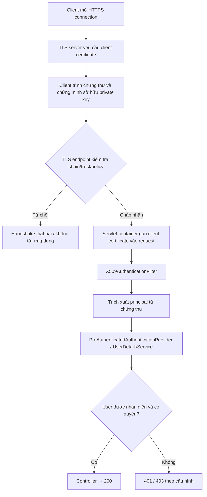
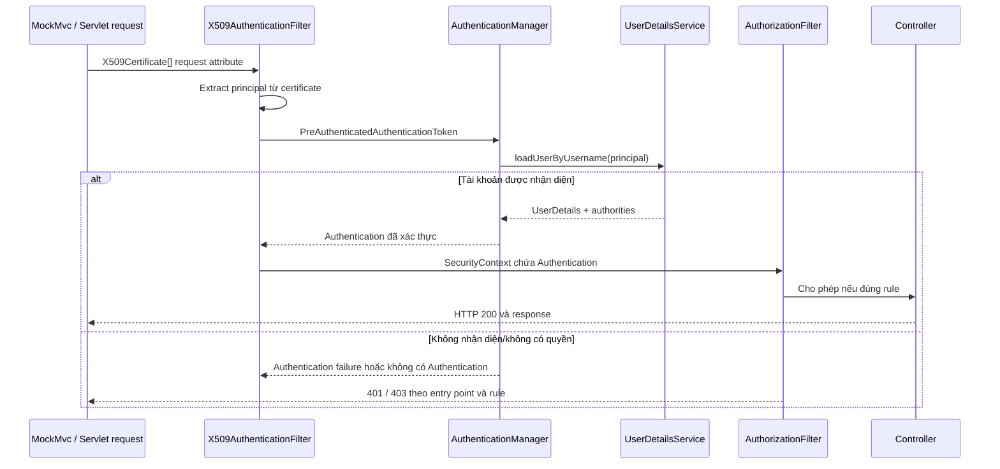
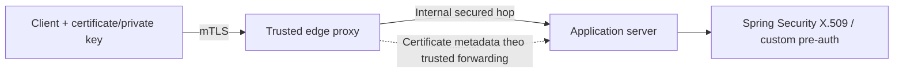

# X.509 với thuộc tính chứng thư trong request và giới hạn giả lập đó

Một hệ thống nội bộ thường bảo vệ API bằng **mutual TLS (mTLS)**: ngoài việc server chứng minh danh tính của mình cho client, client cũng trình một chứng thư X.509. Khi container hoặc reverse proxy triển khai đúng mTLS, ứng dụng có thể nhận thông tin chứng thư client đã được chấp nhận và dùng **Spring Security X.509 authentication** để ánh xạ danh tính chứng thư thành `Authentication`.

Trong kiểm thử Spring MVC, ta có thể đặt trực tiếp một mảng `X509Certificate[]` vào thuộc tính của `HttpServletRequest`, sau đó cho request đi qua `X509AuthenticationFilter`, `AuthenticationManager`, `UserDetailsService` và các luật phân quyền. Cách đó rất hữu ích, nhưng **không thực hiện một TLS handshake, không xác minh chuỗi chứng thư theo truststore, không tự kiểm tra thu hồi chứng thư**. Một kết quả MockMvc `200 OK` khi có request attribute chỉ chứng minh phần bảo mật HTTP/application đã xử lý thông tin chứng thư theo giả định đầu vào; nó **không chứng minh mTLS production đã an toàn**.

Bài học thuộc chương **Cơ chế chuyên biệt** của module **`SPRING_SECURITY_TESTING`**. Trong toàn module, người học kiểm chứng xác thực, phân quyền và bảo vệ HTTP thực tế bằng `spring-security-test` trên Servlet và Reactive, với MockMvc, WebTestClient, `@WithMockUser`, `SecurityContext` cùng các tình huống JWT/OAuth2/OIDC giả lập. Chủ đề ở đây là **“X.509 với thuộc tính chứng thư trong request và giới hạn giả lập đó”**, chủ yếu trên **Servlet/MockMvc**, đồng thời nhận diện điểm khác biệt nếu dịch vụ chạy WebFlux hoặc đi qua TLS termination proxy.

Sau bài này, bạn có thể:

- Giải thích nguồn gốc thuộc tính `jakarta.servlet.request.X509Certificate` và kiểu giá trị `X509Certificate[]`.
- Mô tả đường xử lý từ X.509 client certificate đến `PreAuthenticatedAuthenticationToken` và authorities của Spring Security.
- Tạo chứng thư thử nghiệm bằng Mockito, truyền vào MockMvc qua `x509(...)` hoặc `requestAttr(...)` và assert `200/401/403`.
- Phân biệt **principal được trích xuất từ DN** với **quyền do hệ thống gán**; hiểu vì sao CN hợp lệ chưa đồng nghĩa được phép xem dữ liệu.
- Chỉ ra những gì MockMvc **không thể kết luận** về mTLS handshake, CA trust, SAN, hiệu lực, thuật toán, private key, CRL/OCSP hay đường truyền qua proxy.
- Thiết kế lớp test tích hợp mTLS thật với server SSL, truststore và client certificate riêng để kiểm chứng ranh giới transport.

## 1. X.509 authentication và mTLS liên quan nhưng không đồng nhất

X.509 là chuẩn định dạng chứng thư chứa public key và các trường định danh như subject, issuer, serial number, validity, extensions và Subject Alternative Name (SAN). Chứng thư có thể là một phần của một chuỗi được CA ký, nhưng **chỉ nhìn thấy object chứng thư không có nghĩa chứng thư đã được tin cậy**.

Trong mTLS thông thường, các bước ở tầng mạng và ứng dụng là:



Trong Spring Security X.509, đây là dạng **pre-authentication**: thành phần đứng trước (TLS endpoint/container) đã có trách nhiệm xác minh chứng thư theo chính sách transport. Spring Security nhận một danh tính **được trình bày bởi request đã xử lý ở tầng trước**, trích principal rồi ánh xạ đến người dùng và các authorities của ứng dụng.

| Lớp | Bằng chứng mong muốn | Kiểm thử thường dùng |
| --- | --- | --- |
| TLS endpoint / reverse proxy | Client chứng minh có private key và certificate chain phù hợp trust policy | HTTPS thật, mTLS client và server SSL |
| Servlet container / forwarding boundary | Chứng thư đã được chấp nhận được đưa vào request qua kênh đáng tin | Embedded container hoặc integration test tại proxy |
| `X509AuthenticationFilter` | Đọc đúng request attribute, nhận ra principal | MockMvc với certificate attribute |
| Authentication provider / user lookup | Tên được ánh xạ đến tài khoản và authorities đúng | MockMvc + `UserDetailsService` / policy bean thật |
| HTTP/method authorization | Đúng endpoint được cho phép hoặc từ chối | MockMvc status/response assertions |

**Không được suy ngược rằng `X509AuthenticationFilter` đã xác thực CA, private key hoặc TLS.** Nó xử lý đầu vào đã được đưa đến application. Phần xác minh mật mã phụ thuộc nơi terminate TLS và cấu hình triển khai.

## 2. Thuộc tính chứng thư trong Servlet request là gì?

Ở ứng dụng **Spring Boot 3 / Jakarta Servlet** hiện đại, thông tin certificate chain của client thường có dạng:

```java
Object value = request.getAttribute(
        "jakarta.servlet.request.X509Certificate");

if (value instanceof X509Certificate[] certificates
        && certificates.length > 0) {
    X509Certificate clientLeafCertificate = certificates[0];
}
```

Tên thuộc tính lịch sử của Java EE/`javax.servlet` là `javax.servlet.request.X509Certificate`. Khi dùng Spring Boot 3+, Spring Framework 6+ và Jakarta Servlet, hãy dùng tên thuộc Jakarta Servlet. Không trộn hai namespace chỉ để làm test xanh; cần đối chiếu API và container của ứng dụng.

Giá trị là **mảng chứng thư**, thường có leaf certificate của client ở vị trí đầu tiên, sau đó là các certificate khác trong chain nếu container cung cấp. Các container có thể khác nhau về việc có đưa đủ chain vào attribute không; test của application không nên tự đặt giả định về độ dài chain nếu business logic chỉ dùng leaf.

Các tình huống đầu vào cần phân biệt:

- **Không có attribute**: request không mang chứng thư theo đường Servlet mà Spring Security X.509 chờ đợi.
- **Attribute có mảng rỗng hoặc giá trị sai kiểu**: đầu vào không hợp lệ đối với cơ chế lấy client certificate thông thường; phải coi là chưa có certificate được xác thực.
- **Attribute có một certificate hợp lệ về mặt object Java**: filter có thể trích principal, nhưng điều này **không xác minh** certificate đã đi qua TLS handshake.
- **Attribute là dữ liệu do test cố ý đặt**: đây là mô phỏng cần thiết để kiểm tra lớp ứng dụng, không phải dấu hiệu PKI thành công.

Các Web server có thể đưa thêm thông tin SSL như cipher suite, session ID và key size vào các thuộc tính request. Những thuộc tính đó cũng cần được diễn giải theo container và cấu hình. Một `MockHttpServletRequest` được thiết lập `secure(true)` chỉ mô phỏng `request.isSecure() == true`; riêng cờ này **không thêm client certificate**.

### Spring Security tìm certificate như thế nào?

Ở Servlet, `X509AuthenticationFilter` là bộ lọc xác thực dựa trên client certificate. Một `X509PrincipalExtractor` trích thông tin principal từ chứng thư. Cấu hình mặc định thường dùng **subject distinguished name (DN)** và phần `CN` để tạo tên người dùng, chẳng hạn:

```text
Subject DN: CN=alice, OU=Engineering, O=Example Corp, C=VN
                         │
                         ▼
Extracted principal: alice
                         │
                         ▼
UserDetailsService.loadUserByUsername("alice")
                         │
                         ▼
Authentication principal + GrantedAuthority
```

Trong các cấu hình Spring Security dùng `subjectPrincipalRegex`, mẫu thường gặp là `CN=(.*?)(?:,|$)`. Đây là quy tắc trích chuỗi DN, **không phải** toàn bộ chính sách xác minh PKI, cũng không có nghĩa mọi SAN/URI/UID trong certificate đều được framework tự ánh xạ thành username.

**Cẩn thận với định danh:** DN có escaping, encoding, thứ tự thuộc tính và nhiều trường. Với hệ thống dùng `subjectAltName` (email, DNS, URI hoặc otherName) làm danh tính chính, cần custom principal mapping và test thực tế tương ứng; đừng mặc định CN là một ID vĩnh viễn hoặc duy nhất giữa các CA/tenant.

## 3. Đường xử lý X.509 trong Spring Security

Để không nhầm X.509 với Basic Authentication hay JWT, hãy quan sát những object được tạo:



Thành phần thường gặp là `PreAuthenticatedAuthenticationProvider` với một service lấy `UserDetails` theo principal đã trích; kết quả xác thực thường thuộc loại `PreAuthenticatedAuthenticationToken`. Với một implementation tùy biến, kiểu token, cách kiểm tra certificate hay cơ chế lấy authorities có thể khác.

**Ba tầng quyết định riêng biệt:**

1. **TLS chấp nhận chứng thư không?** → cần test trên SSL/TLS endpoint thật.
2. **Ứng dụng nhận diện principal đó là tài khoản nào?** → test filter + principal extractor + user lookup.
3. **Tài khoản đó có authority phù hợp endpoint không?** → test `hasAuthority`/`hasRole` với 200/403.

Nếu một client có chứng thư do CA tin cậy ký nhưng user chưa được onboard trong `UserDetailsService`, application có thể từ chối. Nếu CN Alice tồn tại và có `CERT_READ` nhưng route cần `CERT_ADMIN`, đó là **authorization denied**, không phải lỗi TLS.

## 4. Ứng dụng mẫu Spring Boot Servlet dùng X.509

Ví dụ này dành cho **Java 17+, Spring Boot 3.x, Spring Security 6.x**, với các dependency:

```text
implementation:
  spring-boot-starter-web
  spring-boot-starter-security

testImplementation:
  spring-boot-starter-test
  spring-security-test
```

Giữ các lớp dưới đây trong package được Spring Boot scan. Nếu dùng Java thực tế, đặt mỗi public class ở file cùng tên. Cấu hình chỉ xử lý **đường ứng dụng sau khi đã nhận certificate attribute**; chưa bật HTTPS connector hoặc cấu hình server-side truststore.

### 4.1. Spring Boot application

```java
import org.springframework.boot.SpringApplication;
import org.springframework.boot.autoconfigure.SpringBootApplication;

@SpringBootApplication
public class X509DemoApplication {
    public static void main(String[] args) {
        SpringApplication.run(X509DemoApplication.class, args);
    }
}
```

### 4.2. Danh sách tài khoản được phép sử dụng chứng thư

Chúng ta định nghĩa Alice có quyền đọc, Bob có quyền đọc và quản trị chứng thư. Tên user được lấy theo principal mà X.509 filter trích từ certificate subject:

```java
import org.springframework.context.annotation.Bean;
import org.springframework.context.annotation.Configuration;
import org.springframework.security.core.userdetails.User;
import org.springframework.security.core.userdetails.UserDetailsService;
import org.springframework.security.provisioning.InMemoryUserDetailsManager;

@Configuration
class X509UsersConfig {

    @Bean
    UserDetailsService certificateUsers() {
        return new InMemoryUserDetailsManager(
                User.withUsername("alice")
                        .password("{noop}unused-in-x509")
                        .authorities("CERT_READ")
                        .build(),
                User.withUsername("bob")
                        .password("{noop}unused-in-x509")
                        .authorities("CERT_READ", "CERT_ADMIN")
                        .build()
        );
    }
}
```

Ở pre-authentication, ứng dụng không dùng password để chứng minh Alice sở hữu private key; credential proof đã phải được xử lý bởi TLS endpoint. Password giả trong ví dụ chỉ đáp ứng kiểu `UserDetails` thử nghiệm. **Không dùng `{noop}` hoặc mật khẩu placeholder trong production**, không dùng user store tĩnh để thay thế onboarding/thu hồi tài khoản thực tế.

**Authorities đến từ đâu?** Trong ví dụ, `CERT_READ` và `CERT_ADMIN` do `UserDetailsService` cấp cho username đã được nhận diện. Chúng **không tự xuất hiện vì chứng thư có CN tương ứng**. Nếu ứng dụng ánh xạ certificate policy OID, issuer, OU hoặc SAN thành authorities, đó phải là một mapping/policy riêng được kiểm thử theo chính sách cụ thể.

### 4.3. SecurityFilterChain chỉ cho X.509 qua API

```java
import org.springframework.context.annotation.Bean;
import org.springframework.context.annotation.Configuration;
import org.springframework.http.HttpStatus;
import org.springframework.security.config.annotation.web.builders.HttpSecurity;
import org.springframework.security.config.http.SessionCreationPolicy;
import org.springframework.security.core.userdetails.UserDetailsService;
import org.springframework.security.web.SecurityFilterChain;
import org.springframework.security.web.authentication.HttpStatusEntryPoint;

@Configuration
class X509ApiSecurityConfig {

    @Bean
    SecurityFilterChain apiSecurity(
            HttpSecurity http, UserDetailsService certificateUsers)
            throws Exception {

        return http
                .securityMatcher("/api/cert/**")
                .authorizeHttpRequests(auth -> auth
                        .requestMatchers("/api/cert/admin")
                        .hasAuthority("CERT_ADMIN")
                        .anyRequest().authenticated())
                .sessionManagement(session -> session
                        .sessionCreationPolicy(
                                SessionCreationPolicy.STATELESS))
                .x509(x509 -> x509
                        .userDetailsService(certificateUsers))
                .exceptionHandling(ex -> ex
                        .authenticationEntryPoint(
                                new HttpStatusEntryPoint(
                                        HttpStatus.UNAUTHORIZED)))
                .build();
    }
}
```

Để bài test có kỳ vọng ổn định, ví dụ **cố ý định nghĩa** entry point trả `401 Unauthorized` khi request chưa được xác thực. Nếu chỉ dùng X.509 với cấu hình pre-auth mặc định, một số cấu hình có thể sử dụng entry point trả `403`. Vì vậy, mã HTTP của “không có certificate” **phải dựa vào cấu hình security chain thực tế**, không được tự suy đoán rằng mọi ứng dụng X.509 đều trả 401.

Với một request đã được xác thực nhưng thiếu `CERT_ADMIN`, authorization thường trả **403 Forbidden**. Trong config trên, `SessionCreationPolicy.STATELESS` giúp mỗi request phải tự chứng minh danh tính qua cơ chế được cấu hình; test không tình cờ được phép chỉ vì đã mang session xác thực từ request trước.

**Về CSRF:** Ví dụ chỉ sử dụng GET và không thực hiện thao tác thay đổi dữ liệu, nên không cần `csrf()`. Nếu API có POST/PUT/DELETE với session/cookie, hãy kiểm thử CSRF riêng theo cấu hình; X.509 không tự làm CSRF biến mất. Nếu là API stateless không dùng cookie, ứng dụng có thể cân nhắc CSRF policy phù hợp nhưng phải quyết định theo threat model.

### 4.4. Controller cho phép quan sát danh tính

```java
import java.util.Map;
import java.util.List;
import jakarta.servlet.http.HttpServletRequest;
import org.springframework.security.core.Authentication;
import org.springframework.security.core.GrantedAuthority;
import org.springframework.web.bind.annotation.GetMapping;
import org.springframework.web.bind.annotation.RestController;

@RestController
class X509IdentityController {

    @GetMapping("/api/cert/me")
    Map<String, Object> me(
            Authentication authentication, HttpServletRequest request) {

        Object raw = request.getAttribute(
                "jakarta.servlet.request.X509Certificate");
        boolean hasCertificate =
                raw instanceof java.security.cert.X509Certificate[] certs
                        && certs.length > 0;

        List<String> authorityNames =
                authentication.getAuthorities().stream()
                        .map(GrantedAuthority::getAuthority)
                        .sorted()
                        .toList();

        return Map.of(
                "username", authentication.getName(),
                "authenticationType",
                    authentication.getClass().getSimpleName(),
                "authorityNames", authorityNames,
                "certificatePresent", hasCertificate
        );
    }

    @GetMapping("/api/cert/admin")
    String admin(Authentication authentication) {
        return "admin:" + authentication.getName();
    }
}
```

Controller trả tên, loại authentication, authorities và một **boolean** cho biết thuộc tính certificate có mặt. Nó **không đưa nội dung raw certificate, credentials, PEM hay private key vào response**. Đây là endpoint quan sát dành cho bài học; production không nên công khai metadata certificate nếu không có nhu cầu nghiệp vụ và quyền truy cập tương xứng.

Kỳ vọng khi Alice được xác thực từ certificate và truy cập `/api/cert/me`: `authentication.getName()` là `alice`, `authenticationType` thường là `PreAuthenticatedAuthenticationToken`, authorities chứa `CERT_READ`, còn `certificatePresent` là `true`.

## 5. Tạo chứng thư X.509 giả bằng Mockito

Test ở tầng Spring Security Servlet thường chỉ cần principal của chứng thư để filter xử lý. Ta có thể mock abstract class `X509Certificate` và stub `getSubjectX500Principal()`:

```java
import java.security.cert.X509Certificate;
import javax.security.auth.x500.X500Principal;

import static org.mockito.Mockito.mock;
import static org.mockito.Mockito.when;

final class CertificateFixtures {
    private CertificateFixtures() {}

    static X509Certificate withCommonName(String name) {
        X509Certificate cert = mock(X509Certificate.class);
        when(cert.getSubjectX500Principal())
                .thenReturn(new X500Principal(
                        "CN=" + name + ", O=Training PKI"));
        return cert;
    }
}
```

Khi `withCommonName("alice")` được gọi, certificate mock trả subject DN chứa `CN=alice`. Mô phỏng này **không có private key**, không được CA nào ký, không có chain thật và không có thời hạn hiệu lực có ý nghĩa. Nó chỉ cung cấp thuộc tính mà `X509PrincipalExtractor` cần để kiểm tra việc đọc và ánh xạ principal.

Tại sao dùng mock ở đây hợp lý? Vì câu hỏi cần trả lời là:

> “Nếu lớp Servlet đã cung cấp một certificate có subject xác định, filter Spring Security trích tên nào, Authentication được tạo ra sao và endpoint có từ chối người thiếu quyền hay không?”

Nó **không trả lời** câu hỏi:

> “Certificate của client có được server TLS tin cậy, còn hạn, chưa bị thu hồi và thật sự thuộc về private key người gửi không?”

Nếu cần kiểm tra một custom principal extractor đọc SAN hoặc serial number, hãy tạo một fixture chứng thư thật có các extensions đó, hoặc stub đầy đủ những phương thức extractor sử dụng. Đừng mặc định rằng mock chỉ có `getSubjectX500Principal()` đủ cho mọi extractor.

## 6. Kiểm thử MockMvc bằng `x509(...)` của spring-security-test

Spring Security Test cung cấp request post-processor `SecurityMockMvcRequestPostProcessors.x509(...)`. Nó giúp gắn certificate chain vào request theo cách dành cho kiểm thử X.509. Kết hợp `@SpringBootTest` và `@AutoConfigureMockMvc`, ta giữ các security filters thực sự hoạt động trong test context.

```java
import org.junit.jupiter.api.Test;
import org.springframework.beans.factory.annotation.Autowired;
import org.springframework.boot.test.autoconfigure.web.servlet
        .AutoConfigureMockMvc;
import org.springframework.boot.test.context.SpringBootTest;
import org.springframework.http.HttpHeaders;
import org.springframework.test.web.servlet.MockMvc;

import static org.hamcrest.Matchers.hasItem;
import static org.springframework.security.test.web.servlet.request
        .SecurityMockMvcRequestPostProcessors.x509;
import static org.springframework.test.web.servlet.request
        .MockMvcRequestBuilders.get;
import static org.springframework.test.web.servlet.result
        .MockMvcResultMatchers.content;
import static org.springframework.test.web.servlet.result
        .MockMvcResultMatchers.jsonPath;
import static org.springframework.test.web.servlet.result
        .MockMvcResultMatchers.status;

@SpringBootTest(classes = X509DemoApplication.class)
@AutoConfigureMockMvc
class X509MockMvcTest {

    @Autowired
    MockMvc mvc;

    @Test
    void aliceCertificate_yieldsPreAuthenticatedIdentity()
            throws Exception {
        mvc.perform(get("/api/cert/me")
                    .with(x509(
                            CertificateFixtures.withCommonName("alice"))))
                .andExpect(status().isOk())
                .andExpect(jsonPath("$.username").value("alice"))
                .andExpect(jsonPath("$.authenticationType")
                        .value("PreAuthenticatedAuthenticationToken"))
                .andExpect(jsonPath("$.authorityNames",
                        hasItem("CERT_READ")))
                .andExpect(jsonPath("$.certificatePresent").value(true));
    }

    @Test
    void bobCertificate_withAdminAuthority_isAllowed()
            throws Exception {
        mvc.perform(get("/api/cert/admin")
                    .with(x509(
                            CertificateFixtures.withCommonName("bob"))))
                .andExpect(status().isOk())
                .andExpect(content().string("admin:bob"));
    }

    @Test
    void aliceCertificate_withoutAdminAuthority_isForbidden()
            throws Exception {
        mvc.perform(get("/api/cert/admin")
                    .with(x509(
                            CertificateFixtures.withCommonName("alice"))))
                .andExpect(status().isForbidden());
    }

    @Test
    void missingCertificate_isUnauthenticated()
            throws Exception {
        mvc.perform(get("/api/cert/me"))
                .andExpect(status().isUnauthorized());
    }

    @Test
    void unknownCertificateSubject_isNotMappedToLocalUser()
            throws Exception {
        mvc.perform(get("/api/cert/me")
                    .with(x509(
                            CertificateFixtures.withCommonName("mallory"))))
                .andExpect(status().isUnauthorized());
    }
}
```

Đây là các bài kiểm tra tích hợp **application-side X.509 authentication**. Các ca đều đi qua HTTP filter chain, không dựng sẵn Authentication qua `@WithMockUser`. Vì test có `@AutoConfigureMockMvc` và security filters được nạp, `x509(...)` tạo đầu vào certificate cho `X509AuthenticationFilter`; bộ lọc và provider thực hiện principal extraction/lookup/authorization theo cấu hình mẫu.

### Đọc ý nghĩa 200, 401 và 403

| Test | Chứng thư được gắn vào request | Tài khoản/quyền | Kỳ vọng |
| --- | --- | --- | --- |
| Alice → `/api/cert/me` | Subject có `CN=alice` | Alice có `CERT_READ` | `200`; name/type/authorities đúng |
| Bob → `/api/cert/admin` | Subject có `CN=bob` | Bob có `CERT_ADMIN` | `200` |
| Alice → `/api/cert/admin` | Subject có `CN=alice` | Không có `CERT_ADMIN` | `403` |
| Không có certificate → `/api/cert/me` | Không có attribute | Không có Authentication | `401` **do entry point đã cấu hình** |
| CN chưa được nhận diện → `/api/cert/me` | Subject có `CN=mallory` | Không tìm thấy UserDetails | `401` theo cấu hình ví dụ |

Một HTTP status 403 trong bài này thường nghĩa là **đã nhận diện danh tính nhưng thiếu quyền**, còn 401 là **không xác thực được theo security chain đã cấu hình**. Riêng ứng dụng dùng X.509 pre-auth mặc định có thể chọn response 403 ngay cả khi chưa có certificate; cần viết test khớp với actual entry point thay vì lấy bảng làm quy tắc tuyệt đối.

**Điểm cần xác nhận khi test fail:** nếu test Mallory trả exception hoặc status khác, kiểm tra `X509AuthenticationFilter` có tiếp tục filter chain sau lỗi authentication không, `AuthenticationEntryPoint` được dùng và liệu còn security chain nào khác match URL. Đừng “sửa” test bằng cách tắt filter hoặc thêm `@WithMockUser` vì sẽ không còn kiểm tra X.509.

## 7. Tự đặt `requestAttr(...)` và hiểu giới hạn của nó

Ngoài `x509(...)`, bạn có thể đặt trực tiếp Servlet request attribute. Cách này rất gần với điều mà MockMvc post-processor phải tạo ra cho stack Jakarta Servlet:

```java
import java.security.cert.X509Certificate;

X509Certificate alice =
        CertificateFixtures.withCommonName("alice");

mvc.perform(get("/api/cert/me")
            .requestAttr(
                    "jakarta.servlet.request.X509Certificate",
                    new X509Certificate[] {alice}))
        .andExpect(status().isOk())
        .andExpect(jsonPath("$.username").value("alice"))
        .andExpect(jsonPath("$.certificatePresent").value(true));
```

**So sánh hai cách:**

| Kỹ thuật | Điều được chuẩn bị | Có TLS handshake? |
| --- | --- | --- |
| `.with(x509(certificate))` | Certificate attribute theo Spring Security Test | Không |
| `.requestAttr("jakarta.servlet.request.X509Certificate", X509Certificate[])` | Attribute Servlet được đặt thủ công | Không |
| `.secure(true)` | Cờ `HttpServletRequest.isSecure()` | Không |
| `.with(user("alice"))` hoặc `@WithMockUser` | `SecurityContext`/Authentication giả lập | Không, và có thể không chạy principal extraction từ cert |
| HTTP client dùng client key/cert tới TLS server có client-auth | Handshake transport thực tế | Có |

Tự đặt attribute phù hợp khi muốn kiểm tra **đúng tên attribute**, muốn mô phỏng chain cụ thể hoặc thử một Servlet filter bổ sung đọc attribute. Tuy nhiên, việc mã test có thể làm vậy cho thấy đây **không phải bằng chứng bảo mật transport**.

### Chỉ đặt `secure(true)` không tạo client identity

```java
mvc.perform(get("/api/cert/me").secure(true))
        .andExpect(status().isUnauthorized());
```

Trong cấu hình mẫu, request này vẫn thiếu certificate attribute, nên chưa có Authentication và bị entry point trả 401. `secure(true)` không tạo private key, không xác minh certificate và cũng không gắn principal. Đây là một **negative control** hữu ích: hệ thống không được dựa riêng vào cờ “HTTPS” để coi client đã xác thực.

### Dùng `@WithMockUser` sẽ kiểm tra thứ khác

```java
@Test
@WithMockUser(username = "alice", authorities = "CERT_READ")
void businessEndpointWorksForPreauthenticatedUser() throws Exception {
    mvc.perform(get("/api/cert/me"))
            .andExpect(status().isOk());
}
```

Test này có thể trả 200 vì SecurityContext đã chứa Authentication do `@WithMockUser` cung cấp, **ngay cả khi request không có client certificate**. Nó có giá trị cho business authorization/controller sau khi đã có danh tính, nhưng không chứng minh X.509 filter đã đọc certificate hay user lookup chạy. Nếu mục tiêu là X.509 principal extraction, **không đặt sẵn Authentication** rồi coi HTTP 200 là thành công của X.509.

Để giảm false positive, trong test chuyên biệt hãy assert `authenticationType` hoặc kiểm chứng provider/user-lookup được gọi đúng. Phải nhớ rằng điều kiện `authenticated()` không phân biệt tất cả các cơ chế xác thực; một Basic/JWT/session Authentication khác nếu được bật cũng có thể thỏa rule. Kiểm chứng X.509 cần giữ đầu vào và authentication mechanism rõ ràng.

## 8. Kiểm tra custom principal extraction và ánh xạ quyền

Trong hệ thống lớn, certificate subject có thể mang các trường như `UID`, `O` hoặc `OU`; nhiều hệ thống hiện đại dùng SAN (URI hoặc DNS) làm danh tính bền vững. Một quy tắc trích CN đơn giản không đủ cho mọi hạ tầng PKI.

### Thay đổi regex lấy principal từ Subject DN

Spring Security Servlet hỗ trợ cấu hình regex dùng để tìm principal trong distinguished name:

```java
.x509(x509 -> x509
        .subjectPrincipalRegex("UID=(.*?)(?:,|$)")
        .userDetailsService(certificateUsers))
```

Đây là đoạn cấu hình **thay thế phần `.x509(...)`** trong `SecurityFilterChain` ở mục 4. Khi chọn `UID` làm principal, certificate fixture cũng phải cung cấp subject có trường `UID`, ví dụ:

```java
X509Certificate cert = mock(X509Certificate.class);
when(cert.getSubjectX500Principal())
        .thenReturn(new X500Principal(
                "UID=alice, CN=Alice Example, O=Training PKI"));
```

Trong thực tế, thứ tự/escaping của DN theo RFC 2253 có thể khác cách con người đọc certificate. Regex dựa trên một chuỗi DN đơn giản có thể xử lý sai dấu phẩy escaped hoặc tên có nhiều thành phần. Nên kiểm tra quy tắc parsing với các certificate thật đại diện cho CA/tenant của hệ thống; nếu identity nằm ở SAN hoặc custom extension, cân nhắc principal extractor riêng thay vì cố ép tất cả vào regex.

### Quyền không được cấp chỉ vì certificate có một OU

Một certificate có `OU=Finance` **không tự cấp** `ROLE_FINANCE_ADMIN`. Trong ví dụ, authorities đến từ `UserDetailsService`. Nếu business policy muốn map issuer + SAN + extension sang quyền, cần một **policy xác thực nguồn certificate đáng tin** và test riêng logic ánh xạ đó. Không nên làm kiểu:

```java
// Ví dụ PHẢN MẪU: không nên cấp admin chỉ vì text có "Admin".
if (subjectDn.contains("Admin")) {
    grant("CERT_ADMIN");
}
```

Subject DN có thể chứa dữ liệu do một CA không cùng chính sách cấp, có escaping và không đảm bảo tên duy nhất toàn cục. Việc cấp quyền phải ràng buộc nguồn tin cậy (CA/issuer/policy), mapping principal đã được định nghĩa và trạng thái tài khoản trong ứng dụng.

### Checklist cho test principal extractor

1. Certificate của Alice trả đúng principal `alice`, authorities `CERT_READ`.
2. Certificate có DN đúng format nhưng username không được cấp → authentication bị từ chối.
3. Certificate không có trường được regex kỳ vọng → không tự cho phép; test xác nhận fail-closed.
4. Certificate có dấu phẩy/escaping/Unicode và nhiều DN attributes → principal extraction theo contract.
5. Hai certificate từ **issuer khác nhau** nhưng cùng CN → không tự đồng nhất thành một tài khoản nếu policy không cho phép.
6. Nếu custom mapping dùng SAN/serial number → fixture phải chứa các trường đó; không chỉ mock `getSubjectX500Principal()`.

Không nên dùng các kiểm thử MockMvc kể trên để khẳng định CA trust policy đã được kiểm chứng. Đó vẫn là trách nhiệm tầng TLS, kể cả khi principal extractor dùng issuer/subject của certificate.

## 9. Những thứ MockMvc không kiểm chứng về X.509

Đây là **phần quan trọng nhất của bài**. Một `X509Certificate` object trong `MockHttpServletRequest` có thể không được ký, không có private key hoặc đã hết hạn mà bộ lọc vẫn dùng được principal nếu test chỉ stub đúng subject.

| Thuộc tính/cơ chế | MockMvc với `x509(...)` có kiểm tra thật không? | Cần gì để kiểm chứng? |
| --- | --- | --- |
| Client chứng minh sở hữu private key | **Không** | mTLS handshake với client key/cert thật |
| Certificate chain đến CA đáng tin | **Không** | Truststore, path validation tại TLS endpoint |
| Certificate hết hạn/chưa đến thời điểm hiệu lực | **Không tự động** | Policy TLS/PKI và test cert hết hạn/not-yet-valid |
| Certificate bị thu hồi (CRL/OCSP) | **Không** | Revocation policy thực tế và test bên TLS/CA |
| Key usage / extended key usage phù hợp clientAuth | **Không tự động** | Certificate profile và validation trên endpoint |
| Chữ ký, thuật toán, key size/policy | **Không** | TLS/JCA/PKIX config và test mTLS thật |
| SAN/issuer/domain ràng buộc theo policy | Chỉ kiểm tra nếu application custom xử lý những trường đó | Test policy + certificate thật và transport |
| TLS version/cipher suites, hostname server | **Không** | HTTPS client/server SSL configuration |
| Spring Security trích principal từ request attribute | **Có thể** | MockMvc với security filter chain và `x509(...)` |
| UserDetails lookup và authorities | **Có thể** | MockMvc với provider/mapping thật |
| Rule 200/401/403 theo danh tính đã cung cấp | **Có thể** | MockMvc status, Authentication, response assertions |

**Chú ý trường `checkValidity()`:** lớp `X509Certificate` có API kiểm tra thời hạn đối tượng certificate; nhưng việc một test mock `getSubjectX500Principal()` không bảo đảm `X509AuthenticationFilter` gọi `checkValidity()` hoặc kiểm chứng chain. Trong kiến trúc pre-auth, container/TLS endpoint phải thực hiện các kiểm tra thuộc chính sách của nó. Không xây dựng bảo vệ production dựa trên việc “MockMvc đã nhận CN nên certificate chắc hẳn còn hạn”.

**Không thể kết luận mức độ an toàn của CA chỉ từ subject.** Ngay cả một certificate thật có DN đúng vẫn có thể do CA khác ký, không thuộc trusted roots, bị thu hồi hoặc không được cấp để client authentication.

### Test một certificate “giả nhưng được chấp nhận” có ích gì?

Nó là ví dụ về **controlled input**: cho Spring Security một kết quả mà tầng TLS được giả định đã xác minh, rồi kiểm tra application code xử lý đúng. Đây cũng là cách nhiều test JWT dùng `mockJwt()` hoặc mock decoder, và OAuth2 Login dùng `oauth2Login()`: mô phỏng một ranh giới đáng tin, **không kiểm tra lại cryptographic proof** ở lớp đó.

Khi muốn chứng minh boundary thật, cần thêm một test lớp khác, không cố ép MockMvc thành mTLS client.

## 10. Thiết kế test tích hợp mTLS thật

Để xác minh HTTPS client certificate authentication, hãy dùng ứng dụng test chạy qua một **SSL connector thật** của embedded server hoặc một reverse proxy test. Một kế hoạch tích hợp tối thiểu:

1. Tạo một **test CA riêng**, server certificate và client certificate cho Alice; tạo thêm client certificate cho Mallory do CA khác ký và một certificate đã hết hạn. Không dùng private key production.
2. Cấu hình HTTPS server connector với keystore/server private key, truststore chỉ tin test CA và **client authentication bắt buộc** (`need`), thay vì chỉ dựa vào HTTP request attribute.
3. Chạy ứng dụng qua một cổng HTTPS test, chẳng hạn `@SpringBootTest(webEnvironment = RANDOM_PORT)` hoặc container riêng. Sử dụng một HTTPS client được cấu hình client key/certificate và truststore phù hợp.
4. Gửi request thật tới `/api/cert/me` qua SSL socket. Certificate Alice phải hoàn tất handshake và ứng dụng map đúng username/authorities.
5. Gửi request **không có client certificate**: TLS handshake bị từ chối trong chế độ `need`; không kỳ vọng nhận một HTTP 401 từ controller vì request có thể không tới lớp HTTP.
6. Gửi certificate do CA không tin cậy ký hoặc certificate hết hạn: TLS handshake/policy từ chối theo cấu hình thực tế; không có application controller được gọi.
7. Gửi certificate được TLS chấp nhận nhưng CN không nằm trong user registry: handshake có thể thành công, còn **Spring Security authentication/authorization** từ chối ở tầng HTTP. Đây là kết quả khác với handshake failure.
8. Nếu có CRL/OCSP, kiểm tra riêng cơ chế revocation đã thật sự được bật. Nhiều cấu hình TLS **không tự bật revocation checking** chỉ vì có truststore.

Ma trận kết quả nên phân biệt rõ:

| Tình huống | Kết quả tầng TLS | Kết quả tầng Spring Security |
| --- | --- | --- |
| Alice: chain tin cậy, còn hạn, tài khoản có `CERT_READ` | Handshake thành công | `/api/cert/me` trả 200 |
| Không có client cert, server `client-auth=need` | Handshake thất bại | Không có HTTP response từ controller |
| CA không tin cậy | Handshake bị từ chối | Không tới `X509AuthenticationFilter` |
| Certificate hết hạn bị policy từ chối | Handshake hoặc validation thất bại | Không tới controller |
| CN Mallory, chain hợp lệ nhưng không có user | Handshake có thể thành công | Authentication bị từ chối theo entry point |
| CN Alice, không có `CERT_ADMIN` | Handshake thành công | `/api/cert/admin` trả 403 |

**Đừng dùng `MockMvc` như một HTTPS client trong ma trận này.** MockMvc không mở socket TLS, nên các lỗi handshake không thể được quan sát đúng. Nên dùng một HTTP client hỗ trợ client certificate (Java `HttpClient` hoặc công cụ phù hợp), TLS test container/proxy và assertions về lỗi handshake/layer HTTP. Với nhiều connector hoặc termination proxy, kiểm tra tại đúng ranh giới mà production đặt niềm tin.

### Gợi ý cấu hình server SSL

Trong một ứng dụng Spring Boot Servlet tích hợp với embedded server, có thể dùng các cấu hình `server.ssl.*` theo phiên bản Boot đang chạy, ví dụ ý tưởng:

```properties
# Chỉ là cấu hình MINH HỌA; đường dẫn/secret phải do test quản lý.
server.port=0
server.ssl.enabled=true
server.ssl.key-store=classpath:tls/server-test.p12
server.ssl.key-store-type=PKCS12
server.ssl.key-store-password=TEST_ONLY_PASSWORD
server.ssl.trust-store=classpath:tls/client-ca-test.p12
server.ssl.trust-store-type=PKCS12
server.ssl.trust-store-password=TEST_ONLY_PASSWORD
server.ssl.client-auth=need
```

Các file `.p12` minh họa ở trên là **fixtures mà bài test tích hợp phải chuẩn bị riêng**, không phải file đang được tạo bởi bài Markdown này. Không commit secret và private key nhạy cảm của môi trường thật. Khi test dùng self-signed test CA, phải phân biệt truststore của server dùng để tin client certificate với truststore của client dùng để tin server certificate.

Một số container/Boot versions hỗ trợ SSL bundles hoặc cấu hình riêng. Chọn cách phù hợp với phiên bản thực tế; test cần khẳng định server đã **thật sự yêu cầu client cert** chứ không chỉ bật `server.ssl.enabled=true`. Nếu client-auth đặt `want`, client có thể không trình chứng thư mà vẫn hoàn tất handshake; Spring Security sẽ quyết định với request không có certificate. Kỳ vọng HTTP và TLS vì vậy khác với `need`.

## 11. Ranh giới tin cậy khi mTLS terminate ở reverse proxy

Nhiều hệ thống triển khai mTLS ở Ingress/Nginx/Envoy/load balancer, không ở embedded Tomcat. Khi đó:



Proxy có thể truyền thông tin certificate qua header hoặc cơ chế forwarding riêng. **Một HTTP header có tên như `X-Client-Cert` không tự động đáng tin**, vì client có thể tự gửi header đó nếu proxy không loại bỏ hoặc ghi đè. Phân biệt hai trường hợp:

- **Container terminate mTLS trực tiếp:** certificate attribute thường đến từ TLS stack/container theo cấu hình SSL.
- **Proxy terminate mTLS:** ứng dụng không tự thấy peer certificate của client gốc qua TLS hop nội bộ; metadata chỉ đáng tin nếu proxy xác minh certificate, loại bỏ dữ liệu untrusted và chuyển tiếp qua kết nối bảo vệ/tin cậy. Việc tái tạo Servlet certificate attribute cần một cơ chế tích hợp đã được kiểm tra.

Các biện pháp thiết kế và kiểm thử cần có:

1. Ở edge, bắt buộc mTLS/validate chain và policy phù hợp, hoặc ghi rõ khi nào optional.
2. Proxy **xóa/ghi đè** mọi header client có thể giả mạo chứa danh tính/certificate trước khi chuyển tiếp.
3. App chỉ chấp nhận forwarding từ proxy được tin cậy qua mạng/transport đã bảo vệ, không trực tiếp expose endpoint nội bộ.
4. Kiểm tra encoding/escaping/giới hạn kích thước khi chuyển chứng thư PEM qua HTTP header; không tự parse các header tùy ý như một chứng thư đã xác minh.
5. Với test, gửi một request **trực tiếp vào app** có header forged và chứng minh app không cấp quyền chỉ từ header đó.
6. Gửi request qua proxy test với client cert hợp lệ và không hợp lệ để xác minh toàn bộ trust boundary.

**Không tạo một filter lấy `X-Client-Cert` từ request rồi đưa thẳng vào `jakarta.servlet.request.X509Certificate`** trừ khi hệ thống đã có cơ chế xác minh nguồn header và bảo vệ forwarding. MockMvc với `requestAttr(...)` sẽ không phát hiện được lỗi deployment kiểu này vì nó chủ động đặt attribute như thể đã tin tưởng.

## 12. Đối chiếu với Reactive/WebFlux và các cơ chế khác

`MockMvc` và `HttpServletRequest` là công cụ **Servlet**. Trong WebFlux, request đi qua `ServerWebExchange`, `ServerHttpRequest` và Reactor Context. Đừng lấy:

```java
request.getAttribute("jakarta.servlet.request.X509Certificate");
```

áp nguyên xi cho reactive handler. Thông tin SSL của request Reactive có thể được công khai qua `ServerHttpRequest.getSslInfo()` (nếu connector cung cấp), và cơ chế X.509 authentication cần cấu hình đúng với **Spring Security Reactive** cùng stack server hiện tại. Không phải mọi WebTestClient in-memory binding đều có một TLS handshake hoặc peer certificates.

Trong Reactive test, `mockUser()`, `mockAuthentication()`, `mockJwt()` hoặc các helper login của `spring-security-test` cung cấp identity thử nghiệm để kiểm tra handler và authorization, nhưng **không chứng minh** peer certificate đã được xác thực ở transport. Khi cần end-to-end mTLS trên WebFlux, chạy server SSL thật và gửi HTTPS request có client certificate bằng một client hỗ trợ TLS.

| Cơ chế | Điểm giả lập quen thuộc | Điều không được kiểm tra nếu chỉ dùng giả lập |
| --- | --- | --- |
| X.509 / mTLS Servlet | `x509(cert)`, `requestAttr(X509Certificate[])` | TLS handshake, CA trust, private key, revocation |
| JWT Resource Server | `jwt()` hoặc `mockJwt()` | Chữ ký JWT, issuer/expiration nếu không dùng decoder thật |
| Opaque token | `opaqueToken()` hoặc `mockOpaqueToken()` | Introspection HTTP và active/expiry thật |
| OAuth2 Login | `oauth2Login()` | Authorization redirect, callback state và token exchange |
| OIDC Login | `oidcLogin()` | ID token signature, nonce, issuer/audience validation |

Trong mọi trường hợp, test helper rất hữu ích nếu người viết test **gọi đúng tên boundary đang thay thế**. Một lời khẳng định “đã test 200/403” khác với “đã test crypto/transport/authentication thật”.

## 13. Lỗi phổ biến khi kiểm thử X.509

**1. Nhầm “MockMvc cho certificate” với “đã thực hiện mTLS”.** MockMvc không thực hiện handshake. Cần integration test qua SSL socket để khẳng định server yêu cầu client cert.

**2. Chỉ dùng `@WithMockUser`.** Endpoint có thể trả 200 khi không có certificate, vì authentication được cấp sẵn. Dùng `x509(...)` và assert `PreAuthenticatedAuthenticationToken`/principal extraction trong các test X.509.

**3. Chỉ kiểm tra `status().isOk()`.** Cần thêm username, loại Authentication và authorities để tránh test pass do một authentication mechanism khác.

**4. Dùng attribute tên `javax.servlet.request.X509Certificate` trong stack Jakarta Servlet.** Hãy dùng tên attribute tương thích với phiên bản container và Spring Security; trong Boot 3+ điển hình là `jakarta.servlet.request.X509Certificate`.

**5. Gắn một `X509Certificate` đơn lẻ thay vì `X509Certificate[]`.** Nhiều cơ chế Servlet/X.509 filter chờ một mảng certificate chain; sai kiểu có thể dẫn đến “không có cert”.

**6. Tạo một mock certificate chỉ stub một method rồi cho rằng mọi thông tin PKI đã đúng.** Nó không có validation chain và không chứng minh subject, SAN hay expiration thật.

**7. Mặc định CA tin cậy → có quyền trong ứng dụng.** TLS trust kiểm tra việc chấp nhận certificate; authorization vẫn phụ thuộc user mapping và rule nghiệp vụ.

**8. Mặc định CN luôn là định danh duy nhất.** Hai issuer có thể cấp CN giống nhau. Nếu hệ thống dùng SAN/issuer/tenant, phải có policy và test cho các chiều đó.

**9. Đặt mọi lỗi missing certificate thành 401 bất kể configuration.** Pre-auth entry point có thể trả 403. Trong bài ví dụ, 401 được **cấu hình tường minh** để assertion ổn định.

**10. Không tách test thiếu certificate và test thiếu authority.** Request không có Authentication khác với Alice đã được nhận diện nhưng thiếu `CERT_ADMIN`.

**11. Tắt security filters bằng `@AutoConfigureMockMvc(addFilters = false)`.** Khi ấy `X509AuthenticationFilter` không chạy; test không còn kiểm tra đường authentication.

**12. Giữ session có Authentication cũ khi test certificate mới.** Với ứng dụng stateful, session có thể làm request được phép dù client certificate đã bị thay đổi/bỏ đi. Dùng session riêng hoặc stateless security chain theo thiết kế, rồi kiểm tra việc xác thực lại theo certificate.

**13. Tin trực tiếp header `X-Client-Cert` ở app.** Header có thể bị giả mạo nếu proxy forwarding boundary không được bảo vệ. Phải test việc strip/overwrite header từ client.

**14. Không kiểm tra policy revoke/expiry ở TLS layer.** Một mocked certificate có subject đúng vẫn có thể đi qua filter; kết quả MockMvc không nói gì về revocation.

**15. Trả nguyên certificate/private key trong response hoặc log.** Không phơi bày credential materials, certificate chain đầy đủ hoặc bí mật; nếu cần audit, log các định danh tối thiểu đã được xác minh và áp chính sách bảo vệ dữ liệu.

## 14. Ma trận test và checklist nghiệm thu

Một bộ kiểm thử X.509 đáng tin nên tách thành **hai tầng test**:

| Case | MockMvc/application layer | HTTPS/mTLS integration layer |
| --- | --- | --- |
| Alice có CN hợp lệ, user tồn tại | Trích username, authorities và 200 | Client cert Alice handshake thành công |
| Bob có `CERT_ADMIN` | Admin endpoint 200 | Certificate chain đúng trust policy |
| Alice thiếu `CERT_ADMIN` | Admin endpoint 403 | TLS vẫn có thể thành công |
| Không có client certificate | 401/403 theo entry point; không có identity | Server `client-auth=need` từ chối handshake |
| Unknown CN | Authentication thất bại | Có thể handshake thành công nếu chain được tin |
| Certificate hết hạn | Không kết luận khi chỉ mock attribute | TLS/PKI policy từ chối khi đã bật check |
| CA không được tin | Không kiểm tra | TLS endpoint từ chối chain |
| Certificate bị thu hồi | Không kiểm tra | Cần revocation validation được bật và test |
| Request trực tiếp giả header cert | Application không được tin header nếu không qua trusted proxy | Edge policy/forwarding không cho spoof |
| SAN/issuer custom mapping | Test principal extractor với fixture phù hợp | Test đúng chuỗi/trust/identity policy |

### Bài tập 1 — Trích CN và xác thực

Tạo `X509Certificate` mock cho Alice có subject `CN=alice, O=Training PKI`. Dùng `.with(x509(cert))` gọi `/api/cert/me`, assert `username=alice` và `authenticationType=PreAuthenticatedAuthenticationToken`. Thử thay CN thành `mallory` và giải thích vì sao filter không tìm được user.

### Bài tập 2 — Phân quyền theo authority

Sử dụng Bob với `CERT_ADMIN` và Alice chỉ có `CERT_READ`. Gọi `/api/cert/admin`, kỳ vọng Bob được 200 còn Alice bị 403. Tách câu hỏi “chứng thư có được container chấp nhận?” khỏi “ứng dụng có cho xem endpoint admin?”.

### Bài tập 3 — Kiểm tra attribute thủ công

Thay `x509(cert)` bằng `requestAttr("jakarta.servlet.request.X509Certificate", new X509Certificate[]{cert})`. So sánh response. Sau đó dùng `secure(true)` nhưng **không có cert**, kiểm tra không được coi là client đã xác thực.

### Bài tập 4 — So sánh test giả lập và mTLS thật

Thiết kế một test SSL server yêu cầu client-auth `need`, dùng test CA/server certificate và hai client certificates: Alice được CA tin, Mallory do CA khác ký. Dự đoán case nào thất bại trước HTTP và case nào tới Spring Security, rồi chứng minh bằng logs/test assertions không chứa private key.

### Bài tập 5 — Identity mapping theo SAN/issuer

Nếu hệ thống dùng SAN URI hoặc issuer + serial thay cho CN, tạo certificate fixtures có trường đó và một extractor/policy phù hợp. Kiểm tra hai chứng thư có CN giống nhau nhưng issuer khác nhau không bị ánh xạ nhầm thành một tài khoản.

### Bài tập 6 — Proxy header spoofing

Giả lập một request có `X-Client-Cert` do client tự gửi nhưng không có TLS client certificate. Xác minh application không tạo X.509 Authentication chỉ vì header đó. Sau đó bổ sung test qua proxy/ingress được cấu hình strip/overwrite các header không tin cậy.

### Checklist trước khi kết luận “đã kiểm thử X.509”

- [ ] MockMvc được cấu hình với **Spring Security filter chain thật**, không `addFilters=false`.
- [ ] Certificate được đặt đúng vào **mảng `X509Certificate[]`** với attribute tương thích Servlet/Jakarta.
- [ ] Có ca chủ thể hợp lệ (200), thiếu quyền (403), không có cert và user không tồn tại (authentication failure).
- [ ] Có assertion cho tên principal, Authentication type và authorities, không chỉ status 200.
- [ ] Phân biệt scope của MockMvc với TLS trust, private-key proof, expiry, revocation và SAN/issuer policy.
- [ ] Với mTLS production, có test tích hợp SSL server yêu cầu client cert và kiểm chứng cả handshake thành công/thất bại.
- [ ] Nếu terminate tại proxy, có kiểm thử forwarding trust boundary và chặn forged certificate headers.
- [ ] Không log hoặc xuất bản private key, bearer token, session secrets hay dữ liệu chứng thư không cần thiết.
- [ ] Các test dùng fixtures không mang thông tin người dùng thật hoặc khóa production.
- [ ] Có tài liệu về nơi TLS terminate, CA trust policy và nơi application thực hiện principal/authority mapping.

### Tài liệu tham khảo

- [Spring Security — X.509 Authentication (Servlet)](https://docs.spring.io/spring-security/reference/servlet/authentication/x509.html)
- [Spring Security — MockMvc Request Post Processors](https://docs.spring.io/spring-security/reference/servlet/test/mockmvc/request-post-processors.html)
- [Spring Security — MockMvc Test Setup](https://docs.spring.io/spring-security/reference/servlet/test/mockmvc/setup.html)
- [Spring Security — Servlet Pre-Authentication Scenarios](https://docs.spring.io/spring-security/reference/servlet/authentication/preauth.html)
- [Jakarta Servlet Specification](https://jakarta.ee/specifications/servlet/)

**Kết luận:** Khi test X.509 với MockMvc, việc gắn `X509Certificate[]` vào `HttpServletRequest` là cách có kiểm soát để xác minh **trích principal, user lookup, Authentication và HTTP authorization** trong Spring Security. Nhưng request attribute chỉ mô phỏng kết quả của một tầng trước; nó không phải chứng cứ cho mTLS handshake, truststore, possession of private key, validation chain hay revocation. Một bộ test hoàn chỉnh cần kết hợp **MockMvc cho application security** và **SSL/mTLS integration tests cho transport trust boundary**, đồng thời kiểm tra riêng proxy forwarding nếu certificate đi qua edge.
