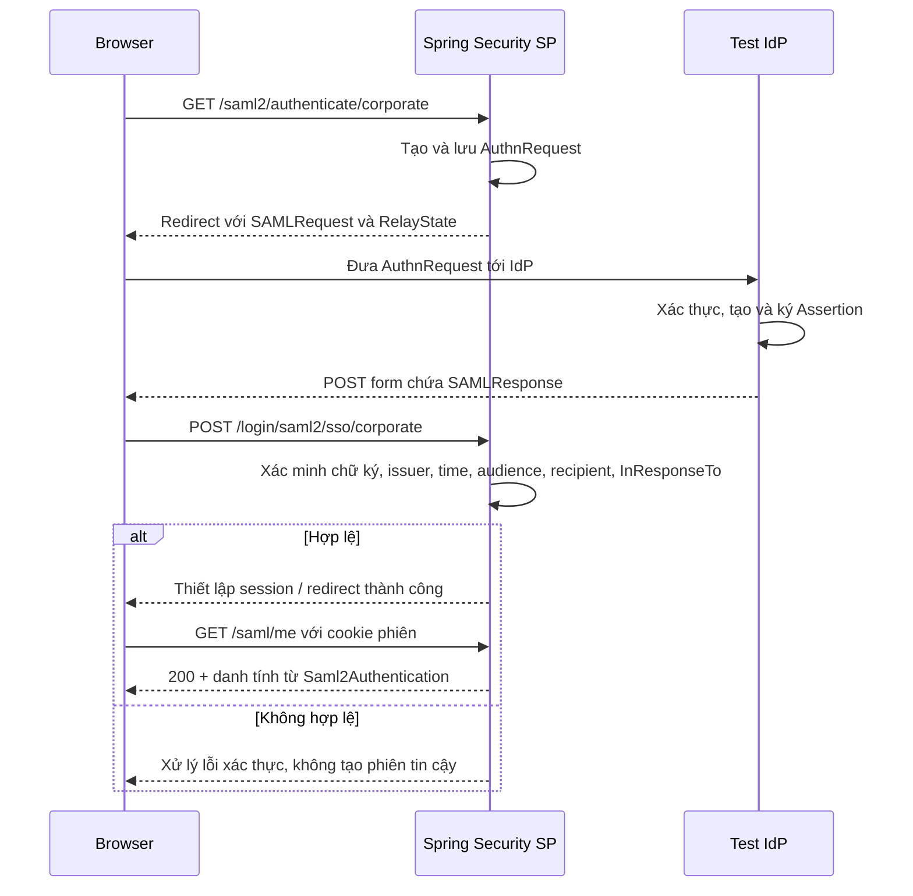

# Kiểm tra luồng SAML2, chữ ký và điều kiện assertion bằng thành phần thật khi cần

Trong ứng dụng Spring Security dùng **SAML 2.0 Service Provider (SP)**, một test trả HTTP 200 khi gắn sẵn principal có thể chứng minh controller cho phép người đã đăng nhập truy cập. Nhưng phép thử đó **không chứng minh** hệ thống đã kiểm tra chữ ký XML của SAML Response, chứng thư của Identity Provider (IdP), thời hạn assertion, audience, recipient hay sự tương ứng với AuthnRequest.

Đây là bài trong chương **Cơ chế chuyên biệt** của module **SPRING_SECURITY_TESTING**. Mục tiêu chung của module là kiểm chứng xác thực, phân quyền và bảo vệ HTTP bằng **spring-security-test** trên Servlet và Reactive, sử dụng MockMvc, WebTestClient, SecurityContext cùng những cơ chế đăng nhập/ủy quyền đặc thù. Với **SAML2 Login**, ta cần phân biệt hai lớp:

- **Kiểm thử hành vi sau đăng nhập:** cung cấp `Saml2Authentication` giả lập để test controller và rule phân quyền; chạy nhanh, độc lập IdP.
- **Kiểm thử luồng và validation thực:** để Spring Security xử lý AuthnRequest, callback ACS và SAML Response được ký bằng khóa test **thật**, sử dụng cấu hình SP/IdP đáng tin cậy; kiểm tra cả phản hồi thành công và từng điều kiện không hợp lệ.

Nguyên tắc cốt lõi: **không tắt kiểm tra chữ ký hoặc điều kiện assertion chỉ để làm test “xanh”**. Hãy tạo fixture SAML hợp lệ và các biến thể bất hợp lệ có chủ đích.

## 1. Định vị SAML2 trong kiến trúc Spring Security

SAML2 Web Browser SSO là giao thức khác OAuth2/OIDC:

| Khía cạnh | SAML2 Login | OAuth2/OIDC Login |
| --- | --- | --- |
| Đối tượng cốt lõi | `AuthnRequest`, `Response`, `Assertion` XML | Authorization code, token response, ID token JWT (OIDC) |
| Dữ liệu xác thực từ IdP | SAML Response/assertion và chữ ký XML | Token/ID token và các cơ chế validation |
| Khóa tin cậy | Chứng thư xác minh chữ ký của IdP trong relying-party registration | JWKS/cấu hình issuer của nhà cung cấp OIDC, tùy luồng |
| Endpoint tiếp nhận | Assertion Consumer Service (ACS), thường nhận `SAMLResponse` | Redirect URI callback thường nhận `code`, `state` |
| Tương quan request/response | `InResponseTo`, request repository, `RelayState` và các ràng buộc SAML liên quan | `state`, nonce (OIDC), PKCE khi áp dụng |
| Principal sau xác thực | Thường là `Saml2AuthenticatedPrincipal` trong `Saml2Authentication` | `OAuth2User` hoặc `OidcUser` |
| Helper test | `saml2Login()` cho MockMvc (nếu phiên bản hỗ trợ) | `oauth2Login()`, `oidcLogin()` |

Không dùng `jwt()` hay `oidcLogin()` rồi kết luận rằng đã xác minh SAML2. Chúng mô phỏng những kiểu Authentication khác nhau; bản thân một `SecurityContext` được tạo trong test **không chứng minh** giao thức đăng nhập đã chạy.

Trong Spring Security hiện đại, **SAML2 Service Provider login là chức năng của stack Servlet**. Không mặc định dùng API tương tự trên WebFlux chỉ vì có `WebTestClient`; phần Reactive được đối chiếu ở cuối bài.

### Các vai trò dễ nhầm

- **IdP:** nơi xác thực người dùng và phát hành SAML Response/assertion.
- **SP / Relying Party:** ứng dụng Spring Security nhận assertion, xác thực nó và tạo session/Authentication của ứng dụng.
- **`RelyingPartyRegistration`:** cấu hình quan hệ tin cậy giữa SP và IdP, gồm registration ID, SP entity ID, ACS và credential xác minh chữ ký của IdP.
- **`Saml2Authentication`:** Authentication sau khi Spring Security đã xử lý SAML Response thành công.
- **`Saml2AuthenticatedPrincipal`:** principal có NameID và các thuộc tính SAML, nhưng các thuộc tính ấy chỉ đáng tin **sau** bước xác minh theo chính sách của SP.

Một file `SAMLResponse` Base64 không tự trở thành bằng chứng danh tính. Mã hóa Base64 chỉ vận chuyển XML, **không cung cấp tính toàn vẹn hay xác thực**.

## 2. Luồng SP-initiated Login cần kiểm tra

Trong cấu hình mặc định phổ biến trên Servlet:

1. Trình duyệt truy cập route được bảo vệ; ứng dụng có thể chuyển hướng đến trang đăng nhập.
2. Trình duyệt bắt đầu SAML2 login tại `/saml2/authenticate/{registrationId}`, chẳng hạn `corporate`.
3. Spring Security tạo **AuthnRequest**, lưu thông tin liên quan tới request và gửi redirect/form tới IdP theo SAML binding được cấu hình.
4. IdP xác thực người dùng, tạo **SAML Response chứa assertion** và ký bằng private key phù hợp.
5. Trình duyệt gửi callback đến **ACS**, mặc định thường là `POST /login/saml2/sso/{registrationId}`, với tham số `SAMLResponse` và có thể `RelayState`.
6. SP giải mã, xác minh chữ ký/quan hệ tin cậy, kiểm tra trạng thái/điều kiện assertion và request correlation, rồi tạo `Saml2Authentication`.
7. Spring Security lưu SecurityContext theo cấu hình; request tiếp theo dùng session được phép vào route bảo vệ.



Đây là mô hình **SP-initiated**. Với IdP-initiated/unsolicited SSO, SP có thể không có AuthnRequest chờ trước; chính sách cho phép hoặc cấm loại response này phải được xác định và kiểm thử riêng. Không suy luận một bài test SP-initiated đã bao phủ unsolicited login.

### RelayState không thay thế chữ ký

`RelayState` có thể giúp duy trì ngữ cảnh yêu cầu và tương quan vòng đi-về. Nó không phải token chứng minh danh tính và không thay bước xác minh XML signature. `InResponseTo` của Response hoặc SubjectConfirmationData phải được xử lý theo chính sách SP và thông tin AuthnRequest đã lưu. Không tin `RelayState` do client tự gửi để chọn user hoặc bỏ qua request correlation.

## 3. Những điều kiện quan trọng trong SAML Response/assertion

Một test có giá trị nên tạo được assertion **hợp lệ** rồi thay đổi đúng **một** điều kiện ở mỗi ca âm. Các thuộc tính thường cần quan tâm:

| Trường / cấu trúc | Ý nghĩa bảo mật | Ca âm nên thử |
| --- | --- | --- |
| `Issuer` của Response/Assertion | Xác định IdP đã phát hành | Issuer khác IdP được tin cậy |
| XML `Signature` và chứng thư IdP | Chứng minh nội dung đã ký và khóa ký đáng tin | Chữ ký bị sửa, khóa không được tin cậy |
| `StatusCode` | Kết quả xử lý của IdP, ví dụ `Success` | Status lỗi, không cho đăng nhập |
| `AudienceRestriction/Audience` | Assertion dành cho SP entity ID nào | Audience trỏ sang ứng dụng khác |
| `Conditions.NotBefore` | Thời điểm sớm nhất assertion được sử dụng | Assertion chưa có hiệu lực |
| `Conditions.NotOnOrAfter` | Thời điểm hết hiệu lực, giới hạn trên không bao gồm | Assertion đã hết hạn |
| `SubjectConfirmationData.Recipient` | ACS được phép nhận bearer assertion | Recipient khác endpoint ACS |
| `SubjectConfirmationData.NotOnOrAfter` | Hạn sử dụng bearer subject confirmation | Subject confirmation đã hết hạn |
| `SubjectConfirmationData.InResponseTo` | Ràng buộc assertion với AuthnRequest tương ứng | ID của một AuthnRequest khác |
| `Response.Destination` | Địa chỉ đích của response theo binding/chính sách | Destination khác ACS |
| `NameID` và attributes | Dữ liệu về principal và thuộc tính được IdP phát hành | Thiếu NameID cần thiết hoặc attributes không đáp ứng policy |

Các giá trị `NotBefore`, `NotOnOrAfter` cần xem xét **clock skew** được cấu hình và đồng hồ ổn định trong test. Nếu đặt assertion hết hạn chỉ trước `now` một giây, một validator cho phép lệch giờ có thể vẫn chấp nhận; hãy chọn thời điểm đủ xa so với khoảng skew hoặc điều khiển clock.

**Không dùng phép sửa XML sau khi ký để kiểm tra sai audience hoặc hết hạn.** Cách đó thường làm chữ ký không hợp lệ trước, khiến test thất bại **vì signature**, không phải vì điều kiện đang muốn kiểm chứng. Hãy tạo assertion mang audience/thời gian sai **trước khi ký**, sau đó ký lại bằng khóa IdP test mà SP tin cậy.

Ngược lại, ca **chữ ký bị thay đổi** nên giữ nguyên nội dung hợp lệ ban đầu, sau đó cố ý sửa một phần nằm trong phạm vi chữ ký để xác minh SP từ chối toàn vẹn bị phá vỡ.

## 4. Quy tắc chữ ký: ký phần nào, tin khóa nào?

SAML cho phép các cấu trúc và cách ký khác nhau tùy IdP và cấu hình: có thể ký **Response**, **Assertion** hoặc cả hai. Quy tắc SP chấp nhận hình thức nào cần thống nhất với hợp đồng thực tế của IdP.

Một fixture đã ký đúng cú pháp XML nhưng dùng chứng thư **không có trong trust configuration** vẫn phải bị từ chối. Tương tự, một Response có phần tử `Signature` không có nghĩa SP đã xác minh được chữ ký đó.

Checklist bảo mật cho lớp xác minh:

1. Xác nhận XML signature tham chiếu đúng phần tử được dùng để xác thực, không chấp nhận XML Signature Wrapping.
2. Sử dụng trust credential của IdP được cấu hình trong `RelyingPartyRegistration` hoặc nguồn metadata đã được xác thực thích hợp.
3. Không tắt các bước validation hoặc chấp nhận “mọi certificate” trong test integration.
4. Kiểm tra yêu cầu ký Response/assertion theo hợp đồng triển khai, gồm xử lý trường hợp một phần có chữ ký và phần khác không.
5. Sử dụng thuật toán ký và cấu hình tin cậy được chính sách hiện tại cho phép; không hạ tiêu chuẩn chỉ để hỗ trợ một fixture cũ.
6. Không xem chuỗi XML đã Base64-decode hoặc DOM parser tùy chỉnh là principal nếu chưa có validation đầy đủ.

Trong Spring Security 6.x và các phiên bản khác, **lớp OpenSAML provider cụ thể có thể thay đổi** (chẳng hạn giữa các thế hệ OpenSAML). Bài test nên tích hợp thông qua `saml2Login()` và `RelyingPartyRegistrationRepository` của Spring Security, thay vì tự gắn chặt vào tên provider nội bộ khi không cần thiết.

**Phân biệt chứng thư:**

- Chứng thư **IdP verification**: SP dùng public key để xác minh chữ ký từ IdP.
- Chứng thư và private key **SP signing** (nếu cấu hình): SP dùng để ký AuthnRequest hoặc các thông điệp outbound theo yêu cầu IdP.
- Một cặp khóa **test IdP** dùng để ký response fixture; public certificate của chính cặp đó phải được cấu hình làm IdP verification credential ở test SP.

Không dùng private key production trong test, không ghi khóa riêng hoặc SAML assertion chứa PII vào log/fixture công khai.

## 5. Cấu hình Spring Boot Servlet: bảo vệ endpoint thực

Ví dụ ứng dụng Spring Boot 3.x, Spring Security 6.x, Java 17+ có những dependency chính:

```gradle
dependencies {
    implementation("org.springframework.boot:spring-boot-starter-web")
    implementation("org.springframework.boot:spring-boot-starter-security")
    implementation("org.springframework.security:spring-security-saml2-service-provider")

    testImplementation("org.springframework.boot:spring-boot-starter-test")
    testImplementation("org.springframework.security:spring-security-test")
}
```

`spring-security-saml2-service-provider` có thể phụ thuộc kho artifact OpenSAML thích hợp tùy phiên bản/build; hãy dùng hướng dẫn quản lý dependency của phiên bản Spring Security hiện có. Không đổi dependency production thành một provider giả để làm bài test pass.

Cấu hình relying party minh họa:

```yaml
spring:
  security:
    saml2:
      relyingparty:
        registration:
          corporate:
            entity-id: "{baseUrl}/saml2/service-provider-metadata/{registrationId}"
            assertion-consumer-service:
              location: "{baseUrl}/login/saml2/sso/{registrationId}"
            assertingparty:
              metadata-uri: https://idp.example.test/saml/metadata
```

Tên `corporate` là **registration ID nội bộ**. `entity-id` là SP entity ID; ACS là địa chỉ nhận Response; `assertingparty.metadata-uri` mô tả IdP và khóa tin cậy. Metadata URL ở đây chỉ minh họa, không phải máy chủ thật để test kết nối.

Trong integration test, nên override metadata URI sang **metadata của IdP thử nghiệm** hoặc cung cấp `RelyingPartyRegistrationRepository` sử dụng credential thử nghiệm. Metadata và chứng thư phải ăn khớp với fixture đang ký assertion. Không lấy metadata từ môi trường production khi không cần thiết; không tải chứng thư không được kiểm soát về rồi mặc định xem nó là đáng tin.

Một `SecurityFilterChain` cho ứng dụng:

```java
import org.springframework.context.annotation.Bean;
import org.springframework.context.annotation.Configuration;
import org.springframework.security.config.Customizer;
import org.springframework.security.config.annotation.web.builders.HttpSecurity;
import org.springframework.security.web.SecurityFilterChain;

@Configuration
class SamlSecurityConfig {

    @Bean
    SecurityFilterChain securityFilterChain(HttpSecurity http)
            throws Exception {
        return http
            .authorizeHttpRequests(auth -> auth
                .requestMatchers("/health").permitAll()
                .requestMatchers("/saml2/authenticate/**",
                    "/login/saml2/sso/**").permitAll()
                .requestMatchers("/saml/reports")
                    .hasAuthority("ROLE_ANALYST")
                .requestMatchers("/saml/**").authenticated()
                .anyRequest().denyAll())
            .saml2Login(Customizer.withDefaults())
            // POST từ IdP đến ACS không mang CSRF token của SPA.
            // Miễn trừ đúng endpoint SAML ACS, không tắt CSRF toàn cục.
            .csrf(csrf -> csrf.ignoringRequestMatchers(
                "/login/saml2/sso/**"))
            .build();
    }
}
```

Khi dùng SAML POST binding, IdP không có CSRF token do ứng dụng SP cấp; vì thế callback ACS cần được xử lý theo chính sách CSRF dành riêng cho giao thức. **Không vô hiệu hóa CSRF đối với mọi POST** hoặc coi miễn trừ CSRF là bỏ qua chữ ký SAML. Nếu framework đã có cấu hình matcher tương đương, tránh lặp hoặc mở rộng quá mức.

Controller:

```java
import java.security.Principal;

import org.springframework.web.bind.annotation.GetMapping;
import org.springframework.web.bind.annotation.RestController;

@RestController
class SamlController {

    @GetMapping("/health")
    String health() {
        return "ok";
    }

    @GetMapping("/saml/me")
    String currentUser(Principal principal) {
        // Chỉ trả tên minh họa, không trả raw SAMLResponse/assertion.
        return principal.getName();
    }

    @GetMapping("/saml/reports")
    String reports() {
        return "reports-ready";
    }
}
```

Để dùng `ROLE_ANALYST`, hệ thống cần ánh xạ attributes/groups SAML đã được xác minh thành authorities theo quy tắc nghiệp vụ riêng; **không tự coi mọi attribute là role tin cậy**. Ví dụ ở đây giả định mapping được cấu hình phù hợp khi kiểm thử rule reports.

## 6. Mức 1: MockMvc giả lập đã đăng nhập bằng saml2Login()

`spring-security-test` có helper `SecurityMockMvcRequestPostProcessors.saml2Login()` cho các phiên bản có hỗ trợ SAML2 Login test. Helper cung cấp `Saml2Authentication` giả lập vào mock request.

```java
import org.junit.jupiter.api.Test;
import org.springframework.beans.factory.annotation.Autowired;
import org.springframework.boot.test.autoconfigure.web.servlet.AutoConfigureMockMvc;
import org.springframework.boot.test.context.SpringBootTest;
import org.springframework.test.web.servlet.MockMvc;

import static org.springframework.security.test.web.servlet.request.SecurityMockMvcRequestPostProcessors.saml2Login;
import static org.springframework.test.web.servlet.request.MockMvcRequestBuilders.get;
import static org.springframework.test.web.servlet.result.MockMvcResultMatchers.status;

@SpringBootTest
@AutoConfigureMockMvc
class SamlControllerAuthorizationTests {

    @Autowired
    MockMvc mvc;

    @Test
    void authenticatedSamlPrincipalCanReadProfile() throws Exception {
        mvc.perform(get("/saml/me").with(saml2Login()))
            .andExpect(status().isOk());
    }

    @Test
    void anonymousRequestDoesNotReadProfile() throws Exception {
        mvc.perform(get("/saml/me"))
            .andExpect(status().is3xxRedirection());
    }
}
```

Với SecurityFilterChain có SAML2 Login và không có authentication, request browser tới `/saml/me` thường được chuyển hướng sang cơ chế đăng nhập. Nếu ứng dụng tùy biến `AuthenticationEntryPoint` thành 401 hoặc chính sách khác, điều chỉnh assertion theo hợp đồng thật, không thay production chỉ để test khớp.

Có thể dùng helper để kiểm thử authorities và attributes phù hợp với API của phiên bản đang sử dụng, ví dụ thiết kế ca:

| Request giả lập | Điều cần assert | Kết luận |
| --- | --- | --- |
| Không có Authentication | Redirect/401 theo entry point | Endpoint không công khai |
| `saml2Login()` vào `/saml/me` | 200 | Controller chấp nhận principal đã đăng nhập |
| `Saml2Authentication` giả thiếu `ROLE_ANALYST` vào `/saml/reports` | 403 | Authorization rule chặn thiếu quyền |
| `Saml2Authentication` giả có `ROLE_ANALYST` | 200 | Authorization rule cho phép khi authority phù hợp |

**Giới hạn bắt buộc ghi nhớ:** helper **không tạo AuthnRequest**, **không gửi `SAMLResponse`**, **không xác minh chữ ký**, **không kiểm tra `AudienceRestriction` hoặc `SubjectConfirmationData`**. Test authorization mức này hợp lệ, nhưng không được đặt tên là “SAML signature verification test”.

`@WithMockUser` cũng chỉ cấp Authentication giả, lại không tái hiện chính xác kiểu `Saml2Authentication`. Nếu controller phụ thuộc SAML attributes/NameID, ưu tiên helper SAML hoặc fixture Authentication chuyên biệt thay vì dùng username/password principal rồi kết luận hành vi SAML tương đương.

## 7. Mức 2: Tích hợp SAML Response thật bằng test IdP

Để kiểm tra chữ ký và assertion conditions, cần **để Spring Security tự xử lý XML đã ký**, không mock `Saml2AuthenticationProvider` hoặc trực tiếp gắn `SecurityContext`.

Cấu trúc bài test nên như sau:

```text
src/main/java/
  .../SamlSecurityConfig.java              (giữ cấu hình thực)
  .../SamlController.java                  (giữ controller thực)

src/test/resources/
  saml/idp-test-metadata.xml               (metadata IdP thử nghiệm)
  saml/test-idp-public-cert.pem            (chứng thư public cho SP)
  # Private key fixture chỉ dùng trong môi trường kiểm thử được bảo vệ.

src/test/java/
  .../Saml2SignedResponseFlowTests.java
  .../SignedSamlResponseFixture.java       (phát Response bằng khóa TEST)
```

Tệp được liệt kê chỉ là **sơ đồ tổ chức đề xuất**, không phải các tệp bài học cần tạo trong bước này. Test IdP/fixture có thể chạy như một server cục bộ hoặc một bộ sinh XML dùng OpenSAML. Khi sử dụng IdP test độc lập, còn có thể kiểm tra metadata, login/consent và binding với browser.

Điều kiện fixture **phải có**:

1. Một `RelyingPartyRegistration("corporate")` có SP entity ID/ACS khớp URL mà test đang gửi.
2. Chứng thư public của IdP test được khai báo là **verification credential tin cậy**.
3. Private key tương ứng chỉ ở bên fixture IdP test, không phải trong cấu hình SP production.
4. SAML Response có `Issuer`, `Status=Success`, `Destination` và assertion/subject confirmation phù hợp với SP.
5. AuthnRequest được sinh ra bởi Spring Security; Response phản hồi với `InResponseTo` thích hợp.
6. Timestamp còn hiệu lực với khoảng clock skew cho phép; Audience là SP entity ID, Recipient là ACS.
7. Chữ ký được tạo **trên đúng phần tử** theo profile IdP và chính sách xác minh của SP.

Nếu dùng SAML HTTP-POST binding ở ACS, `SAMLResponse` là **Base64-encoded XML**. Không đem cách DEFLATE thường dùng cho HTTP-Redirect binding của AuthnRequest áp dụng bừa cho HTTP-POST SAMLResponse.

### Lấy AuthnRequest và session đúng cách

Trong test SP-initiated:

```java
MvcResult started = mvc.perform(
        get("/saml2/authenticate/corporate"))
    .andExpect(status().is3xxRedirection())
    .andReturn();

String redirectUrl = started.getResponse().getRedirectedUrl();
MockHttpSession session =
    (MockHttpSession) started.getRequest().getSession(false);
```

Với cấu hình Redirect binding, `redirectUrl` thường chứa `SAMLRequest` và `RelayState`. Fixture test cần decode request **đúng binding**, lấy request ID, issuer và ACS đã được SP yêu cầu, rồi tạo Response đáp ứng. `session` phải được sử dụng cho callback để request repository trên SP so khớp trạng thái login.

**Không hardcode `InResponseTo` theo một ID cũ**, không dùng session của một request khác và không cho fixture tạo Response có thời gian đã hết hạn. Nếu AuthnRequest binding là POST, bước đọc request phải được đổi theo binding đó thay vì giả định mọi IdP đều dùng redirect.

## 8. Khung integration test: callback ký thật và login được chấp nhận

Đoạn sau là **khung tích hợp có chủ đích**, không phải lớp test chạy ngay nếu chưa cung cấp `SignedSamlResponseFixture` và registration metadata IdP test. Fixture phải **thực sự ký XML** bằng test private key và được SP kiểm chứng bằng test public certificate. Không thay `SignedSamlResponseFixture` bằng một hàm chỉ Base64-encode XML không chữ ký.

```java
import org.junit.jupiter.api.Test;
import org.springframework.beans.factory.annotation.Autowired;
import org.springframework.boot.test.autoconfigure.web.servlet.AutoConfigureMockMvc;
import org.springframework.boot.test.context.SpringBootTest;
import org.springframework.mock.web.MockHttpSession;
import org.springframework.test.web.servlet.MockMvc;
import org.springframework.test.web.servlet.MvcResult;
import org.springframework.web.util.UriComponentsBuilder;

import static org.assertj.core.api.Assertions.assertThat;
import static org.springframework.test.web.servlet.request.MockMvcRequestBuilders.get;
import static org.springframework.test.web.servlet.request.MockMvcRequestBuilders.post;
import static org.springframework.test.web.servlet.result.MockMvcResultMatchers.status;

@SpringBootTest
@AutoConfigureMockMvc
class Saml2SignedResponseFlowTests {

    @Autowired MockMvc mvc;

    // Test-only component: phải triển khai bằng test IdP/OpenSAML thật.
    @Autowired SignedSamlResponseFixture signedFixture;

    @Test
    void validSignedResponseCreatesAuthenticatedSession()
            throws Exception {

        MvcResult start = mvc.perform(
                get("/saml2/authenticate/corporate"))
            .andExpect(status().is3xxRedirection())
            .andReturn();

        MockHttpSession session =
            (MockHttpSession) start.getRequest().getSession(false);
        assertThat(session).isNotNull();

        String redirectUrl = start.getResponse().getRedirectedUrl();
        assertThat(redirectUrl).isNotBlank();

        // Fixture: decode SAMLRequest từ redirect, lấy ID,
        // dựng assertion đúng Audience/Recipient/InResponseTo/time,
        // sau đó ký bằng private key của TEST IdP.
        SignedResponse reply = signedFixture.successFor(
            redirectUrl, "alice@example.test");

        MvcResult callback = mvc.perform(
                post("/login/saml2/sso/corporate")
                    .session(session)
                    .param("SAMLResponse", reply.responseBase64())
                    .param("RelayState", reply.relayState()))
            .andExpect(status().is3xxRedirection())
            .andReturn();

        MockHttpSession authenticatedSession =
            (MockHttpSession) callback.getRequest().getSession(false);
        assertThat(authenticatedSession).isNotNull();

        mvc.perform(get("/saml/me").session(authenticatedSession))
            .andExpect(status().isOk());
    }
}

record SignedResponse(String responseBase64, String relayState) {}

// Contract cho fixture test (chưa có implementation trong ví dụ):
interface SignedSamlResponseFixture {
    SignedResponse successFor(
        String authorizationRedirectUrl, String nameId);

    SignedResponse withAudienceFor(
        String authorizationRedirectUrl,
        String nameId,
        String audience);
}
```

**Lưu ý kỹ thuật:** nếu đăng nhập thành công, session ID có thể thay đổi do bảo vệ session fixation; lấy session sau callback thay vì giả định ID cũ không đổi. `RelayState` mà fixture trả về cần phản ánh giá trị tương quan hợp lệ từ bước bắt đầu luồng. Nếu project dùng authentication success handler trả 200 hoặc redirect URL tùy chỉnh, điều chỉnh kỳ vọng theo handler.

Test ở trên không dùng `.with(saml2Login())`: authentication được tạo **sau khi filter xử lý SAMLResponse thật**. Nó không kiểm trình duyệt/IdP UI, nhưng có thể xác minh phần SP nhận và đánh giá assertion đã ký. Để kiểm toàn bộ browser, cookie/SameSite, proxy HTTPS và IdP login, cần thêm E2E với môi trường IdP thử nghiệm.

## 9. Kiểm tra ca âm đúng nguyên nhân thất bại

Một phương pháp tạo fixture âm là xây dựng một Response hợp lệ trước, sau đó **biến đổi đúng một thuộc tính có chủ đích và ký lại**, trừ bài test trực tiếp về chữ ký.

| Ca test | Cách tạo fixture | Lý do SP phải từ chối |
| --- | --- | --- |
| Chữ ký bị sửa | Ký response hợp lệ rồi sửa dữ liệu nằm trong phần đã ký | Toàn vẹn chữ ký không còn hợp lệ |
| Chữ ký với khóa lạ | Ký hợp lệ bằng khóa **không** nằm trong verification credentials của SP | Không tin người phát hành chữ ký |
| Thiếu chữ ký theo chính sách | Không ký assertion/response ở hình thức bắt buộc | Không đáp ứng yêu cầu xác thực nguồn gốc |
| `Issuer` không đúng | Tạo issuer sai rồi ký lại bằng khóa test | IdP phát hành không khớp đăng ký tin cậy |
| `Audience` là SP khác | Gán sai AudienceRestriction **trước khi ký** | Assertion không dành cho ứng dụng này |
| `Conditions.NotBefore` ở tương lai | Đặt thời điểm vượt clock skew, ký lại | Chưa đến thời điểm hợp lệ |
| `Conditions.NotOnOrAfter` ở quá khứ | Đặt đã hết hạn đủ xa, ký lại | Assertion hết hiệu lực |
| SubjectConfirmation hết hạn | Đặt `SubjectConfirmationData.NotOnOrAfter` quá khứ, ký lại | Không còn được dùng bearer confirmation |
| Sai `Recipient` | Đặt recipient không phải ACS, ký lại | Assertion được gửi sai nơi nhận |
| Sai `Destination` | Đặt URL đích không đúng, ký lại | Response không dành cho endpoint hiện tại |
| Sai `InResponseTo` | Tạo ID khác AuthnRequest đang chờ, ký lại | Không tương quan với yêu cầu đăng nhập |
| `StatusCode` không thành công | Tạo Response báo lỗi IdP | Không có xác thực thành công để chấp nhận |
| Dùng lại cùng Response | Submit lại sau lần đăng nhập hoặc request correlation đã tiêu thụ | Cần xác định chính sách chống replay ở SP |

**Điểm quan trọng về replay:** không mặc định Spring Security có **một kho replay ID toàn cục** trong mọi phiên bản/cấu hình. Một Response bị phát lại có thể thất bại vì AuthnRequest/session đã được tiêu thụ, nhưng điều đó không đồng nghĩa mọi dạng unsolicited response đều được chống replay tự động. Nếu yêu cầu bảo mật có replay cache theo `Response ID`/`Assertion ID`, cần cấu hình và kiểm tra cơ chế đó một cách rõ ràng.

### Ví dụ mô tả test sai audience

Khung kiểm thử có thể trông như sau:

```java
@Test
void wrongAudienceIsRejectedEvenWithTrustedSignature() throws Exception {
    MvcResult start = mvc.perform(
            get("/saml2/authenticate/corporate"))
        .andExpect(status().is3xxRedirection())
        .andReturn();

    MockHttpSession session =
        (MockHttpSession) start.getRequest().getSession(false);

    // Test IdP ký lại Response bằng trusted private key,
    // nhưng AudienceRestriction trỏ sang SP khác.
    SignedResponse wrongAudience = signedFixture.withAudienceFor(
        start.getResponse().getRedirectedUrl(),
        "alice@example.test",
        "https://other-sp.example.test/metadata");

    mvc.perform(post("/login/saml2/sso/corporate")
            .session(session)
            .param("SAMLResponse", wrongAudience.responseBase64())
            .param("RelayState", wrongAudience.relayState()))
        .andExpect(status().is3xxRedirection());

    // Với cấu hình SAML login mặc định, failure handler thường
    // chuyển hướng login?error. Quan trọng nhất: không được
    // có session đã xác thực để truy cập endpoint bảo vệ.
    mvc.perform(get("/saml/me").session(session))
        .andExpect(status().is3xxRedirection());
}
```

Đặt phương thức test này trong cùng lớp `Saml2SignedResponseFlowTests`. `withAudienceFor(...)` đã được khai báo trong interface fixture ở mục 8, nhưng **vẫn phải có implementation thực sự ký XML** và chỉ chạy khi policy, registration và failure handler tương ứng được thiết lập. Đừng kết luận rằng validator audience đã chạy chỉ từ một status lỗi. Hãy xác minh **chữ ký vẫn hợp lệ** và fixture chỉ sai audience, sau đó quan sát loại authentication failure theo cách an toàn (không log assertion chứa dữ liệu cá nhân).

### Khống chế clock khi test thời hạn

Một test assertion hết hạn nên chọn `NotOnOrAfter` đủ xa trong quá khứ so với skew, ví dụ trừ nhiều phút, thay vì đặt ngay `Instant.now().minusMillis(1)`. Test assertion chưa hiệu lực cũng nên đặt `NotBefore` xa hơn skew. Nếu cần ranh giới chính xác đến mili-giây, dùng clock kiểm soát được trong thành phần validator/fixture khi API cho phép, thay vì dựa vào tốc độ CI.

`NotOnOrAfter` là **exclusive upper bound**: đúng tại thời điểm đó đã không còn hợp lệ theo điều kiện; kết quả thực tế còn phải xét chính sách clock skew.

## 10. Các điểm cấu hình và validation thường bị bỏ sót

### SP entity ID và audience là hợp đồng, không phải hostname tùy ý

`AudienceRestriction` thường phải chứa entity ID của SP đã khai báo trong `RelyingPartyRegistration`. Nếu reverse proxy, HTTPS termination hay host header làm đổi `{baseUrl}`, yêu cầu có thể bị từ chối dù chữ ký hợp lệ. Hãy kiểm tra entity ID và ACS dưới môi trường deploy thật, không sửa validator để chấp nhận mọi audience.

### Destination, Recipient và ACS phải nhất quán

`Response.Destination` và `SubjectConfirmationData.Recipient` liên quan nơi nhận. Trong bài test nên kiểm tra các giá trị này khớp ACS thực mà ứng dụng đăng ký với IdP, kể cả scheme `https`, host, port và path khi giao thức/policy yêu cầu. Không đưa một URL lạ vào config chỉ để test qua, nhất là URL do người gọi điều khiển.

### InResponseTo và session correlation

Khi SP phát AuthnRequest, phải duy trì state để so khớp response. Test cần giữ cùng session từ lúc tạo request đến khi post response; nếu tạo callback không có session, request matching có thể thất bại. Khi IdP-initiated login được cho phép, hãy áp dụng chính sách riêng, không coi việc thiếu `InResponseTo` là đương nhiên an toàn.

### IdP metadata và rollover chứng thư

Chứng thư của IdP có thể luân chuyển. Integration test nên dùng metadata/credentials thử nghiệm nhất quán, có thể thêm test dùng hai chứng thư đang được tin trong cửa sổ chuyển đổi; không mặc định mọi chứng thư cùng tên hoặc mọi certificate từ metadata bất kỳ đều đáng tin. Chính sách trust metadata phải được thiết lập ngoài luồng request, không suy từ chuỗi SAML do người dùng gửi.

### XML parsing và signature wrapping

Tránh tự parse XML rồi lấy `NameID` bằng XPath trước khi xác minh chữ ký. XML parser/validator phải xử lý an toàn external entities, canonicalization, reference IDs và các dạng bao gói chữ ký. Dùng pipeline OpenSAML được Spring Security tích hợp, test thêm biến thể có cấu trúc đáng ngờ theo threat model, không tự viết hàm “verify” chỉ kiểm tra sự tồn tại của phần tử `<Signature>`.

### Phân quyền theo attributes

Một assertion hợp lệ có thể chứa groups/attributes, nhưng việc ánh xạ `department=Finance` thành `ROLE_ANALYST` là **quy tắc ứng dụng**. Cần test riêng authority mapping; không mặc định có role chỉ vì IdP đã phát một chuỗi attribute.

## 11. Ma trận kiểm thử theo mục tiêu

| Mục tiêu | Kỹ thuật phù hợp | Bằng chứng thu được |
| --- | --- | --- |
| Endpoint cần người đã đăng nhập | MockMvc `.with(saml2Login())`, request anonymous | 200 đối với principal giả và redirect/401 với anonymous |
| Rule `ROLE_ANALYST` | Authentication giả có/không có authority | Authorization đúng, **chưa** chứng minh assertion |
| SP sinh AuthnRequest | MockMvc `GET /saml2/authenticate/corporate` | AuthnRequest, redirect/POST binding và session correlation |
| SP nhận Response đã ký | MockMvc ACS POST với fixture IdP ký thật | Filter và validation SAML chạy |
| SP từ chối chữ ký giả | Fixture signed đúng rồi bị sửa | Integrity verification hoạt động |
| SP từ chối khóa ký không tin | Fixture ký bằng khóa lạ | Trust configuration hoạt động |
| Audience, time, recipient, destination, InResponseTo | Fixture âm **được ký lại hợp lệ** với một điều kiện sai | Validation điều kiện tương ứng hoạt động |
| Không đăng nhập sau callback lỗi | POST ACS thất bại rồi truy cập `/saml/me` | Không tồn tại session xác thực hợp lệ |
| IdP-initiated và replay | Fixture kèm server-side replay policy được kiểm tra | Chính sách chống unsolicited/replay theo yêu cầu |
| Cookie, SameSite, proxy, trang IdP thực | Browser E2E với IdP test | Tương thích thực sự của front-channel SAML |
| Mapping SAML attributes sang authorities | Integration hoặc test converter/mapping riêng | Quy tắc phân quyền dựa trên claims đã xác minh |

**Một status code không đủ để chỉ ra nguyên nhân.** Ví dụ callback trả `/login?error` có thể do session sai, signature sai, audience sai hoặc XML không parse được. Chỉ được khẳng định “validator audience từ chối” khi fixture có chữ ký hợp lệ, các điều kiện khác đúng và dữ liệu test xác định nguyên nhân.

## 12. Ranh giới MockMvc, WebTestClient và SAML2

Trong module **SPRING_SECURITY_TESTING**, không phải mọi helper có tiền tố `mock` đều thử được cơ chế giao thức:

- `@WithMockUser`: đặt user vào SecurityContext của test; không tạo SAML Response.
- `saml2Login()`: cung cấp `Saml2Authentication` giả cho **MockMvc Servlet**, phù hợp test sau login.
- `jwt()`/`opaqueToken()`: giả authentication cho Resource Server nhận bearer token; không kiểm tra SAML XML.
- `oauth2Login()`/`oidcLogin()`: giả OAuth2/OIDC principal; không kiểm tra SAML2 SSO.
- `WebTestClient.bindToServer()`: gửi HTTP tới server thật; không truyền trực tiếp Authentication object giữa hai tiến trình.

Nếu có một API **WebFlux** được bảo vệ bằng OAuth2/JWT phía sau gateway SAML, hãy test **luồng SAML tại gateway/SP Servlet** riêng, sau đó test API WebFlux bằng token/cookie giao thức mà gateway hoặc hệ thống thật cung cấp. Không tự giả định Spring Security WebFlux có `mockSaml2Login()` tương đương và cùng semantics với MockMvc.

Khi SAML SP thật chạy trên cổng HTTP, test client/brower cần nhận redirect đến IdP, hoàn tất login và gửi SAMLResponse theo binding. Không thể làm cho server thật đã xác thực bằng cách gọi `with(saml2Login())` ở test JVM; helper đó chỉ hữu ích cho mock request đã tích hợp Spring Security Test.

## 13. Bài tập thực hành

1. Dùng `saml2Login()` để gọi `/saml/me`, rồi gọi lại ẩn danh. Giải thích vì sao test này đo authorization mà không đo signature.
2. Cấu hình một relying-party registration `corporate` dùng metadata và public certificate của IdP test; xây dựng fixture ký Response bằng private key tương ứng.
3. Chạy SP-initiated flow: `GET /saml2/authenticate/corporate`, giữ `session`, `RelayState` và AuthnRequest ID, sau đó POST `SAMLResponse` ký hợp lệ tới ACS. Kiểm tra session đã đăng nhập.
4. Tạo fixture Response hợp lệ rồi sửa một byte nằm trong phạm vi XML signature **sau khi ký**. Xác minh login thất bại.
5. Tạo một Response với Audience trỏ sang SP khác, **ký lại bằng khóa test được tin**. Kiểm tra bị từ chối và giải thích vì sao ca này đo audience chứ không phải chữ ký.
6. Lặp lại với `NotBefore` trong tương lai, `NotOnOrAfter` trong quá khứ, `Recipient` sai và `InResponseTo` không khớp. Mỗi fixture chỉ sai một điều kiện.
7. Đăng nhập với assertion có `department=Analytics` nhưng không có role cần thiết. Kiểm tra mapping để `/saml/reports` trả 403 cho người thiếu `ROLE_ANALYST`.
8. Thử post một SAMLResponse cũ sau khi request ban đầu đã hoàn thành. Xác định chính sách chống replay thực tế và các giới hạn khi dùng IdP-initiated flow.
9. Chạy một browser E2E trên IdP test, kiểm tra redirect HTTPS, cookie/session, SameSite, metadata và ACS public URL; so sánh bằng chứng thu được với MockMvc.
10. Lập bảng trường hợp thất bại mà **không ghi raw NameID, attributes hoặc SAMLResponse** vào log. Ghi loại lỗi và thông tin tương quan an toàn để điều tra.

## 14. Ghi nhớ

- **`saml2Login()` chỉ giả lập người dùng đã được xác thực** trong MockMvc, không tạo chữ ký hoặc chạy validation SAML thật.
- **Muốn kiểm tra SAML signature và assertion conditions, phải để pipeline SAML2 của Spring Security xử lý XML thực sự được ký.** Dùng IdP/fixture test với cặp khóa riêng, registration và trust credential nhất quán.
- **Chữ ký hợp lệ chưa đủ.** Phải xem issuer, audience, recipient, destination, thời gian, subject confirmation, `InResponseTo`, trạng thái response và chính sách SP.
- **Fixture âm phải tách nguyên nhân:** sai audience/time cần được ký lại hợp lệ; sai chữ ký thì cố tình phá chữ ký sau khi ký.
- **Trạng thái đăng nhập phải được kiểm chứng sau callback.** Không chấp nhận callback lỗi mà vẫn cho request tiếp theo dùng session đã xác thực.
- **RelayState, AuthnRequest và session cần được xử lý đúng ngữ cảnh.** Không dùng giá trị hardcode hay cho phép unsolicited SSO mà không có chính sách rõ ràng.
- **Không nới lỏng validation để sửa test.** Nếu test khó tạo SAML hợp lệ, sửa fixture IdP, metadata, certificate hoặc thời gian, không bỏ qua xác minh.
- **Servlet SAML2 và Reactive/OAuth2/JWT không phải một stack.** Chọn helper đúng mục tiêu kiểm thử và kiểm chứng giao thức ở nơi nó thực sự chạy.

Trong **SPRING_SECURITY_TESTING**, một bộ kiểm thử SAML2 đáng tin phải trả lời được: **ai đã ký assertion, SP có tin chứng thư ấy không, assertion còn hiệu lực và thực sự dành cho SP/request hiện tại không, và người dùng có được phân quyền đúng sau khi xác thực không?** Các câu trả lời chỉ vững chắc khi kết hợp test authorization giả lập với test tích hợp sử dụng những thành phần xác minh SAML thật.

