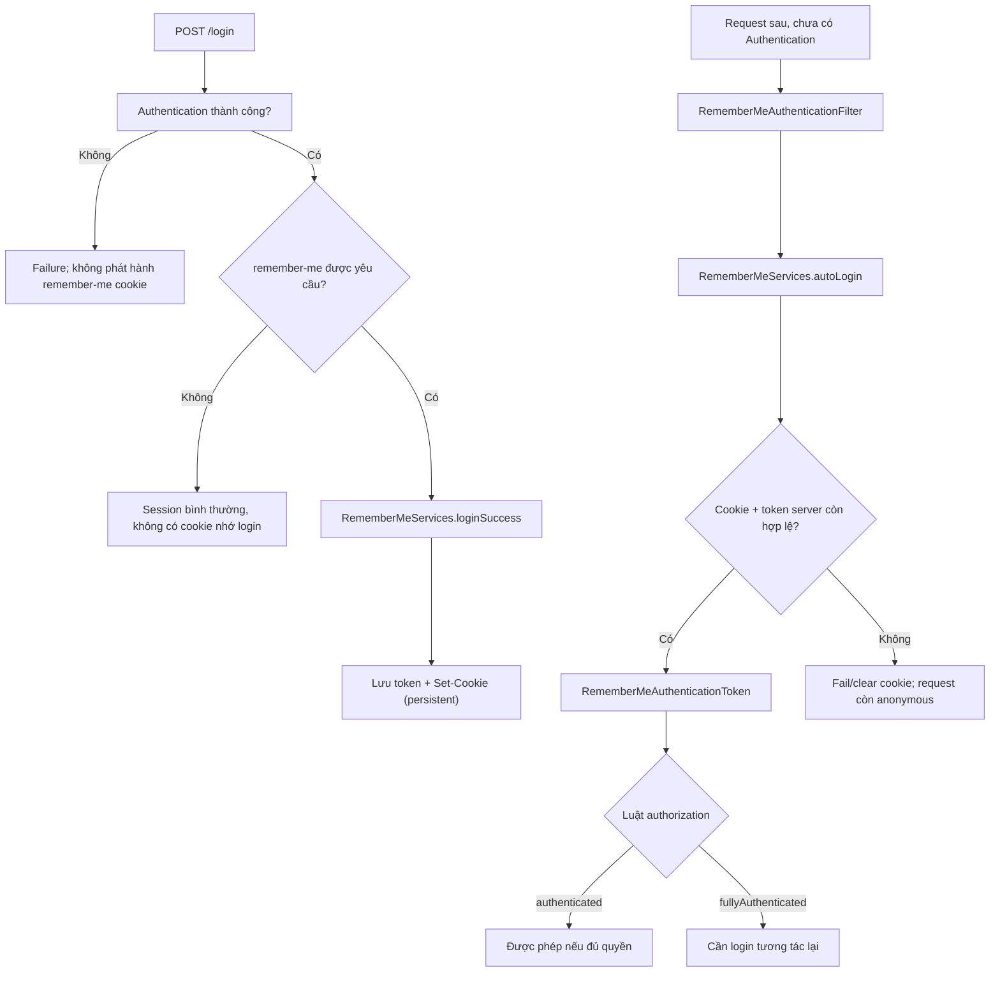

# Remember-me với phát hành, gửi lại và vô hiệu token

Một ứng dụng Spring Security cho phép người dùng chọn **“Ghi nhớ đăng nhập”** (*remember-me*) để khi HTTP session thông thường hết hạn, trình duyệt vẫn có thể gửi cookie nhớ đăng nhập và được xác thực lại. Tính năng này tác động trực tiếp đến ranh giới bảo mật: cookie được **phát hành sau một lần login hợp lệ**, được **gửi lại ở request về sau**, và phải được **vô hiệu hóa đúng lúc** khi logout, phát hiện token cũ bị tái sử dụng hoặc thu hồi thông tin xác thực.

Bài thuộc chương **Cơ chế chuyên biệt** của module `SPRING_SECURITY_TESTING`. Mục tiêu là kiểm chứng hành vi bảo vệ HTTP thực tế bằng `spring-security-test` trên Servlet, đặc biệt với `MockMvc`, `SecurityContext`, cookie và trạng thái token phía server. Ta sẽ phân biệt token-based với persistent remember-me, kiểm tra luồng từ form login tới request ở **session mới**, xác minh token được xoay, thử **replay cookie cũ**, rồi kiểm tra logout và revocation. Cuối bài sẽ chỉ ra giới hạn của `@WithMockUser`, `oauth2Login()`, `oidcLogin()`, JWT giả lập và sự khác biệt với `WebTestClient`/WebFlux.

> **Đích kiểm thử:** Một cookie nhớ đăng nhập không được coi là hợp lệ chỉ vì client gửi lại cùng một chuỗi. Bài test cần chứng minh cơ chế đã phát hành cookie đúng điều kiện, phục hồi Authentication trong request không còn session đăng nhập, xử lý token cũ theo chính sách và ngăn request sau khi token bị vô hiệu hóa.

## 1. Remember-me thực sự làm gì?

Với form login trên Servlet, quá trình thông thường:

1. Người dùng gửi `POST /login` kèm username, password, CSRF token và lựa chọn `remember-me`.
2. `UsernamePasswordAuthenticationFilter` xác thực thành công. Remember-me services, khi được cấu hình đúng, phát hành cookie trên response nếu điều kiện kích hoạt được đáp ứng.
3. Session login có thể hết hạn, bị mất hoặc không được gửi ở request tiếp theo; trình duyệt vẫn còn cookie remember-me.
4. `RememberMeAuthenticationFilter` nhận request không có Authentication hiện hữu, gọi `RememberMeServices.autoLogin(...)`. Nếu cookie hợp lệ, Spring tạo một `RememberMeAuthenticationToken` và có thể cập nhật cookie/token lưu trữ.
5. Authorization tiếp tục quyết định endpoint có được phép cho dạng xác thực này không. `authenticated()` thường chấp nhận remember-me authentication; `fullyAuthenticated()` đòi người dùng xác thực đầy đủ, không chỉ remembered.

```mermaid
sequenceDiagram
    autonumber
    actor Browser as Trình duyệt
    participant App as Spring Security Servlet
    participant Repo as PersistentTokenRepository
    Browser->>App: POST /login (username, password, remember-me=on, CSRF)
    App->>App: Xác minh credentials
    App->>Repo: Tạo series S, token T0
    App-->>Browser: 302 + Set-Cookie remember-me=C0
    Note over Browser: Session cũ không còn
    Browser->>App: GET /private/whoami (cookie C0, session mới)
    App->>Repo: Tìm series S, đối chiếu T0
    App->>Repo: Xoay token thành T1
    App-->>Browser: 200 + Set-Cookie C1
    Note over Browser: C0 đã cũ; trình duyệt dùng C1
    Browser->>App: GET /private/whoami (cookie C0, session mới)
    App->>Repo: Series S tồn tại nhưng token không khớp
    App->>Repo: Thu hồi token của user theo cơ chế persistent
    App-->>Browser: Không xác thực; chuyển đến login
```

Sơ đồ thể hiện hành vi của **persistent remember-me** với cơ chế xoay token. Nó không phải mô tả chính xác mọi triển khai remember-me: loại cookie ký dựa trên khóa (*token-based*) có cách xác minh và thu hồi khác.

### Remember-me không đồng nghĩa phiên đăng nhập đầy đủ

| Trạng thái request | Authentication điển hình | Ý nghĩa |
|---|---|---|
| Vừa đăng nhập bằng form | `UsernamePasswordAuthenticationToken` | Đã xác thực trực tiếp bằng credentials. |
| Session hợp lệ từ login trước | Authentication được phục hồi từ session | Vẫn dùng phiên hiện tại, không cần tự động dùng cookie remember-me. |
| Session không có Authentication, cookie remember-me hợp lệ | `RememberMeAuthenticationToken` | Được nhận diện qua cookie nhớ đăng nhập. |
| Cookie thiếu, hết hạn, không hợp lệ hoặc bị thu hồi | Anonymous hoặc chưa xác thực | Endpoint bảo vệ sẽ kích hoạt entry point theo cấu hình. |

Khi test luồng remember-me, **phải dùng session mới hoặc không gửi session cũ**; nếu giữ session của login, HTTP 200 có thể do `SecurityContext` trong session chứ không hề đi qua remember-me filter.

## 2. Hai kiểu remember-me phổ biến

Spring Security Servlet cung cấp những cơ chế thường gặp:

| Nội dung | Token-based remember-me | Persistent-token remember-me |
|---|---|---|
| Thành phần thường dùng | `TokenBasedRememberMeServices` | `PersistentTokenBasedRememberMeServices` |
| State trên server | Không cần bản ghi cho từng cookie; dựa vào signature, key, thông tin user và thời hạn | Lưu `series`/`token` và thời điểm sử dụng trong `PersistentTokenRepository` |
| Phát hành cookie | Cookie mang dữ liệu được bảo vệ bằng signature | Cookie mang series/token ngẫu nhiên gắn với bản ghi server |
| Request tiếp theo | Xác minh chữ ký, thời hạn và thông tin user tương ứng | Tìm series, đối chiếu token, rồi thường **xoay** token |
| Phát hiện dùng lại token cũ | Không có cơ chế so sánh “token đã được thay thế” dựa trên từng series | Có thể phát hiện token không khớp series và xử lý như khả năng token bị đánh cắp |
| Thu hồi từng thiết bị | Khó nếu không bổ sung state/revocation riêng | Có thể xây dựng theo series trong repository tùy chỉnh; API mặc định có thao tác xóa token theo user |
| Thu hồi toàn bộ | Đổi key hoặc thông tin làm chữ ký mất hiệu lực; tùy thiết kế | `removeUserTokens(username)` ở repository, hoặc logout/change-password policy gọi vào dịch vụ liên quan |

Không hardcode hoặc giải mã cookie rồi tự cho rằng chuỗi trong đó chính là Authentication hợp lệ. Với persistent implementation thông dụng, cookie chứa hai giá trị dạng `series` và `token` được mã hóa để truyền tải, **không phải** nơi lưu chữ ký kiểm chứng bằng thuật toán JWT. Mỗi giá trị vẫn là bí mật bearer có khả năng bị sao chép; do đó phải bảo vệ cookie trên kênh truyền và thiết bị người dùng.

**Chọn cơ chế theo yêu cầu:** Nếu cần thu hồi và phát hiện replay, persistent-token phù hợp cho bài tích hợp này. Nếu dùng token-based, hãy kiểm tra hết hạn, thay password/key và nhánh signature sai; không kỳ vọng “request hợp lệ sẽ phát hành token ngẫu nhiên mới mỗi lần” nếu cơ chế không làm vậy.

## 3. Các lớp Spring Security tham gia

`RememberMeServices` phối hợp login success, request tự động và logout:

- `loginSuccess(request, response, authentication)`: được gọi sau một lần xác thực tương tác thành công; nếu remember-me được yêu cầu hoặc cấu hình luôn ghi nhớ, có thể phát cookie.
- `autoLogin(request, response)`: được `RememberMeAuthenticationFilter` gọi khi SecurityContext chưa có Authentication để thử phục hồi từ cookie.
- `loginFail(request, response)`: thường xóa cookie phía browser khi không thể dùng cookie.
- `logout(request, response, authentication)`: xóa cookie và, với persistent services, xử lý dữ liệu lưu trữ theo triển khai.

`PersistentTokenRepository` lưu các bản ghi dạng `PersistentRememberMeToken`; `JdbcTokenRepositoryImpl` là triển khai JDBC cơ bản. Không nhầm bảng này với bảng HTTP session `SPRING_SESSION` hoặc bảng OAuth2 authorized clients: chúng có vòng đời và mục đích khác nhau.



Phân biệt rõ **“có nhớ đăng nhập”** và **“có quyền truy cập endpoint”**. Người dùng được remember-me filter nhận diện vẫn có thể thiếu `ROLE_ADMIN`, hoặc không đạt yêu cầu `fullyAuthenticated()` của chức năng nhạy cảm.

## 4. Thiết kế API và chính sách để kiểm thử

Giả sử ứng dụng có hai endpoint:

- `GET /private/whoami`: yêu cầu `authenticated()`, trả tên và loại Authentication để phát hiện remember-me có thực sự hoạt động.
- `GET /private/recent`: yêu cầu `fullyAuthenticated()`, không chấp nhận chỉ dùng cookie remember-me; cần phiên xác thực đầy đủ.

### Controller quan sát loại Authentication

```java
import org.springframework.security.core.Authentication;
import org.springframework.web.bind.annotation.GetMapping;
import org.springframework.web.bind.annotation.RestController;

@RestController
class RememberMeDemoController {

    @GetMapping("/private/whoami")
    String whoAmI(Authentication authentication) {
        return authentication.getName() + "|"
                + authentication.getClass().getSimpleName();
    }

    @GetMapping("/private/recent")
    String recent() {
        return "sensitive";
    }
}
```

### Schema cho persistent token

Ví dụ schema dành cho `JdbcTokenRepositoryImpl`:

```sql
CREATE TABLE persistent_logins (
    username  VARCHAR(64)  NOT NULL,
    series    VARCHAR(64)  PRIMARY KEY,
    token     VARCHAR(64)  NOT NULL,
    last_used TIMESTAMP    NOT NULL
);
```

Trong production, tạo schema bằng Flyway/Liquibase và kiểm soát quyền truy cập DB. Không bật tùy chọn tự tạo bảng lúc startup trên database dùng chung; trong test có thể tạo bảng qua migration hoặc khởi tạo một lần trên database cô lập.

### Cấu hình UserDetailsService và token repository

```java
import javax.sql.DataSource;
import org.springframework.context.annotation.Bean;
import org.springframework.context.annotation.Configuration;
import org.springframework.security.core.userdetails.User;
import org.springframework.security.core.userdetails.UserDetailsService;
import org.springframework.security.provisioning.InMemoryUserDetailsManager;
import org.springframework.security.web.authentication.rememberme
        .JdbcTokenRepositoryImpl;
import org.springframework.security.web.authentication.rememberme
        .PersistentTokenRepository;

@Configuration
class RememberMeDataConfig {

    @Bean
    UserDetailsService users() {
        // {noop} chỉ để có fixture đơn giản; production cần password encoder an toàn.
        return new InMemoryUserDetailsManager(
                User.withUsername("alice")
                        .password("{noop}correct-password")
                        .roles("USER")
                        .build());
    }

    @Bean
    PersistentTokenRepository persistentTokenRepository(
            DataSource dataSource) {
        var repository = new JdbcTokenRepositoryImpl();
        repository.setDataSource(dataSource);
        return repository;
    }
}
```

Ở đây `JdbcTokenRepositoryImpl` không tự tạo bảng; schema phải có trước lần sử dụng. Password `{noop}correct-password` chỉ là fixture trong bài học, không phải cách lưu mật khẩu người dùng thật.

### PersistentTokenBasedRememberMeServices và filter chain

```java
import org.springframework.context.annotation.Bean;
import org.springframework.context.annotation.Configuration;
import org.springframework.security.config.Customizer;
import org.springframework.security.config.annotation.web.builders.HttpSecurity;
import org.springframework.security.core.userdetails.UserDetailsService;
import org.springframework.security.web.SecurityFilterChain;
import org.springframework.security.web.authentication.RememberMeServices;
import org.springframework.security.web.authentication.rememberme
        .PersistentTokenBasedRememberMeServices;
import org.springframework.security.web.authentication.rememberme
        .PersistentTokenRepository;

@Configuration
class RememberMeSecurityConfig {

    @Bean
    RememberMeServices rememberMeServices(
            UserDetailsService users,
            PersistentTokenRepository tokens) {
        var services = new PersistentTokenBasedRememberMeServices(
                "fixture-only-key", users, tokens);
        services.setTokenValiditySeconds(14 * 24 * 60 * 60);
        services.setAlwaysRemember(false);
        return services;
    }

    @Bean
    SecurityFilterChain securityFilterChain(
            HttpSecurity http,
            RememberMeServices rememberMeServices) throws Exception {
        return http
                .authorizeHttpRequests(auth -> auth
                        .requestMatchers("/private/recent")
                            .fullyAuthenticated()
                        .requestMatchers("/private/**")
                            .authenticated()
                        .anyRequest().permitAll())
                .formLogin(Customizer.withDefaults())
                .rememberMe(remember -> remember
                        .rememberMeServices(rememberMeServices))
                .logout(Customizer.withDefaults())
                .build();
    }
}
```

`fixture-only-key` là giá trị **chỉ dành cho ví dụ**. Trong production, lấy key bí mật từ cấu hình an toàn và quản lý vòng đời thay đổi key. `setAlwaysRemember(false)` giúp các test chứng minh người dùng phải chọn remember-me (tham số mặc định `remember-me`) thì cookie mới được phát hành; nếu cấu hình `alwaysRemember=true`, yêu cầu này thay đổi.

Lưu ý hai matcher trong `authorizeHttpRequests`: URL `/private/recent` đặc thù đứng trước `/private/**` tổng quát. Nếu đảo, `authenticated()` có thể khớp trước và làm mất ý nghĩa yêu cầu xác thực đầy đủ.

### Vì sao cần formLogin thật trong bài test?

`@WithMockUser` và `.with(user("alice"))` tạo sẵn Authentication để thử authorization, **không** mô phỏng việc nhập username/password thành công tại `UsernamePasswordAuthenticationFilter`; chúng không tự kích hoạt `RememberMeServices.loginSuccess(...)` và không chứng minh cookie sẽ được phát hành.

Tương tự, `.with(oauth2Login())` và `.with(oidcLogin())` chỉ cung cấp principal giả lập, không bảo đảm luồng đăng nhập tương tác của OAuth2/OIDC đã phát remember-me cookie. Với các cơ chế login khác, nhớ đăng nhập phải được tích hợp có chủ đích và kiểm thử đúng success handler/filter thực sự.

## 5. Chuẩn bị môi trường test có kho token thật

Để xác minh token bị xoay hoặc thu hồi, cần một `PersistentTokenRepository` thực sự lưu bản ghi. Ví dụ test dưới đây dùng **H2 cô lập trong bộ test** cùng JDBC implementation thật vì các thao tác cần quan sát chỉ là INSERT, SELECT, UPDATE và DELETE trong `persistent_logins`. Khi production dùng PostgreSQL, nên bổ sung một bài tích hợp Testcontainers với schema/migration thật nếu SQL dialect, concurrency, index hoặc transaction ảnh hưởng đến hành vi token.

Các dependency tối thiểu cho bài minh họa: `spring-boot-starter-web`, `spring-boot-starter-security`, `spring-boot-starter-jdbc`, `spring-boot-starter-test`, `spring-security-test` và `com.h2database:h2` ở test scope.

Đảm bảo có Spring Boot application quét các bean controller, repository và security configuration từ các mục trước, ví dụ:

```java
import org.springframework.boot.SpringApplication;
import org.springframework.boot.autoconfigure.SpringBootApplication;

@SpringBootApplication
public class RememberMeDemoApplication {
    public static void main(String[] args) {
        SpringApplication.run(RememberMeDemoApplication.class, args);
    }
}
```

Test sau không mock `PersistentTokenRepository` và không bỏ qua `UsernamePasswordAuthenticationFilter`. Nó dùng `MockMvc` có **Spring Security filter chain thật**, tự tạo schema chỉ trong database in-memory test và xóa token giữa các ca để chúng không ảnh hưởng nhau.

```java
import jakarta.servlet.http.Cookie;
import org.junit.jupiter.api.BeforeAll;
import org.junit.jupiter.api.BeforeEach;
import org.junit.jupiter.api.Test;
import org.springframework.beans.factory.annotation.Autowired;
import org.springframework.boot.test.autoconfigure.web.servlet.AutoConfigureMockMvc;
import org.springframework.boot.test.context.SpringBootTest;
import org.springframework.jdbc.core.JdbcTemplate;
import org.springframework.mock.web.MockHttpSession;
import org.springframework.test.web.servlet.MockMvc;
import org.springframework.test.web.servlet.MvcResult;

import static org.assertj.core.api.Assertions.assertThat;
import static org.springframework.security.test.web.servlet.request
        .SecurityMockMvcRequestPostProcessors.csrf;
import static org.springframework.test.web.servlet.request
        .MockMvcRequestBuilders.get;
import static org.springframework.test.web.servlet.request
        .MockMvcRequestBuilders.post;
import static org.springframework.test.web.servlet.result
        .MockMvcResultMatchers.content;
import static org.springframework.test.web.servlet.result
        .MockMvcResultMatchers.status;

@SpringBootTest(properties = {
        "spring.datasource.url=jdbc:h2:mem:rememberme-test;DB_CLOSE_DELAY=-1",
        "spring.datasource.driver-class-name=org.h2.Driver",
        "spring.datasource.username=sa",
        "spring.datasource.password=",
        "spring.sql.init.mode=never"
})
@AutoConfigureMockMvc
class PersistentRememberMeTest {
    @Autowired
    MockMvc mvc;

    @Autowired
    JdbcTemplate jdbc;

    @BeforeAll
    static void createSchema(@Autowired JdbcTemplate jdbc) {
        jdbc.execute("""
            CREATE TABLE IF NOT EXISTS persistent_logins (
                username VARCHAR(64) NOT NULL,
                series VARCHAR(64) PRIMARY KEY,
                token VARCHAR(64) NOT NULL,
                last_used TIMESTAMP NOT NULL
            )
            """);
    }

    @BeforeEach
    void clearTokens() {
        jdbc.update("DELETE FROM persistent_logins");
    }

    private int storedTokensFor(String username) {
        Integer count = jdbc.queryForObject(
                "SELECT COUNT(*) FROM persistent_logins WHERE username = ?",
                Integer.class,
                username);
        return count == null ? 0 : count;
    }

    private MvcResult performLogin(boolean remember)
            throws Exception {
        var request = post("/login")
                .with(csrf())
                .param("username", "alice")
                .param("password", "correct-password");

        if (remember) {
            request.param("remember-me", "on");
        }

        return mvc.perform(request)
                .andExpect(status().is3xxRedirection())
                .andReturn();
    }

    private Cookie issueRememberCookie() throws Exception {
        MvcResult login = performLogin(true);
        Cookie cookie = login.getResponse()
                .getCookie("remember-me");
        assertThat(cookie).isNotNull();
        assertThat(cookie.getValue()).isNotBlank();
        assertThat(storedTokensFor("alice")).isEqualTo(1);
        return cookie;
    }

    // Các @Test ở mục 6-9 đặt tiếp trong cùng lớp.
}
```

Trong cấu hình test này, mỗi test dùng cùng H2 database nhưng `@BeforeEach` dọn bảng token và các test phải chạy **không song song trên cùng database**. Với hệ thống chạy song song, chọn database/schema riêng hoặc cơ chế tách dữ liệu; một lệnh DELETE toàn bảng không phải giải pháp cô lập an toàn khi nhiều test cùng sử dụng schema.

Không đặt `@WithMockUser` lên cả lớp test, vì khi đó Authentication giả lập có thể khiến request không đại diện luồng login/remember-me thực. Cũng không gắn `.with(user(...))` vào request kiểm tra remember-me: làm vậy có thể khiến `RememberMeAuthenticationFilter` không cần giải mã cookie nữa.

## 6. Kiểm thử phát hành: cookie chỉ xuất hiện sau login đủ điều kiện

### 6.1. Đăng nhập có chọn remember-me

```java
@Test
void successfulLoginWithRememberMe_issuesCookieAndStoresToken()
        throws Exception {
    MvcResult login = performLogin(true);

    Cookie cookie = login.getResponse().getCookie("remember-me");
    assertThat(cookie).isNotNull();
    assertThat(cookie.getValue()).isNotBlank();
    assertThat(cookie.getMaxAge()).isPositive();
    assertThat(storedTokensFor("alice")).isEqualTo(1);
}
```

Thành công ở đây có **hai bằng chứng độc lập**: HTTP response mang cookie và database có bản ghi persistent token. Chỉ thấy cookie chưa đủ kết luận bảng token đã được ghi; chỉ thấy hàng database cũng chưa chứng minh browser nhận được cookie.

### 6.2. Không chọn remember-me thì không phát hành

```java
@Test
void loginWithoutRememberMe_doesNotIssuePersistentCookie()
        throws Exception {
    MvcResult login = performLogin(false);

    assertThat(login.getResponse().getCookie("remember-me"))
            .isNull();
    assertThat(storedTokensFor("alice")).isZero();
}
```

Ca này phụ thuộc `setAlwaysRemember(false)` và tên tham số mặc định `remember-me` trong cấu hình ví dụ. Nếu sản phẩm có yêu cầu “luôn ghi nhớ” hoặc đổi tên checkbox, sửa test theo yêu cầu, không giữ assertion ngược với thiết kế thực.

### 6.3. Sai mật khẩu không được phát hành token

```java
@Test
void failedLogin_mustNotIssueRememberMeCookie()
        throws Exception {
    MvcResult response = mvc.perform(post("/login")
                    .with(csrf())
                    .param("username", "alice")
                    .param("password", "wrong-password")
                    .param("remember-me", "on"))
            .andExpect(status().is3xxRedirection())
            .andReturn();

    assertThat(response.getResponse().getCookie("remember-me"))
            .isNull();
    assertThat(storedTokensFor("alice")).isZero();
}
```

Với default form login, thất bại thường redirect tới `/login?error`. Nếu ứng dụng có custom login failure handler, HTTP status có thể khác, nhưng **không được phát remember-me token khi xác thực thất bại**.

## 7. Kiểm thử gửi lại cookie trên một session mới

Đây là ca quan trọng nhất để phân biệt **“đang còn session đăng nhập”** với **“remember-me đã thực sự xác thực lại”**.

```java
@Test
void validCookieInFreshSession_restoresRememberMeAuthentication()
        throws Exception {
    Cookie initial = issueRememberCookie();

    MvcResult response = mvc.perform(get("/private/whoami")
                    .session(new MockHttpSession())
                    .cookie(initial))
            .andExpect(status().isOk())
            .andExpect(content().string(
                    "alice|RememberMeAuthenticationToken"))
            .andReturn();

    Cookie rotated = response.getResponse().getCookie("remember-me");
    assertThat(rotated).isNotNull();
    assertThat(rotated.getValue()).isNotBlank();
    assertThat(rotated.getValue()).isNotEqualTo(initial.getValue());
    assertThat(storedTokensFor("alice")).isEqualTo(1);
}
```

`new MockHttpSession()` đại diện **session mới không chứa SecurityContext của lần form login**. Cookie `initial` là dữ liệu duy nhất chứng minh danh tính ở request này. Giá trị phản hồi `RememberMeAuthenticationToken` cho biết hệ thống dùng nhớ đăng nhập thay vì giữ `UsernamePasswordAuthenticationToken` từ session cũ.

`rotated` khác `initial` vì persistent implementation thường cập nhật token sau auto-login thành công nhưng vẫn giữ series. Test không nên mặc định **series** luôn đổi: mục đích xoay token là thay giá trị xác thực của series, để cookie cũ không còn hợp lệ.

### Đối chứng: session mới không mang cookie

```java
@Test
void freshSessionWithoutCookie_stillRequiresLogin()
        throws Exception {
    issueRememberCookie();

    mvc.perform(get("/private/whoami")
                    .session(new MockHttpSession()))
            .andExpect(status().is3xxRedirection());
}
```

Trong ví dụ dùng `formLogin()`, request anonymous tới `/private/whoami` được chuyển tới login (thường 302). Với API dùng HTTP Basic hoặc Bearer entry point, request tương ứng có thể trả 401. Hãy kiểm tra chính sách entry point đang chạy, không viết chung “không có cookie = 403”.

### Cookie remember-me không vượt qua chính sách fullyAuthenticated

```java
@Test
void rememberedUser_cannotAccessFullAuthenticationOnlyRoute()
        throws Exception {
    Cookie remembered = issueRememberCookie();

    mvc.perform(get("/private/recent")
                    .session(new MockHttpSession())
                    .cookie(remembered))
            .andExpect(status().is3xxRedirection());
}
```

Trong cấu hình form login của bài, `fullyAuthenticated()` không chấp nhận `RememberMeAuthenticationToken`; Spring Security thường kích hoạt entry point để yêu cầu đăng nhập đầy đủ lại. Nếu ứng dụng có entry point tùy chỉnh, kết quả có thể là 401 thay vì redirect. **Đừng mặc định 403 trong mọi cấu hình**: `ExceptionTranslationFilter` có thể coi remembered user cần bắt đầu một quy trình xác thực mạnh hơn.

## 8. Token rotation và replay cookie cũ

Với persistent remember-me, **cookie cũ bị dùng lại sau khi một request hợp lệ đã xoay token** là tín hiệu nghi vấn. Spring Security `PersistentTokenBasedRememberMeServices` so sánh token từ cookie với token lưu cùng series. Nếu series tồn tại nhưng token không khớp, triển khai thông dụng coi đây có thể là cookie bị đánh cắp, xóa các token của username liên quan và báo lỗi xác thực.

Mô phỏng:

```java
@Test
void replayOldCookie_revokesPersistentTokens() throws Exception {
    Cookie cookie0 = issueRememberCookie();

    // Request hợp lệ, khiến token T0 được xoay thành T1.
    MvcResult accepted = mvc.perform(get("/private/whoami")
                    .session(new MockHttpSession())
                    .cookie(cookie0))
            .andExpect(status().isOk())
            .andReturn();

    Cookie cookie1 = accepted.getResponse()
            .getCookie("remember-me");
    assertThat(cookie1).isNotNull();
    assertThat(cookie1.getValue())
            .isNotEqualTo(cookie0.getValue());
    assertThat(storedTokensFor("alice")).isEqualTo(1);

    // Replay C0 với session khác: series hợp lệ,
    // nhưng token đã bị thay thế -> bị từ chối.
    mvc.perform(get("/private/whoami")
                    .session(new MockHttpSession())
                    .cookie(cookie0))
            .andExpect(status().is3xxRedirection());

    assertThat(storedTokensFor("alice")).isZero();

    // Cookie mới C1 cũng mất hiệu lực vì token user đã bị thu hồi.
    mvc.perform(get("/private/whoami")
                    .session(new MockHttpSession())
                    .cookie(cookie1))
            .andExpect(status().is3xxRedirection());
}
```

Ca này kiểm tra **hành vi giao thức cookie + dữ liệu persistent thực**:

1. Đăng nhập hợp lệ phát `C0` và tạo một hàng token.
2. Request với `C0` ở session mới được xác thực, cookie mới `C1` được phát hành.
3. Dùng lại `C0` ở một session khác bị từ chối; các token persistent của user bị xóa theo cơ chế phát hiện mismatch.
4. Ngay cả `C1` cũng không còn dùng được sau thu hồi.

**Lưu ý:** Replay detection phụ thuộc chiến lược persistent token. Không áp cùng kỳ vọng “token xoay mỗi request, mismatch xóa toàn bộ” lên `TokenBasedRememberMeServices` dạng chữ ký. Đồng thời, một request với **series không tồn tại** không nhất thiết được xử lý giống series có tồn tại nhưng token sai; hãy thử hai tình huống riêng nếu đây là yêu cầu bảo mật.

Replay thất bại thường được `RememberMeAuthenticationFilter` bắt như lỗi xác thực, xóa cookie phía browser và tiếp tục như request chưa xác thực. Với form login, kết quả thường là redirect. Ở môi trường khác, có thể là 401. Assertion quan trọng nhất không phải chỉ HTTP status, mà còn **không có RememberMeAuthenticationToken hợp lệ** và dữ liệu token server đã bị thu hồi như dự kiến.

## 9. Vô hiệu hóa token: logout và thu hồi chủ động

### 9.1. Logout từ phiên đăng nhập đang có Authentication

Với persistent remember-me, logout cần **cả hai thao tác**:

- Gửi response xóa cookie remember-me ở trình duyệt.
- Xóa dữ liệu token phía server tương ứng. Nếu chỉ xóa cookie trong browser nhưng một bản sao của cookie vẫn nằm trên thiết bị khác, bản sao ấy có thể tiếp tục được dùng khi server chưa thu hồi.

Test phải thực sự gọi `POST /logout` với CSRF token (trong cấu hình CSRF mặc định), giữ **session đã đăng nhập thành công** để logout handler nhận Authentication của user:

```java
@Test
void logoutFromAuthenticatedSession_revokesRememberMe()
        throws Exception {
    MvcResult login = performLogin(true);
    Cookie issued = login.getResponse().getCookie("remember-me");
    MockHttpSession loggedInSession = (MockHttpSession)
            login.getRequest().getSession(false);

    assertThat(issued).isNotNull();
    assertThat(loggedInSession).isNotNull();
    assertThat(storedTokensFor("alice")).isEqualTo(1);

    // Phiên còn sống và được xác thực bằng form.
    mvc.perform(get("/private/whoami")
                    .session(loggedInSession))
            .andExpect(status().isOk())
            .andExpect(content().string(
                    "alice|UsernamePasswordAuthenticationToken"));

    MvcResult logout = mvc.perform(post("/logout")
                    .with(csrf())
                    .session(loggedInSession)
                    .cookie(issued))
            .andExpect(status().is3xxRedirection())
            .andReturn();

    Cookie cleared = logout.getResponse().getCookie("remember-me");
    assertThat(cleared).isNotNull();
    assertThat(cleared.getMaxAge()).isZero();
    assertThat(storedTokensFor("alice")).isZero();

    // Kẻ giữ bản sao của cookie cũ cũng không thể đăng nhập lại.
    mvc.perform(get("/private/whoami")
                    .session(new MockHttpSession())
                    .cookie(issued))
            .andExpect(status().is3xxRedirection());
}
```

Ví dụ này chứng minh rõ **logout → xóa cookie → xóa persistent token → cookie cũ bị từ chối**. Nó giả định `RememberMeServices` được tích hợp vào hệ thống logout của `HttpSecurity` như cấu hình ở mục 4; nếu tự thay `LogoutHandler` hoặc `RememberMeServices`, test sẽ giúp phát hiện việc thiếu cleanup.

**Bẫy quan trọng về thứ tự filter:** `LogoutFilter` trong Servlet thường xử lý `/logout` **trước** `RememberMeAuthenticationFilter`. Vì vậy, một request logout **chỉ có cookie remember-me mà không có session/Authentication hiện hữu** không được mặc nhiên suy ra sẽ gọi `removeUserTokens(username)`. Persistent logout implementation có thể cần Authentication để biết username cần xóa. Nếu sản phẩm yêu cầu “logout bằng cookie trong session đã hết hạn phải thu hồi token phía server”, hãy thiết kế một endpoint/handler thu hồi an toàn có thể xác định user/series sau khi kiểm chứng token và **viết test riêng** cho đường đó, thay vì dựa vào hành vi mặc định chưa được chứng minh.

Đây cũng là lý do test logout ở trên **giữ session đăng nhập đầy đủ**. Không trộn nó với test auto-login từ session mới rồi suy rằng hai trường hợp có cùng lifecycle.

### 9.2. Thu hồi khi thay mật khẩu, khóa tài khoản hoặc thao tác quản trị

Nếu ứng dụng có chức năng đổi mật khẩu, “đăng xuất khỏi mọi thiết bị” hoặc khóa tài khoản, có thể chủ động gọi:

```java
@Autowired
org.springframework.security.web.authentication.rememberme
        .PersistentTokenRepository tokenRepository;

@Test
void serverSideRevocation_rejectsAlreadyIssuedCookie()
        throws Exception {
    Cookie issued = issueRememberCookie();

    tokenRepository.removeUserTokens("alice");
    assertThat(storedTokensFor("alice")).isZero();

    mvc.perform(get("/private/whoami")
                    .session(new MockHttpSession())
                    .cookie(issued))
            .andExpect(status().is3xxRedirection());
}
```

Đoạn `@Autowired` này là **thành viên của cùng lớp test** đã khai báo ở mục 5. Nó mô phỏng việc ứng dụng gọi repository khi có sự kiện thu hồi; một bài test khác cần chứng minh **luồng đổi mật khẩu/khóa tài khoản thực tế có gọi thao tác ấy**. Chỉ gọi `removeUserTokens` trực tiếp trong test chưa chứng minh use case production đã được nối đúng.

Lưu ý: xóa persistent tokens sẽ chặn các **lần auto-login nhớ đăng nhập trong tương lai**. Nó **không tự chấm dứt mọi HTTP session đang tồn tại**. Nếu yêu cầu bảo mật là thu hồi ngay mọi phiên, cần một chiến lược quản lý session độc lập, kiểm tra lại trạng thái account ở request hoặc cơ chế thu hồi phiên tương ứng.

### 9.3. Sau thu hồi, đăng nhập mới vẫn có thể phát token mới

```java
@Test
void revokedToken_doesNotBlockLaterValidLogin()
        throws Exception {
    Cookie first = issueRememberCookie();
    tokenRepository.removeUserTokens("alice");

    mvc.perform(get("/private/whoami")
                    .session(new MockHttpSession())
                    .cookie(first))
            .andExpect(status().is3xxRedirection());

    Cookie second = issueRememberCookie();
    assertThat(second.getValue())
            .isNotEqualTo(first.getValue());
    assertThat(storedTokensFor("alice")).isEqualTo(1);

    mvc.perform(get("/private/whoami")
                    .session(new MockHttpSession())
                    .cookie(second))
            .andExpect(status().isOk());
}
```

Ca này là **đối chứng tích cực** của thao tác thu hồi: token cũ bị chặn nhưng login mới hợp lệ vẫn được cấp token nếu tài khoản chưa bị khóa. Với tài khoản đã bị vô hiệu hóa theo yêu cầu nghiệp vụ, kỳ vọng khác: không được phát hành remember-me token mới.

## 10. Hết hạn cookie, thiếu series và cookie bị chỉnh sửa

Persistent remember-me không chỉ cần kiểm tra replay. Những lỗi sau cũng phải **fail closed**:

| Tình huống | Điều cần quan sát |
|---|---|
| Cookie không có hoặc rỗng | Không tạo RememberMeAuthenticationToken; request cần login nếu endpoint bảo vệ. |
| Cookie không đúng định dạng | Không được biến thành Authentication; có thể xóa cookie trong response. |
| Series không tồn tại trong repository | Không auto-login, không gọi nghiệp vụ bảo vệ. |
| Series tồn tại nhưng token không khớp | Xử lý theo chính sách cookie theft/replay của persistent implementation; test trạng thái DB sau lỗi. |
| Bản ghi token hết hạn | Không auto-login; có thể cần job dọn bản ghi hết hạn vì từ chối không đồng nghĩa đã xóa DB row. |
| User bị khóa/xóa hoặc `UserDetailsService` không tìm thấy user | Không cho user bị vô hiệu tiếp tục auto-login theo chính sách; thử bean thực, không chỉ mock happy path. |
| Cookie bị sao chép sang thiết bị khác | Vẫn là bearer credential; không có cơ chế mặc định bảo đảm nó gắn chặt với thiết bị. |

Ví dụ chỉnh sửa cookie:

```java
@Test
void malformedCookie_cannotRestoreAuthentication()
        throws Exception {
    mvc.perform(get("/private/whoami")
                    .session(new MockHttpSession())
                    .cookie(new Cookie("remember-me", "not-a-token")))
            .andExpect(status().is3xxRedirection());
}
```

Ví dụ kiểm tra **server-side expiration** mà không `Thread.sleep`:

```java
import java.sql.Timestamp;
import java.time.Instant;
import java.time.temporal.ChronoUnit;

@Test
void expiredPersistentToken_isRejected() throws Exception {
    Cookie issued = issueRememberCookie();

    jdbc.update("""
            UPDATE persistent_logins
               SET last_used = ?
             WHERE username = ?
            """,
            Timestamp.from(Instant.now()
                    .minus(30, ChronoUnit.DAYS)),
            "alice");

    mvc.perform(get("/private/whoami")
                    .session(new MockHttpSession())
                    .cookie(issued))
            .andExpect(status().is3xxRedirection());
}
```

Ở đây token validity được cấu hình **14 ngày**, nhưng `last_used` đã bị đưa lùi 30 ngày. Test cố tình gửi cookie dù browser thật thường đã bỏ cookie sau khi hết hạn; mục tiêu là chứng minh **server không tin cookie hết hạn** khi một client vẫn cố gửi. Không assert “DB phải tự xóa bản ghi” trừ khi implementation có cleanup như vậy.

## 11. Test ma trận: tách phát hành, gửi lại và vô hiệu token

| Ca | Bước chuẩn bị | HTTP request quan sát | Assertion quan trọng |
|---|---|---|---|
| A. Phát hành | Form login đúng + `remember-me=on` | `POST /login` | 302, cookie mới, DB có token. |
| B. Không chọn nhớ | Form login đúng nhưng không có checkbox | `POST /login` | Không có remember-me cookie hoặc persistent row. |
| C. Login sai | Password không đúng + có checkbox | `POST /login` | Không phát cookie, DB không có row. |
| D. Gửi lại hợp lệ | Cookie C0 từ A; **session mới** | `GET /private/whoami` | 200, principal nhớ đăng nhập, token/cookie được xoay. |
| E. Không có cookie | Session mới | `GET /private/whoami` | Chuyển login/401 theo entry point, không được phép. |
| F. Endpoint yêu cầu xác thực đầy đủ | Cookie C0; session mới | `GET /private/recent` | Remember-me authentication không đủ. |
| G. Replay cookie cũ | C0 đã được thay bởi C1 | GET dùng lại C0 ở session khác | Bị từ chối và repository xử lý nghi vấn replay. |
| H. Cookie mới sau replay | C1 nhưng dữ liệu đã bị thu hồi | GET dùng C1 | Bị từ chối, không tái tạo session hợp lệ. |
| I. Logout từ session đã login | Session đã xác thực + cookie | `POST /logout` + CSRF | Xóa cookie, thu hồi DB token, C0 không dùng lại được. |
| J. Thu hồi chủ động | `removeUserTokens("alice")` | GET mang cookie cũ | Bị từ chối, kể cả browser chưa xóa cookie. |
| K. Cookie bị sửa/hết hạn | Invalid value hoặc row quá hạn | GET mang cookie đó | Bị từ chối; không lộ tài nguyên. |
| L. Login lại sau thu hồi | Cũ bị thu hồi, credentials vẫn hợp lệ | Login mới, GET với cookie mới | Token mới hoạt động theo chính sách. |

**Khi viết test 302:** Form login có thể redirect cả khi login thành công lẫn thất bại. Vì vậy cần phân biệt bằng **cookie, nội dung, Authentication type, bản ghi repository và request tiếp theo**, không chỉ `status().is3xxRedirection()`. Khi có custom failure handler hoặc REST entry point, hãy thay HTTP kỳ vọng theo cấu hình thực.

## 12. Các bẫy khiến bài test xanh giả

1. **Giữ session từ `POST /login` cho request kiểm tra cookie.** HTTP 200 có thể do session, không chứng minh remember-me auto-login.
2. **Dùng `@WithMockUser`/`.with(user(...))` ngay trên request cần thử cookie.** Authentication giả lập có thể khiến remember-me filter không cần thực hiện công việc.
3. **Chỉ nhìn `Set-Cookie`.** Persistent token có thể không được lưu hoặc bị ghi sai DB; phải xác minh repository.
4. **Chỉ kiểm tra DB token được tạo.** Browser có thể không nhận cookie; request tiếp theo không thể được xác thực lại.
5. **Chỉ kiểm tra lần gửi lại thành công, bỏ qua rotation.** Không phát hiện token cũ vẫn được chấp nhận sau khi token mới đã được cấp.
6. **Cho rằng cookie ký stateless hỗ trợ phát hiện replay như persistent token.** Hai cơ chế khác nhau; phải chọn đúng kỳ vọng.
7. **Đồng nhất logout xóa cookie với vô hiệu token trên server.** Cookie bị đánh cắp có thể tiếp tục hoạt động nếu repository chưa thu hồi.
8. **Giả định logout chỉ với cookie nhưng không có session tự biết username để xóa token.** Kiểm tra thứ tự filter và Authentication chuyển vào logout handler.
9. **Coi removeUserTokens là đóng mọi HTTP session đang tồn tại.** Nó chỉ xử lý persistent remember-me records trừ khi có session revocation bổ sung.
10. **Quên CSRF ở `POST /login` hoặc `POST /logout`.** Spring Security có thể từ chối trước khi đến cơ chế cần kiểm chứng.
11. **Dùng chung DB token giữa nhiều test chạy song song.** Một test xóa token của test khác khiến kết quả ngẫu nhiên.
12. **Đọc cookie từ response nhưng không chuyển vào request sau.** `MockMvc` không tự vận hành cookie jar như browser; test phải mô phỏng việc browser gửi lại.
13. **Chỉ kiểm tra `authenticated()`, không có `fullyAuthenticated()`.** Có thể bỏ sót đường tăng mức xác thực cho thao tác nhạy cảm.
14. **Dùng cookie giá trị thật của production hoặc đưa raw token vào log.** Cookie nhớ đăng nhập là credential, không phải metadata vô hại.

## 13. Bảo vệ và vận hành nhớ đăng nhập

Cookie remember-me là credential tồn tại lâu hơn session bình thường. Trong production cần có chính sách rõ ràng:

- **HTTPS + Secure:** chỉ truyền qua kết nối bảo mật; xem cấu hình cookie của phiên bản Spring Security đang dùng. Không mặc định test HTTP localhost chứng minh cookie production có `Secure`.
- **HttpOnly:** hạn chế JavaScript truy cập cookie khi có XSS; không thay thế kiểm soát XSS.
- **SameSite và CSRF:** remember-me có thể tự động xác thực request khi browser gửi cookie. Phải duy trì chính sách CSRF cho các hành động thay đổi trạng thái; `SameSite` là lớp hỗ trợ, không thay thế CSRF token.
- **Thời gian sống hữu hạn:** xác định token validity, chính sách hết hạn và dọn persistent rows cũ.
- **Thu hồi có chủ đích:** sau password reset, account compromise, khóa tài khoản hoặc “logout all devices”, xóa persistent tokens và nếu cần thu hồi sessions đang hoạt động.
- **Quan sát và cảnh báo:** theo dõi số lần nhớ đăng nhập thất bại, series mismatch, hoạt động bất thường; không log nguyên cookie/token hoặc private key.
- **Điều kiện xác thực mạnh:** thao tác đổi mật khẩu, thanh toán hoặc xem thông tin đặc biệt nhạy cảm có thể dùng `fullyAuthenticated()` hoặc cơ chế xác thực lại/MFA phù hợp.

Persistent remember-me rotation hữu ích nhưng không thần kỳ: nếu kẻ tấn công sao chép cookie mới nhất và sử dụng trước người dùng hợp pháp, họ có thể tạo ra một chuỗi xung đột. Phát hiện replay không chứng minh kẻ nào là người hợp pháp; cách xử lý an toàn thường là thu hồi các token liên quan và yêu cầu login lại.

### Khi nào cần một kho lưu trữ khác JdbcTokenRepositoryImpl?

Nếu muốn **logout từng thiết bị** bằng series, lưu metadata thiết bị an toàn, kiểm soát số lượng token đồng thời, lưu token dạng hash hoặc có chính sách revoke phức tạp, cần thiết kế `PersistentTokenRepository` riêng và test tương ứng. Với repository mặc định, thao tác `removeUserTokens(username)` xóa token theo user, không phải API chọn một thiết bị cụ thể.

Các test có thật DB cũng nên kiểm tra race condition: hai request gần đồng thời sử dụng cùng cookie có thể gây token mismatch sau rotation. Một ứng dụng cần hỗ trợ tình huống đó có thể phải thiết kế chính sách xử lý phù hợp, nhưng không được âm thầm chấp nhận cookie cũ vô thời hạn chỉ để tránh user phải login lại.

## 14. WebFlux, OAuth2/OIDC và JWT: không sao chép cơ chế sai tầng

`PersistentTokenBasedRememberMeServices`, `RememberMeAuthenticationFilter` và `MockMvc` ở ví dụ là **các thành phần Servlet**. `WebTestClient` cùng `SecurityMockServerConfigurers.mockUser()` thuộc WebFlux, không thể trực tiếp áp dụng một Servlet `RequestPostProcessor` hay `RememberMeAuthenticationFilter` vào `SecurityWebFilterChain`.

Nếu ứng dụng Reactive có yêu cầu “ghi nhớ đăng nhập”, cần xác định cơ chế đang dùng thật: WebSession, OAuth2 client authorized sessions, refresh token rotation, cookie tùy biến hoặc thiết kế riêng. Sau đó viết test WebFlux qua `WebTestClient`/HTTP client và **kiểm tra đúng kho/token thực**, không giả định nó tương đương bảng `persistent_logins` của Servlet.

Tương tự:

- `oauth2Login()`/`oidcLogin()` giả lập người dùng đã login, **không** tự chứng minh IdP đã cấp cookie remember-me.
- `jwt()` hoặc `mockJwt()` giả lập xác thực của OAuth2 Resource Server, **không** thay thế persistent cookie hay kiểm tra Bearer token thật.
- `@WithMockUser` thuận tiện cho phép/từ chối quyền sau xác thực, nhưng không kích hoạt luồng phát hành cookie sau login tương tác.
- Refresh token OAuth2/OIDC có vòng đời và chính sách thu hồi khác remember-me cookie. Không đánh đồng hai cơ chế chỉ vì đều giúp người dùng không phải nhập mật khẩu trong mỗi request.

## 15. Checklist hoàn thành

- [ ] Xác định ứng dụng dùng token-based hay persistent remember-me; viết kỳ vọng đúng với cơ chế.
- [ ] Test phát hành đi qua **form login thành công thật**, có CSRF và checkbox theo cấu hình; không thay bằng `@WithMockUser`.
- [ ] Có ca không chọn remember-me và ca login thất bại: đều không được phát cookie/token.
- [ ] Sau phát hành, request thử auto-login dùng **session mới**, gửi đúng cookie browser nhận được.
- [ ] Kiểm tra cả HTTP result và loại Authentication là `RememberMeAuthenticationToken`.
- [ ] Với persistent token, kiểm tra cookie/token được xoay và replay cookie cũ bị từ chối.
- [ ] Kiểm tra hệ quả DB của mismatch, không chỉ redirect hoặc lỗi 401.
- [ ] Logout từ session đã xác thực xóa cookie và token phía server; cookie cũ không truy cập được.
- [ ] Các luồng password reset/account lock/logout mọi thiết bị có test thu hồi token đúng mục tiêu và, khi cần, session riêng.
- [ ] Endpoint nhạy cảm yêu cầu `fullyAuthenticated()` thay vì chỉ nhớ đăng nhập.
- [ ] Có test cookie sai định dạng, bị thu hồi hoặc hết hạn; không dùng `Thread.sleep` để tạo hết hạn.
- [ ] Kho token/fixture được cô lập giữa test; các trường hợp song song được kiểm soát.
- [ ] Cookie production có chính sách Secure/HttpOnly/SameSite, CSRF, expiry và log an toàn.
- [ ] Không áp dụng test Servlet remember-me trực tiếp sang WebFlux hoặc đánh đồng nó với OAuth2 refresh token.

**Kết luận:** Kiểm thử remember-me đáng tin cậy phải chứng minh trọn vòng đời **phát hành sau đăng nhập thật → gửi lại cookie khi session cũ không còn → tạo RememberMeAuthenticationToken → xoay/phát hiện replay → vô hiệu cookie và persistent token**. Chỉ có HTTP 200, cookie tồn tại hoặc `@WithMockUser` là chưa đủ để khẳng định cơ chế này hoạt động an toàn.
