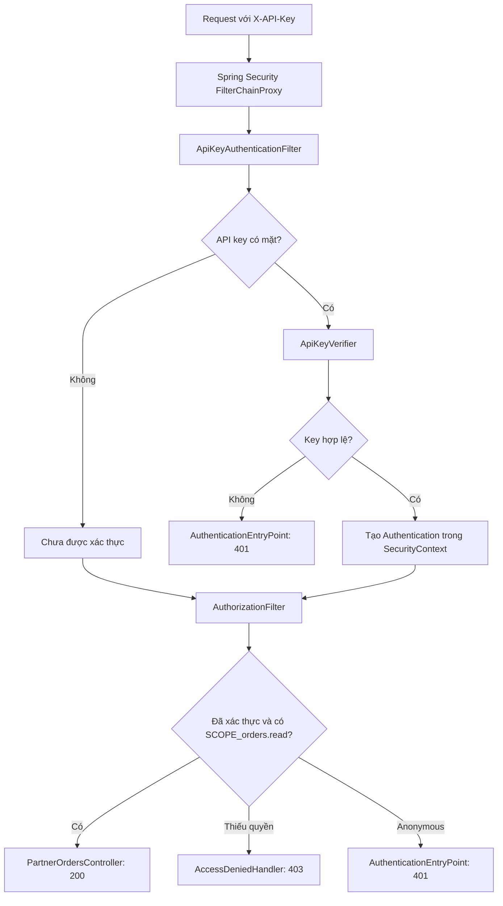

# API key hoặc cơ chế tùy chỉnh qua filter thật của ứng dụng

Trong nhiều hệ thống, ứng dụng không chỉ nhận HTTP Basic, JWT hoặc phiên đăng nhập OAuth2/OIDC mà còn cần một cơ chế riêng: **API key của đối tác**, chữ ký HMAC trên request, mã xác thực nội bộ hoặc header do một gateway đáng tin cậy gửi tới. Spring Security cho phép tích hợp cơ chế đó bằng filter và authentication provider/manager tùy biến. Nhưng một test dùng `@WithMockUser` hay `.with(authentication(...))` rồi nhận `200 OK` **không chứng minh filter tự tạo đã đọc credential hoặc xác thực nó đúng cách**.

Bài học này thuộc chương **Cơ chế chuyên biệt** của module **SPRING_SECURITY_TESTING**. Mục tiêu là kiểm chứng xác thực, phân quyền và bảo vệ HTTP thực tế bằng `spring-security-test` trên Servlet và Reactive. Chúng ta sẽ triển khai một ví dụ API key đủ rõ để quan sát **filter thật của ứng dụng**, dùng `MockMvc` kiểm tra đường được phép, bị từ chối, lỗi credential và quyền truy cập; sau đó so sánh với HTTP integration test và `WebTestClient` của WebFlux.

Kết luận cần đạt được: **để khẳng định API key authentication hoạt động, phải gửi API key trên request thật đi qua filter**, không chỉ đưa `Authentication` hoặc principal đã được test tạo sẵn vào `SecurityContext`.

## 1. API key authentication nằm ở đâu trong Spring Security?

Giả sử một đối tác gọi API xử lý đơn hàng:

```http
GET /api/partner/orders HTTP/1.1
Host: api.example.test
X-API-Key: <secret-api-key>
```

Ứng dụng cần:

1. Đọc header `X-API-Key`.
2. Kiểm tra key còn hiệu lực, chưa bị thu hồi, thuộc client/tenant nào, được cấp những quyền gì.
3. Tạo `Authentication` đã xác thực nếu key hợp lệ.
4. Đưa `Authentication` vào `SecurityContext` **của request hiện tại**.
5. Để `AuthorizationFilter` kiểm tra authority, chẳng hạn `SCOPE_orders.read`.
6. Trả kết quả hoặc một phản hồi từ chối phù hợp; tuyệt đối không log nguyên API key.



Ở đây `X-API-Key` chỉ là giao thức minh họa do ứng dụng quyết định. Một số hệ thống dùng `Authorization: ApiKey <key>` hoặc chữ ký HMAC. Đừng tự cho rằng Spring Security có filter API key mặc định giống như `BearerTokenAuthenticationFilter` của OAuth2 Resource Server; cơ chế tùy biến phải được **đăng ký, cấu hình và kiểm thử** rõ ràng.

### Ba ranh giới kiểm thử cần phân biệt

| Cách viết test | Điều thực sự được kiểm tra | Điều chưa được kiểm tra |
| --- | --- | --- |
| `@WithMockUser(authorities = "SCOPE_orders.read")` | Authorization dựa trên user giả | Filter đọc API key, kiểm tra key |
| `MockMvc` với `X-API-Key`, nạp filter thật và mock `ApiKeyVerifier` | Thứ tự filter, trích xuất header, gọi verifier, đặt authentication, `401/403/200` | Kiểm tra key bằng kho dữ liệu production |
| `MockMvc` với filter và verifier thật + test repository | Kiểm tra credential và quyền trong ứng dụng | TCP/HTTP server thực, proxy/gateway |
| `@SpringBootTest(RANDOM_PORT)` + HTTP client gửi API key | Filter được chạy trên server HTTP thật | Chỉ kiểm chứng dependency ngoài nếu chúng cũng được nối vào test |

Không phải cứ dùng `@SpringBootTest` là toàn bộ cơ chế thật: nếu `ApiKeyVerifier` vẫn là Mockito mock thì test không chứng minh key được tìm trong database, hash được xác minh hoặc trạng thái thu hồi được cập nhật. Hãy ghi rõ ranh giới đang mock.

## 2. Những dependency và thành phần tối thiểu

Ví dụ chính dùng **Spring Boot 3.x, Java 17+, Spring MVC, Spring Security 6.x, JUnit 5, Mockito và Spring Security Test**. Các đoạn Java lược bỏ `package` và `import`; khi đưa vào dự án cần import các class Servlet/Spring tương ứng.

```groovy
dependencies {
    implementation 'org.springframework.boot:spring-boot-starter-web'
    implementation 'org.springframework.boot:spring-boot-starter-security'

    testImplementation 'org.springframework.boot:spring-boot-starter-test'
    testImplementation 'org.springframework.security:spring-security-test'
}
```

Ta thiết kế thành phần tra cứu key qua interface để test có thể giữ **filter và security configuration thật**, đồng thời thay thế **nguồn xác minh key**:

```java
record ApiKeyIdentity(
    String clientId,
    String tenantId,
    List<GrantedAuthority> authorities
) {}

interface ApiKeyVerifier {
    Optional<ApiKeyIdentity> resolve(String rawKey);
}
```

`ApiKeyIdentity` là đối tượng principal cho đối tác. Ví dụ khi key hợp lệ, một identity có thể chứa `clientId=partner-app`, `tenantId=tenant-a` và authority `SCOPE_orders.read`.

Một verifier dùng trong production cần truy vấn dữ liệu key, kiểm tra hash/secret, expiry, trạng thái thu hồi, tenant và quyền theo chính sách. **Không dùng chuỗi hard-code trong production** chỉ vì ví dụ dưới đây dùng credential fixture.

### 2.1. Tách authentication khỏi authorization

Một key hợp lệ nhưng chỉ có quyền `SCOPE_inventory.read` phải được **xác thực** thành principal đúng rồi bị **từ chối 403** khi gọi `/api/partner/orders`. Không nên coi việc thiếu scope là “key sai” và tự trả `401`.

- **Authentication:** raw key có hợp lệ để nhận dạng client không?
- **Authorization:** client đã xác thực có được đọc danh sách đơn hàng của tenant đó không?
- **Resource scoping:** sau khi vượt qua authorization, service chỉ được truy cập dữ liệu thuộc tenant trong identity. Authority đúng **không** cho phép bỏ qua kiểm tra tenant.

## 3. Viết OncePerRequestFilter thật để đọc X-API-Key

`OncePerRequestFilter` là base class của Servlet filter. Ta sử dụng nó để trích xuất credential, gọi `ApiKeyVerifier` và đặt authentication vào `SecurityContextHolder`.

```java
final class ApiKeyAuthenticationFilter extends OncePerRequestFilter {

    private static final String HEADER = "X-API-Key";

    private final ApiKeyVerifier verifier;
    private final AuthenticationEntryPoint entryPoint;

    ApiKeyAuthenticationFilter(
            ApiKeyVerifier verifier,
            AuthenticationEntryPoint entryPoint) {
        this.verifier = verifier;
        this.entryPoint = entryPoint;
    }

    @Override
    protected boolean shouldNotFilter(HttpServletRequest request) {
        String path = request.getRequestURI()
            .substring(request.getContextPath().length());

        return !path.startsWith("/api/partner/");
    }

    @Override
    protected void doFilterInternal(
            HttpServletRequest request,
            HttpServletResponse response,
            FilterChain chain)
            throws ServletException, IOException {

        String rawKey = request.getHeader(HEADER);

        if (rawKey == null || rawKey.isBlank()) {
            // Chưa xác thực: để authorization đưa request
            // vào AuthenticationEntryPoint nếu endpoint yêu cầu key.
            chain.doFilter(request, response);
            return;
        }

        Optional<ApiKeyIdentity> resolved = verifier.resolve(rawKey);

        if (resolved.isEmpty()) {
            // Filter xác thực này chạy trước ExceptionTranslationFilter:
            // chủ động gọi entry point, không ném lỗi và trông đợi ETF bắt.
            SecurityContextHolder.clearContext();
            entryPoint.commence(
                request,
                response,
                new BadCredentialsException("Invalid API key")
            );
            return;
        }

        ApiKeyIdentity identity = resolved.get();

        Authentication auth =
            UsernamePasswordAuthenticationToken.authenticated(
                identity,
                null,
                identity.authorities()
            );

        SecurityContext context =
            SecurityContextHolder.createEmptyContext();
        context.setAuthentication(auth);
        SecurityContextHolder.setContext(context);

        try {
            chain.doFilter(request, response);
        } finally {
            SecurityContextHolder.clearContext();
        }
    }
}
```

Ở đây principal được đặt trực tiếp thành `ApiKeyIdentity`, giúp downstream/controller đọc đúng `clientId` và `tenantId`. Không đặt raw key làm principal, không lưu secret vào `Authentication.credentials` sau khi xác thực và không gửi raw key về response.

**Vì sao filter không ném `BadCredentialsException` trực tiếp?** Trong cấu hình tiếp theo, filter được đặt **trước `UsernamePasswordAuthenticationFilter`**, thông thường cũng trước `ExceptionTranslationFilter`. Một lỗi ném trước ETF không nằm trong phạm vi `try/catch` của ETF. Vì vậy chính filter phải chuyển lỗi xác thực sang `AuthenticationEntryPoint` hoặc dùng một authentication filter framework có sẵn failure handler. Nếu ném exception và trông chờ ETF luôn trả `401`, bài test có thể gặp exception/`500` thay vì response mong đợi.

### 3.1. Đường đi khi thiếu header khác khi header sai

Hai trường hợp đều thường dẫn tới `401` ở endpoint bắt buộc xác thực, nhưng điểm xử lý khác nhau:

- **Không có `X-API-Key`:** filter không tạo authentication rồi gọi `chain.doFilter`. `AnonymousAuthenticationFilter` và `AuthorizationFilter` xử lý request anonymous; ETF có thể khởi động entry point.
- **Có `X-API-Key` nhưng không hợp lệ:** filter gọi verifier, nhận `Optional.empty()`, trực tiếp gọi entry point và **dừng chain**.

Nếu app cho phép một cơ chế đăng nhập khác, ví dụ session, chính sách thiếu API key có thể cho phép cơ chế khác tiếp tục xác thực. Trong ví dụ API máy–máy này, chain sẽ chỉ chấp nhận API key cho endpoint đối tác.

### 3.2. Vì sao phải dọn SecurityContext?

`SecurityContextHolder` trong Servlet thường dùng storage dựa trên thread; luồng container có thể được tái sử dụng cho request khác. Spring Security có cơ chế quản lý và dọn context ở tầng filter, nhưng custom code tự đặt authentication cũng phải tuân thủ vòng đời request. `finally` ở ví dụ là một lớp bảo vệ bổ sung để không để authentication còn sót sau lời gọi downstream.

Đừng giữ `ApiKeyIdentity` trong field `static` của filter hoặc service singleton. Tất cả dữ liệu authentication cần gắn với request hiện tại, không chia sẻ giữa Alice/Bob hay các đối tác khác.

## 4. Đăng ký filter trong SecurityFilterChain, không đăng ký hai lần

Cấu hình sử dụng một security chain Servlet thực. Ta định nghĩa entry point trả `401` và denied handler trả `403`. Trong ví dụ, header `X-Auth-Handled-By` chỉ phục vụ **quan sát nguồn xử lý trong test**, không phải quy định bắt buộc của API production.

```java
@Configuration
class PartnerApiSecurityConfig {

    @Bean
    SecurityFilterChain partnerSecurity(
            HttpSecurity http,
            ApiKeyVerifier verifier) throws Exception {

        AuthenticationEntryPoint entryPoint =
            (request, response, error) ->
                writeError(
                    response,
                    HttpServletResponse.SC_UNAUTHORIZED,
                    "unauthorized",
                    "api-key-entry-point"
                );

        AccessDeniedHandler deniedHandler =
            (request, response, error) ->
                writeError(
                    response,
                    HttpServletResponse.SC_FORBIDDEN,
                    "forbidden",
                    "access-denied-handler"
                );

        return http
            // Ví dụ là API máy–máy dùng header key, không dùng cookie.
            .csrf(AbstractHttpConfigurer::disable)
            .sessionManagement(session -> session
                .sessionCreationPolicy(SessionCreationPolicy.STATELESS)
            )
            .requestCache(cache -> cache
                .requestCache(new NullRequestCache())
            )
            .httpBasic(AbstractHttpConfigurer::disable)
            .formLogin(AbstractHttpConfigurer::disable)
            .authorizeHttpRequests(auth -> auth
                .requestMatchers(
                    HttpMethod.GET,
                    "/api/partner/orders"
                ).hasAuthority("SCOPE_orders.read")
                .anyRequest().denyAll()
            )
            .exceptionHandling(errors -> errors
                .authenticationEntryPoint(entryPoint)
                .accessDeniedHandler(deniedHandler)
            )
            .addFilterBefore(
                new ApiKeyAuthenticationFilter(verifier, entryPoint),
                UsernamePasswordAuthenticationFilter.class
            )
            .build();
    }

    private static void writeError(
            HttpServletResponse response,
            int status,
            String error,
            String source) throws IOException {

        response.setStatus(status);
        response.setContentType(MediaType.APPLICATION_JSON_VALUE);
        response.setCharacterEncoding(StandardCharsets.UTF_8.name());
        response.setHeader("X-Auth-Handled-By", source);
        response.getWriter().write(
            "{\"error\":\"" + error + "\"}"
        );
    }
}
```

Ở đây `.anyRequest().denyAll()` giúp đảm bảo những route ngoài phạm vi ví dụ không vô tình trở thành public vì thiếu rule. Trong ứng dụng nhiều `SecurityFilterChain`, hãy phân định `securityMatcher`, `@Order` và fallback chain cho những route còn lại. Không nên tạo một chain chỉ khớp `/api/partner/**` mà bỏ quên những endpoint không được chain nào bảo vệ.

**Cấu hình CSRF:** việc tắt CSRF trong bài chỉ áp dụng cho API stateless máy–máy, nơi credential truyền qua header tùy biến và không tự đính kèm như cookie của trình duyệt. Nếu ứng dụng còn dùng cookie/session hoặc browser authentication, hãy giữ/chỉnh CSRF theo threat model. Không tắt CSRF chỉ để một bài test `POST` xanh.

### 4.1. Tránh filter bị Spring Boot auto-register ở Servlet container

Ví dụ tạo `new ApiKeyAuthenticationFilter(...)` ngay trong cấu hình `HttpSecurity`. Nó **không** được khai báo thành một `@Component`/`@Bean Filter` toàn cục, nên tránh việc Spring Boot tự đăng ký thêm một bản của nó vào Servlet container.

Nếu filter bắt buộc là Spring bean vì có nhiều dependency, dùng cấu hình kiểm soát `FilterRegistrationBean` để **vô hiệu hóa container registration** khi nó đã nằm trong Spring Security chain; hoặc cấu hình bean chỉ phục vụ việc tạo instance. Đăng ký hai lần có thể dẫn đến:

- Filter xử lý request ngoài thứ tự bảo mật mong muốn.
- `ApiKeyVerifier` bị gọi hai lần, gây I/O thừa.
- Exception xảy ra ở filter chạy bên ngoài `ExceptionTranslationFilter`.
- Bài test `MockMvc` với filter set khác test HTTP thật và tạo kết quả không nhất quán.

### 4.2. AuthenticationException và AccessDeniedException không giống nhau

`ApiKeyAuthenticationFilter` ở trước ETF nên **tự gọi entry point** khi key sai. Với một key đã hợp lệ, `AuthorizationFilter` chạy sau ETF và có thể phát sinh `AccessDeniedException` nếu thiếu `SCOPE_orders.read`. Khi đó ETF gọi `AccessDeniedHandler`.

| Tình trạng | Thành phần quyết định | Kết quả mẫu |
| --- | --- | --- |
| Header không có, request anonymous | AuthorizationFilter → ETF → entry point | `401` |
| Header có nhưng key sai | Custom authentication filter → entry point | `401` |
| Header hợp lệ nhưng scope sai | AuthorizationFilter → ETF → denied handler | `403` |
| Header hợp lệ và đủ scope | Controller | `200` |
| Verifier/database bị lỗi hạ tầng | Logic xử lý lỗi dịch vụ riêng | Không tự mặc định là `401` |

Lỗi timeout kết nối key store hoặc database không đồng nghĩa “key sai”. Không nên catch mọi exception rồi trả `401`, vì điều đó che giấu lỗi hạ tầng. Cần thiết kế chính sách fail-closed (không cho truy cập) nhưng HTTP mapping, retry, circuit breaker và observability phải phân biệt lỗi dịch vụ với lỗi credential.

## 5. Controller và service để nhìn thấy principal đã được filter xác thực

Tạo một service nhận **tenant ID** đã được xác thực, không nhận tenant tùy ý từ header của client.

```java
interface PartnerOrderService {
    List<String> ordersForTenant(String tenantId);
}

@RestController
class PartnerOrdersController {

    private final PartnerOrderService orders;

    PartnerOrdersController(PartnerOrderService orders) {
        this.orders = orders;
    }

    @GetMapping("/api/partner/orders")
    Map<String, Object> currentOrders(
            @AuthenticationPrincipal ApiKeyIdentity identity) {

        return Map.of(
            "clientId", identity.clientId(),
            "tenantId", identity.tenantId(),
            "orders", orders.ordersForTenant(identity.tenantId())
        );
    }
}
```

Test sẽ có thể kiểm tra rằng `clientId` và `tenantId` đến từ verifier, chứ không đến từ `X-Client-Id` hay query parameter không được tin cậy. Đồng thời Mockito `verifyNoInteractions(orders)` chứng minh request sai key hoặc thiếu quyền đã bị chặn **trước khi gọi service**.

Trong production, `PartnerOrderService` phải thực sự áp dụng ràng buộc tenant ở tầng dữ liệu; đoạn controller mẫu giúp truyền đúng identity nhưng không tự thay thế kiểm thử tenant isolation với database thật.

## 6. MockMvc chạy filter thật: bài kiểm thử chính

Dùng `@SpringBootTest` + `@AutoConfigureMockMvc` để nạp application context, `PartnerApiSecurityConfig` và Spring Security filters. Ta **mock `ApiKeyVerifier`** và `PartnerOrderService` để test tập trung vào bộ lọc, không phụ thuộc database.

```java
@SpringBootTest
@AutoConfigureMockMvc
class PartnerApiKeyFilterMvcTest {

    @Autowired
    MockMvc mvc;

    @MockitoBean
    ApiKeyVerifier verifier;

    @MockitoBean
    PartnerOrderService orders;

    private static ApiKeyIdentity principal(
            String client,
            String tenant,
            String authority) {

        return new ApiKeyIdentity(
            client,
            tenant,
            List.of(new SimpleGrantedAuthority(authority))
        );
    }

    @Test
    void validApiKeyWithRequiredScopeGets200() throws Exception {
        when(verifier.resolve("key-reader"))
            .thenReturn(Optional.of(
                principal(
                    "partner-app",
                    "tenant-a",
                    "SCOPE_orders.read"
                )
            ));

        when(orders.ordersForTenant("tenant-a"))
            .thenReturn(List.of("order-001"));

        mvc.perform(get("/api/partner/orders")
                .header("X-API-Key", "key-reader"))
            .andExpect(status().isOk())
            .andExpect(jsonPath("$.clientId")
                .value("partner-app"))
            .andExpect(jsonPath("$.tenantId")
                .value("tenant-a"))
            .andExpect(jsonPath("$.orders[0]")
                .value("order-001"));

        verify(verifier).resolve("key-reader");
        verify(orders).ordersForTenant("tenant-a");
    }

    @Test
    void missingApiKeyGets401() throws Exception {
        mvc.perform(get("/api/partner/orders"))
            .andExpect(status().isUnauthorized())
            .andExpect(header().string(
                "X-Auth-Handled-By",
                "api-key-entry-point"
            ))
            .andExpect(jsonPath("$.error").value("unauthorized"));

        verifyNoInteractions(verifier, orders);
    }

    @Test
    void invalidApiKeyGets401AndStopsChain() throws Exception {
        when(verifier.resolve("invalid-key"))
            .thenReturn(Optional.empty());

        mvc.perform(get("/api/partner/orders")
                .header("X-API-Key", "invalid-key"))
            .andExpect(status().isUnauthorized())
            .andExpect(header().string(
                "X-Auth-Handled-By",
                "api-key-entry-point"
            ));

        verify(verifier).resolve("invalid-key");
        verifyNoInteractions(orders);
    }

    @Test
    void validKeyWithoutPermissionGets403() throws Exception {
        when(verifier.resolve("key-limited"))
            .thenReturn(Optional.of(
                principal(
                    "limited-client",
                    "tenant-b",
                    "SCOPE_inventory.read"
                )
            ));

        mvc.perform(get("/api/partner/orders")
                .header("X-API-Key", "key-limited"))
            .andExpect(status().isForbidden())
            .andExpect(header().string(
                "X-Auth-Handled-By",
                "access-denied-handler"
            ))
            .andExpect(jsonPath("$.error").value("forbidden"));

        verify(verifier).resolve("key-limited");
        verifyNoInteractions(orders);
    }
}
```

`@MockitoBean` có trong Spring Framework 6.2+ (ví dụ Spring Boot 3.4+). Với phiên bản cũ hơn, dùng `@MockBean` tương thích. Các static import Mockito, MockMvc request builders/matchers được lược bỏ cho gọn.

**Test này thực sự chạy custom filter** vì request gửi header `X-API-Key`, không gắn `@WithMockUser` và không gọi `MockMvcRequestPostProcessors.authentication(...)`. Assertion `verify(verifier).resolve(...)` giúp chứng minh filter đã trích xuất đúng raw key, còn assertions status/body/header xác nhận đường xử lý HTTP.

### 6.1. Test riêng trường hợp không rò rỉ authentication sang request tiếp theo

Đôi khi code tự đặt `SecurityContextHolder` nhưng quên dọn trạng thái; một ca đơn lẻ không dễ phát hiện. Thêm test tuần tự:

```java
@Test
void acceptedRequestDoesNotAuthenticateTheFollowingRequest()
        throws Exception {

    when(verifier.resolve("key-reader"))
        .thenReturn(Optional.of(
            principal(
                "partner-app",
                "tenant-a",
                "SCOPE_orders.read"
            )
        ));

    when(orders.ordersForTenant("tenant-a"))
        .thenReturn(List.of());

    mvc.perform(get("/api/partner/orders")
            .header("X-API-Key", "key-reader"))
        .andExpect(status().isOk());

    mvc.perform(get("/api/partner/orders"))
        .andExpect(status().isUnauthorized());

    verify(verifier).resolve("key-reader");
    verifyNoMoreInteractions(verifier);
}
```

Vì request thứ hai không mang key, nó phải anonymous. Đây là một **regression test thực tế** khi ứng dụng tạo `SecurityContext` thủ công. Nó không thay kiểm tra concurrency hoặc session persistence, nhưng giúp bắt lỗi lưu auth trong field static/ThreadLocal sai phạm vi.

### 6.2. Thêm ca key bị thu hồi hoặc hết hạn

Trong test filter, verifier quyết định key hợp lệ hay không. Có thể mô phỏng key bị thu hồi:

```java
@Test
void revokedKeyIsRejected() throws Exception {
    when(verifier.resolve("revoked-key"))
        .thenReturn(Optional.empty());

    mvc.perform(get("/api/partner/orders")
            .header("X-API-Key", "revoked-key"))
        .andExpect(status().isUnauthorized());

    verify(verifier).resolve("revoked-key");
    verifyNoInteractions(orders);
}
```

Tuy nhiên, ca này **không chứng minh verifier thật đọc được trường `revoked` hoặc `expires_at`** từ kho key. Muốn kiểm tra chính sách thu hồi/hết hạn, phải unit/integration test implementation `ApiKeyVerifier` với clock và repository test, hoặc dùng test HTTP có verifier thật.

## 7. Vì sao @WithMockUser không chứng minh API key hoạt động?

Ví dụ sau cho thấy `@WithMockUser` tạo sẵn authentication và authority trong **test method** mà không đi qua filter HTTP:

```java
@Test
@WithMockUser(authorities = "SCOPE_orders.read")
void fakeAuthenticationDoesNotValidateAnApiKey() {
    Authentication auth =
        SecurityContextHolder.getContext().getAuthentication();

    assertThat(auth.isAuthenticated()).isTrue();
    assertThat(auth.getAuthorities())
        .extracting(GrantedAuthority::getAuthority)
        .contains("SCOPE_orders.read");

    verifyNoInteractions(verifier);
}
```

`@WithMockUser` đã đưa một `Authentication` giả có authority tương ứng vào security context. Nếu dùng helper này để gửi request không có API key, `ApiKeyAuthenticationFilter` sẽ thấy thiếu header rồi cho request đi tiếp; `AuthorizationFilter` **có thể chấp nhận user giả** khi rule chỉ dựa vào authority. Điều này **không phải lỗi của `spring-security-test`**: helper đã làm đúng chức năng kiểm tra authorization sau khi có authentication.

Trong controller mẫu nhận `ApiKeyIdentity` bằng `@AuthenticationPrincipal`, `@WithMockUser` còn tạo **kiểu principal khác**, vì vậy endpoint có thể lỗi khi sử dụng identity. Do đó không được suy ra test `@WithMockUser` làm cho chính endpoint mẫu trả `200`: ví dụ trên chỉ xác minh ngữ cảnh giả của test, không thực hiện request HTTP.

Một ví dụ khác dễ gây kết luận sai:

```java
when(orders.ordersForTenant("tenant-a"))
    .thenReturn(List.of());

mvc.perform(get("/api/partner/orders")
        .with(authentication(
            UsernamePasswordAuthenticationToken.authenticated(
                principal("partner-app", "tenant-a", "SCOPE_orders.read"),
                null,
                List.of(
                    new SimpleGrantedAuthority("SCOPE_orders.read")
                )
            )
        )))
    .andExpect(status().isOk());

verifyNoInteractions(verifier);
```

Ở đây `authentication(...)` đã tạo sẵn một `Authentication` có principal đúng kiểu, nên controller trả thành công khi mock service có dữ liệu, dù filter chưa gọi verifier. Muốn test filter, **không dùng helper bơm `Authentication`**; thay bằng raw credential trên request và verify tương tác với verifier.

### 7.1. So sánh các helper JWT/OAuth2/OIDC

| Helper | Điều được giả lập | Không chứng minh điều gì? |
| --- | --- | --- |
| `@WithMockUser` / `user()` | User và authorities trong security context | API key parser/lookup |
| `authentication(...)` | Đối tượng `Authentication` đã được tạo | Custom filter tự xác thực credential |
| `jwt()` trên MockMvc | `JwtAuthenticationToken` giả | JWT signature, API key filter |
| `opaqueToken()` | `BearerTokenAuthentication` giả | Opaque introspection, API key filter |
| `oauth2Login()` / `oidcLogin()` | Login principal và context giả | OAuth2 redirect/token exchange, API key |
| `mockJwt()` / `mockUser()` trên WebTestClient | Reactive authentication giả | Reactive authentication filter tùy biến |
| HTTP request có `X-API-Key` và filter thật | Custom filter và giao thức header | Độ đúng của verifier thật nếu vẫn mock |

Điều này cũng áp dụng cho HMAC signatures, mTLS gateway principal hoặc SSO header: nếu test đưa sẵn principal vào context, nó không chứng minh parser, signature verifier, trust boundary hoặc authentication manager đã chạy.

## 8. Kiểm thử verifier thật và chính sách bảo mật của API key

`ApiKeyVerifier` không nên chỉ so sánh chuỗi raw key với một literal trong source code production. Một thiết kế thực tế có thể tách **key identifier** (để truy vấn record) khỏi **secret** (để xác minh). API key nên đủ ngẫu nhiên, khó đoán và chỉ hiển thị cho chủ sở hữu ở bước cấp phát.

Chính sách nên kiểm tra:

1. **Định dạng/độ dài:** header không có, rỗng, quá dài, có ký tự không phù hợp hoặc nhiều giá trị trùng nhau.
2. **Key lookup:** chỉ xác minh record thuộc tenant/client đã đăng ký, không tin tenant do caller tự gửi ở header phụ.
3. **Secret verification:** hash/HMAC hoặc công cụ password hashing phù hợp với độ entropy của key; so sánh bí mật theo cơ chế an toàn, tránh timing leak khi có thể.
4. **Trạng thái:** key đã kích hoạt, chưa hết hạn, chưa thu hồi, phạm vi môi trường phù hợp.
5. **Quyền:** authorities/scopes sinh từ record đáng tin cậy, không lấy từ header `X-Scopes` do client tự viết.
6. **Revocation/rotation:** key cũ bị từ chối sau khi thu hồi; key mới được chấp nhận; chú ý cache/TTL nếu verifier có cache.
7. **Audit:** log client/tenant và mã lỗi ổn định, tuyệt đối không log raw key, hash nhạy cảm hoặc Authorization header nguyên văn.
8. **Rate limiting:** giới hạn số lần thử key sai, chống dò quét, có telemetry theo IP/client trong phạm vi phù hợp.

Một bộ test của `ApiKeyVerifier` thực có thể dùng repository test và `Clock.fixed(...)` cho expiry:

```java
@Test
void expiredStoredKeyIsNotAccepted() {
    Instant now = Instant.parse("2026-11-25T08:00:00Z");

    // Fixture: stored key has expiresAt = now.minusSeconds(60).
    // Test implementation thực dùng Clock.fixed(now, UTC).
    Optional<ApiKeyIdentity> result =
        realVerifier.resolve("expired-fixture");

    assertThat(result).isEmpty();
}
```

Đây là **khung kiểm thử nghiệp vụ**: `realVerifier` là implementation do dự án cung cấp, không phải bean có sẵn của Spring Security. Một unit test như vậy cần tạo đúng repository/clock/test key record theo kiến trúc dự án; không khẳng định riêng `Optional.empty()` từ Mockito đã kiểm tra được expiry.

### 8.1. Kiểm tra header trùng lặp

Trong filter mẫu, `request.getHeader("X-API-Key")` chỉ lấy một giá trị. Với production, cần xác định chính sách khi client gửi **nhiều header `X-API-Key`** hoặc proxy gộp chúng:

```http
X-API-Key: first-key
X-API-Key: second-key
```

Nên chủ động từ chối request mơ hồ, ví dụ kiểm tra `request.getHeaders("X-API-Key")` có đúng một giá trị, kiểm soát giới hạn độ dài, hoặc parse cấu trúc header theo contract. Khi dùng `MockMvc`, bổ sung test header lặp và xác minh filter **không chấp nhận ngầm giá trị đầu tiên**. Với test ở bài này, đoạn filter chỉ minh họa pipeline và cần tăng cứng trước khi dùng production.

### 8.2. Phân biệt key sai với lỗi kho xác thực

Nếu verifier truy cập DB/Redis hoặc dịch vụ IAM và gặp timeout, ứng dụng phải **fail closed** (không được coi là key hợp lệ), nhưng cũng nên phân biệt với key invalid trong metrics, alert và response policy. Một số hệ thống trả lỗi `503` cho dependency outage; các hệ thống khác có contract riêng. Không gộp toàn bộ exception thành `BadCredentialsException`, vì có thể làm các sự cố xác thực không được phát hiện trong vận hành.

## 9. Kiểm thử HTTP thật bằng RANDOM_PORT

`MockMvc` chạy filter thật ở tầng Servlet trong tiến trình test; nó không cần một cổng TCP. Để chứng minh request tới embedded HTTP server cũng kích hoạt filter, bổ sung test `@SpringBootTest(webEnvironment = RANDOM_PORT)` và gửi API key bằng `TestRestTemplate` hoặc một HTTP client thật.

```java
@SpringBootTest(
    webEnvironment = SpringBootTest.WebEnvironment.RANDOM_PORT
)
class PartnerApiKeyHttpIT {

    @LocalServerPort
    int port;

    @Autowired
    TestRestTemplate rest;

    @Test
    void missingKeyIsUnauthorizedOverHttp() {
        ResponseEntity<String> response =
            rest.getForEntity(
                "/api/partner/orders",
                String.class
            );

        assertThat(response.getStatusCode())
            .isEqualTo(HttpStatus.UNAUTHORIZED);
    }

    @Test
    void providedKeyReachesTheHttpServer() {
        HttpHeaders headers = new HttpHeaders();
        headers.set("X-API-Key", "test-reader-key");

        ResponseEntity<String> response = rest.exchange(
            "/api/partner/orders",
            HttpMethod.GET,
            new HttpEntity<Void>(headers),
            String.class
        );

        // Kỳ vọng 200 khi test profile cấu hình verifier thật
        // hoặc fixture test nhận "test-reader-key" với đủ quyền.
        assertThat(response.getStatusCode())
            .isEqualTo(HttpStatus.OK);
    }
}
```

Test trên giả định **test profile** đã cung cấp `ApiKeyVerifier` nhận `test-reader-key`, cùng `PartnerOrderService` với dữ liệu fixture. Không dùng key production. Phần cấu hình này phải được nạp trước khi server khởi động; `@WithMockUser` ở test thread không thay cho header `X-API-Key` gửi qua HTTP.

Để kiểm chứng key bị thu hồi trong môi trường HTTP thật, cần verifier thật và kho key fixture có thể điều khiển. Một HTTP `200` với verifier Mockito stub vẫn chưa chứng minh database/expiry/revocation.

### 9.1. Không nhầm request thực với TestRestTemplate mock authentication

`@WithMockUser`, `SecurityMockMvcRequestPostProcessors.user(...)` và `jwt()` không tự gắn API key vào HTTP request của `TestRestTemplate`. Security context do test thread tạo không được chuyển qua TCP sang servlet thread. Khi kiểm thử trên random port, hãy gửi credential HTTP **thật theo giao thức do filter đọc**.

Nếu dùng `MockMvcBuilders.standaloneSetup(...)` nhưng không đưa Spring Security filter chain vào, test có thể cho request qua controller dù filter API key chưa hề được chạy. Với `MockMvc` dựng thủ công từ `WebApplicationContext`:

```java
MockMvc mvc = MockMvcBuilders
    .webAppContextSetup(context)
    .apply(springSecurity())
    .build();
```

`@AutoConfigureMockMvc(addFilters = false)` không thích hợp cho bài test này, vì nó bỏ qua chính filter cần kiểm chứng.

## 10. Reactive WebFlux: dùng AuthenticationWebFilter thay vì Servlet filter

Trong ứng dụng Reactive, các thành phần Servlet như `OncePerRequestFilter`, `HttpSecurity` và `SecurityContextHolder` dạng ThreadLocal **không phải cơ chế chính**. Spring Security WebFlux dùng `SecurityWebFilterChain`, `ServerHttpSecurity` và Reactor Context.

Một cách tích hợp API key phù hợp là dùng **`AuthenticationWebFilter`** với `ServerAuthenticationConverter` để đọc header và `ReactiveAuthenticationManager` để xác minh. Cơ chế này có đường failure handler riêng cho lỗi xác thực.

```java
interface ReactiveApiKeyVerifier {
    Mono<ApiKeyIdentity> resolve(String rawKey);
}

@Configuration(proxyBeanMethods = false)
@EnableWebFluxSecurity
class ReactivePartnerSecurityConfig {

    @Bean
    SecurityWebFilterChain reactiveApiKeyChain(
            ServerHttpSecurity http,
            ReactiveApiKeyVerifier verifier) {

        ReactiveAuthenticationManager manager = incoming ->
            verifier.resolve((String) incoming.getCredentials())
                .map(identity -> (Authentication)
                    UsernamePasswordAuthenticationToken.authenticated(
                        identity,
                        null,
                        identity.authorities()
                    )
                )
                .switchIfEmpty(Mono.error(
                    new BadCredentialsException("Invalid API key")
                ));

        AuthenticationWebFilter keyFilter =
            new AuthenticationWebFilter(manager);

        keyFilter.setServerAuthenticationConverter(exchange -> {
            String key = exchange.getRequest()
                .getHeaders()
                .getFirst("X-API-Key");

            if (key == null || key.isBlank()) {
                return Mono.empty();
            }

            return Mono.just(
                UsernamePasswordAuthenticationToken
                    .unauthenticated("api-key", key)
            );
        });

        HttpStatusServerEntryPoint entryPoint =
            new HttpStatusServerEntryPoint(HttpStatus.UNAUTHORIZED);

        keyFilter.setAuthenticationFailureHandler(
            new ServerAuthenticationEntryPointFailureHandler(entryPoint)
        );

        return http
            .csrf(ServerHttpSecurity.CsrfSpec::disable)
            .authorizeExchange(exchanges -> exchanges
                .pathMatchers(
                    HttpMethod.GET,
                    "/api/partner/orders"
                ).hasAuthority("SCOPE_orders.read")
                .anyExchange().denyAll()
            )
            .exceptionHandling(errors -> errors
                .authenticationEntryPoint(entryPoint)
            )
            .addFilterAt(
                keyFilter,
                SecurityWebFiltersOrder.AUTHENTICATION
            )
            .build();
    }
}
```

Trong biến thể WebFlux, một key hợp lệ đưa `Authentication` vào **Reactor Context** của request; không dùng `SecurityContextHolder.setContext(...)` theo thread để chia sẻ danh tính. `AuthenticationWebFilter` quản lý quá trình authentication và failure handler tương ứng. Ví dụ dùng status đơn giản; ứng dụng production có thể thêm JSON error body, audit và các kiểm tra key format.

### 10.1. WebTestClient cần gửi header để kích hoạt authentication converter

Controller WebFlux tối thiểu cho biến thể này đọc principal đã được filter đưa vào Reactor Context:

```java
@RestController
class ReactivePartnerController {

    @GetMapping("/api/partner/orders")
    Mono<Map<String, String>> orders(
            @AuthenticationPrincipal ApiKeyIdentity identity) {

        return Mono.just(Map.of(
            "clientId", identity.clientId(),
            "tenantId", identity.tenantId()
        ));
    }
}
```

Test Reactive giữ chain thật, chỉ mock verifier:

```java
@WebFluxTest(controllers = ReactivePartnerController.class)
@Import(ReactivePartnerSecurityConfig.class)
class ReactiveApiKeyFilterTest {

    @Autowired
    WebTestClient client;

    @MockitoBean
    ReactiveApiKeyVerifier verifier;

    @Test
    void headerIsReadByRealAuthenticationWebFilter() {
        ApiKeyIdentity identity = new ApiKeyIdentity(
            "partner-app",
            "tenant-a",
            List.of(new SimpleGrantedAuthority("SCOPE_orders.read"))
        );

        when(verifier.resolve("reactive-reader-key"))
            .thenReturn(Mono.just(identity));

        client.get()
            .uri("/api/partner/orders")
            .header("X-API-Key", "reactive-reader-key")
            .exchange()
            .expectStatus().isOk();

        verify(verifier).resolve("reactive-reader-key");
    }

    @Test
    void noApiKeyIsRejected() {
        client.get()
            .uri("/api/partner/orders")
            .exchange()
            .expectStatus().isUnauthorized();

        verifyNoInteractions(verifier);
    }
}
```

`ReactivePartnerController` ở đây là controller WebFlux test của ứng dụng, ví dụ dùng `@AuthenticationPrincipal ApiKeyIdentity` để trả danh sách đơn hàng. **Không** dùng `mockUser()` hay `mockJwt()` trong test xác minh API key filter; các mutator đó tạo authentication giả và có thể bỏ qua `AuthenticationWebFilter`.

Nếu tự dựng `WebTestClient` in-process từ context, gọi `.apply(springSecurity())`; nếu dùng `bindToServer()` tới random port thật, gửi header qua HTTP như trên nhưng không sử dụng mutator của client in-process.

### 10.2. Servlet và Reactive không thể dùng chung filter class

| Servlet | Reactive |
| --- | --- |
| `OncePerRequestFilter` | `AuthenticationWebFilter` hoặc custom `WebFilter` |
| `HttpServletRequest.getHeader(...)` | `ServerWebExchange.getRequest().getHeaders()` |
| `HttpSecurity` | `ServerHttpSecurity` |
| `SecurityFilterChain` | `SecurityWebFilterChain` |
| `SecurityContextHolder` (request thread) | `ReactiveSecurityContextHolder` / Reactor Context |
| `AuthenticationEntryPoint` | `ServerAuthenticationEntryPoint` |
| `AccessDeniedHandler` | `ServerAccessDeniedHandler` |
| `MockMvc` | `WebTestClient` |

Không đăng ký `OncePerRequestFilter` rồi kỳ vọng nó xác thực request trên reactive Netty server. Và không dùng `@WithMockUser` để khẳng định converter `X-API-Key` đã chạy.

## 11. Các ca âm tính nên có trong bộ test chuyên biệt

Một bộ test API key có chất lượng không nên chỉ có `200`. Ít nhất cần:

| Ca | Input | Kỳ vọng và điểm xác minh |
| --- | --- | --- |
| Thiếu header | Không có `X-API-Key` | `401`, verifier không được gọi |
| Header rỗng/blank | `X-API-Key:   ` | `401` theo chính sách, không truy cập service |
| Header không hợp lệ | `X-API-Key: invalid` | `401`, verifier đã được gọi |
| Key bị thu hồi | Key đã revoked trong fixture | `401`, verifier thật kiểm tra trạng thái |
| Key hết hạn | `expiresAt` trước clock test | `401`, Clock/expiry policy có negative test |
| Key hợp lệ nhưng scope sai | Identity có `SCOPE_inventory.read` | `403`, service không chạy |
| Key hợp lệ, scope đúng | Identity có `SCOPE_orders.read` | `200`, tenant/client đúng |
| Header quá dài | Input vượt giới hạn thiết kế | Từ chối an toàn, không log key |
| Nhiều header key | Hai giá trị khác nhau | Từ chối input mơ hồ theo contract |
| Sai tenant | Key của tenant B yêu cầu dữ liệu tenant A | Không đọc được dữ liệu A; test tầng service/database |
| Verifier outage | DB/Redis/IAM timeout | Fail closed; không coi là authenticated |
| Request tiếp theo thiếu key | Sau một request đã thành công | Vẫn `401`, không rò rỉ SecurityContext |
| API ngoài phạm vi partner | Đường dẫn khác | Không vô tình cho phép do thiếu fallback security chain |

**Phân biệt 401 và 403:** `401 Unauthorized` trong API là lỗi chưa có credential hợp lệ; `403 Forbidden` là đã xác thực nhưng thiếu quyền. Đây là kết quả điển hình với entry point/handler ví dụ. Nếu ứng dụng có custom response mapping khác, test cần dựa trên policy được phê duyệt.

### 11.1. Điều gì nên được verify thêm ngoài HTTP status?

- `verify(verifier).resolve("key-reader")`: filter thực sự trích xuất và chuyển đúng raw credential tới verifier.
- `verifyNoInteractions(orders)`: request sai key/thiếu quyền không chạy business service.
- Assert `tenantId` và `clientId` trả về từ principal: user-controlled header không thay đổi tenant đã xác thực.
- Assert chính xác `X-Auth-Handled-By` trong test demo: phân biệt entry point với denied handler.
- Assert key đã thu hồi/hết hạn thật sự bị từ chối khi chạy implementation verifier, không chỉ Mockito stub.
- Không có API key trong response JSON, error message, HTTP access logs hoặc test report.

Lưu ý: việc assert rằng raw key có mặt trong Mockito call **không cấp quyền log hoặc in ra key production**. Chỉ dùng fixture vô hại trong test.

## 12. Vài biến thể khác cần áp dụng cùng tư duy

API key không phải cách xác thực tùy biến duy nhất:

- **HMAC request signature:** cần test timestamp, canonical request, body digest và signature bằng secret/key test. Một `@WithMockUser` không chứng minh verifier HMAC chạy. Bổ sung ca body bị sửa, timestamp quá hạn, nonce lặp, chữ ký sai.
- **Trusted reverse-proxy identity header:** phải chứng minh header chỉ được tin khi request đến từ proxy tin cậy hoặc mTLS/transport xác thực. Không cho client Internet tự gửi `X-Authenticated-User` để trở thành user.
- **mTLS client certificate:** `@WithMockUser` không chứng minh TLS handshake hoặc certificate validation. Dùng server/client SSL test fixture và certificate hợp lệ/sai.
- **Pre-authentication:** filter có thể đọc principal được gateway xác minh trước; test cần xác nhận trust boundary và điều kiện cho phép, không chỉ principal hiện diện.
- **Custom bearer format:** authentication filter/parser cần test chuỗi sai, thiếu, quá hạn, đổi khóa và token từ issuer khác; không để helper `jwt()` thay thế test parser tùy biến.

Chọn đúng tầng kiểm thử: test policy nhanh bằng principal giả, test cơ chế bằng filter/converter thật, và test transport/protocol bằng server/client thật khi cần.

## 13. Các lỗi thiết kế thường làm test “xanh” nhưng hệ thống chưa an toàn

### 13.1. Chỉ gọi controller trực tiếp

`MockMvcBuilders.standaloneSetup(controller)` không tự động đăng ký filter của Spring Security production. Nếu không áp dụng filter chain, một `200` chỉ chứng minh controller được gọi. Với custom API key, hãy dùng `@SpringBootTest + @AutoConfigureMockMvc` hoặc setup web application context có `springSecurity()`.

### 13.2. Mock chính filter cần kiểm thử

Nếu test thay `ApiKeyAuthenticationFilter` bằng mock rồi đặt sẵn `SecurityContext`, filter không còn được kiểm tra. Hãy mock **backend dependency** như verifier/repository, không mock code trích xuất credential và tạo authentication.

### 13.3. Gắn @WithMockUser vào toàn bộ test class

Một annotation `@WithMockUser` cấp class có thể vô tình làm các ca “thiếu key” vẫn có authentication. Hãy chỉ dùng helper này trong test authorization độc lập, không dùng trong các test chứng minh cơ chế header.

### 13.4. Đăng ký filter trước/sau ETF mà không hiểu exception handling

Nếu filter xác thực nằm trước `ExceptionTranslationFilter`, exception ném trực tiếp từ filter không nằm trong scope của ETF. Dùng failure handler/entry point trong filter, hoặc framework `AuthenticationFilter`/`AuthenticationWebFilter` được thiết kế cho authentication. Đừng dời filter bừa đến sau ETF chỉ để tránh lỗi `500`.

### 13.5. Trả 401 cho mọi exception, kể cả database lỗi

Key sai, key bị thu hồi và kho key không truy cập được là ba trạng thái khác nhau. Chúng đều không được cho phép truy cập, nhưng observability và HTTP error policy nên phản ánh đúng tình huống. Trả `401` cho mọi outage có thể khiến đội vận hành tưởng người dùng gửi sai key.

### 13.6. Dựa vào caller-supplied tenant hoặc authority

Không nhận `X-Tenant-Id` hoặc `X-Scopes` do caller tự khai rồi dùng trực tiếp làm principal. Chỉ lấy tenant và quyền từ record đáng tin cậy của verifier; nếu cần request chỉ định tenant trong URL, kiểm tra nó trùng hoặc thuộc phạm vi được phép của identity.

### 13.7. Không kiểm thử HTTP server thật khi có proxy/gateway

`MockMvc` không kiểm chứng proxy có bỏ/đổi header, chuyển tiếp qua TLS, giới hạn kích thước header hoặc rewrite path hay không. Nếu hệ thống có API gateway, reverse proxy, service mesh, nên bổ sung integration test đúng các thành phần đó và không khẳng định “end-to-end” từ một test in-process.

## 14. Bài thực hành

1. Tạo `ApiKeyIdentity`, `ApiKeyVerifier`, `ApiKeyAuthenticationFilter` và `PartnerApiSecurityConfig` như mục 2–4.
2. Viết `PartnerOrdersController` trả về clientId, tenantId và dữ liệu từ service; không nhận tenant trực tiếp từ header caller.
3. Dùng `@SpringBootTest + @AutoConfigureMockMvc`, mock verifier/service, gửi `X-API-Key: key-reader`. Khẳng định `200`, principal đúng, verifier gọi đúng một lần và service đọc tenant phù hợp.
4. Gửi request không có key và request với `invalid-key`. Khẳng định `401`, entry point được gọi, service không chạy.
5. Dùng key hợp lệ nhưng thiếu `SCOPE_orders.read`. Khẳng định `403`, denied handler được gọi, service không chạy.
6. Kiểm tra hai request liên tiếp: đầu tiên có key hợp lệ, tiếp theo không có key. Request thứ hai phải vẫn `401`.
7. Tạo verifier test implementation có key store/expiry/revocation, bổ sung ca key bị thu hồi, quá hạn, nhiều header và tenant khác. Dùng `Clock.fixed` nếu verifier có logic thời hạn.
8. Khởi động server bằng `@SpringBootTest(RANDOM_PORT)`, gửi key qua `TestRestTemplate`; bảo đảm test không dựa vào `@WithMockUser`.
9. Nếu dự án là WebFlux, thay Servlet filter bằng `AuthenticationWebFilter`/`ReactiveAuthenticationManager`, dùng `WebTestClient` gửi header `X-API-Key` và verify `ReactiveApiKeyVerifier`. Không dùng `mockJwt()` hay `mockUser()` trong ca test authentication thật.

**Tiêu chí hoàn thành:** test phải chứng minh **filter do ứng dụng tự viết thực sự chạy**, đọc đúng credential, yêu cầu verifier xác thực, tạo principal đúng tenant/scope và phân biệt được `200/401/403`. Một test bơm sẵn `Authentication` không thể thay cho các bằng chứng đó, dù nó rất hữu ích cho kiểm tra authorization sau xác thực.

## Tài liệu tham khảo

- [Spring Security — Servlet Architecture](https://docs.spring.io/spring-security/reference/servlet/architecture.html): `FilterChainProxy`, `SecurityFilterChain`, thứ tự filter và integration với Servlet.
- [Spring Security — Adding Custom Filters](https://docs.spring.io/spring-security/reference/servlet/architecture.html#servlet-adding-filters): `addFilterBefore`, `addFilterAfter` và lưu ý khi đăng ký filter.
- [Spring Security — ExceptionTranslationFilter](https://docs.spring.io/spring-security/reference/servlet/architecture.html#servlet-exceptiontranslationfilter): `AuthenticationEntryPoint` và `AccessDeniedHandler`.
- [Spring Security — MockMvc Security Tests](https://docs.spring.io/spring-security/reference/servlet/test/mockmvc/index.html): áp dụng filter với `MockMvc` và các helper security.
- [Spring Security — WebFlux Security](https://docs.spring.io/spring-security/reference/reactive/configuration/webflux.html): `ServerHttpSecurity`, `SecurityWebFilterChain`, `WebFilter`.
- [Spring Security — Reactive Authentication](https://docs.spring.io/spring-security/reference/reactive/authentication/index.html): `AuthenticationWebFilter` và các cơ chế xác thực Reactive.
- [Spring Security — Reactive WebTestClient Setup](https://docs.spring.io/spring-security/reference/reactive/test/web/setup.html): setup `WebTestClient` và `springSecurity()`.
- [OWASP — REST Security Cheat Sheet](https://cheatsheetseries.owasp.org/cheatsheets/REST_Security_Cheat_Sheet.html): credential transmission, HTTPS, authorization và bảo vệ API.
