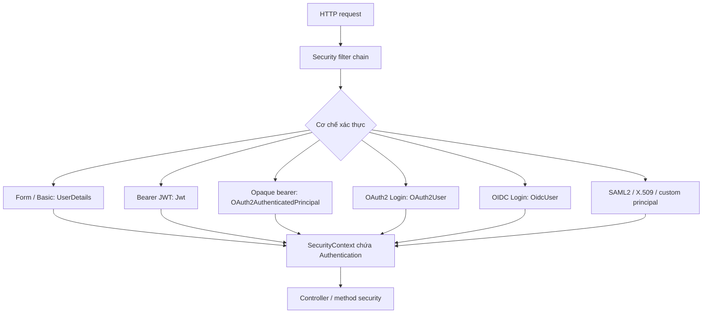

# Chọn principal đúng kiểu mà cơ chế xác thực thực tế tạo ra

Trong chương **Cơ chế chuyên biệt** của module **SPRING_SECURITY_TESTING**, một nguyên nhân phổ biến khiến kiểm thử bảo mật “xanh giả” là **tạo sai kiểu principal**. Ví dụ, ứng dụng đọc claim từ `Jwt` nhưng bài test lại dùng `@WithMockUser`; hoặc controller yêu cầu `OidcUser` nhưng test chỉ cấp `OAuth2User` thông thường. Hai đối tượng có thể có cùng tên người dùng và quyền, song **không đại diện cho cùng cơ chế xác thực**.

Mục tiêu bài học là chọn đúng `Authentication`, principal, attributes/claims và authorities cho **Servlet/MockMvc** lẫn **Reactive/WebTestClient**, đồng thời phân biệt kiểm thử *hành vi sau xác thực* với kiểm thử *quá trình xác thực thật*. Đây là nền tảng để kiểm chứng HTTP 200/401/403, `SecurityContext`, JWT, opaque token, OAuth2/OIDC Login và các cơ chế như X.509, SAML2 hoặc API key mà không dùng tài khoản hay token thật.

## 1. Vì sao `username` giống nhau không đồng nghĩa principal giống nhau?

Spring Security đặt thông tin người gọi trong `SecurityContext`, thông thường thông qua `Authentication`. Một `Authentication` có:

- **Principal:** đại diện danh tính đã xác thực, nhưng có thể là `UserDetails`, `Jwt`, `OAuth2AuthenticatedPrincipal`, `OAuth2User`, `OidcUser`, một đối tượng tùy biến hoặc thậm chí một chuỗi.
- **Authorities:** các `GrantedAuthority` dùng cho `hasAuthority`, `hasRole`, biểu thức method security hoặc logic phân quyền khác.
- **Credentials/details:** thông tin phụ thuộc cơ chế; không nên ghi credentials hoặc token nguyên văn vào log/test report.
- **Authenticated flag:** cho biết trạng thái của authentication object; nó không tự chứng minh rằng một bộ kiểm thử có mock principal đã kiểm tra mật khẩu, chữ ký JWT hay token introspection.



Điều **không nên làm** là thay mọi nhánh trên bằng `@WithMockUser(username = "alice")` rồi kết luận tất cả luồng xác thực hoạt động. Annotation này tạo một `UserDetails` giả phù hợp cho kiểm tra username/role, nhưng không dựng ID token, JWT claim, UserInfo hay opaque introspection metadata.

## 2. Bảng đối chiếu cơ chế, Authentication và principal

| Cơ chế đang dùng | `Authentication` thường gặp | Principal thực tế thường gặp | Dữ liệu ứng dụng có thể cần |
| --- | --- | --- | --- |
| Username/password qua form login hoặc HTTP Basic | `UsernamePasswordAuthenticationToken` | `UserDetails`, thường là `User` | `getUsername()`, authorities |
| Bearer JWT resource server | `JwtAuthenticationToken` | `Jwt` | `sub`, `iss`, `aud`, `scope`, claim riêng |
| Opaque bearer token resource server | `BearerTokenAuthentication` | `OAuth2AuthenticatedPrincipal` | Attributes từ introspection như `sub`, `client_id`, `scope`, `tenant_id` |
| OAuth2 Login (không phải OIDC) | `OAuth2AuthenticationToken` | `OAuth2User` | `getAttributes()`, `getName()` |
| OpenID Connect Login | `OAuth2AuthenticationToken` | `OidcUser` | `getIdToken()`, `getUserInfo()`, `getClaims()`, `getSubject()` |
| SAML2 Login | `Saml2Authentication` | `Saml2AuthenticatedPrincipal` trong cấu hình thông dụng | NameID, các attributes/assertion đã được xử lý |
| X.509 hoặc pre-authentication | Có thể là `PreAuthenticatedAuthenticationToken` | Chuỗi tên hoặc `UserDetails`/custom principal, phụ thuộc provider | Danh tính từ certificate/nguồn tin cậy đã xác minh |
| API key/filter tùy biến | Do ứng dụng định nghĩa, có thể dùng `AbstractAuthenticationToken` | Custom principal riêng | Client ID, tenant, capabilities, thuộc tính đã được xác thực |

Đây là **các dạng thường gặp**, không phải hợp đồng bất biến cho mọi dự án. `AuthenticationProvider`, `JwtAuthenticationConverter`, `OpaqueTokenIntrospector`, `OidcUserService` hoặc một authentication filter tùy biến có thể thay đổi principal. Hãy xác định **bean và cơ chế thật của ứng dụng** trước khi chọn fixture.

### Phân biệt principal, Authentication và authority

Ba câu hỏi khác nhau cần ba loại assertion:

1. **Đây là kiểu xác thực nào?** Ví dụ `JwtAuthenticationToken` không phải `OAuth2AuthenticationToken`.
2. **Principal mang dữ liệu gì?** Ví dụ `Jwt.getClaimAsString("tenant_id")` khác `OidcUser.getUserInfo()`.
3. **Được phép làm gì?** Ví dụ `SCOPE_orders.read` nằm trong `Authentication.getAuthorities()`, không tự xuất hiện chỉ vì principal có một attribute cùng tên.

Test có thể pass `hasAuthority("SCOPE_orders.read")` dù việc ánh xạ `scope` từ token **chưa hề được thực thi**, nếu fixture đã gắn authority trực tiếp.

## 3. Chọn `UserDetails` khi code thật dùng username/password

Với form login hoặc HTTP Basic dùng `UserDetailsService`, controller có thể cần `UserDetails`:

```java
@GetMapping("/account/me")
Map<String, String> me(@AuthenticationPrincipal UserDetails user) {
    return Map.of("username", user.getUsername());
}
```

Trường hợp này `@WithMockUser` hoặc `user(...)` trong MockMvc là fixture phù hợp:

```java
@Test
void formLoginPrincipalCanReadUsername() throws Exception {
    mvc.perform(get("/account/me")
            .with(user("fixture-reader").roles("USER")))
        .andExpect(status().isOk())
        .andExpect(jsonPath("$.username").value("fixture-reader"));
}

@Test
@WithMockUser(username = "fixture-admin", roles = "ADMIN")
void annotatedUserCanExerciseRolePolicy() throws Exception {
    mvc.perform(get("/account/admin"))
        .andExpect(status().isOk());
}
```

Hai ví dụ giả định controller và security chain được nạp, endpoint `/account/admin` yêu cầu `ROLE_ADMIN`. Với `@WithMockUser`, Spring Security Test thường tạo `UsernamePasswordAuthenticationToken` cùng principal `User`. Nếu ứng dụng dùng custom `UserDetails` với thuộc tính domain đặc biệt, nên tạo đúng custom principal hoặc dùng `@WithUserDetails` với `UserDetailsService` test.

`@WithUserDetails` giúp lấy người dùng từ `UserDetailsService`, nhưng vẫn **không tự gửi mật khẩu qua HTTP hay xác minh password encoder**. Để kiểm tra HTTP Basic/form authentication thật, hãy gửi credential fixture qua cơ chế login của ứng dụng và kiểm tra cả mật khẩu sai lẫn đúng. Tên `fixture-admin` không có nghĩa tài khoản này tồn tại trên hệ thống triển khai.

**Không dùng** `@WithMockUser` cho endpoint bắt buộc đọc `Jwt`, `OidcUser` hoặc `OAuth2AuthenticatedPrincipal`: tên người dùng đúng vẫn không giải quyết được sai kiểu principal.

## 4. Bearer JWT: principal là `Jwt`, không phải `UserDetails`

Trong OAuth2 Resource Server dùng JWT, Spring Security thường tạo `JwtAuthenticationToken`, có principal là đối tượng `Jwt`. Controller đọc claim bằng API của `Jwt`:

```java
record IdentityView(String subject, String tenant) {}

@GetMapping("/api/jwt/me")
IdentityView jwtIdentity(
        @AuthenticationPrincipal(errorOnInvalidType = true) Jwt jwt) {
    Object value = jwt.getClaim("tenant_id");
    if (!(value instanceof String tenant) || tenant.isBlank()) {
        throw new ResponseStatusException(
            HttpStatus.FORBIDDEN, "Invalid tenant claim");
    }
    return new IdentityView(jwt.getSubject(), tenant);
}
```

Để kiểm tra **logic HTTP sau khi JWT đã xác thực**, dùng `jwt()` của `SecurityMockMvcRequestPostProcessors`:

```java
@Test
void jwtClaimsReachTheController() throws Exception {
    mvc.perform(get("/api/jwt/me")
            .with(jwt().jwt(token -> token
                .subject("fixture-sub-501")
                .claim("tenant_id", "tenant-a"))
                .authorities(new SimpleGrantedAuthority(
                    "SCOPE_profile.read"))))
        .andExpect(status().isOk())
        .andExpect(jsonPath("$.subject").value("fixture-sub-501"))
        .andExpect(jsonPath("$.tenant").value("tenant-a"));
}
```

Ví dụ giả định route thuộc security chain resource server JWT và có chính sách phù hợp. Nếu route yêu cầu `SCOPE_profile.read`, một test cùng principal nhưng `.authorities(new SimpleGrantedAuthority("SCOPE_other.read"))` phải trả 403; route không có bearer authentication phải bị từ chối theo entry point đã cấu hình, thường là 401.

### Sai kiểu trong cùng endpoint

```java
@Test
@WithMockUser(username = "fixture-sub-501")
void thisDoesNotConstructJwtPrincipal() throws Exception {
    // Gọi controller yêu cầu Jwt không trở thành test JWT hợp lệ
    // chỉ nhờ username giống claim sub.
    mvc.perform(get("/api/jwt/me"));
}
```

Đoạn trên là **ví dụ anti-pattern**, cố ý không đặt assertion HTTP cố định: khi dùng `@AuthenticationPrincipal` sai kiểu, framework có thể trả `null` theo mặc định hoặc ném lỗi nếu `errorOnInvalidType = true`; exception handler quyết định response cuối. Điều cần sửa là **fixture**, không phải viết một kỳ vọng 200 cho principal sai kiểu.

`jwt()` cũng không xác minh chữ ký hoặc `exp`/`nbf`/issuer/audience. Với nhóm test đó, gửi Bearer header chứa **JWT thực sự được ký bằng private key test**, cho `JwtDecoder` dùng public key/issuer fixture để kiểm tra. Đừng tuyên bố “JWT hết hạn bị từ chối” dựa trên một mock `Jwt` đã được gắn thẳng vào security context.

## 5. Opaque bearer token: dùng `OAuth2AuthenticatedPrincipal` và attributes

Một resource server dùng opaque token thường nhận phản hồi từ introspection endpoint rồi tạo `BearerTokenAuthentication`. Principal ở dạng `OAuth2AuthenticatedPrincipal`, cho phép đọc attributes:

```java
@GetMapping("/api/opaque/me")
IdentityView opaqueIdentity(
        @AuthenticationPrincipal(errorOnInvalidType = true)
        OAuth2AuthenticatedPrincipal principal) {
    Object subject = principal.getAttribute("sub");
    Object tenant = principal.getAttribute("tenant_id");
    if (!(subject instanceof String sub) || sub.isBlank()
            || !(tenant instanceof String tenantId) || tenantId.isBlank()) {
        throw new ResponseStatusException(
            HttpStatus.FORBIDDEN, "Missing opaque token attributes");
    }
    return new IdentityView(sub, tenantId);
}
```

MockMvc hỗ trợ `opaqueToken()` để dựng trạng thái principal opaque đã xác thực:

```java
@Test
void opaquePrincipalSuppliesAttributes() throws Exception {
    mvc.perform(get("/api/opaque/me")
            .with(opaqueToken()
                .attributes(attrs -> {
                    attrs.put("sub", "fixture-opaque-201");
                    attrs.put("tenant_id", "tenant-b");
                })
                .authorities(new SimpleGrantedAuthority(
                    "SCOPE_profile.read"))))
        .andExpect(status().isOk())
        .andExpect(jsonPath("$.subject").value("fixture-opaque-201"))
        .andExpect(jsonPath("$.tenant").value("tenant-b"));
}
```

Những attributes này là **dữ liệu giả**. Trong triển khai thật, Spring Security chỉ nên tin principal sau khi introspection xác nhận token đang hoạt động. Dùng `opaqueToken()`/WebFlux `mockOpaqueToken()` có nghĩa **bỏ qua** HTTP introspection; không kiểm tra được `active: false`, token bị thu hồi, timeout hay HTTP 5xx của authorization server.

**Attributes khác authorities:** một map có `scope=profile.read` chưa đồng nghĩa `Authentication` có `SCOPE_profile.read`. Nếu gọi `.authorities(...)`, test đã thiết lập quyền trực tiếp và chưa kiểm tra bước biến đổi scope trong introspector. Viết test riêng cho `OpaqueTokenIntrospector` hoặc `ReactiveOpaqueTokenIntrospector` với HTTP stub nếu ánh xạ quyền là mục tiêu.

## 6. OAuth2 Login và OIDC Login: hai principal không thể tráo đổi

Ứng dụng **OAuth2 client đăng nhập qua trình duyệt** khác với resource server nhận Bearer token. Một user đã đăng nhập OAuth2 thường có `OAuth2AuthenticationToken`, nhưng principal phụ thuộc cơ chế:

- **OAuth2 Login thuần:** `OAuth2User`, thường là `DefaultOAuth2User`. Dùng `getAttributes()`.
- **OIDC Login:** `OidcUser`, thường là `DefaultOidcUser`, có `getIdToken()`, `getUserInfo()`, `getClaims()`, `getSubject()`.

Hai controller tiêu biểu:

```java
@GetMapping("/ui/oauth2/profile")
Map<String, Object> oauthProfile(
        @AuthenticationPrincipal OAuth2User user) {
    return Map.of("name", user.getName());
}

@GetMapping("/ui/oidc/profile")
Map<String, Object> oidcProfile(
        @AuthenticationPrincipal(errorOnInvalidType = true) OidcUser user) {
    return Map.of(
        "subject", user.getSubject(),
        "issuer", user.getIdToken().getClaimAsString("iss"));
}
```

`OidcUser` là một dạng `OAuth2User`, vì vậy code chỉ yêu cầu giao diện `OAuth2User` có thể nhận được OIDC principal. **Chiều ngược lại không đúng**: `DefaultOAuth2User` thông thường không có ID token và không thể đáp ứng method yêu cầu `OidcUser`.

### MockMvc: chọn đúng post-processor

```java
// OAuth2 Login thông thường:
mvc.perform(get("/ui/oauth2/profile")
        .with(oauth2Login()))
    .andExpect(status().isOk());

// OIDC Login khi controller cần ID token:
mvc.perform(get("/ui/oidc/profile")
        .with(oidcLogin().idToken(id -> id
            .claim("iss", "https://issuer.test.invalid")
            .claim("sub", "fixture-oidc-sub"))))
    .andExpect(status().isOk())
    .andExpect(jsonPath("$.subject").value("fixture-oidc-sub"));
```

Đây là ví dụ tích hợp **sau đăng nhập**; cần nạp đúng OAuth2/OIDC Login security chain và registration fixture trong context. `oidcLogin()` không gọi authorization endpoint, token endpoint, JWKS hay UserInfo endpoint thật. Nó cố ý bỏ qua kiểm tra `state`, `nonce`, `iss`, `aud` và chữ ký ID token. Muốn kiểm chứng những bước này, cần stub OIDC Provider và chạy Authorization Code callback thật với khóa ký test.

**ID token không phải access token:** `JwtAuthenticationToken` từ bearer resource server không tự trở thành `OidcUser`, dù JWT chứa claim `sub` và `email`. Đừng dùng `jwt()` thay `oidcLogin()` cho controller dựa vào `OidcUser.getIdToken()`.

### UserInfo có thể không tồn tại

Không phải mọi phiên OIDC đều cung cấp `OidcUserInfo`. Nếu code gọi `user.getUserInfo().getPreferredUsername()` mà không kiểm tra `null`, test chỉ có ID token có thể phát hiện lỗi đó. Cần ít nhất hai fixture: có UserInfo và không có UserInfo, để xác nhận fallback hoặc lỗi đúng hợp đồng. Một test `@WithMockUser` hoàn toàn không thể kiểm chứng nhánh này.

## 7. SAML2, X.509 và filter tùy biến: không tự suy ra kiểu principal

Các cơ chế chuyên biệt không nên bị ép vào cùng một lớp principal:

**SAML2 Login:** Sau khi assertion SAML được xác minh và mapping hoàn tất, ứng dụng có thể nhận `Saml2Authentication` với principal `Saml2AuthenticatedPrincipal`. Nếu service cần NameID hoặc attributes SAML, dùng fixture SAML đúng kiểu. Một `@WithMockUser(username = "name-id")` chỉ chứng minh role/username, không xác minh XML signature, audience, issuer, thời gian hoặc replay protection của SAML assertion.

**X.509/mTLS:** Trong pre-authentication, chuỗi tên được trích từ certificate có thể đi vào `PreAuthenticatedAuthenticationToken`, rồi provider ánh xạ thành `UserDetails` hoặc principal tùy biến. Kiểu cuối cùng phụ thuộc cấu hình `AuthenticationUserDetailsService` và provider; không mặc định principal luôn là `X509Certificate`. Muốn test filter trích subject từ certificate, hãy cung cấp certificate **fixture** và chạy đúng filter; dùng mock user không chứng minh TLS peer certificate đã được xác nhận.

**API key/cơ chế tùy biến:** Một filter có thể tạo `ApiClientAuthentication` và `ApiClientPrincipal`, ví dụ:

```java
record ApiClientPrincipal(String clientId, String tenantId) {}

final class ApiClientAuthentication extends AbstractAuthenticationToken {
    private final ApiClientPrincipal principal;

    ApiClientAuthentication(ApiClientPrincipal principal,
                            Collection<? extends GrantedAuthority> authorities) {
        super(authorities);
        this.principal = principal;
        super.setAuthenticated(true);
    }

    @Override
    public ApiClientPrincipal getPrincipal() {
        return principal;
    }

    @Override
    public Object getCredentials() {
        return null;
    }
}
```

Đây là **kiểu minh họa dành cho test**, không phải một cơ chế xác thực API key hoàn chỉnh. Chỉ code xác thực đáng tin cậy sau khi kiểm tra key/secret mới được tạo token có `authenticated=true`; không cho client tự chỉ định quyền/tenant qua header không được xác minh. Với custom token, tránh lưu raw API key trong `credentials` hoặc log.

Khi controller cần `ApiClientPrincipal`, viết fixture có **đúng đối tượng custom**, cùng test tích hợp gửi `X-Api-Key` fixture thật để bảo đảm filter/provider tạo authentication đúng kiểu. `@WithMockUser` không thể thay thế test này.

## 8. `@AuthenticationPrincipal`: null, sai kiểu và cách báo lỗi rõ ràng

Spring MVC/WebFlux hỗ trợ `@AuthenticationPrincipal` để giải principal từ `Authentication`. Khi argument có kiểu không tương thích:

- Mặc định, resolver có thể trả **`null`** thay vì tự chuyển kiểu principal.
- Với `@AuthenticationPrincipal(errorOnInvalidType = true)`, resolver ném lỗi kiểu (thường là `ClassCastException`) để lộ fixture hoặc code sai kỳ vọng.
- Việc ném lỗi không tự đồng nghĩa HTTP 401/403; response phụ thuộc exception handler và việc request đã đi qua filter hay chưa.

Ví dụ rõ ràng hơn trong controller yêu cầu JWT:

```java
@GetMapping("/api/jwt/subject")
String subject(
        @AuthenticationPrincipal(errorOnInvalidType = true) Jwt jwt) {
    return jwt.getSubject();
}
```

Test cho route này nên dùng `jwt()` trên MockMvc hoặc `mockJwt()` trên WebTestClient, **không dùng** `@WithMockUser`. Khi thật sự cần dự án hỗ trợ nhiều authentication mechanism cho cùng một endpoint, đừng ép mọi principal sang một kiểu: có thể đọc `Authentication` và thực hiện **mapping theo loại** qua một lớp adapter riêng.

```java
record CallerIdentity(String subject, String tenantId) {}

CallerIdentity mapCaller(Authentication authentication) {
    Object principal = authentication.getPrincipal();

    if (principal instanceof Jwt jwt) {
        return new CallerIdentity(jwt.getSubject(),
            jwt.getClaimAsString("tenant_id"));
    }
    if (principal instanceof OidcUser oidc) {
        Object tenant = oidc.getClaims().get("tenant_id");
        return new CallerIdentity(oidc.getSubject(),
            tenant instanceof String value ? value : null);
    }
    if (principal instanceof OAuth2AuthenticatedPrincipal opaque) {
        return new CallerIdentity(opaque.getAttribute("sub"),
            opaque.getAttribute("tenant_id"));
    }

    throw new AccessDeniedException("Unsupported authentication principal");
}
```

Ví dụ trên là **khung adapter**, chưa phải policy hoàn chỉnh: phải kiểm tra `subject`/`tenantId` có đúng kiểu, không rỗng, issuer đáng tin, tên tenant hợp lệ và quyền tương ứng. Nếu dự án **chỉ** cho phép JWT, đơn giản hơn và an toàn hơn là yêu cầu `Jwt` tường minh thay vì nhận mọi principal.

**Không coi giá trị `name` là khóa nhận dạng toàn cục.** `Authentication.getName()` có thể xuất phát từ username, JWT `sub`, OAuth2 `nameAttributeKey` hoặc SAML NameID. Với nhiều issuer/tenant, cần xác định nguồn định danh và phạm vi duy nhất theo contract; không gom hai người dùng chỉ vì string `getName()` giống nhau.

## 9. Quan sát principal ở đúng chỗ trong `SecurityContext`

Để biết request thực sự mang loại authentication nào, quan sát **bên trong pipeline bảo mật**, không đọc context ở thời điểm tùy ý sau test:

```java
@GetMapping("/test-only/security-shape")
Map<String, String> securityShape(Authentication authentication) {
    return Map.of(
        "authenticationType", authentication.getClass().getSimpleName(),
        "principalType",
            authentication.getPrincipal().getClass().getSimpleName());
}
```

Endpoint này chỉ thích hợp cho **test fixture**, không nên công khai trong production vì có thể tiết lộ thông tin cấu trúc bảo mật. Đối với Servlet, `SecurityContextHolder` gắn với thread request và có thể bị filter xóa sau khi response hoàn tất. Với WebFlux, principal đi qua **Reactor Context**, có thể quan sát ở service bằng `ReactiveSecurityContextHolder.getContext()`:

```java
Mono<String> principalClassName() {
    return ReactiveSecurityContextHolder.getContext()
        .map(SecurityContext::getAuthentication)
        .map(auth -> auth.getPrincipal().getClass().getSimpleName());
}
```

Trên WebFlux, **không** kiểm tra `SecurityContextHolder.getContext()` từ thread JUnit rồi suy luận principal của reactive subscription. Nếu test method security trực tiếp bằng `StepVerifier`, gắn đúng `Authentication` vào publisher:

```java
Mono<String> secured = service.readSensitiveValue()
    .contextWrite(
        ReactiveSecurityContextHolder.withAuthentication(authentication));

StepVerifier.create(secured)
    .expectNext("expected-value")
    .verifyComplete();
```

Ví dụ giả định service là Spring bean có reactive method security bật khi cần kiểm tra `@PreAuthorize`. Với HTTP, nên xác nhận principal qua giá trị controller thực sự trả ra và các ca thiếu quyền/anonymous, không chỉ test một endpoint chẩn đoán.

## 10. MockMvc: fixture nào đúng cho từng controller?

| Controller cần | MockMvc post-processor thích hợp | Không dùng làm thay thế |
| --- | --- | --- |
| `UserDetails`, username và role | `user(...)`, `@WithMockUser`, `@WithUserDetails` | Một JWT chỉ có `sub` |
| `Jwt` và JWT claims | `jwt()` | `@WithMockUser` |
| `OAuth2AuthenticatedPrincipal` từ opaque bearer | `opaqueToken()` | `jwt()` hoặc `oidcLogin()` |
| `OAuth2User` từ OAuth2 Login | `oauth2Login()` | `opaqueToken()` |
| `OidcUser` và ID token | `oidcLogin()` | `oauth2Login()` thông thường |
| Custom `ApiClientPrincipal` | Custom `Authentication` / custom `@WithSecurityContext` | Username giả có cùng client ID |

Ví dụ test phải kiểm tra cả **principal** và **quyền**. Với route JWT chỉ cho phép `SCOPE_profile.read`, thử:

```java
@Test
void jwtWithoutScopeIsForbidden() throws Exception {
    mvc.perform(get("/api/jwt/me")
            .with(jwt().jwt(token -> token
                .subject("fixture-sub-501")
                .claim("tenant_id", "tenant-a"))
                .authorities(new SimpleGrantedAuthority(
                    "SCOPE_other.read"))))
        .andExpect(status().isForbidden());
}
```

Để test 403 có giá trị, security chain phải có rule yêu cầu `SCOPE_profile.read` cho endpoint; nếu route chỉ dùng `authenticated()`, JWT thiếu scope vẫn được phép theo cấu hình đó. Một assertion phải phản ánh **quy tắc thực tế**, không phỏng đoán rule tồn tại.

Với request anonymous, một resource server JWT/opaque thường trả 401; OAuth2 Login trên trình duyệt thường trả redirect đến trang đăng nhập thay vì 401. Nếu app có custom `AuthenticationEntryPoint` hoặc `AccessDeniedHandler`, cập nhật mã kỳ vọng theo chính sách đã định nghĩa.

## 11. WebTestClient: `mockJwt`, `mockOpaqueToken` và `mockOidcLogin`

Trên **Reactive/WebFlux**, chọn helper tương đương nhưng bắt đầu từ `SecurityMockServerConfigurers`:

```java
import static org.springframework.security.test.web.reactive.server.SecurityMockServerConfigurers.mockJwt;
import static org.springframework.security.test.web.reactive.server.SecurityMockServerConfigurers.mockOpaqueToken;
import static org.springframework.security.test.web.reactive.server.SecurityMockServerConfigurers.mockOidcLogin;
import static org.springframework.security.test.web.reactive.server.SecurityMockServerConfigurers.springSecurity;
```

Ví dụ với endpoint nhận JWT:

```java
webTestClient.mutateWith(mockJwt()
        .jwt(token -> token
            .subject("fixture-reactive-jwt")
            .claim("tenant_id", "tenant-reactive"))
        .authorities(new SimpleGrantedAuthority("SCOPE_profile.read")))
    .get().uri("/api/jwt/me")
    .exchange()
    .expectStatus().isOk()
    .expectBody()
    .jsonPath("$.subject").isEqualTo("fixture-reactive-jwt");
```

Ví dụ với endpoint nhận principal opaque:

```java
webTestClient.mutateWith(mockOpaqueToken()
        .attributes(attrs -> {
            attrs.put("sub", "fixture-reactive-opaque");
            attrs.put("tenant_id", "tenant-reactive");
        })
        .authorities(new SimpleGrantedAuthority("SCOPE_profile.read")))
    .get().uri("/api/opaque/me")
    .exchange()
    .expectStatus().isOk()
    .expectBody()
    .jsonPath("$.subject").isEqualTo("fixture-reactive-opaque");
```

Ví dụ OIDC Login trong một ứng dụng client WebFlux:

```java
webTestClient.mutateWith(mockOidcLogin()
        .idToken(token -> token
            .subject("fixture-reactive-oidc")
            .claim("tenant_id", "tenant-reactive")))
    .get().uri("/ui/oidc/profile")
    .exchange()
    .expectStatus().isOk()
    .expectBody()
    .jsonPath("$.subject").isEqualTo("fixture-reactive-oidc");
```

Các đoạn này **thuộc các cấu hình ứng dụng tương ứng** (JWT resource server, opaque resource server, OAuth2/OIDC Login); không phải một cấu hình security mặc nhiên chấp nhận mọi cơ chế cùng lúc. `WebTestClient` cần được bind vào application context có `SecurityWebFilterChain` và dùng `.apply(springSecurity())` nếu tự tạo client, hoặc gửi request đến server đã cấu hình security đúng.

**Đặc biệt:** `WebTestClient.bindToServer()` gửi HTTP tới server thật không thể chuyển `mockJwt()`, `mockOpaqueToken()` hoặc `mockOidcLogin()` phía JUnit thành một principal trên server thông qua socket. Khi đó phải gửi Basic/Bearer token fixture hoặc cookie/session được tạo bởi luồng login test thật.

## 12. Tạo custom principal cho test mà không sửa production authentication

Khi ứng dụng dùng `ApiClientPrincipal`, tạo một factory test nhỏ để các case dùng đúng kiểu authentication:

```java
Authentication fixtureApiClient(
        String clientId, String tenantId, String authority) {
    ApiClientPrincipal principal =
        new ApiClientPrincipal(clientId, tenantId);

    return new ApiClientAuthentication(
        principal,
        List.of(new SimpleGrantedAuthority(authority)));
}
```

Đối với unit test service thuần, truyền fixture authentication trực tiếp cho method nhận `Authentication` hoặc gọi qua `SecurityContext` test đúng phạm vi. Với Spring MVC và nhiều test method, có thể xây annotation `@WithSecurityContext(factory = ...)` để đưa đúng custom `Authentication` vào context. Với test Reactive, gắn authentication vào `ReactiveSecurityContextHolder.withAuthentication(...)` trên đúng publisher.

Tuy nhiên, test **custom filter/provider** cần một nhóm kiểm thử riêng: gửi request có header API key fixture, để filter xác minh dữ liệu test, tạo `ApiClientAuthentication` và đặt security context. Không tạo trước principal bằng test annotation rồi tuyên bố filter đã xác minh API key.

Một factory fixture nên cho phép tùy chỉnh **cả principal và authorities**, nhưng tránh cấp `ROLE_ADMIN` mặc định cho mọi test. Điều này khiến ca thiếu quyền không bao giờ chạy; nên có ít nhất một case principal hợp lệ nhưng authority không đủ.

## 13. Khi nào dùng mock và khi nào cần xác thực thật?

| Điều cần chứng minh | Nên dùng | Không được kết luận chỉ từ mock |
| --- | --- | --- |
| Controller đọc `Jwt.getSubject()`/tenant | `jwt()` hoặc `mockJwt()` | JWT signature/expiry/issuer được xác minh |
| Resource server kiểm tra role/authority từ bearer principal giả | `jwt()`, `opaqueToken()`, các bản mock Reactive | Decoder hoặc introspection xử lý token thật |
| Controller đọc `OidcUser.getIdToken()` | `oidcLogin()` hoặc `mockOidcLogin()` | OIDC `state`, `nonce`, token exchange, chữ ký |
| Controller đọc attributes SAML2 | Fixture `Saml2Authentication` đúng kiểu | SAML signature, assertion validity, replay validation |
| Filter API key tạo đúng principal | Request thật qua filter với key fixture | Header được xác minh khi chỉ đặt principal trong test |
| HTTP Basic mật khẩu sai/đúng | Request với credential fixture, user store và encoder test | Password encoder được kiểm tra bởi `@WithMockUser` |
| Bearer JWT hết hạn/sai chữ ký | JWT ký bằng khóa test, gửi `Authorization: Bearer` qua decoder thật | Trạng thái 401 qua `jwt()` giả |
| Opaque introspection timeout/`active:false` | HTTP introspection stub và introspector thật | `opaqueToken()` kiểm tra lỗi server-to-server |

**Tránh nhầm hai mục tiêu test:** fixture principal phù hợp giúp kiểm thử logic **sau khi xác thực**; test cơ chế authentication phải đi qua **đường tạo principal thật**. Với HTTP client test, đừng gắn post-processor đã xác thực vào chính request mà bạn muốn kiểm tra decoder, introspector, X.509 hoặc API-key filter.

## 14. Ma trận ca âm tính giúp phát hiện chọn sai principal

| Kịch bản | Principal fixture | Hành vi cần quan sát |
| --- | --- | --- |
| JWT API, `Jwt` với `tenant_id` đúng và scope đủ | `jwt()` / `mockJwt()` | 200, trả đúng subject/tenant |
| JWT API, principal `UserDetails` từ `@WithMockUser` | Sai kiểu so với contract | Không tuyên bố test JWT thành công; kiểm tra lỗi type qua test phù hợp |
| JWT API, scope không đủ | JWT đúng kiểu, authority sai | 403 nếu endpoint yêu cầu scope |
| Opaque API, `OAuth2AuthenticatedPrincipal` có attributes đúng | `opaqueToken()` / `mockOpaqueToken()` | 200 và body đúng |
| Opaque API, attributes thiếu/sai kiểu | Principal opaque đúng loại, dữ liệu sai | Bị từ chối theo policy claim, không lộ thông tin khác tenant |
| OIDC endpoint, `OidcUser` có ID token | `oidcLogin()` / `mockOidcLogin()` | Đọc `sub`/claim đúng |
| OIDC endpoint, `DefaultOAuth2User` thuần | Không có `OidcUser` | Test bắt được sai kiểu; không giả vờ có ID token |
| Custom API-key principal thiếu quyền | `ApiClientAuthentication` đúng kiểu, authority sai | 403, không chạy nghiệp vụ bảo vệ |
| Request anonymous tới API bearer | Không có authentication | Thường 401, không có principal giả |

Khi mã ứng dụng cần kiểm tra **tenant**, thêm ít nhất hai danh tính có cùng scope nhưng khác tenant; cùng một authority `SCOPE_orders.read` không đồng nghĩa có quyền truy cập tài nguyên của tenant khác. Nếu policy nằm tại method security (`@PreAuthorize`), test phải bật interceptor và gọi bean thông qua proxy, không gọi `new Service()` hoặc self-invocation.

## 15. Bài thực hành: thay fixture username sai bằng principal đúng cơ chế

Cho ba API trong ba cấu hình bảo mật riêng: `GET /api/jwt/me` (resource server JWT), `GET /api/opaque/me` (opaque bearer) và `GET /ui/oidc/profile` (OIDC client login). Thêm một API tùy biến nhận API key với `ApiClientPrincipal`.

1. **Xác định loại thật:** ghi bảng `Authentication`, principal và attributes/claims mà từng endpoint đang đọc. Giải thích vì sao bốn endpoint không thể cùng dùng `@WithMockUser` để thay thế.
2. **JWT/Servlet:** dùng MockMvc `jwt()` với `sub`, `tenant_id` và `SCOPE_profile.read`. Khẳng định status 200, subject/tenant đúng. Đổi authority để kiểm tra 403 và thử thiếu tenant theo policy.
3. **Opaque/Servlet:** dùng `opaqueToken()` thêm `sub` và `tenant_id` vào attributes. Khẳng định dữ liệu được đọc đúng kiểu; thử thiếu attribute và authority.
4. **OIDC/Servlet:** dùng `oidcLogin().idToken(...)` để controller nhận `OidcUser`. Đối chiếu với `oauth2Login()` và chỉ ra khác biệt khi mã thật cần `getIdToken()` hoặc `getUserInfo()`.
5. **Reactive:** lặp lại nhóm JWT, opaque, OIDC bằng `mockJwt()`, `mockOpaqueToken()` và `mockOidcLogin()`. Bật `springSecurity()` trên WebTestClient gắn application context và có test anonymous/thiếu quyền/đủ quyền.
6. **Custom principal:** tạo fixture `ApiClientAuthentication`, kiểm tra controller đọc client ID/tenant. Viết test tích hợp gửi API key fixture thật để chứng minh filter/provider tạo đúng principal.
7. **Ranh giới mock:** tạo một test JWT ký bằng khóa test với decoder thật, một test introspection `active:false` qua stub hoặc một test OIDC callback qua provider stub. Giải thích tại sao các test mock principal bên trên chưa kiểm tra những bước này.
8. **An toàn dữ liệu:** không dùng key, token, certificate, session cookie hoặc secret của môi trường triển khai. Không để thông tin xác thực nguyên văn trong log và artifact CI.

### Tiêu chí hoàn thành

- Mỗi ca test chọn principal **đúng kiểu mà cơ chế đang triển khai tạo ra**, thay vì chỉ giống username hoặc authorities.
- Phân biệt `Authentication`, principal, attributes/claims và `GrantedAuthority`.
- Controller/service đọc đúng dữ liệu có kiểm tra kiểu, có ca thiếu claim và cross-tenant bị từ chối.
- Trên Servlet và Reactive, security filter chain thật sự được áp dụng với các ca được phép/bị từ chối.
- Không dùng `jwt()`, `opaqueToken()` hoặc `oidcLogin()` làm bằng chứng chữ ký/issuer/introspection/login callback đã được xác minh.
- Test dùng dữ liệu fixture cô lập và không lộ bí mật xác thực.

## Ghi nhớ

**Kiểu principal là một phần của hợp đồng xác thực.** `@WithMockUser` phù hợp để kiểm tra username/role thông thường, nhưng không thay thế `Jwt`, `OAuth2AuthenticatedPrincipal`, `OidcUser`, `Saml2AuthenticatedPrincipal` hay custom principal khi mã ứng dụng cần các dữ liệu đặc thù. Trong **SPRING_SECURITY_TESTING**, hãy chọn `jwt()`/`mockJwt()`, `opaqueToken()`/`mockOpaqueToken()`, `oauth2Login()`/`mockOAuth2Login()`, `oidcLogin()`/`mockOidcLogin()` đúng cơ chế, kiểm tra cả 200/401/403 và nhánh claim sai. Cuối cùng, dùng token/certificate/provider stub đi qua bộ lọc và validator thật khi mục tiêu là kiểm chứng bản thân quá trình xác thực chứ không chỉ trạng thái principal sau xác thực.
