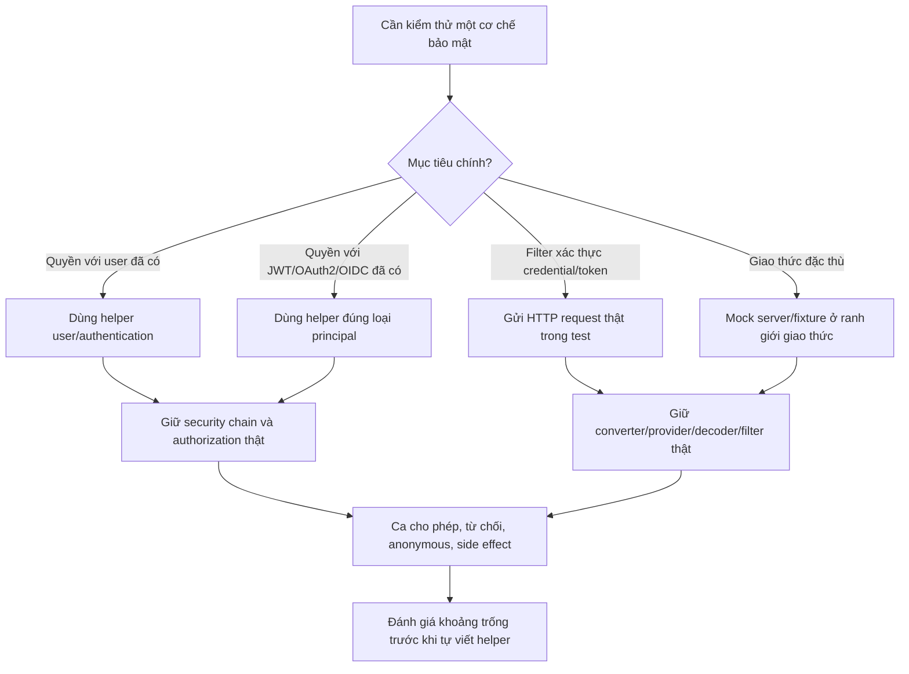

# Đối chiếu helper sẵn có trước khi mô phỏng một cơ chế chuyên biệt

> **Chương:** Cơ chế chuyên biệt  
> **Module:** `SPRING_SECURITY_TESTING`  
> **Mục tiêu:** Trước khi tự tạo `SecurityContext`, mock filter, viết annotation test hoặc giả lập một cơ chế xác thực chuyên biệt, hãy đối chiếu các helper có sẵn của `spring-security-test`. Bài học phân biệt Servlet/`MockMvc` và Reactive/`WebTestClient`, các trạng thái user/JWT/OAuth2/OIDC, CSRF và các ranh giới mà helper **không** kiểm chứng. Người học xây được ma trận ca được phép/bị từ chối, rồi chọn đúng lúc cần test converter, provider, filter, token endpoint hoặc giao thức thực.

## 1. Vấn đề: tự giả lập quá nhiều có thể bỏ qua chính cơ chế cần kiểm chứng

Giả sử API bảo vệ endpoint `GET /api/reports/quarterly`. Ứng dụng thực dùng Bearer JWT, xác minh chữ ký qua JWKS, lấy claim `scope`, tạo authority `SCOPE_reports:read` rồi quyết định quyền truy cập. Một test tạo:

```java
@Test
@WithMockUser(roles = "ADMIN")
void reportIsAccessible() throws Exception {
    mvc.perform(get("/api/reports/quarterly"))
        .andExpect(status().isOk());
}
```

Test có thể xanh nhưng không cho biết JWT decoder đã hoạt động hay chưa, scope có được chuyển thành authority đúng không, token hết hạn có bị từ chối không, và API có vô tình cho phép role ADMIN thay vì scope đã định nghĩa hay không.

Tự viết một filter giả đặt `SecurityContextHolder.getContext().setAuthentication(...)` cũng có thể khiến test bỏ qua Bearer token filter thật. Trong trường hợp đó, **càng mô phỏng nhiều, bằng chứng về cơ chế xác thực thực tế càng ít**.

Nguyên tắc thiết kế:

1. Xác định **hợp đồng cần chứng minh**: controller xử lý principal, HTTP authorization, authentication filter, token validation, protocol login hay truy cập dữ liệu.
2. Tìm **helper có sẵn** đúng cơ chế và đúng nền tảng Servlet/Reactive.
3. Giữ **thành phần thật** ở ranh giới đang kiểm chứng; giả lập tối thiểu những thứ nằm ngoài ranh giới đó.
4. Nếu helper cấp sẵn authentication, ghi rõ nó **không kiểm tra cách authentication được tạo**.
5. Chỉ tạo helper hoặc mock chuyên biệt mới khi công cụ có sẵn không biểu diễn được contract; bổ sung test giao thức thật khi cần.

### 1.1. Sơ đồ lựa chọn



## 2. Danh mục helper chính trên Servlet và Reactive

Nhiều helper trong Spring Security Test có tên gần giống nhau nhưng API khác vì chúng can thiệp ở **hai hạ tầng HTTP khác nhau**.

| Mục đích | Servlet / MockMvc | Reactive / WebTestClient | Bản chất mô phỏng |
| --- | --- | --- | --- |
| Bật tích hợp Spring Security cho test client | `SecurityMockMvcConfigurers.springSecurity()` | `SecurityMockServerConfigurers.springSecurity()` | Nối hạ tầng test với security chain |
| User đã xác thực | `user("alice")` | `mockUser("alice")` | Cài principal/authorities đã được xác thực |
| Authentication tự tạo | `authentication(authentication)` | `mockAuthentication(authentication)` | Cài một `Authentication` sẵn có |
| Anonymous | `anonymous()` hoặc `@WithAnonymousUser` | `@WithAnonymousUser` hoặc request không có mock identity | Không có user đã xác thực |
| Annotation TestContext | `@WithMockUser`, `@WithUserDetails`, `@WithSecurityContext` | `@WithMockUser`, `@WithSecurityContext` khi tích hợp Reactor Context đúng | Tạo SecurityContext cho test |
| JWT resource server | `jwt()` | `mockJwt()` | JWT principal/authority giả, không giải mã Bearer header |
| Opaque bearer token | `opaqueToken()` | `mockOpaqueToken()` | Principal từ introspection được mô phỏng |
| OAuth2 Login | `oauth2Login()` | `mockOAuth2Login()` | OAuth2 principal sau login |
| OIDC Login | `oidcLogin()` | `mockOidcLogin()` | OIDC principal sau login |
| OAuth2 authorized client đã có | `oauth2Client()` | `mockOAuth2Client()` ở phiên bản hỗ trợ | Chuẩn bị authorized client; không tự cấp token |
| CSRF hợp lệ | `csrf()` | `csrf()` | Đáp ứng kiểm tra CSRF của request test |
| HTTP Basic thực qua request | `httpBasic("alice", "password")` | HTTP Authorization Basic header trên WebTestClient | Gửi credential vào filter, không tự xác thực |
| Form login thực qua request | `formLogin()` hoặc POST form phù hợp | POST login form với WebTestClient | Chạy filter/manager khi cấu hình hỗ trợ |

Tên helper và overload có thể thay đổi theo phiên bản Spring Security. Khi thêm một helper vào dự án, kiểm tra đúng artifact `spring-security-test` và phiên bản đang dùng, đặc biệt với các cơ chế ít phổ biến. **Không tự sáng tác tên helper** dựa trên sự tương đồng với Servlet.

### 2.1. Hai nhóm helper không nên nhầm lẫn

**Nhóm 1 — gắn trạng thái xác thực đã có:** `user()`, `jwt()`, `opaqueToken()`, `oauth2Login()`, `oidcLogin()` và các bản Reactive. Chúng phù hợp để kiểm tra controller/method security **sau khi xác thực**. Chúng không chứng minh password, chữ ký, introspection hay callback.

**Nhóm 2 — tạo HTTP request giống giao thức thật:** `httpBasic()`, POST form login, Bearer header chứa token thật, cookie phiên, header API key hoặc certificate ở kết nối TLS. Nhóm này có thể đi qua filter/decoder/provider thật, nhưng còn phụ thuộc vào cách dựng server, credential store, khóa và endpoint test.

Ví dụ `with(httpBasic("alice", "wrong"))` **gửi credential sai**; nó không biến Alice thành người đã xác thực. Ngược lại, `with(user("alice"))` **đặt Authentication sẵn có**; nó không kiểm tra password.

## 3. Cấu hình nền: helper chỉ có ý nghĩa khi security chain được giữ

### 3.1. Servlet: MockMvc tích hợp Spring Security

Ví dụ với Spring Boot và filter chain thật:

```java
@SpringBootTest
@AutoConfigureMockMvc(addFilters = true)
class ReportHttpSecurityIT {

    @Autowired MockMvc mvc;

    @Test
    void anonymousCannotReadReport() throws Exception {
        mvc.perform(get("/api/reports/quarterly"))
            .andExpect(status().isUnauthorized());
    }

    @Test
    void viewerCannotReadAdminReport() throws Exception {
        mvc.perform(get("/api/reports/admin")
                .with(user("alice").roles("VIEWER")))
            .andExpect(status().isForbidden());
    }
}
```

Hai status là giả định khi cấu hình dùng entry point HTTP trả `401` cho anonymous và endpoint `/api/reports/admin` yêu cầu role cao hơn VIEWER. Nếu ứng dụng có form/OAuth2 login redirect, anonymous có thể nhận `302` thay vì `401`. Đừng áp đặt status mà chưa kiểm tra security configuration.

Nếu tự cấu hình MockMvc mà không dùng Boot:

```java
MockMvc mvc = MockMvcBuilders
    .webAppContextSetup(webApplicationContext)
    .apply(SecurityMockMvcConfigurers.springSecurity())
    .build();
```

Khi dùng `MockMvcBuilders.standaloneSetup(controller)` và chỉ gắn principal giả, bạn **không tự động có SecurityFilterChain production**. Đó có thể là unit test controller hợp lệ, nhưng không chứng minh HTTP access control.

### 3.2. Reactive: WebTestClient và WebFilter chain

```java
WebTestClient client = WebTestClient
    .bindToApplicationContext(applicationContext)
    .apply(SecurityMockServerConfigurers.springSecurity())
    .configureClient()
    .build();
```

Client này sử dụng WebFlux application context với security filters tương ứng. Test cấp danh tính theo request:

```java
client.mutateWith(
        SecurityMockServerConfigurers.mockUser("alice")
            .roles("VIEWER"))
    .get()
    .uri("/api/reports/admin")
    .exchange()
    .expectStatus().isForbidden();
```

`@WithMockUser` cũng có thể dùng trong Spring TestContext Reactive, nhưng cần hỗ trợ Reactor Context. Một `SecurityContextHolder` trên thread chạy JUnit không tự trở thành principal của mọi `Mono/Flux`, và `WebTestClient.bindToServer()` gửi HTTP qua mạng không tự mang annotation test vào server.

## 4. Đối chiếu user(), @WithMockUser và authentication() trước khi tự tạo SecurityContext

Khi service chỉ dựa trên tên user và authorities, hãy dùng helper đơn giản:

```java
mvc.perform(get("/api/reports/quarterly")
        .with(user("alice")
            .authorities(new SimpleGrantedAuthority(
                "SCOPE_reports:read"))))
    .andExpect(status().isOk());
```

Nếu nhiều test cần cùng một identity, `@WithMockUser` giảm lặp:

```java
@Test
@WithMockUser(
    username = "alice",
    authorities = "SCOPE_reports:read")
void userWithScopeCanRead() throws Exception {
    mvc.perform(get("/api/reports/quarterly"))
        .andExpect(status().isOk());
}
```

Đối với principal đặc biệt, có thể cung cấp `Authentication` trực tiếp:

```java
Authentication auth = new UsernamePasswordAuthenticationToken(
    new InternalPrincipal("agent-17", "tenant-a"),
    "N/A",
    List.of(new SimpleGrantedAuthority("ROLE_INTERNAL")));

mvc.perform(get("/internal/reports/summary")
        .with(authentication(auth)))
    .andExpect(status().isOk());
```

Trong ví dụ, `InternalPrincipal` là một type custom của ứng dụng, có thể khai báo:

```java
public record InternalPrincipal(
    String agentId,
    String tenantId
) {}
```

Đoạn test này chỉ hợp lệ khi endpoint `/internal/reports/summary` tồn tại và `SecurityFilterChain` chấp nhận `ROLE_INTERNAL`. Nó không kiểm tra cách ứng dụng xác thực agent. Nếu production yêu cầu `ApiKeyAuthenticationToken` có thêm metadata hoặc thuộc tính `isAuthenticated` riêng, hãy tạo **đúng kiểu token** trong test khi mục tiêu là kiểm tra code xử lý token đó.

### 4.1. Kiểm tra role và authority đúng chuỗi

```java
@WithMockUser(roles = "REPORTER")
// Tạo authority ROLE_REPORTER.

@WithMockUser(authorities = "SCOPE_reports:read")
// Tạo authority SCOPE_reports:read.
```

`hasRole("REPORTER")` kiểm tra tiền tố role mặc định; `hasAuthority("SCOPE_reports:read")` kiểm tra authority chính xác. Nếu test chỉ dùng `roles = "ADMIN"` cho mọi đường thành công, nó có thể không đại diện cho danh tính runtime với scope/phạm vi thật.

**Lựa chọn:** Nếu mục tiêu là HTTP authorization với một user đã có, dùng `user()`, `@WithMockUser` hoặc `mockUser()`. Nếu mục tiêu là cách HTTP Basic, API key hoặc JWT đã tạo ra user, dùng request giao thức thật và giữ authentication filter/provider.

## 5. JWT: dùng jwt()/mockJwt() khi test quyền, không dùng để kiểm tra chữ ký

Với Resource Server bảo vệ `GET /api/reports/quarterly` bằng authority `SCOPE_reports:read`, MockMvc có thể dựng token/principal:

```java
@Test
void jwtPrincipalWithReadScopeCanAccess() throws Exception {
    mvc.perform(get("/api/reports/quarterly")
            .with(jwt()
                .jwt(token -> token
                    .subject("alice")
                    .claim("scope", "reports:read")
                    .claim("tenant_id", "tenant-a"))
                .authorities(new SimpleGrantedAuthority(
                    "SCOPE_reports:read"))))
        .andExpect(status().isOk());
}
```

Thử thiếu quyền:

```java
@Test
void authenticatedJwtWithoutReadScopeIsForbidden()
        throws Exception {
    mvc.perform(get("/api/reports/quarterly")
            .with(jwt()
                .jwt(token -> token.subject("alice"))
                .authorities(new SimpleGrantedAuthority(
                    "SCOPE_profile"))))
        .andExpect(status().isForbidden());
}
```

Đây là hai ca **authorization với `JwtAuthenticationToken` đã được tạo sẵn**. Lệnh `.authorities(...)` đặt authority trực tiếp và không chứng minh `JwtGrantedAuthoritiesConverter` của ứng dụng đọc claim `scope` đúng. Nó cũng không gọi `JwtDecoder`, không xác minh JWS signature, `kid`, `iss`, `aud` hoặc `exp`.

### 5.1. Khi phải test converter thật

Hãy tạo một `Jwt` có đúng claims và gọi **converter thực**:

```java
Jwt jwt = Jwt.withTokenValue("fixture-only")
    .header("alg", "RS256")
    .subject("alice")
    .claim("scope", "reports:read reports:write")
    .build();

Collection<GrantedAuthority> authorities =
    jwtGrantedAuthoritiesConverter.convert(jwt);

assertTrue(authorities.stream()
    .map(GrantedAuthority::getAuthority)
    .anyMatch("SCOPE_reports:read"::equals));
```

`jwtGrantedAuthoritiesConverter` phải là converter đang dùng trong ứng dụng hoặc đúng thành phần của converter chain cần kiểm tra; đừng tự tạo một converter khác rồi kết luận cấu hình production hoạt động. Test này không kiểm tra chữ ký.

### 5.2. Khi phải test decoder và validation

Gửi header `Authorization: Bearer <signed-test-jwt>` đến HTTP endpoint với `SecurityFilterChain` thật; cấu hình `JwtDecoder` hoặc `ReactiveJwtDecoder` dùng public JWKS cục bộ hoặc key của fixture:

- Chữ ký đúng, issuer/audience/thời gian đúng → authentication thành công; sau đó phân quyền.
- Chữ ký sai hoặc `kid` không tương ứng key → `401`.
- Token hết hạn, chưa đến `nbf` hoặc issuer/audience không hợp lệ theo validator → `401`.
- Token hợp lệ nhưng thiếu authority → `403`.

Muốn xác minh validation thực, **không được dùng `jwt()` hoặc `mockJwt()` thay cho Bearer token thật**. Nếu ứng dụng chưa cấu hình audience validator, cũng không được mặc định Spring Security đã kiểm tra audience; test phải gắn với validator hiện có.

### 5.3. Reactive tương ứng

```java
client.mutateWith(
        SecurityMockServerConfigurers.mockJwt()
            .jwt(token -> token
                .subject("alice")
                .claim("tenant_id", "tenant-a"))
            .authorities(new SimpleGrantedAuthority(
                "SCOPE_reports:read")))
    .get()
    .uri("/api/reports/quarterly")
    .exchange()
    .expectStatus().isOk();
```

Khi test Reactor Context, kiểm tra controller đọc principal/authorities từ pipeline đúng; không dùng `SecurityContextHolder` ThreadLocal làm nguồn user trong một `Mono` bất đồng bộ.

## 6. Opaque token: helper sẵn có hay introspection thật?

Một Resource Server có thể nhận **opaque bearer token**. Nó phải gọi introspection endpoint hoặc một `OpaqueTokenIntrospector` để biết token còn active, chủ thể và authorities. Trên MockMvc:

```java
@Test
void opaquePrincipalCanReadReport() throws Exception {
    mvc.perform(get("/api/reports/quarterly")
            .with(opaqueToken()
                .attributes(attributes -> {
                    attributes.put("sub", "alice");
                    attributes.put("scope", "reports:read");
                })
                .authorities(new SimpleGrantedAuthority(
                    "SCOPE_reports:read"))))
        .andExpect(status().isOk());
}
```

Tương ứng WebFlux dùng `SecurityMockServerConfigurers.mockOpaqueToken()` để mô phỏng principal và quyền. Các test này tốt khi controller sử dụng các attributes của một opaque-token principal đã được introspect.

Nhưng chúng **không gửi token đến introspection endpoint** và không phát hiện việc token bị đánh dấu `active=false`. Nếu cần kiểm tra authentication:

1. Giữ Bearer filter và `OpaqueTokenIntrospector` hoặc reactive introspector thật.
2. Dựng introspection endpoint cục bộ trả JSON `{"active":true,"sub":"alice","scope":"reports:read"}`.
3. Gửi Bearer token trong HTTP request thật của test.
4. Với `active=false` hoặc lỗi introspection, assert `401`; với token active nhưng thiếu scope, assert `403`.
5. Kiểm tra client authentication, timeout/cache chính sách và việc không log raw token.

Không tự mock `OpaqueTokenIntrospector.introspect(...)` rồi báo rằng HTTP introspection protocol đã được kiểm chứng. Mock introspector chỉ phù hợp khi test các thành phần **sau** bước introspection.

## 7. OAuth2/OIDC Login: helper principal khác với callback

Trên Servlet:

```java
@Test
void loggedInOidcUserCanAccessOwnProfile()
        throws Exception {
    mvc.perform(get("/api/profile")
            .with(oidcLogin()
                .authorities(new SimpleGrantedAuthority(
                    "ROLE_MEMBER"))))
        .andExpect(status().isOk());
}
```

Trên WebFlux:

```java
client.mutateWith(
        SecurityMockServerConfigurers.mockOidcLogin()
            .authorities(new SimpleGrantedAuthority(
                "ROLE_MEMBER")))
    .get()
    .uri("/api/profile")
    .exchange()
    .expectStatus().isOk();
```

`oauth2Login()`/`mockOAuth2Login()` chuẩn bị một principal OAuth2; `oidcLogin()`/`mockOidcLogin()` chuẩn bị principal OIDC với cấu trúc tương ứng. Đây là cách đúng để test controller dùng `@AuthenticationPrincipal OAuth2User` hoặc `OidcUser` **sau đăng nhập**.

**Giới hạn:** Test không chạy redirect authorization endpoint, xác minh `state`, PKCE, callback `code`, token endpoint, UserInfo endpoint hay ID Token signature/nonce. Đừng kết luận “OIDC Login đã an toàn” chỉ vì helper dựng thành công OIDC principal.

### 7.1. Principal có issuer, subject và tài khoản nội bộ

Với ứng dụng ánh xạ OIDC account, khóa liên kết nên là cặp `issuer + subject`. Không dùng email hiển thị như một định danh luôn bất biến. Nếu controller yêu cầu custom `AppOidcPrincipal` có `localUserId` và authorities nội bộ, đừng mặc định helper tạo ra class đó:

```java
OidcIdToken idToken = new OidcIdToken(
    "fixture-id-token",
    Instant.now().minusSeconds(10),
    Instant.now().plusSeconds(600),
    Map.of(
        "iss", "https://idp.example.test",
        "sub", "subject-17",
        "aud", List.of("portal-client")));

OidcUser user = new DefaultOidcUser(
    List.of(new SimpleGrantedAuthority("ROLE_MEMBER")),
    idToken);

mvc.perform(get("/api/profile")
        .with(oidcLogin().oidcUser(user)))
    .andExpect(status().isOk());
```

Đây là fixture **sau xác thực**, không phải ID Token được ký. Khi code cần custom principal, tạo đúng class/hợp đồng trong test và có test riêng cho service ánh xạ của ứng dụng. Không dùng `@WithMockUser` mặc định nếu controller ép kiểu principal thành `OidcUser`.

### 7.2. Khi phải test callback thực

Dùng mock IdP cục bộ có authorization, token, JWKS và UserInfo endpoint phù hợp; giữ session, lấy `state` từ request redirect và gửi callback tương ứng. Với OIDC, phát ID Token ký bằng test key, xác minh issuer/audience/nonce theo cấu hình. Chỉ lúc đó test mới quan sát giao thức OAuth2/OIDC thực.

Nếu bài test chỉ muốn kiểm tra role bảo vệ `GET /api/profile` thì giải pháp callback đầy đủ là quá nặng; dùng `oidcLogin()` và test mapper riêng tiết kiệm hơn mà vẫn rõ ranh giới.

## 8. OAuth2 client: authorized client giả không thay được việc cấp token

Ứng dụng có thể vừa nhận một request của user, vừa đóng vai **OAuth2 client** gọi dịch vụ ngoài. `oauth2Client()` hoặc helper Reactive tương ứng giúp chuẩn bị `OAuth2AuthorizedClient` đã có để test code dùng registration/token. Nó không tự chứng minh:

- Token endpoint nhận đúng `grant_type=client_credentials` hay `refresh_token`.
- Client xác thực đúng bằng Basic, post hoặc private-key JWT.
- Access token được lưu theo đúng `registrationId + principalName`.
- Access token hết hạn được thay mới theo provider/clock skew.
- Resource API trả `401 invalid_token` hoặc `403 insufficient_scope` được xử lý đúng.

Nếu mục tiêu là token acquisition/refresh, giữ `OAuth2AuthorizedClientManager` hoặc `ReactiveOAuth2AuthorizedClientManager` và provider thật; stub token endpoint và downstream API qua HTTP cục bộ. Kiểm tra method, path, body, response, số request, authorized-client store và failure handling.

Không nhầm `@WithMockUser(username="alice")` hoặc `mockOAuth2Login()` với việc cấp một access token cho outbound client. Đó là hai vai trò khác nhau trong kiến trúc.

## 9. CSRF, HTTP Basic và form login: so sánh trước khi giả lập đăng nhập

Các helper user/JWT/OIDC có thể vượt qua bước authentication. Nếu muốn kiểm tra **credential validation**, dùng request HTTP và giữ filter/provider thực.

### 9.1. HTTP Basic gửi credential, không gắn sẵn user

```java
@Test
void invalidBasicPasswordMustBeRejected() throws Exception {
    mvc.perform(get("/api/reports/quarterly")
            .with(httpBasic("alice", "wrong-password")))
        .andExpect(status().isUnauthorized());
}
```

Đoạn này giả định `httpBasic` được bật, có user store/password encoder thực (hoặc fixture tương thích) và `alice` không có mật khẩu `wrong-password`. Nó kiểm chứng authentication provider/filter theo cấu hình, khác với `with(user("alice"))`.

Form login cũng cần request đúng HTTP method, content type, parameter và CSRF policy:

```java
mvc.perform(post("/login")
        .with(csrf())
        .param("username", "alice")
        .param("password", "test-password"))
    .andExpect(status().is3xxRedirection());
```

Đây là mảnh test cho ứng dụng có form login tiêu chuẩn; kết quả redirect và URL đích tùy success handler. Chỉ có response `302` chưa chứng minh session của Alice được lưu đúng; cần kiểm tra cookie/session và request tiếp theo. `formLogin()` là helper dựng form login request thuận tiện khi phiên bản và login URL phù hợp.

### 9.2. CSRF phải tách khỏi role

Với POST được bảo vệ trong ứng dụng session-based:

```java
@Test
@WithMockUser(roles = "EDITOR")
void missingCsrfIsForbidden() throws Exception {
    mvc.perform(post("/api/reports")
            .contentType(MediaType.APPLICATION_JSON)
            .content("{\"name\":\"quarterly\"}"))
        .andExpect(status().isForbidden());
}

@Test
@WithMockUser(roles = "EDITOR")
void editorWithCsrfCanCreate() throws Exception {
    mvc.perform(post("/api/reports")
            .with(csrf())
            .contentType(MediaType.APPLICATION_JSON)
            .content("{\"name\":\"quarterly\"}"))
        .andExpect(status().isCreated());
}
```

Đường thành công giả định controller trả `201 Created` và dependency đã được chuẩn bị. Khi kiểm tra **thiếu role**, phải thêm `csrf()` để tránh `403` do CSRF che mất lỗi authorization:

```java
@Test
@WithMockUser(roles = "VIEWER")
void viewerWithValidCsrfIsStillForbidden()
        throws Exception {
    mvc.perform(post("/api/reports")
            .with(csrf())
            .contentType(MediaType.APPLICATION_JSON)
            .content("{\"name\":\"quarterly\"}"))
        .andExpect(status().isForbidden());
}
```

Với WebFlux, dùng `client.mutateWith(SecurityMockServerConfigurers.csrf())` cho request POST trong test context-bound. `csrf()` không tự tạo principal hay quyền, và không kiểm chứng chuỗi cookie/header CSRF thật của browser. Nếu ứng dụng chỉ nhận Bearer token trong header và không dùng ambient cookie credentials, CSRF policy có thể khác; test phải theo chain thực, không ép mọi API phải bật/tắt CSRF như nhau.

## 10. Nếu không có helper cho cơ chế chuyên biệt: chọn mức mô phỏng

Không phải cơ chế nào cũng có helper tích hợp sẵn trên mọi Spring Security version. Ví dụ: custom API key, HMAC-signed request, mTLS client certificate, SAML2 SSO, WebAuthn/passkey, pre-authentication header do reverse proxy tin cậy cung cấp. Đừng đoán có `mockMyMechanism()` tương ứng.

| Cơ chế | Khi chỉ cần test quyền sau xác thực | Khi phải test cơ chế thật |
| --- | --- | --- |
| API key tự thiết kế | `authentication(customAuth)` hoặc custom `@WithSecurityContext` | Gửi header API key, giữ filter/converter/verifier thật |
| HMAC-signed request | Principal/authority đã tạo sẵn | Gửi body, timestamp, nonce và signature; xác minh canonicalization/replay |
| mTLS/X.509 | Authentication phù hợp hoặc fixture request theo hạ tầng test hỗ trợ | Thực hiện TLS handshake với test cert, truststore và client-auth thật |
| SAML2 | Principal/authentication của ứng dụng sau login, helper nếu version hỗ trợ | SAML response ký test key, ACS endpoint, issuer/audience/InResponseTo validation |
| Pre-auth từ reverse proxy | Custom Authentication có đúng principal | Kiểm tra trust boundary: chỉ proxy đáng tin cậy được cấp header |
| Opaque token | `opaqueToken()` / `mockOpaqueToken()` | Bearer header + introspection client/endpoint thật |
| Custom JWT claims/tenant | `jwt()` / `mockJwt()` với claim đúng kiểu | Converter/decoder thật và DB membership policy |

### 10.1. Trường hợp API key: test filter bằng HTTP header

Giả sử ứng dụng có một `ApiKeyFilter` thực đọc `X-API-Key`, gọi `ApiKeyVerifier` và đưa authentication vào security context khi hợp lệ. Để kiểm tra filter, **không** dùng `@WithMockUser` làm đường chính:

```java
@SpringBootTest
@AutoConfigureMockMvc(addFilters = true)
class InternalKeySecurityIT {

    @Autowired MockMvc mvc;
    @MockitoBean ApiKeyVerifier verifier;

    @Test
    void validApiKeyGivesAccess() throws Exception {
        when(verifier.verify("key-test-valid"))
            .thenReturn(Optional.of(
                new InternalIdentity("agent-17", "ROLE_INTERNAL")));

        mvc.perform(get("/internal/reports/summary")
                .header("X-API-Key", "key-test-valid"))
            .andExpect(status().isOk());

        verify(verifier).verify("key-test-valid");
    }

    @Test
    void invalidApiKeyIsRejected() throws Exception {
        when(verifier.verify("key-test-invalid"))
            .thenReturn(Optional.empty());

        mvc.perform(get("/internal/reports/summary")
                .header("X-API-Key", "key-test-invalid"))
            .andExpect(status().isUnauthorized());
    }
}
```

Ví dụ là **khung test phụ thuộc ứng dụng**: `ApiKeyVerifier`, `InternalIdentity`, `ApiKeyFilter` và endpoint phải được định nghĩa, filter phải nằm trong `SecurityFilterChain` với hành vi sai key → 401. Fixture chỉ mock verifier, không mock filter đang được kiểm tra.

Nếu mục tiêu là xác minh cách tính/so sánh secret trong verifier, không được mock verifier ở ca đó. Dùng key store test thật và kiểm tra thêm key bị thu hồi, hết hạn, rotate, scope thiếu, key từ tenant khác. Đừng log API key trong assertion failure hoặc CI.

### 10.2. Trường hợp HMAC: không chỉ kiểm tra header tồn tại

Với request có header `X-Signature`, một mock Authentication đã có không chứng minh hệ thống bảo vệ khỏi sửa body/replay. Cần ca âm tính:

- Chữ ký đúng trên body A → được phép.
- Cùng chữ ký nhưng body B → bị từ chối.
- Timestamp ngoài cửa sổ → bị từ chối.
- Nonce đã sử dụng → bị từ chối theo replay policy.
- Signature sai thuật toán hoặc encoding → bị từ chối.
- Header thiếu hoặc key bị thu hồi → bị từ chối.

Thành phần tính HMAC phải dùng test key cố định, không phải secret production. Nếu verifier đọc raw request body, test phải kiểm tra byte-level canonicalization và encoding; một DTO Jackson giống nhau về giá trị chưa chắc có cùng bytes dùng ký.

### 10.3. Trường hợp mTLS: request attribute không phải TLS handshake

Một test Servlet có thể đưa certificate vào request attribute hoặc tạo `Authentication` X.509 để kiểm tra logic **sau khi chứng chỉ được chấp nhận**. Nhưng điều đó chưa kiểm chứng TLS handshake, client certificate trust chain, hostname, expiry, key usage hay reverse proxy có chuyển danh tính đúng ranh giới tin cậy.

Nếu yêu cầu là “chỉ client có chứng chỉ do CA test cấp mới kết nối được”, cần test HTTPS server với truststore/client-auth thật và các chứng chỉ test hợp lệ, hết hạn hoặc không tin cậy. Đừng coi header `X-Client-Cert` do client tự gửi là bằng chứng về mTLS.

### 10.4. Trường hợp SAML2 hoặc WebAuthn

Đây là các giao thức có nhiều bước và thuộc tính ràng buộc. Kiểm tra liệu phiên bản Spring Security Test có helper chuyên dụng phù hợp hay không; nếu không, chọn giữa custom Authentication fixture để test authorization **sau** đăng nhập và một integration test chạy response/protocol cục bộ có kiểm soát.

Với SAML2, cần xem chữ ký, issuer, audience, InResponseTo, ACS URL và thời gian. Với WebAuthn/passkey, cần kiểm tra challenge, RP ID, origin, signature, counter/chính sách và ceremony của trình duyệt. Không tự tạo principal rồi khẳng định giao thức đã được xác minh.

## 11. Custom @WithSecurityContext: khi nào hợp lý và cách tránh sai hợp đồng

Khi nhiều test cần một custom principal giống runtime, thay vì copy-paste đoạn tạo Authentication, có thể định nghĩa annotation riêng dựa trên `@WithSecurityContext`:

```java
@Retention(RetentionPolicy.RUNTIME)
@Target({ ElementType.METHOD, ElementType.TYPE })
@WithSecurityContext(factory = WithInternalActorFactory.class)
public @interface WithInternalActor {
    String id() default "agent-17";
    String tenant() default "tenant-a";
}
```

Factory:

```java
public final class WithInternalActorFactory
        implements WithSecurityContextFactory<WithInternalActor> {

    @Override
    public SecurityContext createSecurityContext(
            WithInternalActor annotation) {
        InternalPrincipal principal = new InternalPrincipal(
            annotation.id(), annotation.tenant());

        Authentication authentication =
            new UsernamePasswordAuthenticationToken(
                principal,
                "N/A",
                List.of(new SimpleGrantedAuthority(
                    "ROLE_INTERNAL")));

        SecurityContext context =
            SecurityContextHolder.createEmptyContext();
        context.setAuthentication(authentication);
        return context;
    }
}
```

Sử dụng:

```java
@Test
@WithInternalActor(id = "agent-42", tenant = "tenant-b")
void internalActorCanReadOwnTenant() throws Exception {
    mvc.perform(get("/internal/reports/summary"))
        .andExpect(status().isOk());
}
```

Ở đây `@WithInternalActor` là helper **sau xác thực** cho test, không phải filter xác thực API key/mTLS. Cần có Spring TestContext/Spring Security Test listener. Với service Reactive, cần tích hợp Reactor Context; với network-bound WebTestClient, annotation không tự truyền sang remote server.

Vì ví dụ dùng `UsernamePasswordAuthenticationToken` có principal kiểu `InternalPrincipal`, nó chỉ tương thích nếu code ứng dụng thực sự đọc kiểu đó mà không yêu cầu một custom `Authentication` subclass khác. Nếu runtime dùng `ApiKeyAuthenticationToken` với thuộc tính key ID hay scopes đặc biệt, factory phải biểu diễn đúng hợp đồng token runtime để tránh test xanh giả.

### 11.1. Không để factory tạo context toàn cục

Tránh giữ một `SecurityContext` mutable ở static field rồi trả lại cho mọi test; khi test A thay đổi authorities hoặc identity, test B có thể vô tình dùng chung object. Luôn tạo context riêng bằng `SecurityContextHolder.createEmptyContext()`; để Spring TestContext quản lý lifecycle và cleanup.

Nếu cần profile người dùng thực từ `UserDetailsService`, cân nhắc `@WithUserDetails` trong test Servlet. Nhưng WebFlux thường dùng `ReactiveUserDetailsService`: `@WithUserDetails` không tự chuyển thành cơ chế reactive lookup. Khi mục tiêu là kiểm tra actual user lookup, hãy gửi credential qua filter/reactive authentication manager và giữ service đúng loại.

## 12. Ma trận ca test tối thiểu, không che lỗi 401 bằng 403

Chọn một endpoint `GET /api/reports/quarterly` yêu cầu `SCOPE_reports:read` và `POST /api/reports` yêu cầu `ROLE_EDITOR` với CSRF nếu ứng dụng dùng session.

| Identity/credential | Quyền | CSRF nếu POST | Dự kiến | Thành phần được chứng minh |
| --- | --- | --- | --- | --- |
| Không có identity | — | Không liên quan cho GET | `401` hoặc redirect | Authentication entry point |
| Principal giả đã xác thực | Thiếu scope | GET không yêu cầu | `403` | Authorization matcher |
| Principal giả đã xác thực | Đúng scope | GET không yêu cầu | `200` | Authorization/controller |
| Bearer JWT sai chữ ký, decoder thật | Scope claim có thể tự khai | GET | `401` | JWT validation |
| Bearer JWT chữ ký đúng | Thiếu scope | GET | `403` | Validation + authorization |
| Session user ROLE_EDITOR | Có role | Thiếu CSRF | `403` | CsrfFilter/WebFilter |
| Session user ROLE_VIEWER | Thiếu role | CSRF hợp lệ | `403` | Authorization POST |
| Session user ROLE_EDITOR | Có role | CSRF hợp lệ | `2xx` | HTTP policy + nghiệp vụ |
| API key không hợp lệ, filter thật | Không có quyền | GET | `401` | API-key verifier/filter |
| API key hợp lệ nhưng thiếu role | Thiếu | GET | `403` | Authentication + authorization |
| OIDC principal giả | Đủ quyền | GET | `200` | Principal/authorization, không phải callback |
| Opaque token inactive, introspection thật | — | GET | `401` | Introspection |

Các status phụ thuộc cấu hình entry point và contract của ứng dụng; với OAuth2 Login có thể là redirect, còn API stateless thường trả 401. Quan trọng hơn HTTP status là **không có side effect khi bị chặn**, không trả dữ liệu tenant khác, không rò token/secret và không bỏ qua filter thật.

### 12.1. Xác minh không có side effect

```java
@Test
@WithMockUser(roles = "VIEWER")
void forbiddenPostMustNotWrite() throws Exception {
    mvc.perform(post("/api/reports")
            .with(csrf())
            .contentType(MediaType.APPLICATION_JSON)
            .content("{\"name\":\"quarterly\"}"))
        .andExpect(status().isForbidden());

    verifyNoInteractions(reportWriter);
}
```

Test này giả định `reportWriter` là dependency mock của controller và `ROLE_VIEWER` bị từ chối. `csrf()` được cấp **chủ ý** để chắc chắn test đang kiểm tra role, không phải CSRF. Với Reactive, dùng WebTestClient và kiểm tra publisher lỗi hoặc WebFilter response đúng; khi test method security, dùng `StepVerifier` để subscribe.

### 12.2. Cùng tên người dùng nhưng khác cơ chế

Lập test cho `alice` qua ba đường:

1. `@WithMockUser(username="alice")`: xác nhận quyền theo authorities do test cung cấp.
2. `jwt()` hoặc `mockJwt()` với `sub="alice"`: xác nhận code xử lý `Jwt` principal.
3. Bearer JWT ký test key thật: xác nhận decoder, validator và converter theo chính sách.

Ba test này **không phải ba lần lặp dư thừa** nếu bạn ghi rõ ba hợp đồng khác nhau. Ngược lại, ba test cùng dùng `@WithMockUser` với tên method khác nhau không tạo thêm bằng chứng về JWT.

## 13. Khi tự viết helper, hãy kiểm tra chất lượng của chính helper

Nếu không tìm thấy helper sẵn có phù hợp, custom fixture/helper phải có test riêng ở mức cần thiết:

- **Identity fidelity:** principal type, name, issuer/subject, tenant và authorities đúng runtime.
- **Authentication fidelity:** trạng thái `isAuthenticated`, credential handling và exception type không giả mạo tình huống “đã xác thực”.
- **Request fidelity:** đúng method, path, header, cookie, body, media type, charset và URL encoding.
- **Protocol fidelity:** token response, state/nonce, refresh rotation, HMAC canonicalization hoặc mTLS handshake được test đúng cấp độ.
- **Lifecycle:** SecurityContext, session, Reactor Context, mocks, token store và fixture được dọn sau mỗi test.
- **Positive + negative:** có case được phép, thiếu credential, credential sai, sai role/scope, token hết hạn, request bị sửa.
- **Isolation:** chạy hai người dùng/tenant khác nhau và anonymous; không tái dùng authorized client hoặc context của test trước.
- **Failure transparency:** lỗi phải đi qua handler thật, không swallow exception rồi trả thành công giả.

Không dùng `lenient()` hoặc `any()` cho mọi argument của repository, tenant resolver và security provider nếu mục tiêu là kiểm tra quyền và cô lập dữ liệu. Khi các đối số là phần của chính sách, hãy assert cụ thể chúng.

## 14. Quy trình ra quyết định trước mỗi bài test chuyên biệt

| Bước | Câu hỏi | Quyết định thực hành |
| --- | --- | --- |
| 1 | Tôi đang test “đã xác thực” hay “cách xác thực”? | Helper identity cho loại thứ nhất; HTTP/protocol thật cho loại thứ hai |
| 2 | Tôi chạy Servlet hay WebFlux? | Chọn MockMvc/Servlet postprocessors hoặc WebTestClient/Reactive configurers |
| 3 | Principal runtime là UserDetails, Jwt, OAuth2User, OidcUser hay custom? | Chọn đúng helper/Authentication để controller không bị test bằng sai kiểu |
| 4 | Spring Security Test có helper chính thức? | Kiểm tra phiên bản và dùng trước khi viết custom |
| 5 | Helper có bỏ qua converter, decoder, provider hoặc filter tôi cần test? | Nếu có, thay bằng test thành phần thật hoặc HTTP stub |
| 6 | Security chain đã được áp dụng vào test client chưa? | `springSecurity()` hoặc Boot test filters với đúng context |
| 7 | Các ca 401/403 có bị CSRF hoặc matcher khác che mất không? | Tách riêng authentication, authorization và CSRF |
| 8 | Có dữ liệu/tác vụ ngoài dự kiến khi bị từ chối không? | Verify no interaction, kiểm tra DB/event/audit theo nhu cầu |
| 9 | Test có phụ thuộc một IdP thật hoặc secret production không? | Dùng mock server cục bộ và test keys/credentials |
| 10 | Có thể diễn giải rõ test đang chứng minh điều gì? | Ghi ranh giới test trong tên và assertion |

## 15. Bài thực hành tổng hợp

Xây một API báo cáo có ba phương thức xác thực tùy vùng đường dẫn: JWT Bearer cho `/api/**`, OIDC Login cho `/ui/**` và một API key nội bộ cho `/internal/**`. Mỗi vùng có `SecurityFilterChain` hoặc `SecurityWebFilterChain` phù hợp với nền tảng. Viết test theo các cấp:

1. **JWT authorization:** dùng `jwt()`/`mockJwt()` để test scope cho phép và từ chối; ghi rõ không kiểm tra chữ ký.
2. **JWT authentication:** dùng test key/JWKS và Bearer header thật để test `401` khi sai chữ ký, hết hạn, sai issuer; `403` khi token hợp lệ thiếu scope.
3. **OIDC principal:** dùng `oidcLogin()` hoặc `mockOidcLogin()` để kiểm tra controller nhận đúng subject, issuer và role nội bộ.
4. **OIDC callback:** dùng IdP HTTP stub có `state` và ID Token ký test key để kiểm tra phần giao thức; không thay bằng `@WithMockUser`.
5. **API key:** trước hết dùng `authentication(customAuth)` cho unit test quyền; sau đó giữ filter thật và gửi `X-API-Key` để test valid/invalid/revoked key.
6. **CSRF:** ở vùng dùng session, POST đủ role nhưng thiếu token → 403; thiếu role nhưng có token → 403; đủ cả hai → thành công.
7. **Reactive:** lặp lại ca thích hợp với WebTestClient, `springSecurity()`, `mockJwt()` và `mockOidcLogin()`; dùng `StepVerifier` cho service trả `Mono/Flux`.
8. **Isolation:** thử Alice/Bob trên các tenant, không dùng chung context/authorized client; xác nhận không có side effect khi bị từ chối.
9. **So sánh chi phí:** ghi số thành phần thật và giả của mỗi test; không mở IdP thật cho ca chỉ cần check role, nhưng cũng không mock filter khi muốn check token validation.

**Tiêu chí đạt:** Có thể giải thích chính xác **helper nào được chọn, helper bỏ qua phần nào, thành phần bảo mật nào vẫn chạy thật và bằng chứng nào xác nhận request được cho phép/bị từ chối**. Chỉ tạo helper chuyên biệt mới khi helper chuẩn không đủ biểu diễn hợp đồng, không phải vì quen cách tự set `SecurityContext`.

**Ghi nhớ:** `spring-security-test` cung cấp nhiều helper cho danh tính đã xác thực trên Servlet và Reactive. **Đối chiếu helper sẵn có trước** để tránh viết test giả lập thừa; **không dùng helper đặt sẵn principal** để tuyên bố credential, chữ ký, introspection hoặc OAuth2/OIDC protocol đã được xác minh. Bài test bảo mật đáng tin nhất là bài nêu rõ ranh giới thật–giả, giữ đúng filter/converter/provider cần kiểm tra và có đủ ca thành công, từ chối cùng kiểm tra tác dụng phụ.
