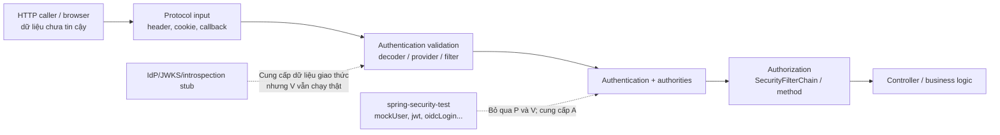
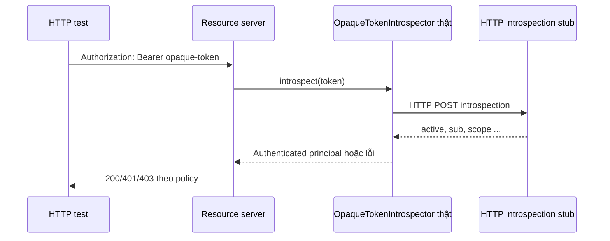

# Ghi rõ phần được giả lập và phần giao thức cần kiểm tra riêng

## 1. Vì sao một bài kiểm thử security “xanh” vẫn có thể bỏ sót lỗi nghiêm trọng?

Giả sử ứng dụng Java dùng Spring Security và có một API chỉ cho người sở hữu phạm vi `reports.read` truy cập. Nhóm phát triển viết MockMvc test với `jwt()`, đưa vào authority `SCOPE_reports.read` rồi nhận HTTP 200. Test này chứng minh quy tắc phân quyền với **Authentication đã được chuẩn bị trước**, nhưng chưa chứng minh chữ ký access token, issuer, audience hay thời hạn được kiểm tra.

Tương tự, `oidcLogin()` có thể đặt `OidcUser` vào request mà không hề chuyển hướng trình duyệt tới nhà cung cấp danh tính, trao đổi authorization code hoặc xác minh ID Token. Một test dùng `with(csrf())` có thể chứng minh CSRF filter chấp nhận token đúng trong request giả, nhưng chưa chứng minh trình duyệt thực nhận đúng cookie và gửi token trong form.

Vì vậy, **ghi rõ phần được giả lập và phần giao thức cần kiểm tra riêng** là một yêu cầu về độ tin cậy của bộ kiểm thử, không chỉ là cách viết chú thích. Nếu nhóm chỉ nhìn vào kết quả 200/403 mà không biết đã bỏ qua bước nào, test có thể tạo cảm giác an toàn sai.

Bài này nằm trong chương **Cơ chế chuyên biệt** của module **SPRING_SECURITY_TESTING**, tập trung kiểm chứng xác thực, phân quyền và HTTP security bằng `spring-security-test` trên Servlet và Reactive. Công cụ chính là MockMvc, WebTestClient, `@WithMockUser`, SecurityContext và JWT/OAuth2/OIDC giả lập; riêng bài này mở rộng phương pháp đánh giá tới các giao thức hoặc cơ chế như Bearer JWT, opaque token, OAuth2/OIDC login, CSRF, session, SAML 2.0, X.509/mTLS và WebAuthn.

Sau bài học, bạn có thể:

1. Chỉ ra điểm “cắt” trong security pipeline nơi bài test thay hành vi thật bằng mock hoặc fixture.
2. Nêu chính xác các khẳng định được phép đưa ra từ `jwt()`, `opaqueToken()`, `oauth2Login()`, `oidcLogin()` và các mutator Reactive.
3. Lập ma trận bổ sung test giao thức riêng cho chữ ký, thời gian, state, nonce, callback, certificate, cookie và replay.
4. Viết test đủ quyền/bị từ chối, đồng thời không nhầm các kết quả ấy với xác minh token hoặc phiên đăng nhập thật.
5. Ghi bằng chứng và giới hạn test vào mô tả, báo cáo coverage hoặc tài liệu review.
6. Thiết kế các lớp unit, HTTP integration, protocol integration và E2E bổ sung nhau thay vì cố biến mọi test thành E2E.

## 2. Ba khái niệm phải tách bạch

### 2.1. Giả lập Authentication

Mock Authentication là cách **cung cấp danh tính hoặc authorities đã có** cho hệ thống đang được kiểm thử. Ví dụ:

```java
mvc.perform(get("/api/reports")
        .with(jwt().authorities(
            new SimpleGrantedAuthority("SCOPE_reports.read"))))
    .andExpect(status().isOk());
```

Với setup MockMvc có tích hợp Spring Security, `jwt()` giúp request có `JwtAuthenticationToken` giả. Nó phù hợp để trả lời: “Khi người dùng có quyền này, chính sách HTTP và business handler làm gì?”. Nó không trả lời: “Một compact JWT do bên ngoài gửi tới có vượt qua decoder, signature verification và token validators hay không?”.

### 2.2. Kiểm tra giao thức (protocol verification)

Kiểm tra giao thức là kiểm tra các bước kỹ thuật dẫn từ **dữ liệu bên ngoài chưa được tin cậy** thành một Authentication được chấp nhận. Ví dụ:

- JWT: parse compact token, xác minh JWS signature, issuer, audience, `exp`, `nbf`, thuật toán và key đúng.
- Opaque token: gọi introspection endpoint; đọc kết quả `active`, scope, thời hạn và xử lý lỗi HTTP.
- OAuth2/OIDC login: thực hiện authorization redirect, ràng buộc `state`, xử lý callback, đổi code, kiểm tra ID Token/nonce/issuer/audience theo flow.
- SAML: kiểm tra response/assertion, chữ ký, điều kiện thời gian, recipient/destination, InResponseTo và chống replay.
- X.509/mTLS: thực hiện TLS handshake, chain trust và policy client certificate.
- WebAuthn: xác minh challenge, origin, RP ID, credential và chữ ký assertion.

Một integration test dùng IdP/JWKS/introspection server **giả được kiểm soát** vẫn có thể chạy các bước protocol validation thật. “Giả server đối tác” khác hoàn toàn với “giả kết quả authentication”.

### 2.3. Kiểm tra phân quyền (authorization)

Sau khi authentication thành công, hệ thống phải quyết định principal nào được thực hiện hành động nào:

- `hasRole("ADMIN")`, `hasAuthority("SCOPE_reports.read")`.
- `@PreAuthorize`/`@PostAuthorize`, owner/tenant checks.
- CSRF và các chính sách bảo vệ HTTP tùy đường đi.
- Truy cập đúng, bị chặn 401/403 hoặc chuyển hướng theo `AuthenticationEntryPoint`.

Một test có thể kiểm tra authorization rất sâu mà **không kiểm tra authentication**, hoặc ngược lại. Mỗi kết luận phải thuộc đúng lớp đã thực sự chạy.

## 3. Bản đồ ranh giới tin cậy của các loại test



| Cấp độ | Điểm đầu vào của test | Có thể kết luận | Chưa thể kết luận |
| --- | --- | --- | --- |
| **L0 — Unit thuần** | Gọi class/method với object Java trực tiếp | Hàm mapping hoặc policy hoạt động theo fixture | HTTP filter, entry point, protocol |
| **L1 — Mock Authentication + HTTP** | MockMvc/WebTestClient với `jwt()`, `mockUser()`… | Security chain xử lý quyền/route với Authentication có sẵn | Token thực, TLS, login callback |
| **L2 — Raw protocol input + real validators** | Bearer JWT thật, form credential, session/cookie thật | Authentication filter/decoder/provider xác minh đầu vào trong cấu hình test | IdP production, public network, proxy/TLS nếu không được chạy |
| **L3 — Protocol endpoint được stub** | JWKS/IdP/introspection/SAML peer giả qua HTTP | Tích hợp protocol parser, request/response, failure handling | Tính tương thích tuyệt đối với hệ thống production |
| **L4 — E2E qua hạ tầng thật** | Browser/HTTP server, TLS, IdP test environment | Các bước được triển khai trong môi trường cụ thể phối hợp đúng | Mọi cấu hình, phiên bản hoặc sự cố tương lai |

**Không có cấp độ nào “tốt hơn tuyệt đối”.** L1 rất nhanh, ổn định và cần thiết để kiểm tra nhiều nhánh quyền; L2/L3 bảo vệ các ranh giới mà L1 bỏ qua; L4 giúp phát hiện sự khác biệt môi trường nhưng tốn chi phí và khó chẩn đoán hơn.

## 4. Quy tắc mô tả test: Setup → giả lập → xác minh → chưa xác minh

Một mô tả test đầy đủ nên chứa:

1. **Đường vào:** gọi trực tiếp service, MockMvc/WebTestClient mock server hay HTTP server thật?
2. **Danh tính:** được tạo bởi `@WithMockUser`, `jwt()`, decoder thật, form login, IdP callback hay chứng thư TLS?
3. **Thành phần thật đã chạy:** filter chain, authentication manager, decoder, converter, repository, validator, controller nào?
4. **Bằng chứng:** status, `WWW-Authenticate`, `Location`, body, principal, authorities, callback state, request tới endpoint giả nào?
5. **Giới hạn:** credential/signature/cookie/TLS/remote identity flow nào chưa được chạy?
6. **Test bổ sung:** tên hoặc nhóm ca sẽ xác minh giới hạn đó.

Ví dụ ghi trong review:

> Test `readerCanOpenReport`: MockMvc đi qua SecurityFilterChain, dùng `jwt()` đặt `SCOPE_reports.read`. Đã kiểm tra 200 và body báo cáo. **Không kiểm tra** parse JWT, chữ ký, issuer, audience, expiry. Nhóm `JwtResourceServerIntegrationTest` dùng raw Bearer và `JwtDecoder` thật để kiểm tra các bước đó.

Cách diễn đạt này có thể dài hơn một dòng assertion, nhưng nó ngăn việc diễn giải sai khả năng của suite.

## 5. Servlet: mock JWT để kiểm tra quyền, không nhầm với kiểm tra chữ ký

Ví dụ security policy:

```java
@Configuration
class ReportsSecurity {
    @Bean
    SecurityFilterChain security(HttpSecurity http) throws Exception {
        return http
            .authorizeHttpRequests(auth -> auth
                .requestMatchers(HttpMethod.GET, "/api/reports/**")
                    .hasAuthority("SCOPE_reports.read")
                .anyRequest().denyAll())
            .oauth2ResourceServer(oauth2 ->
                oauth2.jwt(Customizer.withDefaults()))
            .build();
    }
}
```

Controller cần có route thật, ví dụ `GET /api/reports/today` trả `"ready"`. Với `@SpringBootTest` và `@AutoConfigureMockMvc`, test:

```java
import org.junit.jupiter.api.Test;
import org.springframework.beans.factory.annotation.Autowired;
import org.springframework.security.core.authority.SimpleGrantedAuthority;
import org.springframework.test.web.servlet.MockMvc;

import static org.springframework.security.test.web.servlet.request
    .SecurityMockMvcRequestPostProcessors.jwt;
import static org.springframework.test.web.servlet.request
    .MockMvcRequestBuilders.get;
import static org.springframework.test.web.servlet.result
    .MockMvcResultMatchers.*;

class ReportsAuthorizationTest {
    @Autowired MockMvc mvc;

    @Test
    void scopeAllowsReport() throws Exception {
        mvc.perform(get("/api/reports/today")
                .with(jwt().jwt(token -> token.subject("alice"))
                    .authorities(new SimpleGrantedAuthority(
                        "SCOPE_reports.read"))))
            .andExpect(status().isOk());
    }

    @Test
    void unrelatedScopeIsForbidden() throws Exception {
        mvc.perform(get("/api/reports/today")
                .with(jwt().jwt(token -> token.subject("bob"))
                    .authorities(new SimpleGrantedAuthority(
                        "SCOPE_profile"))))
            .andExpect(status().isForbidden());
    }
}
```

Để test class chạy, nạp nó qua Spring TestContext phù hợp với `ReportsSecurity`, bean decoder cần thiết cho resource server configuration và route `/api/reports/today`. Class trên chỉ trình bày **các method test** và các import chính, không phải toàn bộ application source code.

**Phạm vi chứng minh:** route/authority. `jwt().authorities(...)` đã cung cấp kết quả mapping, nên không chứng minh converter thực lấy scope claim thành `SCOPE_*`. Muốn kiểm tra mapping, hãy bỏ overrides authorities và chạy converter thực, hoặc test converter trực tiếp với claims phù hợp.

### 5.1. Tích hợp JWT thật: khác ở đầu vào

Ở integration test, gửi **raw compact token**:

```java
String compactJwt = testJwtSigner.sign(
    "alice", "reports.read", "reports-api");

mvc.perform(get("/api/reports/today")
        .header(HttpHeaders.AUTHORIZATION,
            "Bearer " + compactJwt))
    .andExpect(status().isOk());
```

`testJwtSigner` trong ví dụ là fixture do test triển khai bằng private key RSA hoặc HMAC key riêng; bean `JwtDecoder` thực trong context phải dùng trust configuration tương ứng. Đừng thay bean `JwtDecoder` bằng Mockito trong ca đang kiểm tra chữ ký.

Những test phải bổ sung:

| Đầu vào | Thành phần phải chạy | Kỳ vọng thường gặp |
| --- | --- | --- |
| JWT ký đúng, issuer/audience/expiry hợp lệ, đủ scope | Decoder + converters + authorization | 200 |
| Không có Bearer | Entry point | 401, thường có Bearer challenge |
| JWT sai chữ ký | JWS validation | 401 |
| JWT sai `iss` | Issuer validator được cấu hình | 401 |
| JWT sai `aud` | **Audience validator do ứng dụng cấu hình** | 401 |
| JWT hết hạn quá clock skew | Timestamp validator | 401 |
| JWT hợp lệ nhưng thiếu scope | Converter + authorization | 403 |

**Lưu ý:** có claim `aud` trong token không bảo đảm resource server sẽ kiểm tra audience nếu ứng dụng chưa cấu hình validator tương ứng. Các ca cần được thiết kế theo contract thật, không tự suy luận mọi claim đều được framework mặc định enforce.

## 6. Opaque bearer token: mock principal khác gọi introspection endpoint

Trong Servlet, Spring Security Test có `opaqueToken()` để đặt `BearerTokenAuthentication` giả vào request, tương tự mục đích của `jwt()` nhưng dùng principal opaque:

```java
import static org.springframework.security.test.web.servlet.request
    .SecurityMockMvcRequestPostProcessors.opaqueToken;

mvc.perform(get("/api/reports/today")
        .with(opaqueToken().authorities(
            new SimpleGrantedAuthority("SCOPE_reports.read"))))
    .andExpect(status().isOk());
```

Test này không chứng minh ứng dụng thực sự gửi HTTP request tới introspection endpoint, dùng client credentials đúng, xử lý `active: false`, timeout hay lỗi mạng.

Một integration test opaque token cần:

1. Cấu hình `SecurityFilterChain` dùng `oauth2ResourceServer(oauth2 -> oauth2.opaqueToken(...))`.
2. Cấu hình **OpaqueTokenIntrospector thật** trỏ tới HTTP stub server; không mock `introspect(...)` bằng Mockito.
3. Gửi `Authorization: Bearer test-opaque-token` qua HTTP/MockMvc.
4. HTTP stub nhận POST introspection, xác minh thông tin yêu cầu theo hợp đồng.
5. Stub trả `active: true` với scope đủ/thiếu, `active: false`, response lỗi và timeout có kiểm soát.
6. Assert 200/403/401 và hành vi khi service introspection không sẵn sàng; **không được fail open**.



**Không tự kết luận mọi lỗi introspection sẽ trả chính xác 401.** Một hệ thống có thể chuyển lỗi phụ thuộc mạng thành 5xx/503 theo error handling policy. Điều bắt buộc là token **không được chấp nhận như một Authentication hợp lệ** nếu không có bằng chứng validation thích hợp.

## 7. OAuth2 Login: login mock chỉ chứng minh hậu đăng nhập

Với Spring Security OAuth2 Login, `oauth2Login()` tạo trạng thái người dùng đã đăng nhập để kiểm tra downstream authorization, ví dụ controller có `OAuth2AuthenticationToken`/`OAuth2User`:

```java
import static org.springframework.security.test.web.servlet.request
    .SecurityMockMvcRequestPostProcessors.oauth2Login;

mvc.perform(get("/account")
        .with(oauth2Login()
            .attributes(attributes -> {
                attributes.put("sub", "alice-42");
                attributes.put("name", "Alice");
            })))
    .andExpect(status().isOk());
```

**Đã kiểm tra:** Sau khi Authentication dạng OAuth2 User tồn tại, controller và chính sách truy cập hoạt động theo attributes đã cung cấp. **Chưa kiểm tra:** Authorization redirect, `state`, authorization code, PKCE, token endpoint, client secret, redirect URI, xác minh token/claim hay lưu authorized client trong flow thật.

Để kiểm chứng giao thức OAuth2 Authorization Code:

| Bước | Kích thích test | Bằng chứng nên assert |
| --- | --- | --- |
| Bắt đầu authorization | Anonymous đến route bảo vệ hoặc `/oauth2/authorization/{registrationId}` | Redirect hợp lệ, đúng provider/client, `state` |
| Giữ state | Khởi tạo login A và B độc lập | State riêng, không chấp nhận tráo callback |
| PKCE khi có yêu cầu | Redirect authorization | `code_challenge`/method; token exchange có `code_verifier` phù hợp |
| Callback | `code` + `state` đúng session/repository | Request được tiếp nhận qua OAuth2 login filter |
| Token exchange | HTTP stub IdP trả token response | Client gửi grant/code/redirect URI và auth client đúng |
| Lỗi callback | Sai/mất state, code giả, token endpoint lỗi | Từ chối, không tạo session authenticated |
| Sau login | Truy cập endpoint bảo vệ | Principal, authorities và session/redirect sau login đúng |

HTTP stub IdP có thể trả response được kiểm soát; bài test vẫn cần dùng **OAuth2 login filters và authorization request repository thật**. Đừng chỉ mock `OAuth2AuthorizedClientService` rồi kết luận luồng state/PKCE đã được xác minh.

### 7.1. Cẩn thận với URL có state ngẫu nhiên

Khi kiểm tra redirect, không so toàn bộ URL bao gồm `state` (hoặc `nonce`) cố định; hãy parse `Location`, xác nhận host/path/client/redirect URI trong allowlist, kiểm tra state không rỗng và ràng buộc với callback.

Không để test tự follow redirect nếu bạn cần khẳng định bước `302` được tạo ở đúng nơi. Một client tự theo redirect tới login page có thể khiến status cuối là 200 và che việc redirect sai đích.

## 8. OIDC Login: ID Token claims giả chưa phải ID Token hợp lệ

OIDC bổ sung lớp định danh trên OAuth2. MockMvc có `oidcLogin()` giúp tạo `OidcUser` và `OidcIdToken` giả:

```java
import static org.springframework.security.test.web.servlet.request
    .SecurityMockMvcRequestPostProcessors.oidcLogin;

mvc.perform(get("/profile")
        .with(oidcLogin().idToken(token ->
            token.claim("sub", "user-123")
                .claim("preferred_username", "alice"))))
    .andExpect(status().isOk());
```

Đoạn này thích hợp khi controller đọc `OidcUser`, `sub` hoặc authorities. Nhưng **không có đủ bằng chứng** rằng ứng dụng đã:

- Nhận token từ token endpoint thực và giải mã JWS.
- Kiểm tra chữ ký ID Token/JWK của đúng issuer.
- Kiểm tra `iss`, `aud`, `azp` khi áp dụng, thời hạn và quy tắc OIDC tương ứng.
- Đối chiếu `nonce` với giá trị đã tạo trước authorization.
- Xử lý `at_hash`/`c_hash` ở những flow/response có yêu cầu.
- Gọi UserInfo endpoint đúng cách và đối chiếu `sub` giữa UserInfo và ID Token nếu có dùng UserInfo.

**Kiểm chứng giao thức riêng:** chạy authorization-code/OIDC flow qua test IdP được kiểm soát, cung cấp signed ID Token và discovery/JWKS/UserInfo responses phù hợp. Thử ID Token sai issuer, audience, nonce hoặc signature; thử UserInfo khác subject; assert **không tạo session authenticated** khi điều kiện định danh không hợp lệ.

Đừng lấy giá trị `email`, `preferred_username` hoặc `name` làm định danh bất biến mà không có hợp đồng ứng dụng. Trong OIDC, `iss + sub` thường là cặp định danh ổn định hơn cho một principal của issuer; cần test tránh trộn tài khoản khi các providers khác nhau trả cùng tên hiển thị.

## 9. Form Login, HTTP Basic, session và remember-me: ranh giới khác nhau

### 9.1. `@WithMockUser` không xác minh mật khẩu

```java
@Test
@WithMockUser(username = "alice", roles = "USER")
void authenticatedUserCanRead() throws Exception {
    mvc.perform(get("/api/me"))
        .andExpect(status().isOk());
}
```

Tập hợp principal/role được tạo bởi test listener, **không phải** do người dùng nhập mật khẩu. Muốn kiểm tra HTTP Basic, gửi header Basic qua filter/`AuthenticationManager`:

```java
import static org.springframework.security.test.web.servlet.request
    .SecurityMockMvcRequestPostProcessors.httpBasic;

mvc.perform(get("/api/me")
        .with(httpBasic("alice", "correct-test-password")))
    .andExpect(status().isOk());

mvc.perform(get("/api/me")
        .with(httpBasic("alice", "wrong-password")))
    .andExpect(status().isUnauthorized());
```

Hai test cần một `UserDetailsService` và `PasswordEncoder` thực trong test context, với credential test có chủ đích; `httpBasic()` chỉ tạo header, còn security filters mới xử lý xác thực.

### 9.2. Form Login cần kiểm tra cả cookie/session

`formLogin()` là request builder gửi form tới endpoint login; nó không giống `with(user())`:

```java
import static org.springframework.security.test.web.servlet.request
    .SecurityMockMvcRequestBuilders.formLogin;

MvcResult login = mvc.perform(formLogin()
        .user("alice").password("correct-test-password"))
    .andExpect(status().is3xxRedirection())
    .andReturn();

MockHttpSession session =
    (MockHttpSession) login.getRequest().getSession(false);
assertThat(session).isNotNull();

mvc.perform(get("/api/me").session(session))
    .andExpect(status().isOk());
```

Đây là mẫu yêu cầu application bật form login và session-based authentication; bảo đảm form submission đáp ứng CSRF/cấu hình thực và redirect theo success handler đã chọn. Tiếp theo nên thử password sai, session-fixation handling, logout invalidation và tái dùng session/cookie cũ để truy cập endpoint bảo vệ.

**Không** dùng `with(user("alice"))` vào request sau logout để kết luận logout thất bại; helper tự cấp Authentication mới cho request sau đó. Trong test browser thực, cần quan sát `Set-Cookie`, `HttpOnly`, `Secure`, `SameSite` và điều kiện CSRF tương ứng.

### 9.3. Remember-me cần cookie được ký/tra cứu thật

Một `remember-me` cookie giả với value `"alice"` không chứng minh hệ thống khôi phục session an toàn. Test giao thức remember-me nên cho remember-me filter/service thật tạo cookie, bỏ session đã login, rồi gửi cookie đó trong request mới. Thử cookie bị sửa, hết hạn, đổi key hoặc bị revoke theo implementation được dùng. Một số cấu hình lưu persistent tokens trong database; cần kho dữ liệu test cô lập để không trộn người dùng.

## 10. CSRF: `csrf()` giúp kiểm tra filter, chưa đủ cho browser flow

MockMvc có:

```java
import static org.springframework.security.test.web.servlet.request
    .SecurityMockMvcRequestPostProcessors.csrf;

mvc.perform(post("/api/notes")
        .with(user("alice").roles("WRITER"))
        .with(csrf())
        .contentType(MediaType.TEXT_PLAIN)
        .content("hello"))
    .andExpect(status().isOk());
```

Test này cho thấy Spring Security chấp nhận **CSRF token do test helper tạo** cho request trong mock environment, nếu endpoint, authentication và policy phù hợp. Nó không khẳng định cookie-backed `CsrfTokenRepository`, browser form, token masking hoặc JavaScript client gửi lại header chính xác theo giao thức người dùng thật.

Muốn kiểm tra vòng đời CSRF thực:

1. Gửi GET trong session/cookie mới để app phát token hoặc trả token qua contract đã cấu hình.
2. Đọc `Set-Cookie`/form field/response header tương ứng; giữ nguyên cookie jar của kịch bản.
3. Gửi POST có cookie/session và CSRF token hợp lệ → chấp nhận nếu quyền đủ.
4. Thử thiếu token, sửa token hoặc token từ session khác **nếu repository ràng buộc theo session** → từ chối.
5. Kiểm tra phản hồi 403 do CSRF khác với 403 do thiếu authority bằng hai ca đối chứng.

Cookie CSRF repository và session CSRF repository có contract khác nhau; không tự kết luận mọi token của session A sẽ bị từ chối trong session B. Muốn so sánh cross-session, phải biết repository thật đang dùng và cách client gửi token.

## 11. SAML 2.0: principal giả khác với assertion đã được xác minh

Một ứng dụng SAML Service Provider cần xử lý response/assertion của Identity Provider, thường kèm chữ ký XML, thời hạn, audience restriction, destination/recipient và correlation với authentication request. Trong một test service/controller, có thể đặt một `Saml2Authentication` đã được tạo sẵn nếu chỉ muốn xem ứng dụng xử lý người dùng/attributes sau login.

**Lúc này đã giả lập:** kết quả xác thực SAML, principal và authorities. **Chưa kiểm tra:** XML signature verification, canonicalization, certificate trust, `InResponseTo`, `Destination`, `Recipient`, `NotBefore/NotOnOrAfter`, audience, replay protection hay session establishment.

Không cần ép toàn bộ XML SAML vào mọi test authorization. Thay vào đó:

| Mục tiêu | Cách kiểm tra phù hợp |
| --- | --- |
| Controller hiển thị tên, roles từ SAML principal | Authentication fixture có attributes được chọn |
| Assertion được ký bởi IdP được tin cậy | SAML authentication provider/resolver thật với metadata/certificate test |
| Response bị sửa sau ký | Signed response bị chỉnh sửa → từ chối |
| Assertion hết hạn | Conditions/subject-confirmation time validation thật |
| Response dành cho SP khác | Audience/destination/recipient mismatch → từ chối |
| Request/response correlation | Đúng/sai `InResponseTo`, đúng session/repository |
| Chống replay | Gửi lại response/assertion và kiểm tra theo cơ chế replay protection ứng dụng triển khai |

Khi dùng test IdP, tạo certificate/key **dành riêng test** và dữ liệu assertion có hiệu lực thời gian ổn định. Nếu ứng dụng không có cơ chế replay cache, đừng ghi “đã test chống replay” chỉ vì signature đúng; cần định nghĩa rõ cách ngăn reuse assertion và xác minh đúng cơ chế đó.

## 12. X.509 và mTLS: request có certificate khác TLS handshake thật

Trên Servlet, một test có thể mô phỏng certificate có mặt trong request (ví dụ dùng `x509()` của Spring Security MockMvc Test nếu phiên bản hỗ trợ), qua đó kiểm tra cách `X509AuthenticationFilter` lấy thông tin subject hoặc ánh xạ người dùng. Nhưng mock request **không mở TLS socket** và không chứng minh client certificate đã được TLS stack xác minh.

Tách hai phần:

- **Application-level X.509 mapping:** filter đọc certificate attribute, trích xuất principal bằng regex/mapping đã cấu hình, tìm user và gắn Authentication.
- **Transport-level mTLS:** server yêu cầu client certificate, validate certificate chain, trust store, thời hạn, EKU/usage theo policy, hostname/endpoint và certificate revocation nếu triển khai; có thể có reverse proxy thực hiện TLS termination.

Thử nghiệm giao thức mTLS cần embedded server hoặc proxy test chạy HTTPS với trust store test, client có/không có certificate và certificate tin cậy/không tin cậy. Có thể kiểm tra handshake thất bại **trước khi** request vào controller; không phải mọi lỗi TLS đều xuất hiện dưới dạng HTTP 401.

Nếu production TLS được terminate tại proxy và proxy đưa danh tính vào header, phải kiểm tra **trust boundary proxy → ứng dụng**. Không tin một header `X-Client-Cert` do caller bên ngoài tự gửi; cần xác minh proxy loại bỏ/ghi đè header đó hoặc ứng dụng chỉ nhận từ kênh đáng tin cậy.

## 13. WebAuthn/passkey và MFA: Authentication đã có không chứng minh xác minh challenge

Các cơ chế đăng nhập không dựa vào password đơn thuần thường có nhiều bước và trạng thái tạm:

**WebAuthn/passkey** cần challenge, relying party ID (RP ID), origin, credential ID, public key, chữ ký assertion, user verification/presence theo policy, sign counter hoặc cơ chế phát hiện clone phù hợp với loại authenticator.

**MFA/step-up authentication** có thể yêu cầu xác thực yếu tố bổ sung dựa trên session hiện tại, challenge TTL, số lần thử, ràng buộc action/risk level và đánh dấu phiên đã hoàn tất bước nâng quyền.

Nếu test chỉ:

```java
mvc.perform(get("/payments/approve")
        .with(user("alice").authorities(
            new SimpleGrantedAuthority("MFA_VERIFIED"))))
    .andExpect(status().isOk());
```

thì chỉ chứng minh **ủy quyền sau khi đã có `MFA_VERIFIED`**. Nó không chứng minh authenticator đã ký challenge, TOTP/OTP hợp lệ hay step-up token được tạo an toàn.

Giao thức cần test riêng:

| Giao thức | Positive case | Negative case bắt buộc cân nhắc |
| --- | --- | --- |
| WebAuthn | Assertion ký bởi credential đã đăng ký, challenge/origin/RP ID đúng | Sai challenge, origin, RP ID, chữ ký hoặc credential ID |
| WebAuthn registration | Tạo credential mới theo policy RP | Attestation/credential dữ liệu sai, duplicate credential, user presence/verification policy |
| OTP/TOTP | Mã đúng trong cửa sổ thời gian đã cấu hình | Sai mã, replay, brute-force/rate limit, vượt TTL |
| Step-up/MFA | User được đánh dấu level phù hợp **sau khi** challenge hoàn tất | Chưa MFA, thử dùng state của session khác, hết hạn, hạ level |
| Recovery code | Code hợp lệ chỉ dùng một lần | Dùng lại code, code thuộc user khác |

Không đoán rằng framework mặc định đã có tất cả chính sách rate limiting, replay hoặc anti-cloning; nhiều hành vi thuộc vào implementation và cấu hình ứng dụng.

## 14. Reactive/WebFlux: cùng nguyên tắc, khác test helpers

Trong WebFlux, sử dụng `WebTestClient` và security WebFilters. Mock server cần tích hợp `springSecurity()`:

```java
WebTestClient baseClient =
    WebTestClient.bindToApplicationContext(context)
        .apply(SecurityMockServerConfigurers.springSecurity())
        .configureClient()
        .build();
```

Các mutator thường dùng:

```java
import static org.springframework.security.test.web.reactive.server
    .SecurityMockServerConfigurers.mockUser;
import static org.springframework.security.test.web.reactive.server
    .SecurityMockServerConfigurers.mockJwt;
import static org.springframework.security.test.web.reactive.server
    .SecurityMockServerConfigurers.mockOAuth2Login;
import static org.springframework.security.test.web.reactive.server
    .SecurityMockServerConfigurers.mockOidcLogin;
import static org.springframework.security.test.web.reactive.server
    .SecurityMockServerConfigurers.csrf;

baseClient.mutateWith(mockUser("alice").roles("USER"))
    .get().uri("/api/me")
    .exchange()
    .expectStatus().isOk();

baseClient.mutateWith(mockJwt()
        .authorities(new SimpleGrantedAuthority(
            "SCOPE_reports.read")))
    .get().uri("/api/reports")
    .exchange()
    .expectStatus().isOk();

baseClient.mutateWith(mockOidcLogin())
    .get().uri("/profile")
    .exchange()
    .expectStatus().isOk();
```

Các request mẫu yêu cầu controller/routes, `SecurityWebFilterChain` và test context tương ứng; đoạn code minh họa cách **gắn danh tính giả cho từng request**, không phải test class độc lập có thể chạy ngay. `mockOAuth2Login()` có thể dùng tương tự khi controller cần `OAuth2User` thay vì `OidcUser`.

**Trong Reactive, mock Authentication nằm trong Reactor Context** của request/subscription. Không tự lấy `SecurityContextHolder` ThreadLocal làm bằng chứng rằng publisher đã có principal. Nếu test method security trực tiếp bằng `@WithMockUser`, cần TestContext listeners phù hợp, bao gồm `ReactorContextTestExecutionListener` hoặc cấp context tường minh bằng `contextWrite(ReactiveSecurityContextHolder.withAuthentication(...))`.

### 14.1. Muốn test token thật trong WebFlux?

Sử dụng **`ReactiveJwtDecoder` thật**, ký compact JWT bằng fixture test và gửi:

```java
baseClient.get().uri("/api/reports")
    .headers(headers -> headers.setBearerAuth(
        compactJwtSignedByTestKey))
    .exchange()
    .expectStatus().isOk();
```

Không dùng `mockJwt()` trong ca này. Nếu `WebTestClient.bindToServer()` đang kết nối HTTP server thật, các mutator mock authentication cũng **không thể** đưa Authentication từ tiến trình test sang server qua socket; chỉ credential HTTP thật mới tới được server.

## 15. Custom authentication filter/provider: test ranh giới của chính bạn

Ứng dụng có thể tự thêm `OncePerRequestFilter`, `AuthenticationConverter`, `AuthenticationProvider` hoặc reactive `AuthenticationWebFilter` để hỗ trợ API key, signed webhook, HMAC request, tenant header hay một cơ chế SSO nội bộ.

Lỗi thường gặp là mock luôn kết quả cuối:

```java
when(customAuthenticationProvider.authenticate(any()))
    .thenReturn(authenticatedUser);
```

Như vậy test business có thể đúng, nhưng **không xác minh bộ chuyển đổi credential, chữ ký hoặc replay policy**. Hãy xác định từng ranh giới:

1. **Extraction:** filter đọc credential từ đúng header/cookie/query? Có từ chối thiếu/giả dạng?
2. **Canonicalization:** nếu signed request, ứng dụng ký/kiểm tra đúng method, URI, body, timestamp và charset?
3. **Validation:** thuật toán xác minh chữ ký/khóa, credential store, nonce và hạn?
4. **Context:** Authentication được đặt và được dọn đúng request/Reactor subscription?
5. **Authorization:** authority/tenant/owner được kiểm tra không?
6. **Failure path:** thông báo lỗi không rò rỉ token/secret, không tự fail open?

Với HMAC webhook, ví dụ, một test chỉ đặt `X-Signature: valid` rồi mock verifier là test **xử lý sau xác thực**, không phải test mật mã. Cần thêm test ký request thật với test key và thay đổi body/timestamp/nonce để xác minh request bị từ chối khi nội dung thay đổi.

## 16. Cách xây ma trận claim-to-evidence cho từng mechanism

Không nên ghi chung “Test authentication = PASS”. Bảng dưới giúp trả lời chính xác mức bao phủ.

| Cơ chế | Test giả lập nên có | Protocol integration phải bổ sung khi dùng cơ chế đó |
| --- | --- | --- |
| Username + password | `@WithMockUser`, `with(user())`, mock user trong WebFlux | `formLogin()`/Basic thật, password encoder, account lock, login success/failure |
| Session/cookie | Request có user giả, role/owner checks | Login/logout, session fixation, cookie flags, invalidation, timeout |
| CSRF | `with(csrf())` hoặc `mutateWith(csrf())`, negative thiếu token | GET phát token, POST cùng cookie/session, token sai/mất, cookie repository |
| JWT resource server | `jwt()`/`mockJwt()` với claims/authorities rõ ràng | Raw JWT, signature, issuer, audience, timestamps, converter, JWKS nếu dùng |
| Opaque bearer | `opaqueToken()`/`mockOpaqueToken()` | HTTP introspection thật, active/scope/error/timeout |
| OAuth2 Login | `oauth2Login()`/`mockOAuth2Login()` | Redirect, state, PKCE, callback, code exchange, session |
| OIDC Login | `oidcLogin()`/`mockOidcLogin()` | OAuth2 flow + ID Token/nonce/JWKS/UserInfo validation |
| SAML 2.0 | Authenticated principal fixture | Signed XML, metadata, conditions, InResponseTo, destination, replay |
| X.509/mTLS | Request certificate/identity mapping giả | TLS handshake, trust chain, certificate validation, proxy boundary |
| WebAuthn | User đã có credential/authority | Challenge, RP/origin, public-key signature, credential state |
| MFA/step-up | Authority/claim cho level xác thực | Challenge TTL, rate limit, session binding, replay/upgrade |
| Custom API key/HMAC | Provider/verifier mock trong unit test | Actual header parsing, signature/secret, nonce/timestamp, failure modes |

**Mục đích của bảng không phải buộc một dự án triển khai tất cả cơ chế.** Chỉ chọn những dòng hệ thống thực sự dùng, rồi ghi rõ lý do các hạng mục chưa áp dụng.

## 17. Viết assertions đúng với lớp bảo mật

### 17.1. 200 chứng minh điều gì?

Một 200 ở protected endpoint chỉ có giá trị nếu:

- Endpoint thực sự tồn tại và được security chain phù hợp bảo vệ.
- Test chứng minh request anonymous hoặc thiếu quyền bị từ chối.
- Danh tính được cấp ở lớp mong muốn (mock hoặc credential thật).
- Controller/service trả dữ liệu đúng principal, tenant, owner hoặc phạm vi.

Nếu rule `permitAll()` bắt request trước, token có thể không cần để nhận 200. Test positive phải đi kèm negative.

### 17.2. 401, 403, redirect không có cùng nguyên nhân

| Phản hồi | Ý nghĩa thường gặp | Bẫy kiểm thử |
| --- | --- | --- |
| 401 + `WWW-Authenticate` | Chưa có Authentication hợp lệ với Basic/Bearer | Đừng dùng mock user để test password/JWT invalid |
| 403 | Đã authenticated nhưng không được quyền; hoặc bị CSRF chặn | Đừng kết luận luôn do thiếu role |
| 302/3xx + `Location` | Browser được đưa đến login/OAuth2 authorization | Không chỉ assert status, cần kiểm tra đích và state |
| TLS handshake failure | Client certificate không được TLS chấp nhận | Không kỳ vọng nhất thiết có HTTP response 401 |
| 5xx/503 | Service xác thực phụ thuộc bị lỗi theo error policy | Không được biến lỗi dependency thành authenticated success |

Với OAuth2/OIDC/SAML, test redirect không chứng minh callback đã được xử lý, và test callback thành công không tự chứng minh tất cả negative cases đã được chặn. Viết test theo **từng giai đoạn** và kiểm tra trạng thái sau mỗi giai đoạn.

### 17.3. Đặt tên test theo phần đã chứng minh

Nên:

```java
readerWithMockJwtCanAccessReports()
signedJwtWithWrongIssuerIsRejectedByDecoder()
oidcUserAttributesAreMappedToDomainPrincipal()
oidcCallbackWithWrongStateDoesNotCreateSession()
invalidClientCertificateFailsTlsHandshake()
```

Tránh:

```java
jwtIsSecure()       // Quá rộng: chưa biết đã test lớp nào.
oauth2Works()       // Không nêu redirect, token hay user mapping.
authenticationTest() // Không nêu credential và expected behavior.
```

Tên test và report cùng phản ánh một ranh giới tin cậy giúp việc review, sửa lỗi và truy vết yêu cầu bảo mật dễ hơn.

## 18. Dữ liệu thử nghiệm, tính cô lập và chống false positive

Càng nhiều bước giao thức, càng dễ có state bị dùng lại giữa các test:

- JWT signing key và decoder trust root phải tương ứng; không sử dụng private key production.
- Refresh/access token, `OAuth2AuthorizedClientService` và principal name phải được tạo/cleanup theo đúng phạm vi.
- `state`, `nonce`, PKCE verifier, SAML request ID, WebAuthn challenge và MFA session state phải **riêng từng flow** khi yêu cầu.
- Session/cookie jar của Alice và Bob không được dùng lẫn; test login nên giữ toàn bộ chuỗi yêu cầu trong cùng `@Test`.
- Các response do HTTP stub cung cấp cần có timestamp có kiểm soát; các test expiry không dựa vào `Thread.sleep` dài.
- Spring TestContext có thể cache bean giữa các test: một mock được reset không xóa tự động session/Redis/database/JWKS cache.
- Không ghi JWT, refresh token, client secret, signing key hoặc certificate private key vào log CI.
- Những cơ chế có replay cache cần test với request ID/nonce khác nhau và trường hợp tái sử dụng có chủ đích.

### 18.1. Test cross-user/cross-flow là một lớp bảo vệ quan trọng

Một flow login thành công cho Alice **không** chứng minh Bob bị từ chối truy cập dữ liệu của Alice. Tương tự, callback OAuth2 có state đúng **không** chứng minh state của session A không thể tái sử dụng trong session B. Hãy bổ sung negative cross-user/cross-flow theo threat model thật.

Đừng tạo hai `@Test` phụ thuộc thứ tự “A login trước, B kiểm tra cookie sau”. Nếu cần nhiều bước, giữ chuỗi trong một test có setup và teardown rõ ràng.

## 19. Mẫu tài liệu bàn giao phạm vi kiểm thử

Với mỗi nhóm test, tạo một bản ghi nhỏ. Ví dụ:

| Trường | Nội dung ví dụ |
| --- | --- |
| **Tên nhóm** | `ReportsJwtAuthorizationMockMvcTest` |
| **Cấp độ** | L1 — mock Authentication qua `jwt()` |
| **Điểm vào** | MockMvc + SecurityFilterChain thật |
| **Dữ liệu giả lập** | `JwtAuthenticationToken` với `SCOPE_reports.read` |
| **Đã kiểm tra** | Route `/api/reports` trả 200 khi đủ scope; 403 khi thiếu scope |
| **Chưa kiểm tra** | Parse compact JWT, JWS signature, issuer, audience, exp, JWKS |
| **Bằng chứng** | Test cases và status/body |
| **Test bổ sung** | `ReportsJwtProtocolIntegrationTest`: Bearer JWT thật với decoder thật |
| **Mức độ kết luận** | “Authorization đúng theo Authentication fixture”, không phải “JWT protocol đúng hoàn toàn” |

Với cơ chế OIDC, các trường tương ứng có thể là:

| Trường | Nội dung ví dụ |
| --- | --- |
| **Tên nhóm** | `ProfileOidcPrincipalTest` |
| **Cấp độ** | L1 — `oidcLogin()` |
| **Dữ liệu giả lập** | `OidcUser`, ID Token claims và authorities |
| **Đã kiểm tra** | Domain mapper dùng `iss` + `sub`, trả profile đúng user |
| **Chưa kiểm tra** | OIDC redirect, state, nonce, token exchange, signature, UserInfo |
| **Test bổ sung** | `OidcAuthorizationCodeFlowIT` với IdP/JWKS/UserInfo stub |

Nếu suite chưa có test bổ sung, ghi trạng thái **chưa kiểm chứng** hoặc **rủi ro còn lại**; đừng tự chuyển thành “PASS” dựa trên một test có điểm cắt cao hơn.

## 20. Bài thực hành

**Bài 1 — Phân loại test.** Cho các lệnh `with(user())`, `with(jwt())`, `with(oidcLogin())`, `mockJwt()`, HTTP header Bearer JWT ký thật, và form login có session. Lập bảng chỉ ra loại Authentication fixture, lớp security thật và protocol nào bị bỏ qua.

**Bài 2 — JWT: mock so với decoder thật.** Viết hai test cùng endpoint báo cáo: một dùng `jwt()` với scope đúng, một gửi JWT RSA ký thật với `JwtDecoder`. Thêm wrong signature, wrong issuer, expired và missing scope; giải thích vì sao ca mock không thể thay các ca này.

**Bài 3 — Opaque token.** Viết test `opaqueToken()` cho authorization, rồi dùng introspection HTTP stub và introspector thật để thử `active=true`, `active=false`, sai scope và service error.

**Bài 4 — OAuth2/OIDC.** Dùng `oauth2Login()` và `oidcLogin()` để test controller principal mapping. Sau đó xây flow integration với IdP stub: redirect, `state`/PKCE, callback, ID Token/nonce, UserInfo. Ghi rõ check nào được test nào đảm nhận.

**Bài 5 — Cookie và CSRF.** Với application bật form login/session và CSRF, so sánh `@WithMockUser`, `formLogin()` và `with(csrf())`. Thực hiện một flow browser-like dùng cookie jar thật trong test và thử token thiếu/sai.

**Bài 6 — SAML hoặc mTLS.** Chọn cơ chế dự án thực sự dùng. Viết một test mapping principal sau Authentication và một test protocol negative: SAML sai chữ ký/conditions hoặc certificate không được TLS trust. Tránh kết luận cả hai test bao phủ cùng một lớp.

**Bài 7 — MFA/WebAuthn.** Đặt một quyền giả `MFA_VERIFIED` để kiểm tra policy, rồi thiết kế test challenge/signature hoặc TOTP/replay riêng. Không ghi “MFA hoạt động” khi mới chỉ thêm GrantedAuthority vào mock request.

**Bài 8 — Báo cáo traceability.** Với một endpoint thực, điền mẫu ở mục 19 và mô tả tối thiểu một lỗ hổng kiểm chứng còn lại. Đề xuất test cấp độ L2/L3 có dữ liệu giả cô lập để đóng lỗ hổng đó.

**Tiêu chí hoàn thành:** Người học giải thích được *đã giả lập ở đâu*, *đã xác minh thật ở đâu* và *cần thêm test gì*. Bộ test có ít nhất một ca **được phép**, một ca **bị từ chối vì authorization** và các ca **từ chối credential/protocol** tương ứng cơ chế thực sự triển khai, không gộp mọi kết quả vào một nhãn “authentication test”.

## 21. Tài liệu tham khảo

- [Spring Security — Testing with MockMvc](https://docs.spring.io/spring-security/reference/servlet/test/mockmvc/index.html): tích hợp SecurityFilterChain vào Servlet HTTP tests.
- [Spring Security — Testing OAuth2 with MockMvc](https://docs.spring.io/spring-security/reference/servlet/test/mockmvc/oauth2.html): `jwt()`, `opaqueToken()`, `oauth2Login()` và `oidcLogin()`.
- [Spring Security — Testing HTTP Basic](https://docs.spring.io/spring-security/reference/servlet/test/mockmvc/http-basic.html): tạo HTTP Basic request để authentication filter xử lý.
- [Spring Security — Testing Form Login](https://docs.spring.io/spring-security/reference/servlet/test/mockmvc/form-login.html): `formLogin()` và lifecycle của form submission.
- [Spring Security — Testing CSRF](https://docs.spring.io/spring-security/reference/servlet/test/mockmvc/csrf.html): `with(csrf())`.
- [Spring Security — JWT Resource Server (Servlet)](https://docs.spring.io/spring-security/reference/servlet/oauth2/resource-server/jwt.html): decoder, signature và validation.
- [Spring Security — Opaque Tokens (Servlet)](https://docs.spring.io/spring-security/reference/servlet/oauth2/resource-server/opaque-token.html): introspection.
- [Spring Security — OAuth2 Login](https://docs.spring.io/spring-security/reference/servlet/oauth2/login/index.html): authorization-code login flow.
- [Spring Security — SAML 2.0 Login](https://docs.spring.io/spring-security/reference/servlet/saml2/login/index.html): SP, IdP, assertion validation.
- [Spring Security — X.509](https://docs.spring.io/spring-security/reference/servlet/authentication/x509.html): authentication dựa trên client certificate.
- [Spring Security — Testing WebFlux Authentication](https://docs.spring.io/spring-security/reference/reactive/test/web/authentication.html): `mockUser()`.
- [Spring Security — Testing OAuth2 on WebTestClient](https://docs.spring.io/spring-security/reference/reactive/test/web/oauth2.html): `mockJwt()`, `mockOAuth2Login()`, `mockOidcLogin()`.
- [Spring Security — WebFlux Testing Setup](https://docs.spring.io/spring-security/reference/reactive/test/web/setup.html): `springSecurity()` và `WebTestClient`.
- [RFC 6749 — The OAuth 2.0 Authorization Framework](https://www.rfc-editor.org/rfc/rfc6749): authorization code và state.
- [OpenID Connect Core 1.0](https://openid.net/specs/openid-connect-core-1_0.html): ID Token, nonce, UserInfo và OIDC validation.
- [RFC 6750 — OAuth 2.0 Bearer Token Usage](https://www.rfc-editor.org/rfc/rfc6750): Bearer credentials/challenges.
- [Web Authentication: WebAuthn Level 3](https://www.w3.org/TR/webauthn-3/): challenge, origin, RP ID và credential validation.
