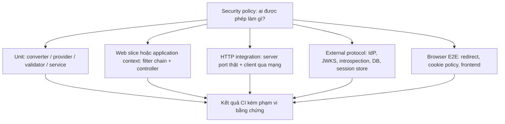
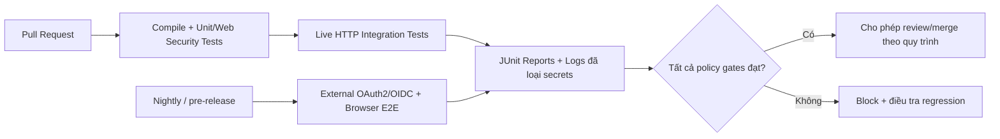

# Tổ chức test theo chính sách bảo mật và ranh giới hệ thống

Khi một dự án đã có hàng trăm bài test Spring Security, vấn đề không còn là “làm sao viết thêm một `MockMvc` test trả HTTP 200?”, mà là: **bộ test có phát hiện được một thay đổi khiến người chưa đăng nhập hoặc người thiếu quyền truy cập dữ liệu hay không?** Và nếu một test đang xanh, ta biết chính xác **tầng bảo mật nào đã được kiểm chứng** hay chưa?

Chương **Bộ kiểm thử và CI** của module `SPRING_SECURITY_TESTING` giải quyết câu hỏi đó bằng hai trục tổ chức song song:

1. **Chính sách bảo mật (security policy):** Ai được truy cập tài nguyên nào, bằng bằng chứng xác thực gì, trong điều kiện nào, và hành vi thất bại phải ra sao?
2. **Ranh giới hệ thống (system boundary):** Test chạy qua những thành phần nào — method đơn lẻ, security filter chain, HTTP server, database/session store, OAuth2/OIDC provider, resource server hay browser?

Nếu chỉ tổ chức theo tên framework (tất cả test `MockMvc` một chỗ, tất cả test `WebTestClient` một chỗ), ta dễ bỏ sót chính sách quan trọng. Ngược lại, nếu chỉ theo URL mà không ghi rõ thành phần được mock, một test dùng `@WithMockUser` có thể bị hiểu nhầm là đã chứng minh password được kiểm tra, một test dùng `with(jwt())` bị hiểu nhầm là đã kiểm tra chữ ký JWT, hoặc một test dùng `oidcLogin()` bị xem là đã thực hiện authorization code flow.

Bài học trình bày cách thiết kế **test suite dựa trên yêu cầu bảo mật**, phân tầng kiểm tra từ unit đến live HTTP, gắn JUnit tags/Gradle tasks cho CI, kiểm soát dữ liệu và môi trường, và tạo bằng chứng đủ rõ để review các thay đổi nhạy cảm.

> Nguyên tắc xuyên suốt: Mỗi bài test phải trả lời được ba câu hỏi — **chính sách nào**, **ranh giới nào**, và **bằng chứng nào chứng minh chính sách đó còn đúng**.

## 1. Bắt đầu từ policy, không bắt đầu từ công cụ

Giả sử một ứng dụng quản lý đơn hàng có các yêu cầu:

- `GET /api/public` cho phép anonymous.
- `GET /api/orders` cần người dùng đã xác thực với authority `SCOPE_orders.read`.
- `POST /api/orders` cần `SCOPE_orders.write`; nếu người dùng đăng nhập bằng browser session thì request cần CSRF token hợp lệ.
- `GET /api/admin` chỉ cho `ROLE_ADMIN`.
- JWT Bearer từ issuer được tin cậy phải hợp lệ về chữ ký/thời hạn và các validators đang cấu hình.
- Sau logout, session cũ không được dùng để truy cập tài nguyên được bảo vệ.
- Callback OAuth2 Login phải kiểm tra `state` trước khi sử dụng authorization code.

Đây là **các contract**, không phải tên bài test. Từ mỗi contract ta suy ra ca thành công, ca thất bại và điểm quan sát.

| Policy ID | Tài nguyên và điều kiện | Ca cho phép | Ca từ chối tối thiểu | Ranh giới cần chứng minh |
| --- | --- | --- | --- | --- |
| `POL-PUBLIC-01` | `GET /api/public` công khai | Anonymous → 200 | Không cần auth để vào | URL matcher + filter chain |
| `POL-ORDER-R-02` | Đọc order cần `SCOPE_orders.read` | Có scope → 200 | Anonymous → 401/redirect; thiếu scope → 403 | Authorization |
| `POL-ORDER-W-03` | Ghi order qua session cần scope và CSRF | Đủ scope + CSRF → thành công | Không scope → 403; thiếu CSRF → 403 | Authorization + CSRF |
| `POL-ADMIN-04` | Admin cần `ROLE_ADMIN` | Admin → 200 | User thường → 403 | Role mapping |
| `POL-JWT-05` | JWT chỉ từ issuer tin cậy | JWT đã ký/claims đúng → 200 | Sai chữ ký, hết hạn → 401 | JWT decoder + filter |
| `POL-SESSION-06` | Logout chấm dứt phiên | Login rồi truy cập → 200 | Session cũ sau logout không còn hợp lệ | Session persistence/invalidation |
| `POL-OAUTH-07` | Callback gắn với authorization request | `state` đúng → xử lý tiếp | `state` sai → login failure | OAuth2 filters + repository |

**Lưu ý 401/302:** Với HTTP Basic hoặc Bearer API, request chưa xác thực thường được trả **401**. Với form login, request chưa xác thực có thể **redirect 302** đến trang login. Policy phải ghi điều kiện theo entry point của ứng dụng, không áp đặt 401 cho mọi request. Với 403, phải phân biệt **thiếu quyền** và **thiếu CSRF** bằng tiền điều kiện của test.

### 1.1. Mỗi policy cần cả positive và negative cases

Một bài test `200 OK` chỉ chứng minh một request cụ thể được phép. Nó không phát hiện việc URL vô tình bị mở bằng `permitAll()`. Đối với endpoint được bảo vệ, tối thiểu nên có:

1. **Allow:** chủ thể đúng, bằng chứng xác thực hợp lệ, quyền đủ.
2. **Deny unauthenticated:** request không có bằng chứng xác thực.
3. **Deny insufficient authority:** authentication hợp lệ nhưng role/scope không đủ.
4. **Deny invalid credential:** khi policy liên quan đến Basic/Bearer/token, gửi credentials sai hoặc token hỏng để kiểm tra provider/decoder.
5. **Deny violated protocol protection:** khi liên quan state-changing browser request, CSRF sai/thiếu; khi liên quan OAuth2/OIDC, `state`/`nonce`/token validation theo hợp đồng.

Không phải endpoint nào cũng cần tất cả năm nhóm. Nhưng **không thể bỏ qua ca từ chối** trên đường nhạy cảm chỉ vì một ca allow đã xanh.

### 1.2. Một assertion nên chứng minh một điều cụ thể

Ví dụ:

```java
mvc.perform(get("/api/orders")
        .with(user("alice").authorities(
            new SimpleGrantedAuthority("SCOPE_orders.read"))))
    .andExpect(status().isOk());
```

Bài này có thể chứng minh rule đọc đơn hàng cho phép principal có authority phù hợp. Nó **không** chứng minh HTTP Basic password, token signature, session cookie hoặc IdP token endpoint. Trong báo cáo CI, hãy mô tả nó là **authorization policy test**, không phải “JWT authentication E2E”.

## 2. Trục thứ hai: ranh giới nào đang được chạy?

Trục policy cho biết *cần bảo vệ gì*. Trục ranh giới cho biết *test thực sự chạy qua thành phần nào*.



| Tầng | Công cụ thường dùng | Có thể chứng minh | Không tự chứng minh |
| --- | --- | --- | --- |
| **Unit** | JUnit, Mockito, `StepVerifier` | `AuthenticationConverter`, `AuthenticationProvider`, mapping authorities, validator logic | Filter chain được cấu hình đúng |
| **Web integration trong bộ nhớ** | Servlet `MockMvc`; Reactive `WebTestClient.bindToApplicationContext(...).apply(springSecurity())` | URL rules, CSRF, security filters, handler, exceptions và status | TCP/TLS, reverse proxy, browser cookie transport |
| **Live HTTP integration** | `@SpringBootTest(RANDOM_PORT)` + `WebTestClient.bindToServer()` | Header/cookie thực qua HTTP, server filters, session qua request mới | Provider ngoài, TLS/gateway nếu không đi qua |
| **External protocol integration** | Local HTTP stub, Testcontainers, IdP test, DB/session store | Token exchange, JWKS/issuer, opaque introspection, persistence | Production IdP/hạ tầng nếu stub thay thế |
| **Browser E2E** | Browser automation + môi trường test | Redirect, cookie `Secure/SameSite`, frontend, cross-origin | Mọi cấu hình production nếu môi trường khác |

**Độ sâu test không tự động phản ánh chất lượng:** Một unit test kiểm tra việc không cấp quyền admin từ một JWT claim giả có thể rất nhanh và chính xác; một browser test chỉ xem trang xuất hiện vẫn có thể bỏ sót một API không được bảo vệ. Chọn ranh giới nhỏ nhất đủ chứng minh policy, rồi thêm một số integration journeys tại các mối nối quan trọng.

### 2.1. Mock authentication khác xác thực credentials thật

Trong Servlet:

- `@WithMockUser`, `with(user(...))`, `with(jwt())`, `with(oauth2Login())` và `with(oidcLogin())` cấp sẵn authentication/principal cho request test.
- `with(httpBasic(username, password))` **tạo HTTP Basic Authorization header**. Nếu security filters được bật và cấu hình `httpBasic()`/provider phù hợp, credentials được đưa qua cơ chế xác thực thật trong ứng dụng.
- `.header("Authorization", "Bearer " + signedToken)` gửi Bearer token qua request mock; nếu Resource Server và `JwtDecoder` thực được cấu hình, request đi qua đường xác minh token.

Trong WebFlux:

- `mutateWith(mockUser())`, `mockJwt()`, `mockOAuth2Login()` và `mockOidcLogin()` tạo security context giả lập cho test server trong bộ nhớ.
- `bindToServer()` không chèn mock security context vào server ở đầu xa. Muốn kiểm tra xác thực thực, phải gửi credentials qua HTTP headers/cookies và server có cơ chế xác thực tương ứng.

Không so sánh hai test trên cùng nhãn “authentication passed” khi một test bypass provider còn test kia đã dùng provider hoặc decoder thật.

## 3. Thiết kế cấu trúc bộ test theo hai chiều

Cách tổ chức phù hợp cho một dự án có nhiều policy là **nhóm test theo năng lực bảo mật**, sau đó gắn nhãn tầng thực thi bằng tên class hoặc JUnit tags.

Ví dụ một cấu trúc khái niệm, không bắt buộc thay đổi source sets hiện có:

```text
src/test/java/com/example/security/
  policy/
    PublicEndpointPolicyWebTest.java
    OrderAuthorityPolicyWebTest.java
    AdminPolicyWebTest.java
    CsrfPolicyWebTest.java
  authentication/
    BasicCredentialsWebTest.java
    JwtDecoderWebTest.java
    OpaqueIntrospectionHttpTest.java
  session/
    LoginSessionHttpTest.java
    LogoutSessionHttpTest.java
  oauth2/
    OAuth2RedirectWebTest.java
    AuthorizationCodeExchangeHttpTest.java
    OidcTokenValidationHttpTest.java
  context/
    ReactiveSecurityContextUnitTest.java
    ServletAsyncContextWebTest.java
  endtoend/
    BrowserLoginExternalTest.java
```

Ý nghĩa của cách đặt tên:

- `OrderAuthorityPolicyWebTest` cho biết đây là **policy test** ở web boundary.
- `BasicCredentialsWebTest` cho biết mục tiêu là **credentials**, không phải gắn user giả.
- `OidcTokenValidationHttpTest` cho biết cần chạy **HTTP/token validation**; nếu chỉ dùng `oidcLogin()` thì tên này không đúng phạm vi.
- `BrowserLoginExternalTest` báo trước phụ thuộc browser/IdP test.

Không bắt buộc tất cả test `MockMvc` nằm cùng package. Một security policy có thể có cả unit test và live HTTP test; mục tiêu là reviewer tìm thấy bằng chứng của chính sách mà không phải đoán từ tên framework.

### 3.1. Dùng nhãn tier và nhãn policy

JUnit Jupiter hỗ trợ `@Tag`. Nên phân biệt hai kiểu nhãn:

- **Execution tier**, chọn một nhãn chính cho mỗi class: `unit`, `web`, `http` hoặc `external`.
- **Policy area**, có thể thêm nhiều nhãn: `authn`, `authz`, `csrf`, `session`, `jwt`, `oauth2`, `oidc`, `reactive`.

Ví dụ:

```java
import org.junit.jupiter.api.Tag;
import org.junit.jupiter.api.Test;

@Tag("web")
@Tag("authz")
class OrdersAuthorizationWebTest {

    @Test
    void readerWithScopeCanReadOrders() {
        // MockMvc integration test ở phần sau.
    }
}
```

Nhãn `authz` giúp lọc test liên quan chính sách; nhãn `web` giúp CI quyết định thời điểm chạy. Không dùng nhãn `e2e` cho một test chỉ gọi controller bằng mock principal. Các tier tags nên được quy ước ổn định và kiểm tra review để tránh class vô tình thuộc cả `web` và `http`.

### 3.2. Tên phương thức phản ánh actor, action và kết quả

Tên tốt:

```java
void anonymousCannotReadOrders();
void userWithOrdersReadScopeCanReadOrders();
void authenticatedUserWithoutReadScopeGetsForbidden();
void invalidBearerTokenIsRejectedByDecoder();
void sessionCookieAfterLogoutNoLongerAuthenticates();
void oidcCallbackWithWrongStateDoesNotExchangeCode();
```

Tên mơ hồ:

```java
void securityWorks();
void testLogin();
void shouldReturn200();
void oauth2Test();
```

Các tên tốt là **một yêu cầu có thể bị phá vỡ**. Khi CI thất bại, developer biết ai, hành động nào và ranh giới nào đang sai.

## 4. Một chính sách mẫu để triển khai thành nhiều tầng test

Phần này dùng **ứng dụng Spring MVC có HTTP Basic** làm fixture riêng. Nó kiểm tra authorization, password verification và CSRF. Các ví dụ JWT/OIDC phía sau là những fixture độc lập; không đưa mọi authentication mechanism vào cùng một chain rồi giả định kết quả như nhau.

### 4.1. Dependency và cấu hình

Ví dụ Gradle Groovy DSL:

```groovy
dependencies {
    implementation 'org.springframework.boot:spring-boot-starter-web'
    implementation 'org.springframework.boot:spring-boot-starter-security'

    testImplementation 'org.springframework.boot:spring-boot-starter-test'
    testImplementation 'org.springframework.security:spring-security-test'

    // Cần khi dùng WebTestClient live HTTP với Servlet app.
    testImplementation 'org.springframework.boot:spring-boot-starter-webflux'
}
```

Cấu hình:

```java
import org.springframework.context.annotation.Bean;
import org.springframework.context.annotation.Configuration;
import org.springframework.http.HttpMethod;
import org.springframework.security.config.Customizer;
import org.springframework.security.config.annotation.web.builders.HttpSecurity;
import org.springframework.security.core.userdetails.User;
import org.springframework.security.core.userdetails.UserDetailsService;
import org.springframework.security.crypto.bcrypt.BCryptPasswordEncoder;
import org.springframework.security.crypto.password.PasswordEncoder;
import org.springframework.security.provisioning.InMemoryUserDetailsManager;
import org.springframework.security.web.SecurityFilterChain;

@Configuration
class SampleApiSecurityConfig {

    @Bean
    SecurityFilterChain apiSecurity(HttpSecurity http)
            throws Exception {

        return http
            .authorizeHttpRequests(auth -> auth
                .requestMatchers(HttpMethod.GET, "/api/public")
                    .permitAll()
                .requestMatchers(HttpMethod.GET, "/api/orders")
                    .hasAuthority("SCOPE_orders.read")
                .requestMatchers(HttpMethod.POST, "/api/orders")
                    .hasRole("EDITOR")
                .requestMatchers(HttpMethod.GET, "/api/admin")
                    .hasRole("ADMIN")
                .anyRequest().denyAll()
            )
            .httpBasic(Customizer.withDefaults())
            .build();
    }

    @Bean
    PasswordEncoder passwordEncoder() {
        return new BCryptPasswordEncoder();
    }

    @Bean
    UserDetailsService users(PasswordEncoder encoder) {
        return new InMemoryUserDetailsManager(
            User.withUsername("alice")
                .password(encoder.encode("correct"))
                .authorities(
                    "SCOPE_orders.read", "ROLE_EDITOR")
                .build(),
            User.withUsername("bob")
                .password(encoder.encode("bob-password"))
                .authorities("ROLE_VIEWER")
                .build(),
            User.withUsername("admin")
                .password(encoder.encode("admin-password"))
                .authorities("ROLE_ADMIN", "SCOPE_orders.read")
                .build()
        );
    }
}
```

Trong ví dụ, Spring Security giữ mặc định **CSRF protection** cho `POST /api/orders`. Đây là thiết kế học tập để kiểm tra thứ tự CSRF và authorization, không phải khẳng định rằng mọi REST API dùng Bearer token đều cần cùng cấu hình. Với API stateless chỉ nhận Authorization header, chính sách CSRF có thể khác; hãy quyết định dựa trên **cách browser/client tự gửi credentials**.

Controller:

```java
import org.springframework.security.core.Authentication;
import org.springframework.web.bind.annotation.GetMapping;
import org.springframework.web.bind.annotation.PostMapping;
import org.springframework.web.bind.annotation.RestController;

@RestController
class SampleApiController {

    @GetMapping("/api/public")
    String publicInfo() {
        return "public";
    }

    @GetMapping("/api/orders")
    String orders() {
        return "order-list";
    }

    @PostMapping("/api/orders")
    String createOrder() {
        return "created";
    }

    @GetMapping("/api/admin")
    String admin() {
        return "admin-only";
    }
}
```

**Giới hạn fixture:** Người dùng và password hardcode chỉ dành cho test; production cần user store/identity provider phù hợp, bảo vệ secrets và xử lý chính sách account. Bài học này kiểm tra cách **tổ chức suite**, không xây authentication server production.

## 5. Tầng web: policy tests nhanh bằng MockMvc

Mục tiêu của tầng này là chứng minh `authorizeHttpRequests(...)` và CSRF rules được áp dụng cho HTTP request, **không** buộc test phải xác minh mật khẩu trong từng biến thể role/scope.

### 5.1. Test bằng principal giả lập để cô lập authorization

```java
import org.junit.jupiter.api.Tag;
import org.junit.jupiter.api.Test;
import org.springframework.beans.factory.annotation.Autowired;
import org.springframework.boot.test.autoconfigure.web.servlet.AutoConfigureMockMvc;
import org.springframework.boot.test.context.SpringBootTest;
import org.springframework.http.MediaType;
import org.springframework.test.web.servlet.MockMvc;

import static org.springframework.security.test.web.servlet.request
    .SecurityMockMvcRequestPostProcessors.user;
import static org.springframework.test.web.servlet.request
    .MockMvcRequestBuilders.get;
import static org.springframework.test.web.servlet.result
    .MockMvcResultMatchers.content;
import static org.springframework.test.web.servlet.result
    .MockMvcResultMatchers.status;

@SpringBootTest
@AutoConfigureMockMvc
@Tag("web")
@Tag("authz")
class OrdersAuthorizationWebTest {

    @Autowired
    MockMvc mvc;

    @Test
    void anonymousCannotReadOrders() throws Exception {
        mvc.perform(get("/api/orders")
                .accept(MediaType.APPLICATION_JSON))
            .andExpect(status().isUnauthorized());
    }

    @Test
    void readerWithScopeCanReadOrders() throws Exception {
        mvc.perform(get("/api/orders")
                .with(user("alice").authorities(
                    new org.springframework.security.core.authority
                        .SimpleGrantedAuthority("SCOPE_orders.read"))))
            .andExpect(status().isOk())
            .andExpect(content().string("order-list"));
    }

    @Test
    void authenticatedUserWithoutReadScopeGetsForbidden()
            throws Exception {
        mvc.perform(get("/api/orders")
                .with(user("bob").roles("VIEWER")))
            .andExpect(status().isForbidden());
    }

    @Test
    void publicEndpointDoesNotRequireLogin() throws Exception {
        mvc.perform(get("/api/public"))
            .andExpect(status().isOk())
            .andExpect(content().string("public"));
    }
}
```

**Vì sao có cả anonymous/insufficient-authority?** Nếu ai đó vô tình sửa rule thành `permitAll()`, test positive vẫn xanh nhưng negative sẽ phát hiện regression.

**Vì sao dùng `with(user(...))`?** Chỉ muốn kiểm tra rule dựa trên authority; cách này không phụ thuộc password encoder hay chi tiết authentication provider. Đây là **quyết định chủ đích**, không phải đường tắt được phép dùng cho mọi tầng.

`@SpringBootTest + @AutoConfigureMockMvc` dùng security filter chain nếu không tắt filters. Với setup thủ công, cần tích hợp `springSecurity()`; `MockMvcBuilders.standaloneSetup(controller)` đơn thuần sẽ không chứng minh URL rules thực.

### 5.2. Cẩn thận với @WithMockUser và authority mapping

`@WithMockUser(roles = "ADMIN")` mặc định tạo `ROLE_ADMIN`. Nó không tạo `SCOPE_orders.read`. Nếu policy yêu cầu một authority chính xác, hãy dùng:

```java
@Test
@WithMockUser(
    username = "alice",
    authorities = {"SCOPE_orders.read"}
)
void mockedScopeCanPassOrderReadRule() throws Exception {
    mvc.perform(get("/api/orders"))
        .andExpect(status().isOk());
}
```

Import `org.springframework.security.test.context.support.WithMockUser`. Một test dùng `roles={"orders.read"}` sẽ tạo `ROLE_orders.read`, **khác** `SCOPE_orders.read`. Với Resource Server JWT, scope mapping thường dùng `SCOPE_...`; còn OAuth2 Login có thể dùng authority mapping khác theo cấu hình. Test phải mô phỏng đúng contract của ứng dụng.

## 6. Tầng web: kiểm tra HTTP Basic provider và CSRF thật

Một nhánh của suite phải chứng minh **credentials đến filter rồi được kiểm tra**, thay vì tất cả test đều gắn mock user.

```java
import org.junit.jupiter.api.Tag;
import org.junit.jupiter.api.Test;
import org.springframework.beans.factory.annotation.Autowired;
import org.springframework.boot.test.autoconfigure.web.servlet.AutoConfigureMockMvc;
import org.springframework.boot.test.context.SpringBootTest;
import org.springframework.http.MediaType;
import org.springframework.test.web.servlet.MockMvc;

import static org.springframework.security.test.web.servlet.request
    .SecurityMockMvcRequestPostProcessors.csrf;
import static org.springframework.security.test.web.servlet.request
    .SecurityMockMvcRequestPostProcessors.httpBasic;
import static org.springframework.test.web.servlet.request
    .MockMvcRequestBuilders.get;
import static org.springframework.test.web.servlet.request
    .MockMvcRequestBuilders.post;
import static org.springframework.test.web.servlet.result
    .MockMvcResultMatchers.content;
import static org.springframework.test.web.servlet.result
    .MockMvcResultMatchers.status;

@SpringBootTest
@AutoConfigureMockMvc
@Tag("web")
@Tag("authn")
@Tag("csrf")
class CredentialsAndCsrfWebTest {

    @Autowired
    MockMvc mvc;

    @Test
    void correctBasicCredentialsAuthenticate() throws Exception {
        mvc.perform(get("/api/orders")
                .with(httpBasic("alice", "correct")))
            .andExpect(status().isOk())
            .andExpect(content().string("order-list"));
    }

    @Test
    void incorrectBasicCredentialsAreRejected() throws Exception {
        mvc.perform(get("/api/orders")
                .with(httpBasic("alice", "wrong"))
                .accept(MediaType.APPLICATION_JSON))
            .andExpect(status().isUnauthorized());
    }

    @Test
    void createOrderRequiresCsrfWhenPolicyEnablesIt()
            throws Exception {
        mvc.perform(post("/api/orders")
                .with(httpBasic("alice", "correct")))
            .andExpect(status().isForbidden());
    }

    @Test
    void createOrderWithCsrfAndEditorRoleSucceeds()
            throws Exception {
        mvc.perform(post("/api/orders")
                .with(httpBasic("alice", "correct"))
                .with(csrf()))
            .andExpect(status().isOk())
            .andExpect(content().string("created"));
    }

    @Test
    void validCsrfDoesNotGiveViewerEditorPermission()
            throws Exception {
        mvc.perform(post("/api/orders")
                .with(httpBasic("bob", "bob-password"))
                .with(csrf()))
            .andExpect(status().isForbidden());
    }
}
```

Năm ca này phân biệt:

- **Password/provider:** Basic đúng/sai.
- **CSRF:** Có/không token cho POST.
- **Authorization:** Bob có credentials hợp lệ và CSRF nhưng không có `ROLE_EDITOR`.

`with(httpBasic(...))` thiết lập HTTP header trong request MockMvc; nó **không** tạo sẵn authenticated principal. Vì vậy, nếu filters và authentication provider thực được cấu hình, test kiểm tra đường xác thực HTTP Basic. Tuy nhiên, vì MockMvc không mở socket, nó vẫn chưa kiểm tra reverse proxy, TLS hoặc header qua mạng.

`with(csrf())` tạo CSRF token hợp lệ cho MockMvc request. Nó kiểm tra CSRF filter và việc app chấp nhận token; nó **không** chứng minh trình duyệt đã nhận token từ HTML/endpoint và gửi đúng cookie/header. Muốn kiểm tra chuỗi browser/session đó, dùng live HTTP hoặc browser integration.

### 6.1. Test nào cần mock provider hoặc encoder?

Không nên mock `AuthenticationManager` trong mọi bài web test. Nếu mock nó trả thành công bất kể password, test `incorrectBasicCredentialsAreRejected` mất giá trị. Ngược lại, nếu mục tiêu chỉ là handler xử lý domain logic với một user đã đăng nhập, không cần gọi BCrypt/database hàng trăm lần.

Quy tắc gọn:

- **Test policy/handler:** có thể giả lập principal/authorities.
- **Test authentication mechanism:** giữ converter/filter/provider/decoder thật theo ranh giới cần kiểm chứng.
- **Test token issuer hoặc external IdP:** dùng stub/mock đúng thành phần ở ngoài ranh giới và ghi lại những thứ chưa được chứng minh.

## 7. JWT và opaque token: chia suite theo điểm tin cậy

Ứng dụng Resource Server JWT cần một nhóm test riêng để chứng minh Bearer token thật sự đi vào decoder. Cùng endpoint có thể có hai loại test:

| Test | Input | Điều chứng minh |
| --- | --- | --- |
| Authorization rules | `with(jwt().authorities(...))` hoặc Reactive `mockJwt()` | Scope/role rule và handler |
| Bearer parsing | `Authorization: Bearer <value>` | HTTP filter lấy token đúng |
| JWT validation | Bearer JWT ký bằng key test, `JwtDecoder` thật | Chữ ký, thời hạn, issuer và các validators đã cấu hình |
| Token invalid | JWT bị sửa signature, expired, wrong issuer | Resource Server từ chối bằng 401 |
| Token valid nhưng scope thiếu | JWT hợp lệ nhưng thiếu authority | 403 |
| Opaque introspection | Bearer opaque string + HTTP stub + introspector thật | POST introspection, active/inactive và mapping scope |

**Không đánh đồng `with(jwt())` với “JWT decoder đã xác minh chữ ký”.** Helper này được thiết kế để tạo authentication giả lập cho kiểm tra downstream behavior. Tương tự, `opaqueToken()` hoặc `mockOpaqueToken()` không gửi HTTP introspection request.

### 7.1. Cấu trúc test giúp phát hiện mock che lỗi

Một cách phân nhóm trong package `authentication`:

```text
JwtAuthorizationPolicyWebTest
  - readerTokenCanRead()
  - missingScopeCannotRead()

JwtBearerValidationWebTest
  - signedTrustedTokenIsAccepted()
  - tamperedSignatureIsRejected()
  - expiredTokenIsRejected()
  - wrongIssuerIsRejected()

OpaqueTokenIntrospectionHttpTest
  - activeTokenGetsExpectedAuthorities()
  - inactiveTokenIsRejected()
  - introspectionEndpointReceivesToken()
```

Nhóm thứ hai và thứ ba cần các fixtures chuyên biệt: signed JWT/JWK test, hoặc local HTTP stub cho introspection. Nếu môi trường test thay decoder/introspector bằng Mockito mock, hãy đổi mô tả bằng chứng cho chính xác.

Đối với expiration/issued-at, dùng test clock phù hợp hoặc token được tạo với thời gian tương thích validator; chú ý **clock skew**. Đối với issuer/audience, chỉ assert validator đã được cấu hình thực sự, không mặc định mọi decoder kiểm tra tất cả claims theo yêu cầu ứng dụng.

## 8. OAuth2/OIDC: tổ chức test theo các chặng giao thức

Một OAuth2/OIDC Client login có nhiều điểm tin cậy độc lập:

1. **Bắt đầu login:** `GET /oauth2/authorization/{registrationId}` sinh redirect, `state` và, nếu dùng PKCE, `code_challenge`/`S256`.
2. **Callback:** ứng dụng nhận `code` và `state`; dùng session/repository phù hợp để ghép với request ban đầu.
3. **Code exchange:** OAuth2 Client gửi HTTP POST đến token endpoint.
4. **OIDC validation:** nếu có ID token, xác minh chữ ký, issuer, audience, thời hạn và nonce theo cấu hình.
5. **Session/authorized client:** ứng dụng lưu user session hoặc `OAuth2AuthorizedClient`; request sau dùng đúng dữ liệu đó.
6. **Resource Server:** khi access token được dùng để gọi API khác, API đích xác minh token theo hợp đồng của nó.

Hãy gắn tên test với **đúng chặng**:

| Chặng | Ví dụ tên test | Bằng chứng |
| --- | --- | --- |
| Redirect | `authorizationRedirectContainsStateAndPkceChallenge` | 302 Location có state/challenge |
| Callback binding | `wrongStateCannotCompleteLogin` | Callback từ chối, không đổi code |
| Token exchange | `validCodeTriggersTokenEndpointPost` | Stub ghi nhận POST /token |
| OIDC ID token | `invalidIdTokenSignatureFailsLogin` | Decoder/JWK thật từ chối |
| Session | `loggedInSessionCanReadProfile` | Request mới với cookie hợp lệ |
| Authorization downstream | `oidcUserWithoutRequiredAuthorityIsForbidden` | 403 với principal giả lập |

**Quan trọng:** `oauth2Login()`/`oidcLogin()` của spring-security-test tạo principal đã đăng nhập. Chúng là lựa chọn tốt cho **quy tắc authorization sau login**, nhưng không chạy redirect, token exchange hay xác minh compact ID token thật. Một suite vững cần cả vài test giao thức thật với local IdP stub hoặc Authorization Server test, và nhiều test principal/authority nhanh.

Không để PR suite phụ thuộc mặc định vào IdP trên Internet với credentials production. Nếu bài test cần hệ thống ngoài, phân nhóm `external` và nêu rõ cách cấp credentials/hạ tầng test an toàn.

## 9. Session, logout và CSRF cần kiểm tra bằng nhiều request

Test policy thường xử lý từng request. Nhưng session/CSRF có contract **giữa các request**, vì vậy cần ít nhất một integration journey:

```text
GET /api/me chưa login
    -> redirect login hoặc 401
GET /csrf
    -> CSRF token + session cookie (nếu cấu hình phát cookie)
POST /login + username/password + CSRF + session cookie
    -> session authenticated / cookie sau login
GET /api/me + cookie phiên sau login
    -> 200, Alice
POST /logout + CSRF + cookie cùng session
    -> logout
GET /api/me + cookie cũ
    -> không còn được xác thực
```

Nếu dùng `MockMvc`, có thể giữ `MockHttpSession` từ kết quả login và truyền vào request mới. Nếu dùng `WebTestClient.bindToServer()`, cần đọc header `Set-Cookie` của response và **chủ động gửi `Cookie`** ở request sau. Session cookie mặc định thường là `JSESSIONID` ở Servlet và `SESSION` ở WebFlux, nhưng tên thực phụ thuộc cấu hình.

### 9.1. Test server session không thay browser cookie test

MockMvc `.session(session)` và `with(csrf())` có thể chứng minh session persistence/CSRF filter trong Servlet pipeline. Chúng không chứng minh browser tự áp dụng `SameSite`, `Secure`, `HttpOnly` hay domain/path rules.

Một test live HTTP sử dụng `cookie(name, value)` kiểm tra server đã nhận cookie qua HTTP, nhưng WebTestClient vẫn có thể gửi cookie mà browser sẽ chặn theo policy. Nếu acceptance criterion là chống cross-site cookie leakage hoặc bảo đảm browser flow, dùng browser automation với đúng origin/scheme.

### 9.2. Không dùng @WithMockUser cho request sau khi đăng nhập

Nếu test login rồi gọi:

```java
mvc.perform(get("/api/me")
        .with(user("alice")))
    .andExpect(status().isOk());
```

kết quả **không chứng minh session từ request trước đã được lưu và nạp lại**. Muốn chứng minh session, request kế tiếp phải chỉ mang session/cookie đã cấp, không gắn principal giả lần nữa.

## 10. Phân chia suite bằng JUnit tags và Gradle tasks

Sau khi định nghĩa ranh giới, hãy biến chúng thành các nhóm có thể chạy độc lập:

| Tier tag | Thời điểm chạy | Đặc điểm |
| --- | --- | --- |
| `unit` | Mỗi commit/PR | Không cần Spring context/network |
| `web` | Mỗi commit/PR | MockMvc hoặc WebFlux mock-server; context nhỏ hoặc đầy đủ |
| `http` | Mỗi PR hoặc sau build, tùy chi phí | `RANDOM_PORT`, local HTTP stub, DB/session test container nếu cần |
| `external` | Theo lịch, pre-release hoặc điều kiện phù hợp | Browser/IdP test hoặc môi trường nhiều service |

Bảng là **đề xuất lịch chạy**, không phải yêu cầu chính thức cho mọi tổ chức. Nếu một HTTP test bảo vệ chính sách cực kỳ quan trọng và chạy nhanh, nên đặt nó vào PR gate. Ngược lại, một browser E2E rất chậm không cần thay mọi authorization test nhỏ.

### 10.1. Cấu hình Gradle Groovy DSL cho JUnit Jupiter

Các ví dụ test trước đó dùng `@Tag("web")`; có thể thêm một `@Tag("http")` cho test live server. Với Gradle thông thường:

```groovy
tasks.named('test', Test) {
    useJUnitPlatform {
        includeTags 'unit', 'web'
    }

    testLogging {
        events 'failed', 'skipped'
        exceptionFormat 'full'
    }
}

tasks.register('httpIntegrationTest', Test) {
    group = 'verification'
    description = 'Run local live-HTTP security integration tests'

    testClassesDirs = sourceSets.test.output.classesDirs
    classpath = sourceSets.test.runtimeClasspath

    useJUnitPlatform {
        includeTags 'http'
    }

    shouldRunAfter tasks.named('test')

    testLogging {
        events 'failed', 'skipped'
        exceptionFormat 'full'
    }
}
```

Mô hình này **giữ chung source set `src/test/java`** và lọc execution bằng tags. Vì `test` chỉ chọn `unit`/`web`, class **không có tier tag** có thể bị bỏ qua một cách im lặng. Cần một quy tắc review hoặc bước kiểm tra bổ sung để bảo đảm mọi test thuộc đúng tier. Đừng bật filter tags trước khi đã phân loại các test hiện có.

Một số dự án chọn tạo source set `integrationTest` riêng thay vì dùng tags. Cách đó cũng hợp lệ và giúp phân tách dependency/lifecycle, nhưng phải cấu hình compile/runtime classpaths và resources phù hợp. Không trộn hai mô hình mà không xác định test nào thuộc task nào.

### 10.2. Lệnh chạy ở local và CI

```bash
# PR suite nhanh: unit + web integration
./gradlew test

# Live HTTP integration (server, cookies, token HTTP, local stubs)
./gradlew httpIntegrationTest

# Cả hai nhóm
./gradlew test httpIntegrationTest

# Chạy một test method/class để điều tra cục bộ
./gradlew test --tests '*OrdersAuthorizationWebTest'
```

Trong Windows, sử dụng `gradlew.bat` thay cho `./gradlew` khi chạy qua cmd/PowerShell. Những lệnh trên chỉ là **hướng dẫn**, không phải khẳng định đã chạy chúng hoặc đã QA code ví dụ trong môi trường người học.

### 10.3. Quy tắc gán tags

Nên quy định:

- Mỗi class có **đúng một execution tier tag** để tránh chọn hai lần hoặc vô tình bỏ qua.
- Có thể thêm nhiều policy tags.
- Test `http` không gọi IdP production; chỉ gọi embedded server và local stub/containers.
- Test `external` phải mô tả môi trường, secrets, cleanup, rate limits và dữ liệu thử nghiệm.
- Nếu một `web` test cần network ngoài, phân loại lại hoặc thay phụ thuộc bằng stub có contract rõ.
- Nếu một `unit` test khởi tạo Spring context bằng `@SpringBootTest`, nó không còn là unit theo định nghĩa này.

Điều quan trọng là **tier tag thể hiện ranh giới chạy thực tế**, không phải mong muốn về tốc độ.

## 11. CI pipeline: kiểm tra chính sách theo nhịp có kiểm soát

Một pipeline CI có thể thực hiện:



Không cần mọi test chạy trong một job lớn. Job riêng giúp dễ thấy lỗi thuộc tầng nào và chọn mức concurrency phù hợp.

### 11.1. Ví dụ GitHub Actions minh họa

Giả sử repository đã có Gradle Wrapper và Gradle tasks ở mục trước:

```yaml
name: Security Tests

on:
  pull_request:
  push:
    branches: [main]

permissions:
  contents: read

jobs:
  security-tests:
    runs-on: ubuntu-latest
    timeout-minutes: 25

    steps:
      - name: Checkout
        uses: actions/checkout@v4

      - name: Set up Java
        uses: actions/setup-java@v4
        with:
          distribution: temurin
          java-version: '21'

      - name: Set up Gradle
        uses: gradle/actions/setup-gradle@v4

      - name: Unit and web security policies
        run: ./gradlew --no-daemon test

      - name: Live HTTP security integration
        run: ./gradlew --no-daemon httpIntegrationTest

      - name: Upload test reports
        if: always()
        uses: actions/upload-artifact@v4
        with:
          name: security-test-reports
          path: |
            **/build/test-results/**
            **/build/reports/tests/**
          if-no-files-found: warn
```

Đây là **mẫu cấu hình tham khảo**, cần điều chỉnh theo phiên bản JDK, Gradle, action versions và security policy của repository. Trong hệ thống thật, nên pin third-party actions theo commit SHA đã được review và cấp quyền tối thiểu cho workflow. Không nên đặt credential production vào YAML hoặc in raw token/session cookie trong test reports.

Nếu một trong các lệnh Gradle thất bại, job phải thất bại. `if: always()` ở bước upload chỉ để giữ báo cáo phục vụ điều tra, **không** biến kết quả test thất bại thành pass. Khi dùng nhiều module/Gradle subprojects, hãy bảo đảm glob report path bao phủ đúng output của những module đang được kiểm thử.

### 11.2. External suites chạy riêng

Các test gọi IdP hoặc browser external có thể cần OAuth client credentials, callback URLs, TLS, test accounts và cleanup. Nên có job theo lịch hoặc pre-release với environment/secrets riêng:

- Chỉ sử dụng **test tenant/client** có quyền tối thiểu.
- Không cho PR từ nguồn chưa tin cậy truy cập secrets nhạy cảm.
- Không cho test login/refresh/revocation tác động đến tài khoản production.
- Không bỏ qua fail chỉ vì test “hay flaky”; nếu suite bị cách ly, ghi rõ mức coverage tạm thời bị mất và thời hạn xử lý.
- Cấu hình retry có giới hạn theo hạ tầng, không che đi lỗi xác thực hoặc cấp quyền thực sự.

Một test external không chạy trên PR **không được tính là PR đã kiểm chứng đầy đủ phần external đó**. Báo cáo CI cần nói rõ suite nào đã chạy và suite nào chưa chạy.

## 12. Kiểm soát các nguồn flaky trong security tests

Security integration dễ phát sinh lỗi không ổn định vì phụ thuộc thời gian, session state, port, key, mạng hoặc thứ tự test.

### 12.1. Độc lập dữ liệu và session

Mỗi test nên tự tạo fixture mà nó cần:

- User Alice/Bob và authorities rõ ràng.
- Session cookie lấy từ chính response login của test.
- CSRF token từ đúng session/repository.
- JWT/key test được tạo và xác minh nhất quán theo test context.
- Authorization request/state/nonce riêng cho mỗi OAuth2/OIDC flow.
- DB/schema/test tenant cô lập; transaction rollback phải phù hợp với live HTTP/server threads.

Không cho một test “login Alice” chạy trước để một test khác dựa vào session còn sót. JUnit không bảo đảm thứ tự thực thi theo cách mà những test phụ thuộc trạng thái ngầm thường mong đợi.

### 12.2. Thời gian, JWT exp và clock skew

JWT `exp` và `nbf` phụ thuộc thời gian; OIDC ID token và OAuth2 access token cũng vậy. Một test dùng `Thread.sleep(...)` dài để chờ token hết hạn vừa chậm vừa dễ flaky.

Ưu tiên:

- Token fixture có timestamps được xây từ một `Clock`/time source kiểm soát được.
- Validator đọc cùng một clock test hoặc token được đặt đủ xa khỏi ranh giới skew.
- Assertions cụ thể: expired token → 401, valid-but-low-scope → 403.
- Không giả định mọi decoder kiểm tra `aud` nếu application chưa cấu hình audience validator.

### 12.3. Random ports và local HTTP stubs

Live HTTP test nên dùng `RANDOM_PORT` hoặc port động của MockWebServer/WireMock. Không hardcode `localhost:8080` rồi để các CI jobs tranh cùng cổng.

Nếu dùng local stub cho `/token`, `/jwks` hoặc `/introspect`:

- Truyền base URI động vào application context trước khi tạo client registration/decoder/introspector.
- Reset recorded requests và queued responses giữa tests nếu dùng chung server.
- Ghi rõ test đang **kiểm tra outbound HTTP request** hay **đang tin stub trả kết quả**; stub trả 200 sẵn không chứng minh provider bên ngoài thật đã kiểm tra credentials.
- Dừng server/containers khi kết thúc; tránh để resources làm ảnh hưởng suite khác.

### 12.4. Song song, global security state và SecurityContext

Ở Servlet, `SecurityContextHolder` thường dùng `ThreadLocal` và test security listeners dọn state theo lifecycle. Nhưng nếu test tự gọi `SecurityContextHolder.setStrategyName(...)`, dùng static variables, pool/thread tuỳ biến hoặc sửa shared SecurityContext, có thể gây leak giữa tests.

Ở Reactive, `Reactor Context` đi theo subscriber/subscription; đừng dùng ThreadLocal để truyền danh tính giữa các operators một cách ngầm định. Khi test chuyển scheduler hoặc `@Async`/executor, hãy thêm negative cases Alice/Bob/no-context thay vì chỉ khẳng định một request duy nhất được phép.

Một bộ test được bật parallel cần kiểm tra sự độc lập của dữ liệu, session và mocks. Không bật concurrency tối đa ngay khi các fixtures đang dùng shared mutable state hoặc static HTTP stub queue.

## 13. “Test xanh giả”: những kiểu bỏ sót thường gặp

### 13.1. Tắt security filters

```java
@AutoConfigureMockMvc(addFilters = false)
```

Nếu mục tiêu là bảo vệ URL, cấu hình này vô hiệu hóa bằng chứng từ security filter chain. Controller có thể trả 200 dù `SecurityFilterChain` đang sai. Chỉ dùng filter-disabled test khi bạn chủ đích kiểm tra controller độc lập; đặt tên là controller test, không phải security integration test.

### 13.2. Mock toàn bộ AuthenticationManager

Nếu `AuthenticationManager.authenticate(...)` bị mock để luôn trả Alice, test sai password không còn kiểm tra password verification. Điều đó có thể phù hợp cho unit test converter/filter delegation, nhưng không đủ cho authentication HTTP integration.

### 13.3. Gắn @WithMockUser rồi kết luận session persistence đúng

Principal giả được cấp trực tiếp theo test method. Nó không chứng minh POST login, session fixation, `Set-Cookie` hoặc request kế tiếp dùng cookie. Test session cần hai hoặc nhiều requests có liên hệ nhân quả.

### 13.4. JWT/OIDC helper bị xem là cryptographic test

`with(jwt())`, `mockJwt()` và `oidcLogin()` bỏ qua decoder/validation thật theo cách sử dụng thông thường của helper. Nếu policy nói “issuer và chữ ký phải hợp lệ”, cần gửi token đã ký vào decoder/resource server hoặc thực thi callback OIDC thật với test JWK.

### 13.5. Chỉ assert 302 hoặc 403

Form login thành công và thất bại đều có thể redirect. POST thiếu CSRF và user thiếu role đều có thể trả 403. Hãy xác định **tiền điều kiện** và assert redirect target, authentication state, cookie/session hoặc outbound request khi cần.

### 13.6. Chạy subset quá hẹp mà không phát hiện test bị bỏ sót

Nếu Gradle `includeTags 'unit','web'`, class chưa được gắn tag có thể không chạy. Nên có quy định hoặc kiểm tra CI để phát hiện test class không thuộc tier; nếu thay đổi cách phân nhóm, so sánh số lượng discovered/executed/skipped tests với baseline và điều tra mọi thay đổi lớn.

### 13.7. Dùng coverage percentage thay security policy coverage

Line coverage cao không chứng minh 401/403 hoặc token validation đã được kiểm tra. Một endpoint `permitAll()` có thể vẫn đạt 100% lines của controller. Duy trì ma trận policy ID → positive/negative tests → boundary là bằng chứng hữu ích hơn chỉ một tỷ lệ coverage.

## 14. Đánh giá chất lượng suite bằng bằng chứng thay vì số lượng test

Một dashboard đơn giản có thể ghi:

| Policy ID | Unit | Web | HTTP | External | Negative cases | Trạng thái |
| --- | --- | --- | --- | --- | --- | --- |
| POL-ORDER-R-02 | Không bắt buộc | Allow/deny | Header Basic | Không cần | Anonymous + thiếu scope | Đạt khi tất cả required tests xanh |
| POL-ORDER-W-03 | Có thể có mapper test | CSRF + role | Browser session nếu áp dụng | Không cần | Thiếu CSRF + thiếu role | Đạt khi đủ nhánh |
| POL-JWT-05 | Validator logic | Bearer decoder | Có thể dùng live HTTP | JWK test nếu cần | Chữ ký sai + expired + wrong issuer | Đạt khi decoder thật chạy |
| POL-SESSION-06 | Ít giá trị | Login/logout session | Cookie round-trip | Browser nếu policy cần | Cookie cũ sau logout | Đạt khi test qua boundary đúng |
| POL-OAUTH-07 | State repository logic | Redirect/state | Token endpoint stub | IdP test tùy contract | Wrong state + invalid code | Đạt khi filter/callback được chạy |

Dashboard này là **bản đồ trách nhiệm**, không phải bảng yêu cầu mọi policy đều có test ở tất cả các tầng. Nếu mỗi policy đều bị buộc có browser E2E, suite sẽ chậm và khó bảo trì. Nếu mọi policy chỉ có unit test, configuration mistakes ở security filter chain có thể bị bỏ sót.

### 14.1. Test report nên nêu phạm vi bằng chứng

Một báo cáo CI chất lượng nên trả lời:

- Suite nào đã chạy: `unit`, `web`, `http`, `external`?
- Test nào thất bại và policy ID nào bị ảnh hưởng?
- Mock nào đã được dùng để tạo authentication?
- Các request token/cookie có đi qua HTTP thật hay chỉ đi trong bộ nhớ?
- Test external có được thực thi hay đã skip vì thiếu môi trường?
- Có flaky/quarantined test nào làm mất một phần policy coverage không?

Đừng ghi “Spring Security E2E passed” nếu job chỉ chạy `@WithMockUser` tests.

### 14.2. Bảo mật dữ liệu chẩn đoán CI

JUnit XML, application logs, Gradle output và HTTP stub recordings có thể chứa:

- Password hoặc Basic header.
- Bearer access/refresh token.
- Session ID, `Set-Cookie`/`Cookie`.
- OAuth client secret, authorization code, PKCE verifier.
- Private signing key của fixture.

Hãy lọc hoặc che các dữ liệu này khi lưu artifacts, giới hạn thời gian giữ báo cáo và hạn chế quyền truy cập. Đối với token test, ưu tiên assert metadata/claims và effects thay vì in nguyên token vào failure message.

## 15. Checklist review khi chính sách bảo mật thay đổi

Khi một pull request thay đổi `SecurityFilterChain`, `SecurityWebFilterChain`, `AuthenticationProvider`, JWT validators hoặc OAuth2 Client config, reviewer có thể dùng checklist:

- [ ] Xác định policy ID/actor/resource được thay đổi.
- [ ] Có test **allow** cho chủ thể hợp lệ.
- [ ] Có test **deny anonymous** tại endpoint bảo vệ.
- [ ] Có test **deny insufficient authority** khi có role/scope rules.
- [ ] Nếu thay authentication mechanism, có test credentials/token thật đi qua provider/decoder.
- [ ] Nếu có state-changing browser request, CSRF được giữ hoặc có lý do cấu hình khác được review.
- [ ] Nếu thay session/login/logout, có test nhiều request dùng cookie thật hoặc mock session theo ranh giới.
- [ ] Nếu thay OAuth2/OIDC flow, có test redirect/state/code exchange/ID token tương ứng với phần thay đổi.
- [ ] Các test được gắn tier tag hợp lệ và chạy trong CI gate phù hợp.
- [ ] Không có fixture dùng production secrets, network ngoài không kiểm soát hoặc test che lỗi bằng `permitAll()`.
- [ ] CI reports thể hiện đầy đủ suites đã chạy và phần external chưa chạy nếu có.

Checklist này là cơ chế review, không phải cách thay thế security threat modeling. Các policy nhạy cảm có thể cần thêm kiểm tra IDOR/ownership (người A không đọc được tài nguyên riêng của B), audit logging, rate limiting, tenant isolation và các ranh giới khác theo thiết kế sản phẩm.

## 16. Bài thực hành tổng hợp: tạo một bộ security test chạy được trên CI

Giả sử ứng dụng có hai endpoints:

- `GET /api/orders`: yêu cầu `SCOPE_orders.read`.
- `POST /api/orders`: yêu cầu `ROLE_EDITOR` và CSRF nếu dùng browser session.

Thực hiện theo các bước:

1. **Viết ma trận chính sách:** ghi rõ actor anonymous, Alice (đọc/ghi), Bob (thiếu quyền), phương thức HTTP, expected status và thành phần phải được kiểm tra.
2. **Web authorization suite:** dùng `MockMvc.with(user())` hoặc `@WithMockUser` để kiểm tra allow, anonymous deny và scope/role deny. Đặt `@Tag("web")`.
3. **Credential/CSRF suite:** gửi `with(httpBasic("alice","correct"))`, kiểm tra password đúng/sai; đối với POST, tách thiếu CSRF khỏi thiếu role. Không mock `AuthenticationManager` trong suite này.
4. **Live HTTP suite:** khởi động server cổng ngẫu nhiên, dùng `WebTestClient.bindToServer()` để gửi Basic header hoặc cookie/session thực theo cơ chế đã chọn. Đặt `@Tag("http")`.
5. **JWT/OAuth2 mở rộng:** nếu app có Resource Server, thêm test signed JWT thật qua Bearer header, invalid signature/expiry. Nếu có OAuth2/OIDC Login, thêm test redirect/state/callback và token endpoint stub tương ứng.
6. **Gradle tasks:** cấu hình `test` cho `unit`/`web` và `httpIntegrationTest` cho `http`; xác nhận không có class vô tình bị bỏ qua vì thiếu tag.
7. **CI workflow:** chạy hai tasks trong PR gate, giữ reports khi thất bại, tách external suite sang job riêng, không cung cấp production credentials.
8. **Mutation thử nghiệm:** tạm đổi `hasAuthority("SCOPE_orders.read")` thành `permitAll()` trong nhánh thử, kiểm tra **negative test phải đỏ**. Hoàn nguyên sau đó; đây là cách đơn giản kiểm tra suite thực sự bắt được regression bảo mật.

**Tiêu chí hoàn thành:** Người học có thể truy ngược từ một rule bảo mật đến test positive/negative cụ thể, chỉ ra ranh giới thực thi của từng test, và tổ chức CI sao cho lỗi authentication/authorization quan trọng làm thất bại pull request. Một test xanh nhờ principal giả lập phải được mô tả là **authorization test**; một test cần chứng minh password, session cookie, JWT signature, OIDC callback hoặc introspection phải thực thi qua cơ chế tương ứng. **Chất lượng bộ test nằm ở khả năng chứng minh và phát hiện vi phạm policy, không chỉ ở số lượng test hay tỷ lệ line coverage.**

