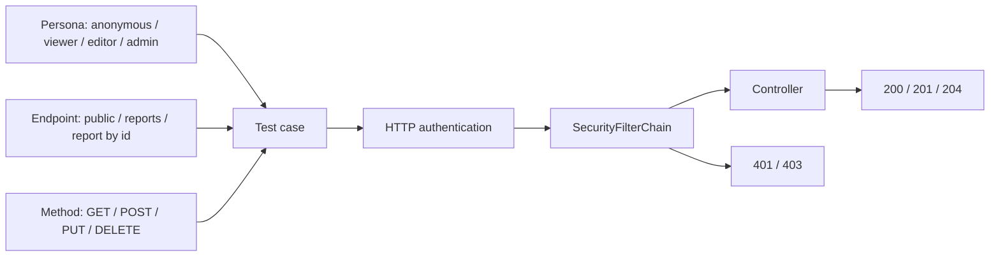

# Parameterized test cho ma trận vai trò, endpoint và HTTP method

Trong chương **Bộ kiểm thử và CI** của module **SPRING_SECURITY_TESTING**, chúng ta kiểm chứng xác thực, phân quyền và bảo vệ HTTP thực tế bằng `spring-security-test` trên **Servlet** và **Reactive**. Các kỹ thuật `MockMvc`, `WebTestClient`, `@WithMockUser`, `SecurityContext` cùng JWT/OAuth2/OIDC giả lập cho phép mô phỏng những request được phép hoặc bị từ chối. Khi số endpoint, vai trò và HTTP method tăng, viết một test method riêng cho mọi tổ hợp thường dẫn tới sao chép code, thiếu ca âm tính và khó theo dõi thay đổi chính sách.

**JUnit 5 Parameterized Test** giúp biểu diễn chính sách bằng **bảng ca kiểm thử**: mỗi hàng là một tổ hợp `(role/principal, endpoint, HTTP method, expected status)`, còn phần dựng request và assertion được tái sử dụng. Điểm quyết định không nằm ở việc chạy càng nhiều hàng càng tốt, mà là **mỗi kỳ vọng phải được xác định độc lập với code phân quyền đang được kiểm thử**, và ma trận phải tách riêng lỗi xác thực, lỗi thiếu quyền, CSRF và endpoint không tồn tại.

Bài này xây dựng một ví dụ chạy qua `SecurityFilterChain` Servlet thật bằng `MockMvc` và `httpBasic(...)`, sau đó mở rộng sang `WebTestClient`/WebFlux, JWT/OAuth2 giả lập và cách tổ chức test suite trong CI. Tập ca sẽ bao phủ `GET`, `POST`, `PUT`, `DELETE`; anonymous, VIEWER, EDITOR, ADMIN; cùng status `200`, `201`, `204`, `401`, `403`.

## 1. Tại sao cần ma trận ba chiều?

Một API báo cáo có thể áp dụng chính sách không chỉ theo **đường dẫn**, mà còn theo **HTTP method**. `GET /api/reports/42` và `DELETE /api/reports/42` đi tới cùng tài nguyên nhưng yêu cầu quyền khác nhau.



Nếu mỗi phương thức được khai báo bảo mật khác nhau, ta cần biết:

1. **Anonymous** có bị chặn khỏi các route bảo vệ không?
2. **Đã xác thực nhưng thiếu quyền** có nhận `403` thay vì được vào controller không?
3. **Đủ quyền** có đi đến đúng handler và nhận status thành công theo hợp đồng không?
4. Với `POST`, `PUT`, `DELETE`, CSRF có đang chặn sớm và che lấp lỗi phân quyền không?
5. Test có đang dùng **filter chain thật**, hay chỉ gán một principal giả để bypass cơ chế xác thực?

JUnit 5 `@ParameterizedTest` chạy cùng một test method nhiều lần với dữ liệu từ `@MethodSource`, `@CsvSource`, `@EnumSource` hoặc nguồn khác. Trong bài này `@MethodSource` đặc biệt phù hợp vì có thể truyền `HttpMethod` enum, persona và status có kiểu dữ liệu rõ ràng.

## 2. Đặt chính sách dự kiến thành bảng trước khi viết test

Ứng dụng minh họa có chính sách:

- `GET /api/public/ping`: công khai.
- `GET /api/reports/{id}`: VIEWER, EDITOR, ADMIN đều đọc được.
- `POST /api/reports` và `PUT /api/reports/{id}`: chỉ EDITOR hoặc ADMIN được thay đổi.
- `DELETE /api/reports/{id}`: chỉ ADMIN được xóa.
- Những request vào `/api/**` không khớp các rule trên bị từ chối theo quy tắc `denyAll`.

Ma trận **kỳ vọng độc lập**:

| HTTP method | Endpoint | Anonymous | VIEWER | EDITOR | ADMIN |
| --- | --- | ---: | ---: | ---: | ---: |
| `GET` | `/api/public/ping` | 200 | 200 | 200 | 200 |
| `GET` | `/api/reports/42` | 401 | 200 | 200 | 200 |
| `POST` | `/api/reports` | 401 | 403 | 201 | 201 |
| `PUT` | `/api/reports/42` | 401 | 403 | 200 | 200 |
| `DELETE` | `/api/reports/42` | 401 | 403 | 403 | 204 |

Với cấu hình dùng **HTTP Basic** và không bật form login ở ví dụ này, route bảo vệ không có authentication trả `401 Unauthorized`. Người đã xác thực nhưng không thỏa role trả `403 Forbidden`. Đường công khai được phép trả `200 OK`. Những status thành công `201 Created` hoặc `204 No Content` đến từ contract của controller, không phải tự động do security filter sinh ra.

**Điều kiện quan trọng:** mọi test `POST`/`PUT`/`DELETE` dùng để kiểm tra role sẽ được cấp CSRF token test hợp lệ. Khi Spring Security đang bật CSRF, một request thiếu token có thể trả `403` **trước** khi đến rule xác thực/phân quyền. Vì vậy, nếu không gắn `csrf()`, hàng “anonymous → 401” của request POST có thể thất bại do nguyên nhân không liên quan đến role.

## 3. Chọn mức kiểm thử: mock danh tính hay đi qua xác thực thật?

Hai cách viết đều có giá trị nhưng chứng minh những điều khác nhau:

```java
// Giả lập Authentication đã tồn tại: phù hợp test policy.
mockMvc.perform(get("/api/reports/42")
        .with(user("viewer").roles("VIEWER")))
    .andExpect(status().isOk());

// Gửi credential thật qua HTTP Basic filter để kiểm tra wiring.
mockMvc.perform(get("/api/reports/42")
        .with(httpBasic("viewer", "pw")))
    .andExpect(status().isOk());
```

Đoạn này cần static import `SecurityMockMvcRequestPostProcessors.user`, `httpBasic`, `MockMvcRequestBuilders.get` và `MockMvcResultMatchers.status`. Với `httpBasic(...)`, `MockMvc` tạo header Basic; `BasicAuthenticationFilter` và `UserDetailsService` của test sẽ xử lý credential. Với `user(...)` hoặc `@WithMockUser`, test cung cấp sẵn authentication, không xác minh mật khẩu thật.

Đối với **ma trận tích hợp nhỏ** của bài này, dùng `httpBasic(...)` để chứng minh cả đường đi từ credential đến authorization. Đối với hàng trăm tổ hợp role/claim của một policy phức tạp, dùng `mockUser`/`jwt()` trong unit hoặc slice test sẽ tiết kiệm chi phí hơn. Không cần chạy mọi tổ hợp token thật qua HTTP khi converter/validator đã có test phù hợp; nhưng nên giữ một số ca đại diện ở trust boundary xác thực thật.

## 4. Ví dụ đầy đủ: policy và controller trong Spring Boot test context

Ví dụ Java 17+ dưới đây dùng Spring Boot 3.x/Spring Security 6.x, JUnit Jupiter và `spring-security-test`, không cần database hay dịch vụ ngoài. Để tài liệu tự chứa, các lớp cấu hình, controller và ca parameterized nằm trong **một test class**. Trong một ứng dụng thật, test nên import **cấu hình production** tương ứng thay vì định nghĩa một chính sách test khác production.

Các dependency Gradle Groovy cần có (phiên bản do Spring Boot BOM của dự án quản lý):

```gradle
dependencies {
    implementation "org.springframework.boot:spring-boot-starter-web"
    implementation "org.springframework.boot:spring-boot-starter-security"

    testImplementation "org.springframework.boot:spring-boot-starter-test"
    testImplementation "org.springframework.security:spring-security-test"
}
```

### 4.1. Cấu hình Spring Security và các endpoint

Khối sau xác định phần **đầu** của file `AccessMatrixTest.java`. Những method `@ParameterizedTest` ở mục 5–7 nằm trong **cùng class**.

```java
package example.securitytesting;

import java.util.Locale;
import java.util.stream.Stream;

import org.junit.jupiter.api.Test;
import org.junit.jupiter.api.Tag;
import org.junit.jupiter.params.ParameterizedTest;
import org.junit.jupiter.params.provider.Arguments;
import org.junit.jupiter.params.provider.MethodSource;
import org.springframework.beans.factory.annotation.Autowired;
import org.springframework.boot.SpringBootConfiguration;
import org.springframework.boot.autoconfigure.EnableAutoConfiguration;
import org.springframework.boot.test.autoconfigure.web.servlet.AutoConfigureMockMvc;
import org.springframework.boot.test.context.SpringBootTest;
import org.springframework.context.annotation.Bean;
import org.springframework.context.annotation.Configuration;
import org.springframework.context.annotation.Import;
import org.springframework.http.HttpMethod;
import org.springframework.http.HttpStatus;
import org.springframework.http.MediaType;
import org.springframework.http.ResponseEntity;
import org.springframework.security.config.Customizer;
import org.springframework.security.config.annotation.web.builders.HttpSecurity;
import org.springframework.security.config.annotation.web.configuration.EnableWebSecurity;
import org.springframework.security.config.annotation.web.configurers.AbstractHttpConfigurer;
import org.springframework.security.core.userdetails.User;
import org.springframework.security.core.userdetails.UserDetailsService;
import org.springframework.security.provisioning.InMemoryUserDetailsManager;
import org.springframework.security.web.SecurityFilterChain;
import org.springframework.test.web.servlet.MockMvc;
import org.springframework.test.web.servlet.request.MockHttpServletRequestBuilder;
import org.springframework.web.bind.annotation.DeleteMapping;
import org.springframework.web.bind.annotation.GetMapping;
import org.springframework.web.bind.annotation.PathVariable;
import org.springframework.web.bind.annotation.PostMapping;
import org.springframework.web.bind.annotation.PutMapping;
import org.springframework.web.bind.annotation.RequestBody;
import org.springframework.web.bind.annotation.RestController;

import static org.springframework.security.test.web.servlet.request
        .SecurityMockMvcRequestPostProcessors.csrf;
import static org.springframework.security.test.web.servlet.request
        .SecurityMockMvcRequestPostProcessors.httpBasic;
import static org.springframework.test.web.servlet.request.MockMvcRequestBuilders.request;
import static org.springframework.test.web.servlet.result.MockMvcResultMatchers.status;

@Tag("security-matrix")
@SpringBootTest(classes = AccessMatrixTest.TestApplication.class)
@AutoConfigureMockMvc
class AccessMatrixTest {

    @Autowired
    MockMvc mvc;

    enum Persona {
        ANONYMOUS, VIEWER, EDITOR, ADMIN;

        String username() {
            return name().toLowerCase(Locale.ROOT);
        }
    }

    @SpringBootConfiguration
    @EnableAutoConfiguration
    @Import({AccessPolicy.class, ApiController.class})
    static class TestApplication {}

    @Configuration
    @EnableWebSecurity
    static class AccessPolicy {

        @Bean
        SecurityFilterChain securityFilterChain(
                HttpSecurity http) throws Exception {
            return http
                    .authorizeHttpRequests(auth -> auth
                        .requestMatchers(
                                HttpMethod.GET, "/api/public/ping")
                            .permitAll()
                        .requestMatchers(
                                HttpMethod.GET, "/api/reports/*")
                            .hasAnyRole("VIEWER", "EDITOR", "ADMIN")
                        .requestMatchers(
                                HttpMethod.POST, "/api/reports")
                            .hasAnyRole("EDITOR", "ADMIN")
                        .requestMatchers(
                                HttpMethod.PUT, "/api/reports/*")
                            .hasAnyRole("EDITOR", "ADMIN")
                        .requestMatchers(
                                HttpMethod.DELETE, "/api/reports/*")
                            .hasRole("ADMIN")
                        .anyRequest().denyAll())
                    .httpBasic(Customizer.withDefaults())
                    .formLogin(AbstractHttpConfigurer::disable)
                    .build();
        }

        @Bean
        UserDetailsService users() {
            return new InMemoryUserDetailsManager(
                User.withUsername("viewer")
                    .password("{noop}pw").roles("VIEWER").build(),
                User.withUsername("editor")
                    .password("{noop}pw").roles("EDITOR").build(),
                User.withUsername("admin")
                    .password("{noop}pw").roles("ADMIN").build());
        }
    }

    @RestController
    static class ApiController {

        public record ReportInput(String title) {}
        public record ReportView(long id, String title) {}

        @GetMapping("/api/public/ping")
        String ping() {
            return "pong";
        }

        @GetMapping("/api/reports/{id}")
        ReportView get(@PathVariable("id") long id) {
            return new ReportView(id, "draft");
        }

        @PostMapping("/api/reports")
        ResponseEntity<ReportView> create(
                @RequestBody ReportInput input) {
            return ResponseEntity.status(HttpStatus.CREATED)
                    .body(new ReportView(42L, input.title()));
        }

        @PutMapping("/api/reports/{id}")
        ReportView update(
                @PathVariable("id") long id,
                @RequestBody ReportInput input) {
            return new ReportView(id, input.title());
        }

        @DeleteMapping("/api/reports/{id}")
        ResponseEntity<Void> delete(@PathVariable("id") long id) {
            return ResponseEntity.noContent().build();
        }
    }

    // @MethodSource và các @ParameterizedTest của mục 5–7.
}
```

Ví dụ đặt `@EnableWebSecurity` trong test context và để CSRF bật mặc định. Ba người dùng chỉ có **role riêng của họ**; không giả định ADMIN tự động mang cả `ROLE_EDITOR` hoặc `ROLE_VIEWER`. Thay vào đó, chính sách nêu tường minh `hasAnyRole("VIEWER", "EDITOR", "ADMIN")` cho phép ADMIN đọc báo cáo.

Các endpoint minh họa không ghi database. Do đó test ở bài này chỉ chứng minh **HTTP method mapping, authentication, role và CSRF**; muốn chứng minh yêu cầu `403` không ghi dữ liệu, cần giữ repository thật và assert side effect trong một integration test khác.

## 5. `@MethodSource`: ma trận 20 hàng có kỳ vọng tường minh

Phần sau được thêm **bên trong** `AccessMatrixTest` ở mục 4. Mỗi `Arguments.of(...)` là **một hàng độc lập** tương ứng với bảng ở mục 2.

```java
static Stream<Arguments> accessCases() {
    return Stream.of(
        // Endpoint công khai: không cần credential.
        Arguments.of("public-anon", HttpMethod.GET,
                "/api/public/ping", Persona.ANONYMOUS, 200),
        Arguments.of("public-viewer", HttpMethod.GET,
                "/api/public/ping", Persona.VIEWER, 200),
        Arguments.of("public-editor", HttpMethod.GET,
                "/api/public/ping", Persona.EDITOR, 200),
        Arguments.of("public-admin", HttpMethod.GET,
                "/api/public/ping", Persona.ADMIN, 200),

        // GET /api/reports/42
        Arguments.of("read-anon", HttpMethod.GET,
                "/api/reports/42", Persona.ANONYMOUS, 401),
        Arguments.of("read-viewer", HttpMethod.GET,
                "/api/reports/42", Persona.VIEWER, 200),
        Arguments.of("read-editor", HttpMethod.GET,
                "/api/reports/42", Persona.EDITOR, 200),
        Arguments.of("read-admin", HttpMethod.GET,
                "/api/reports/42", Persona.ADMIN, 200),

        // POST /api/reports
        Arguments.of("create-anon", HttpMethod.POST,
                "/api/reports", Persona.ANONYMOUS, 401),
        Arguments.of("create-viewer", HttpMethod.POST,
                "/api/reports", Persona.VIEWER, 403),
        Arguments.of("create-editor", HttpMethod.POST,
                "/api/reports", Persona.EDITOR, 201),
        Arguments.of("create-admin", HttpMethod.POST,
                "/api/reports", Persona.ADMIN, 201),

        // PUT /api/reports/42
        Arguments.of("update-anon", HttpMethod.PUT,
                "/api/reports/42", Persona.ANONYMOUS, 401),
        Arguments.of("update-viewer", HttpMethod.PUT,
                "/api/reports/42", Persona.VIEWER, 403),
        Arguments.of("update-editor", HttpMethod.PUT,
                "/api/reports/42", Persona.EDITOR, 200),
        Arguments.of("update-admin", HttpMethod.PUT,
                "/api/reports/42", Persona.ADMIN, 200),

        // DELETE /api/reports/42
        Arguments.of("delete-anon", HttpMethod.DELETE,
                "/api/reports/42", Persona.ANONYMOUS, 401),
        Arguments.of("delete-viewer", HttpMethod.DELETE,
                "/api/reports/42", Persona.VIEWER, 403),
        Arguments.of("delete-editor", HttpMethod.DELETE,
                "/api/reports/42", Persona.EDITOR, 403),
        Arguments.of("delete-admin", HttpMethod.DELETE,
                "/api/reports/42", Persona.ADMIN, 204)
    );
}

@ParameterizedTest(
    name = "{index}: {0} | {1} {2} as {3} -> HTTP {4}")
@MethodSource("accessCases")
void roleEndpointAndMethodMatrix(
        String caseId,
        HttpMethod method,
        String uri,
        Persona persona,
        int expectedStatus) throws Exception {

    MockHttpServletRequestBuilder builder = request(method, uri);

    if (persona != Persona.ANONYMOUS) {
        // Header Basic được BasicAuthenticationFilter xử lý thật.
        builder.with(httpBasic(persona.username(), "pw"));
    }

    if (method == HttpMethod.POST
            || method == HttpMethod.PUT
            || method == HttpMethod.DELETE) {
        // Loại trừ lỗi thiếu CSRF để kiểm tra đúng role.
        builder.with(csrf());
    }

    if (method == HttpMethod.POST || method == HttpMethod.PUT) {
        builder.contentType(MediaType.APPLICATION_JSON)
                .content("{\"title\":\"matrix report\"}");
    }

    mvc.perform(builder)
            .andExpect(status().is(expectedStatus));
}
```

Khi JUnit 5 chạy `roleEndpointAndMethodMatrix(...)`, mỗi hàng sẽ xuất hiện trong kết quả test với tên diễn giải như `create-viewer | POST /api/reports as VIEWER → HTTP 403`. Nếu một rule bị sửa nhầm từ `hasAnyRole("EDITOR", "ADMIN")` sang `permitAll()`, các ca anonymous/VIEWER sẽ phát hiện sự nới lỏng đó.

**Đừng tính `expectedStatus` bằng chính logic đang được kiểm thử.** Ví dụ không nên copy biểu thức `if (persona == ADMIN || method == GET)` từ policy rồi dùng nó để sinh kết quả mong đợi. Nếu cả policy và bộ sinh expected cùng sai, test vẫn xanh. Bảng kỳ vọng nên xuất phát từ hợp đồng bảo mật đã được review, được ghi rõ trong tài liệu hoặc được phê duyệt bởi chủ sở hữu nghiệp vụ.

## 6. CSRF là một trục khác: đừng trộn vào ma trận role

Trong cấu hình Servlet mẫu, CSRF được bật mặc định đối với các HTTP method thay đổi trạng thái. Hàng POST anonymous mong `401` **khi có CSRF hợp lệ**; nếu bỏ CSRF token, filter có thể trả `403` trước bước xác thực.

Hãy viết **một parameterized test riêng** cho các request ghi **không có CSRF**. Đoạn sau cũng nằm trong `AccessMatrixTest`:

```java
static Stream<Arguments> writeMethodsWithoutCsrf() {
    return Stream.of(
        Arguments.of(HttpMethod.POST, "/api/reports"),
        Arguments.of(HttpMethod.PUT, "/api/reports/42"),
        Arguments.of(HttpMethod.DELETE, "/api/reports/42")
    );
}

@ParameterizedTest(name = "missing CSRF: {0} {1} -> 403")
@MethodSource("writeMethodsWithoutCsrf")
void writeRequestWithoutCsrf_isForbidden(
        HttpMethod method, String uri) throws Exception {

    MockHttpServletRequestBuilder builder =
            request(method, uri).with(httpBasic("admin", "pw"));

    if (method == HttpMethod.POST || method == HttpMethod.PUT) {
        builder.contentType(MediaType.APPLICATION_JSON)
                .content("{\"title\":\"new title\"}");
    }

    mvc.perform(builder)
            .andExpect(status().isForbidden());
}
```

Vì ADMIN có đủ quyền theo tất cả ba route, `403` ở đây phản ánh **thiếu CSRF** trong cấu hình mẫu, không phải thiếu role. Với ứng dụng Resource Server thuần Bearer token, có thể chính sách CSRF đã được tắt có chủ đích; khi đó các ca này phải thay đổi theo cấu hình thực tế. Không mặc định bật hoặc tắt CSRF chỉ để “làm cho test xanh”.

Đối với `PATCH` và các method mở rộng, thêm hàng nếu ứng dụng thực sự hỗ trợ và policy quy định; không cần tạo test cho mọi HTTP verb mà ứng dụng không sử dụng.

## 7. Assert status chưa đủ cho ca thành công quan trọng

Ma trận status là lớp bảo vệ đầu tiên. Tuy nhiên, `200` có thể đến từ **sai controller**, hoặc `201` trả dữ liệu không đúng. Giữ một vài assertion chuyên sâu cho các hàng có rủi ro cao:

```java
import static org.springframework.test.web.servlet.request.MockMvcRequestBuilders.get;
import static org.springframework.test.web.servlet.result.MockMvcResultMatchers.jsonPath;

@Test
void viewerReadsCorrectReportBody() throws Exception {
    mvc.perform(get("/api/reports/42")
            .with(httpBasic("viewer", "pw")))
        .andExpect(status().isOk())
        .andExpect(jsonPath("$.id").value(42))
        .andExpect(jsonPath("$.title").value("draft"));
}

@Test
void wrongBasicPasswordIsRejected() throws Exception {
    mvc.perform(get("/api/reports/42")
            .with(httpBasic("viewer", "incorrect")))
        .andExpect(status().isUnauthorized());
}
```

Trong ví dụ này, test body chứng minh đường GET đến handler chính xác; test mật khẩu sai chứng minh Basic authentication filter từ chối credential. Test thứ hai có giá trị khác với ma trận role: tất cả hàng VIEWER/EDITOR/ADMIN của ma trận đều dùng credential **hợp lệ**.

Nếu endpoint ghi dữ liệu thật, còn cần assertion về side effect: request bị từ chối không tăng số record, không gửi event, không gọi service thanh toán; request thành công tạo/cập nhật đúng dữ liệu. Các assertion đó phù hợp với một tập **vertical integration test** nhỏ hơn, giữ database thật của test.

## 8. Khi nào dùng `@CsvSource`, `@EnumSource` hay `@MethodSource`?

JUnit Jupiter cung cấp nhiều nguồn tham số:

| Nguồn | Phù hợp khi | Giới hạn thường gặp |
| --- | --- | --- |
| `@CsvSource` | Các giá trị chuỗi/số nhỏ, dễ đọc dạng bảng | URI chứa dấu phẩy/giá trị trống cần quote/escaping; khó truyền object phức tạp |
| `@EnumSource` | Chạy cùng một ca trên nhiều enum, ví dụ HTTP method | Không đủ tự thân cho ma trận persona × endpoint × status khác nhau |
| **`@MethodSource`** | Truyền `HttpMethod`, enum persona, expected status và fixture khác | Cần đặt tên nguồn rõ ràng và giữ dữ liệu không phụ thuộc trạng thái mutable |
| `@CsvFileSource` | Ma trận lớn được quản trị như dữ liệu test | Test fixture ở file riêng, cần kiểm soát phiên bản/đường dẫn |
| `@TestFactory` dynamic test | Sinh cây test động theo nhiều nhóm | Cần tự quản lifecycle và báo cáo; không luôn thay thế parameterized test đơn giản |

Ví dụ ngắn với `@CsvSource` khi policy chỉ xét hai role:

```java
@ParameterizedTest(name = "role={0}, expected={1}")
@CsvSource({
    "VIEWER, 200",
    "EDITOR, 200",
    "ADMIN, 200"
})
void readersCanGetReport(String role, int expected) throws Exception {
    mvc.perform(get("/api/reports/42")
            .with(user("someone").roles(role)))
        .andExpect(status().is(expected));
}
```

Ví dụ này cần thêm import `CsvSource`, `SecurityMockMvcRequestPostProcessors.user` và `MockMvcRequestBuilders.get`. Nó tạo authentication giả để kiểm tra role; không chạy HTTP Basic password verification. Dùng nó cho unit/slice test hoặc khi đã có ca tích hợp authentication thật ở chỗ khác.

`@EnumSource` phù hợp nếu ta định nghĩa **enum thao tác nghiệp vụ**, trong đó mỗi giá trị gắn với HTTP method và URI hợp lệ. **Lưu ý:** `org.springframework.http.HttpMethod` trong Spring Framework 6 không phải Java `enum`, vì vậy không được truyền trực tiếp `HttpMethod.class` vào `@EnumSource`.

```java
enum WriteOperation {
    CREATE(HttpMethod.POST, "/api/reports"),
    UPDATE(HttpMethod.PUT, "/api/reports/42"),
    REMOVE(HttpMethod.DELETE, "/api/reports/42");

    final HttpMethod method;
    final String uri;

    WriteOperation(HttpMethod method, String uri) {
        this.method = method;
        this.uri = uri;
    }
}

@ParameterizedTest(name = "missing CSRF for operation {0}")
@EnumSource(WriteOperation.class)
void writeOperationsRequireCsrf(WriteOperation operation)
        throws Exception {
    MockHttpServletRequestBuilder builder =
            request(operation.method, operation.uri)
                .with(httpBasic("admin", "pw"));

    if (operation.method == HttpMethod.POST
            || operation.method == HttpMethod.PUT) {
        builder.contentType(MediaType.APPLICATION_JSON)
                .content("{\"title\":\"new title\"}");
    }

    mvc.perform(builder).andExpect(status().isForbidden());
}
```

Đoạn này cần import `org.junit.jupiter.params.provider.EnumSource` và đặt trong class test ở mục 4. Đây là **phương án thay thế** cho test `writeRequestWithoutCsrf_isForbidden` của mục 6, không cần chạy trùng cả hai trong một suite. Khi các giá trị phụ thuộc lẫn nhau (method tương ứng với URI và status cụ thể), `@MethodSource` vẫn là lựa chọn linh hoạt hơn.

## 9. Bẫy “tích Descartes mọi thứ” và cách ưu tiên ca đại diện

Giả sử có 12 roles, 40 endpoints, 6 HTTP methods, 4 loại credential và 3 CSRF trạng thái. Tích số tổ hợp là rất lớn, trong khi phần lớn endpoint không hỗ trợ mọi method hoặc có cùng rule.

Thay vì sinh toàn bộ, chia theo rủi ro:

1. **Chính sách HTTP chính:** mỗi endpoint group × method được hỗ trợ × representative persona (anonymous, thiếu quyền, đủ quyền).
2. **Đường xác thực:** một số ca credential hợp lệ, sai/thiếu credential và token hết hạn ở ranh giới auth.
3. **CSRF:** từng nhóm request thay đổi trạng thái có CSRF enabled; tách khỏi ma trận role.
4. **Phân quyền dữ liệu:** các ca tenant/owner đúng và sai, có assertion không side effect.
5. **Ngoại lệ:** exception handler 401/403/404/5xx, rate-limit hoặc validation nếu là hợp đồng quan trọng.

Nếu VIEWER và một role `READ_ONLY_AUDITOR` có cùng quyền trong mọi route đã xét, một ma trận smoke test có thể chọn một persona đại diện; các role mapping chi tiết sẽ được kiểm tra ở unit test converter/authorization manager. Tuy nhiên phải có ít nhất một ca phát hiện **đặc quyền tăng ngoài ý muốn**: ví dụ VIEWER không được DELETE.

Hãy đặt tên từng case theo quyết định được bảo vệ, không chỉ theo số thứ tự. Tên `delete-editor-403` dễ truy vấn trong log CI hơn `case-17`.

## 10. Kiểm thử WebFlux với `WebTestClient` theo cùng mô hình dữ liệu

Trong ứng dụng Reactive, `SecurityWebFilterChain` thay cho `SecurityFilterChain` của Servlet. Ta vẫn có thể dùng `@ParameterizedTest`/`@MethodSource`; phần khác là cách tạo request và mô phỏng principal.

Ví dụ sau giả định `baseClient` đã được bind với WebFlux `ApplicationContext` và `.apply(SecurityMockServerConfigurers.springSecurity())`, có endpoint tương ứng cùng chính sách:

```java
import static org.springframework.security.test.web.reactive.server
        .SecurityMockServerConfigurers.csrf;
import static org.springframework.security.test.web.reactive.server
        .SecurityMockServerConfigurers.mockUser;

import org.junit.jupiter.params.ParameterizedTest;
import org.junit.jupiter.params.provider.Arguments;
import org.junit.jupiter.params.provider.MethodSource;
import org.springframework.http.HttpMethod;
import org.springframework.http.MediaType;
import org.springframework.test.web.reactive.server.WebTestClient;
import java.util.Map;
import java.util.stream.Stream;

// @Autowired / @BeforeEach: baseClient được cấu hình với WebFlux security.
WebTestClient baseClient;

static Stream<Arguments> reactiveCases() {
    return Stream.of(
        Arguments.of(HttpMethod.GET, "/api/reports/42",
                "anonymous", 401),
        Arguments.of(HttpMethod.GET, "/api/reports/42",
                "viewer", 200),
        Arguments.of(HttpMethod.POST, "/api/reports",
                "viewer", 403),
        Arguments.of(HttpMethod.POST, "/api/reports",
                "editor", 201)
    );
}

@ParameterizedTest(name = "{index}: {0} {1} as {2} -> {3}")
@MethodSource("reactiveCases")
void reactiveAccessMatrix(
        HttpMethod method, String uri, String persona, int expected) {
    WebTestClient candidate = baseClient;

    if (!"anonymous".equals(persona)) {
        candidate = candidate.mutateWith(
                mockUser(persona).roles(persona.toUpperCase(
                        java.util.Locale.ROOT)));
    }

    if (method == HttpMethod.POST || method == HttpMethod.PUT
            || method == HttpMethod.DELETE) {
        candidate = candidate.mutateWith(csrf());
    }

    WebTestClient.ResponseSpec response;
    if (method == HttpMethod.POST || method == HttpMethod.PUT) {
        response = candidate.method(method)
                .uri(uri)
                .contentType(MediaType.APPLICATION_JSON)
                .bodyValue(Map.of("title", "draft"))
                .exchange();
    } else {
        response = candidate.method(method)
                .uri(uri)
                .exchange();
    }

    response.expectStatus().isEqualTo(expected);
}
```

Đây là đoạn cần đặt trong **một test class WebFlux** (không thêm nguyên xi vào `AccessMatrixTest` Servlet). `baseClient` phải được khởi tạo trước các test; `mockUser(...)` và `csrf()` là những post-processor của WebFlux, không phải bản Servlet. Nếu ứng dụng Reactive đã tắt CSRF theo chính sách, các hàng phải được điều chỉnh cho phù hợp.

`mockUser()` giả lập `Authentication` trong Reactive security context, không xác minh mật khẩu. Nếu muốn kiểm tra HTTP Basic/Bearer authentication thật của WebFlux, gửi header tới `WebTestClient` và cấu hình `ReactiveAuthenticationManager`/`ReactiveJwtDecoder` test thích hợp. Kết quả `401/403` cũng phụ thuộc authentication entry point và cấu hình login của WebFlux thực tế.

## 11. Ma trận cho JWT/OAuth2/OIDC: tách claim mapping khỏi HTTP policy

Với OAuth2 Resource Server, API có thể kiểm tra `SCOPE_reports.read` thay vì `ROLE_VIEWER`. Không nên copy bảng role ở mục 2 sang JWT mà không thay đổi tiêu chí:

| Persona/token | HTTP method | Authority mô phỏng | Kỳ vọng với policy yêu cầu `SCOPE_reports.read` |
| --- | --- | --- | --- |
| Không Bearer token | GET | Không có | `401` nếu cần xác thực |
| JWT hợp lệ nhưng chỉ có `SCOPE_profile.read` | GET | Thiếu reports.read | `403` |
| JWT có `SCOPE_reports.read` | GET | Đủ scope | `200` |
| JWT đủ scope nhưng tenant khác | GET | Đủ scope, sai tenant claim | `403` hoặc `404` theo hợp đồng nghiệp vụ |
| JWT lỗi chữ ký/hết hạn | GET | Không thể xác thực | `401` qua decoder thật |

Ví dụ để test authorization với JWT giả:

```java
mockMvc.perform(get("/api/reports/42")
        .with(jwt().authorities(
                new SimpleGrantedAuthority("SCOPE_reports.read"))))
    .andExpect(status().isOk());
```

Đoạn này **chỉ đúng khi** test context dùng rule `hasAuthority("SCOPE_reports.read")` và có handler cho URI. Trong `AccessPolicy` của mục 4, rule đòi `ROLE_VIEWER/EDITOR/ADMIN` nên snippet trên không tương thích nguyên trạng. Import cần dùng là `SecurityMockMvcRequestPostProcessors.jwt` và `SimpleGrantedAuthority`.

`jwt()`, `opaqueToken()` và `mockOidcLogin()` giúp giả lập danh tính/quyền cho test policy; chúng không chứng minh chữ ký JWT, token introspection hoặc OIDC login thật. Giữ một tập nhỏ test Bearer token thật với decoder/introspector hoặc IdP giả tại trust boundary thích hợp, không biến mọi hàng trong ma trận policy thành bài kiểm tra giao thức.

## 12. Tổ chức suite và CI: chạy nhanh, dễ chẩn đoán

Một bộ parameterized test hữu ích cho CI cần:

- **Tên ca ổn định:** mỗi row có tên thể hiện method, endpoint, persona và expected HTTP status.
- **Fixture độc lập:** không dùng mutable static list/counter quyết định expected; không để session/cookie, cache quyền hoặc database rò giữa các hàng.
- **Một hợp đồng rõ:** ma trận status kiểm tra HTTP authorization; các test chi tiết kiểm tra body, side effect, dữ liệu tenant và token thật ở những ranh giới có rủi ro.
- **Lỗi dễ tra cứu:** CI báo chính xác row thất bại, ví dụ `delete-editor`, thay vì chỉ `accessMatrix`.
- **Không che giấu flaky:** không tự động retry rồi coi PASS mà bỏ qua nguyên nhân mất context, race condition, dùng chung database hoặc fixture không ổn định.

### Gradle và tag

JUnit 5 `@Tag("security-matrix")` được đặt trên class mẫu giúp CI chọn nhóm test theo mục tiêu. Dự án có thể cấu hình Gradle như sau:

```gradle
tasks.withType(Test).configureEach {
    useJUnitPlatform()
    testLogging {
        events "failed"
        exceptionFormat "full"
    }
}

tasks.register("securityMatrixTest", Test) {
    group = "verification"
    description = "Run Spring Security HTTP access matrix tests"
    testClassesDirs = sourceSets.test.output.classesDirs
    classpath = sourceSets.test.runtimeClasspath
    useJUnitPlatform {
        includeTags "security-matrix"
    }
}
```

Chạy trong project Gradle đã có wrapper:

```bash
# Toàn bộ test mặc định (nếu cấu hình task test không loại tag):
./gradlew test

# Chạy riêng test class đại diện:
./gradlew test --tests "example.securitytesting.AccessMatrixTest"

# Chạy mọi test có tag security-matrix bằng task riêng:
./gradlew securityMatrixTest
```

Trên Windows có thể dùng `gradlew.bat` tương đương. Đoạn cấu hình này là **ví dụ**; kiểm tra quy ước build, tên test task và cách tổ chức source set của dự án trước khi áp dụng. Lệnh `--tests` chọn class/method theo bộ lọc Gradle; tag JUnit được xử lý bởi `useJUnitPlatform`.

### Ví dụ CI

Trong một pipeline CI, nên chạy nhanh unit/parameterized security tests trước khi chạy các tập tích hợp nặng. Minh họa GitHub Actions:

```yaml
name: Security test suite

on: [push, pull_request]

jobs:
  security-matrix:
    runs-on: ubuntu-latest
    steps:
      - uses: actions/checkout@v4
      - uses: actions/setup-java@v4
        with:
          distribution: temurin
          java-version: "21"
          cache: gradle
      - name: Allow Gradle wrapper execution
        run: chmod +x ./gradlew
      - name: Verify HTTP security matrix
        run: ./gradlew --no-daemon securityMatrixTest
```

Đây là ví dụ pipeline, không phải file đã được tạo trong project. Nếu project dùng Java 17 hoặc release khác, chỉnh `java-version` cho phù hợp. Không lưu password, private key JWT, OAuth2 client secret hay token thật trong source test/CI logs; dùng fixture giả, test keys và secret store của CI khi thực sự cần.

## 13. Test thất bại thường vì đâu?

| Triệu chứng | Nguyên nhân khả dĩ | Hướng điều tra |
| --- | --- | --- |
| Anonymous POST kỳ vọng 401 nhưng nhận 403 | `CsrfFilter` chặn vì thiếu token | Dùng `csrf()` trong ma trận role; test CSRF riêng |
| VIEWER nhận 200 khi DELETE đáng lẽ 403 | Request matcher quá rộng hoặc rule sắp xếp sai | Kiểm tra method-specific matchers và `anyRequest` |
| EDITOR nhận 403 với POST dù đủ role | Thiếu CSRF hoặc authority không có tiền tố `ROLE_` | Xem security debug/test setup, thử CSRF hợp lệ |
| Anonymous GET trả 302 thay vì 401 | Form login entry point đang bật | Xác định contract ứng dụng, cấu hình Basic/Bearer hay login |
| Mọi hàng trả 200 | Security filter chain không được áp dụng hoặc controller test bypass filter | Kiểm tra `@AutoConfigureMockMvc`, `springSecurity()` và test context |
| Hàng `httpBasic` hợp lệ đều trả 401 | UserDetailsService/password encoder/client filter cấu hình sai | Kiểm tra test users, password và authentication mechanism |
| Một hàng trả 404 | URI hoặc controller mapping không khớp | Kiểm tra `@PathVariable` và HTTP method thực |
| Test `@MethodSource` không chạy | Method source sai tên, không static hoặc thiếu dependency JUnit Params | Xác minh signature và runtime test engine |
| Test CI flaky nhưng chạy riêng PASS | Session, DB, static cache hoặc context chia sẻ giữa các rows | Cô lập fixture, không mutate client dùng chung |
| Token JWT mock PASS nhưng Bearer thật 401 | Decoder, issuer, audience, signature hoặc clock validation | Tách test token validation khỏi test authorization |

**Quan sát đặc biệt:** Không sửa status kỳ vọng trong bảng chỉ để trùng output đang nhận. Phải xác định output khác do **contract thay đổi có chủ ý**, do setup (CSRF/login), hay do lỗi bảo mật thật. Khi policy được đổi, hãy cập nhật bảng dựa trên yêu cầu được duyệt, sau đó chỉnh code và kiểm tra lại.

## 14. Bảo trì ma trận khi chính sách thay đổi

Một bảng ca dễ bảo trì nên tuân thủ các nguyên tắc:

1. **Đổi policy và bảng expected cùng một review:** người duyệt dễ nhìn thấy role nào vừa được cấp hoặc thu hồi quyền.
2. **Không copy tên endpoint thành nhiều constant vô nghĩa:** nhóm các đường dẫn có cùng policy, nhưng giữ ít nhất một test representative cho matcher quan trọng.
3. **Đặt tên role có ý nghĩa và không tự suy diễn phân cấp:** ADMIN không tự có `ROLE_VIEWER` trừ khi cấu hình cấp authority hoặc rule cho phép.
4. **Tách response status khỏi side effect và body:** phần ma trận kiểm chứng quyền; một số integration test chuyên sâu kiểm tra dữ liệu.
5. **Tối ưu CI theo ranh giới:** unit/parameterized test nhanh chạy thường xuyên, test DB/real token/IdP giả chạy theo tầng phù hợp.
6. **Không dùng `@DirtiesContext` cho từng hàng chỉ vì có nhiều tham số:** context cache giúp test nhanh, còn trạng thái request/DB phải được cô lập đúng nơi sở hữu.

Khi thêm endpoint `PATCH /api/reports/42`, quy trình tốt là: định nghĩa rule `PATCH`, thêm kỳ vọng vào bảng với đủ persona đại diện, bổ sung row `@MethodSource`, thêm ca CSRF nếu method đó được bảo vệ CSRF, rồi kiểm tra trong CI. Không nên chỉ thêm happy path “editor PATCH thành công” mà quên “viewer PATCH bị từ chối”.

## 15. Checklist trước khi đưa ma trận vào CI

- Ma trận liệt kê rõ **persona × endpoint × HTTP method**, có expected HTTP status **độc lập** với implementation.
- Có đủ ca anonymous, authenticated thiếu quyền và authenticated đủ quyền cho mỗi nhóm policy quan trọng.
- `MockMvc` hoặc `WebTestClient` được gắn security filter chain thật phù hợp stack Servlet/Reactive.
- Test dùng `httpBasic(...)`/Bearer header khi phải xác minh auth mechanism; dùng `@WithMockUser`/`mockUser()`/`jwt()` khi chỉ cần mô phỏng authentication.
- Request `POST`/`PUT`/`DELETE` trong ma trận role có CSRF hợp lệ khi policy bật CSRF; có test riêng cho thiếu CSRF.
- Assertion `401`, `403`, `200`, `201`, `204` phản ánh entry point và contract của ứng dụng; không đoán status.
- Một vài ca đại diện còn assert response body, sai credential và không side effect đối với yêu cầu trái quyền.
- `@MethodSource` khai báo hàng rõ ràng, có tên test hiển thị tốt trong CI, không tính expected bằng logic policy đang test.
- State giữa các hàng độc lập; không chia sẻ session, cache mutable, test data hoặc principal mặc định một cách vô ý.
- Suite có tag/task phù hợp để chạy nhanh trong pull request và tách test tích hợp nặng.
- Với JWT/OAuth2/OIDC, test danh tính giả lập không bị nhầm với test chữ ký, introspection hay login protocol thật.
- Khi thay đổi role/endpoint/method, bảng quyền và các case âm tính được cập nhật trong cùng review.

**Kết luận:** Parameterized test biến các quy tắc truy cập HTTP thành một hợp đồng có thể kiểm chứng: **ai** được gọi **endpoint nào**, bằng **HTTP method nào**, và nhận **status gì**. Một bảng 20 hàng cùng các ca CSRF riêng đủ cho ví dụ nhỏ để phát hiện các lỗi matcher, role hoặc cấu hình authentication/authorization thường gặp. Kết hợp chúng với vài integration test kiểm tra side effect và những test token/IdP thật ở ranh giới quan trọng sẽ tạo một bộ Spring Security test suite dễ đọc, nhanh, ổn định và hữu ích trong CI.
