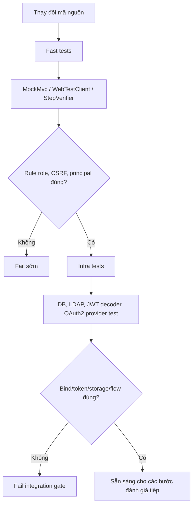

# Tách bộ test nhanh khỏi kiểm thử tích hợp có phụ thuộc hạ tầng

Một bộ kiểm thử Spring Security đáng tin cậy cần cho lập trình viên biết nhanh khi một quy tắc xác thực/phân quyền bị phá vỡ, đồng thời vẫn phát hiện lỗi phát sinh khi ứng dụng kết nối với database, LDAP server, OAuth2 provider hoặc các dịch vụ bên ngoài. Nếu mọi test đều khởi động container và chờ mạng, phản hồi trên pull request sẽ chậm, dễ lỗi ngẫu nhiên. Nếu chỉ chạy `@WithMockUser` và mock JWT, pipeline có thể xanh dù cấu hình decoder, LDAP bind hoặc kho authorized client thật không hoạt động.

Giải pháp là **tách bộ test nhanh khỏi kiểm thử tích hợp có phụ thuộc hạ tầng**, nhưng không được đồng nghĩa với **bỏ qua kiểm thử tích hợp**. Mỗi nhóm phải có mục tiêu, môi trường chạy, yêu cầu về dữ liệu, cách kích hoạt và điều kiện bắt buộc trước khi merge/release rõ ràng.

Bài thuộc chương **Bộ kiểm thử và CI** của module **SPRING_SECURITY_TESTING**. Module tập trung kiểm chứng xác thực, phân quyền và bảo vệ HTTP thực tế bằng `spring-security-test` trên ứng dụng Servlet và Reactive, với MockMvc, WebTestClient, `@WithMockUser`, SecurityContext, JWT/OAuth2/OIDC giả lập và những ca được phép hoặc bị từ chối. Bài này hướng dẫn tổ chức các ca kiểm thử đó thành **nhiều lớp tốc độ**, cấu hình **JUnit 5 + Gradle**, vận hành **CI có hai nhóm job**, bảo vệ tính độc lập của dữ liệu và tránh tình trạng test quan trọng bị skip mà nhóm phát triển không biết.

## 1. Phân chia theo ranh giới phụ thuộc, không chỉ theo tên annotation

“Unit test”, “slice test” và “integration test” là cách gọi phạm vi kiểm thử. Còn “nhanh” hay “cần hạ tầng” là phân loại **về chi phí và sự phụ thuộc khi chạy**. Hai cách phân loại có liên quan nhưng không hoàn toàn trùng nhau.

| Nhóm | Ví dụ Spring Security | Phụ thuộc khi chạy | Mục tiêu chính |
| --- | --- | --- | --- |
| **Nhanh — logic thuần** | Kiểm tra converter JWT claims → authorities, chính sách mapping role, decision function | JUnit/Mockito, không network | Phản hồi tức thời cho logic nhỏ |
| **Nhanh — MVC slice** | `@WebMvcTest` + MockMvc + `user()`, `jwt()`, `csrf()` | Spring MVC context nhỏ, mock service | HTTP 200/401/403 và controller binding |
| **Nhanh — Reactive slice** | `@WebFluxTest` + WebTestClient + `mockUser()`, `mockJwt()` | Mock WebFlux context | Filter chain, Reactive principal và authorization |
| **Nhanh — method security** | `@PreAuthorize` với Spring proxy, `StepVerifier` và fake collaborator | Test Spring context tối thiểu | Chặn nghiệp vụ khi thiếu quyền |
| **Tích hợp — JDBC/DB** | `@SpringBootTest` + PostgreSQL Testcontainers | Docker/container, migration, DB | Quyền truy cập cùng dữ liệu persist thật |
| **Tích hợp — LDAP** | Embedded LDAP hoặc server test, bind/search, group mapping | LDAP server, LDIF, socket/port | Xác thực password và nhóm thật |
| **Tích hợp — OAuth2/OIDC/JWT** | Mock identity provider chạy HTTP, JWKS/decoder thật, token endpoint | HTTP server, key pairs, protocol state | Kiểm chứng token/issuer/flows thật |
| **Tích hợp — hệ thống** | App + database + queue + external sandbox | Nhiều dịch vụ, resource limits, network | Phát hiện lỗi phối hợp và cấu hình hệ thống |

**Đừng dùng nguyên tắc “có `@SpringBootTest` thì chắc chắn chậm, có `@WebMvcTest` thì chắc chắn nhanh”.** Một integration test dùng H2 trong JVM có thể tương đối nhanh; một MVC slice có listener gọi dịch vụ ngoài có thể chậm và không ổn định. Hãy xét **tài nguyên phải khởi động, I/O thực sự và mục tiêu kiểm chứng**.

Một cách tổ chức đơn giản cho module là:

- **Bộ fast:** không cần Docker, LDAP ngoài, broker, cloud account hoặc network; xác minh logic và chính sách web/method theo fixture giả lập.
- **Bộ infra:** có thể yêu cầu Docker, server LDAP, provider thử nghiệm, database hoặc kết nối ngoài; tự cấp tài nguyên và tự dọn.
- **Bộ external/staging (nếu có):** kiểm tra hệ thống tích hợp bên ngoài CI sandbox; chạy dưới kiểm soát và thông tin đăng nhập riêng, không thay thế hai bộ trên.

## 2. Mục tiêu bảo mật nào được bảo đảm ở mỗi tầng?

Ví dụ endpoint `POST /api/reports` cần `SCOPE_reports.write` và phải ghi báo cáo với đúng chủ sở hữu.



| Yêu cầu | Bộ fast có thể chứng minh | Bộ infra phải bổ sung khi yêu cầu |
| --- | --- | --- |
| Người dùng không đủ quyền bị chặn | Có: `user()`, `mockJwt()`, `@WithMockUser` | Kiểm chứng authority được tạo đúng từ credential thật |
| Anonymous bị từ chối | Có: không gắn Authentication, assert 401/redirect | Kiểm tra entry point thực tế và reverse proxy nếu liên quan |
| POST có CSRF phù hợp | Có: `csrf()` hoặc `mockCsrf()` tùy stack | Kiểm tra cookie/session/browser flow nếu cần |
| Principal và owner không lẫn Alice/Bob | Có: hai mock principal và assertion body | Kiểm tra persistence/session/cache qua nhiều request thật |
| JWT signature/issuer/audience hết hạn được kiểm tra | **Không** khi chỉ dùng `jwt()`/`mockJwt()` | Có: token ký bằng khóa test và decoder thật |
| LDAP password bind hoạt động | **Không** với `@WithMockUser` | Có: LDAP server test, user search và bind |
| OAuth2 authorization code hoặc OIDC callback hoạt động | **Không** với `oauth2Login()`/`mockOidcLogin()` | Có: provider thử nghiệm và flow HTTP tương ứng |
| Database schema, migration và transaction tương thích | Không nếu mock repository | Có: database thử nghiệm và dữ liệu persist |
| Token/authorized client được cô lập | Kiểm thử logic repository in-memory | Kiểm tra service/store thật khi có JDBC/cache/session |

Điểm quan trọng nhất là **không suy diễn kết quả của test giả lập thành bằng chứng cho cơ chế thật mà mock đã bỏ qua**.

## 3. Quy ước tên, tag và vị trí test

Không bắt buộc mỗi loại test phải nằm trong một source set riêng. Để triển khai ban đầu, có thể dùng JUnit 5 `@Tag` và một số quy ước dễ đọc:

```text
src/test/java/.../
  ReportControllerSecurityTest.java      # fast: MVC slice
  ReportPermissionMappingTest.java       # fast: converter/logic
  ReactiveReportMethodTest.java          # fast: method security
  ReportPostgresIT.java                  # @Tag("infra")
  LdapAuthenticationIT.java              # @Tag("infra")
  JwtDecoderIntegrationIT.java           # @Tag("infra")
```

Quy ước đề xuất:

- Tất cả test **mặc định** chạy trong task `test`, **ngoại trừ** test gắn `@Tag("infra")`.
- Test có Docker/LDAP/HTTP server/dữ liệu ngoài được đánh dấu `@Tag("infra")` ở **cấp class** để tránh bỏ sót một method.
- Suffix `IT` giúp người đọc nhận biết ý định, nhưng **suffix một mình không đủ** nếu Gradle cấu hình lọc dựa trên tag.
- Test cần một hệ thống staging thật có thể nhận tag riêng như `external`, nhưng phải có task/job và chính sách vận hành rõ; không âm thầm gộp với fast.

Ví dụ:

```java
import org.junit.jupiter.api.Tag;
import org.junit.jupiter.api.Test;

@Tag("infra")
class LdapAuthenticationIT {

    @Test
    void wrongPasswordIsRejectedByLdapServer() {
        // Bài test mở LDAP server test hoặc kết nối tới fixture của test.
    }
}
```

**Quy tắc review:** khi một test mới gọi Docker, LDAP, broker hoặc API network, người viết phải chỉ rõ nó chạy ở job nào. Một `@Tag("infra")` không được task nào include sẽ khiến test tồn tại trong repo nhưng **không bao giờ chạy**.

## 4. Ví dụ ứng dụng bảo mật để tạo bộ fast

Ta sử dụng một HTTP API Servlet với hai endpoint:

- `GET /api/identity`: cho phép mọi người đã xác thực, trả tên principal.
- `POST /api/reports`: yêu cầu `SCOPE_reports.write`, có CSRF hợp lệ và gọi service tạo báo cáo.

Mô hình này nhỏ nhưng có đủ trường hợp **200, 201, 401, 403 và “không gọi nghiệp vụ khi bị từ chối”**.

### Controller và service contract

```java
import java.util.Map;
import org.springframework.http.HttpStatus;
import org.springframework.http.ResponseEntity;
import org.springframework.security.core.Authentication;
import org.springframework.web.bind.annotation.*;

record CreateReportRequest(String title) {}
record ReportReceipt(String id) {}

interface ReportService {
    ReportReceipt create(String title, String owner);
}

@RestController
@RequestMapping("/api")
class ReportController {
    private final ReportService reports;

    ReportController(ReportService reports) {
        this.reports = reports;
    }

    @GetMapping("/identity")
    Map<String, String> identity(Authentication auth) {
        return Map.of("name", auth.getName());
    }

    @PostMapping("/reports")
    ResponseEntity<ReportReceipt> create(
            @RequestBody CreateReportRequest input,
            Authentication auth) {
        ReportReceipt receipt = reports.create(
            input.title(), auth.getName());
        return ResponseEntity.status(HttpStatus.CREATED).body(receipt);
    }
}
```

### SecurityFilterChain test

```java
import org.springframework.context.annotation.Bean;
import org.springframework.context.annotation.Configuration;
import org.springframework.http.HttpMethod;
import org.springframework.security.config.Customizer;
import org.springframework.security.config.annotation.web.builders.HttpSecurity;
import org.springframework.security.web.SecurityFilterChain;

@Configuration
class ReportSecurityConfig {

    @Bean
    SecurityFilterChain reportSecurity(HttpSecurity http) throws Exception {
        return http
            .authorizeHttpRequests(auth -> auth
                .requestMatchers(HttpMethod.POST, "/api/reports")
                    .hasAuthority("SCOPE_reports.write")
                .requestMatchers(HttpMethod.GET, "/api/identity")
                    .authenticated()
                .anyRequest().denyAll())
            .httpBasic(Customizer.withDefaults())
            // Mặc định để CSRF bật trong ví dụ MVC.
            .build();
    }
}
```

Với entry point HTTP Basic, GET anonymous thường nhận **401**. POST có `Authentication` thiếu authority nhưng CSRF hợp lệ sẽ nhận **403** do authorization. Nếu POST thiếu CSRF, request cũng có thể nhận **403** do cơ chế khác — vì vậy các bài test phải tách nguyên nhân.

Ở dự án thật, bộ fast nên sử dụng chính sách HTTP được khai báo cho ứng dụng, không tự tạo một cấu hình dễ dãi khiến test xanh dù config production không được kiểm tra. Nếu dùng một test configuration riêng, phải bổ sung một tầng kiểm thử tích hợp xác nhận security config thật.

## 5. Fast MockMvc: đủ trường hợp cho phép và từ chối

Một `@WebMvcTest` slice cho controller, import `SecurityFilterChain` liên quan và mock `ReportService` sẽ không cần DB, LDAP, OAuth2 provider hoặc HTTP server ngoài.

```java
import org.junit.jupiter.api.Tag;
import org.junit.jupiter.api.Test;
import org.springframework.beans.factory.annotation.Autowired;
import org.springframework.boot.test.autoconfigure.web.servlet.WebMvcTest;
import org.springframework.context.annotation.Import;
import org.springframework.http.MediaType;
import org.springframework.security.core.authority.SimpleGrantedAuthority;
import org.springframework.test.context.bean.override.mockito.MockitoBean;
import org.springframework.test.web.servlet.MockMvc;

import static org.mockito.Mockito.*;
import static org.springframework.security.test.web.servlet.request
    .SecurityMockMvcRequestPostProcessors.user;
import static org.springframework.security.test.web.servlet.request
    .SecurityMockMvcRequestPostProcessors.csrf;
import static org.springframework.test.web.servlet.request.MockMvcRequestBuilders.*;
import static org.springframework.test.web.servlet.result.MockMvcResultMatchers.*;

@Tag("fast")
@WebMvcTest(ReportController.class)
@Import(ReportSecurityConfig.class)
class ReportControllerSecurityTest {

    @Autowired MockMvc mvc;
    @MockitoBean ReportService reports;

    @Test
    void anonymousRequestGets401() throws Exception {
        mvc.perform(get("/api/identity"))
            .andExpect(status().isUnauthorized());

        verifyNoInteractions(reports);
    }

    @Test
    void aliceAndBobUseTheirOwnIdentity() throws Exception {
        mvc.perform(get("/api/identity").with(user("alice")))
            .andExpect(status().isOk())
            .andExpect(jsonPath("$.name").value("alice"));

        mvc.perform(get("/api/identity").with(user("bob")))
            .andExpect(status().isOk())
            .andExpect(jsonPath("$.name").value("bob"));

        verifyNoInteractions(reports);
    }

    @Test
    void missingWriteAuthorityGets403WithoutBusinessCall()
            throws Exception {
        mvc.perform(post("/api/reports")
                .with(user("viewer").roles("VIEWER"))
                .with(csrf())
                .contentType(MediaType.APPLICATION_JSON)
                .content("{\"title\":\"Q1\"}"))
            .andExpect(status().isForbidden());

        verifyNoInteractions(reports);
    }

    @Test
    void writerCanCreateReport() throws Exception {
        when(reports.create("Q1", "writer"))
            .thenReturn(new ReportReceipt("report-101"));

        mvc.perform(post("/api/reports")
                .with(user("writer").authorities(
                    new SimpleGrantedAuthority("SCOPE_reports.write")))
                .with(csrf())
                .contentType(MediaType.APPLICATION_JSON)
                .content("{\"title\":\"Q1\"}"))
            .andExpect(status().isCreated())
            .andExpect(jsonPath("$.id").value("report-101"));

        verify(reports, times(1)).create("Q1", "writer");
        verifyNoMoreInteractions(reports);
    }

    @Test
    void writerWithoutCsrfGets403() throws Exception {
        mvc.perform(post("/api/reports")
                .with(user("writer").authorities(
                    new SimpleGrantedAuthority("SCOPE_reports.write")))
                .contentType(MediaType.APPLICATION_JSON)
                .content("{\"title\":\"Q1\"}"))
            .andExpect(status().isForbidden());

        verifyNoInteractions(reports);
    }
}
```

Mẫu dùng `@MockitoBean` của Spring Framework 6.2+ / Spring Boot 3.4+. Với phiên bản cũ, phải chọn annotation mock bean tương thích. Các thành phần Spring Boot/Spring Security dùng đúng phiên bản do dự án quản lý.

**Vì sao xếp vào fast?** Request chạy bằng MockMvc với context MVC và filter chain phù hợp, service được mock; không khởi động database/container hay gọi LDAP. Bài test vẫn kiểm tra **Spring Security HTTP authorization thật** ở tầng MockMvc, chứ không chỉ kiểm tra một hàm Java thuần.

**Giới hạn:** `user("alice")` được gắn vào request bởi test helper; nó không kiểm chứng password, JWT signature, LDAP bind hoặc OAuth2 login flow. Các kiểm chứng đó thuộc bộ hạ tầng khi ứng dụng sử dụng chúng.

## 6. Fast test cũng phải kiểm chứng “không gọi nghiệp vụ”

Chỉ thấy `403` không chứng minh request không gây tác dụng phụ. Lập trình viên có thể vô tình gọi service rồi tự trả `ResponseEntity.status(403)`.

Do đó một ca từ chối quan trọng cần **hai lớp assertion**:

```java
mvc.perform(post("/api/reports")
        .with(user("viewer").roles("VIEWER"))
        .with(csrf())
        .contentType(MediaType.APPLICATION_JSON)
        .content("{\"title\":\"Q1\"}"))
    .andExpect(status().isForbidden());

verifyNoInteractions(reports);
```

Trong bộ fast, mock service chính là ranh giới quan sát tốt. Trong integration test với service thật, cần xác minh **trạng thái database/queue không đổi**, hoặc repository/downstream publisher không bị gọi khi bị từ chối.

Cũng cần phân biệt **403 do thiếu authority** và **403 do thiếu CSRF**: luôn thêm `csrf()` cho test mà mục tiêu là thiếu role/scope, rồi viết một ca thiếu CSRF riêng. Nếu không, test 403 vẫn có thể xanh ngay cả khi rule authorization bị gỡ.

## 7. Fast test Reactive: WebTestClient và StepVerifier

Ứng dụng WebFlux có stack riêng: `SecurityWebFilterChain`, `ServerHttpSecurity`, `WebTestClient` và context Reactive. Đừng tự mang `HttpSecurity`/Servlet MockMvc vào một Reactive application.

Một bộ fast HTTP có thể sử dụng:

```java
import static org.springframework.security.test.web.reactive.server
    .SecurityMockServerConfigurers.springSecurity;
import static org.springframework.security.test.web.reactive.server
    .SecurityMockServerConfigurers.mockUser;

WebTestClient baseClient = WebTestClient
    .bindToApplicationContext(applicationContext)
    .apply(springSecurity())
    .configureClient()
    .build();

WebTestClient aliceClient =
    baseClient.mutateWith(mockUser("alice").roles("READER"));

WebTestClient bobClient =
    baseClient.mutateWith(mockUser("bob").roles("VIEWER"));

// Giả sử GET /api/private yêu cầu ROLE_READER:
aliceClient.get().uri("/api/private")
    .exchange()
    .expectStatus().isOk();

bobClient.get().uri("/api/private")
    .exchange()
    .expectStatus().isForbidden();

baseClient.get().uri("/api/private")
    .exchange()
    .expectStatus().isUnauthorized();
```

Ví dụ giả định `applicationContext` có controller và một `SecurityWebFilterChain` sử dụng HTTP Basic entry point; mã status anonymous phụ thuộc cấu hình cụ thể. Các client local từ `mutateWith` không làm thay đổi `baseClient`.

Ở tầng method security, test trực tiếp publisher bằng `StepVerifier`:

```java
import static org.springframework.security.core.context
    .ReactiveSecurityContextHolder.withAuthentication;

Authentication reader =
    UsernamePasswordAuthenticationToken.authenticated(
        "alice", null,
        List.of(new SimpleGrantedAuthority("SCOPE_reports.read")));

StepVerifier.create(
        securedReportService.read("r-1")
            .contextWrite(withAuthentication(reader)))
    .expectNext("report:r-1")
    .verifyComplete();
```

Đoạn này cần một Spring bean `securedReportService` được proxy bởi `@EnableReactiveMethodSecurity` và fake collaborator trả giá trị như kỳ vọng. Các trường hợp thiếu quyền nên assert `AccessDeniedException` và không có interaction nghiệp vụ. Ở cấp `StepVerifier`, ta kiểm tra **tín hiệu publisher**, không phải HTTP 401/403.

**Fast không có nghĩa là vô giá trị:** nó giúp bắt sai rule, sai principal, sai authority hoặc sai chỗ đặt Reactor Context ngay khi sửa code, mà không phụ thuộc container.

## 8. Fast test về JWT/OAuth2/OIDC và giới hạn cần ghi rõ

Trong một bài thử **Resource Server riêng** (giả sử ứng dụng có `GET /api/reports` yêu cầu `SCOPE_reports.read`; endpoint này không thuộc controller minh họa ở mục 4), có thể dùng:

```java
import static org.springframework.security.test.web.servlet.request
    .SecurityMockMvcRequestPostProcessors.jwt;

mvc.perform(get("/api/reports")
        .with(jwt().authorities(
            new SimpleGrantedAuthority("SCOPE_reports.read"))))
    .andExpect(status().isOk());
```

Trong MockMvc Servlet, `jwt()` tạo đối tượng authentication/claims phục vụ kiểm thử; nó **không gửi một JWT được ký qua HTTP** để decoder kiểm tra chữ ký. Với WebFlux, công cụ tương ứng là `mockJwt()`.

Tương tự:

- `oauth2Login()` (Servlet MockMvc) và `mockOAuth2Login()` (WebFlux) mô phỏng user **đã** đăng nhập OAuth2.
- `oidcLogin()` và `mockOidcLogin()` mô phỏng OIDC principal/token claims.
- `@WithMockUser` mô phỏng một user đã xác thực theo cách thông thường; không thực hiện LDAP/DB password authentication.

Các bài test này nên nằm trong **fast** khi mục tiêu là business rule/authorization với principal đã dựng sẵn. Nhưng nếu mục tiêu là **signature/JWKS/issuer/audience/expiration**, **authorization code/PKCE/state**, hoặc **LDAP password bind**, phải có kiểm thử tích hợp dùng cơ chế thật với credential/key/provider test.

Một pipeline chỉ chạy mocks rồi gọi trạng thái “OAuth2 end-to-end PASSED” là tự đánh giá quá mức phạm vi đã kiểm chứng.

## 9. Xác định “có phụ thuộc hạ tầng” bằng một tiêu chí rõ ràng

Thử đặt câu hỏi khi phân loại test:

1. Test có yêu cầu Docker daemon hay container image không?
2. Test có mở server socket LDAP/HTTP/WireMock/Keycloak giả lập không?
3. Test có kết nối PostgreSQL, Redis, Kafka, broker hay filesystem chia sẻ không?
4. Test có yêu cầu thời gian chờ health-check/migration hoặc dữ liệu seed phức tạp không?
5. Test có cần tài khoản sandbox, secret hoặc network bên ngoài máy chạy không?
6. Test có thể chạy offline với JVM/JUnit/Mockito/Spring Test context đơn giản không?

Nếu test có **phụ thuộc thật** vào một hoặc nhiều hạ tầng có vòng đời riêng, nên phân vào nhóm `infra` và có cơ chế cấp phát/cleanup tương ứng.

**Một integration test không nhất thiết là external-system test.** Embedded LDAP được tạo trong JVM, H2 in-memory và fake identity provider local vẫn là những integration test có kết nối hoặc trạng thái; chúng có thể chạy rất nhanh. Việc phân loại cuối cùng dựa trên **giá trị bảo mật, độ ổn định và chi phí khởi động đo được**, không chỉ dựa trên nhãn “embedded”.

## 10. Ví dụ hạ tầng: Spring Boot + PostgreSQL Testcontainers

Giả sử ứng dụng production lưu báo cáo thật vào PostgreSQL. Một bài tích hợp cần chứng minh HTTP request được cho phép rồi thực sự ghi đúng owner, không chỉ trả response từ mock `ReportService`.

Phụ thuộc bổ sung (Gradle Kotlin DSL):

```kotlin
dependencies {
    testImplementation("org.springframework.boot:spring-boot-testcontainers")
    testImplementation("org.testcontainers:junit-jupiter")
    testImplementation("org.testcontainers:postgresql")
    testRuntimeOnly("org.postgresql:postgresql")
}
```

Với Spring Boot 3.1+, `@ServiceConnection` có thể tự tạo connection details từ Testcontainers. Bài test khung:

```java
import java.util.UUID;
import org.junit.jupiter.api.Tag;
import org.junit.jupiter.api.Test;
import org.springframework.beans.factory.annotation.Autowired;
import org.springframework.boot.test.autoconfigure.web.servlet.AutoConfigureMockMvc;
import org.springframework.boot.test.context.SpringBootTest;
import org.springframework.boot.testcontainers.service.connection.ServiceConnection;
import org.springframework.http.MediaType;
import org.springframework.test.web.servlet.MockMvc;
import org.testcontainers.containers.PostgreSQLContainer;
import org.testcontainers.junit.jupiter.Container;
import org.testcontainers.junit.jupiter.Testcontainers;

import static org.assertj.core.api.Assertions.assertThat;
import static org.springframework.security.test.web.servlet.request
    .SecurityMockMvcRequestPostProcessors.user;
import static org.springframework.security.test.web.servlet.request
    .SecurityMockMvcRequestPostProcessors.csrf;
import static org.springframework.test.web.servlet.request.MockMvcRequestBuilders.post;
import static org.springframework.test.web.servlet.result.MockMvcResultMatchers.status;

@Tag("infra")
@Testcontainers
@SpringBootTest
@AutoConfigureMockMvc
class ReportPostgresIT {

    @Container
    @ServiceConnection
    static PostgreSQLContainer<?> postgres =
        new PostgreSQLContainer<>("postgres:16-alpine");

    @Autowired MockMvc mvc;
    @Autowired ReportRepository repository;

    @Test
    void writerCreatesRowWithCorrectOwner() throws Exception {
        String title = "ci-" + UUID.randomUUID();

        mvc.perform(post("/api/reports")
                .with(user("writer").authorities(
                    new SimpleGrantedAuthority("SCOPE_reports.write")))
                .with(csrf())
                .contentType(MediaType.APPLICATION_JSON)
                .content("{\"title\":\"" + title + "\"}"))
            .andExpect(status().isCreated());

        assertThat(repository.findByTitle(title))
            .isPresent()
            .get()
            .extracting(ReportEntity::getOwner)
            .isEqualTo("writer");
    }
}
```

Đây là **khung** dành cho ứng dụng đã có entity, repository `ReportRepository.findByTitle(...)`, `ReportEntity.getOwner()`, service implementation thật và migration/schema tương ứng. Các loại đó phải được định nghĩa theo codebase thực tế; đừng chép ví dụ vào một dự án không có repository rồi coi đó là test chạy ngay.

Mục tiêu mà khung minh họa: **request đã được security cho phép và dữ liệu thật được ghi với owner đúng**. Tuy nhiên `.with(user("writer"))` vẫn là mock Authentication. Vì vậy đây là test **persistence + authorization web** với PostgreSQL thật, **chưa** kiểm chứng JWT signature hoặc LDAP bind. Nếu muốn kiểm tra cơ chế xác thực thật, bổ sung test credential tương ứng.

### Lưu ý cách quản lý container

- `@Container` trên trường static thường khởi động container một lần cho lớp test và dừng khi lớp kết thúc.
- Các test nên dùng dữ liệu có ID riêng; không dựa vào row còn lại từ một test khác.
- Đừng tự dùng lại Spring ApplicationContext đã cache với DataSource trỏ tới container **đã bị dừng**. Nếu nhiều lớp chia sẻ context/container, cần thiết kế vòng đời chung tương ứng hoặc phân tách context rõ ràng.
- Docker unavailable **phải tạo tín hiệu thất bại rõ ràng** nếu đây là một gate bắt buộc. Tránh cấu hình vô tình bỏ qua test khi Docker không sẵn có.
- Không lưu credential PostgreSQL production vào test. Container phải dùng database riêng và dữ liệu giả.

## 11. Kiểm thử hạ tầng với LDAP, JWT và OAuth2 provider

Không phải mọi bài tích hợp đều cần PostgreSQL. Ví dụ:

| Cơ chế | Hạ tầng kiểm thử | Assertion không thể có chỉ với mock principal |
| --- | --- | --- |
| **LDAP** | UnboundID in-memory server hoặc container LDAP với LDIF riêng | Password đúng bind thành công; sai password 401; group editors → `ROLE_EDITORS`; thiếu quyền 403 |
| **JWT Resource Server** | RSA/EC test key, decoder/JWKS hoặc HTTP issuer giả lập | Token chữ ký sai, issuer/audience không hợp lệ, hết hạn bị từ chối trước controller |
| **OAuth2 Client** | Provider stub với authorize/token endpoints | Authorization Code/PKCE/state, token exchange, client registration đúng |
| **OIDC Login** | OIDC provider thử nghiệm với discovery/JWKS/ID Token | `iss`, `aud`, `nonce`, ID Token và UserInfo được xử lý theo flow thật |
| **Authorized-client persistence** | JDBC/session/cache repository thật | Token/refresh token của Alice không bị dùng cho Bob, xóa/refresh đúng khóa |
| **Database authorization** | PostgreSQL/Testcontainers và rows theo tenant | User A không đọc/ghi row tenant B qua service/repository thật |

Ví dụ kiểm thử LDAP qua HTTP phải gửi credential:

```java
mvc.perform(get("/api/me")
        .with(httpBasic("alice", "alice-test-password")))
    .andExpect(status().isOk());

mvc.perform(get("/api/me")
        .with(httpBasic("alice", "wrong-password")))
    .andExpect(status().isUnauthorized());
```

Với một `LdapAuthenticationProvider` thật được cấu hình trỏ đến server test, `httpBasic(...)` gửi credential cho filter authentication xử lý. Khác hoàn toàn với `.with(user("alice"))`, vốn dựng sẵn Authentication trong request và bỏ qua LDAP.

Đối với JWT, nếu mục tiêu là decoder thật, gửi `Authorization: Bearer <test-signed-token>` qua HTTP (dùng key/issuer do test sở hữu), không dùng `jwt()` hoặc `mockJwt()` thay thế. Test cũng cần trường hợp **signature sai**, **expiry**, **issuer/audience sai** và **scope bị từ chối**, tùy contract của hệ thống.

## 12. Tách JUnit 5 tags bằng Gradle tasks

Có hai cách chính:

1. Cùng `src/test/java`, đánh dấu `@Tag("infra")` và khai báo **hai Gradle Test tasks**.
2. Tạo source set riêng `src/integrationTest/java` (hoặc JVM Test Suite plugin) khi cần dependency/classpath, vòng đời hay số lượng test hoàn toàn khác.

Để bắt đầu đơn giản, dùng **cách 1**. Trong `build.gradle.kts` (Kotlin DSL), thêm cấu hình sau vào dự án đã áp dụng Java/Spring Boot plugin và JUnit Platform:

```kotlin
import org.gradle.api.tasks.testing.Test

// task test mặc định: chạy mọi JUnit Jupiter test không gắn "infra".
tasks.named<Test>("test") {
    useJUnitPlatform {
        excludeTags("infra")
    }
}

// Cùng test source set, nhưng chỉ chạy các test @Tag("infra").
val infraTest by tasks.registering(Test::class) {
    description = "Run security integration tests requiring infrastructure"
    group = "verification"

    testClassesDirs = sourceSets["test"].output.classesDirs
    classpath = sourceSets["test"].runtimeClasspath

    useJUnitPlatform {
        includeTags("infra")
    }
    shouldRunAfter(tasks.named("test"))
}
```

Cách sử dụng:

```bash
# Linux/macOS:
./gradlew test
./gradlew infraTest
./gradlew test infraTest

# Windows PowerShell/cmd:
gradlew.bat test
gradlew.bat infraTest
```

**Cách các task chọn test:**

- Test không có tag hoặc tag `fast` được chạy trong task `test`.
- Lớp có `@Tag("infra")` không chạy trong `test`; nó chạy trong `infraTest`.
- Một lớp vô tình có cả `fast` và `infra` vẫn bị loại khỏi `test` theo `excludeTags("infra")`.
- `shouldRunAfter` **không tạo dependency**: gọi chỉ `infraTest` vẫn chỉ chạy infra. Đây là chủ ý để có thể chạy hai nhóm riêng.
- `infraTest` dùng cùng output/classpath từ test source set. Đây không phải một source set mới.

**Đừng coi `@Tag("infra")` là một điều kiện tự động được CI bảo vệ.** Nếu pipeline chỉ chạy `./gradlew test`, test infra sẽ **không chạy**. CI phải có job gọi `infraTest`; khi tính năng bảo mật quan trọng phụ thuộc vào nó, job đó phải là required check trước merge.

## 13. Những sai lầm Gradle/JUnit làm test biến mất khỏi pipeline

| Sai sót | Hậu quả | Cách phát hiện |
| --- | --- | --- |
| Đặt `@Tag("infra")` nhưng CI không gọi `infraTest` | Test không bao giờ chạy | Kiểm tra CI job và test reports |
| Chỉ đặt tên lớp `*IT` mà không có tag | `test` có thể chạy hạ tầng ngoài ý muốn | Quy ước review + tag hoặc source set riêng |
| Chỉ lọc `includeTags("fast")` cho fast, quên gắn tag vào test mới | Test mới bị bỏ qua | Mặc định chạy mọi test **trừ infra** |
| Infra task dùng classpath sai | Test không discover được hoặc thiếu thư viện | Cấu hình testClassesDirs/classpath theo source set |
| Docker thiếu, test dùng chế độ tự skip | Job CI xanh dù tích hợp chưa chạy | Không cho skip lặng lẽ, yêu cầu môi trường sẵn có |
| Chạy task nhưng không có test được discover | Có nguy cơ kết luận xanh giả | Kiểm tra reports/count và ít nhất một sentinel test |
| Test bị `@Disabled` mà không có thời hạn | Bao phủ bảo mật giảm dần | Review danh sách skipped/disabled trên CI |
| Test retry đến khi xanh, không theo dõi lần fail đầu | Che giấu flaky/đua dữ liệu | Giữ first-failure logs, phân loại và sửa nguyên nhân |

**Một cách kiểm tra thủ công hữu ích:** tạo một ca infra cố tình fail trong nhánh thử nghiệm, chạy `./gradlew test` phải không bị ảnh hưởng, còn `./gradlew infraTest` phải fail. Khôi phục test sau khi xác minh. Cách này giúp chắc chắn filter tags thực sự hoạt động.

Nếu tổ chức source set riêng, dùng Test Suite/plugin Gradle phù hợp phiên bản đang dùng; đừng trộn các ví dụ Maven Failsafe/Surefire với Gradle rồi suy luận chúng chọn cùng tên test.

## 14. Pipeline CI với hai quality gates

Một pipeline lý tưởng thực hiện:

1. **Job fast** trên mọi pull request: compile/test nhanh, báo lỗi authorization sớm.
2. **Job infra** khi job fast thành công: khởi động Docker/service giả lập, chạy các test có phụ thuộc hạ tầng.
3. **Chính sách merge** chỉ cho phép merge khi **các checks bắt buộc đều thành công**.
4. **Báo cáo**: luôn lưu JUnit XML, test reports hoặc artifacts hữu ích khi test fail.

Mẫu GitHub Actions minh họa:

```yaml
name: Security test suites

on:
  pull_request:
  push:
    branches: [main]

permissions:
  contents: read

jobs:
  fast:
    runs-on: ubuntu-latest
    timeout-minutes: 15
    steps:
      - uses: actions/checkout@v4
      - uses: actions/setup-java@v4
        with:
          distribution: temurin
          java-version: '21'
      - uses: gradle/actions/setup-gradle@v4
      - name: Fast security tests
        run: ./gradlew --no-daemon test
      - name: Store fast test results
        if: always()
        uses: actions/upload-artifact@v4
        with:
          name: fast-test-results
          path: |
            build/test-results/test
            build/reports/tests/test
          if-no-files-found: warn

  infra:
    needs: fast
    runs-on: ubuntu-latest
    timeout-minutes: 35
    steps:
      - uses: actions/checkout@v4
      - uses: actions/setup-java@v4
        with:
          distribution: temurin
          java-version: '21'
      - uses: gradle/actions/setup-gradle@v4
      - name: Check Docker availability
        run: docker info
      - name: Infrastructure security tests
        run: ./gradlew --no-daemon infraTest
      - name: Store infrastructure test results
        if: always()
        uses: actions/upload-artifact@v4
        with:
          name: infra-test-results
          path: |
            build/test-results/infraTest
            build/reports/tests/infraTest
          if-no-files-found: warn
```

Đây là cấu hình **tham khảo** cho repository Gradle Kotlin DSL có hai test tasks ở mục trước; đường dẫn báo cáo phải điều chỉnh nếu build đa module. GitHub-hosted Linux runners thường có Docker nhưng vẫn kiểm tra `docker info`; với self-hosted runner, chuẩn bị Docker/service và quyền truy cập an toàn là một bước riêng.

**Vì sao dùng `needs: fast`?** Test hạ tầng đắt hơn chỉ bắt đầu sau khi bộ nhanh thành công. Nếu ưu tiên rút ngắn tổng thời gian thay vì tiết kiệm tài nguyên, có thể chạy hai job song song, miễn là không chia sẻ trạng thái. Cần cân nhắc trên số liệu thực tế.

Quan trọng: đặt **hai checks** là bắt buộc trong branch protection/rulesets nếu sự an toàn của tính năng phụ thuộc cả hai. Một job nightly không đủ thay thế gate trước merge nếu thay đổi code hôm nay có thể phá vỡ đường xác thực production.

## 15. Không dùng secret production để chạy test hạ tầng

Với Testcontainers, LDAP nhúng hoặc OIDC provider giả lập, hãy cấp **secret fixture** ngắn hạn, khóa test và dữ liệu giả. Không dùng token hay tài khoản production.

Những quy tắc nên áp dụng:

- Testcontainers sử dụng database riêng, không kết nối nhầm tới database công ty.
- LDAP server chỉ listen loopback hoặc private network test; dùng DN giả và password giả.
- Test JWT dùng khóa riêng được sinh cho test hoặc key pair test, không log private key.
- Stub OAuth2/OIDC chỉ phục vụ test, không nhận redirect/credential của người dùng thật.
- Không in Authorization header, cookie, refresh token, password hoặc client secret vào logs/artifacts.
- Với pull request từ fork, không cung cấp secret nhạy cảm cho code chưa tin cậy; tránh cấp quyền ghi hoặc token release vào job thực thi code của pull request.
- Không dùng `pull_request_target` để chạy mã chưa tin cậy với token đặc quyền.
- Nếu bắt buộc test tới một sandbox ngoài, tạo tài khoản chỉ có quyền tối thiểu và cơ chế rotation/cleanup; tách job đó khỏi luồng PR không đáng tin.

**Bộ infra tự chứa** thường có lợi hơn test phụ thuộc staging chia sẻ, vì nó không phải đợi environment hoặc trạng thái dữ liệu không kiểm soát được.

## 16. Kiểm soát cô lập dữ liệu khi chạy hai bộ test

Chuyển test sang `infraTest` không làm nó tự độc lập. Một test PostgreSQL để lại rows, một test OAuth2 để lại authorized client hoặc một test LDAP sửa group membership vẫn có thể làm ca tiếp theo phụ thuộc thứ tự.

| Loại trạng thái | Ranh giới cô lập nên có |
| --- | --- |
| SecurityContext Servlet | `@WithMockUser` theo method hoặc request postprocessor; dọn context nếu tự đặt |
| Reactor Context | `contextWrite(withAuthentication(...))` theo subscription |
| HTTP session | Session/cookie riêng cho Alice và Bob; không static session dùng chung |
| Mockito stubbing | Mock do Spring Test/MockitoExtension quản lý, reset phù hợp |
| PostgreSQL | Database/schema riêng hoặc ID fixture duy nhất; cleanup đúng test-owned rows |
| LDAP | Server fixture, LDIF bất biến hoặc reset/snapshot/cleanup DN đúng phạm vi |
| OAuth2 authorized client | Phân tách `registrationId + principalName`, cleanup mỗi record |
| Redis/cache | Prefix key theo test hoặc database/instance riêng |
| Kafka/queue | Topic/consumer group riêng, theo dõi message và xóa tài nguyên |
| Clock/token expiration | Dùng `Clock` cố định khi có thể; không trông vào `Thread.sleep` |

**Đừng xóa toàn bộ database/cache chia sẻ** khi các test đang chạy song song. Thay vào đó, cấp schema/namespace riêng hoặc cleanup chỉ những record do test sở hữu. `@Transactional` trên test có thể rollback thao tác cùng transaction, nhưng không tự rollback những request HTTP chạy transaction khác hoặc các side effects như message queue.

Test cần ngăn trùng principal/tenant nên có fixture Alice/Bob với khóa rõ; test trả `403` và `verifyNoInteractions(service)` có thể đi cùng assert repository không có row mới.

## 17. Phân quyền bảo mật trong CI: đừng kiểm tra mỗi happy path

Một số ca tối thiểu nên luôn nằm trong **fast**:

| Hành vi | Kỳ vọng |
| --- | --- |
| Anonymous vào endpoint bảo vệ | 401 hoặc redirect được cấu hình |
| Authenticated nhưng thiếu quyền | 403 |
| Đủ quyền nhưng thiếu CSRF với form/cookie API | 403 |
| Đủ quyền và CSRF hợp lệ | 2xx, response đúng |
| Alice/Bob gọi cùng endpoint | Principal/tenant được tách đúng |
| Request bị từ chối | Collaborator nghiệp vụ không chạy |

Với **infra**, bổ sung các ca mà mocks không thể xác minh:

| Hành vi | Kỳ vọng |
| --- | --- |
| JWT bị sửa chữ ký | Decoder từ chối trước business code |
| JWT hết hạn, issuer/audience sai | 401/exception tương ứng theo entry point |
| LDAP password sai | Bind thất bại, không có Authentication hợp lệ |
| LDAP group không khớp | Xác thực thành công, nhưng thiếu authority → 403 |
| Database migrations | Schema lên đúng phiên bản, query/transaction hoạt động |
| OAuth2 authorized client của Bob | Không dùng/access token của Alice |
| OIDC callback với nonce/issuer không hợp lệ | Flow bị từ chối, không tạo session đăng nhập |

Kết quả cụ thể 401/403/redirect sẽ phụ thuộc cấu hình production; điều quan trọng là test nhận dạng được **nguồn gốc từ chối** và chứng minh dữ liệu hoặc hành động nhạy cảm không lọt qua.

## 18. Báo cáo test, thời gian chạy và tỷ lệ flaky

Sau khi tách bộ test, hãy đo cả **độ nhanh** và **độ tin cậy**, không chỉ đếm số test:

- **Fast suite duration:** thường được kỳ vọng ngắn để lập trình viên chạy thường xuyên; đặt SLO theo kích thước module thực tế.
- **Infrastructure suite duration:** đo thời gian khởi động container/migration và thời gian test; tối ưu reuse tài nguyên hợp lý.
- **Flaky rate:** tỷ lệ test fail rồi pass lại mà không đổi code; cần tìm lỗi race, timeouts, shared state hoặc tài nguyên môi trường.
- **Skipped/disabled tests:** nhất là các test JWT/LDAP/OIDC quan trọng không được âm thầm biến mất.
- **Test coverage theo ranh giới:** mỗi endpoint và cơ chế xác thực quan trọng có ca được phép, bị từ chối và thiếu credential.
- **First-failure artifacts:** log, JUnit XML, screenshot/report nếu có; redaction secrets trước khi upload.

Retry không phải giải pháp lâu dài. Một test infra thất bại ngẫu nhiên do cùng port, dữ liệu LDAP cũ hoặc thời gian hết hạn JWT bất định cần được sửa nguồn gốc. Nếu buộc phải quarantine test, ghi rõ chủ sở hữu, lý do, thời hạn và tác động đến merge gate; không để một test authorization quan trọng bị disable vô thời hạn.

## 19. Những anti-pattern khiến phân tầng kiểm thử phản tác dụng

### Đưa mọi bài @SpringBootTest sang infra

Một `@SpringBootTest` chỉ dùng in-memory fake và context nhỏ có thể vẫn chạy nhanh. Cần đo trước khi di chuyển. Ngược lại, một `@WebMvcTest` phụ thuộc remote service (do bean bị scan sai hoặc mock thiếu) không xứng đáng được xếp fast.

### Dùng MockMvc user() để “chứng minh LDAP/JWT thật”

`user()`, `jwt()` và `@WithMockUser` cấp Authentication mô phỏng; chúng kiểm tra authorization sau khi danh tính đã có. Nếu claim “JWT signature verified” hoặc “LDAP bind passed”, phải có request credential/token đi qua provider/decoder thật.

### Chỉ chạy infra vào ban đêm khi đó là gate bắt buộc

Nightly rất hữu ích cho bài test dài, nhưng một lỗi phân quyền nguy hiểm cần bị chặn **trước khi merge** nếu dự án dựa vào tầng tích hợp đó. Có thể chọn subset infra trọng yếu trên PR và bộ đầy đủ theo lịch; phải ghi rõ risk acceptance cho phần không chạy tại merge gate.

### Auto-skip khi Docker không sẵn sàng

Dùng chế độ “không có Docker thì skip” trên CI khiến pipeline xanh dù chưa kiểm tra kết nối DB. Với một required integration job, môi trường không sẵn sàng là **lỗi hạ tầng cần hiển thị**, không phải test PASSED.

### Chia sẻ database, cache và HTTP session

Nếu test Bob chỉ pass khi chạy sau Alice, hoặc test đọc cache bị dính token của test trước, việc chuyển sang `infraTest` không sửa được. Cần fixture theo test ID, cleanup và context/session riêng.

### Gộp Gradle test và infraTest nhưng không lưu báo cáo riêng

Khi cùng một nguồn test được chạy bởi hai task khác nhau, báo cáo theo task giúp xác định fail ở logic hay hạ tầng. Nếu chỉ xuất một tổng trạng thái không có test count/artifacts, rất khó phát hiện test bị bỏ lọc.

### Giảm tiêu chuẩn assertions để test nhanh

Đừng bỏ `verifyNoInteractions`, case 401/403 hay test các tài khoản khác nhau để giảm thời gian. Fast suite được thiết kế để **bắt lỗi bảo mật sớm**, không phải chỉ tập hợp happy-path tests.

## 20. Kế hoạch áp dụng từng bước trong dự án

Nếu dự án đang có một task `test` chứa lẫn mọi loại test, có thể chuyển đổi theo thứ tự:

1. **Lập danh sách phụ thuộc thực tế** của các lớp test: Mockito-only, MockMvc slice, Reactive slice, PostgreSQL, LDAP, OIDC stub, broker.
2. **Đánh dấu `@Tag("infra")`** cho những lớp cần hạ tầng. Giữ các test còn lại được chạy mặc định bởi `test`.
3. **Tạo Gradle task `infraTest`** với JUnit Platform tag filter; xác minh cả hai task thực sự discover và chạy test đúng nhóm.
4. **Tách fixture và dữ liệu:** dùng fake credentials, cổng ngẫu nhiên, database riêng, session/tenant/authorized-client key riêng.
5. **Chạy fast suite** trên developer machine và mọi PR; xử lý test fail sớm.
6. **Bổ sung infra job** trên CI runner có Docker và các server thử nghiệm cần thiết; giữ logs/results sau thất bại.
7. **Đặt merge gates** cho những nhóm bắt buộc để bảo vệ hành vi xác thực và phân quyền production.
8. **Đo thời gian/flaky**; chỉ tối ưu hoặc di chuyển các ca dựa trên quan sát thực.
9. **Kiểm chứng security coverage:** có 401/403, success, CSRF, user isolation và test token/password/provider thật ở đúng tầng.
10. **Không nhầm hoàn tất việc tách task với hoàn tất kiểm thử:** cả hai nhóm phải có assertion đủ mạnh và được thực thi thường xuyên.

## 21. Bài thực hành: xây pipeline hai bộ cho Spring Security

Giả sử ứng dụng có:

- `GET /api/reports/{id}` yêu cầu `SCOPE_reports.read`.
- `POST /api/reports` yêu cầu `SCOPE_reports.write` và ghi PostgreSQL.
- Người dùng đăng nhập qua LDAP hoặc OIDC; API còn hỗ trợ Bearer JWT.

Hãy thực hiện các bước sau:

1. Tạo `@WebMvcTest` fast: anonymous 401, viewer thiếu quyền 403, writer được phép 2xx; với POST có CSRF bật, tách ca thiếu CSRF và ca thiếu authority.
2. Dùng `verifyNoInteractions(reportService)` để chứng minh request bị từ chối không gọi nghiệp vụ.
3. Tạo `@WebFluxTest` nếu có endpoint Reactive: dùng `WebTestClient.mutateWith(mockJwt())` hoặc `mockUser()` theo security configuration; kiểm tra 200/401/403 mà không cần server ngoài.
4. Tạo test `@Tag("infra")` với PostgreSQL Testcontainers và repository/service thật: request được phép phải ghi đúng owner/tenant; request thiếu quyền không tạo row.
5. Với cơ chế xác thực thực tế đang dùng, thêm ít nhất một integration test: LDAP bind sai password trả 401 **hoặc** JWT signature/issuer sai bị decoder từ chối. Không dùng `@WithMockUser` làm bằng chứng cho bước này.
6. Thêm test cô lập Alice/Bob, hai session/tenant hoặc hai OAuth2 authorized clients; không chia sẻ dữ liệu từ test trước.
7. Cấu hình Gradle `test` loại tag `infra` và `infraTest` chỉ nhận tag `infra`; chạy riêng từng task và chạy chung.
8. Trong CI, chạy hai job và lưu reports. Tạm thời làm một test infra fail có chủ đích để xác nhận job infra thật sự chặn merge; sau đó khôi phục.
9. Chạy lại suite với thứ tự test khác nhau, quan sát timing và flaky; giải quyết port fixed, shared DB hoặc cache còn sót.
10. Ghi rõ ở README nhóm phát triển: lệnh chạy fast/local, điều kiện chạy infra, quy ước tag, nơi xem báo cáo và điều kiện để được merge.

**Tiêu chí đạt:** phân loại test theo ranh giới phụ thuộc; có hai Gradle tasks chọn đúng ca; CI chạy cả fast và infra theo gate phù hợp; không sử dụng mocks để tuyên bố đã kiểm tra token/LDAP/provider thật; mọi ca bảo mật quan trọng có nhánh cho phép/bị từ chối, kiểm tra không có side effect trái phép; và hạ tầng test có dữ liệu/tài nguyên độc lập, không cần credential production.

### Tài liệu tham khảo

- [Spring Security — Servlet Testing](https://docs.spring.io/spring-security/reference/servlet/test/index.html): MockMvc, request postprocessors, security testing.
- [Spring Security — Reactive Testing](https://docs.spring.io/spring-security/reference/reactive/test/index.html): WebTestClient, mock JWT/OAuth2/OIDC, method security.
- [Gradle — Testing in Java & JVM Projects](https://docs.gradle.org/current/userguide/java_testing.html): cấu hình Test tasks và JUnit Platform.
- [JUnit 5 — Tagging and Filtering](https://docs.junit.org/current/user-guide/#writing-tests-tagging-and-filtering): `@Tag` và include/exclude tags.
- [Testcontainers — Java](https://java.testcontainers.org/): PostgreSQL container, JUnit Jupiter lifecycle và connection.
- [Spring Boot — Testcontainers Support](https://docs.spring.io/spring-boot/reference/testing/testcontainers.html): `@ServiceConnection` và test database integration.
- [GitHub Actions — Workflow Syntax](https://docs.github.com/en/actions/writing-workflows/workflow-syntax-for-github-actions): jobs, dependencies, runner, artifact steps và permissions.
