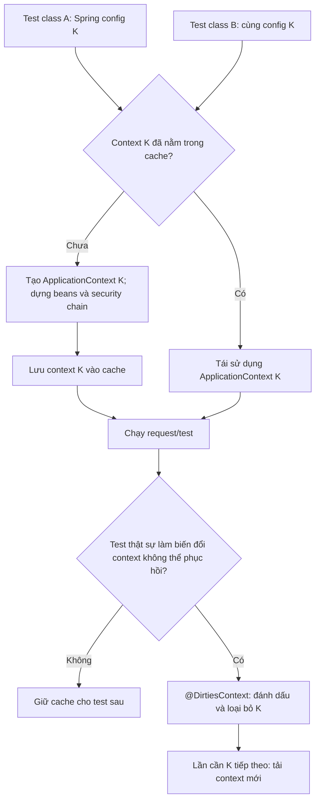
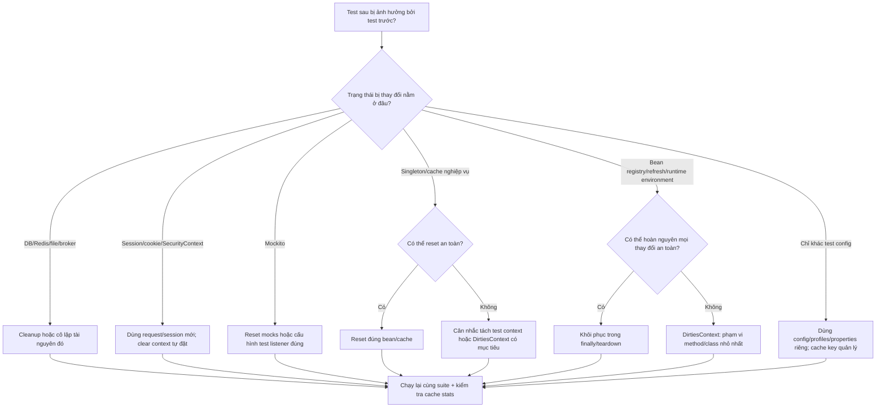

# Chỉ dùng @DirtiesContext khi cần cô lập thay đổi context thực sự

Một bộ kiểm thử Spring Security thường có nhiều lớp `@SpringBootTest`, `@WebMvcTest` hoặc `@WebFluxTest`. Nếu mỗi test đều khởi tạo lại toàn bộ `ApplicationContext`, thời gian dựng bean, cấu hình `SecurityFilterChain`/`SecurityWebFilterChain`, kết nối database và tạo các tài nguyên tích hợp sẽ tăng mạnh. Spring TestContext Framework **lưu cache ApplicationContext để tái sử dụng** giữa các test có cấu hình tương thích. `@DirtiesContext` là công cụ chủ động đánh dấu context đã bị “làm bẩn” và yêu cầu loại nó khỏi cache — không phải một nút “reset toàn bộ trạng thái test”.

Bài thuộc chương **Bộ kiểm thử và CI** trong module `SPRING_SECURITY_TESTING`. Người học kiểm chứng xác thực, phân quyền và HTTP security bằng `spring-security-test` trên Servlet/Reactive với `MockMvc`, `WebTestClient`, `@WithMockUser`, `SecurityContext`, JWT/OAuth2/OIDC giả lập và các ca được phép hoặc từ chối. Trọng tâm ở đây là xây dựng **test suite nhanh, đáng tin cậy, không rò rỉ trạng thái**, chỉ dùng `@DirtiesContext` khi test thực sự thay đổi cấu trúc hoặc cấu hình runtime của Spring context mà không thể khôi phục an toàn bằng cơ chế nhỏ hơn.

> **Nguyên tắc:** Nếu thứ cần dọn chỉ là hàng trong database, một `HttpSession`, `SecurityContextHolder`, mock interaction hoặc nội dung cache nghiệp vụ, hãy dọn **đúng trạng thái đó**. Dùng `@DirtiesContext` cho những thay đổi **bên trong ApplicationContext dùng chung** mà không thể reset chắc chắn; ghi rõ lý do và giới hạn phạm vi làm bẩn.

## 1. Hiểu đúng cache của Spring TestContext

Spring TestContext Framework có một bộ cache cho các `ApplicationContext` được tạo từ cấu hình test. Nhiều test class với cấu hình context giống nhau có thể nhận **cùng một instance ApplicationContext** trong cùng JVM/test process; chúng không nhất thiết phải khởi tạo lại BeanFactory và security chain. Một context có thể chứa:

- Các bean `SecurityFilterChain` (Servlet) hoặc `SecurityWebFilterChain` (WebFlux).
- `UserDetailsService`, `AuthenticationProvider`, `JwtDecoder`/`ReactiveJwtDecoder`, custom security filters.
- Các singleton service, repository, cache manager, datasource và embedded infrastructure được khai báo trong Spring.
- Test-specific beans, ví dụ `@MockitoBean`/`@MockitoSpyBean` hoặc `@TestConfiguration`.



**Điểm cần nhớ:** Đây là cache cho `ApplicationContext`, không phải cache của **mọi trạng thái** mà một bài test sử dụng. Việc một bean là singleton trong context không có nghĩa mọi trạng thái của bean đó phải được dọn bằng cách hủy context; đa số singleton có thể được reset, thay fixture hoặc cấu hình bất biến ngay từ đầu.

### Cache key và những điều làm test có context khác nhau

Spring TestContext không dùng đơn thuần tên lớp test làm khóa. Những thông tin trong `MergedContextConfiguration` có thể tác động tới khả năng tái sử dụng, chẳng hạn:

| Thành phần test configuration | Tác động điển hình đến cache key |
|---|---|
| `@SpringBootTest(classes=...)`, `@ContextConfiguration` | Khác bean configuration có thể tạo key khác. |
| `@ActiveProfiles("test")` | Profile khác dẫn đến cấu hình context khác. |
| `@TestPropertySource`, `@SpringBootTest(properties=...)` | Cấu hình properties test có thể tạo context riêng. |
| `@Import`, `@TestConfiguration` và context customizers | Có thể thay đổi phần cấu hình tham gia cache key. |
| `@MockitoBean`/`@MockitoSpyBean` hoặc dynamic property customizers | Sự khác biệt trong các khai báo override/customizer có thể làm context không dùng chung. |
| `@WebMvcTest` so với `@SpringBootTest` | Khác kiểu test context; không mặc nhiên dùng chung. |
| `@WebFluxTest` so với test Servlet | Khác web stack và bean graph, không phải một context. |

Do đó, **không cần thêm `@DirtiesContext` chỉ để ép hai test có `@ActiveProfiles` hoặc `@SpringBootTest(properties=...)` khác nhau nhận cấu hình riêng**. Spring sẽ xét cấu hình khi tạo cache key; dùng annotation đúng tầng giúp test tự có context tương ứng.

Trong một bộ test lớn, nếu mỗi lớp khai báo một tập `@MockitoBean`, `@TestConfiguration` hay properties riêng, số context key có thể tăng đáng kể ngay cả **không có `@DirtiesContext`**. Tối ưu bằng cách chuẩn hóa những cấu hình test giống nhau, không thêm bừa annotation “làm sạch context”.

## 2. @DirtiesContext làm gì — và không làm gì?

`@DirtiesContext` thuộc package:

```java
import org.springframework.test.annotation.DirtiesContext;
```

Nó thông báo cho Spring TestContext rằng `ApplicationContext` đang dùng đã bị thay đổi, hoặc cần được thay thế, và **loại context tương ứng khỏi cache theo chế độ đã chọn**. Khi một test sau cần cấu hình đó, framework sẽ tải context mới; việc đóng context cũ có thể giải phóng bean/resource có vòng đời phụ thuộc context.

Những gì annotation **không tự bảo đảm**:

- **Không rollback dữ liệu đã commit** trong PostgreSQL/MySQL/Redis hoặc database bên ngoài.
- **Không xóa** object static, `ThreadLocal` do thư viện ngoài tạo, System properties, file tạm hay message queue.
- **Không chặn** mọi request hay task bất đồng bộ còn đang chạy từ context cũ nếu ứng dụng không quản lý tài nguyên đúng vòng đời.
- **Không thay thế** `SecurityContextHolder.clearContext()` cho trường hợp test tự đặt context.
- **Không tự kiểm tra** xem security chain có thực sự bảo vệ HTTP endpoint đúng cách.
- **Không làm các assertion trong cùng test trở nên đúng hơn**; nó chủ yếu thay đổi **vòng đời context cho các test liên quan về sau**.

Ví dụ: test gọi `@DirtiesContext` sau khi ghi một hàng vào database thật. Context có thể bị đóng rồi tạo mới, nhưng hàng database đó vẫn còn. Một test khác khởi động trên cùng database sẽ tiếp tục nhìn thấy hàng đã commit. Muốn test cô lập dữ liệu, dùng transaction rollback hợp lệ, fixture cleanup, schema/container riêng hoặc cơ chế reset DB tương ứng.

## 3. Chế độ @DirtiesContext ở method và class

`@DirtiesContext` hỗ trợ nhiều thời điểm đánh dấu. Chọn chế độ hẹp nhất phù hợp với hành vi test.

| Phạm vi | Annotation minh họa | Khi nào context bị coi là dirty? | Lưu ý |
|---|---|---|---|
| Một phương thức | `@DirtiesContext` trên method | Mặc định **sau** method (`AFTER_METHOD`) | Hợp với một ca làm biến đổi context runtime. |
| Một phương thức, cần context mới trước | `@DirtiesContext(methodMode = BEFORE_METHOD)` | **Trước** method | Dùng khi không tin trạng thái context đã được cache trước khi method này chạy; nên tìm test gây bẩn thật. |
| Cả lớp | `@DirtiesContext` trên class | Mặc định **sau** lớp (`AFTER_CLASS`) | Khi nhiều test trong lớp tác động lẫn nhau theo một kịch bản có chủ đích. |
| Cả lớp, cần context mới từ đầu | `@DirtiesContext(classMode = BEFORE_CLASS)` | **Trước** lớp | Không dùng chỉ để đổi test properties; context key đã xử lý việc đó. |
| Từng test method trong lớp | `BEFORE_EACH_TEST_METHOD` hoặc `AFTER_EACH_TEST_METHOD` | Trước/sau **mỗi** method | Rất tốn chi phí; cân nhắc tái thiết kế fixture/state. |

Ví dụ cú pháp:

```java
import org.springframework.test.annotation.DirtiesContext;
import org.springframework.test.annotation.DirtiesContext.ClassMode;
import org.springframework.test.annotation.DirtiesContext.MethodMode;

// Chỉ đánh dấu sau test này:
@DirtiesContext(methodMode = MethodMode.AFTER_METHOD)
@Test
void changesRuntimeContextState() {
    // ...
}

// Khi cả lớp thực sự dùng/mutate context theo cách không thể rollback:
@DirtiesContext(classMode = ClassMode.AFTER_CLASS)
class ContextMutatingScenarioTest {
    // ...
}
```

**Mỗi ví dụ trên là đoạn annotation độc lập**, không phải tệp Java hoàn chỉnh với nhiều class và method ngoài class. Chế độ class-level `BEFORE_EACH_TEST_METHOD`/`AFTER_EACH_TEST_METHOD` có thể khiến context phải tải lại rất thường xuyên. `@DirtiesContext` trên một method không tự bảo đảm test đó được chạy trước/sau những test khác; **đừng thiết kế test phụ thuộc thứ tự của JUnit**.

### Hierarchy mode

Nếu ứng dụng dùng `@ContextHierarchy` với parent/child context, tham số `hierarchyMode` có thể điều chỉnh phần cache bị loại:

```java
@DirtiesContext(
        methodMode = DirtiesContext.MethodMode.AFTER_METHOD,
        hierarchyMode = DirtiesContext.HierarchyMode.CURRENT_LEVEL)
@Test
void modifiesOnlyChildContext() {
    // ...
}
```

`CURRENT_LEVEL` chỉ phù hợp khi thay đổi được giới hạn đúng cấp context hiện tại. Chế độ mặc định `EXHAUSTIVE` có thể loại các context liên quan trong hierarchy rộng hơn để tránh reuse trạng thái lệch nhau. Chọn sai chế độ có thể vừa chậm vừa để rò thay đổi ở parent; chỉ tinh chỉnh nếu thực sự có context hierarchy.

## 4. Dấu hiệu nào đủ để coi ApplicationContext đã bị thay đổi?

Một test **có lý do cân nhắc** `@DirtiesContext` khi chính thao tác đang thử làm thay đổi registry/cấu hình Spring runtime, khiến test khác dùng lại cùng context có thể thấy bean graph hoặc môi trường đã khác ban đầu, và việc khôi phục cục bộ không an toàn.

Ví dụ:

- Test một cơ chế plugin có khả năng **đăng ký/thu hồi bean runtime** trong `BeanFactory`.
- Test một chức năng chủ động thay đổi `Environment`/`PropertySources` rồi kích hoạt **reload/refresh** có ảnh hưởng đến nhiều bean sống trong context.
- Test một subsystem tự thay đổi singleton infrastructure, security strategy hoặc cấu trúc Spring context, mà không có API khôi phục đáng tin cậy.
- Một test tích hợp cố tình đóng hoặc thay đổi cấu hình context theo chính use case của sản phẩm.

Ngược lại, những thứ sau **thường không phải context bị dirty**: request được xác thực bằng `@WithMockUser`, gọi `MockMvc.perform`, một token JWT bị giả lập, một row DB được thêm, mock có lời gọi Mockito, một cookie/session được tạo, một singleton counter có `reset()`, hay hai test class có properties cấu hình khác nhau.

### Ví dụ một context mutation thực sự

Giả sử test kiểm tra một cơ chế có thể thêm singleton runtime vào `BeanFactory`. Sau khi đăng ký, Spring context đã khác trước test:

```java
import org.junit.jupiter.api.Test;
import org.springframework.beans.factory.annotation.Autowired;
import org.springframework.boot.test.context.SpringBootTest;
import org.springframework.context.ConfigurableApplicationContext;
import org.springframework.test.annotation.DirtiesContext;

import static org.assertj.core.api.Assertions.assertThat;

@SpringBootTest
class RuntimeBeanRegistryTest {
    @Autowired
    ConfigurableApplicationContext context;

    @Test
    @DirtiesContext(
            methodMode = DirtiesContext.MethodMode.AFTER_METHOD)
    void registeringRuntimeSingletonInvalidatesCachedContext() {
        var beanFactory = context.getBeanFactory();

        assertThat(beanFactory.containsSingleton("runtimePolicy"))
                .isFalse();

        // Minh họa cơ chế plugin thực sự thay đổi BeanFactory:
        beanFactory.registerSingleton(
                "runtimePolicy", new Object());

        assertThat(beanFactory.containsSingleton("runtimePolicy"))
                .isTrue();
    }
}
```

Đây là ví dụ **cố ý thay đổi bean registry** để minh họa, không phải một kỹ thuật khuyến nghị để thay đổi `SecurityFilterChain` sau khi ứng dụng đã khởi động. Một singleton mới được đăng ký runtime **không khiến các bean và filter chain đã dựng tự động được tái cấu hình**. Vì registry đã bị thay đổi và test không khôi phục được toàn bộ ảnh hưởng một cách chắc chắn, `@DirtiesContext(AFTER_METHOD)` là hợp lý.

Nếu test chỉ muốn dùng một bean thay thế, lựa chọn tốt hơn là khai báo `@TestConfiguration`/`@MockitoBean` **trước khi context được xây dựng**, cho Spring TestContext tạo cache key tương ứng. Đó là bài test cấu hình khác, không phải runtime mutation cần `@DirtiesContext`.

## 5. Spring Security: @WithMockUser không làm bẩn ApplicationContext

`@WithMockUser` của `spring-security-test` thiết lập Authentication trong test security context. Khi được tích hợp đúng với Spring TestContext, các test execution listeners có nhiệm vụ tạo và dọn security context quanh test. **Một identity giả lập không tạo bean mới hoặc thay đổi định nghĩa SecurityFilterChain.**

Ví dụ một bộ test Servlet với controller và service:

```java
import org.springframework.context.annotation.Bean;
import org.springframework.context.annotation.Configuration;
import org.springframework.http.HttpMethod;
import org.springframework.security.config.Customizer;
import org.springframework.security.config.annotation.web.builders.HttpSecurity;
import org.springframework.security.web.SecurityFilterChain;
import org.springframework.web.bind.annotation.GetMapping;
import org.springframework.web.bind.annotation.PathVariable;
import org.springframework.web.bind.annotation.RestController;

interface ReportReader {
    String read(String id);
}

@RestController
class ReportController {
    private final ReportReader reader;

    ReportController(ReportReader reader) {
        this.reader = reader;
    }

    @GetMapping("/api/reports/{id}")
    String read(@PathVariable String id) {
        return reader.read(id);
    }
}

@Configuration
class ReportSecurityConfig {
    @Bean
    SecurityFilterChain chain(HttpSecurity http) throws Exception {
        return http
                .authorizeHttpRequests(auth -> auth
                        .requestMatchers(
                                HttpMethod.GET, "/api/reports/**")
                        .hasAuthority("REPORT_READ")
                        .anyRequest().denyAll())
                .httpBasic(Customizer.withDefaults())
                .build();
    }
}
```

Test kiểm tra cả nhánh được phép và bị từ chối mà **không cần `@DirtiesContext`**:

```java
import org.junit.jupiter.api.Test;
import org.springframework.beans.factory.annotation.Autowired;
import org.springframework.boot.test.autoconfigure.web.servlet.AutoConfigureMockMvc;
import org.springframework.boot.test.context.SpringBootTest;
import org.springframework.test.context.bean.override.mockito.MockitoBean;
import org.springframework.test.web.servlet.MockMvc;
import org.springframework.security.test.context.support.WithMockUser;

import static org.mockito.Mockito.verify;
import static org.mockito.Mockito.verifyNoInteractions;
import static org.mockito.Mockito.when;
import static org.springframework.test.web.servlet.request.MockMvcRequestBuilders.get;
import static org.springframework.test.web.servlet.result.MockMvcResultMatchers.*;

@SpringBootTest
@AutoConfigureMockMvc
class ReportSecurityTests {
    @Autowired MockMvc mockMvc;

    @MockitoBean ReportReader reader;

    @Test
    @WithMockUser(username = "alice", authorities = "REPORT_READ")
    void permittedReaderReceivesReport() throws Exception {
        when(reader.read("q4")).thenReturn("quarter-four");

        mockMvc.perform(get("/api/reports/q4"))
                .andExpect(status().isOk())
                .andExpect(content().string("quarter-four"));

        verify(reader).read("q4");
    }

    @Test
    @WithMockUser(username = "bob", authorities = "REPORT_WRITE")
    void wrongAuthorityIsForbidden() throws Exception {
        mockMvc.perform(get("/api/reports/q4"))
                .andExpect(status().isForbidden());

        verifyNoInteractions(reader);
    }
}
```

Test cần có bean `ReportReader`: `@MockitoBean` cung cấp override khi Spring test context được xây dựng. `@MockitoBean` thuộc Spring Framework 6.2+/Spring Boot 3.4+; phiên bản cũ dùng cơ chế mock bean phù hợp. Với cơ chế Mockito test listener mặc định, mock thường được reset giữa các test method. Nếu dự án tùy biến reset mode/listeners, phải kiểm tra lại hoặc tự reset đúng cách. **Sự thay đổi trong số lần gọi/stub Mockito không phải thay đổi cấu trúc ApplicationContext**.

Nếu chỉ muốn giả lập Authentication cho một request cụ thể, có thể dùng:

```java
import static org.springframework.security.test.web.servlet.request
        .SecurityMockMvcRequestPostProcessors.user;

mockMvc.perform(get("/api/reports/q4")
        .with(user("alice").authorities(
                new org.springframework.security.core.authority
                    .SimpleGrantedAuthority("REPORT_READ"))));
```

`MockMvc` post-processor này tác động đến **request**; không yêu cầu hủy context. Nó cũng không kiểm tra xác minh mật khẩu HTTP Basic, JWT signature hay giao thức OAuth2/OIDC. Nếu mục tiêu là cơ chế đăng nhập thực, cần bài test đi qua chính filter/decoder tương ứng — `@DirtiesContext` không thay thế được sự thiếu bao phủ đó.

### Khi tự gắn SecurityContextHolder bằng tay

Nếu một test trực tiếp gọi `SecurityContextHolder.setContext(...)` (thường gặp trong unit test không có Spring TestContext), hãy khôi phục state bằng `try/finally` thay vì đánh dấu context dirty:

```java
import org.springframework.security.core.context.SecurityContextHolder;
import org.springframework.security.authentication
        .UsernamePasswordAuthenticationToken;
import java.util.List;

@Test
void manualSecurityContextMustBeCleared() {
    var context = SecurityContextHolder.createEmptyContext();
    context.setAuthentication(
            new UsernamePasswordAuthenticationToken(
                    "alice", "unused", List.of()));

    try {
        SecurityContextHolder.setContext(context);
        // Gọi unit under test, assert kết quả.
    } finally {
        SecurityContextHolder.clearContext();
    }
}
```

Với `@WithMockUser`, listener của `spring-security-test` đã thực hiện vòng đời test security context; không cần thêm code dọn thủ công chỉ vì dùng annotation. Nếu có async worker/thread pool tự quản, phải kiểm tra cách truyền và dọn Authentication trên worker thread riêng; `@DirtiesContext` không bảo đảm xóa các ThreadLocal bên ngoài vòng đời Spring.

## 6. Session, cookie và MockMvc là request state, không phải context state

Một test đăng nhập qua form rồi giữ `MockHttpSession` cần cách ly session giữa những test khác. **Mỗi request có session/cookie riêng** theo mục tiêu test; không cần dựng lại `ApplicationContext`:

```java
import org.springframework.mock.web.MockHttpSession;

@Test
void freshSessionMustNotInheritPreviousLogin() throws Exception {
    MockHttpSession anonymousSession = new MockHttpSession();

    mockMvc.perform(get("/api/reports/q4")
                    .session(anonymousSession))
            .andExpect(status().isUnauthorized());
}
```

Đoạn này giả định `ReportSecurityConfig` bật HTTP Basic entry point như mục 5 và request chưa có Authentication. Nếu hệ thống sử dụng form login, kỳ vọng có thể là redirect 302. Điều cần chứng minh là **request mới không mang Authentication từ session khác**.

Nếu test chủ động chia sẻ session nhằm kiểm tra login, CSRF hoặc remember-me, giữ session đúng trong **kịch bản đó** rồi hủy/không tái dùng ở kịch bản độc lập. Test `MockMvc` không cần `@DirtiesContext` chỉ vì vừa tạo cookie hoặc gửi HTTP request.

### JWT/OAuth2/OIDC giả lập cũng không cần DirtiesContext

| Công cụ | Thay đổi ở đâu? | Có lý do dirties context chỉ vì dùng? |
|---|---|---|
| `@WithMockUser` | Authentication của test | **Không** |
| `MockMvc.with(user(...))` | SecurityContext của request | **Không** |
| `MockMvc.with(jwt())` | JWT Authentication giả lập của request | **Không** |
| `MockMvc.with(oauth2Login())`/`oidcLogin()` | Principal/OAuth2 Authentication giả lập | **Không** |
| `WebTestClient.mutateWith(mockUser())` | Reactive security context trong request test | **Không** |
| `WebTestClient.mutateWith(mockJwt())` | Reactive JWT Authentication giả lập | **Không** |
| JWT decoder/JWKS cache thật được **test chủ động thay đổi ở runtime** | Có thể là state của bean/cache | **Chỉ cân nhắc** khi không thể reset hoặc cô lập an toàn bằng cách nhỏ hơn. |

Với request stateless, thực tế cần test **không truyền authentication** sau một request đã giả lập authenticated để xác minh không có state rò rỉ. Đó là một test âm tính bổ sung, không phải lý do mặc định để đóng context.

## 7. Database thật: dọn dữ liệu hoặc rollback, đừng đóng context

Khi quyền phụ thuộc bản ghi owner/tenant/membership, test có thể dùng PostgreSQL Testcontainers và repository thật. Dữ liệu seed/thay đổi **nằm trong DB**, không nằm trong định nghĩa bean. Vì vậy `@DirtiesContext` có thể khiến Spring khởi động lại mà dữ liệu đã commit vẫn còn.

Một cách chuẩn bị fixture cho test đơn giản dùng `@Sql`:

```java
import org.springframework.test.context.jdbc.Sql;
import org.springframework.test.context.jdbc.Sql.ExecutionPhase;

@Sql(
    executionPhase = ExecutionPhase.BEFORE_TEST_METHOD,
    statements = {
        "DELETE FROM documents",
        "INSERT INTO documents (id, owner_username, title) " +
                "VALUES (101, 'alice', 'visible')",
        "INSERT INTO documents (id, owner_username, title) " +
                "VALUES (102, 'bob', 'hidden')"
    })
@Test
void ownerCannotReadAnotherOwnersDocument() {
    // Chạy test với repository thật và DB fixture đã seed.
    // Không có @DirtiesContext.
}
```

Đây là **mẫu minh họa**, không phải SQL cho mọi schema. Nếu bảng có tenant, soft-delete, foreign keys hoặc constraints khác, phải seed đầy đủ và dọn theo thứ tự phù hợp. `@Sql` có thể tham gia test transaction hoặc transaction riêng tùy cấu hình; khi kiểm thử qua HTTP server/transaction khác, cần bảo đảm fixture đã **commit và nhìn thấy được**.

Với `@DataJpaTest`, test transaction thường được rollback theo mặc định. Với `@SpringBootTest(webEnvironment=RANDOM_PORT)`, transaction của server không tự rollback theo transaction trên test thread. Đặt `@DirtiesContext` lên test không làm hai transaction đó trở thành một.

### Dữ liệu ở kho ngoài cũng cần chiến lược riêng

- **Redis/cache phân quyền:** xóa key có namespace test hoặc dùng Redis riêng; không trông chờ Spring context đóng sẽ xóa Redis.
- **Kafka/RabbitMQ:** topic/queue test riêng, consumer offset và message cleanup có kiểm soát.
- **File/object storage:** dùng thư mục/bucket test, xóa artifact do test tạo.
- **Testcontainers:** khởi tạo/dừng container theo vòng đời rõ ràng; dọn schema/fixture giữa test khi cần, không mặc định restart toàn container.
- **Search index và event projections:** cần chờ xử lý đồng bộ hoặc kiểm tra eventual consistency, không dùng context reload để che lỗi race.

Nếu test cần mỗi case một dataset thực sự độc lập, có thể dùng schema/container riêng thay vì dọn một DB chung. Lựa chọn phụ thuộc mức độ cô lập, chi phí CI và khả năng chạy song song.

## 8. Singleton state và cache nghiệp vụ: ưu tiên reset có mục tiêu

Một bean singleton có thể lưu dữ liệu thay đổi qua test. Nhưng **dữ liệu biến đổi trong bean** khác với **cấu trúc ApplicationContext bị sửa đổi**.

Ví dụ service có bộ đếm phục vụ quan sát:

```java
import java.util.concurrent.atomic.AtomicInteger;
import org.springframework.stereotype.Component;

@Component
class AuditCounter {
    private final AtomicInteger count = new AtomicInteger();

    void record() {
        count.incrementAndGet();
    }

    int value() {
        return count.get();
    }

    void reset() {
        count.set(0);
    }
}
```

Test có thể dùng lifecycle method:

```java
import org.junit.jupiter.api.AfterEach;
import org.springframework.beans.factory.annotation.Autowired;
import org.springframework.boot.test.context.SpringBootTest;

@SpringBootTest
class AuditCounterTest {
    @Autowired
    AuditCounter counter;

    @AfterEach
    void cleanUpState() {
        counter.reset();
    }

    @Test
    void recordsOperation() {
        counter.record();
        assertThat(counter.value()).isEqualTo(1);
    }
}
```

Ở đây `@AfterEach` phù hợp hơn `@DirtiesContext`: chỉ một giá trị số nguyên cần được trả về trạng thái ban đầu. Tuy nhiên test vẫn cần hoạt động độc lập với nhau; nếu có chạy song song trên **cùng bean singleton**, `reset()` của test A có thể ảnh hưởng test B. Khi đó cần tách bean/context phù hợp, dùng tài nguyên theo test hoặc hạn chế concurrency, chứ không đơn giản thêm `@DirtiesContext` và hy vọng nó tuần tự hóa các test.

### Cache Caffeine, Spring Cache và security policy cache

Nếu hệ thống cache quyền đã tính toán, thay đổi membership trong DB chưa chắc ngay lập tức thay đổi quyết định authorization. Có hai lớp kiểm thử khác nhau:

- **Kiểm thử query/policy không cache:** có thể clear `CacheManager` hoặc dùng config vô hiệu cache cho test đó; không cần làm dirty toàn context.
- **Kiểm thử invalidation thật:** giữ cache production-like, tạo entry, thay đổi quyền, kích hoạt cơ chế vô hiệu hóa và xác nhận request sau không còn được phép. Nếu cứ xóa cache bằng tay trước request thì test có thể bỏ sót lỗi invalidation.

`@DirtiesContext` không thay thế test invalidation: nó tạo lại bean cache cục bộ và vô tình che việc code production **không xóa cache đúng sự kiện**. Nếu cache nằm ở Redis bên ngoài, context mới còn có thể gặp lại dữ liệu cũ.

### Thay đổi Environment nhưng có thể hoàn nguyên

Nếu test cố ý chèn một `PropertySource` vào `ConfigurableEnvironment`, ưu tiên gỡ đúng nguồn trong `finally` khi an toàn:

```java
import java.util.Map;
import org.springframework.core.env.MapPropertySource;

var sources = context.getEnvironment().getPropertySources();
var temporary = new MapPropertySource(
        "temporary-test-flag",
        Map.of("feature.policy.strict", "false"));

try {
    sources.addFirst(temporary);
    // Kiểm tra component đọc Environment tại runtime.
} finally {
    sources.remove("temporary-test-flag");
}
```

Đây là **đoạn bên trong test có `context` kiểu `ConfigurableApplicationContext`**, không phải một class độc lập. Nếu việc thay property đã khiến cả hệ thống refresh/rebind/đổi singleton theo cách không thể khôi phục bằng cách gỡ PropertySource, khi đó mới cân nhắc `@DirtiesContext`. Chỉ `System.setProperty(...)` cũng không tự cập nhật mọi bean `@Value` đã khởi tạo và **không được Spring tự hoàn nguyên** khi context bị đóng.

## 9. @TestPropertySource, @MockitoBean và @DynamicPropertySource: cấu hình trước khi dựng và mutation runtime

Một số người thêm `@DirtiesContext` vì lớp A cần `app.policy=strict`, lớp B cần `app.policy=relaxed`. Đây thường là **khác cấu hình context ngay từ đầu**:

```java
@SpringBootTest(properties = "app.policy=strict")
class StrictPolicyTest {
    // Context được cấu hình với policy strict khi khởi tạo.
}

@SpringBootTest(properties = "app.policy=relaxed")
class RelaxedPolicyTest {
    // Cấu hình khác: Spring TestContext xét cache key tương ứng.
}
```

Tương tự, `@MockitoBean` khai báo override trước khi context được xây dựng, không phải sửa `BeanFactory` runtime mỗi lần gọi `Mockito.when(...)`. Nếu hai test class có tập mock override khác nhau, Spring có thể tạo hai context khác nhau. Dùng `@DirtiesContext` để “chắc chắn mock đã được áp dụng” là sai mục đích.

### DynamicPropertySource và Testcontainers: trường hợp tinh tế

`@DynamicPropertySource` đăng ký **supplier** cho property động, ví dụ JDBC URL của PostgreSQL Testcontainers. Supplier có thể trỏ tới cổng container hoặc server local. Không nên giả định **giá trị thực mà supplier trả về** luôn trở thành một thành phần riêng trong cache key. Trong một số mô hình kế thừa test class, các subclass dùng chung khai báo dynamic property nhưng dùng **container/giá trị khác nhau**; context cache có thể bị reuse không đúng vòng đời hoặc mang URL cũ.

Hướng xử lý ưu tiên:

1. Đồng bộ **vòng đời của container và ApplicationContext**: nếu context có thể được cache để tái sử dụng, tài nguyên mà DataSource/decoder đang tham chiếu cũng phải còn sống.
2. Tạo cấu hình test riêng biệt có cache key phản ánh sự khác biệt thực sự, hoặc thiết kế singleton container cho các test cố ý dùng chung.
3. Nếu một test class cần loại context sau khi container/nguồn property thay đổi và không có cách an toàn hơn, đặt `@DirtiesContext(classMode = AFTER_CLASS)` ở **ranh giới lớp phù hợp**, ghi rõ lý do; với hierarchy, xét hierarchy mode.

Không nên giải quyết bằng cách thêm `@DirtiesContext` trên **mọi method** rồi để container vẫn bị stop/restart ngoài kiểm soát. Context được rebuild nhưng một dynamic property supplier có thể vẫn trỏ tới tài nguyên đã dừng; cần sửa đúng lifecycle.

### Test thay đổi chính sách bảo mật bằng cấu hình khác

Giả sử một test cần `SecurityFilterChain` xác thực Basic, test khác cần OAuth2 Resource Server JWT. Nếu ứng dụng thật chỉ chạy **một trong hai** theo profile/property, hãy khai báo hai cấu hình test rõ ràng để Spring xây dựng **hai context phù hợp ngay từ đầu**. Không sửa thủ công bean `SecurityFilterChain` đang sống rồi “dọn bằng DirtiesContext” chỉ để chuyển giữa hai chế độ. Điều này cũng giúp tránh vô tình kiểm tra một filter chain khác production.

## 10. WebFlux/WebTestClient: Reactor context không cần làm mới ApplicationContext

Spring Security WebFlux dùng `SecurityWebFilterChain` và Reactor security context. `WebTestClient` trong process có thể tạo Authentication cho mỗi request bằng `SecurityMockServerConfigurers`:

```java
import org.junit.jupiter.api.BeforeEach;
import org.junit.jupiter.api.Test;
import org.springframework.beans.factory.annotation.Autowired;
import org.springframework.boot.test.context.SpringBootTest;
import org.springframework.context.ApplicationContext;
import org.springframework.security.core.authority.SimpleGrantedAuthority;
import org.springframework.test.web.reactive.server.WebTestClient;

import static org.springframework.security.test.web.reactive.server
        .SecurityMockServerConfigurers.mockUser;
import static org.springframework.security.test.web.reactive.server
        .SecurityMockServerConfigurers.springSecurity;

@SpringBootTest(
        webEnvironment = SpringBootTest.WebEnvironment.MOCK)
class ReactiveSecurityIsolationTest {
    @Autowired
    ApplicationContext context;

    WebTestClient client;

    @BeforeEach
    void configureClient() {
        client = WebTestClient.bindToApplicationContext(context)
                .apply(springSecurity())
                .configureClient()
                .build();
    }

    @Test
    void permittedUserCanRead() {
        client.mutateWith(mockUser("alice").authorities(
                        new SimpleGrantedAuthority("REPORT_READ")))
                .get()
                .uri("/api/reports/q4")
                .exchange()
                .expectStatus().isOk();
    }

    @Test
    void missingRoleIsRejected() {
        client.mutateWith(mockUser("bob").authorities(
                        new SimpleGrantedAuthority("REPORT_WRITE")))
                .get()
                .uri("/api/reports/q4")
                .exchange()
                .expectStatus().isForbidden();
    }
}
```

Ví dụ giả định có **WebFlux controller** trả 200 cho `GET /api/reports/q4` và một `SecurityWebFilterChain` yêu cầu `REPORT_READ`. Nếu test dùng Servlet controller/chain hoặc thiếu security filter trong context, các assertion không đo đúng cơ chế. Với `WebTestClient.bindToServer()` gọi một server ngoài, `mockUser()` trong tiến trình test không tự xác thực request ở server; phải gửi credentials/token thật.

Hai request trên tạo Authentication trong **Reactor context của từng request**, không thay `SecurityWebFilterChain` singleton. Không có lý do `@DirtiesContext` chỉ vì đã dùng `mutateWith(mockUser())`, `mockJwt()`, `mockOAuth2Login()` hoặc `mockOidcLogin()`.

Nếu test tự tạo Reactor publisher và gọi `contextWrite(ReactiveSecurityContextHolder.withAuthentication(...))`, hãy giữ context gắn với subscription phù hợp; không tạo shared hot/cached Publisher làm rò identity giữa tests. Vấn đề đó thuộc **cô lập publisher và reactive state**, không phải cứ đóng Spring ApplicationContext là sửa được.

## 11. CI: chi phí của một context bị evict không chỉ là thời gian tạo bean

Khi một context bị đánh dấu dirty và bị đóng, việc tái tạo có thể kéo theo:

- Tạo lại toàn bộ `BeanFactory`, proxy method security và `SecurityFilterChain`/`SecurityWebFilterChain`.
- Khởi tạo connection pool, ORM mappings, serializers, caches, validation, auto-configuration, mock overrides và các integration clients.
- Khởi động lại embedded server hoặc test infrastructure gắn với context (tùy loại `@SpringBootTest`).
- Re-run những lifecycle callbacks khởi tạo dữ liệu hoặc tài nguyên của ứng dụng.

Nếu rất nhiều test dùng `@DirtiesContext(classMode=AFTER_EACH_TEST_METHOD)`, bộ cache không còn phát huy tác dụng và CI phải lặp lại những bước tốn kém. Điều này có thể khiến test chậm đến mức nhóm phát triển tránh chạy đầy đủ các ca bảo mật — chi phí gián tiếp nhưng đáng quan tâm.

### Phân biệt cache context và JVM fork

Context cache thường thuộc **cùng một JVM test process**. Hai Gradle/Maven test forks độc lập không chia sẻ cùng cache này, dù annotation và cấu hình trùng nhau. Nếu CI chạy quá nhiều forks hoặc restart JVM liên tục, cache hit có thể thấp dù **không** dùng `@DirtiesContext`.

Ở phía khác, nếu context cache có giới hạn kích thước và bộ test có quá nhiều cấu hình không đồng nhất, cơ chế eviction của cache cũng có thể tải lại context; không nên quy mọi lần refresh cho `@DirtiesContext`.

### Quan sát cache thay vì suy đoán

Spring TestContext hỗ trợ thông tin chẩn đoán về context cache thông qua logging. Trong môi trường Spring Boot test, có thể bật log mức DEBUG cho logger:

```properties
logging.level.org.springframework.test.context.cache=DEBUG
```

Sau đó quan sát các thống kê **cache hits, misses, kích thước và những lần tải context** (các trường cụ thể tùy phiên bản framework). Khi một test bị chậm, cần phân biệt:

- Cache miss do cấu hình test thực sự khác.
- Miss do eviction vì giới hạn kích thước cache.
- Context bị loại vì `@DirtiesContext`.
- JVM/fork mới nên cache ban đầu trống.
- Context load thất bại hoặc có infrastructure khởi động chậm.

Không nên đưa raw secrets/JDBC passwords hoặc HTTP Authorization header vào log khi đang chẩn đoán. Log cache không phải lý do bật log request/token ở mức tiết lộ thông tin nhạy cảm.

## 12. Một test chỉ fail khi chạy cả suite: chẩn đoán theo trạng thái gây nhiễm

Triệu chứng quen thuộc là `ReportSecurityTest` chạy riêng luôn xanh nhưng khi chạy sau `LoginFlowTest` lại trả 200 thay vì 403, hoặc một test yêu cầu JWT token cũ thất bại trong CI vì bộ decoder dùng cache JWKS từ test trước. **Đừng thêm `@DirtiesContext` theo phản xạ**. Trước hết cần tìm trạng thái nào bị để lại.

Quy trình điều tra:

1. **Tái hiện có kiểm soát:** chạy nhóm test nhỏ gây lỗi và test bị ảnh hưởng; ghi nhận khác biệt khi chạy riêng và khi chạy cùng nhau. Không sửa kết quả bằng cách buộc thứ tự JUnit.
2. **Xác nhận có dùng chung context không:** kiểm tra cấu hình test và log cache; hai test khác context mà vẫn ảnh hưởng nhau thì nguyên nhân có thể nằm ở database, static state hoặc tài nguyên bên ngoài.
3. **Xác định loại state:** SecurityContext ThreadLocal, HTTP session/cookie, mock interactions/stubs, singleton mutable fields, database rows, Redis, file, container, property sources hay bean registry.
4. **Đặt assertion về trạng thái ban đầu:** ví dụ bảo đảm bảng membership chỉ có fixture dự kiến, session mới chưa xác thực hoặc cache không mang tenant của user trước.
5. **Sửa tại nơi tạo state:** reset/cleanup trong `@AfterEach`, `@Sql`, teardown, fixture factory hoặc một API business revoke đúng; không che lỗi bằng context reload.
6. **Chỉ khi Spring context thực sự thay đổi không hồi phục:** chọn `@DirtiesContext` theo method/class mode, ghi lý do trong comment và xác minh kết quả bằng test độc lập.
7. **Kiểm tra lại trong CI:** chạy đầy đủ nhóm test, quan sát cache stats và đảm bảo test không phụ thuộc thứ tự/worker/fork.

Ví dụ ba triệu chứng dễ nhầm:

| Triệu chứng | Nguyên nhân có thể | Cách sửa trước khi cân nhắc DirtiesContext |
|---|---|---|
| Test anonymous thấy user cũ | Session/cookie dùng chung hoặc tự set `SecurityContextHolder` mà không clear | Mỗi test/request tạo session đúng, clear context tự đặt. |
| Test owner khác vẫn xem được tài liệu | DB fixture hoặc cache quyền theo sai tenant/username | Dọn DB có kiểm soát, kiểm tra cache key/invalidation, dùng repository thật. |
| JWT token bị kiểm tra bằng khóa không còn đúng | Decoder cache JWKS hoặc test server đã thay khóa/đổi cổng | Test rotation có fixture/cache policy riêng; đồng bộ vòng đời JWKS server và context. |

Với JWT rotation, đôi khi cần **decoder instance mới hoặc context mới** để test một kịch bản cold-cache. Nếu thay decoder trong Spring context bằng cách tái cấu hình runtime không hoàn nguyên được thì `@DirtiesContext` có thể hợp lý. Nếu mục tiêu là **hành vi cache thực tế** sau rotation, việc xóa decoder/cache trước mỗi request sẽ làm test bỏ sót lỗi quan trọng.

## 13. Test song song: @DirtiesContext không phải khóa đồng bộ

Một nhóm test có thể hoạt động tuần tự nhưng fail khi CI bật parallel execution. Khi hai test dùng **cùng ApplicationContext**, cùng database/schema hoặc cùng singleton state, có thể xảy ra race condition:

- Test A làm dirty context trong lúc test B đang dùng bean từ context đó.
- Test A dọn bảng fixture khi test B đang gửi request.
- Test A clear shared cache khiến test B nhận sai dữ liệu.
- Test A xoay JWKS key trong mock IdP server khi test B đang xác minh token.

`@DirtiesContext` **không bảo đảm tuần tự hóa execution** và không giải quyết race ở DB hoặc server ngoài. Cách xử lý có thể là tách tài nguyên theo test, thiết kế fixture bất biến, hoặc hạn chế chạy song song cho nhóm thực sự chia sẻ state.

Trong JUnit Jupiter, `@ResourceLock` là một công cụ để phối hợp các test cùng tranh chấp tài nguyên được đặt tên **trong cùng phạm vi điều phối của test engine**:

```java
import org.junit.jupiter.api.Test;
import org.junit.jupiter.api.parallel.ResourceLock;

@ResourceLock("shared-document-fixture")
class DocumentFixtureIsolationTest {
    @Test
    void readsSeededDocument() {
        // Cần fixture chung đã được cô lập trong phạm vi khóa.
    }

    @Test
    void revokesMembership() {
        // Không chạy xung đột với test cùng resource lock.
    }
}
```

Các test **khác** dùng cùng database cũng phải khai báo resource lock tương thích thì sự phối hợp này mới có ý nghĩa. Nó **không** khóa xuyên các JVM/process/CI jobs độc lập; nếu nhiều worker cùng thao tác một DB ngoài, cần schema/database riêng hoặc cơ chế phân vùng/cấp khóa bên ngoài. Nếu dự án dùng `@Execution(SAME_THREAD)`, lưu ý nó không tự bảo đảm mọi test class khác chạy tuần tự trên cùng nguồn.

Một bộ CI khỏe mạnh không phụ thuộc vào test A chạy trước B. Cấu hình test và fixture phải đủ độc lập để **thay đổi thứ tự test không làm thay đổi kết quả bảo mật**.

## 14. Quy tắc ra quyết định trước khi thêm @DirtiesContext



| Vấn đề cụ thể | Giải pháp ưu tiên | `@DirtiesContext`? |
|---|---|---|
| `@WithMockUser` thay user giữa tests | Listener của Spring Security Test và request isolation | **Không** |
| `MockMvc` giữ cookie/login session cũ | Session/cookie mới theo từng kịch bản | **Không** |
| `@MockitoBean` có lời gọi hoặc stub còn sót | Cơ chế reset mock của test listener hoặc reset chủ động | **Không** |
| Test ghi dữ liệu PostgreSQL | Cleanup/rollback/schema riêng | **Không** |
| Cache quyền bị stale | Invalidate/clear cache đúng nơi hoặc test cache thật | **Không mặc định** |
| Singleton có API `reset()` đáng tin | `@AfterEach` hoặc reset fixture | **Không** |
| Test đổi `@ActiveProfiles`/properties giữa classes | Cấu hình test riêng, Spring cache key | **Không** |
| Plugin test đăng ký bean runtime không có cách rollback | Đánh dấu dirty sau method/lớp | **Có thể cần** |
| Test thay đổi live `Environment` rồi reload cả bean graph không thể phục hồi | Tách context hoặc `@DirtiesContext` có giới hạn | **Có thể cần** |
| Container test bị stop nhưng Spring context vẫn cache DataSource | Sửa vòng đời container/context; chỉ mark dirty khi cần loại context cũ | **Có thể cần**, không phải sửa lỗi gốc bằng mọi-method dirty |
| Suite chạy song song trên một DB chung | Schema/database riêng hoặc cơ chế đồng bộ | **Không đủ** |
| Test cần fresh context chỉ để tránh bug từ test trước | Tìm và sửa test gây nhiễm; dirty tạm thời khi điều tra | **Chỉ biện pháp tạm**, không coi là thiết kế tốt |

## 15. Một checklist review cho Pull Request và pipeline CI

Trước khi thêm `@DirtiesContext` vào một test Spring Security:

- [ ] Test có thực sự **thay đổi ApplicationContext** runtime hay chỉ thay đổi dữ liệu, session, user, mock hoặc cache?
- [ ] Đã chứng minh không có cơ chế cleanup/rollback/reset an toàn và cục bộ hơn?
- [ ] Nếu đánh dấu dirty, đã chọn `AFTER_METHOD`/`AFTER_CLASS` hoặc `BEFORE_*` chính xác theo điểm mutation?
- [ ] Không đặt `AFTER_EACH_TEST_METHOD` cho cả lớp chỉ vì một ca duy nhất cần context mới?
- [ ] Đã xem xét `@ContextHierarchy` và giới hạn hierarchy mode nếu ứng dụng dùng parent/child contexts?
- [ ] `@WithMockUser`, `MockMvc.with(user()/jwt()/oauth2Login()/oidcLogin())` và WebFlux `mutateWith(...)` đang dùng đúng tầng, không có context dirtiness giả?
- [ ] Mock `@MockitoBean` được reset phù hợp; test dương tính/âm tính kiểm tra đúng HTTP authorization và dependency?
- [ ] Dữ liệu DB, Redis, file, broker và container được dọn/cô lập độc lập với Spring context?
- [ ] Khi cần rollback DB, đã phân biệt test thread transaction và server/async/reactive transaction?
- [ ] Không dùng `@DirtiesContext` để che việc JWT/OIDC decoder, method security proxy hay filter chain test chưa được nạp đúng?
- [ ] Dynamic properties và Testcontainers có vòng đời đồng bộ với ApplicationContext caching?
- [ ] Các test song song không tranh chấp state; `@DirtiesContext` không bị dùng như khóa concurrency?
- [ ] Có quan sát context cache hits/misses trong CI và xác định chi phí thật nếu phải rebuild?
- [ ] Sau khi thêm annotation, test vẫn độc lập thứ tự và chứng minh nhánh truy cập **được phép** lẫn **bị từ chối**?
- [ ] Có comment giải thích **vì sao** context thực sự bị biến đổi, để lần refactor sau có thể bỏ annotation khi không còn cần?

## 16. Kịch bản luyện tập: chọn đúng công cụ cô lập

**Tình huống A — Kiểm tra `@PreAuthorize` bằng `@WithMockUser`.** Một test dùng `ROLE_ADMIN`, test khác dùng `ROLE_USER`; service có `@PreAuthorize` nhưng bean/proxy không bị thay đổi. **Không dùng `@DirtiesContext`.** Giữ service thật, dùng test security listener và xác minh nghiệp vụ không chạy khi thiếu quyền.

**Tình huống B — Kiểm thử JWT bằng `mockJwt()`.** Các request dùng authorities khác nhau, cùng `SecurityWebFilterChain` được tái sử dụng. **Không dùng `@DirtiesContext`.** Mỗi request `WebTestClient` dùng test configurer phù hợp, test cả 200/403. Nếu muốn kiểm chứng signature/JWKS, tạo test riêng dùng decoder thật.

**Tình huống C — Kiểm thử thu hồi membership ở PostgreSQL.** Test thay `active=true` thành false; request sau phải bị từ chối. **Không dùng `@DirtiesContext` để dọn row**. Seed/cleanup dữ liệu có kiểm soát và kiểm tra cache invalidation đúng hợp đồng.

**Tình huống D — Kiểm thử plugin security đăng ký bean runtime.** Test thực sự thay `BeanFactory` bằng một plugin và không có API hoàn nguyên an toàn. **Có lý do dùng `@DirtiesContext(AFTER_METHOD)`**, tốt hơn là giới hạn trong test ấy thay vì gắn cả lớp. Nếu có thể dựng plugin như test configuration riêng từ đầu, ưu tiên cách đó.

**Tình huống E — Test OAuth2 qua IdP stub có static server theo class.** Khi lớp đầu kết thúc, IdP server bị stop nhưng context có thể cache HTTP client/token endpoint URI cũ. **Đồng bộ vòng đời** hoặc tách context; `@DirtiesContext(AFTER_CLASS)` có thể cần trong thiết kế nhất định, nhưng không thay thế việc ngừng tái sử dụng server đã đóng.

**Tình huống F — Test chỉ đỏ khi chạy parallel.** Hai lớp cùng cập nhật bảng `persistent_logins` của remember-me. **Cô lập database hoặc đồng bộ nhóm test**, không dựa vào `@DirtiesContext`. Nếu một test xóa token của test kia, context mới cũng vẫn kết nối tới cùng DB.

## 17. Tổng kết

`@DirtiesContext` là một công cụ vòng đời **ApplicationContext**: nó nói với Spring TestContext rằng context đang được cache không còn thích hợp để tái sử dụng. Nó có ích khi **bản thân context hoặc bean registry/configuration runtime đã thay đổi không hồi phục**, nhưng có chi phí tải lại toàn bộ môi trường và không tự dọn những dữ liệu bên ngoài.

Đối với đa số ca kiểm thử `SPRING_SECURITY_TESTING` — `@WithMockUser`, `MockMvc`, `WebTestClient`, JWT/OAuth2/OIDC giả lập, kiểm tra 200/401/403, CSRF, database fixture — hãy cô lập **Authentication, session, publisher, mock hoặc data store** đúng tầng. Chỉ đánh dấu dirty khi có bằng chứng context thực sự bị làm bẩn và không thể phục hồi an toàn. Cách chọn đúng ranh giới cô lập vừa giữ được **độ chính xác của test bảo mật**, vừa tránh những lần dựng lại Spring context không cần thiết trong CI.
