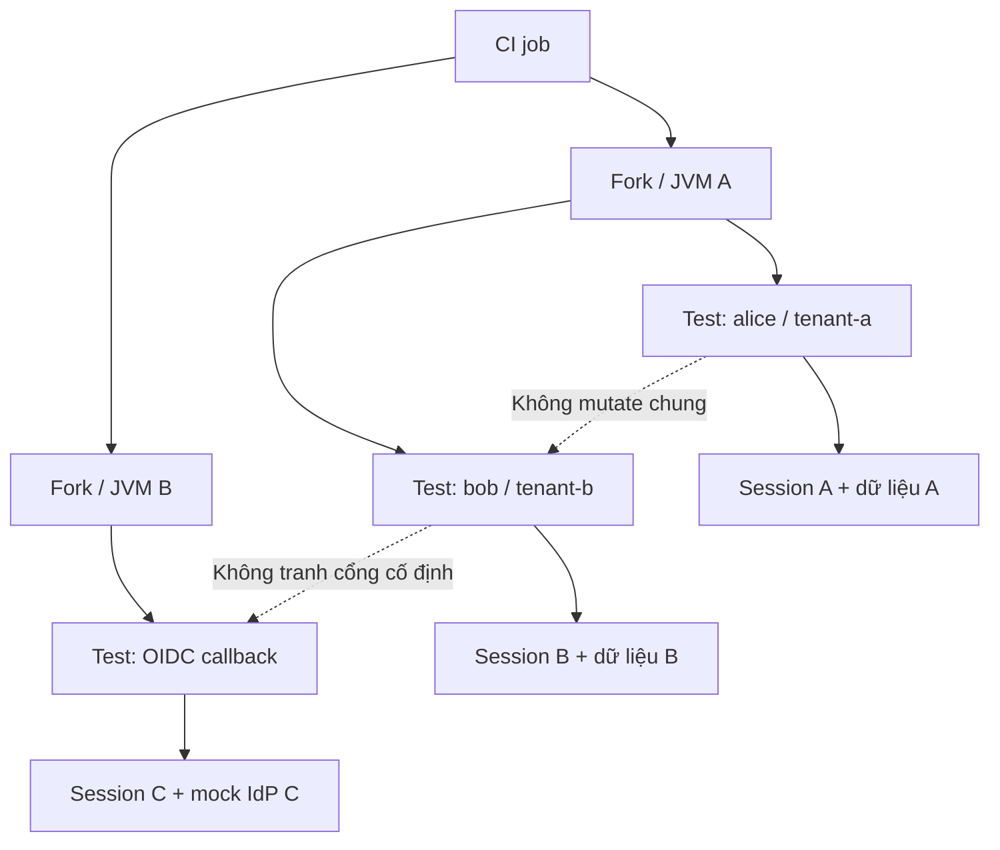
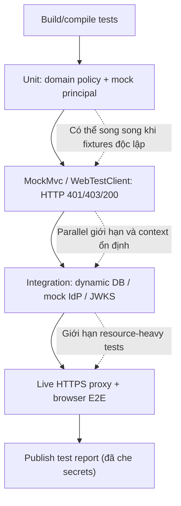
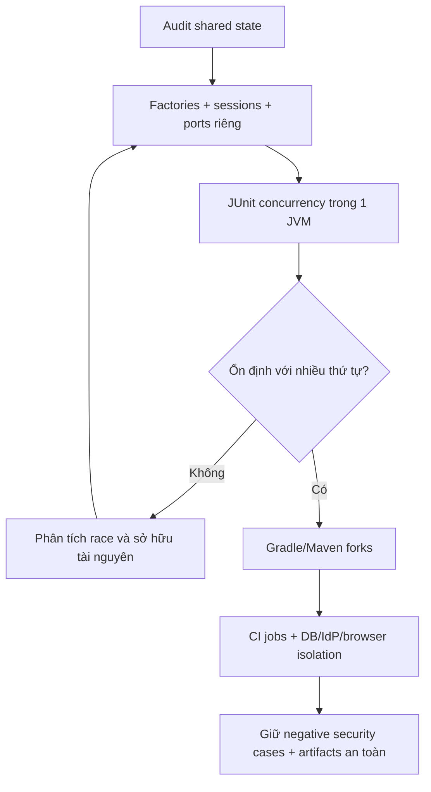

# Chạy song song mà không dùng chung phiên, cổng hoặc dữ liệu khả biến

Một test bảo mật chạy xanh khi thực thi riêng lẻ nhưng thất bại khi CI chạy nhiều bài cùng lúc thường không chứng minh được rằng Spring Security hoạt động sai. Nguyên nhân có thể là test A dùng lại `MockHttpSession` của test B, hai mock Identity Provider cùng tranh cổng `9090`, một bài xóa toàn bộ bảng dữ liệu khi bài khác đang truy vấn, hoặc `SecurityContext` của user này bị giữ trong một biến `static` cho user khác đọc. Đây không chỉ là lỗi “test flaky”: các phép thử mất tính độc lập sẽ che khuất lỗi phân quyền và làm ta tin nhầm rằng một người dùng có thể hoặc không thể truy cập tài nguyên.

Trong chương **Bộ kiểm thử và CI** của module **SPRING_SECURITY_TESTING**, bài này trình bày cách tổ chức và chạy bộ kiểm thử Spring Security song song **mà không chia sẻ phiên, cổng cố định hoặc dữ liệu khả biến giữa các ca chạy đồng thời**. Mục tiêu của module là kiểm chứng xác thực, phân quyền và bảo vệ HTTP thực tế trên cả **Servlet** với `MockMvc` lẫn **Reactive** với `WebTestClient`. Chúng ta sử dụng `spring-security-test`, `@WithMockUser`, `SecurityContext`, các principal JWT/OAuth2/OIDC giả lập và các ca được phép/bị từ chối; đồng thời xác định ranh giới giữa mock principal test và kiểm thử đăng nhập/token thực.

## 1. Cần cô lập cái gì khi bật parallel?

JUnit chạy hai test cùng lúc không có nghĩa chúng phải chia sẻ dữ liệu. Mỗi ca cần một **phạm vi sở hữu rõ ràng** cho state có thể thay đổi. Các bean Spring thường là singleton và Spring TestContext có thể cache application context, nên không thể chỉ giả định mỗi method nhận một ứng dụng mới.

| Tài nguyên | Rủi ro khi chạy song song | Chiến lược ưu tiên |
|---|---|---|
| `MockHttpSession` / Servlet session | User A thấy giỏ dữ liệu hoặc đăng nhập của B | Session mới cho từng ca; cùng session chỉ bên trong kịch bản có chủ đích |
| WebFlux `WebSession`/cookie | Callback OAuth2 dùng nhầm session/state | Cookie jar hoặc session fixture độc lập; không giữ cookie trong biến static |
| `SecurityContextHolder` | ThreadLocal còn user từ thao tác test thủ công | Spring Security Test quản lý context; nếu tự set thì dọn bằng `clearContext()` |
| Reactor Context | Publisher được cache hoặc subscribe ngoài request | Gắn authentication theo subscription; không cache dữ liệu identity dùng chung |
| `MockWebServer` / WireMock / mock IdP | Cổng cố định trùng nhau; queue response bị rút bởi test khác | Bind cổng `0` và lấy cổng thực; server riêng theo phạm vi; dispatcher có định tuyến |
| Application HTTP server | Hai JVM cùng cố bind `8080` | `RANDOM_PORT` hoặc port do runtime cấp; không đoán “port còn trống” |
| Database / repository | Test A cleanup dữ liệu test B | Database/schema riêng hoặc bản ghi có namespace riêng và cleanup có phạm vi |
| Cache, token store, clock | Authorities/token hết hạn/giá trị từ test trước còn lưu | Cache fixture tách biệt, clock inject, reset có kiểm soát |
| Test data builder / `Map`/`List` | Mutate chung làm assertion không ổn định | Factory tạo object mới, copy immutable collections |
| Spring application context | Test này thay singleton bean mà test khác đang dùng | Không mutate singleton; tách context khi cấu hình khác |
| File tạm, log và artifact | Hai jobs ghi đè cùng tên file | `@TempDir` hoặc workspace/job-specific directory |

Hai câu hỏi quan trọng cho mọi fixture là: **Ai sở hữu tài nguyên?** và **khi nào nó bị dọn?** Nếu câu trả lời chỉ là “tất cả test dùng chung để nhanh hơn”, khả năng cao fixture đó không an toàn khi parallel.



Parallel có thể xảy ra ở **nhiều tầng đồng thời**: JUnit Jupiter chạy method/class đồng thời trong một JVM, Gradle/Maven tạo nhiều JVM fork, và CI chạy nhiều job/agent. Lock hoặc `ThreadLocal` trong một JVM **không** bảo vệ tài nguyên dùng chung ở JVM/agent khác.

## 2. “Độc lập” nghĩa là gì trong security test?

Hai bài test độc lập phải cho kết quả giống nhau dù:

1. Chạy một mình.
2. Chạy cùng test suite theo thứ tự khác.
3. Chạy song song với test có principal/role/tenant khác.
4. Chạy nhiều lần liên tiếp trên cùng máy/CI worker.
5. Chạy khi mock IdP và database từ test khác cũng đang hoạt động.

Ví dụ, một test authorization với `jwt()`/`mockJwt()` phải kiểm **principal và authorities mà chính request đó được cấp**, không đọc principal từ một biến toàn cục do test trước đặt.

| Ca kiểm thử | Principal / session | Data fixture | Kết quả mong muốn |
|---|---|---|---|
| Alice đọc hóa đơn tenant A | Alice, `SCOPE_invoices.read`, session riêng hoặc Bearer identity riêng | Hóa đơn A | Được phép |
| Bob đọc hóa đơn tenant A | Bob, tenant B, authority đọc hợp lệ | Cùng loại hóa đơn nhưng fixture riêng | Từ chối theo policy tenant |
| Anonymous đọc hóa đơn | Không có Authentication | Fixture độc lập | 401 hoặc redirect theo entry point |
| Alice thiếu scope | Alice, scope ghi nhưng không có scope đọc | Hóa đơn A | 403 |
| OIDC callback của Alice | State/cookie của flow Alice | Code/token fixture Alice | Chỉ flow Alice thành công |
| OIDC callback của Bob | State/cookie của flow Bob | Code/token fixture Bob | Không dùng được state/cookie Alice |

Đừng chỉ xác nhận tất cả ca trả đúng mã HTTP. Với ca được phép, nên assert response mang **đúng user hoặc tenant của ca đó**; với ca từ chối, assert không có dữ liệu nhạy cảm lọt ra. Nếu tất cả request trả 403 vì một database bị reset giữa chừng, test “thiếu quyền bị chặn” có thể xanh do nguyên nhân sai.

## 3. Bật JUnit Jupiter parallel có chủ đích

JUnit Jupiter có thể cấu hình parallel qua `junit-platform.properties` trong test resources:

```properties
junit.jupiter.execution.parallel.enabled = true
junit.jupiter.execution.parallel.mode.default = concurrent
junit.jupiter.execution.parallel.mode.classes.default = concurrent
junit.jupiter.execution.parallel.config.strategy = fixed
junit.jupiter.execution.parallel.config.fixed.parallelism = 4
```

Đây là **ví dụ cấu hình**, không phải lời khuyên luôn chạy 4 thread. Parallelism phải phù hợp CPU, database pool, dung lượng mock servers và tài nguyên CI. Nếu chỉ muốn chạy **các class song song** nhưng **methods trong một class tuần tự**, có thể cấu hình:

```properties
junit.jupiter.execution.parallel.enabled = true
junit.jupiter.execution.parallel.mode.default = same_thread
junit.jupiter.execution.parallel.mode.classes.default = concurrent
```

Chế độ thứ hai có thể là bước chuyển tiếp an toàn hơn cho integration tests có một mock server dùng queue responses **trong cùng class**. Nó không làm những tài nguyên toàn cục trở nên tự động cô lập: hai class vẫn chạy đồng thời.

### Ghi đè tại từng class

```java
import org.junit.jupiter.api.parallel.Execution;
import org.junit.jupiter.api.parallel.ExecutionMode;

@Execution(ExecutionMode.CONCURRENT)
class StatelessAuthorizationTests {
    // Chỉ dùng fixtures mới cho mỗi method.
}

@Execution(ExecutionMode.SAME_THREAD)
class IdpFlowWithSharedQueueTests {
    // Tạm thời tuần tự hóa methods vì fixture queue có state theo thứ tự.
}
```

`@Execution(SAME_THREAD)` là **giải pháp kiểm soát phạm vi**, không thay thế việc loại bỏ shared mutable state. Nếu các class khác cùng truy cập queue, file hay database đó, annotation trên một class không đủ.

### @TestInstance và state của test object

JUnit Jupiter thường tạo một instance test class cho từng method theo lifecycle mặc định `PER_METHOD`. Nếu dùng `@TestInstance(PER_CLASS)`, các method có thể chia sẻ fields của cùng một instance; cần đặc biệt cẩn thận trước khi chạy concurrent.

```java
// RỦI RO nếu methods chạy song song:
@TestInstance(TestInstance.Lifecycle.PER_CLASS)
@Execution(ExecutionMode.CONCURRENT)
class SharedStateExample {
    private String currentUser; // Mutable state dùng chung.
}
```

Không lưu principal, session hoặc request body của “test hiện tại” trong field của test class có nhiều execution song song. Dùng biến cục bộ trong từng test hoặc object fixture mới cho từng method. `@BeforeEach` **không tự biến mọi static field hoặc shared singleton thành độc lập**.

## 4. Servlet: mỗi request và mỗi test có session riêng

Một `MockHttpSession` là đối tượng mô phỏng HTTP session và chứa state có thể thay đổi. Không đặt nó ở `static final` để tiện tái sử dụng:

```java
// SAI: hai test có thể vô tình dùng chung session và SecurityContext.
static final MockHttpSession SHARED_SESSION = new MockHttpSession();
```

Khi test controller chỉ cần principal giả, gắn identity **ngay trên request**:

```java
import org.springframework.security.core.authority.SimpleGrantedAuthority;
import static org.springframework.security.test.web.servlet.request
        .SecurityMockMvcRequestPostProcessors.user;
import static org.springframework.test.web.servlet.request
        .MockMvcRequestBuilders.get;

mockMvc.perform(get("/api/me")
        .with(user("alice").authorities(
            new SimpleGrantedAuthority("ROLE_MEMBER"))))
    .andExpect(status().isOk())
    .andExpect(jsonPath("$.name").value("alice"));
```

Trong request khác, dùng `user("bob")`. Điều quan trọng không phải tên helper mà là **mỗi request tự định nghĩa Authentication của nó**, thay vì đọc một user từ global mutable holder.

### Khi cần kiểm session persistence thật

Nếu yêu cầu là “đăng nhập một lần, request thứ hai cùng session vẫn xác thực”, phải cho Spring Security thực hiện login thật trong test và giữ phiên **trong chính kịch bản**. Post-processor `user()` và annotation `@WithMockUser` chủ yếu tạo Authentication giả cho request; chúng không tự chứng minh username/password login hoặc session persistence.

Ví dụ mô hình của một test session-based:

```java
// Mỗi method tạo hoặc nhận một session mới trong fixture của chính mình.
MockHttpSession aliceSession = new MockHttpSession();
MockHttpSession bobSession = new MockHttpSession();

assertThat(aliceSession).isNotSameAs(bobSession);
// Test login thực cho Alice sử dụng aliceSession và cookie/state tương ứng.
// Test login thực cho Bob sử dụng bobSession và cookie/state tương ứng.
// Không lưu cả hai vào một biến static để callback dùng chung.
```

**Không** kết luận login persistence chỉ vì gọi `mockMvc.perform(...with(user("alice")).session(aliceSession))` hai lần: mỗi request vẫn được cấp authentication giả. Để kiểm phiên thật, gửi login form/OIDC callback qua đúng filter chain và sau đó thử endpoint bảo vệ **không gắn `user()`** ở request thứ hai.

## 5. @WithMockUser, SecurityContextHolder và dọn trạng thái

Spring Security Test dùng test execution listeners để thiết lập rồi dọn security context trong các test được hỗ trợ. `@WithMockUser` hữu ích cho những test cố định principal:

```java
@Test
@WithMockUser(username = "alice", authorities = "ROLE_MEMBER")
void aliceCanReadProfile() throws Exception {
    mockMvc.perform(get("/api/me"))
            .andExpect(status().isOk());
}
```

Khi dùng `@WithMockUser`, đừng tự thêm logic biến `SecurityContextHolder` thành static field nhằm “tiết kiệm” setup. Trong Servlet, chiến lược lưu context thường dựa trên `ThreadLocal`; mỗi test thread phải được quản lý và dọn đúng sau khi sử dụng.

Với **unit test chủ động set context**, phải cleanup kể cả khi assertion thất bại:

```java
import org.junit.jupiter.api.AfterEach;
import org.springframework.security.core.context.SecurityContextHolder;

@AfterEach
void clearSecurityContextCreatedManually() {
    SecurityContextHolder.clearContext();
}
```

`clearContext()` ở đây dành cho test tự gọi `setContext(...)` hoặc thay strategy theo cách thủ công. Nó không thay thế quản lý session repository, không xóa session thực của user, và không làm sạch Reactor Context trong một publisher reactive.

### Thread mới không kế thừa @WithMockUser một cách mặc định

Nếu một test gọi `CompletableFuture.supplyAsync(...)` để thực hiện `MockMvc.perform(...)` từ worker thread, đừng mặc định `@WithMockUser` của test thread được truyền sang worker. Sử dụng `.with(user(...))`, `.with(jwt(...))` trên **từng request** khi muốn kiểm concurrency identity, hoặc cơ chế propagation test được kiểm soát rõ.

Không chuyển mọi test sang `SecurityContextHolder.MODE_INHERITABLETHREADLOCAL` để “chữa” việc thiếu principal; chiến lược đó có thể khiến context bị truyền ngoài ý muốn qua thread pools. Với các bài test controller/authorization, truyền principal ở cấp request là cách rõ ràng hơn.

## 6. MockMvc concurrency test: Alice và Bob không nhìn thấy nhau

Giả sử `GET /api/me` trả JSON chứa tên từ `Authentication.getName()`, và SecurityFilterChain yêu cầu authenticated user. Ví dụ dùng hai task thực thi đồng thời để phát hiện test nào phụ thuộc vào biến identity toàn cục:

```java
import java.util.concurrent.CountDownLatch;
import java.util.concurrent.Executors;
import java.util.concurrent.Future;
import java.util.concurrent.TimeUnit;
import org.junit.jupiter.api.Test;
import org.springframework.beans.factory.annotation.Autowired;
import org.springframework.test.web.servlet.MockMvc;

import static org.assertj.core.api.Assertions.assertThat;
import static org.springframework.security.test.web.servlet.request
        .SecurityMockMvcRequestPostProcessors.user;
import static org.springframework.test.web.servlet.request
        .MockMvcRequestBuilders.get;
import static org.springframework.test.web.servlet.result
        .MockMvcResultMatchers.status;

class ConcurrentIdentityMvcTest {

    @Autowired MockMvc mvc; // Trong @SpringBootTest/@AutoConfigureMockMvc phù hợp.

    @Test
    void concurrentRequestsKeepTheirOwnPrincipal() throws Exception {
        var executor = Executors.newFixedThreadPool(2);
        var start = new CountDownLatch(1);

        try {
            Future<String> aliceResult = executor.submit(() -> {
                start.await();
                return mvc.perform(get("/api/me")
                        .with(user("alice").roles("MEMBER")))
                    .andExpect(status().isOk())
                    .andReturn().getResponse().getContentAsString();
            });

            Future<String> bobResult = executor.submit(() -> {
                start.await();
                return mvc.perform(get("/api/me")
                        .with(user("bob").roles("MEMBER")))
                    .andExpect(status().isOk())
                    .andReturn().getResponse().getContentAsString();
            });

            start.countDown();

            assertThat(aliceResult.get(5, TimeUnit.SECONDS))
                    .contains("alice")
                    .doesNotContain("bob");
            assertThat(bobResult.get(5, TimeUnit.SECONDS))
                    .contains("bob")
                    .doesNotContain("alice");
        } finally {
            executor.shutdownNow();
        }
    }
}
```

Đây là **method minh họa bên trong test context đã có `MockMvc`, endpoint `/api/me` và security filters**. Nó chứng minh rằng principal cấp trên từng request không bị hoán đổi giữa hai request chạy đồng thời; **chưa** chứng minh persistence qua session hay việc xử lý password/JWT thật. Đối với JSON, có thể thay assertion `contains(...)` bằng `ObjectMapper` đọc trường `name` để kiểm chặt hơn.

Test có `CountDownLatch` để hai task bắt đầu gần đồng thời; không dùng `Thread.sleep(...)` rồi suy ra chắc chắn có overlap. Timeout trong `Future.get(...)` giúp phát hiện deadlock, nhưng nếu CI quá chậm cần điều chỉnh phù hợp thay vì tăng vô hạn. Không để executor tạo thread còn sống sau khi test kết thúc.

**Lưu ý:** Chính ứng dụng được test vẫn cần thread-safe. Nếu controller singleton lưu `currentUser` vào field rồi trả về field đó, hai request có thể trộn user dù test fixtures đúng. Bài test concurrency là cách phát hiện loại lỗi state dùng chung này.

## 7. Reactive: WebTestClient và Reactor Context theo subscription

Trong WebFlux, security context được truyền trong **Reactor Context**, không nên dùng một `SecurityContextHolder` ThreadLocal toàn cục để đại diện cho request. Khi test HTTP, dùng configurer Reactive theo request/test client:

```java
import org.springframework.security.core.authority.SimpleGrantedAuthority;
import static org.springframework.security.test.web.reactive.server
        .SecurityMockServerConfigurers.mockJwt;

WebTestClient aliceClient = baseClient.mutateWith(
    mockJwt()
        .jwt(jwt -> jwt.subject("alice")
                .claim("tenant_id", "tenant-a"))
        .authorities(new SimpleGrantedAuthority(
                "SCOPE_profile.read")));

WebTestClient bobClient = baseClient.mutateWith(
    mockJwt()
        .jwt(jwt -> jwt.subject("bob")
                .claim("tenant_id", "tenant-b"))
        .authorities(new SimpleGrantedAuthority(
                "SCOPE_profile.read")));

aliceClient.get().uri("/api/me").exchange()
        .expectStatus().isOk()
        .expectBody()
        .jsonPath("$.name").isEqualTo("alice");

bobClient.get().uri("/api/me").exchange()
        .expectStatus().isOk()
        .expectBody()
        .jsonPath("$.name").isEqualTo("bob");
```

Đoạn ví dụ giả định `baseClient` đã gắn `SecurityWebFilterChain`, endpoint trả tên/tenant theo authentication, và các policy phù hợp. `mutateWith(...)` tạo client được cấu hình thêm cho kịch bản; không mutate một singleton chứa principal rồi để test khác đọc.

`mockJwt()` giả Authentication, **không gọi `ReactiveJwtDecoder`** hoặc kiểm JWT signature/JWKS. Khi mục tiêu là kiểm token thật, gửi Bearer JWT qua live HTTP server có decoder/JWKS test riêng.

### Hai Reactor subscriptions không dùng chung identity

Với một service đọc `ReactiveSecurityContextHolder`, dùng `StepVerifier` để kiểm context theo subscription:

```java
import java.util.List;
import org.springframework.security.authentication
        .UsernamePasswordAuthenticationToken;
import org.springframework.security.core.Authentication;
import org.springframework.security.core.authority.SimpleGrantedAuthority;
import org.springframework.security.core.context.ReactiveSecurityContextHolder;
import reactor.core.publisher.Mono;
import reactor.core.scheduler.Schedulers;
import reactor.test.StepVerifier;

Mono<String> currentName = ReactiveSecurityContextHolder
        .getContext()
        .map(context -> context.getAuthentication().getName());

Authentication alice = new UsernamePasswordAuthenticationToken(
        "alice", "unused",
        List.of(new SimpleGrantedAuthority("ROLE_MEMBER")));
Authentication bob = new UsernamePasswordAuthenticationToken(
        "bob", "unused",
        List.of(new SimpleGrantedAuthority("ROLE_MEMBER")));

Mono<String> a = currentName
        .subscribeOn(Schedulers.parallel())
        .contextWrite(
            ReactiveSecurityContextHolder.withAuthentication(alice));
Mono<String> b = currentName
        .subscribeOn(Schedulers.parallel())
        .contextWrite(
            ReactiveSecurityContextHolder.withAuthentication(bob));

StepVerifier.create(Mono.zip(a, b))
        .assertNext(pair -> {
            assertThat(pair.getT1()).isEqualTo("alice");
            assertThat(pair.getT2()).isEqualTo("bob");
        })
        .verifyComplete();
```

`Mono.zip` subscribe vào hai publishers có context riêng; `subscribeOn` giúp công việc được sắp lịch trên scheduler Reactor. Test này kiểm **cách ly context của hai subscriptions**, không phải test cookie/HTTP session. Bản thân `publishOn`/`subscribeOn` trong cùng một reactive chain không mặc nhiên làm Reactor Context biến mất.

Một anti-pattern cần tránh:

```java
// SAI nếu Mono phụ thuộc người dùng được lưu và tái sử dụng toàn cục.
static final Mono<String> CACHED_USER =
        ReactiveSecurityContextHolder.getContext()
            .map(ctx -> ctx.getAuthentication().getName())
            .cache();
```

Subscriber đầu có thể khiến `cache()` giữ kết quả theo identity rồi trả kết quả đó cho subscriber khác. Nguyên nhân là **cache giá trị có phạm vi user thành dữ liệu toàn cục**, không phải Reactor Context tự bị “rò rỉ” vô cớ. Nếu cần cache, phân vùng theo identity/tenant và đánh giá security implications; không cache kết quả username trong singleton chung.

## 8. Cookie và WebSession: cô lập từng browser flow

Trong WebFlux, tên session cookie thường là `SESSION` theo cấu hình WebSession mặc định nhưng có thể thay đổi. Trong Servlet, có thể dùng `JSESSIONID` hoặc tên riêng. Đối với login OIDC, request bắt đầu tạo authorization request có `state`, và callback cần gửi **đúng cookie của flow đó**.

```text
Flow Alice:
  GET /oauth2/authorization/corporate
  cookie jar A, state-A, code-A
  GET /login/oauth2/code/corporate?code=code-A&state=state-A

Flow Bob:
  GET /oauth2/authorization/corporate
  cookie jar B, state-B, code-B
  GET /login/oauth2/code/corporate?code=code-B&state=state-B
```

**Không** lưu cookie jar, `MockHttpSession`, `WebSession` hoặc value của `state` trong field static rồi để hai flow cùng sử dụng. Nếu callback Alice nhận session của Bob, Spring Security cần từ chối vì authorization request/state không khớp; test nên có ca negative để kiểm điều đó.

Một test browser-flow đúng nên giữ session **bên trong cùng test**, nhưng hai test khác nhau có cookie store riêng. Đừng hiểu “không dùng chung phiên” là không bao giờ tái sử dụng phiên ở *hai request của cùng một kịch bản*: chính bài test login persistence cần hai request cùng phiên. Quy tắc là **không dùng chung phiên giữa các execution độc lập**.

## 9. Cổng động: đừng cố định 8080, 9090 hoặc “tìm cổng trống”

Giả sử hai CI forks đều cố khởi động mock IdP trên `http://localhost:9090`. Chúng có thể gặp `BindException: Address already in use`; tệ hơn, nếu chỉ một server tồn tại, test ở fork còn lại có thể vô tình gọi vào server **của test khác** và nhận dữ liệu sai.

Không nên thực hiện:

```java
// RỦI RO khi CI chạy song song:
mockIdp.start(9090);
// Hoặc cấu hình spring boot test server ở port 8080 cố định.
```

Với Spring Boot web integration test, ưu tiên để runtime cấp cổng:

```java
import org.springframework.boot.test.context.SpringBootTest;
import org.springframework.boot.test.web.server.LocalServerPort;

@SpringBootTest(webEnvironment =
        SpringBootTest.WebEnvironment.RANDOM_PORT)
class LiveHttpSecurityTest {

    @LocalServerPort
    int localPort;

    // HTTP client sẽ gọi localhost:localPort,
    // không tự đoán port trước khi app bắt đầu.
}
```

`RANDOM_PORT` thường thiết lập `server.port=0` để hệ điều hành chọn một cổng còn trống lúc server bind. `@LocalServerPort` nhận cổng **sau khi server được khởi động**. Đó là giải pháp chống tranh cổng giữa những server instance độc lập.

**Ngoại lệ quan trọng:** Spring TestContext có thể cache và **tái sử dụng cùng ApplicationContext**, do đó nhiều test class chia sẻ một HTTP server và cùng cổng thực nếu dùng chung context. Bản thân việc cùng gọi **một server đã được khởi động một lần** không gây lỗi bind; vấn đề là dữ liệu/session/beans của các test có bị dùng chung không. Nếu yêu cầu của suite là **mỗi ca có server và cổng riêng**, phải thiết kế context/server độc lập; chỉ ghi `RANDOM_PORT` **không bảo đảm một port mới cho mọi method**.

### Vì sao “lấy cổng trống rồi đóng socket” không an toàn?

```text
Test A: mở ServerSocket(0) để biết cổng 51234
Test A: đóng socket
Test B: bind cổng 51234
Test A: cố start mock IdP tại 51234 -> FAIL
```

Đó là lỗi **time-of-check vs time-of-use**. Cách đúng là để chính server đang dùng bind cổng 0 và **giữ socket đó**. Không giữ một danh sách cổng được cho là trống trong file hoặc biến static giữa nhiều JVM.

## 10. MockWebServer cho OAuth2/OIDC: tách server và response state

Với OkHttp MockWebServer, có thể để hệ điều hành cấp cổng:

```java
import java.io.IOException;
import okhttp3.mockwebserver.MockWebServer;

try (MockWebServer idp = new MockWebServer()) {
    idp.start(); // Bind cổng ngẫu nhiên do OS chọn.

    String tokenEndpoint = idp.url("/token").toString();
    String userInfoEndpoint = idp.url("/userinfo").toString();

    // Dựng ClientRegistration cho riêng kịch bản này.
    // Thực hiện code exchange hoặc gọi client đã được cấu hình.
}
```

`MockWebServer` trong ví dụ dùng package `okhttp3.mockwebserver`; vòng đời `try-with-resources` áp dụng cho phiên bản thư viện có hỗ trợ `AutoCloseable`. Nếu dùng version không hỗ trợ, hãy chủ động `shutdown()` trong `finally`. Không hardcode mock IdP URL rồi dùng lại giữa nhiều CI workers.

### Trong @SpringBootTest với @DynamicPropertySource

Khi application context cần biết token URL **trong quá trình tạo bean**, có thể đăng ký dynamic property từ một mock server được khởi động trước:

```java
import java.io.IOException;
import okhttp3.mockwebserver.MockWebServer;
import org.junit.jupiter.api.AfterAll;
import org.springframework.test.context.DynamicPropertyRegistry;
import org.springframework.test.context.DynamicPropertySource;

class OAuth2TestWithClassScopedIdp {

    private static final MockWebServer IDP = startIdp();

    private static MockWebServer startIdp() {
        try {
            MockWebServer server = new MockWebServer();
            server.start();
            return server;
        } catch (IOException ex) {
            throw new ExceptionInInitializerError(ex);
        }
    }

    @DynamicPropertySource
    static void registerIdp(DynamicPropertyRegistry properties) {
        properties.add(
            "spring.security.oauth2.client.provider.test.authorization-uri",
            () -> IDP.url("/authorize").toString());
        properties.add(
            "spring.security.oauth2.client.provider.test.token-uri",
            () -> IDP.url("/token").toString());
        properties.add(
            "spring.security.oauth2.client.provider.test.user-info-uri",
            () -> IDP.url("/userinfo").toString());
    }

    @AfterAll
    static void stopIdp() throws IOException {
        IDP.shutdown();
    }
}
```

Đây là **mảnh cấu hình test**, cần được đặt trong một test class có Spring TestContext, client registration trỏ đến provider `test` và một fixture OAuth2/OIDC hoàn chỉnh. Tùy OIDC setup, cần thêm JWKS/issuer/ID token hợp lệ; không bật issuer discovery qua URL production trong unit test.

Lợi ích của server theo **test class** là các class độc lập có thể có **cổng và hàng đợi riêng**. Nhưng những methods trong **chính class đó vẫn chia sẻ server**: nếu chúng chạy đồng thời và cùng gọi `IDP.enqueue(...)`, response có thể được lấy theo thứ tự đến ngẫu nhiên.

### Queue FIFO không an toàn khi các request song song

```java
// RỦI RO khi Alice/Bob chạy đồng thời trên cùng mock server:
idp.enqueue(responseForAlice);
idp.enqueue(responseForBob);
// Test Alice không thể giả định POST /token đến trước Bob.
```

Có ba phương án:

1. **Server riêng cho mỗi test thực sự chạy đồng thời** (ví dụ dựng fixture/client trong từng method hoặc context độc lập).
2. **Dispatcher theo request**: server được chia sẻ nhưng response được chọn dựa trên đường dẫn, code, client ID hoặc một khóa request có kiểm soát, không dựa vào FIFO.
3. **Tuần tự hóa các methods dùng queue** bằng `@Execution(SAME_THREAD)` trong class đó, trong khi những class độc lập khác vẫn có thể chạy concurrent.

Ví dụ dispatcher cho một mock token endpoint (OAuth2 không phải OIDC):

```java
import okhttp3.mockwebserver.Dispatcher;
import okhttp3.mockwebserver.MockResponse;
import okhttp3.mockwebserver.RecordedRequest;

idp.setDispatcher(new Dispatcher() {
    @Override
    public MockResponse dispatch(RecordedRequest request) {
        if (!"/token".equals(request.getPath())) {
            return new MockResponse().setResponseCode(404);
        }

        String form = request.getBody().readUtf8();
        if (form.contains("code=alice-code")) {
            return tokenResponse("alice-access-token");
        }
        if (form.contains("code=bob-code")) {
            return tokenResponse("bob-access-token");
        }
        return new MockResponse().setResponseCode(400)
            .setHeader("Content-Type", "application/json")
            .setBody("{\"error\":\"invalid_grant\"}");
    }

    private MockResponse tokenResponse(String accessToken) {
        return new MockResponse().setResponseCode(200)
            .setHeader("Content-Type", "application/json")
            .setBody("{\"access_token\":\"" + accessToken
                + "\",\"token_type\":\"Bearer\",\"expires_in\":300}");
    }
});
```

Đoạn minh họa trên phù hợp với **các authorization code giả chỉ chứa ký tự an toàn như `alice-code`**, và server giả dùng riêng trong test. Trong fixture nghiêm túc, parse form theo `application/x-www-form-urlencoded`, kiểm `grant_type`, `redirect_uri`, `client authentication`, PKCE khi dùng và **giá trị code một lần**. Không dùng substring mơ hồ để quyết định quyền thực của token. Với OAuth2 Login còn cần stub UserInfo nếu client yêu cầu; OIDC cần ID token/JWKS test hợp lệ.

### Lifecycle mock server và Spring TestContext cache

Một vấn đề tinh tế: test class kết thúc và `@AfterAll` đóng mock IdP, nhưng **ApplicationContext còn nằm trong cache**. Nếu một class khác tái sử dụng context ấy trong khi provider URL vẫn trỏ tới server đã đóng, test có thể fail ngẫu nhiên.

Để tránh:

- Đặt mock server và context ở **cùng phạm vi sở hữu** nếu context có thể được dùng lại.
- Khi dynamic properties khác nhau giữa những class, bảo đảm context cache key phân biệt đúng cấu hình hoặc tạo context riêng một cách có chủ đích.
- Nếu nhiều class có chung một base test và kế thừa `@DynamicPropertySource` nhưng cần địa chỉ mock server khác nhau, xem xét `@DirtiesContext` ở cấp class theo tình huống để tránh dùng lại context sai.
- Không đóng một mock server khi một test khác còn dùng nó; nếu không thể đảm bảo ownership thì không chạy các ca đó đồng thời.

`@DirtiesContext` có chi phí và có thể gây xung đột nếu một cached context đang được test khác dùng đồng thời. Nó **không phải cơ chế lock**; nên ưu tiên thiết kế test contexts/fixtures đúng phạm vi hơn là đánh dấu mọi class dirty.

## 11. Dữ liệu miền: đừng xóa sạch database khi có test khác đang đọc

Xét ứng dụng nhiều tenant có bảng `invoice`. Nếu mỗi test đều chạy:

```sql
DELETE FROM invoice;
```

thì khi chạy parallel, test A có thể xóa bản ghi test B vừa tạo. Một test kiểm phân quyền tenant có thể thất bại với 404 (không tìm thấy dữ liệu) thay vì 403 (đúng bản ghi nhưng bị từ chối); một negative test chỉ assert “không trả 200” có thể **xanh vì lý do sai**.

Ưu tiên **dữ liệu riêng cho từng test**:

```java
record Invoice(
        String id, String tenantId, String ownerId, long amountCents) {}

Invoice aliceInvoice = new Invoice(
        "inv-test-alice-001", "tenant-test-a", "alice", 120_000);
Invoice bobInvoice = new Invoice(
        "inv-test-bob-001", "tenant-test-b", "bob", 200_000);
```

Trong unit test, mỗi method có thể tạo một `Map` bất biến riêng chứa bản ghi của chính mình. Trong integration test với database dùng chung, cần ID/tenant namespace không va chạm giữa những ca cùng lúc. Một hậu tố ngẫu nhiên hợp lệ cũng có thể được dùng, nhưng hãy **ghi ID đã tạo vào thông báo lỗi của test** để tái hiện và cleanup.

### Cleanup theo phạm vi sở hữu

```java
String invoiceId = "inv-" + UUID.randomUUID();
try {
    invoiceRepository.save(
        new Invoice(invoiceId, "tenant-test-a", "alice", 120_000));
    // Gọi HTTP endpoint và assert quyền/data.
} finally {
    invoiceRepository.deleteById(invoiceId);
}
```

Đây là mẫu minh họa cho repository đồng bộ có các method tương ứng. Với reactive repository, các lời gọi `save`/`deleteById` là publishers cần được subscribe theo test harness; đừng gọi chúng rồi bỏ qua Mono vì chưa có tác dụng. Trong integration suite, cleanup có thể nằm trong `@AfterEach` hoặc fixture manager ghi nhớ tất cả ID đã tạo; quan trọng là **chỉ xóa dữ liệu của test mình**, không dùng `deleteAll()` giữa những ca concurrent.

Với test repository thật, có thể lựa chọn **database/schema/container riêng theo class hoặc fork** để cô lập mạnh hơn. Điều này tốn tài nguyên nhưng rõ ràng hơn việc chia sẻ một database và cố tự xử lý mọi collision.

### Transaction rollback không phải bùa hộ mệnh

`@Transactional` trên test có thể rollback transaction được quản lý bởi **test thread**. Nhưng với `@SpringBootTest(webEnvironment=RANDOM_PORT)`, HTTP request đi qua server thread với transaction riêng; rollback của test method không mặc định rollback những gì server đã commit. Với Reactive, transaction gắn với subscriber/reactive flow có cơ chế riêng.

Vì vậy:

- Với repository unit/integration chạy ngay trong transaction test phù hợp: rollback có thể hữu ích.
- Với live HTTP tests: dùng cleanup chủ động hoặc database tách riêng.
- Với WebFlux/R2DBC: test theo reactive transaction semantics thực, không suy từ `ThreadLocal` của imperative transaction.
- Với fixture shared database: tránh `TRUNCATE` hoặc reset sequence toàn cục khi các test khác đang thực thi.

## 12. Cache, authorized client store và singleton beans

Không phải dữ liệu dùng chung nào cũng nằm trong database. Ứng dụng Spring thường có singleton cache, `OAuth2AuthorizedClientService`, `ReactiveOAuth2AuthorizedClientService`, user-details cache, rate limiter hoặc test double có state.

| Thành phần | Một lỗi parallel điển hình | Cách cô lập |
|---|---|---|
| In-memory cache | User A đọc kết quả cache theo key thiếu tenant | Key gồm user/tenant hoặc cache riêng từng test |
| OAuth2 authorized-client service | Hai test cùng registration/principal ID và ghi đè token | Principal/registration ID riêng, store riêng hoặc context riêng |
| JWT decoder/JWKS cache | Test lỗi tải JWKS dùng khóa cache từ test thành công | Decoder/cache fixture riêng cho kịch bản |
| `@MockBean`/`@MockitoBean` chung context | Test A reset mock trong lúc B đang stub/verify | Không thay behavior của cùng mock trong parallel; tách context hoặc tuần tự hóa |
| Clock mutable dùng chung | Test A đổi thời gian khiến token B hết hạn | `Clock.fixed(...)` cho mỗi fixture hoặc bean không thay đổi |
| In-memory fake repository | `ConcurrentHashMap` chia sẻ nhưng mọi test gọi `clear()` | Tạo fake repository riêng hoặc namespace records |
| Rate limiter global | Test A tiêu quota khiến B bị 429 | Key/quota fixture riêng, reset đúng phạm vi |

**Lưu ý:** Dùng `ConcurrentHashMap` chỉ bảo đảm một số thao tác thread-safe; nó **không bảo đảm cách ly dữ liệu nghiệp vụ**. Hai test cùng ghi key `alice` vẫn có thể ghi đè nhau. Tương tự, một mock Mockito có thể thread-safe về vài mặt gọi method nhưng **stubbing/reset đồng thời giữa nhiều test không phải thiết kế ổn định**.

Trong Servlet, `SecurityContextHolder` thường lưu thông tin theo thread trong request. Trong Reactive, `ReactiveSecurityContextHolder` dùng Reactor Context theo subscription. Cả hai đều không bảo vệ một singleton field như:

```java
// SAI: singleton service lưu danh tính của request hiện tại.
class UnsafeProfileService {
    private String currentUsername;

    String read(Authentication auth) {
        currentUsername = auth.getName();
        return currentUsername; // Có thể đã bị request khác ghi đè.
    }
}
```

Thay bằng biến cục bộ, tham số tường minh hoặc lấy identity từ đúng context của request. Dùng **parallel test với hai user khác nhau** để phát hiện sai sót này.

## 13. Spring TestContext cache: lợi ích và giới hạn

Spring TestContext Framework cache `ApplicationContext` để các test có cấu hình tương thích không phải khởi tạo lại toàn bộ bean graph. Đây là cách tăng tốc hợp lý, đặc biệt với Spring Security integration tests. Nhưng:

- **Cached context không có nghĩa test fixture độc lập.** Các singleton beans, in-memory repositories, mocks và caches trong context có thể được tái sử dụng.
- Hai test class có configuration tương đương có thể chia sẻ **cùng ApplicationContext**, bao gồm cả embedded server khi có.
- `@BeforeEach` chỉ làm sạch những đối tượng mà method đó thực sự reset; nó không reset mọi session, database hay cache bên ngoài.
- Thay `System.setProperty(...)` trong lúc app contexts khác đang tạo bean có thể làm việc đọc cấu hình không ổn định; system properties là state JVM-wide.
- Đóng mock IdP/JWKS server trong khi cached context khác còn trỏ tới URI của nó có thể gây lỗi mạng khó tái hiện.

### Khi nào nên tạo context riêng?

Khi hai kịch bản thật sự khác các thông số chi phối authentication/authorization (ví dụ hai `JwtDecoder` sử dụng JWKS khác nhau, session repository khác nhau hoặc client registrations khác nhau), cân nhắc context riêng với property/configuration khác biệt rõ ràng.

Khi chỉ khác **dữ liệu user/tenant**, thường không cần tạo lại toàn bộ context: cấp principal và records riêng theo từng test. Tách context để chạy parallel **không thể thay thế** việc tránh shared database và static mutable data ngoài context.

`@DirtiesContext` có thể buộc TestContext loại cached context sau/giữa test, nhưng:

1. Chi phí tạo lại context có thể cao.
2. Các test đang dùng cùng cached context đồng thời có thể chịu ảnh hưởng của việc đóng context.
3. Nó không tự cô lập external database, fixed port, process-wide properties hay container dùng chung.
4. Vì vậy nó là công cụ cho **state thực sự thuộc context**, không phải cách “sửa mọi flaky test” bằng một annotation.

Một quy tắc hữu ích: **hãy giữ application context bất biến trong quá trình test chạy song song**. Những thay đổi hành vi chỉ cần trong một request nên truyền qua request/fixture; những thay đổi cấu hình bean nên nằm trong test context có ownership rõ ràng.

## 14. ResourceLock, SAME_THREAD và @Isolated: dùng đúng phạm vi

Không phải thư viện hoặc hệ thống cũ nào cũng dễ cô lập ngay. JUnit Jupiter có `@ResourceLock` để ngăn các test thuộc **cùng một tiến trình JUnit** truy cập đồng thời vào tài nguyên có tên chung.

```java
import org.junit.jupiter.api.parallel.ResourceAccessMode;
import org.junit.jupiter.api.parallel.ResourceLock;

@ResourceLock(
    value = "legacy-shared-test-database",
    mode = ResourceAccessMode.READ_WRITE)
class LegacyDatabaseSecurityTests {
    // Các tests này không chạy đồng thời với tests
    // đang giữ cùng resource lock trong JUnit process.
}
```

Với một class dùng mock IdP FIFO, `@Execution(SAME_THREAD)` đảm bảo các methods của chính class đó không chạy song song với nhau theo execution mode tương ứng. Với một số class phải độc quyền toàn bộ tiến trình JUnit, `@Isolated` của JUnit Jupiter có thể là công cụ thích hợp, nhưng cần kiểm phiên bản JUnit đang dùng.

**Giới hạn quan trọng:**

- `@ResourceLock` và `@Isolated` chỉ điều phối các bài test trong cùng cơ chế/JVM JUnit có hỗ trợ, **không khóa tài nguyên giữa Gradle forks, Maven forks hay CI agents**.
- Đặt lock trên một class nhưng class khác dùng cùng database mà không khai báo lock thì vẫn có race.
- Lock không dọn dữ liệu cũ; nó chỉ điều phối thời điểm truy cập.
- Cần tránh lấy nhiều lock theo những cách khiến suite bị deadlock hoặc giảm tốc độ không cần thiết.

Ưu tiên **loại bỏ shared mutable state**; chỉ khóa khi có lý do thực sự và có kế hoạch cải thiện fixture. Một suite chạy tuần tự và xanh không đồng nghĩa nó đã sẵn sàng chạy parallel.

## 15. @TempDir và các tài nguyên bên ngoài database

Test bảo mật còn có thể dùng file khóa JWT/keystore, truststore, export report, audit log hoặc ảnh chụp lỗi HTTP. Đừng để các test cùng ghi vào `build/test-output/token.pem` hay một file tên cố định.

```java
import java.nio.file.Files;
import java.nio.file.Path;
import org.junit.jupiter.api.Test;
import org.junit.jupiter.api.io.TempDir;

class IsolatedTestFiles {

    @Test
    void createsPrivateFixtureFile(@TempDir Path tempDir)
            throws Exception {
        Path keyFixture = tempDir.resolve("test-key-description.txt");
        Files.writeString(keyFixture, "test-only");
        assertThat(Files.readString(keyFixture))
                .isEqualTo("test-only");
    }
}
```

`@TempDir` tạo phạm vi temp directory do JUnit quản lý; cách cụ thể phụ thuộc cấu hình cleanup của framework. Với **khóa ký JWT dùng để test validation thật**, cần tạo/cấp khóa test hợp lệ bằng fixture an toàn, không dùng lại secret production. Không để nhiều test cùng sửa một keystore hay file credential trên đĩa.

Khi chạy nhiều CI jobs trên cùng workspace (hoặc build cache/artifact store), đặt đường dẫn output theo job ID/fork/test case; không để job B xóa thư mục mà job A đang dùng.

## 16. Gradle: kết hợp threads JUnit và process forks

Ví dụ cấu hình Gradle Kotlin DSL:

```kotlin
tasks.test {
    useJUnitPlatform()

    systemProperty(
        "junit.jupiter.execution.parallel.enabled", "true")
    systemProperty(
        "junit.jupiter.execution.parallel.mode.default", "concurrent")
    systemProperty(
        "junit.jupiter.execution.parallel.mode.classes.default", "concurrent")
    systemProperty(
        "junit.jupiter.execution.parallel.config.strategy", "fixed")
    systemProperty(
        "junit.jupiter.execution.parallel.config.fixed.parallelism", "4")

    // Số JVM Gradle có thể chạy đồng thời cho task test.
    maxParallelForks = 2
}
```

`maxParallelForks = 2` là **hai test JVM có thể chạy đồng thời**, không phải “chỉ hai test threads”. Nếu mỗi fork chạy tối đa bốn threads JUnit, số lượng các execution đồng thời có thể cao hơn hai; rồi CI lại có thể chạy nhiều jobs. Những giới hạn tài nguyên cần tính cho **cả ba tầng**.

Ví dụ ước lượng kế hoạch tài nguyên:

```text
JUnit threads mỗi fork : 4
Gradle forks mỗi job   : 2
CI jobs cùng runner    : 3
Lượng đồng thời lý thuyết có thể lên tới: 4 x 2 x 3 = 24
```

Đây là cách hình dung mức độ đồng thời, **không phải cam kết 24 test luôn chạy cùng lúc**. Scheduling, độ dài tests và giới hạn runner có thể làm số thực tế nhỏ hơn. Dù vậy, nếu mỗi test mở một database container hoặc 10 connections, runner có thể hết RAM/connection trước khi CPU được sử dụng hiệu quả.

Nên phân loại suite:

- **Unit/authorization tests với mocks độc lập:** mức concurrency cao.
- **MockMvc/WebTestClient integration với context cache ổn định:** concurrency vừa phải, dữ liệu/session riêng.
- **OIDC callback/JWKS/mock IdP nhiều bước:** fixture riêng hoặc queue/dispatcher được kiểm soát; không mù quáng tăng workers.
- **Live proxy/browser E2E:** giới hạn parallel dựa vào browser instances, IdP test accounts, external services và tài nguyên thực.

Không cần ép toàn bộ dự án dùng cùng cấu hình parallelism. Có thể tách Gradle test tasks/suites để unit tests chạy nhanh, còn integration/E2E có giới hạn riêng.

## 17. Maven và JUnit: phân biệt parallel framework với forks

Với Maven Surefire, cấu hình JUnit 5 parallel thường thông qua `junit-platform.properties` hoặc JUnit configuration parameters. Maven Surefire còn có cấu hình `forkCount`/`reuseForks` ở mức plugin, độc lập với số threads Jupiter.

Ví dụ cấu hình khái niệm:

```xml
<plugin>
  <groupId>org.apache.maven.plugins</groupId>
  <artifactId>maven-surefire-plugin</artifactId>
  <configuration>
    <forkCount>2</forkCount>
    <reuseForks>true</reuseForks>
  </configuration>
</plugin>
```

Ví dụ này phải đặt trong phần `build/plugins` của POM và cần phiên bản Surefire tương thích với JUnit Jupiter của dự án. Việc bật forks **không tự bật parallel execution trong một fork**; sử dụng properties Jupiter tương ứng nếu cần. Maven Failsafe có thể dành cho integration tests với cổng/containers thực, tùy quy ước dự án.

Trong cả Gradle và Maven, **không** xem một process lock hoặc `@ResourceLock` là cơ chế phân quyền tài nguyên giữa nhiều forks. Nếu các forks dùng cùng một database schema hoặc fixed port, hãy cô lập bằng external namespace/port do OS cấp, hoặc giới hạn số forks của suite đó.

## 18. Bộ kiểm thử nhiều tầng trong CI

Một pipeline đáng tin thường có nhiều tầng với phạm vi rõ:



| Tầng | Chính sách parallel gợi ý | Điều tối thiểu phải kiểm |
|---|---|---|
| Unit permission/domain | Method concurrency nếu fixture độc lập | User/role/tenant/scope đối chứng |
| Spring MVC MockMvc | Class/method concurrency theo thiết kế context | Không chia sẻ session/cached mutable fixture |
| Spring WebFlux WebTestClient | Concurrency với Reactor Context riêng | Không cache principal/authorization của user khác |
| Mock IdP integration | Server/dispatcher/cổng động | State/code/token của flow này không bị flow khác tiêu thụ |
| DB/Testcontainers integration | Per-job container/schema hoặc namespace + cleanup | Không có cross-test record deletion |
| Browser/proxy E2E | Giới hạn theo số browser/IdP accounts | Cookie/session/TLS/redirect và negative cases |

Để test authorization ổn định, nên có:

```text
Anonymous              -> 401 hoặc redirect phù hợp
Authenticated wrong role/scope -> 403
Authenticated correct scope    -> 200
Correct scope, wrong tenant    -> 403/404 theo domain policy
Same principal, separate session -> không rò rỉ state
Two principals concurrently    -> mỗi response trả đúng user
```

Ca negative phải xác nhận **nguyên nhân từ chối** ở lớp thích hợp, không chỉ “khác 200”: một request 404 vì test B vừa xóa record không chứng minh Spring Security đã chặn truy cập tenant khác.

### Khi nào nên rerun flaky test?

Rerun có thể hữu ích để **thu thập bằng chứng lỗi không ổn định**, nhưng không nên được dùng để biến test vừa thất bại thành pipeline xanh mà không điều tra nguyên nhân. Lưu seed, test IDs, cổng actual, tên fixture và message exception; không lưu token/cookie/credentials thật. Nếu chỉ khi bật parallel test mới fail, hãy xem shared state, cache, response queue, DB cleanup và cổng trước khi gán nguyên nhân cho “CI chậm”.

## 19. Hướng dẫn debug lỗi chỉ xuất hiện trên CI

| Triệu chứng | Giả thuyết ưu tiên | Kiểm chứng |
|---|---|---|
| `BindException: Address already in use` | Cổng mock server/app cố định | Chuyển sang bind 0, đọc actual port |
| OIDC callback `invalid_state` ngẫu nhiên | Session/cookie chung, IdP queue lẫn, replica khác | Log correlation ID và state presence (không log giá trị), kiểm cookie jar |
| `invalid_grant` chỉ khi chạy parallel | Mock IdP trả response sai code hoặc code reuse | Dispatcher theo code, one-time code fixture riêng |
| Bob nhận response của Alice | Shared mutable principal/cache/session, key thiếu tenant | Test hai user đồng thời, kiểm response exact |
| 404 thay cho 403 khi test cross-tenant | Test khác đã xóa dữ liệu | Namespace records, không `deleteAll()` |
| JWT test pass đơn lẻ, fail khi suite | JWKS/decoder cache hoặc mock server đã shutdown | Isolate decoder/idp/context lifetime |
| `@WithMockUser` không có trong worker thread | ThreadLocal không được truyền tự động | Gắn `user()`/`jwt()` theo request |
| Unit test WebFlux thấy user cũ | `cache()` trên Mono phụ thuộc identity | Không cache value per-user toàn cục |
| Test pass với một fork, fail với hai forks | ResourceLock chỉ hiệu lực trong JVM; external DB/port chung | Isolate external resources per fork |
| Test hết hạn token có khi fail | `Instant.now()` không được điều khiển | Clock fixture và expiry margin |
| Mock verification fail ngẫu nhiên | Hai tests dùng cùng Mockito mock/reset behavior | Mocks/context riêng, không reset chung khi concurrent |
| Quá nhiều timeout | CPU, thread pool, DB pool hoặc Testcontainers quá tải | Giảm parallelism, đo resource limits |

**Thứ tự điều tra:** trước hết chứng minh resources có được cô lập không; tiếp theo kiểm điều kiện chạy đồng thời; cuối cùng mới xét bugs logic authentication/authorization. Không sửa mọi lỗi bằng `Thread.sleep(500)` hoặc timeout rất lớn: những cách đó thường chỉ che giấu race.

### Log hữu ích mà không lộ bí mật

Nên ghi một lượng metadata an toàn:

```text
testCase=alice-can-read
testRun=ci-1285
serverPort=dynamic-port-returned-by-server
fixtureTenant=tenant-test-a
fixtureRecord=inv-test-alice-001
expectedStatus=200
actualStatus=200
identityType=JwtAuthenticationToken
```

Không ghi `Authorization` header, bearer token, session ID, authorization code, client secret hoặc private signing key vào log CI. Nếu test cần so token value, so trong bộ nhớ bằng giá trị fixture và chỉ báo pass/fail.

## 20. Quy trình chuyển một test suite cũ sang parallel

Đừng bật đồng thời mọi cấu hình concurrency trong một lần rồi cố sửa hàng trăm lỗi. Một quy trình có kiểm soát:

**Giai đoạn A — Khảo sát tài nguyên**

Liệt kê những điểm dùng `static`/singleton mutable state, `MockHttpSession`, cookie jar, `System.setProperty`, cổng cố định, `deleteAll()`/`TRUNCATE`, mock server response queue, mock bean bị reset, cache và tệp tạm cùng tên. Đặc biệt với security tests, tìm mọi nơi gán Authentication bằng tay hoặc cast principal từ biến dùng chung.

**Giai đoạn B — Cô lập đầu vào**

Đảm bảo test factory cho user/JWT/OIDC/domain tạo dữ liệu mới; mỗi test có tenant/record namespace riêng, request-specific principal và session/cookie scope của chính nó. Dùng cổng 0, `RANDOM_PORT` và test-owned server lifecycle. Thay hardcoded clock bằng `Clock` test khi nghiệp vụ có hạn dùng.

**Giai đoạn C — Chạy nhóm ít state trước**

Cho phép concurrency với unit tests và authorization tests có fixture bất biến. Chạy chúng lặp lại ở các thứ tự khác nhau để phát hiện phụ thuộc thứ tự. Sau đó mới bật concurrency cho MockMvc/WebTestClient integration và mock IdP. Các kịch bản thực sự phụ thuộc shared queue cần chuyển sang dispatcher hoặc tạm thời cùng-thread.

**Giai đoạn D — Mở rộng sang CI forks và jobs**

Nếu suite ổn trong một JVM nhưng fail khi tăng `maxParallelForks` hoặc `forkCount`, kiểm external state: database schema, ports, files, cache, user accounts của IdP test và job artifacts. Resource locks trong JUnit không phối hợp giữa forks hoặc CI machines.

**Giai đoạn E — Rà soát giá trị bảo mật của assertion**

Giữ cả ca cho phép và bị từ chối. Nếu test mong 403 nhưng nhận 404, đừng nới assertion thành “khác 200” nếu chưa xác định lý do. Sau khi giải quyết race, giữ regression test giúp phát hiện việc trộn user hoặc tenant trong tương lai.



## 21. Checklist trước khi đánh dấu suite “parallel-safe”

Hãy dùng checklist như điều kiện nghiệm thu, không chỉ là danh sách thẩm mỹ:

- [ ] Không có `static MockHttpSession`, cookie jar, `SecurityContext` hoặc mutable test principal dùng chung giữa các ca đồng thời.
- [ ] Mọi test HTTP có principal xác định cho chính request, hoặc test login thật với session được giữ **chỉ trong kịch bản đó**.
- [ ] Không dùng `@WithMockUser` của test thread như một giả định ngầm rằng worker threads cũng có authentication.
- [ ] Reactive test không tự `subscribe()` để mang identity đi ngoài publisher; không cache `Mono` chứa user name/authorities ở phạm vi singleton.
- [ ] Mock IdP và embedded HTTP servers không tranh cổng cố định; cổng được đọc sau khi server bind.
- [ ] Mock server responses không dựa vào thứ tự FIFO của hai flow đang chạy đồng thời, hoặc methods dùng queue đã được tuần tự hóa có chủ đích.
- [ ] Không đóng mock IdP/JWKS server khi cached ApplicationContext khác vẫn đang cần URL của nó.
- [ ] Dữ liệu DB có namespace hoặc store riêng, cleanup chỉ xóa records do test sở hữu.
- [ ] Không dùng reset mock/cache/clock toàn cục trong lúc test khác đang truy cập.
- [ ] `@DirtiesContext` và `@ResourceLock` chỉ được áp dụng đúng phạm vi; không bị hiểu nhầm là bảo vệ giữa nhiều forks/JVM.
- [ ] Đường dẫn file output/temp tách biệt; CI jobs không ghi đè hay xóa dữ liệu của nhau.
- [ ] Số JUnit threads, build forks và CI jobs phù hợp với CPU, RAM, database pool và browser resources.
- [ ] Có test concurrent users để chứng minh principal/tenant không bị trộn.
- [ ] Các ca 401/403/200 hoặc redirect có assertion về **nguyên nhân**, không chỉ phủ định 200.
- [ ] Token/cookie/secret production không xuất hiện trong fixture hoặc CI logs.
- [ ] Suite chạy ổn định khi chạy riêng lẻ, chạy cả bộ, đổi thứ tự và tăng concurrency trong phạm vi hỗ trợ.

## 22. Bài thực hành: tăng tốc suite mà không phá cô lập bảo mật

Một ứng dụng có ba nhóm kiểm thử:

- **Group A:** 100 bài MockMvc kiểm quyền `ROLE_READER` và JWT scope `SCOPE_invoices.read`.
- **Group B:** 20 bài WebFlux kiểm `mockJwt()`, `ReactiveSecurityContextHolder` và business tenant rules.
- **Group C:** 10 bài OAuth2/OIDC Login integration, hiện dùng một `MockWebServer` cố định tại `localhost:9090` và một database test chung.

Hãy triển khai tuần tự:

1. Viết `junit-platform.properties` cho phép chạy class song song nhưng method trong từng class tuần tự. Ghi rõ lý do chọn chế độ này trước khi thử method concurrency.
2. Tìm và loại bỏ các field `static` giữ `MockHttpSession`, principal, token response queue hoặc test domain objects mutable.
3. Tạo fixture cho Alice/tenant-a và Bob/tenant-b. Viết test MockMvc hai request đồng thời bằng `ExecutorService`, cho mỗi request principal riêng và assert kết quả đúng từng user.
4. Tạo hai Reactor publishers đọc `ReactiveSecurityContextHolder`, gắn authentication khác nhau bằng `contextWrite(...)` và kiểm bằng `StepVerifier.create(Mono.zip(...))` rằng không trộn identity.
5. Chuyển MockWebServer sang bind cổng 0; lấy `server.url("/token")` làm URL thực. Không dùng cấu hình cổng mặc định cố định.
6. Dùng dispatcher phân route theo authorization code test hoặc tạo mock IdP riêng cho flow; loại bỏ giả định callback Alice luôn gọi token endpoint trước Bob.
7. Tạo records riêng bằng fixture ID/tenant có namespace; thử chạy test “xóa dữ liệu” cùng lúc test “đọc hóa đơn” và thay `deleteAll()` bằng cleanup theo ID.
8. Viết một test OAuth2 callback với session Alice, một test callback với session Bob. Đảm bảo tráo `state` hoặc cookie giữa hai flow **không tạo Authentication**.
9. Chạy suite qua Gradle với 2 forks và JUnit parallelism giới hạn; sau đó tăng từng thông số trong khả năng tài nguyên CI. Ghi lại số failures, loại lỗi, thời gian thực thi và tài nguyên tiêu thụ.
10. Nếu một nhóm legacy buộc dùng chung database không thể phân vùng, dùng `@ResourceLock` trong **một JVM** hoặc cấu hình một fork riêng cho nhóm đó; giải thích vì sao lock không đủ khi hai CI jobs cùng truy cập DB.
11. Thêm ca negative với JWT sai scope và user sai tenant. Đừng chỉ assert “status không phải 200” mà kiểm đúng 401/403/404 theo contract và dữ liệu không lộ.
12. Định nghĩa tiêu chí “parallel-safe” cho từng group và document ownership của session, port, DB, mock IdP, cache, filesystem.

### Câu hỏi tự kiểm tra

**Câu 1.** Hai test đều dùng `@SpringBootTest(RANDOM_PORT)` nhưng cùng cached ApplicationContext. Chúng có chắc chắn sở hữu hai cổng khác nhau không?

**Trả lời:** Không. Context được cache có thể mang cùng HTTP server/cổng. Điều cần kiểm thêm là data/session/beans có độc lập; nếu yêu cầu port riêng phải tạo server/context riêng.

**Câu 2.** `@ResourceLock("db")` có ngăn một Gradle fork thứ hai chạy query trên cùng DB không?

**Trả lời:** Không. ResourceLock của JUnit chỉ điều phối những execution trong phạm vi engine/JVM tương ứng; cần cô lập DB/namespace hoặc điều phối ở cấp cao hơn giữa forks/jobs.

**Câu 3.** Tại sao `MockWebServer.enqueue(...)` dễ làm OAuth2 test flaky khi hai callback chạy cùng lúc?

**Trả lời:** Queue FIFO tiêu thụ response theo thứ tự request **đến server**, không theo thứ tự test đã enqueue. Dùng dispatcher theo code/registration hoặc server độc lập để response không bị nhận nhầm.

**Câu 4.** Vì sao test `@WithMockUser` pass trong test thread nhưng HTTP request thực thi ở worker thread lại anonymous?

**Trả lời:** Authentication đặt qua test listener/ThreadLocal không tự động được truyền sang mọi executor thread. Cấp identity ngay trên request bằng Spring Security Test post-processor hoặc thiết lập cơ chế propagation có chủ đích, không dùng biến static.

**Câu 5.** Một test cross-tenant mong 403 nhưng gặp 404 vì test khác vừa xóa bản ghi. Có nên chấp nhận 404 để suite xanh?

**Trả lời:** Chỉ khi 404 là **security contract có chủ đích** và dữ liệu vẫn tồn tại theo fixture. Nếu record biến mất do race, test đã mất tiền điều kiện và không kiểm chứng được chính sách tenant. Cần sửa isolation.

**Tiêu chí hoàn thành:** Các test có **session/cookie và principal riêng**, mock IdP/app dùng **cổng được runtime cấp và state được quản lý đúng phạm vi**, fixtures/DB/cache/files không bị ghi đè giữa các ca đồng thời; có test đối chứng bảo đảm **không rò rỉ danh tính hoặc tenant**. Suite chạy được ở các mức JUnit threads, build forks và CI jobs đã chọn, và vẫn giữ nguyên ý nghĩa của các ca được phép/bị từ chối thay vì chỉ che dấu flaky failures.
