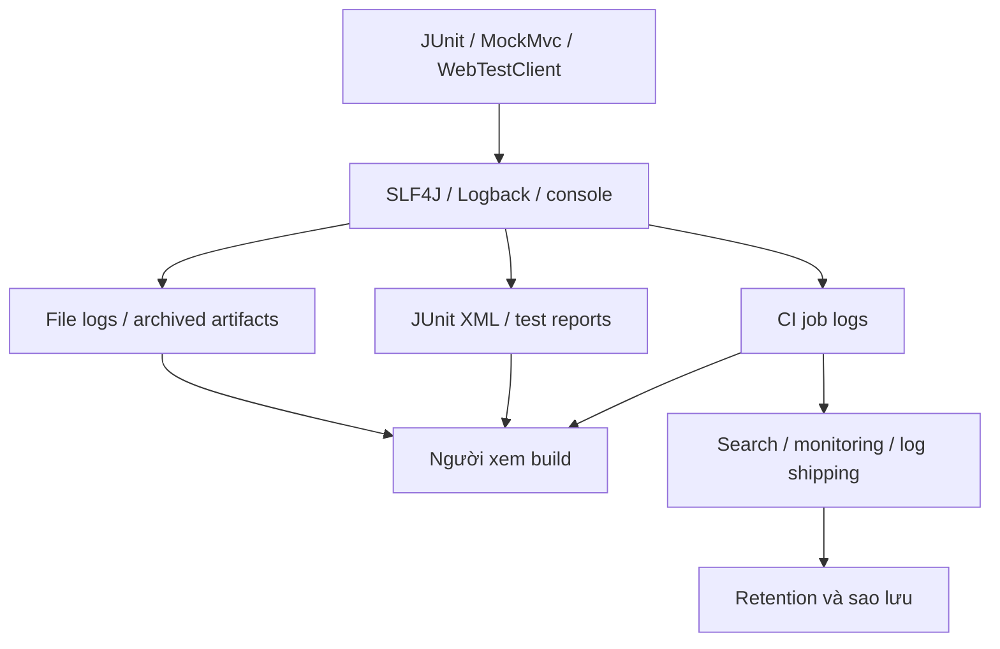
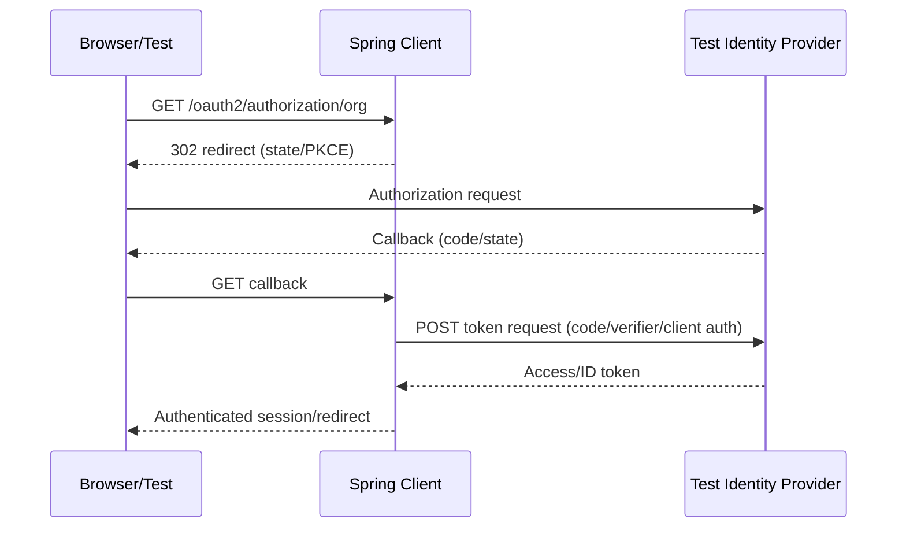

# Thu thập log chẩn đoán có che token, cookie và thông tin xác thực

Khi một ca kiểm thử Spring Security thất bại trên CI, kỹ sư thường muốn xem càng nhiều thông tin càng tốt: request, response, các filter, exception, claims của JWT và trạng thái session. Nhưng một câu lệnh tưởng như vô hại như `log.debug("headers={}", requestHeaders)` có thể ghi **Bearer access token, refresh token, cookie phiên, API key hoặc mật khẩu** vào console, file log, báo cáo JUnit XML hoặc artifact được lưu lâu hơn môi trường test.

Bài thuộc chương **Bộ kiểm thử và CI** của module **SPRING_SECURITY_TESTING**. Module này kiểm chứng xác thực, phân quyền và bảo vệ HTTP thực tế bằng `spring-security-test` trên Servlet và Reactive; người học sử dụng `MockMvc`, `WebTestClient`, `@WithMockUser`, `SecurityContext`, JWT/OAuth2/OIDC giả lập và các ca được phép hoặc bị từ chối. Đề bài tập trung vào **thu thập log chẩn đoán đủ để hiểu test hỏng nhưng không tiết lộ token, cookie và thông tin xác thực**.

> **Nguyên tắc cốt lõi:** An toàn nhất là **không đưa bí mật vào sự kiện log ngay từ đầu**. Chỉ log các trường được phép (allowlist). Masking/redaction bằng regex, tính năng “mask secrets” của CI và quyền truy cập log là các lớp phòng vệ bổ sung; không được dựa vào chúng như cơ chế bảo vệ duy nhất.

## 1. Vì sao log kiểm thử cũng là một ranh giới bảo mật?

Trên máy lập trình, log có vẻ chỉ là văn bản tạm thời. Trên CI, cùng dữ liệu ấy có thể đi qua:



Một token xuất hiện trong stdout có thể bị lưu ở **nhiều nơi** ngay cả khi team đã xóa dòng khỏi màn hình CI. Test thường chạy song song, được rerun, và có thể được thực thi trên pull request từ môi trường ít tin cậy hơn.

Rủi ro chính:

- **Token replay:** Bearer token bị lộ có thể được sử dụng cho đến khi hết hạn/thu hồi, tùy cơ chế.
- **Session hijacking:** Cookie phiên hoặc `Set-Cookie` mang session ID có thể cho phép giả danh.
- **Credential disclosure:** `Authorization: Basic ...`, API key, OAuth2 client secret, password và OTP có thể bị tái sử dụng.
- **Lộ danh tính và dữ liệu nhạy cảm:** Claims JWT, email, số điện thoại, địa chỉ, tenant ID và payload nghiệp vụ.
- **Lan truyền bí mật:** Một lỗi assertion in toàn bộ request có thể khiến báo cáo test, issue tracker và chatbot nhận token ngoài dự định.
- **Sai lệch chẩn đoán:** Log chứa token nguyên vẹn khuyến khích copy credential thật để tái hiện lỗi thay vì tạo dữ liệu test an toàn.

Ngay cả token được tạo riêng cho test cũng cần được quản lý. Nó có thể trỏ vào IdP sandbox hoặc tài nguyên thực trong môi trường tích hợp; không có bảo đảm rằng mọi credential có hậu tố `-test` đều vô hại.

## 2. Phân loại dữ liệu trước khi bật logging

Đặt chính sách cụ thể cho từng loại dữ liệu. Đừng quyết định dựa trên cảm giác rằng “chỉ chạy ở test nên có thể log hết”.

| Dữ liệu | Ví dụ | Chính sách mặc định |
|---|---|---|
| Access token / refresh token | `Bearer eyJ...`, opaque token | **Không log giá trị** |
| ID token OIDC | JWT chứa danh tính người dùng | **Không log giá trị hoặc raw claims** |
| Authorization header | `Bearer ...`, `Basic ...` | Không log giá trị; chỉ có thể log loại cơ chế nếu cần |
| Cookie yêu cầu | `Cookie: SESSION=...` | Không log giá trị |
| Cookie phản hồi | `Set-Cookie: SESSION=...; HttpOnly` | Không log giá trị; có thể kiểm thuộc tính bằng assertion riêng |
| API key | `X-Api-Key`, `api_key`, query secret | Không log giá trị |
| Mật khẩu, OTP, recovery code | Form/JSON body, query | Không log giá trị |
| OAuth2 authorization code | Callback `?code=...` | Không log giá trị |
| OAuth2 client secret | Token endpoint body/Basic auth | Không log giá trị |
| PKCE `code_verifier` | Token request | Không log giá trị |
| CSRF token / anti-forgery secret | Header/form/cookie | Không log giá trị |
| Session ID / JSESSIONID | Cookie, URL rewriting | Không log giá trị |
| Raw JWT claims | `sub`, `email`, `aud`, custom claims | Chỉ ghi trường tối thiểu sau khi đã đánh giá riêng |
| Request body | JSON/form/GraphQL | Mặc định không log; test riêng nếu cần payload chẩn đoán |
| Query string | `?token=...&code=...` | Không log nguyên chuỗi |
| Raw path | `/users/alice@example.com` | Ưu tiên route template, không path có giá trị cụ thể |
| HTTP method | `GET`, `POST` | Có thể log sau kiểm soát format |
| Route template | `/api/orders/{id}` | Có thể log |
| HTTP status | `200`, `401`, `403` | Có thể log |
| Duration | `duration_ms=23` | Có thể log |
| Request/correlation ID do server cấp | UUID không mang bí mật | Có thể log |
| Error category | `BAD_CREDENTIALS`, `ACCESS_DENIED` | Có thể log |
| Tên exception đã phân loại | `BadCredentialsException` | Có thể log nếu chính sách cho phép |
| Raw exception message / stack trace | Có thể chứa URI/token/header | Không log mặc định ở nhánh credential |

**Chú ý:** Header `Authorization` có thể chứa Basic credential mã hóa Base64. Base64 **không phải mã hóa bảo mật**; không log chuỗi và cũng không log giá trị sau giải mã. Cookie `HttpOnly` giúp ngăn JavaScript truy cập trong browser, **không** làm giá trị cookie trở nên an toàn để ghi vào server logs.

## 3. Allowlist thay vì “log tất cả rồi thay chuỗi”

Hai chiến lược:

**Chiến lược yếu:**

```java
// KHÔNG DÙNG: đưa nguyên request vào log trước khi mask.
log.debug("request={}", request);
log.debug("headers={}", request.getHeaderNames());
log.debug("auth={}",
        request.getHeader("Authorization"));
```

Ghi header names riêng lẻ thường không lộ giá trị, nhưng các lời gọi ghi request object, all headers, body hoặc `Authorization` có thể lộ credential. Một layout/appender hoặc formatter sau đó có thể lưu dữ liệu trước khi regex che xong.

**Chiến lược được ưu tiên:**

```java
log.info(
    "security_http method={} route={} status={} request_id={} duration_ms={}",
    safeMethod,
    safeRouteTemplate,
    responseStatus,
    safeRequestId,
    elapsedMillis);
```

Các giá trị **được tạo hoặc xác minh** từ nguồn phù hợp. Không truyền `HttpServletRequest`, `ServerWebExchange`, `Authentication`, `Jwt`, `HttpHeaders`, `Cookie[]` hoặc đối tượng DTO chứa bí mật vào logger.

Một record log JSON dạng allowlist:

```json
{
  "event": "security_http",
  "method": "GET",
  "route": "/api/reports/{id}",
  "status": 403,
  "outcome": "ACCESS_DENIED",
  "requestId": "ea68c5fe-c956-4517-9897-4627e8e03c43",
  "durationMs": 19
}
```

Record trên hỗ trợ chẩn đoán “request nào, endpoint nào, bị từ chối như thế nào, chậm bao lâu” mà không chứa access token hoặc session cookie.

### 3.1. Không giả định mọi trường metadata đều an toàn

- `request.getRequestURI()` có thể chứa email, mã truy cập nhúng trong path, tên tài khoản hoặc định danh nhạy cảm.
- `request.getQueryString()` có thể chứa `code`, `state`, `access_token`, `password`, `client_secret`.
- `X-Correlation-ID` do client gửi có thể là chuỗi dài, có newline/control chars hoặc cố tình chứa token.
- `exception.getMessage()` có thể nhắc raw request target, username hoặc nội dung credential do thư viện ngoài tạo.
- `authentication.getPrincipal()` có thể là toàn bộ JWT/OIDC object có thông tin cá nhân.
- MDC được cấu hình không kiểm soát có thể mang dữ liệu từ request khác hoặc chứa giá trị do client gửi.

Bởi vậy, chỉ log **server-generated request ID** hoặc một correlation ID đã được kiểm định format/độ dài. Nếu không cần giữ ID do client gửi, tạo UUID mới và echo nó trong `X-Request-ID`.

## 4. Tách chẩn đoán, audit và bảo vệ credential

Có ba nhu cầu khác nhau:

| Mục đích | Ví dụ | Dữ liệu cần thiết |
|---|---|---|
| **Diagnostic logging** | Test trả `401` ngoài dự kiến | Route template, status, error category, request ID, duration |
| **Security audit** | Ai cố thực hiện thao tác trái phép | Subject đã xác minh hoặc định danh nội bộ tối thiểu, action, resource class/ID theo policy, outcome |
| **Incident investigation** | Điều tra tấn công hoặc sự cố hệ thống | Sự kiện có nguồn gốc, kiểm soát quyền truy cập, retention và dữ liệu tối thiểu theo chính sách |

Không vì muốn debug JWT validation mà ghi JWT nguyên vẹn vào audit. Một audit record cũng không nên sử dụng `X-User-Id` do client tự gửi để thay identity đã được xác thực.

Nếu cần phân biệt `AUTHENTICATION_FAILED` với `AUTHORIZATION_DENIED`, có thể ghi:

```text
security_auth event=authentication_failed mechanism=bearer reason=invalid_token request_id=...
security_auth event=authorization_denied mechanism=bearer rule=reports.read request_id=...
```

`reason=invalid_token` là mã phân loại do ứng dụng xác định; **không** dùng raw `OAuth2Error.getDescription()`, parser error chứa token, hoặc message của exception làm reason nếu chưa qua kiểm định. Tránh log chi tiết quá mức về cơ chế xác thực vào phản hồi client để không tạo oracle hỗ trợ tấn công.

## 5. Thiết kế schema log chuẩn cho suite

Một schema an toàn ở mức test/HTTP:

```text
event_type
service
environment
request_id
trace_id
http_method
route_template
http_status
outcome_code
auth_mechanism
duration_ms
test_case_id          (chỉ trong test)
```

Quy ước:

- `service` là tên dịch vụ do config quản lý, không phải giá trị header bất kỳ.
- `test_case_id` là một tên cố định của bài test, không phải raw display name có dữ liệu bí mật.
- `auth_mechanism` chỉ là `none`, `basic`, `bearer`, `form`, `oidc`... nếu hệ thống xác định đáng tin; không kèm token.
- `trace_id` do hệ thống tracing sinh ra hoặc đã qua validation.
- `outcome_code` lấy từ enum/allowlist, không từ exception message.
- `route_template` như `/api/reports/{id}`, không phải URL raw.
- `duration_ms` đo bằng monotonic clock (`System.nanoTime()`), không dựa hiệu hai timestamp UTC có thể thay đổi đồng hồ.

**Nên tránh log username/email theo mặc định.** Nếu audit bắt buộc có actor ID, chỉ lấy sau xác thực từ nguồn đáng tin cậy và áp dụng quyền truy cập/retention riêng; pseudonym hóa bằng hash không khóa không phải lúc nào cũng bảo vệ được danh tính, nhất là khi tập giá trị nhỏ.

## 6. Servlet: một filter ghi log an toàn với dữ liệu allowlist

Ví dụ sau thiết kế filter chẩn đoán cho Spring MVC. Nó **không truy xuất Authorization, Cookie hoặc request body**, không lấy raw query string, không log exception message và dùng UUID do server tạo.

```java
public final class SafeHttpDiagnosticFilter
        extends OncePerRequestFilter {

    private static final Logger log =
        LoggerFactory.getLogger(
            SafeHttpDiagnosticFilter.class);

    private static final Set<String> METHODS = Set.of(
        "GET", "POST", "PUT",
        "PATCH", "DELETE", "HEAD", "OPTIONS");

    @Override
    protected void doFilterInternal(
            HttpServletRequest request,
            HttpServletResponse response,
            FilterChain chain)
            throws ServletException, IOException {

        String requestId = UUID.randomUUID().toString();
        long startedNanos = System.nanoTime();

        // Trả request ID không bí mật cho client để tra log.
        response.setHeader("X-Request-ID", requestId);

        String outcome = "completed";

        try (MDC.MDCCloseable ignored =
                MDC.putCloseable("requestId", requestId)) {
            try {
                chain.doFilter(request, response);
            } catch (ServletException | IOException
                    | RuntimeException failure) {
                // Không log failure.getMessage() hoặc raw stacktrace.
                outcome = "unhandled_exception";
                throw failure;
            } finally {
                String method = METHODS.contains(
                        request.getMethod())
                    ? request.getMethod()
                    : "OTHER";

                Object routeAttribute = request.getAttribute(
                    HandlerMapping
                        .BEST_MATCHING_PATTERN_ATTRIBUTE);

                String route = routeAttribute instanceof String
                    ? (String) routeAttribute
                    : "not_routed";

                // Nếu có exception chưa được map, status ở đây
                // có thể chưa là HTTP status cuối cùng.
                String status = "unhandled_exception"
                        .equals(outcome)
                    ? "unresolved"
                    : Integer.toString(response.getStatus());

                long durationMs =
                    TimeUnit.NANOSECONDS.toMillis(
                        System.nanoTime() - startedNanos);

                log.info(
                    "security_http method={} route={} status={} request_id={} outcome={} duration_ms={}",
                    method, route, status,
                    requestId, outcome, durationMs);
            }
        }
    }
}
```

Các import tiêu biểu:

```java
import java.io.IOException;
import java.util.Set;
import java.util.UUID;
import java.util.concurrent.TimeUnit;

import jakarta.servlet.FilterChain;
import jakarta.servlet.ServletException;
import jakarta.servlet.http.HttpServletRequest;
import jakarta.servlet.http.HttpServletResponse;

import org.slf4j.Logger;
import org.slf4j.LoggerFactory;
import org.slf4j.MDC;

import org.springframework.web.filter.OncePerRequestFilter;
import org.springframework.web.servlet.HandlerMapping;
```

**Điều được bảo đảm ở ví dụ:** Filter tạo một record chỉ từ metadata được phép và không lấy raw credential. Chuyện một logger ở component khác có ghi credential hay không **không được bảo đảm** bởi riêng filter này.

**Giới hạn cần hiểu:**

- Khi Spring Security từ chối trước Spring MVC HandlerMapping, `BEST_MATCHING_PATTERN_ATTRIBUTE` có thể chưa tồn tại. `not_routed` là fallback an toàn; **không** thay bằng `request.getRequestURI()` nếu chưa đánh giá dữ liệu nhạy cảm.
- Một exception chưa được map có thể khiến response status cuối do container thiết lập **sau khi filter thoát**; log `unresolved` thay vì ghi nhầm `200`.
- Nếu Servlet bắt đầu xử lý async và response chưa commit, record ở dispatch ban đầu chưa phản ánh kết quả cuối. Muốn log final response, dùng async lifecycle/observation integration riêng và kiểm trường hợp async dispatch.
- MDC của Servlet thread được xóa sau `try-with-resources`. Đừng giả định MDC tự đi theo `@Async`, thread pool hoặc Reactor context.
- Header `X-Request-ID` không phải session/credential; không dùng nó làm căn cứ cho authorization.

### 6.1. Đăng ký đúng một lần, không phá SecurityFilterChain

Một lựa chọn là đăng ký filter ở ranh giới Servlet container:

```java
@Configuration(proxyBeanMethods = false)
class SafeDiagnosticConfiguration {

    @Bean
    FilterRegistrationBean<SafeHttpDiagnosticFilter>
            safeDiagnosticRegistration() {

        FilterRegistrationBean<SafeHttpDiagnosticFilter>
                registration =
                    new FilterRegistrationBean<>();

        registration.setFilter(
            new SafeHttpDiagnosticFilter());

        registration.setOrder(
            Ordered.HIGHEST_PRECEDENCE + 10);

        return registration;
    }
}
```

Import:

```java
import org.springframework.boot.web.servlet.FilterRegistrationBean;
import org.springframework.context.annotation.Bean;
import org.springframework.context.annotation.Configuration;
import org.springframework.core.Ordered;
```

Đây là cách đăng ký **Servlet filter**, khác với thêm filter vào `SecurityFilterChain`. Không đồng thời khai báo `@Component` auto-registration và `.addFilterBefore(...)`/`.addFilterAfter(...)` cho cùng filter mà chưa kiểm cơ chế đăng ký; filter chạy hai lần có thể tạo log lặp hoặc sai thứ tự.

Trong cấu hình có nhiều dispatch (REQUEST/ASYNC/ERROR), quyết định rõ cần một log cho mỗi dispatch hay một log cho request cuối, rồi viết test tương ứng. Log thử nghiệm này là **ví dụ chẩn đoán**; không nên thay thế observability/HTTP server metrics chuẩn nếu dự án đã có cơ chế phù hợp.

### 6.2. Vì sao không đọc headers rồi tự che?

Mẫu không an toàn:

```java
// KHÔNG DÙNG:
log.debug("Authorization = {}",
    request.getHeader("Authorization"));

log.debug("Cookie = {}",
    request.getHeader("Cookie"));
```

Ngay cả khi dùng layout regex che token ở cuối pipeline, raw secret đã nằm trong log event/argument array và có thể được một appender khác ghi ra. **Không xây log event có bí mật** là cách phòng vệ mạnh hơn.

## 7. Kiểm tra Servlet filter bằng MockMvc và secret canary

Ta cần một phép thử cố ý gửi **giá trị giả dạng credential** nhưng có chuỗi nhận diện riêng, sau đó xác nhận output log không chứa chúng. Không sử dụng token production thật để kiểm redaction.

Ví dụ giả định ứng dụng Spring MVC có route `/api/private` yêu cầu Bearer JWT, decoder production sẽ từ chối token không hợp lệ, và `SafeHttpDiagnosticFilter` đã đăng ký.

```java
@SpringBootTest
@AutoConfigureMockMvc
@ExtendWith(OutputCaptureExtension.class)
class SafeDiagnosticsIT {

    @Autowired
    MockMvc mockMvc;

    @Test
    void invalidBearerAndCookieNeverAppearInConsole(
            CapturedOutput output) throws Exception {

        String bearerCanary =
            "SENSITIVE_BEARER_CANARY_0c12a7";
        String cookieCanary =
            "SENSITIVE_SESSION_CANARY_29b7d1";
        String apiKeyCanary =
            "SENSITIVE_APIKEY_CANARY_58d9e0";

        mockMvc.perform(get("/api/private")
                .header(HttpHeaders.AUTHORIZATION,
                    "Bearer " + bearerCanary)
                .header(HttpHeaders.COOKIE,
                    "SESSION=" + cookieCanary)
                .header("X-Api-Key", apiKeyCanary))
            .andExpect(status().isUnauthorized())
            .andExpect(header().exists(
                "X-Request-ID"));

        String logs = output.getAll();

        assertThat(logs)
            .contains("security_http")
            .doesNotContain(
                bearerCanary,
                cookieCanary,
                apiKeyCanary);
    }
}
```

Import chính:

```java
import org.junit.jupiter.api.Test;
import org.junit.jupiter.api.extension.ExtendWith;
import org.springframework.beans.factory.annotation.Autowired;
import org.springframework.boot.test.autoconfigure.web.servlet.AutoConfigureMockMvc;
import org.springframework.boot.test.context.SpringBootTest;
import org.springframework.boot.test.system.CapturedOutput;
import org.springframework.boot.test.system.OutputCaptureExtension;
import org.springframework.http.HttpHeaders;
import org.springframework.test.web.servlet.MockMvc;

import static org.assertj.core.api.Assertions.assertThat;
import static org.springframework.test.web.servlet.request
    .MockMvcRequestBuilders.get;
import static org.springframework.test.web.servlet.result
    .MockMvcResultMatchers.header;
import static org.springframework.test.web.servlet.result
    .MockMvcResultMatchers.status;
```

**Ý nghĩa:** Test gửi ba chuỗi không có giá trị bảo mật vào các vị trí dễ rò rỉ, kiểm response `401` và kiểm log do `OutputCaptureExtension` thu thập không chứa chúng. Đây là kiểm tra **luồng output được capture trong môi trường test**, chưa chứng minh mọi appender/file/remote sink đều an toàn.

Để test thực sự kiểm filter/chính sách:

1. Có một ca dương với credential test hợp lệ nhận status đúng, giúp phát hiện trường hợp mọi request đều bị từ chối vì cấu hình sai.
2. Chạy logger với cấu hình tương tự CI, không tắt toàn bộ logging chỉ để test redaction xanh.
3. Bảo đảm request đi qua `SecurityFilterChain` thật; không dùng `.with(jwt())` trong ca muốn kiểm decoder JWT.
4. Không gọi `.andDo(print())` hoặc in `MvcResult` nguyên vẹn vì có thể đưa headers/cookies ra console **trước lúc assert redaction**.
5. Nếu application log nằm ở file riêng hoặc Logback appender khác stdout/stderr, phải kiểm sink ấy bằng cách thích hợp; `CapturedOutput` chỉ bao phủ output mà extension bắt được.
6. Không chạy test capture global stdout không cô lập song song với test khác dùng cùng JVM nếu dễ lẫn output.

### 7.1. Test authorization đúng nhưng log không lộ dữ liệu

Một suite nên có cả ba nhóm:

| Ca | Request | HTTP assertion | Log assertion |
|---|---|---|---|
| A | Không Bearer | `401` | Có request ID/status; không có cookie |
| B | Bearer sai | `401` | Không có raw token hoặc raw parser message |
| C | Bearer đúng thiếu scope | `403` | Có loại sự kiện từ chối; không có access token |
| D | Bearer đúng đủ scope | `200` | Chỉ có metadata cho phép |
| E | Session cookie sai | Unauthorized theo policy | Không có cookie raw |
| F | OAuth2 login callback lỗi | Login fail | Không có `code`, `state` raw hoặc ID token |
| G | Request có password trong JSON | Từ chối hoặc xử lý đúng contract | Không in request body/password |
| H | Response phát `Set-Cookie` | Status theo contract | Log không chứa session ID |

Một test `doesNotContain("Bearer")` có thể gây false positive vì log được phép ghi **tên cơ chế** `mechanism=bearer` bằng chữ thường. Để kiểm leak thực tế, ưu tiên canary value riêng và các dạng encoded của nó, đồng thời đánh giá đầy đủ các sink.

## 8. CapturedOutput, ListAppender và ý nghĩa của từng loại bằng chứng

Có nhiều cách thu thập log trong bài test:

| Công cụ | Phạm vi | Rủi ro |
|---|---|---|
| `OutputCaptureExtension` của Spring Boot Test | stdout/stderr được capture | Không bao phủ chắc chắn mọi appender hay log shipping |
| Logback `ListAppender` | Event của logger cụ thể | Không tự bao phủ logger/framework khác; event có thể giữ argument/raw throwable |
| In-memory fake audit sink | Các audit events ứng dụng tạo | Chỉ bao phủ cổng audit được inject |
| File appender trong test | Log file với layout/encoder đã cấu hình | Cần cleanup và bảo vệ file/artifact |
| E2E CI artifact inspection | File/test report thực sau job | Có thể phát hiện leak từ nhiều tầng nhưng phải tránh lưu/copy secret mới |

Có thể dùng `ListAppender<ILoggingEvent>` để khẳng định một component **không truyền credential vào log event**:

```java
Logger logger = (Logger) LoggerFactory
        .getLogger(SafeHttpDiagnosticFilter.class);

ListAppender<ILoggingEvent> appender =
        new ListAppender<>();
appender.start();
logger.addAppender(appender);

try {
    // Gọi MockMvc với các secret canary test.
    // Đọc các event đã capture:
    List<String> messages = appender.list.stream()
        .map(ILoggingEvent::getFormattedMessage)
        .toList();

    assertThat(messages)
        .allSatisfy(message ->
            assertThat(message)
                .doesNotContain("SENSITIVE_BEARER_CANARY"));
} finally {
    logger.detachAppender(appender);
    appender.stop();
}
```

Đây là một ví dụ **đoạn test hỗ trợ**; `Logger` là `ch.qos.logback.classic.Logger`, còn `ListAppender` và `ILoggingEvent` là API Logback. Cần logback-classic trên test classpath. Không dùng đoạn này với một SLF4J provider khác khi cast không tương thích.

Chỉ đọc `getFormattedMessage()` chưa bao phủ mọi đường rò rỉ: event có thể giữ `getArgumentArray()`, throwable proxy, MDC và marker/key-value pairs chứa dữ liệu, hoặc một appender khác đã nhận raw event. Khi mục tiêu là bảo đảm không đưa credential vào logger, hãy **kiểm các thành phần của event** và ưu tiên kiểm code chỉ dựng record từ allowlist.

Đừng duy trì một root logger appender tạm thời dùng chung trong các test chạy song song nếu nó thu thập dữ liệu của test khác; khi cần capture root logs, cô lập JVM/suite hoặc tuần tự hóa.

## 9. Reactive WebFlux: log tại WebFilter mà không lộ Reactor context

Trong WebFlux, request đi qua `SecurityWebFilterChain`, còn danh tính được quản lý qua Reactor Context. Không nên dùng `SecurityContextHolder.getContext()` trên thread xử lý để suy ra user của request Reactive, và cũng không được log toàn bộ `ServerWebExchange`.

Một `WebFilter` minh họa log allowlist:

```java
@Component
public final class SafeReactiveDiagnosticWebFilter
        implements WebFilter {

    private static final Logger log =
        LoggerFactory.getLogger(
            SafeReactiveDiagnosticWebFilter.class);

    @Override
    public Mono<Void> filter(
            ServerWebExchange exchange,
            WebFilterChain chain) {

        String requestId = UUID.randomUUID().toString();
        long startedNanos = System.nanoTime();

        exchange.getResponse()
            .getHeaders()
            .set("X-Request-ID", requestId);

        return chain.filter(exchange)
            .doFinally(signal -> {
                Object pattern = exchange.getAttribute(
                    HandlerMapping
                        .BEST_MATCHING_PATTERN_ATTRIBUTE);

                String route = pattern instanceof String
                    ? (String) pattern
                    : "not_routed";

                HttpStatusCode status =
                    exchange.getResponse().getStatusCode();

                String statusText = status == null
                    ? "unresolved"
                    : Integer.toString(status.value());

                long durationMs =
                    TimeUnit.NANOSECONDS.toMillis(
                        System.nanoTime() - startedNanos);

                log.info(
                    "security_http method={} route={} status={} request_id={} signal={} duration_ms={}",
                    exchange.getRequest()
                        .getMethod().name(),
                    route,
                    statusText,
                    requestId,
                    signal.name(),
                    durationMs);
            });
    }
}
```

Import:

```java
import java.util.UUID;
import java.util.concurrent.TimeUnit;

import org.slf4j.Logger;
import org.slf4j.LoggerFactory;
import org.springframework.http.HttpStatusCode;
import org.springframework.stereotype.Component;
import org.springframework.web.reactive.HandlerMapping;
import org.springframework.web.server.ServerWebExchange;
import org.springframework.web.server.WebFilter;
import org.springframework.web.server.WebFilterChain;
import reactor.core.publisher.Mono;
```

Ví dụ cố ý **không truy cập raw Authorization, Cookie, body, query hoặc JWT claims**. `doFinally` chạy khi subscription hoàn tất, thất bại hoặc bị cancel; điều này hữu ích để chẩn đoán tín hiệu Reactive.

**Giới hạn quan trọng:**

- Một error handler nằm ngoài WebFilter này có thể đổi HTTP status **sau** signal lỗi, vì vậy status ở đây đôi khi là `unresolved` hoặc trạng thái trung gian. Nếu cần log status cuối, dùng cơ chế observation/error-handler tích hợp đúng thứ tự.
- Với streaming/SSE vô hạn, `doFinally` chỉ chạy khi stream kết thúc/cancel; không coi log terminal là “request đầu tiên trả headers”.
- Reactor `Context` không đồng nhất với SLF4J MDC của thread hiện tại. Nếu muốn trace IDs xuất hiện ở operator khác, dùng context propagation được cấu hình đúng, không tự chép principal/JWT sang MDC.
- Spring WebFlux WebFilter bean được auto đăng ký; không đồng thời add cùng filter vào chain riêng khi chưa đánh giá thứ tự và duplicate registration.
- `getMethod().name()` trả một giá trị HTTP method, nhưng nếu môi trường nhận method bất thường vẫn nên chuẩn hóa theo allowlist như Servlet khi cần compliance log nghiêm ngặt.

### 9.1. WebTestClient kiểm log và phản hồi ở hai ranh giới

Với ứng dụng WebFlux chạy ở random port:

```java
@SpringBootTest(
    webEnvironment =
        SpringBootTest.WebEnvironment.RANDOM_PORT)
@ExtendWith(OutputCaptureExtension.class)
class ReactiveSafeDiagnosticsIT {

    @LocalServerPort
    int port;

    @Test
    void invalidTokenIsRejectedWithoutLeaking(
            CapturedOutput output) {

        String canary =
            "SENSITIVE_REACTIVE_BEARER_447a9e";

        WebTestClient client =
            WebTestClient.bindToServer()
                .baseUrl("http://localhost:" + port)
                .responseTimeout(Duration.ofSeconds(3))
                .build();

        client.get()
            .uri("/api/private")
            .headers(headers ->
                headers.setBearerAuth(canary))
            .exchange()
            .expectStatus().isUnauthorized()
            .expectHeader().exists("X-Request-ID");

        assertThat(output.getAll())
            .contains("security_http")
            .doesNotContain(canary);
    }
}
```

`WebTestClient.bindToServer()` gửi HTTP thật tới app. Nếu dùng `.mutateWith(mockJwt())` trên client bind-to-context, JWT object được chèn vào test server để kiểm authorization; đó **không** phải test việc decoder nhận token từ mạng. Khi muốn kiểm chữ ký/issuer/audience thật, gửi Bearer JWT test được ký bằng test key qua header và giữ decoder/validators của application.

## 10. Lỗi authentication: log mã lỗi, không log credential

Một mẫu dễ rò rỉ:

```java
// KHÔNG DÙNG:
catch (AuthenticationException ex) {
    log.warn("Authentication failed: {}",
        ex.getMessage(), ex);
}
```

`ex.getMessage()` và exception cause/stack trace có thể mang raw URI hoặc credential nếu exception được tạo từ thư viện không kiểm soát. Thay bằng mã lỗi được **phân loại tường minh**:

```java
enum AuthOutcome {
    BAD_CREDENTIALS,
    TOKEN_EXPIRED,
    INVALID_TOKEN,
    ACCESS_DENIED,
    INTERNAL_AUTH_ERROR
}

AuthOutcome classify(AuthenticationException ex) {
    if (ex instanceof BadCredentialsException) {
        return AuthOutcome.BAD_CREDENTIALS;
    }

    if (ex instanceof CredentialsExpiredException) {
        return AuthOutcome.TOKEN_EXPIRED;
    }

    return AuthOutcome.INVALID_TOKEN;
}
```

Trong failure handler của Servlet, ghi:

```java
AuthOutcome result = classify(exception);

log.warn(
    "security_auth result={} request_id={}",
    result.name(), safeRequestId);
```

Nếu cần phân biệt signature/issuer/audience chính xác, đưa các lỗi ấy vào taxonomy **chỉ khi decoder/validator có tín hiệu đáng tin**, không parse chuỗi exception message bằng các mảnh regex dễ thay đổi. Những lỗi nội bộ không thuộc authentication failure có thể cần audit/incident handling riêng; tránh quy tất cả thành `BAD_CREDENTIALS`.

**Không log trực tiếp:**

```java
log.warn("failed auth={}", authentication);
log.warn("jwt={}", jwt.getTokenValue());
log.warn("claims={}", jwt.getClaims());
log.warn("details={}", exception.getMessage());
```

`Authentication` thường chứa credentials hoặc principal details; `Jwt` có raw token và claims. Khi cần tìm nguyên nhân thiếu scope, log **rule identifier** và outcome, không dump toàn bộ authorities/claims nếu chúng có thể chứa thông tin nhạy cảm.

## 11. OAuth2/OIDC: nơi bí mật thường xuất hiện ngoài Authorization header

Trong integration test OAuth2/OIDC, thông tin nhạy cảm không chỉ nằm ở Bearer header.

| Ranh giới | Trường dễ lộ | Cách chẩn đoán an toàn |
|---|---|---|
| Redirect tới authorization endpoint | `state`, `nonce`, `code_challenge`, `redirect_uri` | Ghi `registrationId`, flow step và request ID; không log full Location |
| Callback OIDC/OAuth2 | `code`, `state`, `session` | Ghi callback matched/failed và reason code |
| Token endpoint | `client_secret`, `code_verifier`, authorization code | Ghi grant type/HTTP result, không body/Basic auth |
| ID token validation | ID token, `sub`, email, profile claims | Ghi validator category và kết quả |
| JWT Resource Server | Bearer/JWT raw, scope, audience | Ghi status và mã lỗi/required rule |
| Refresh token exchange | Refresh token và token response mới | Ghi token refresh attempted/succeeded/failed |
| Logout | Session cookie, ID token hint, logout token | Ghi loại logout và kết quả, không URL/body raw |
| Test IdP/HTTP stub | RecordedRequest có raw credential | Không in nguyên RecordedRequest; assert trực tiếp trong memory |

Một ví dụ đặc biệt nguy hiểm:

```java
// CÓ THỂ LỘ code và state trong query.
log.debug("redirect={}",
    mvcResult.getResponse().getRedirectedUrl());
```

Trong test cần kiểm callback/redirect, parse response **trong memory**, assert các trường yêu cầu, rồi không in URL hoàn chỉnh. Thay vì log nguyên `Location`, có thể ghi `redirect_uri_matches_config=true` hoặc `flow_step=authorization_redirect`.

`state` và `nonce` không có cùng công dụng với access token, nhưng vẫn là dữ liệu giao dịch xác thực cần được giữ kín ở nhiều mô hình threat. Không thêm chúng vào log chẩn đoán theo thói quen.

## 12. URL, payload, cookie và lỗi framework

Các nguồn rò rỉ vượt ra ngoài logger của ứng dụng:

### 12.1. `MockMvcResultHandlers.print()` và lỗi assertion

```java
// Dễ đưa request/response header, cookie và body vào CI log.
mockMvc.perform(get("/api/private")
        .header("Authorization", "Bearer " + token))
    .andDo(print());
```

Dùng `andExpect(...)` và log metadata đã allowlist thay vì `print()` ở suite chung. Nếu phải phân tích một request cụ thể, chạy local bằng credential giả, giới hạn quyền truy cập console và loại bỏ cơ chế dump sau khi chẩn đoán.

### 12.2. WebTestClient exchange details

`WebTestClient` có thể xuất diagnostics khi assertion HTTP/body thất bại. Đừng in nguyên `ExchangeResult`, `requestHeaders`, `responseHeaders` hoặc response body nếu có cookie, token hoặc PII. Tránh tự thêm `consumeWith(result -> log.debug("{}", result))`.

Với API trả `Set-Cookie`, test thuộc tính bằng assertion như `HttpOnly`, `Secure`, `SameSite` theo hợp đồng; không ghi giá trị cookie vào log để chứng minh cookie tồn tại.

### 12.3. HTTP wiretap và request logging middleware

HTTP client/server logging middleware, Reactor Netty wiretap, filter dump headers, proxy access log hoặc HTTP trace/HAR có thể ghi thông tin:

- Netty/wiretap ở chế độ HEX/byte/text có thể hiển thị raw HTTP headers/body.
- Request logging bật `includeHeaders`/`includePayload` có thể ghi bí mật trong header/form/JSON.
- Server access log có thể ghi request line **kèm query string**; OAuth2 callback có `code` và `state`.
- Reverse proxy/API gateway/load balancer có thể lưu `Authorization`, cookie hoặc query theo cấu hình riêng.
- Exception handler có thể log URI raw hoặc `Throwable` được dựng kèm secrets.

Không bật các tùy chọn dump raw traffic trên shared CI chỉ để debug một test `401`. Nếu buộc capture ở máy cô lập, dùng **secrets giả, retention ngắn, quyền truy cập hẹp**, đồng thời xóa artifact sau khi phân tích theo quy trình.

### 12.4. Không log object `SecurityContext`

```java
// KHÔNG DÙNG:
log.debug("context={}",
    SecurityContextHolder.getContext());
```

Context có thể chứa principal/credentials và chi tiết nguồn xác thực. Với Reactive, `ReactiveSecurityContextHolder.getContext()` là publisher gắn với subscription; log cả context hoặc JWT vào MDC còn có nguy cơ rò rỉ giữa threads nếu cấu hình propagation sai.

## 13. Masking/redaction ở layout: chỉ là phòng vệ bổ sung

Có thể áp dụng regex hoặc encoder redaction ở logging sink để che giá trị không mong muốn. Nhưng cần hiểu giới hạn:

- Header có thể viết hoa/thường khác nhau, có whitespace lạ hoặc ở dạng nhiều dòng.
- Credential có thể nằm trong query string, JSON escaped, URL encoded, Base64 hoặc binary/hex dump.
- Bản sao dữ liệu có thể đã được appender khác hoặc exporter khác nhận **trước lúc che**.
- Stack trace, MDC, structured key-value pairs hoặc nested objects có thể bypass bộ lọc regex chỉ xử lý message.
- Một logger mới hoặc thay đổi thư viện có thể dùng format khác regex đã dự kiến.
- CI secret masking thường chỉ nhận diện đúng chuỗi được cấu hình; token ngẫu nhiên, token được chia nhỏ/encode và credential phát sinh sau đó không nhất thiết được che.

Một danh sách bảo vệ nên bao phủ:

```text
Authorization
Proxy-Authorization
Cookie
Set-Cookie
X-Api-Key
X-Auth-Token
password, passwd, secret
access_token, refresh_token, id_token
client_secret, authorization_code
code_verifier, csrf_token
JSESSIONID, SESSION, session_id
```

Đây là **danh mục cần tìm kiếm và loại khỏi nguồn log**, không phải lời hứa rằng một regex chứa các tên trên sẽ xử lý mọi trường hợp. Ưu tiên chỉ phát những trường đã được duyệt, sau đó thêm kiểm tra phát hiện canary ở sink.

### 13.1. Tránh tự tạo “fingerprint” token không an toàn

Không log bốn ký tự cuối access token để phân biệt request; không log hash SHA-256 thô của secret rồi giả định nó vô danh. Một mã có entropy thấp hoặc không được bảo vệ có thể bị đoán bằng dictionary.

Nếu doanh nghiệp cần đối chiếu token trong audit, hãy có thiết kế riêng với **HMAC có khóa, rotation, quyền truy cập hạn chế và đánh giá dữ liệu riêng tư**; còn với bài kiểm thử Spring Security thông thường, `requestId`, `traceId`, `clientRegistrationId` hoặc `eventId` là đủ để chẩn đoán mà không phải ghi token.

## 14. Kiểm redaction bằng nhiều canary và nhiều đường truyền

Một canary tốt phải:

- Không có giá trị sử dụng bên ngoài test.
- Có prefix dễ phân biệt, ví dụ `SENSITIVE_COOKIE_CANARY_...`.
- Không giống thông tin thật của người dùng.
- Xuất hiện ở **đúng vị trí rủi ro**: cookie, Authorization, query, body, OAuth2 callback, response.
- Có ID riêng cho mỗi ca hoặc fixture, tránh nhầm với output từ test khác.

Ma trận đề nghị:

| ID | Input giả | Nơi có thể rò rỉ | Kết quả kiểm |
|---|---|---|---|
| L01 | `Authorization: Bearer CANARY_A` | Servlet/Reactive log, JWT exception | Không có CANARY_A |
| L02 | `Authorization: Basic CANARY_B` | HTTP Basic filter/logger | Không có CANARY_B |
| L03 | `Cookie: SESSION=CANARY_C` | Request logging/access log | Không có CANARY_C |
| L04 | `Set-Cookie: SESSION=CANARY_D` | Response logging/test failure | Không có CANARY_D |
| L05 | `X-Api-Key: CANARY_E` | Custom filter/provider | Không có CANARY_E |
| L06 | Form `password=CANARY_F` | Request body/logger | Không có CANARY_F |
| L07 | JSON `"password":"CANARY_G"` | Body dump/exception | Không có CANARY_G |
| L08 | `?code=CANARY_H&state=...` | Access log/redirect print | Không có CANARY_H |
| L09 | OAuth2 `client_secret=CANARY_I` | Token endpoint wiretap | Không có CANARY_I |
| L10 | JWT raw `CANARY_J` | Decoder failure | Không có CANARY_J |
| L11 | ID token raw `CANARY_K` | OIDC login failure | Không có CANARY_K |
| L12 | Header `X-Request-ID` chứa control chars | MDC/log injection | Server cấp ID chuẩn; không log raw |
| L13 | Path chứa email/secret | Raw request target | Log route template, không path raw |
| L14 | URL encoded token | Access log/query formatter | Không ghi raw/decoded value |
| L15 | Password xuất hiện trong exception message | Exception logger | Chỉ ghi error category |
| L16 | Request hợp lệ nhận `200` | Business/service logs | Không lộ credential dù success |
| L17 | Auth failure `401` | Error logs | Không lộ raw token/cookie |
| L18 | Access denied `403` | Authorization logs | Không lộ claims và secret |
| L19 | Reactive pipeline đổi scheduler | MDC/log context | Không lẫn dữ liệu request khác |
| L20 | Test fail và có JUnit XML artifact | Test reports | Không chứa bất kỳ canary nào |

**Không chỉ kiểm success path.** Rò rỉ thường xảy ra ở lỗi parse JWT/OIDC, exception message hoặc test assertion fail, nơi nhóm phát triển có xu hướng bật DEBUG.

### 14.1. Kết quả test không có canary chưa đủ nếu không có log

Một test không thấy canary vì **không ghi log gì** cũng xanh. Do đó thêm positive control:

```java
assertThat(output.getAll())
    .contains("security_http");

assertThat(output.getAll())
    .doesNotContain(bearerCanary);
```

Với Logback ListAppender, assert tồn tại event ở logger cụ thể, field `status`, `request_id` hợp lệ, và event không mang raw secret trong message/arguments/MDC. Ngoài ra, kiểm các sinks khác đã được bật trong CI.

## 15. Kiểm rò rỉ trong artifact CI chứ không chỉ console

Một pipeline thường sinh ra:

```text
build/test-results/test/*.xml
build/reports/tests/test/...
build/logs/...
artifacts/
screenshots/
network-captures/
```

Đây là **đường dẫn ví dụ** (không phải yêu cầu tạo hoặc quét file trong STEP 4). Dữ liệu nguy hiểm có thể xuất hiện ở:

- `<system-out>` / `<system-err>` trong JUnit XML.
- Stack trace trong failure report khi assertion in body/headers.
- HTML report của Gradle/Maven.
- Browser screenshot/HTML snapshot chứa session token trong DOM/URL.
- HAR/network capture chứa Cookie/Authorization.
- HTTP stub recorded requests được serialize làm artifact.
- Console logs từ test containers, proxy hoặc identity server.
- Log files được upload theo glob quá rộng.

**Quy trình CI phù hợp:**

1. Trước build, xác định log sink và artifact nào được tạo.
2. Trên test fixture an toàn, đưa canary vào tất cả nguồn credential cần bảo vệ.
3. Chạy các ca success/failure và giữ nguyên mức log dự kiến của CI.
4. Kiểm stdout, JUnit XML, HTML report, file log và artifact được phép upload **trước khi publish**.
5. Nếu tìm thấy canary, coi là một regression bảo mật; sửa tại nguồn log và bổ sung test bắt lỗi.
6. Chỉ upload đúng file chẩn đoán đã được kiểm duyệt; không upload cả thư mục môi trường hoặc raw network dump.
7. Áp dụng retention ngắn, quyền xem/download tối thiểu và chính sách xóa dữ liệu phù hợp.
8. Không dùng credential production trong job có quyền đọc artifacts rộng.

Nếu một job đã ghi **credential thật**, không chỉ xóa artifact: cần kích hoạt quy trình ứng phó, thu hồi/rotate credential theo khả năng, kiểm người đã truy cập log và xóa mọi bản sao có thể xử lý theo chính sách.

## 16. Cấu hình test logging trên CI: đủ để debug, không thừa bí mật

Chọn mức log theo mục tiêu:

| Logger/tầng | Mức đề xuất mặc định | Lý do |
|---|---|---|
| Application security events allowlist | `INFO` cho outcome cần quan sát | Có request ID, status và reason code |
| Framework HTTP wiretap | Tắt/không bật | Tránh raw HTTP headers và body |
| Full request/response dump | Tắt trên shared CI | Tránh token/cookie/PII |
| `org.springframework.security` | Không bật DEBUG rộng mặc định | Có thể sinh log quá chi tiết; tùy phiên bản và filter |
| Custom auth provider | Code-only reason category | Không chứa raw credential |
| Test output / assertion failure | Chỉ field hữu ích | Không in request object nguyên vẹn |
| Audit bảo mật | Theo chính sách riêng | Có retention/quyền xem khác diagnostic |

Đừng bật `--debug`, `--info`, `--stacktrace` trên toàn bộ build và giả định CI masking sẽ xử lý mọi bí mật. Các tùy chọn đó **không nhất thiết luôn lộ bí mật**, nhưng có thể tăng lượng dữ liệu và bề mặt cần kiểm; chỉ bật có chủ đích, với fixture an toàn và kiểm soát artifact.

Một ví dụ Gradle task test hiển thị summary/failures nhưng không tự động show standard streams:

```groovy
tasks.withType(Test).configureEach {
    useJUnitPlatform()

    testLogging {
        events "failed"
        showStandardStreams = false
        exceptionFormat = "short"
    }
}
```

Đây là **một lớp giảm tiếng ồn**, không bảo đảm log an toàn: thư viện, test runner và report XML vẫn có thể ghi stdout/stack traces. `exceptionFormat = "short"` có thể ẩn chi tiết hữu ích, nên chọn theo nhu cầu chẩn đoán, nhưng không thay thế việc loại secrets tại nguồn.

### 16.1. Nếu dùng GitHub Actions hoặc CI khác

Nên:

- Truyền secrets bằng cơ chế secret store và biến môi trường có quyền tối thiểu.
- Hạn chế secrets trên pull request từ fork hoặc workflow không tin cậy.
- Tránh shell tracing (`set -x`) khi chạy lệnh có credential.
- Không in environment/config toàn bộ.
- Không đặt token trong command-line arguments dễ bị lộ trong logs/process listing.
- Không upload toàn bộ workspace, browser profile hoặc HTTP captures.
- Cân nhắc tắt artifact upload khi kiểm redaction chưa đạt.
- Nhớ rằng secret masking của CI thường **không bảo đảm che token được encode/chia nhỏ hoặc token phát sinh động**.

Không dùng tên biến môi trường như `SPRING_SECURITY_OAUTH2_CLIENT_REGISTRATION_*` hoặc cấu hình YAML làm lý do in toàn bộ properties; các properties có thể chứa `client-secret`.

## 17. Bảo vệ log khi test JWT, OAuth2 và OIDC thật

### 17.1. JWT Resource Server

Để test chữ ký/issuer/audience, gửi token đã ký bằng khóa test qua `Authorization: Bearer ...`, giữ `JwtDecoder` hoặc `ReactiveJwtDecoder` thật.

Với token sai:

- **HTTP assertion:** `401`.
- **Diagnostic assertion:** có `request_id`, `status=401` hoặc mã lỗi thích hợp.
- **Redaction assertion:** token raw không xuất hiện trong console/file/artifacts.
- **Business assertion:** không ghi dữ liệu hoặc tạo event trái phép.

Với token hợp lệ thiếu scope:

- HTTP thường `403` theo chain minh họa.
- Log `ACCESS_DENIED` và route/rule code, **không** dump claims/access token.
- Không tự động log out user do một authorization denial, trừ chính sách có yêu cầu riêng.

### 17.2. OAuth2 Client và OIDC Login

Với authorization code flow:



Một diagnostic event an toàn:

```text
auth_flow registration=org stage=token_exchange outcome=failed request_id=...
```

Một diagnostic event không an toàn:

```text
token_request code=... code_verifier=... client_secret=...
id_token=... refresh_token=...
```

`oauth2Login()`/`oidcLogin()` trong `spring-security-test` tạo principal giả lập. Dùng chúng cho logic ứng dụng, nhưng đừng kết luận đã kiểm toàn bộ OIDC flow. Khi test IdP stub, RecordedRequest có thể giữ Basic client authentication và token body; chỉ assert fields **trong memory**, không dump raw request.

### 17.3. Tránh log thông tin xác thực trong response lỗi

Thông báo lỗi công khai nên sử dụng mã lỗi phù hợp và request ID, không chứa access token, password, client secret, session ID hoặc raw JWT validation message. Một test nên kiểm **cả HTTP body và log**; che token trong log nhưng trả nó về client qua error JSON vẫn là lỗ hổng.

## 18. Chẩn đoán thất bại 401/403 mà không cần lộ credential

Khi test JWT sai, các trường thường đủ để trả lời câu hỏi kỹ thuật:

```text
test_case=wrongAudienceIsUnauthorized
request_id=ea68c5fe-c956-4517-9897-4627e8e03c43
method=GET
route=/api/reports/{id}
mechanism=bearer
status=401
outcome=INVALID_TOKEN
validator=AUDIENCE
duration_ms=12
```

Những gì **không cần thiết**:

```text
Authorization: Bearer eyJ...
Cookie: SESSION=...
JwtAuthenticationToken(principal=..., credentials=...)
id_token=...
aud claim full object=...
```

Nếu phân loại `validator=AUDIENCE` phải có bằng chứng từ validator production, có thể ghi category ấy. Nếu parser chỉ báo chung `invalid_token`, đừng suy diễn rằng lỗi do audience rồi in claims để “xem rõ hơn”. Tạo test độc lập cho sai chữ ký, issuer, audience và thời hạn với đối chứng token hợp lệ.

### 18.1. Cẩn thận khi kiểm test thất bại

Một bộ test log redaction phải **cố ý tạo lỗi** như malformed token và invalid API key vì exception path là nơi hay có log raw credential nhất. Nhưng không nên đặt credential thật vào assertion message:

```java
// KHÔNG DÙNG:
assertThat(response).as("JWT " + rawToken)
    .isNotNull();
```

Đặt thông điệp an toàn:

```java
assertThat(response)
    .as("JWT validation result for request " + requestId)
    .isNotNull();
```

Request ID ở đây phải là giá trị nội bộ được kiểm soát; nếu lấy từ user input thì cần validate.

## 19. Log injection, dữ liệu bị encode và lẫn context

Người tấn công có thể cung cấp:

```text
X-Correlation-ID: normal-value\nstatus=200 actor=admin
```

Nếu logger ghi thẳng chuỗi đó, một dòng log có thể bị giả mạo hoặc parser log bị nhiễu. Vì vậy:

- Nếu dùng client-provided correlation ID, giới hạn ký tự/độ dài và chuẩn hóa theo allowlist trước khi log.
- Có thể tạo UUID riêng phía server và chỉ lưu mapping sang external trace ID qua cơ chế tracing an toàn.
- Không log raw route URI/query cho request chưa qua validation.
- Với JSON structured logging, dùng encoder chuẩn thay vì tự nối JSON bằng string.
- MDC phải được clear khi thread/request kết thúc, đặc biệt trong Servlet thread pools.
- Trong Reactor, context gắn với subscriber; không giả định MDC ThreadLocal sẽ tự đi theo mỗi operator nếu chưa có integration context propagation.
- Một exception từ thư viện ngoài có thể chứa chuỗi đã URL encode hoặc Base64; redaction test nên dùng nhiều dạng canary, nhưng chính sách **không ghi đầu vào bí mật** vẫn là tuyến phòng thủ chính.

Ví dụ kiểm correlation ID đã được cấp thay vì tin header:

```java
String safeRequestId = UUID.randomUUID().toString();

response.setHeader("X-Request-ID", safeRequestId);

log.info("request_id={} outcome={}",
    safeRequestId,
    "ACCESS_DENIED");
```

Không đưa `response.getHeader("Set-Cookie")` hoặc raw `request.getHeader("Cookie")` vào MDC để phục vụ correlation.

## 20. Bài thực hành tổng hợp

Giả sử có Spring Boot API `/api/reports` bảo vệ bằng JWT có scope `reports.read`; môi trường test có IdP/JWKS giả lập và có thể tạo JWT test ký thật.

### Phần A — Diagnostic filter an toàn

1. Tạo filter Servlet hoặc WebFlux chỉ log method, route template, response status, request ID, duration và normalized outcome.
2. Không truy xuất `Authorization`, `Cookie`, `Set-Cookie`, request body hoặc query string để xây event log.
3. Trả `X-Request-ID` an toàn cho client để đối chiếu HTTP response với dòng log.
4. Với Servlet, xử lý MDC lifecycle; với WebFlux, tránh dùng ThreadLocal như nguồn danh tính.
5. Nếu request async/streaming, ghi rõ thời điểm log được phát và có phải response cuối cùng hay không.

### Phần B — Test `401/403/200`

1. Gửi request **không Bearer**, assert `401`, log có request ID nhưng không chứa cookie test.
2. Gửi malformed Bearer token canary, assert `401`, log không chứa token.
3. Gửi JWT ký thật thiếu scope, assert `403`, không log token/raw JWT claims.
4. Gửi JWT hợp lệ đủ scope, assert `200`, vẫn không log token.
5. Với cả bốn ca, assert route template/status đúng và kết quả HTTP không lộ credential.
6. Nếu API trả `Set-Cookie`, assert cookie security attributes theo contract mà không in raw value.

### Phần C — Đưa bài test vào CI

1. Dùng `OutputCaptureExtension` cho stdout/stderr và cơ chế capture sink appender/file khác.
2. Cố ý tạo failure path của JWT, API key, OAuth2 callback và request body chứa canary.
3. Chạy với đúng log level dự kiến của CI.
4. Đọc report/console/artifact được phép sinh; kiểm không có canary raw/encoded.
5. Nếu tìm thấy canary, sửa **điểm tạo log event** trước, rồi thêm defense-in-depth redaction.
6. Không publish/upload raw debug traces; kiểm retention và quyền truy cập report.

### Câu hỏi tự kiểm tra

**1.** Vì sao không ghi `Authorization` rồi dựa vào regex thay bằng `***`? Vì raw secret đã được đưa vào log event và có thể đi qua appender/encoder không được che, chưa kể các định dạng encode khác.

**2.** `CapturedOutput` không thấy token có chứng minh mọi log sink an toàn chưa? **Chưa.** Nó chỉ kiểm stdout/stderr được capture, không tự bao gồm file/remote appender/JUnit XML.

**3.** `MockMvc.andDo(print())` nguy hiểm ở đâu? Nó có thể in raw request/response headers, cookie, body và URI vào console/CI report.

**4.** Có nên log ID token OIDC để debug sai `nonce` không? **Không.** Nên ghi validator outcome và request ID; ID token chứa dữ liệu danh tính và có thể bị lạm dụng.

**5.** Token hết hạn nhận `401`, nhưng log không có request ID: vấn đề gì? Không thể correlate request/response để điều tra; nên có safe request ID mà không ghi token.

**6.** Có thể dùng `X-Correlation-ID` do client gửi nguyên vẹn làm MDC không? **Không nên.** Cần validate/giới hạn hoặc sinh ID mới để tránh log injection và vô tình ghi secret.

**7.** `HttpOnly` trên session cookie có làm cookie an toàn để ghi vào log không? **Không.** Nó chỉ giới hạn JavaScript trong browser, không bảo vệ cookie trong server logs.

**8.** Không thấy `SENSITIVE_*` trong output nhưng test cũng không có record `security_http`: kết luận gì? Bằng chứng redaction chưa đủ vì log có thể đã bị tắt; cần đối chứng log event hợp lệ xuất hiện.

## 21. Checklist review trước khi bật log trên CI

- [ ] Schema log là allowlist, không phải serialize request/response.
- [ ] Không log Authorization, Cookie, Set-Cookie, API key, password, OTP, client secret, CSRF token.
- [ ] Không log raw JWT, ID token, refresh token, OAuth2 code, `state`, `code_verifier`.
- [ ] Không log raw query string, request body, URI chứa identifier nhạy cảm.
- [ ] Chỉ ghi route template, status, request ID và outcome code khi cần.
- [ ] Correlation ID được sinh/validate an toàn; không tin user header nguyên vẹn.
- [ ] MDC được dọn đúng request/thread; WebFlux dùng context propagation đúng.
- [ ] Failure handler không log raw exception message, stack trace chưa kiểm.
- [ ] Không bật HTTP wiretap/full request logging trên CI dùng credential nhạy cảm.
- [ ] Test cả login thành công, token sai, token thiếu scope, OAuth2 callback lỗi.
- [ ] Có canary riêng cho Bearer, Basic, session cookie, API key và body.
- [ ] Test redaction có positive control cho phép logger thật sự chạy.
- [ ] Kiểm console, file log, JUnit XML, HTML report, HAR/screenshot nếu có.
- [ ] Không upload raw test dump/RecordedRequest/binary network capture.
- [ ] Artifact được duyệt có retention tối thiểu và quyền download hạn chế.
- [ ] Suite chạy song song không làm lẫn event/captured output hoặc MDC.
- [ ] Log và response error không chứa token hay thông tin cá nhân quá phạm vi.
- [ ] Khi phát hiện leak thật, có quy trình revoke/rotate và xử lý bản sao.
- [ ] Test bảo mật vẫn assert status, authorization và hậu điều kiện; redaction không thay thế test phân quyền.
- [ ] Kết luận ghi rõ những sink/môi trường được kiểm, không tuyên bố “mọi log đều an toàn” khi chỉ capture stdout.

## 22. Tài liệu tham khảo

- [Spring Security — Testing with MockMvc](https://docs.spring.io/spring-security/reference/servlet/test/mockmvc/index.html)
- [Spring Security — Servlet Authentication Architecture](https://docs.spring.io/spring-security/reference/servlet/authentication/architecture.html)
- [Spring Security — Testing WebFlux](https://docs.spring.io/spring-security/reference/reactive/test/web/index.html)
- [Spring Security — Reactive OAuth2 Testing](https://docs.spring.io/spring-security/reference/reactive/test/web/oauth2.html)
- [Spring Framework — Servlet Filters](https://docs.spring.io/spring-framework/reference/web/webmvc/filters.html)
- [Spring Framework — WebTestClient](https://docs.spring.io/spring-framework/reference/testing/webtestclient.html)
- [Spring Boot — Testing Applications: OutputCaptureExtension](https://docs.spring.io/spring-boot/reference/testing/spring-boot-applications.html)
- [OWASP — Logging Cheat Sheet](https://cheatsheetseries.owasp.org/cheatsheets/Logging_Cheat_Sheet.html)
- [OWASP — Secrets Management Cheat Sheet](https://cheatsheetseries.owasp.org/cheatsheets/Secrets_Management_Cheat_Sheet.html)
- [RFC 6750 — OAuth 2.0 Bearer Token Usage](https://www.rfc-editor.org/rfc/rfc6750.html)
- [RFC 6749 — The OAuth 2.0 Authorization Framework](https://www.rfc-editor.org/rfc/rfc6749.html)

**Kết luận:** Log chẩn đoán tốt không phải log nhiều dữ liệu nhất, mà là log **đúng bằng chứng cần thiết**: request ID, route, status, outcome và độ trễ đủ để điều tra `401/403` mà không lộ token, cookie hoặc thông tin xác thực. Với `MockMvc`, `WebTestClient`, JWT/OAuth2/OIDC và CI, hãy loại secrets ngay từ lúc tạo event, kiểm bằng canary trên mọi sink liên quan, rồi dùng masking/retention/access control làm các lớp bổ sung. Một bộ test xanh chỉ đáng tin khi vừa kiểm được chính sách bảo mật, vừa không tạo ra rủi ro mới trong quá trình chẩn đoán.
