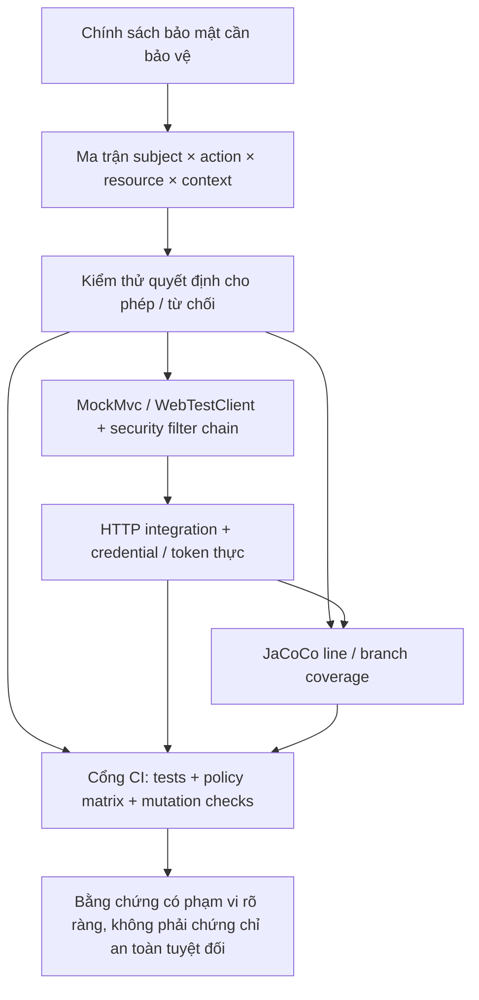
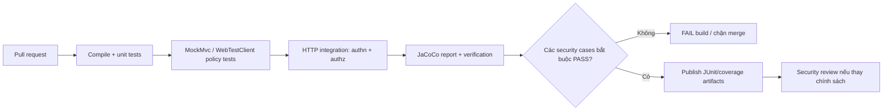

# Độ bao phủ mã không tự chứng minh đủ độ bao phủ chính sách

Một pipeline CI có thể báo **100% line coverage**, **100% branch coverage** và toàn bộ test đều xanh, trong khi người dùng không có quyền vẫn đọc được tài liệu của người khác. Vấn đề là **độ bao phủ mã** và **độ bao phủ chính sách bảo mật** trả lời hai câu hỏi khác nhau:

- **Code coverage** hỏi: những dòng lệnh, nhánh điều kiện hoặc instruction nào đã được thực thi trong các lần chạy test?
- **Security policy coverage** hỏi: những quyết định *cho phép* và *từ chối* nào đã được chứng minh đúng với mỗi loại chủ thể, thao tác, tài nguyên, ngữ cảnh và ranh giới xác thực quan trọng?

Không có công cụ đo line/branch coverage nào có thể tự suy ra toàn bộ chính sách truy cập mà doanh nghiệp mong muốn. Đó là lý do một bộ kiểm thử Spring Security tốt phải kết hợp **coverage kỹ thuật**, **ma trận chính sách**, **các ca âm tính**, **kiểm thử giao thức xác thực thật** và **các cổng CI kiểm tra kết quả**.

Bài học thuộc chương **Bộ kiểm thử và CI** của module **SPRING_SECURITY_TESTING**. Ví dụ dùng `spring-security-test`, `MockMvc`, `@WithMockUser`, `SecurityContext`, `@PreAuthorize`, sau đó mở rộng sang `WebTestClient`, JWT/OAuth2/OIDC, CSRF, kiểm thử HTTP thật và JaCoCo. Mục tiêu không phải đạt một con số đẹp, mà là có **bằng chứng kiểm thử đủ sức phát hiện những thay đổi làm mất chính sách**.

## 1. 100% branch coverage vẫn có thể bỏ sót lỗ hổng

Xét hàm phân quyền sau:

```java
boolean canRead(
        String requester,
        String owner,
        boolean isAdministrator) {

    if (isAdministrator) {
        return true;
    }
    return requester.equals(owner);
}
```

Giả sử chỉ có hai ca test:

```java
@Test
void adminMayRead() {
    assertThat(canRead("root", "alice", true)).isTrue();
}

@Test
void ownerMayRead() {
    assertThat(canRead("alice", "alice", false)).isTrue();
}
```

Hai test đã chạy cả nhánh `if` đúng và nhánh `if` sai, nên có thể đạt độ bao phủ dòng/nhánh rất cao, thậm chí 100% đối với đoạn mã này. Nhưng chưa có ca nào hỏi:

> Bob không phải owner và cũng không phải admin thì sao?

Chỉ cần một thay đổi lỗi:

```java
boolean canRead(
        String requester,
        String owner,
        boolean isAdministrator) {

    if (isAdministrator) {
        return true;
    }
    return true; // BUG: mọi người dùng đều đọc được tài liệu!
}
```

Cả hai test ban đầu **vẫn xanh**. Kiểm thử không hề phản đối lỗi “mọi người đọc được mọi tài liệu” vì các assertion chỉ kiểm tra các trường hợp **cho phép**.

Bổ sung ca âm tính:

```java
@Test
void nonOwnerWithoutAdminRoleMustBeDenied() {
    assertThat(canRead("bob", "alice", false)).isFalse();
}
```

Giờ đây nếu nhánh không phải admin bị đổi thành `return true`, test sẽ thất bại.

**Bài học:** line/branch coverage là tín hiệu cho biết code đã được chạy, không phải chứng minh điều kiện phân quyền đã được kiểm tra đúng trên đủ loại input. Ngay cả khi branch coverage là 100%, không gian dữ liệu như *owner khác người gọi*, *tenant khác nhau*, *token đã hết hạn* hay *request thiếu CSRF* vẫn có thể bị bỏ sót.

## 2. Phân biệt năm tầng bằng chứng trong Spring Security Testing



| Tầng | Câu hỏi đang trả lời | Công cụ minh họa | Điều không được suy ra |
| --- | --- | --- | --- |
| Code coverage | Code nào đã chạy? | JaCoCo, line/branch report | Không tự biết một rule bảo mật có đúng không |
| Unit policy test | Hàm/policy có trả allow/deny đúng input? | JUnit, Mockito, AssertJ | Không chắc Spring Security đã gọi policy |
| HTTP authorization test | Security chain có chặn request đúng nơi? | `MockMvc`, `WebTestClient`, `@WithMockUser`, `mockJwt()` | Không chứng minh xác thực mật khẩu/chữ ký/token thực |
| HTTP authentication integration | Credential thật được parser/decoder/IdP xử lý đúng? | `@SpringBootTest(RANDOM_PORT)`, Basic/Bearer, fake IdP | Không chứng minh policy chưa có trong đặc tả đã đầy đủ |
| Policy evidence/CI | Những quyết định quan trọng có test và fail gate? | Requirement IDs, test reports, review và policy mutation | Không tự thay thế threat modeling/audit độc lập |

Đừng ghép năm tầng thành một chỉ số duy nhất rồi gọi đó là “độ an toàn 95%”. Một phần mềm có nhiều test vẫn có thể thiếu một quy tắc nghiệp vụ quan trọng chưa từng được mô tả.

## 3. Chính sách là tổ hợp của nhiều chiều, không chỉ có role

Một quyết định truy cập có thể phụ thuộc:

```text
decision = policy(
    subject,       // anonymous, user, admin, service account
    action,        // GET / POST / DELETE / approve
    resource,      // tài liệu, đơn hàng, tài khoản
    relationship,  // owner, người được chia sẻ, người ngoài
    tenant,        // tenant A, tenant B
    attributes,    // scope, account state, subscription
    context        // time, MFA, IP/device, CSRF/session
)
```

Ví dụ chính sách tài liệu:

- **P-01:** Người chưa đăng nhập không được đọc tài liệu riêng tư.
- **P-02:** Owner của tài liệu được đọc tài liệu đó.
- **P-03:** User đã đăng nhập nhưng không phải owner/admin không được đọc.
- **P-04:** Admin nội bộ được đọc tài liệu theo đúng phạm vi quản trị được quy định.
- **P-05:** Không user nào được dùng ID tài liệu của tenant B để vượt ranh giới tenant A nếu không có quyền cross-tenant được phê duyệt.
- **P-06:** Chỉ editor được tạo tài liệu; nếu ứng dụng dùng session/cookie, request tạo dữ liệu còn phải đáp ứng quy tắc CSRF.
- **P-07:** Bearer token thiếu, sai chữ ký, hết hạn, sai issuer/audience hoặc bị thu hồi phải bị từ chối theo loại cơ chế xác thực.
- **P-08:** Endpoint không được khai báo public phải có fallback bảo vệ, kể cả khi team thêm route mới.

Đây là **các yêu cầu giả định cho ví dụ học tập**; dự án thực phải xác nhận chúng với product/security owner. Không nên tự đặt chính sách admin cross-tenant hoặc mã `404`/`403` rồi coi đó là đặc tả production.

### 3.1. Tạo ma trận chính sách từ yêu cầu

| Policy ID | Subject | Action + resource | Ngữ cảnh | Kết quả dự kiến | Test evidence |
| --- | --- | --- | --- | --- | --- |
| P-01 | Anonymous | GET tài liệu riêng tư | Không credential | `401` hoặc login redirect theo entry point | `anonymousCannotReadDocument` |
| P-02 | Alice | GET doc-A | Alice là owner | `200` | `ownerMayReadOwnDocument` |
| P-03 | Bob | GET doc-A | Bob không là owner/admin | `403` | `outsiderCannotReadDocument` |
| P-04 | Admin có quyền phù hợp | GET doc-A | Quyền admin nằm trong tenant được phép | `200` | `adminCanReadAllowedDocument` |
| P-05 | Alice tenant A | GET doc-B tenant B | Không có quyền cross-tenant | Từ chối hoặc `404` theo contract | `crossTenantAccessDenied` |
| P-06 | Editor | POST tài liệu | CSRF bắt buộc trong app có cookie | `403` khi thiếu CSRF | `postWithoutCsrfDenied` |
| P-07 | Client gửi JWT hết hạn | GET tài nguyên | Decoder JWT thật | `401` | `expiredJwtRejected` |
| P-08 | User thường | DELETE route chỉ dành admin | Không có vai trò admin | `403` | `deleteRequiresAdmin` |

Một ô trong ma trận phải có **đầu vào, kết quả và bằng chứng**. Chỉ ghi “GET cần authentication” là chưa đủ để kiểm tra việc người đã xác thực có được đọc *tài nguyên của người khác* hay không.

Một ma trận tốt còn lưu **nguồn yêu cầu** (security design, ticket, policy document), mức rủi ro, người chịu trách nhiệm và test ID. CI có thể kiểm tra test nào thuộc nhóm security bắt buộc; review có thể đối chiếu việc thay đổi policy với các ô cần thêm/sửa.

### 3.2. Tránh bùng nổ tổ hợp

Không cần chạy toàn bộ tích Descartes của mọi vai trò, endpoint, tenant, trạng thái token, HTTP method và browser. Cách lựa chọn hợp lý:

1. Chọn **equivalence classes**: anonymous, owner, non-owner, admin, service account.
2. Chọn **boundary cases**: token vừa hết hạn, expiry cách xa skew, tài nguyên vừa bị chuyển ownership, permission vừa bị thu hồi.
3. Ưu tiên **cross-boundary cases**: user tenant A truy cập tenant B, token dành cho audience khác, POST thiếu CSRF, endpoint mới chưa khai báo quyền.
4. Chọn ít nhất một ca **allow** và một ca **deny** cho mỗi quy tắc quan trọng.
5. Dùng `@ParameterizedTest` để biểu diễn các tổ hợp giống cấu trúc, không dùng chúng để che giấu các yêu cầu có ý nghĩa khác nhau.

**Coverage về chính sách** là việc kiểm tra các quyết định đã được chọn theo threat model và đặc tả; không phải khẳng định đã duyệt hết mọi input có thể tồn tại.

## 4. Ví dụ thực hành: code được chạy nhưng policy bị bỏ qua

Dựng một Spring MVC API:

```http
GET /api/documents/{id}
```

Quy tắc giản lược cho ví dụ: user **đã đăng nhập** được đọc tài liệu nếu là owner hoặc có `ROLE_ADMIN`. Ở phần code đầu tiên, chưa triển khai tenant isolation; mục 7 sẽ giải thích vì sao đây là một yêu cầu **riêng**, cần thêm code/test khi ứng dụng có đa tenant.

### 4.1. Model và repository

```java
record DocumentRecord(
    String id,
    String owner,
    String content
) {}

record DocumentView(
    String id,
    String content
) {}

interface DocumentRepository {
    Optional<DocumentRecord> findById(String id);
}
```

Repository là một boundary do dự án định nghĩa. Trong unit/HTTP security test ban đầu, ta mock repository để tạo dữ liệu cố định, không phụ thuộc cơ sở dữ liệu.

### 4.2. Giữ policy thành một bean thực

```java
@Component("documentPolicy")
class DocumentPolicy {

    private final DocumentRepository repository;

    DocumentPolicy(DocumentRepository repository) {
        this.repository = repository;
    }

    public boolean canRead(Authentication auth, String documentId) {
        if (auth == null ||
                auth instanceof AnonymousAuthenticationToken) {
            return false;
        }

        boolean isAdmin = auth.getAuthorities().stream()
            .anyMatch(authority ->
                "ROLE_ADMIN".equals(authority.getAuthority()));

        return repository.findById(documentId)
            .map(doc -> isAdmin || doc.owner().equals(auth.getName()))
            .orElse(false);
    }
}
```

Chú ý: `isAdmin` chỉ bypass kiểm tra **owner** trong ví dụ, không có nghĩa được bypass tenant/organization trong sản phẩm thật. Đừng dùng role `ADMIN` chung chung nếu ứng dụng có admin theo từng tenant; ở đó cần quyền quản trị có phạm vi phù hợp.

### 4.3. Method security nằm trên service thực

```java
@Service
class DocumentService {

    private final DocumentRepository repository;

    DocumentService(DocumentRepository repository) {
        this.repository = repository;
    }

    @PreAuthorize("@documentPolicy.canRead(authentication, #p0)")
    public DocumentView getDocument(String id) {
        DocumentRecord doc = repository.findById(id)
            .orElseThrow(() ->
                new ResponseStatusException(
                    HttpStatus.NOT_FOUND,
                    "Document not found"
                )
            );

        return new DocumentView(doc.id(), doc.content());
    }
}
```

`#p0` là tham số đầu tiên của method trong SpEL, tránh phụ thuộc tên parameter khi biên dịch. Quan trọng hơn, `@PreAuthorize` chỉ có hiệu lực khi **Spring method security được bật** và method được gọi qua bean proxy phù hợp. Đừng tạo `new DocumentService(...)` trong unit test rồi coi đó là bài kiểm tra method security; tự gọi trực tiếp bypass AOP proxy.

Controller:

```java
@RestController
class DocumentController {

    private final DocumentService service;

    DocumentController(DocumentService service) {
        this.service = service;
    }

    @GetMapping("/api/documents/{id}")
    DocumentView read(@PathVariable String id) {
        return service.getDocument(id);
    }
}
```

Cấu hình bảo mật:

```java
@Configuration
@EnableMethodSecurity
class DocumentSecurityConfig {

    @Bean
    SecurityFilterChain securityFilterChain(HttpSecurity http)
            throws Exception {

        return http
            .authorizeHttpRequests(requests -> requests
                .requestMatchers(
                    HttpMethod.GET,
                    "/api/documents/**"
                ).authenticated()
                .anyRequest().denyAll()
            )
            .httpBasic(Customizer.withDefaults())
            .build();
    }
}
```

Ta cố ý chia trách nhiệm:

- HTTP chain chặn anonymous ở biên, đảm bảo những request không xác thực không tới controller.
- `DocumentService` thực sử dụng `@PreAuthorize` để kiểm tra **owner/admin**.
- `DocumentPolicy` thực truy vấn repository và so sánh identity.
- `DocumentRepository` là dependency có thể mock để kiểm tra logic bảo mật, nhưng không mock `DocumentService` nếu muốn chứng minh method security trên service.

**Không nhầm `anyRequest().denyAll()` với việc những GET đã khai báo đều an toàn**: GET của người đã xác thực vẫn cần policy theo owner phía service. Nếu method security bị gỡ, một authenticated Bob có thể đọc tài liệu Alice.

## 5. Một bộ MockMvc test chứng minh allow và deny

Test sử dụng `@SpringBootTest`, `@AutoConfigureMockMvc` và `@MockitoBean DocumentRepository`. `@WithMockUser`/`user(...)` chỉ tạo authentication giả cho inbound request; authentication provider mật khẩu không phải mục tiêu ở đây.

```java
@SpringBootTest
@AutoConfigureMockMvc
class DocumentPolicyHttpTest {

    @Autowired MockMvc mvc;

    @MockitoBean DocumentRepository repository;

    @BeforeEach
    void documents() {
        when(repository.findById("doc-a"))
            .thenReturn(Optional.of(
                new DocumentRecord("doc-a", "alice", "A's report")
            ));

        when(repository.findById("doc-b"))
            .thenReturn(Optional.of(
                new DocumentRecord("doc-b", "bob", "B's report")
            ));
    }

    @Test
    void anonymousCannotReadDocument() throws Exception {
        mvc.perform(get("/api/documents/doc-a"))
            .andExpect(status().isUnauthorized());
    }

    @Test
    @WithMockUser(username = "alice")
    void ownerMayReadOwnDocument() throws Exception {
        mvc.perform(get("/api/documents/doc-a"))
            .andExpect(status().isOk())
            .andExpect(jsonPath("$.id").value("doc-a"));
    }

    @Test
    @WithMockUser(username = "bob")
    void outsiderCannotReadDocument() throws Exception {
        mvc.perform(get("/api/documents/doc-a"))
            .andExpect(status().isForbidden());
    }

    @Test
    @WithMockUser(username = "admin", roles = "ADMIN")
    void adminCanReadAllowedDocument() throws Exception {
        mvc.perform(get("/api/documents/doc-a"))
            .andExpect(status().isOk());
    }
}
```

Trong Spring Framework 6.2+ (ví dụ Spring Boot 3.4+), `@MockitoBean` thuộc `org.springframework.test.context.bean.override.mockito.MockitoBean`; với Spring Boot cũ hơn chưa hỗ trợ annotation này, dùng `@MockBean` phù hợp. Ví dụ giả định controller, service, policy và security config đều được Spring Boot component scan.

Vì `@WithMockUser` được tạo bởi Spring Security Test và HTTP chain bật Basic entry point, kết quả điển hình là:

- Anonymous ⇒ `401 Unauthorized`.
- Alice owner ⇒ `200 OK`.
- Bob authenticated nhưng không owner/admin ⇒ `403 Forbidden`.
- Admin ⇒ `200 OK`.

Bộ test này có giá trị hơn một test “mọi dòng đều chạy” vì nó kiểm tra rõ **nhánh từ chối**. Đồng thời nhớ rằng `@WithMockUser` **không kiểm chứng Basic password hoặc JWT signature thật**.

### 5.1. Dùng parameterized test làm ma trận dễ đọc

Các ca truy cập user đã xác thực có thể gom thành một test có đầu vào và expected status rõ ràng:

```java
@ParameterizedTest(name = "{0} GET {1} => {3}")
@MethodSource("accessCases")
void documentedAccessCases(
        String username,
        String documentId,
        String authority,
        int expectedStatus) throws Exception {

    mvc.perform(
        get("/api/documents/{id}", documentId)
            .with(user(username).authorities(
                new SimpleGrantedAuthority(authority)
            ))
    )
    .andExpect(status().is(expectedStatus));
}

static Stream<Arguments> accessCases() {
    return Stream.of(
        Arguments.of("alice", "doc-a", "ROLE_USER", 200),
        Arguments.of("alice", "doc-b", "ROLE_USER", 403),
        Arguments.of("bob",   "doc-a", "ROLE_USER", 403),
        Arguments.of("bob",   "doc-b", "ROLE_USER", 200),
        Arguments.of("admin", "doc-a", "ROLE_ADMIN", 200),
        Arguments.of("admin", "doc-b", "ROLE_ADMIN", 200)
    );
}
```

Đoạn này có thể đặt **trong `DocumentPolicyHttpTest` ở trên**, tái sử dụng `@BeforeEach` để stub hai document. `user(username)` là `SecurityMockMvcRequestPostProcessors.user(...)`; nó gắn principal giả vào một request MockMvc. Đảm bảo Spring Security Test đã tích hợp vào MockMvc (với `@AutoConfigureMockMvc` và security auto-configuration theo Spring Boot chuẩn).

Khi có thêm tenant, department, state hoặc action, ma trận cần được mở rộng tương ứng, chứ không chỉ thêm một dòng test có expected `200`. Mỗi ca có thể gắn ID chính sách vào tên hiển thị hoặc `@DisplayName` để người review biết mình đang bảo vệ yêu cầu nào.

### 5.2. Tại sao cần test chính service thật?

Một anti-pattern phổ biến:

```java
@WebMvcTest(DocumentController.class)
class ControllerOnlyTest {

    @MockitoBean DocumentService service;

    @Test
    @WithMockUser(username = "bob")
    void mayLookSuccessfulWithoutCheckingOwnership() {
        when(service.getDocument("doc-a"))
            .thenReturn(new DocumentView("doc-a", "A's report"));

        // Nếu HTTP chain chỉ yêu cầu authenticated(),
        // controller sẽ gọi mock service và có thể trả 200.
    }
}
```

Khi mock `DocumentService`, annotation `@PreAuthorize` nằm trên service thực **không còn được thực thi trong lời gọi đó**. Test MVC slice vẫn hữu ích cho mapping/JSON/HTTP rule, nhưng không được dùng kết quả xanh để khẳng định method security trên `DocumentService` đang bảo vệ owner. Test cần nạp service thật qua Spring proxy hoặc có một integration test khác chuyên kiểm chứng method security.

### 5.3. Thêm assertion về tác dụng phụ

Với hành động ghi, xóa, chuyển tiền hoặc duyệt hồ sơ, chỉ assert `403` chưa đủ: service có thể đã ghi DB rồi exception mới phát sinh. Cần kiểm tra **không có tác dụng phụ** khi request bị từ chối:

- Không tạo/chỉnh sửa record.
- Không phát message/event ra queue.
- Không gửi email/webhook.
- Không gọi downstream API có side effect.
- Không để transaction đã commit trước khi `@PostAuthorize` từ chối.

Với logic nhạy cảm, ưu tiên authorization **trước khi thực hiện side effect**. Test nên dùng repository hoặc fake downstream để assert không có write/call, thay vì chỉ kiểm tra response status.

## 6. Ma trận phải có cả xác thực, phân quyền và ngữ cảnh HTTP

Ở một ứng dụng thật, còn các chiều ngoài owner/admin. Hãy mở rộng bộ kiểm thử thành nhóm có mục đích riêng:

| Nhóm | Ca cho phép | Ca từ chối | Bằng chứng cần có |
| --- | --- | --- | --- |
| Anonymous/authenticated | User hợp lệ đọc tài nguyên | Không credential → `401` | Security filter chain thật |
| Role/scope | Scope đúng | Scope sai → `403` | Mapping authority đúng |
| Ownership/IDOR | Owner GET tài nguyên của mình | Non-owner GET cùng ID → `403/404` theo contract | Policy thực được gọi |
| Tenant isolation | User tenant A đọc record tenant A | User tenant A đọc record tenant B | Kiểm tra owner + tenant cùng lúc |
| HTTP methods | GET read-only được phép | POST/DELETE trái quyền bị từ chối | Không chỉ thử một HTTP method |
| CSRF | Browser session + token hợp lệ | POST thiếu/sai CSRF → `403` | CSRF filters trong chain |
| JWT | JWT ký đúng, issuer/audience/scope đúng | Chữ ký sai, hết hạn, sai issuer/aud → `401` nếu validator cấu hình | Decoder và validator thật |
| Opaque token | `active:true` và đúng scope | `active:false` → `401` | HTTP introspection thật hoặc fixture rõ ràng |
| OAuth2/OIDC login | Callback state/code/ID token hợp lệ | Sai state/nonce/chữ ký → login thất bại | Không chỉ dùng login mutator |
| Custom API key/filter | Key hợp lệ | Missing/revoked key → `401` | Filter thực được gọi, không chỉ bơm principal |
| Fallback/default deny | Route có policy rõ ràng | Route mới không nằm allowlist | Security matcher và fallback chain |
| Session & logout | Cookie session đúng | Cookie hết hạn/revoked, CSRF sai | HTTP integration, trạng thái session |

Đừng cố coi mọi `403` là cùng một lỗi. Request user đã xác thực thiếu quyền thường tạo `403`, nhưng request POST thiếu CSRF cũng có thể trả `403` trước khi kiểm tra quyền. Cần kiểm tra **nguyên nhân** và đôi khi cả việc service không được gọi.

### 6.1. 401, 403 hay 404 phụ thuộc contract

- `401 Unauthorized`: không có authentication hợp lệ theo entry point đang dùng.
- `403 Forbidden`: đã xác thực nhưng không đủ quyền, hoặc bị cơ chế khác như CSRF từ chối.
- `404 Not Found`: một số hệ thống cố ý che sự tồn tại của resource người gọi không được xem; phải là chính sách được thiết kế rõ, không phải default áp dụng cho mọi trường hợp.
- Redirect tới login: xảy ra với form/OAuth2 login, không nhất thiết là lỗi test.

Một ma trận quality gate không nên hard-code rằng **mọi anonymous request đều trả 401**. Để test đúng, phải đọc policy entry point/exception handling và quyết định bảo mật của từng endpoint.

### 6.2. JWT mutator kiểm tra policy, không kiểm tra mật mã

Với `MockMvc`, `.with(jwt())`; với `WebTestClient`, `.mutateWith(mockJwt())` có thể cấp sẵn `JwtAuthenticationToken` đã xác thực. Dù claims có `exp` cũ hoặc `iss` sai, mutator không tự gọi decoder thật để xác minh.

Nếu security policy quan tâm một claim `scope`, mutator rất hữu ích để kiểm tra phép ánh xạ/đánh giá authority **khi bạn cấp authority cụ thể**. Nhưng để kiểm chứng chữ ký/issuer/audience/expiration, bổ sung test Bearer header với `JwtDecoder`/`ReactiveJwtDecoder` thật và token JWS được ký bằng khóa test. Với opaque token, bổ sung HTTP introspection hoặc test implementation introspector thực. Đừng ghi “JWT validation covered” chỉ vì có nhiều test `mockJwt()`.

## 7. Policy coverage cần ghi rõ phạm vi và khả năng truy vết

Một báo cáo policy nên có:

- **Policy ID** và mô tả quyết định, ví dụ P-03 “non-owner cannot read”.
- **Subject + action + resource + context**, không chỉ endpoint.
- **Expected outcome** và cách diễn giải status/body/header/tác dụng phụ.
- **Test name**, tầng test (unit, MockMvc, WebTestClient, HTTP integration), fixture và cách tạo credential.
- **Kết quả CI**, lịch sử thất bại, owner xử lý và tình trạng quarantine nếu có.
- **Khoảng trống chưa kiểm tra**: tenant isolation, token revocation, event side effect, phương thức HTTP mới.

Có thể tính một tỷ lệ tham khảo:

```text
policy_case_coverage =
    số trường hợp chính sách đã có test thực thi/đạt
    ------------------------------------------------
    tổng số trường hợp chính sách đã được lập danh mục
```

**Không coi tỷ lệ này là chứng nhận bảo mật.** Nếu danh mục thiếu quy tắc “Bob không được đọc tài liệu Alice”, `policy_case_coverage = 100%` vẫn có thể đi cùng lỗ hổng nghiêm trọng. Vì vậy cần review danh mục theo threat model và những thay đổi sản phẩm, không chỉ review số.

Nếu policy được định nghĩa với nhiều điều kiện, ngoài các dòng allow/deny nên có ca kiểm tra **ranh giới điều kiện**: cùng user nhưng owner thay đổi, cùng role nhưng tenant khác, cùng token nhưng scope mất, cùng request nhưng CSRF không hợp lệ.

### 7.1. Đặt priority theo rủi ro

Khi thời gian CI có giới hạn, ưu tiên chạy các policy cases có thiệt hại cao nhất: lộ dữ liệu cá nhân, truy cập cross-tenant, phê duyệt giao dịch, thao tác admin, token giả/expired, SSRF hoặc quyền được ủy quyền bất hợp lệ. Một ca formatting response ít rủi ro không thể thay thế một ca non-owner deny cho endpoint nhạy cảm.

**Security regression suite** cần có khả năng chạy nhanh trên mỗi pull request; những integration tests phụ thuộc nhiều dịch vụ có thể chạy thêm ở pipeline riêng, nhưng không nên để critical authorization regressions chỉ được phát hiện trong một job ít khi thực thi.

## 8. Mutation testing: thay đổi policy có làm test đỏ không?

Một câu hỏi thực dụng hơn code coverage là:

> Nếu ai đó vô tình làm policy **dễ dãi hơn**, test có thất bại không?

Với ví dụ ở mục 4, thử thay:

```java
// Ban đầu:
@PreAuthorize("@documentPolicy.canRead(authentication, #p0)")

// Mutation nguy hiểm:
@PreAuthorize("isAuthenticated()")
```

Nếu bộ test chỉ có Alice đọc tài liệu Alice, cả hai phiên bản đều xanh. Ca Bob đọc tài liệu Alice kỳ vọng `403` sẽ bắt được mutation này.

Các mutation bảo mật đáng thử:

| Thay đổi lỗi giả định | Test cần bắt lỗi |
| --- | --- |
| `hasAuthority("SCOPE_reports.read")` → `authenticated()` | User đăng nhập thiếu scope vẫn phải bị `403` |
| Xóa `@PreAuthorize` | Non-owner không được đọc/ghi dữ liệu |
| `tenantId.equals(resource.tenantId)` → luôn `true` | Cross-tenant access bị từ chối |
| `denyAll()` fallback → `permitAll()` | Route không có khai báo rõ vẫn bị từ chối |
| Tắt `csrf()` | POST dùng browser credential nhưng thiếu token không được xử lý |
| Bỏ `exp` validator của JWT | Token quá hạn bị `401` trong integration test decoder thật |
| Cấp `ROLE_ADMIN` cho mọi client | User thường không gọi được endpoint admin |
| Gọi service trước khi từ chối | Không phát sinh DB write/event khi deny |

Các công cụ như PIT có thể tạo mutation ở mức Java bytecode và báo mutant nào bị test tiêu diệt. Tuy nhiên, **không mặc định công cụ mutation tự sửa mọi annotation `@PreAuthorize`, chuỗi SpEL, cấu hình DSL hoặc rule từ database**. Cần review những phần không được công cụ đụng tới và có thể thử thay đổi có kiểm soát trên nhánh riêng rồi khôi phục. Không chỉnh production policy chỉ để kiểm thử trực tiếp trên nhánh phát hành.

Mutation score cũng không phải chứng nhận không còn lỗ hổng: các mutation được sinh ra chỉ bao phủ tập thay đổi mà công cụ/nhóm đã định nghĩa.

### 8.1. Phân biệt “test tồn tại” và “test đủ nhạy”

Một test có tên `cannotReadOtherTenant` nhưng chỉ assert response khác `500` là test yếu. Nếu đổi policy sang `permitAll` mà test vẫn xanh, nó không giữ được yêu cầu. Tốt hơn là assert status đúng contract, kiểm tra identity/tenant ở body nếu được phép và verify không có side effect khi bị từ chối.

Số lượng test lớn hoặc tỷ lệ line coverage cao không bù được test có assertion quá rộng.

## 9. JaCoCo trong Gradle: hữu ích nhưng chỉ là một cổng

Đối với dự án Gradle, một cấu hình minh họa:

```groovy
plugins {
    id 'java'
    id 'jacoco'
}

tasks.named('test') {
    useJUnitPlatform()
}

tasks.named('jacocoTestReport') {
    dependsOn tasks.named('test')
    reports {
        xml.required = true
        html.required = true
    }
}

tasks.named('jacocoTestCoverageVerification') {
    dependsOn tasks.named('test')
    violationRules {
        rule {
            limit {
                counter = 'BRANCH'
                value = 'COVEREDRATIO'
                minimum = 0.80
            }
        }
    }
}

tasks.named('check') {
    dependsOn tasks.named('jacocoTestCoverageVerification')
}
```

Đây là **cấu hình ví dụ**, không phải một ngưỡng được đề xuất cho mọi hệ thống. `minimum = 0.80` chỉ minh họa cách đặt cổng branch coverage. Hệ thống có nhiều controller mỏng, code generated hoặc domain security logic phức tạp cần quy tắc đo lường và loại trừ lớp được xem xét riêng.

Những giới hạn quan trọng:

- JaCoCo đo instruction/line/branch của bytecode được instrument, **không hiểu semantics của security policy**.
- Một method có đủ branch coverage vẫn có thể không có ca *outsider deny*.
- `@PreAuthorize` là metadata/SpEL được Spring AOP xử lý; chỉ đo bytecode service không chứng minh interceptor đã được kích hoạt.
- Nếu chỉ chạy unit test, report có thể **không bao gồm integration tests** dùng `*IT`.
- Một job CI gọi `jacocoTestReport` mà không kiểm tra `jacocoTestCoverageVerification` có thể chỉ xuất report, **không fail** khi coverage giảm.

Đừng dùng threshold coverage làm điều kiện **duy nhất** để merge. Hãy giữ security tests là bước bắt buộc và đảm bảo các test quan trọng thực sự được thực thi.

## 10. Tách unit tests và integration tests mà không để CI bỏ sót

Nhiều nhóm đặt tên test tích hợp `*IT` và tách thành task `integrationTest`. Nhưng khi CI chỉ chạy `./gradlew test`, những test đó có thể không được chọn.

Ví dụ Gradle sử dụng cùng `sourceSets.test` cho đơn giản (trong dự án lớn có thể tách source set riêng):

```groovy
tasks.named('test') {
    useJUnitPlatform()
    exclude '**/*IT.class'
}

tasks.register('integrationTest', Test) {
    description = 'Run HTTP/security integration tests'
    group = 'verification'

    testClassesDirs = sourceSets.test.output.classesDirs
    classpath = sourceSets.test.runtimeClasspath

    useJUnitPlatform()
    include '**/*IT.class'
    shouldRunAfter tasks.named('test')
}

tasks.named('check') {
    dependsOn tasks.named('integrationTest')
}
```

**Lưu ý:** đây là đoạn bổ sung vào build đã có `java` plugin và `test` task. Test class đặt tên `PolicyHttpIT`/`JwtDecoderIT` phải có mặt trong compiled test output. Nếu sử dụng JUnit Platform tags thay vì naming, cấu hình include/exclude tags theo convention và chạy đúng cả hai tập.

Trong cách tách này, JaCoCo report được gắn mặc định với `test` task **không tự động cộng coverage từ `integrationTest`**. Nếu muốn đo coverage tổng, phải cấu hình execution data từ cả hai task rồi tạo một report tương ứng. Dù report tổng tăng, các security policy cases vẫn cần cổng kiểm soát độc lập.

Có thể kiểm tra hiệu lực CI bằng cách chạy thử một **negative security test cố ý thất bại trên nhánh thử nghiệm** và xác nhận job thật sự fail. Đừng chỉ nhìn log “BUILD SUCCESSFUL” mà không biết suite `*IT` có chạy hay không.

## 11. CI cần chặn regression bảo mật, không chỉ xuất dashboard đẹp

Một pipeline đề xuất:



Một ví dụ workflow GitHub Actions, với giả định Gradle đã khai báo task `integrationTest` và JaCoCo verification như các mục trên:

```yaml
name: Security tests

on:
  push:
  pull_request:

jobs:
  security:
    runs-on: ubuntu-latest

    steps:
      - uses: actions/checkout@v4

      - uses: actions/setup-java@v4
        with:
          distribution: temurin
          java-version: '17'
          cache: gradle

      - name: Run unit, policy and HTTP integration tests
        run: |
          chmod +x ./gradlew
          ./gradlew --no-daemon clean test integrationTest jacocoTestReport jacocoTestCoverageVerification

      - name: Publish test reports
        if: always()
        uses: actions/upload-artifact@v4
        with:
          name: security-test-reports
          path: |
            build/test-results/
            build/reports/tests/
            build/reports/jacoco/
          if-no-files-found: warn
```

Các phiên bản action và cách đặt tên task là **minh họa**; khi đưa vào repository thật cần kiểm tra version/action policy của tổ chức. Nếu test cần Postgres, Redis hoặc Authorization Server giả, hãy cấu hình Testcontainers hoặc service containers riêng, không dùng database hay secret của production.

Trong CI, fail gate cần bao gồm:

1. **Compile/test thất bại ⇒ build đỏ.**
2. **Test deny critical thất bại ⇒ build đỏ**, không chỉ xuất cảnh báo.
3. **Integration test dự kiến phải chạy**, không silent-skip vì tag/pattern/task chưa được nối.
4. **Coverage threshold** nếu có phải được verify chứ không chỉ generate.
5. **Policy review** khi code thay đổi ở `SecurityFilterChain`, `SecurityWebFilterChain`, `@PreAuthorize`, converters hoặc role/scopes; yêu cầu cập nhật ma trận và test evidence.
6. **Test artifacts sạch:** không lộ bearer token, client secret, raw API key, cookie session hoặc thông tin cá nhân.

Đừng “sửa” CI đỏ bằng `@Disabled`, bỏ một test khỏi task hoặc hạ threshold mà không có lý do/đánh giá rủi ro rõ ràng. Nếu có test không ổn định, cần điều tra, cô lập và theo dõi cụ thể — không thể coi quarantine vô thời hạn là trạng thái đạt chất lượng.

## 12. Kiểm thử Servlet và Reactive cùng một chính sách

Cùng một yêu cầu “Bob không được đọc tài liệu Alice” có thể được thi hành ở các tầng khác nhau:

| Hệ Servlet | Hệ Reactive |
| --- | --- |
| `HttpSecurity`, `SecurityFilterChain` | `ServerHttpSecurity`, `SecurityWebFilterChain` |
| `MockMvc`, `@WithMockUser`, `jwt()` | `WebTestClient`, `mockUser()`, `mockJwt()` |
| `SecurityContextHolder` | `ReactiveSecurityContextHolder`/Reactor Context |
| `JwtDecoder`, `OpaqueTokenIntrospector` | `ReactiveJwtDecoder`, `ReactiveOpaqueTokenIntrospector` |
| `@EnableMethodSecurity` | `@EnableReactiveMethodSecurity` |
| `@SpringBootTest(RANDOM_PORT)` + `TestRestTemplate` | `@SpringBootTest(RANDOM_PORT)` + `WebTestClient.bindToServer()` |

Với WebFlux, `mockUser()` gắn authentication giả vào reactive request. Khi kiểm tra method security/reactive context, cần bean thật được Spring quản lý và publisher được subscribe đúng. Một test chỉ `StepVerifier.create(service.method())` với service được `new` thủ công có thể bypass method security proxy.

### 12.1. Một test WebFlux chỉ kiểm tra authorization sau authentication

Ví dụ cho API JWT reactive có policy `SCOPE_reports.read`:

```java
client.mutateWith(mockJwt()
        .jwt(jwt -> jwt.claim("sub", "alice"))
        .authorities(
            new SimpleGrantedAuthority("SCOPE_reports.read")
        )
    )
    .get()
    .uri("/api/reports")
    .exchange()
    .expectStatus().isOk();

client.mutateWith(mockJwt()
        .jwt(jwt -> jwt.claim("sub", "bob"))
        .authorities(
            new SimpleGrantedAuthority("SCOPE_other.read")
        )
    )
    .get()
    .uri("/api/reports")
    .exchange()
    .expectStatus().isForbidden();
```

Đoạn này thuộc một test `@WebFluxTest`/`@SpringBootTest` **in-process** đã nạp `SecurityWebFilterChain` thật và gắn `springSecurity()` khi bind client thủ công. Nó chứng minh policy chấp nhận/từ chối dựa trên authentication giả, **không chứng minh** JWT đã được ký/kiểm tra hay bearer filter đã parse header.

Để kiểm tra xác thực thật trong WebFlux, gửi compact JWT qua HTTP header và dùng `ReactiveJwtDecoder` thật, hoặc kiểm tra HTTP introspection của opaque token. Một security suite cần ghi rõ đây là các **tầng bằng chứng bổ sung**, không hoán đổi.

## 13. Những lỗ hổng thường ẩn sau coverage cao

### 13.1. Chỉ thử role mà quên ownership/tenant

Ca “ROLE_USER được GET” có thể xanh cho mọi ID, trong khi ứng dụng cho phép IDOR (Insecure Direct Object Reference). Hãy kiểm tra owner, non-owner, admin có phạm vi phù hợp và cross-tenant bằng resource IDs thật khác nhau.

### 13.2. Chỉ thử GET mà quên POST/PUT/DELETE

Bảo vệ read endpoint không đảm bảo write endpoint cũng được bảo vệ. Khi có nhiều HTTP method, định nghĩa permission theo hành động và test cả các phương thức nhạy cảm. Một rule kiểu `requestMatchers("/api/documents/**").authenticated()` không thay cho quyền tạo/sửa/xóa theo nghiệp vụ.

### 13.3. Đo coverage controller nhưng policy nằm ở service/AOP

Test controller `@WebMvcTest` với service mock có thể phủ toàn bộ controller nhưng không chạy `@PreAuthorize` của service. Hãy bổ sung test với service thật qua Spring proxy hoặc integration test.

### 13.4. CSRF bị tắt trong test

Nếu production dùng session/cookie và bật CSRF, một cấu hình test tắt filter để test dễ xanh làm mất khả năng bắt tấn công CSRF. Đưa `csrf()` vào request hợp lệ trong `MockMvc`/`WebTestClient` in-process, thêm request thiếu token kỳ vọng `403`. Với HTTP thật, phải dùng token/cookie do server test cung cấp.

### 13.5. JWT/OIDC helper giả được gọi là “authentication end-to-end”

`jwt()`, `mockJwt()`, `oauth2Login()` hoặc `mockOidcLogin()` không thực hiện tất cả bước decoder/IdP login. Khi coverage cao mà các bước này không được test, lỗ hổng cấu hình issuer/audience, sai chữ ký hoặc callback state vẫn có thể tồn tại.

### 13.6. Không có test khi request bị từ chối nhưng side effect đã xảy ra

Ví dụ `@PostAuthorize` có thể từ chối sau khi method chạy. Nếu method gửi webhook hoặc đã commit ghi dữ liệu, `403` ở HTTP không đảm bảo hệ thống chưa tạo tác dụng phụ. Hãy quan sát record/event/downstream, cân nhắc chuyển authorization lên trước side effect.

### 13.7. Test chỉ chạy trong IDE, không được CI chọn

Tên class `*IT`, JUnit tag `integration` hay test ở source set riêng có thể bị bỏ qua khi pipeline chỉ chạy `test`. Phải kiểm tra số test chạy và task graph thực tế, rồi chặn merge khi suite security bắt buộc không được thực thi.

### 13.8. Test trả đúng status vì sai nguyên nhân

Một `403` có thể do thiếu CSRF, chứ không phải thiếu role; một `401` có thể do không gửi token, chứ không phải chữ ký sai. Tách từng loại nguyên nhân, giữ những điều kiện còn lại hợp lệ và có assertion phù hợp (kể cả verifier/decoder invocation nếu đó là ranh giới đang test).

## 14. Đề xuất quy trình review policy thay đổi

Khi pull request thêm một endpoint hoặc sửa rule, nhóm review có thể dùng một checklist ngắn:

1. **Policy mới/sửa là gì?** Xác định subject/action/resource/context, allow và deny, fallback.
2. **Nguy cơ bypass nào?** Owner khác, tenant khác, method khác, role rộng hơn, token/credential sai.
3. **Test hiện tại nào bảo vệ?** Kiểm tra test chạy với Spring Security chain và bean policy thật, không chỉ controller mock.
4. **Có negative test không?** Test phải thất bại nếu policy bị nới lỏng.
5. **Có side effect không?** Khi deny, không có ghi DB/event/HTTP call ngoài ý muốn.
6. **Authentication có được kiểm tra đúng tầng không?** Mock principal hay credential thật; có kiểm tra expiry/issuer/audience không?
7. **CI có chạy test này không?** Chạy qua task nào, job nào, artifact nào; thất bại có chặn merge không?
8. **Dữ liệu test có độc lập không?** Account/tenant ID/clock/session/cache được cô lập và cleanup.

Security review không cần một trang dashboard đồ sộ nếu từng yêu cầu chưa có test. Ngược lại, một ma trận gọn, có ID và negative case rõ ràng giúp reviewer đánh giá thay đổi policy hiệu quả hơn các con số tổng hợp.

## 15. Bài thực hành

1. Triển khai `canRead` ở mục 1. Chạy hai test cho admin và owner, rồi thêm ca Bob không phải owner. Thử thay nhánh `return requester.equals(owner)` bằng `return true` trên nhánh thử nghiệm và xác nhận negative test thất bại.
2. Tạo `DocumentController`, `DocumentService` và `DocumentPolicy` như mục 4. Bật `@EnableMethodSecurity`, giữ service/policy thật, mock `DocumentRepository`.
3. Viết `MockMvc` test anonymous `401`, owner `200`, non-owner `403`, admin `200`. Dùng ma trận tham số cho Alice, Bob và admin.
4. Thử cố ý mock `DocumentService` hoặc xóa `@PreAuthorize` trên nhánh thử nghiệm. Quan sát test nào còn xanh và test nào đỏ; giải thích sự khác biệt giữa controller coverage và method security coverage.
5. Bổ sung trường `tenantId` vào resource/identity fixture và quy tắc không truy cập cross-tenant. Viết ít nhất một ca Alice tenant A truy cập doc tenant B bị từ chối theo contract.
6. Thêm một POST có CSRF hoặc một Resource Server JWT vào ứng dụng mẫu. Viết test âm tính: POST thiếu CSRF `403`, hoặc JWT hết hạn/sai chữ ký `401` với decoder thật.
7. Cấu hình JaCoCo branch coverage và task `integrationTest`. Bảo đảm `check` và pipeline CI thực thi những test bảo mật quan trọng, không chỉ sinh HTML report.
8. Gắn ID chính sách vào ma trận, điền test evidence. Nếu một rule mới được thêm mà chưa có test deny, nêu rõ đó là **coverage gap**, không tự nâng mức tin cậy từ phần trăm JaCoCo.

**Tiêu chí hoàn thành:** bạn có thể giải thích vì sao 100% code coverage vẫn chưa chứng minh đủ security policy; biết chuyển yêu cầu thành ma trận allow/deny, có test HTTP chạy đúng security layer và có cổng CI làm regression bị phát hiện. Phát biểu cuối cùng luôn giới hạn ở **những quy tắc và những ranh giới đã được test**, không tuyên bố “ứng dụng an toàn tuyệt đối” dựa trên một chỉ số.

## Tài liệu tham khảo

- [Spring Security — Authorize HTTP Requests](https://docs.spring.io/spring-security/reference/servlet/authorization/authorize-http-requests.html): `SecurityFilterChain`, `requestMatchers` và fallback authorization.
- [Spring Security — Method Security](https://docs.spring.io/spring-security/reference/servlet/authorization/method-security.html): `@EnableMethodSecurity`, `@PreAuthorize` và Spring AOP.
- [Spring Security — Testing with MockMvc](https://docs.spring.io/spring-security/reference/servlet/test/mockmvc/index.html): `@WithMockUser` và request post-processors.
- [Spring Security — Reactive WebTestClient Setup](https://docs.spring.io/spring-security/reference/reactive/test/web/setup.html): `springSecurity()` và WebFlux security tests.
- [Spring Security — Reactive OAuth2 Testing](https://docs.spring.io/spring-security/reference/reactive/test/web/oauth2.html): `mockJwt()`, `mockOidcLogin()` và phạm vi giả lập.
- [Spring Boot — Testing Spring Boot Applications](https://docs.spring.io/spring-boot/reference/testing/spring-boot-applications.html): full-context/slice test, RANDOM_PORT và thực hiện HTTP tests.
- [JaCoCo — Coverage Counters](https://www.jacoco.org/jacoco/trunk/doc/counters.html): ý nghĩa của instruction, line, branch và các coverage counters.
- [Gradle JaCoCo Plugin](https://docs.gradle.org/current/userguide/jacoco_plugin.html): report và coverage verification tasks.
- [OWASP — Authorization Cheat Sheet](https://cheatsheetseries.owasp.org/cheatsheets/Authorization_Cheat_Sheet.html): kiểm tra quyền, deny-by-default và nguyên tắc least privilege.
