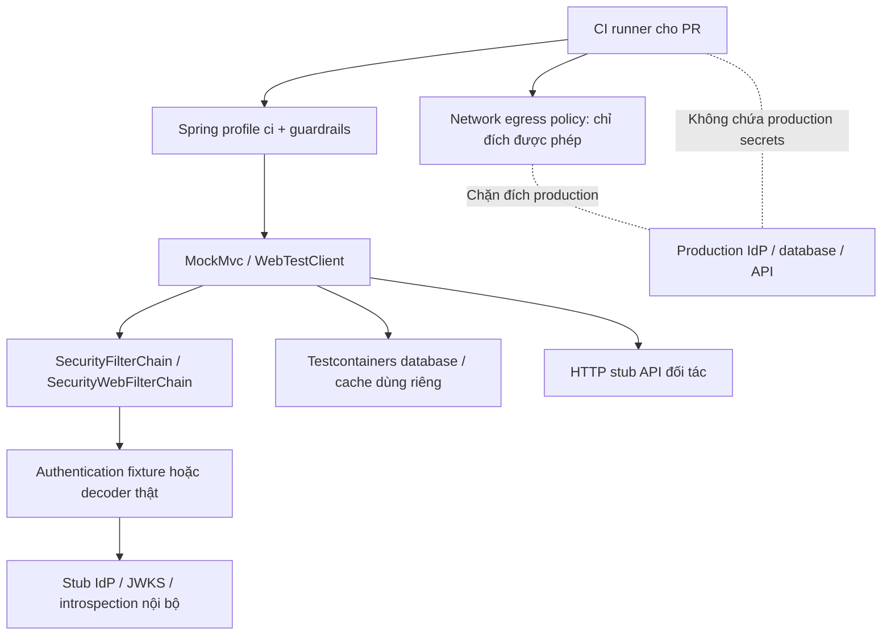

# Giữ môi trường CI độc lập với tài khoản và dịch vụ production

## 1. Vì sao đây là yêu cầu bắt buộc của bộ kiểm thử bảo mật?

Một ứng dụng Spring Boot có API đăng nhập, bảo vệ tài nguyên bằng JWT, gọi OAuth2 Identity Provider và lưu session/refresh token trong Redis. Trên máy phát triển, người viết test có thể đang đăng nhập VPN và có sẵn biến môi trường trỏ tới dịch vụ thật. Khi đưa test lên CI, một cấu hình thiếu ràng buộc có thể khiến bài test:

- Gửi mật khẩu hoặc client secret tới Identity Provider production.
- Xin access token bằng tài khoản production, tạo session thật hoặc kích hoạt MFA.
- Gọi endpoint thay đổi dữ liệu của người dùng thật.
- Sử dụng Redis/database production để lưu session, authorized client hoặc refresh token.
- Tải JWKS/discovery từ production, làm test phụ thuộc mạng và phát sinh lỗi bất ngờ khi hệ thống thật thay đổi.
- Làm lộ thông tin trong log CI khi request bị lỗi hoặc test framework in headers.

Bộ test có thể báo **PASS** nhưng vẫn là một sự cố về ranh giới môi trường. Ngược lại, khi dịch vụ production gián đoạn, bài test độc lập không nên thất bại nếu mục tiêu chỉ là kiểm tra security filter, quyền truy cập hoặc logic ứng dụng.

Bài này thuộc chương **Bộ kiểm thử và CI** của module **SPRING_SECURITY_TESTING**: kiểm chứng xác thực, phân quyền và bảo vệ HTTP bằng `spring-security-test` trên Servlet/MockMvc và Reactive/WebTestClient, sử dụng `@WithMockUser`, SecurityContext và JWT/OAuth2/OIDC giả lập. Trọng tâm là **không để test hoặc pipeline CI cần tài khoản, khóa, token hay dịch vụ production**, đồng thời vẫn đủ bằng chứng rằng cơ chế security hoạt động.

Mục tiêu học tập:

1. Thiết lập nguyên tắc “CI không có đường ghi hoặc quyền đăng nhập production”.
2. Phân tách credential giả, secret test, signing key test, token thật trong môi trường test và credential production.
3. Sử dụng mock Authentication đúng mục đích; dùng decoder/IdP/JWKS/introspection stub khi cần kiểm tra giao thức thật.
4. Cô lập database, cache, session, cookie, OAuth2 authorized clients và trạng thái giữa các test.
5. Đặt guardrail ở cấu hình Spring, pipeline, credentials và network, thay vì chỉ dựa vào tên profile.
6. Viết test kiểm tra HTTP 200/401/403 và các ca thất bại khi dịch vụ phụ thuộc không khả dụng.
7. Thiết kế ma trận kiểm tra để phát hiện vô tình gọi production trước khi merge hoặc deploy.

## 2. Định nghĩa ranh giới: “test độc lập với production” là gì?

Không độc lập nếu CI phải kết nối tài khoản người dùng thật, mượn private key production, dùng refresh token thật hoặc yêu cầu token endpoint thật đang hoạt động để hoàn thành unit/integration test thường ngày.

Độc lập khi:

- CI **không có thông tin đăng nhập production**, kể cả tài khoản read-only nếu không thực sự được phép bởi một bài kiểm thử tách biệt có phê duyệt.
- Security test dùng **dữ liệu giả, môi trường test và server giả được kiểm soát**; mọi thao tác ghi chỉ vào tài nguyên dùng riêng cho CI.
- Token, certificate và signing key do test tạo không được production tin cậy và ngược lại.
- Các URL dependency được xác định tường minh qua cấu hình test; mất biến môi trường phải **fail closed**, không fallback sang default production.
- Đường ra Internet/dịch vụ nội bộ được giới hạn ở mức hạ tầng chạy CI để phòng trường hợp test bỏ qua cấu hình.
- Các bước cần thực sự kiểm chứng tương thích với production được đặt ở **một pipeline hoặc môi trường được cấp quyền riêng**, có giới hạn, quan sát và phê duyệt phù hợp, không lẫn vào PR test thông thường.

**Mục tiêu an toàn:** một pull request không tin cậy phải không thể lấy secret production hoặc tự do gọi API production chỉ vì nó chứa mã test.

### 2.1. Các lớp cần kiểm soát



Sơ đồ nhấn mạnh **phòng vệ nhiều lớp**: profile test chỉ là một phần, không thể thay thế phân quyền secret, phân tách môi trường và chặn egress.

## 3. Lập ma trận các phụ thuộc có thể làm CI chạm production

| Thành phần | Dấu hiệu vô tình dùng production | Thay thế khi kiểm thử | Cách xác minh ranh giới |
| --- | --- | --- | --- |
| Database | JDBC URL lấy từ biến môi trường production | Testcontainers PostgreSQL hoặc DB test riêng | Assert host/database thuộc test; account không có quyền production |
| Redis/session store | `spring.data.redis.host` trỏ cluster thật | Redis Testcontainers hoặc in-memory implementation phù hợp | Mỗi test có namespace/instance riêng, TTL và cleanup |
| OAuth2/OIDC issuer | `issuer-uri` là IdP thật | Issuer/JWKS stub cục bộ, hoặc mock Authentication | Khẳng định endpoint gọi là stub hoặc decoder dùng test key |
| JWT verification | Public key/JWK set của production | RSA/EC key pair dành riêng test | Token ký bằng test key hợp lệ; token khóa khác bị từ chối |
| Opaque token | Introspection URL production | Introspection HTTP stub | Test thấy POST đến stub, `active=false` bị từ chối |
| OAuth2 Client | Client ID/secret thật, token endpoint thật | Mock `OAuth2AuthorizedClientManager` hoặc token endpoint stub | Không gửi OAuth2 grant ra external host |
| Session/cookie | Cookie do browser cá nhân export | `MockHttpSession`/`WebSession` và cookie test mới | Alice/Bob không chia sẻ session |
| Email/SMS/MFA | SMTP/SMS provider thật | In-memory outbox, fake gateway và OTP verifier test | Không gửi thông báo đến người dùng thật |
| Object storage | Bucket production | Container/local emulator hoặc bucket CI riêng | Prefix/bucket/credential giới hạn theo test |
| HTTP API đối tác | Base URL có default production | MockRestServiceServer, WireMock hoặc MockWebServer | Verify outbound request đến stub và không có request thật |
| Observability | Token/log gửi tới monitoring production | Collector test hoặc vô hiệu hóa exporter | Secrets được redact, không có exporter tới production |

**Quan trọng:** Một dịch vụ “staging” có thể dùng chung database, issuer hoặc signing key với production nếu cấu hình vận hành không thật sự tách biệt. Chỉ dựa vào tên `staging`/`test` chưa đủ; phải kiểm tra danh tính, credential, endpoint và quyền thực tế.

## 4. Ba lớp kiểm thử và mức độ mô phỏng

Không nhất thiết dựng một Identity Provider có đầy đủ giao thức cho mọi test. Phân cấp rõ để suite vừa nhanh vừa đủ bằng chứng:

| Lớp | Đầu vào test | Thành phần được chạy thật | Chưa được chứng minh |
| --- | --- | --- | --- |
| **Authorization test nhanh** | `@WithMockUser`, `with(user())`, `jwt()`, `mockJwt()` | Security filter chain và authorization theo Authentication có sẵn | Password, JWT signature, token exchange |
| **Protocol integration test** | Basic credential test, compact JWT ký thật, callback OAuth2/OIDC từ IdP stub | Authentication filter/provider/decoder và protocol validation | Khả năng tương thích tuyệt đối với IdP production |
| **Isolated end-to-end test** | HTTP server thật, UI/browser test, local dependencies | HTTP stack, session/cookie, security và service test | Môi trường production luôn hoạt động giống test |

Nên có nhiều test authorization nhanh và một tập protocol integration nhỏ nhưng có ca âm tính quan trọng. **Không dùng kết quả `jwt()` để tuyên bố decoder đã kiểm tra chữ ký**; helper của `spring-security-test` đã đặt Authentication cho request.

### 4.1. Chọn helper theo mục tiêu

- `@WithMockUser` hoặc `with(user(...))`: kiểm tra `hasRole`, `hasAuthority` và logic dùng principal trên Servlet.
- `jwt()`: kiểm tra resource-server authorization với `JwtAuthenticationToken` giả.
- `oauth2Login()`/`oidcLogin()`: kiểm tra phần ứng dụng sau đăng nhập OAuth2/OIDC.
- `mockUser()`/`mockJwt()`/`mockOidcLogin()` trên WebTestClient: tương tự trong Reactive.
- Raw `Authorization: Bearer <signed JWT>`: kiểm tra decoder thật.
- HTTP login/callback thực tới stub: kiểm tra giao thức, CSRF, `state`/`nonce`, token exchange khi có cấu hình.

## 5. Tổ chức cấu hình CI: không có fallback về production

Spring Boot cho phép dùng profile riêng. Ví dụ file cấu hình **mô phỏng trong tài liệu** (đây không phải yêu cầu tạo file ngoài hai tệp đang được giao):

```yaml
# application-ci.yml
spring:
  security:
    oauth2:
      resourceserver:
        jwt:
          # Bài integration sẽ inject jwk-set-uri qua DynamicPropertySource.
          # Không đặt issuer-uri của production làm default.
  datasource:
    # JDBC URL sẽ được cung cấp bởi Testcontainers trong integration test.
    hikari:
      maximum-pool-size: 3
  main:
    banner-mode: "off"

app:
  external:
    # URL fail-safe không thể truy cập thật;
    # test HTTP thay bằng URL stub có chủ đích.
    reports-base-url: "http://127.0.0.1:1"
  ci:
    strict-isolation: true
```

**Không copy nguyên vào production:** cấu hình trên cố tình không cung cấp credential, issuer hay JWKS URL có thể hoạt động ngoài test. Trong test thực, hãy bind các endpoint từ fixture đang chạy vào bean/application context, ví dụ cổng ngẫu nhiên của WireMock/Testcontainers.

Một ví dụ test dùng profile:

```java
@SpringBootTest(
    webEnvironment = SpringBootTest.WebEnvironment.MOCK)
@AutoConfigureMockMvc
@ActiveProfiles("ci")
class ReportsSecurityCiTest {
    @Autowired MockMvc mvc;

    @Test
    @WithMockUser(roles = "READER")
    void readerCanRead() throws Exception {
        mvc.perform(get("/api/reports"))
            .andExpect(status().isOk());
    }
}
```

Ví dụ yêu cầu endpoint và `SecurityFilterChain` được nạp trong context, với `READER` được cho phép ở `GET /api/reports`. Nếu ứng dụng thực dùng Bearer resource server và policy yêu cầu scope, dùng `jwt()` hoặc token signed test phù hợp thay vì áp dụng `@WithMockUser` một cách máy móc.

### 5.1. Tránh “nếu không có env thì dùng URL production”

Đoạn sau nguy hiểm:

```java
String url = System.getenv().getOrDefault(
    "PAYMENTS_BASE_URL",
    "https://payments.production.example.invalid");
```

Nếu biến bị thiếu trên CI, ứng dụng sẽ cố đi đến địa chỉ mặc định. Tên host `.invalid` trong ví dụ là placeholder an toàn, nhưng **mẫu fallback tới production trong mã thật là sai**.

Nên thay bằng cấu hình bắt buộc và validate trên CI; ví dụ ứng dụng cần một endpoint test, nếu không có thì báo lỗi **trước khi tạo network client**:

```java
String baseUrl = environment.getRequiredProperty(
    "app.external.reports-base-url");
```

`getRequiredProperty` chỉ bảo đảm thuộc tính có mặt; chưa bảo đảm endpoint an toàn. Thực hiện thêm validation URL/host và chặn network egress ở runner.

## 6. Fail closed bằng guard cấu hình ở môi trường CI

Trong test integration chỉ được phép nói chuyện với các HTTP stub lắng nghe loopback, có thể thêm guard như sau:

```java
import java.net.URI;
import java.util.Locale;
import java.util.Set;
import org.springframework.core.env.Environment;

final class CiEndpointGuard {
    private static final Set<String> LOOPBACK =
        Set.of("localhost", "127.0.0.1", "::1");

    private CiEndpointGuard() {}

    static URI requireLocalStub(Environment env, String key) {
        String configured = env.getRequiredProperty(key);
        URI uri = URI.create(configured);
        String host = uri.getHost();
        String scheme = uri.getScheme();

        if (host == null ||
            scheme == null ||
            !Set.of("http", "https").contains(
                scheme.toLowerCase(Locale.ROOT)) ||
            !LOOPBACK.contains(host.toLowerCase(Locale.ROOT)) ||
            uri.getUserInfo() != null) {
            throw new IllegalStateException(
                "CI dependency must use an explicit local stub: " + key);
        }
        return uri;
    }
}
```

Sử dụng trong test hoặc bean cấu hình **chỉ của CI**:

```java
@Bean
@Profile("ci")
RestClient reportsClient(
        RestClient.Builder builder,
        Environment environment) {
    URI base = CiEndpointGuard.requireLocalStub(
        environment, "app.external.reports-base-url");
    return builder.baseUrl(base.toString()).build();
}
```

Guard này chỉ là ví dụ cho **HTTP stub chạy trên loopback**. Testcontainers dùng host/port do runtime cung cấp hoặc service container theo network riêng có thể cần một allowlist khác. Không cho phép host bất kỳ chỉ vì kết thúc bằng `-test`; tránh tự viết logic kiểm tra domain quá đơn giản.

**Giới hạn quan trọng:** validation cấu hình trong application không ngăn được một pull request độc hại cố ý xóa guard hoặc dùng HTTP client khác. CI phải được vận hành với **không có production secrets và network egress bị hạn chế độc lập với mã PR**.

## 7. Guardrail tại pipeline: profile không phải ranh giới bảo mật

Một kiến trúc an toàn nên có nhiều lớp:

1. **Identity của runner:** không có quyền truy cập tài nguyên production; service account dành riêng CI, quyền tối thiểu.
2. **Secret store:** không inject production JWT keys, DB passwords, OAuth2 client secrets hoặc token refresh vào PR job.
3. **Network:** egress allowlist/proxy/firewall/chính sách container chặn IP, DNS/host dịch vụ production và metadata endpoint không cần thiết.
4. **Configuration:** bắt buộc `ci` profile, không có production URL mặc định; địa chỉ stub được cấp từ test harness.
5. **Data:** database, cache, buckets và queues tách riêng, có cleanup và namespace.
6. **Logs/artifacts:** redaction secrets, không lưu bearer tokens, cookies, ID Tokens, private keys vào build artifact.
7. **Workflow trust:** PR không được phép tự chọn runner production, secret environment hoặc token có quyền ghi.
8. **Approval:** những bài kiểm thử có tiếp cận hệ thống sản phẩm thật phải ở workflow riêng và có quyền/phê duyệt cụ thể.

### 7.1. Vì sao chỉ dùng `SPRING_PROFILES_ACTIVE=ci` chưa đủ?

Profile là lựa chọn cấu hình **trong code**. Người gửi PR có thể sửa mã để bỏ qua profile hoặc thêm client gọi URL khác. Kể cả test được viết thiện chí, một thư viện có thể tự gửi telemetry hoặc gọi discovery endpoint. Vì vậy không thể coi biến môi trường là biện pháp cô lập mạnh nếu runner vẫn có đầy đủ secrets và quyền mạng.

**An toàn ở hạ tầng:** runner dành cho PR không được gắn production service account hay có network route tới production. Nếu doanh nghiệp không thể áp dụng chính sách chặn egress, ít nhất phải loại bỏ hoàn toàn production credentials, cô lập runner và theo dõi các request ngoài allowlist, đồng thời thừa nhận đây chưa phải một bảo đảm tương đương firewall.

## 8. Ví dụ workflow CI không cần tài khoản production

Ví dụ GitHub Actions dùng JDK 21 và Gradle, **không đưa vào bất kỳ secret production**:

```yaml
name: Spring Security tests

on:
  pull_request:
  push:
    branches: [main]

permissions:
  contents: read

jobs:
  test:
    runs-on: ubuntu-latest
    timeout-minutes: 20
    env:
      SPRING_PROFILES_ACTIVE: ci
      CI_TEST_MODE: "true"
    steps:
      - uses: actions/checkout@v4
      - uses: actions/setup-java@v4
        with:
          distribution: temurin
          java-version: "21"
      - name: Test SecurityFilterChain and protocols
        run: ./gradlew --no-daemon test
```

Workflow này là **khung minh họa**, chưa tự tạo network sandbox hoặc kiểm tra chính sách egress. Với yêu cầu supply-chain cao, hãy pin các GitHub Actions theo commit SHA đã được phê duyệt thay vì dựa vào major version tag; hạn chế token `GITHUB_TOKEN` với `permissions: contents: read` như ví dụ. Nếu sử dụng self-hosted runner, bảo đảm runner PR được cô lập và không có quyền truy cập mạng/credential production.

**Không nên** cấp `id-token: write` hoặc secret deploy production cho job chạy mã từ pull request không tin cậy. Nếu workflow cần publish artifact/deploy, tách sang job và trigger được tin cậy với quyền rõ ràng, không mặc định truyền secret từ job kiểm thử sang bước tiếp theo.

### 8.1. Dùng OIDC của hệ thống CI thế nào cho đúng?

Một số pipeline sử dụng OIDC federation để lấy token ngắn hạn thay cho secret lưu lâu dài. Đây có thể là lựa chọn tốt cho **quyền truy cập tài nguyên test** như registry/build cache hoặc môi trường integration riêng. Tuy nhiên, nó không tự làm CI an toàn nếu role được trao có quyền production.

Điều kiện cấp quyền phải gắn với repository, branch/environment và workflow đáng tin cậy; các PR không tin cậy không được nhận role production. Không dùng cùng role để test và deploy nếu phạm vi quyền khác nhau.

## 9. MockMvc: test phân quyền mà không đăng nhập tài khoản thật

Đối với Servlet, `@WithMockUser` hoặc `SecurityMockMvcRequestPostProcessors.user` có thể cấp Authentication giả theo từng ca:

```java
import org.junit.jupiter.api.Test;
import org.springframework.beans.factory.annotation.Autowired;
import org.springframework.boot.test.autoconfigure.web.servlet
    .AutoConfigureMockMvc;
import org.springframework.boot.test.context.SpringBootTest;
import org.springframework.security.test.context.support.WithMockUser;
import org.springframework.test.context.ActiveProfiles;
import org.springframework.test.web.servlet.MockMvc;

import static org.springframework.test.web.servlet.request
    .MockMvcRequestBuilders.get;
import static org.springframework.test.web.servlet.result
    .MockMvcResultMatchers.*;

@SpringBootTest
@AutoConfigureMockMvc
@ActiveProfiles("ci")
class AuditAuthorizationCiTest {
    @Autowired MockMvc mvc;

    @Test
    void anonymousCannotSeeAudit() throws Exception {
        mvc.perform(get("/api/audit"))
            .andExpect(status().isUnauthorized());
    }

    @Test
    @WithMockUser(username = "alice", roles = "AUDITOR")
    void auditorMaySeeAudit() throws Exception {
        mvc.perform(get("/api/audit"))
            .andExpect(status().isOk());
    }

    @Test
    @WithMockUser(username = "bob", roles = "USER")
    void ordinaryUserGets403() throws Exception {
        mvc.perform(get("/api/audit"))
            .andExpect(status().isForbidden());
    }
}
```

Đoạn code giả định `GET /api/audit` tồn tại và `SecurityFilterChain` dùng HTTP Basic hoặc Bearer entry point trả 401 cho anonymous, cùng rule `hasRole("AUDITOR")`. Với form login, anonymous có thể nhận 3xx redirect; hãy assert dựa trên **entry point ứng dụng thực sự cấu hình**.

Ba test trên **không yêu cầu user Alice/Bob production** và không gọi token endpoint hay authentication database thật. Đồng thời chúng **không kiểm tra mật khẩu**; nếu mục tiêu là kiểm chứng Basic/form login, dùng `httpBasic("test-user", "test-password")`/`formLogin()` với `UserDetailsService` test.

### 9.1. Dùng `jwt()` cho resource server khi chỉ cần kiểm tra scope

```java
mvc.perform(get("/api/reports")
    .with(jwt().jwt(jwt -> jwt.subject("ci-alice"))
        .authorities(new SimpleGrantedAuthority(
            "SCOPE_reports.read"))))
    .andExpect(status().isOk());
```

Test chỉ kiểm tra policy với Authentication giả. Nó không phải bằng chứng JWT có chữ ký hợp lệ, issuer/audience đúng, hoặc claims được chuyển thành authorities bởi converter thật. Để kiểm tra các bước đó trong CI, dùng compact JWT **ký bằng test key** và bean `JwtDecoder` thật trong local integration test.

## 10. JWT thật nhưng không sử dụng khóa production

Đối với resource server JWT, tạo key pair test trong một fixture hoặc Spring test configuration. Chỉ xuất **public key** cho `NimbusJwtDecoder`, dùng private key test để ký token:

```java
KeyPairGenerator generator = KeyPairGenerator.getInstance("RSA");
generator.initialize(2048);
KeyPair pair = generator.generateKeyPair();

RSAPublicKey publicKey = (RSAPublicKey) pair.getPublic();
RSAPrivateKey privateKey = (RSAPrivateKey) pair.getPrivate();

RSAKey jwk = new RSAKey.Builder(publicKey)
    .privateKey(privateKey)
    .keyID("ci-test-key")
    .build();

JwtEncoder encoder =
    new NimbusJwtEncoder(
        new ImmutableJWKSet<>(new JWKSet(jwk)));

NimbusJwtDecoder decoder =
    NimbusJwtDecoder.withPublicKey(publicKey).build();
decoder.setJwtValidator(
    JwtValidators.createDefaultWithIssuer(
        "https://issuer.ci.invalid"));
```

Các class liên quan thuộc Spring Security OAuth2 JWT và Nimbus JOSE/JWK; `issuer.ci.invalid` là issuer fixture **không có dịch vụ thật**. Với token test có `iss` tương ứng, ký bằng `NimbusJwtEncoder` và gửi chuỗi Bearer qua MockMvc:

```java
Instant now = Instant.now();
JwtClaimsSet claims = JwtClaimsSet.builder()
    .issuer("https://issuer.ci.invalid")
    .subject("ci-alice")
    .issuedAt(now)
    .expiresAt(now.plusSeconds(300))
    .audience(List.of("reports-api"))
    .claim("scope", "reports.read")
    .build();

String compact = encoder.encode(
    JwtEncoderParameters.from(
        JwsHeader.with(SignatureAlgorithm.RS256)
            .keyId("ci-test-key")
            .build(),
        claims)).getTokenValue();

mvc.perform(get("/api/reports")
        .header(HttpHeaders.AUTHORIZATION, "Bearer " + compact))
    .andExpect(status().isOk());
```

**Các điều kiện để chạy ví dụ:** Spring Test ApplicationContext phải có `JwtDecoder` test tương ứng, `SecurityFilterChain` bật `oauth2ResourceServer().jwt()`, endpoint `/api/reports` và chính sách scope hợp lệ. Không dùng đoạn code rời rạc rồi coi nó đã tạo đủ application.

Nên bổ sung:

- Token ký bằng **khóa test khác** → 401.
- Token sai issuer → 401.
- Token hết hạn đủ xa ngưỡng clock skew → 401.
- Token hợp lệ nhưng thiếu scope → 403.
- Token sai audience → 401 **nếu** ứng dụng cấu hình audience validator; `aud` không mặc định luôn được kiểm tra theo tên API.

**Không lưu private key test lâu dài nếu không cần.** Nếu key pair được tạo ngẫu nhiên theo test context, decoder và encoder phải sử dụng **cùng cặp khóa** trong suốt vòng đời context. CI không cần và không được tải private key production để test JWT validation.

## 11. JWKS, discovery và OAuth2/OIDC: stub dịch vụ, không stub kết luận

Nếu production resource server dùng `issuer-uri` hoặc `jwk-set-uri`, test cần phân biệt:

1. **Mock Authentication:** dùng `jwt()`/`mockJwt()`; không có request JWKS.
2. **Local key decoder:** dùng decoder thật với public key test; có xác minh JWS nhưng không tải JWKS.
3. **JWKS protocol integration:** `JwtDecoder` thật gọi JWKS HTTP stub và chọn key theo `kid`, cache/refresh theo cấu hình.

Trong CI, JWKS endpoint nên là HTTP stub cục bộ. Ví dụ một đoạn cấu hình test:

```java
@DynamicPropertySource
static void jwtProperties(DynamicPropertyRegistry registry) {
    registry.add(
        "spring.security.oauth2.resourceserver.jwt.jwk-set-uri",
        () -> jwksStub.baseUrl() + "/.well-known/jwks.json");
}
```

`jwksStub` là HTTP stub đã khởi động trước khi Spring xây resource-server context; code trên chỉ mô tả cách inject URL của fixture. Không để `jwk-set-uri` mặc định quay về production khi stub khởi động lỗi.

Một JWKS response chỉ nên chứa **public JWK** (không private exponent/secret). Test nên kiểm tra có thể xác minh token đúng `kid`; token ký bằng key không tin cậy, sai thuật toán hoặc JWKS lỗi phải bị từ chối theo policy.

### 11.1. OAuth2/OIDC Login

MockMvc hỗ trợ:

```java
mvc.perform(get("/profile")
    .with(oidcLogin().idToken(token ->
        token.claim("sub", "ci-user-123"))))
    .andExpect(status().isOk());
```

Đây là kiểm thử phần **sau đăng nhập**; không gọi production IdP. Muốn kiểm tra protocol thật, sử dụng authorization server test hoặc HTTP stub với:

- Issuer/discovery metadata và JWKS cục bộ.
- Authorization redirect chứa `state` và `nonce` khi áp dụng.
- Callback với `code`, `state` gắn với đúng session.
- Token endpoint trả test access token/ID Token đã ký bằng test key.
- Positive và negative cho state sai, nonce sai, signature/issuer/audience sai.
- UserInfo endpoint test nếu ứng dụng sử dụng, cùng đối chiếu `sub`.

Token endpoint và callback phải dùng **client ID/secret không có giá trị production**. Giả mạo IdP bằng stub cho phép kiểm tra thực các filter/provider bên ứng dụng, nhưng **không chứng minh** hệ thống sẽ luôn tương thích với một IdP production đang thay đổi.

## 12. OAuth2 Client và token outbound: không bao giờ xin token bằng client thật trong PR

Khi service gọi API đối tác qua `OAuth2AuthorizedClientManager`, unit test nên mock kết quả cấp token nếu hành vi cần kiểm tra là **cách ứng dụng dùng token**:

```java
OAuth2AuthorizedClientManager manager =
    mock(OAuth2AuthorizedClientManager.class);

when(manager.authorize(any(OAuth2AuthorizeRequest.class)))
    .thenReturn(testAuthorizedClient);
```

`testAuthorizedClient` là fixture chứa `OAuth2AuthorizedClient` với `OAuth2AccessToken` giả và registration test. Dùng `MockRestServiceServer` với RestClient hoặc `ExchangeFunction` với WebClient để xác minh request outbound:

- Đúng URL/path/method và header `Authorization: Bearer ...`.
- Không đi mạng thật.
- Xử lý 401/403/5xx của downstream theo policy.
- Chặn việc tiếp tục gọi API khi manager trả `null`/exception hoặc Reactive manager trả `Mono.empty()`.

Muốn kiểm chứng **cấp/refresh token thực**, chạy `OAuth2AuthorizedClientProvider`/manager thật với **local token endpoint stub**, `ClientRegistration` và authorized-client store test. Tuyệt đối không đặt client secret production vào pipeline chỉ để lấy token “trông giống thật”.

## 13. HTTP outbound: stub có kiểm soát thay cho API production

Một chiến lược nhanh cho `RestClient` (Spring Framework 6.1+) là `MockRestServiceServer`:

```java
@Test
void downstreamCallUsesTestTransport() {
    RestClient.Builder builder = RestClient.builder()
        .baseUrl("https://partner.example.invalid");

    MockRestServiceServer remote =
        MockRestServiceServer.bindTo(builder).build();
    RestClient http = builder.build();

    remote.expect(requestTo(
            "https://partner.example.invalid/api/reports"))
        .andExpect(method(HttpMethod.GET))
        .andRespond(withSuccess(
            "{\"status\":\"ready\"}",
            MediaType.APPLICATION_JSON));

    String body = http.get().uri("/api/reports")
        .retrieve().body(String.class);

    assertThat(body).contains("ready");
    remote.verify();
}
```

**Vì sao ví dụ an toàn:** `MockRestServiceServer` intercept request từ builder được liên kết; không có socket ra host `example.invalid`. Nếu một service khác tự khởi tạo HTTP client ngoài builder đó, request của service ấy **không** được mock mặc nhiên; cần inject client qua constructor và kiểm tra toàn bộ code path.

Trong test có HTTP stub chạy trên loopback, dùng port ngẫu nhiên và inject URL bằng `@DynamicPropertySource`/constructor, không dùng cổng cố định dễ va chạm hoặc URL production. Với WebClient Reactive, có thể mock `ExchangeFunction` hoặc chạy HTTP stub. Đừng chỉ verify Mockito interaction mà không assert chính request outbound.

## 14. Cô lập database, cache và session với Testcontainers

Khi test cần kiểm tra Spring Security session, remember-me, OAuth2 authorized client persistence hoặc ACL gắn với dữ liệu, hãy dùng datastore dành riêng CI.

Ví dụ PostgreSQL bằng Testcontainers (khi dự án đã thêm các dependency test tương ứng):

```java
@Testcontainers
@SpringBootTest
@ActiveProfiles("ci")
class SecurityRepositoryIntegrationTest {

    @Container
    static PostgreSQLContainer<?> postgres =
        new PostgreSQLContainer<>("postgres:16-alpine")
            .withDatabaseName("security_ci")
            .withUsername("ci_user")
            .withPassword("ci_password_only");

    @DynamicPropertySource
    static void datasource(DynamicPropertyRegistry properties) {
        properties.add("spring.datasource.url",
            postgres::getJdbcUrl);
        properties.add("spring.datasource.username",
            postgres::getUsername);
        properties.add("spring.datasource.password",
            postgres::getPassword);
    }
}
```

Testcontainers cần Docker/container runtime phù hợp; ví dụ không yêu cầu người học kết nối database thật. Mỗi suite nên kiểm soát dữ liệu tồn dư: schema riêng, transactions khi thích hợp, cleanup hoặc một container riêng nếu isolation quan trọng hơn tốc độ.

**Cảnh báo:** `@Transactional` rollback trên thread test không chắc rollback thao tác đã thực hiện trong một HTTP request khác thread, trên async executor, trong Redis hoặc queue. Không dùng rollback làm bằng chứng đã dọn mọi security state. Đối với Redis, OAuth2 authorized client repository, session store và remember-me tokens, tạo namespace/instance riêng và cleanup.

### 14.1. Không đặt dữ liệu production vào fixture

Không sao chép bản dump tài khoản production vào CI; nếu cần dữ liệu gần thực, dùng dữ liệu tổng hợp hoặc đã được xử lý theo chính sách bảo vệ dữ liệu có căn cứ, không chứa password hash/token/session/PII thật. Test phân quyền chỉ cần những principal giả có authority và ownership được mô hình rõ.

## 15. Session, cookie và CSRF: độc lập giữa các ca

Test session cần phân biệt hai việc:

- **Kiểm tra authorization:** `with(user(...))` hoặc `@WithMockUser` thiết lập SecurityContext cho request.
- **Kiểm tra login/session thực:** chạy form/Basic authentication theo cấu hình, nhận session/cookie của test và dùng lại trong chính kịch bản.

Với Servlet:

```java
@Test
void twoUsersDoNotShareTestSession() throws Exception {
    MockHttpSession alice = Sessions.forUser("alice");
    MockHttpSession bob = Sessions.forUser("bob");

    mvc.perform(get("/api/me").session(alice))
        .andExpect(jsonPath("$.username").value("alice"));
    mvc.perform(get("/api/me").session(bob))
        .andExpect(jsonPath("$.username").value("bob"));
}
```

`Sessions.forUser(...)` ở đây là một test helper **do dự án cung cấp**, tạo `MockHttpSession` và `SecurityContext` hợp lệ cho security-context repository đang dùng; không phải Spring Security API có sẵn. Để test form login thực, lấy `MockHttpSession` từ login response thay vì dựng sẵn.

Với CSRF, `with(csrf())` (Servlet) và `mutateWith(csrf())` (Reactive) tạo token test cho request; chúng không tự chứng minh browser cookie/header flow đã đúng. Nếu ứng dụng dùng session/cookie-backed CSRF repository, test giao thức phải lấy token theo đúng session/cookie và thử sai/mất token với repository thật.

Không để static `MockHttpSession`, `WebSession`, cookie jar, OAuth2 `state`, `nonce`, refresh token hoặc `OAuth2AuthorizedClient` sống qua nhiều test độc lập. Test A không được cần chạy trước test B.

## 16. WebFlux: cô lập Reactor Context và WebTestClient

Trong Reactive, test setup có thể dùng:

```java
WebTestClient baseClient = WebTestClient
    .bindToApplicationContext(context)
    .apply(SecurityMockServerConfigurers.springSecurity())
    .configureClient()
    .build();

baseClient.mutateWith(SecurityMockServerConfigurers
        .mockUser("alice").roles("READER"))
    .get().uri("/api/me")
    .exchange()
    .expectStatus().isOk();

baseClient.mutateWith(SecurityMockServerConfigurers
        .mockUser("bob").roles("READER"))
    .get().uri("/api/me")
    .exchange()
    .expectStatus().isOk();
```

Đoạn code cần WebFlux application context, `SecurityWebFilterChain` và endpoint thật. Mỗi request bắt đầu từ `baseClient` chưa gắn Authentication; không lưu một WebTestClient đã mutate với Alice vào static field dùng cho Bob.

Khi test method Reactive trực tiếp với `@WithMockUser`, `ReactorContextTestExecutionListener` (và security context listener) giúp đưa Authentication vào Reactor Context trong TestContext phù hợp. Nếu viết unit test thuần Reactor, gắn context trực tiếp bằng:

```java
Mono<String> username = ReactiveSecurityContextHolder.getContext()
    .map(ctx -> ctx.getAuthentication().getName())
    .contextWrite(
        ReactiveSecurityContextHolder.withAuthentication(
            testAuthentication));

StepVerifier.create(username)
    .expectNext("ci-alice")
    .verifyComplete();
```

`testAuthentication` là fixture được tạo trong chính test. Đừng dùng `SecurityContextHolder` dựa vào ThreadLocal làm nguồn mặc định xuyên scheduler.

**Protocol integration trên WebFlux:** muốn kiểm tra chữ ký JWT, cấu hình `ReactiveJwtDecoder` thật và gửi header Bearer chứa compact JWT ký test. Không dùng `mockJwt()` rồi kết luận decoder/JWKS hoạt động. Khi `WebTestClient.bindToServer()` tới server HTTP thật, Authentication giả trong process test cũng không vượt qua socket.

## 17. Bảo vệ secrets và artifacts của CI

Trong test bảo mật, dữ liệu nhạy cảm xuất hiện nhiều nhất ở:

- Token trong `Authorization`, cookie `JSESSIONID`/remember-me, `state`/`nonce`, client secret trong request token endpoint.
- Log HTTP debug của MockMvc/WebTestClient, log WireMock, request dump khi assertion thất bại.
- Gradle test reports, JUnit XML, HTML, build artifacts, screenshots và trace của browser tests.
- Exception message khi authentication provider/JWKS/introspection trả lỗi.

Một vài biện pháp:

1. **Dùng dummy secrets và token giả**, không tài khoản/khóa thật; vẫn tránh logging toàn bộ token để tạo thói quen an toàn.
2. Redact các header `Authorization`, `Cookie`, `Set-Cookie` và field `client_secret`/`refresh_token` trước khi log.
3. Không dùng `MockMvcResultHandlers.print()` hoặc WebTestClient request dump trên toàn bộ suite có chứa credential thật, nếu chưa có cơ chế che dữ liệu.
4. Hạn chế retention, scope truy cập và nội dung của artifacts; không upload thư mục chứa file khóa hoặc session state.
5. CI secret scanners và policy checks hỗ trợ phát hiện nhầm lẫn, nhưng không thay thế thiết kế phân tách credentials.

Khi cần debug một test JWT, log claim không nhạy cảm, `jti` rút gọn hoặc test correlation ID. Không ghi compact JWT, private JWK, full certificate private key hay cookie session vào issue công khai.

## 18. Rủi ro từ pull request không tin cậy

Một PR từ fork hoặc nhánh không được tin cậy có thể sửa chính script kiểm thử để in biến môi trường, gọi external endpoint hoặc thay `CI_TEST_MODE`. Vì vậy:

- Chạy PR trong runner ít đặc quyền, không production secrets, không cloud role có quyền ghi ngoài test.
- Không sử dụng workflow đặc quyền để checkout/execute code của PR nếu chưa có quy trình review rõ ràng.
- Không tự động kết hợp `pull_request_target` với việc thực thi trực tiếp mã PR bằng token có đặc quyền.
- Nếu runner cần Docker/Testcontainers, xác định rõ quyền truy cập Docker socket và khả năng thoát khỏi container; không coi container mặc định là ranh giới bảo mật mạnh.
- Không mount kubeconfig, SSH keys, VPN secrets, prod service account hoặc cloud metadata credentials vào PR runner.
- Không cho phép workflow PR tùy ý lựa chọn GitHub Environment bảo vệ secret/deployment.

Chính sách này bảo vệ cả **tính an toàn của production** lẫn **tính tin cậy của kết quả test**. Một CI job không có quyền gọi production không thể vô tình làm đổi dữ liệu thật khi code test bị sai.

## 19. Ma trận kiểm chứng độc lập với production

| Mục tiêu | Positive | Negative bắt buộc | Bằng chứng không liên quan production |
| --- | --- | --- | --- |
| HTTP authorization | User giả đủ quyền → 200 | Anonymous → 401/redirect; thiếu quyền → 403 | `@WithMockUser`/`jwt()`, không có account thật |
| JWT signature | Token ký test key → hợp lệ | Wrong key/issuer/expiry → 401 | Local key/decoder hoặc JWKS stub |
| JWT scope | `reports.read` → 200 | Scope sai → 403 | No production token |
| OAuth2/OIDC post-login | `oidcLogin()` đọc claim đúng | Principal/role không đủ bị chặn | No production IdP |
| OAuth2/OIDC protocol | State/nonce/callback hợp lệ | Sai/mất state, nonce, signature | Stub IdP/JWKS/Token |
| Opaque introspection | `active=true` đủ scope | `active=false`, sai scope, timeout | Introspection stub, no real client |
| HTTP outbound | Client gửi header/method đúng | Downstream 401/5xx, timeout giả | MockRestServiceServer/HTTP stub |
| Session/cookie | Login test user và đọc tài nguyên | Session hết hạn/logout/cross-user | Session store riêng |
| CSRF | POST đúng token được phép | Missing/invalid token bị từ chối | Repository test, cookie/session fixture |
| Persistence | Lưu token/session vào datastore CI | Không rò dữ liệu giữa tests | Testcontainers/namespace riêng |
| No-prod egress | Stub URLs/ports theo fixture | Missing URL/attempt production bị guard/policy chặn | Runner/network policy + audit |
| Logs | Error và artifacts không chứa secrets | Intentional marker/token giả không bị log raw | Redaction test + review |

### 19.1. Test bảo vệ việc không fallback tới production

Một ca có thể kiểm tra guard chính nó:

```java
@Test
void ciRejectsExternalBaseUrl() {
    MockEnvironment env = new MockEnvironment()
        .withProperty(
            "app.external.reports-base-url",
            "https://api.production.example.invalid");

    assertThatThrownBy(() ->
        CiEndpointGuard.requireLocalStub(
            env, "app.external.reports-base-url"))
        .isInstanceOf(IllegalStateException.class);
}

@Test
void ciAcceptsLocalStub() {
    MockEnvironment env = new MockEnvironment()
        .withProperty(
            "app.external.reports-base-url",
            "http://127.0.0.1:18080");

    assertThat(CiEndpointGuard.requireLocalStub(
        env, "app.external.reports-base-url").getHost())
        .isEqualTo("127.0.0.1");
}
```

Hai test kiểm tra behavior của guard, **không xác nhận network egress đã bị chặn**. Một cơ chế mạng độc lập mới có thể giới hạn mọi code path, kể cả mã không gọi guard.

## 20. Những lỗi phổ biến khiến CI không thật sự cô lập

**1. Gán `SPRING_PROFILES_ACTIVE=ci` nhưng vẫn truyền production secrets.** Profile không ngăn một client khác lấy secret; loại quyền thật khỏi runner.

**2. Hardcode issuer URI production để test JWT authorization.** `jwt()` không cần IdP; decoder test dùng local test key hoặc JWKS stub.

**3. Nhờ tài khoản production cấp token để kiểm tra HTTP 200.** Có thể gây side effect, rate limit và phụ thuộc MFA/IdP. Dùng mock auth hoặc flow cục bộ.

**4. Dùng cùng OAuth2 client secret cho CI và production.** Khi PR/CI lộ secret, ranh giới sụp đổ. Dùng client registration, secret, audience, redirect URI riêng cho test.

**5. Dùng cùng signing key cho test và production.** Khi test key rò, token test có thể được server thật tin cậy. Phải tách trust roots; CI public key không được nằm trong production JWKS trust config.

**6. Testcontainers bị cấu hình nhầm URL DB production.** Container chạy nhưng Spring Datasource vẫn lấy env production có độ ưu tiên cao hơn. Assert URL thực của bean datasource và chặn network egress.

**7. MockMvc/WebTestClient test vẫn gọi REST client thật.** Mock server inbound không tự mock HTTP outbound; dùng MockRestServiceServer, ExchangeFunction fake hoặc stub network.

**8. Chỉ thay host nhưng credentials vẫn thật.** Secret bị gửi tới stub hoặc log. Dùng toàn bộ credential test và redact output.

**9. Một test dựa vào dữ liệu do test trước tạo.** Khi đổi thứ tự hoặc chạy song song gây flaky, và state có thể tràn sang test khác. Tạo/cleanup state theo từng kịch bản.

**10. Dùng `@DirtiesContext` để xóa mọi thứ.** Context cache được làm mới nhưng external Redis, database, session store, queue không tự reset; cần cleanup trực tiếp.

**11. Không kiểm tra negative case khi IdP/JWKS không sẵn sàng.** Có thể che logic fail open hoặc exception không an toàn. Simulate timeout/5xx ở stub và xác minh request không được cấp quyền.

**12. Bật HTTP debug với Authorization header.** CI logs và artifact có thể chứa token. Cần redaction và dùng dữ liệu giả.

**13. Cho job PR dùng self-hosted runner có quyền production.** Mã PR được chạy trên máy có VPN/secrets, dù test không cố ý dùng. Chuyển sang runner cô lập hoặc chặn quyền.

**14. Dùng chung “staging” với dữ liệu/khóa production.** Tên môi trường khác nhau không tương đương bảo mật tách biệt.

**15. Tất cả test đều mock provider, không có protocol integration.** Suite nhanh nhưng không phát hiện JWT decoder sai key hoặc OAuth2 callback sai state. Thêm một tập test dùng thành phần xác minh thật với stub cục bộ.

## 21. Quy trình đưa một bộ Spring Security test lên CI

### Trước khi kết nối pipeline

1. Thống kê tất cả endpoint, database, cache, IdP, OAuth2 client, monitoring exporter mà app có thể kết nối khi test.
2. Đặt **endpoint test mặc định fail-closed**, không tự lấy cấu hình production.
3. Tách credentials, signing keys, session stores và issuer trust config.
4. Xác định mục tiêu từng test: authorization mock hay protocol integration.
5. Thêm test negative cho anonymous, thiếu quyền và invalid credentials.

### Khi cấu hình CI job

1. Dùng runner ít đặc quyền, không production secret, hạn chế network và không tự cấp OIDC/cloud role production.
2. Cài dependencies/JDK tương thích và chạy test không cần mạng production.
3. Dựng Testcontainers/stubs có cổng ngẫu nhiên và chờ health/readiness trước khi Spring context kết nối.
4. Inject endpoint và credentials test tường minh; fail khi thiếu.
5. Kiểm tra log và test report không có bearer/cookie/private key.

### Sau khi test hoàn thành

1. Dọn dữ liệu test, authorized-client state, session/Redis keys và containers.
2. Giữ lại kết quả kiểm thử, không giữ credential/secret.
3. Báo cáo những phần được giả lập, những thành phần xác minh thật và khoảng trống chưa kiểm chứng.
4. Chỉ chuyển sang integration với dịch vụ đối tác/IdP thực nếu có workflow riêng và môi trường cho phép.

## 22. Bài tập thực hành

**Bài 1 — Lập bản đồ production dependencies.** Với một ứng dụng Spring Security demo, liệt kê JDBC, Redis, OAuth2 issuer/JWKS, API đối tác và SMTP. Mỗi dependency phải có thay thế trong CI và cơ chế xác nhận không kết nối production.

**Bài 2 — MockMvc không có tài khoản thật.** Viết ba test cho một endpoint bảo vệ: anonymous, user giả đủ quyền và user giả thiếu quyền. Giải thích vì sao `@WithMockUser` không chứng minh password login.

**Bài 3 — JWT signed test.** Tạo RSA key pair riêng test và `JwtDecoder` thật, gửi compact Bearer JWT qua MockMvc. Thêm wrong signature, expired, issuer/audience sai và thiếu scope; chứng minh không cần production JWKS.

**Bài 4 — OAuth2 Client isolation.** Dùng Mockito mock `OAuth2AuthorizedClientManager`, trả authorized client fixture. Kiểm tra HTTP outbound bằng MockRestServiceServer và nhánh manager không cấp token. Sau đó làm token-endpoint stub test với provider thật.

**Bài 5 — OIDC login với IdP stub.** So sánh `oidcLogin()` (post-login) với flow Authorization Code có `state`/`nonce`, callback và ID Token từ IdP stub; ghi rõ protocol steps được kiểm tra.

**Bài 6 — Database riêng.** Dựng PostgreSQL/Redis Testcontainers cho các test session hoặc authorized-client store. Chứng minh không còn dữ liệu giữa hai test độc lập và application context không đọc production URL.

**Bài 7 — CI profile và guard.** Viết `CiEndpointGuard` hoặc validator config phù hợp, test chấp nhận URL loopback/stub và từ chối URL ngoài allowlist. Bổ sung một ràng buộc egress ở runner và phân biệt hai lớp bảo vệ.

**Bài 8 — Reactive.** Dùng WebTestClient với `mockUser()`, `mockJwt()` và một test `ReactiveJwtDecoder` thật. Xác minh 200/401/403 mà không dùng production IdP hay cookie của người khác.

**Bài 9 — Pipeline an toàn.** Tạo workflow PR với quyền đọc, không production secrets và test services cục bộ. Ghi lại những điều workflow chưa bảo đảm, chẳng hạn egress chặn thực tế hoặc runner isolation.

**Bài 10 — Kiểm thử thất bại an toàn.** Tắt JWKS/introspection stub hoặc trả response lỗi có kiểm soát. Xác minh hệ thống không tạo Authentication hợp lệ từ token chưa được xác minh và không gửi request sang production.

Một bài hoàn chỉnh cần chứng minh **tính đúng của HTTP security và tính độc lập với production**: có ca được phép/bị từ chối; token/credential được tạo bởi test; không có tài khoản/secret/endpoint production; trạng thái được cô lập; các giao thức cần test thật đều dùng local fixture hoặc môi trường test có kiểm soát.

## 23. Tài liệu tham khảo

- [Spring Security — Testing MockMvc](https://docs.spring.io/spring-security/reference/servlet/test/mockmvc/index.html): cách gắn security filters và request post-processors.
- [Spring Security — Testing OAuth2 in MockMvc](https://docs.spring.io/spring-security/reference/servlet/test/mockmvc/oauth2.html): `jwt()`, `opaqueToken()`, `oauth2Login()` và `oidcLogin()`.
- [Spring Security — Testing WebFlux Security](https://docs.spring.io/spring-security/reference/reactive/test/web/setup.html): `WebTestClient` và `springSecurity()`.
- [Spring Security — Reactive OAuth2 Testing](https://docs.spring.io/spring-security/reference/reactive/test/web/oauth2.html): `mockJwt()`, OAuth2/OIDC mock principal.
- [Spring Security — JWT Resource Server](https://docs.spring.io/spring-security/reference/servlet/oauth2/resource-server/jwt.html): `JwtDecoder` và các validator.
- [Spring Security — OAuth2 Client Core](https://docs.spring.io/spring-security/reference/servlet/oauth2/client/core.html): `OAuth2AuthorizedClientManager`/service/repository.
- [Spring Framework — MockRestServiceServer](https://docs.spring.io/spring-framework/reference/testing/spring-mvc-test-client.html): test HTTP clients mà không gửi request thật.
- [Spring Boot — Profiles](https://docs.spring.io/spring-boot/reference/features/profiles.html): profile và cấu hình môi trường.
- [Spring Boot — Testing Spring Boot Applications](https://docs.spring.io/spring-boot/reference/testing/spring-boot-applications.html): `@SpringBootTest`, MockMvc/WebTestClient và test lifecycle.
- [Testcontainers — Spring Boot](https://java.testcontainers.org/modules/databases/): chạy database test riêng, thay thế tài nguyên bên ngoài.
- [GitHub Actions — Security Hardening](https://docs.github.com/en/actions/security-for-github-actions/security-guides/security-hardening-for-github-actions): least privilege, secrets và workflow trust boundary.
- [GitHub Actions — OpenID Connect](https://docs.github.com/en/actions/concepts/security/openid-connect): federation và scoped short-lived credentials.
- [Spring Framework — TestContext Caching](https://docs.spring.io/spring-framework/reference/testing/testcontext-framework/ctx-management/caching.html): context cache và giới hạn isolation.
