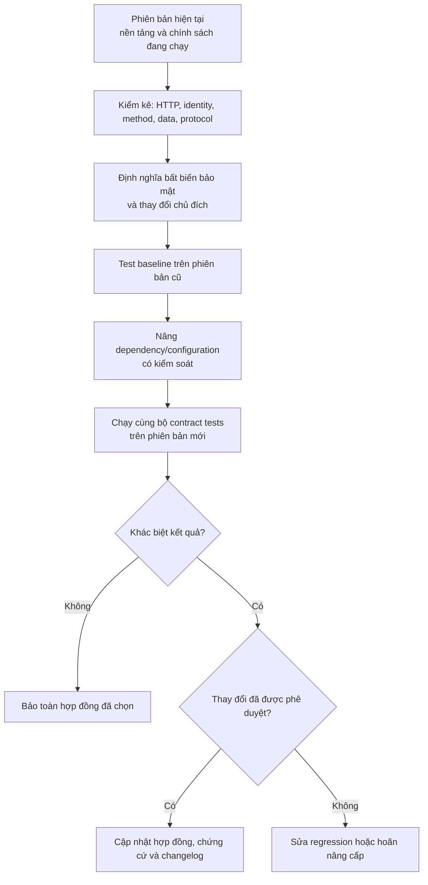

# Lập danh sách chính sách và hành vi bảo mật cần bảo toàn khi nâng phiên bản

> **Chương:** Di chuyển và nâng cấp  
> **Module:** `SPRING_SECURITY_TESTING`  
> **Đích học tập:** Xây dựng một **bản kiểm kê chính sách bảo mật có thể kiểm thử** trước khi nâng Spring Security, Spring Boot hoặc chuyển Servlet sang Reactive. Người học biết chọn `spring-security-test`, `MockMvc`, `WebTestClient`, `@WithMockUser`, `SecurityContext`, JWT/OAuth2/OIDC test helpers và HTTP test fixture để chứng minh các trường hợp được phép, bị từ chối, hết hạn và lỗi vẫn đúng sau nâng cấp.

## 1. Nâng phiên bản là thay đổi hành vi tiềm tàng, không chỉ sửa code cho biên dịch

Một bản nâng Spring Security có thể biên dịch thành công nhưng vẫn thay đổi hành vi quan trọng:

- Đường dẫn từng yêu cầu quyền nay khớp một `requestMatcher` khác.
- Một `SecurityFilterChain` được chọn trước chuỗi vốn được dự định bảo vệ endpoint.
- Request chưa đăng nhập chuyển từ `401` sang `302`, hoặc ngược lại, do `AuthenticationEntryPoint`.
- Một POST bị `403` vì CSRF, khiến team tưởng rằng kiểm tra role đã hoạt động.
- `@PreAuthorize` không còn chạy vì cấu hình method security hoặc Spring proxy không được nạp.
- JWT hợp lệ về chữ ký nhưng converter tạo authorities khác; issuer, audience hoặc clock skew không còn như kỳ vọng.
- OAuth2/OIDC login, callback, session và refresh token vận hành khác khi thay dependency hoặc cấu hình.
- Trong WebFlux, principal không còn được đọc từ đúng Reactor Context tại thời điểm subscribe.

**Mục tiêu của bước kiểm kê không phải “không được phép thay đổi bất kỳ thứ gì”.** Mục tiêu là tách **hành vi cần giữ nguyên** khỏi **thay đổi có chủ đích đã được phê duyệt**, viết bằng các hợp đồng kiểm thử cụ thể. Nếu một cấu hình cũ vốn không an toàn và bản nâng cấp sửa lỗ hổng, phải ghi thành thay đổi mong muốn, không cố giữ lỗ hổng chỉ để test cũ xanh.

### 1.1. Một chính sách có hai lớp bằng chứng

| Lớp bằng chứng | Câu hỏi cần trả lời | Ví dụ |
| --- | --- | --- |
| **Cấu hình** | Những bean/matcher/filter/converter nào được đăng ký? | Có `SecurityFilterChain` bảo vệ `/api/**` và `JwtDecoder` |
| **Hành vi quan sát được** | Với request và danh tính xác định, kết quả thực sự là gì? | Token thiếu scope nhận `403`; đủ scope và đúng owner nhận `200` |

Kiểm tra chỉ sự tồn tại của một annotation hoặc bean là chưa đủ. Trong các bản nâng cấp, **hành vi đầu ra, side effect và trạng thái bảo mật** mới là hợp đồng cần được đóng băng bằng regression tests.



## 2. Bắt đầu bằng bản danh mục chính sách, không bắt đầu bằng danh sách API đã deprecated

Danh sách thay tên API giúp ứng dụng biên dịch; danh sách **chính sách** giúp ứng dụng tiếp tục an toàn. Hãy lập bảng inventory trước khi động vào framework.

| Mã | Nhóm chính sách cần kiểm kê | Câu hỏi bảo mật phải giữ |
| --- | --- | --- |
| POL-01 | Phạm vi HTTP | URL, method, host/port, dispatcher type nào thuộc chain nào? |
| POL-02 | Ưu tiên nhiều filter chain | Chain nào thắng khi nhiều matcher có thể khớp? |
| POL-03 | Anonymous và entry point | Chưa xác thực được `401`, redirect login hay phản hồi khác? |
| POL-04 | Authorization theo URL | Role, authority, scope và thứ tự rule nào cho phép/từ chối? |
| POL-05 | Method security | `@PreAuthorize`, `@PostAuthorize` hoặc custom manager có được thực thi? |
| POL-06 | Quy ước authority | `ROLE_`/`SCOPE_`, case sensitivity và mapping quyền có nhất quán? |
| POL-07 | HTTP Basic/form login | Password verifier, session, failure/success handler hoạt động ra sao? |
| POL-08 | JWT validation | Chữ ký, JWKS/`kid`, `iss`, `aud`, `exp`, `nbf` và clock skew được kiểm tra thế nào? |
| POL-09 | Opaque token | Introspection `active`, credentials, cache và lỗi endpoint được xử lý thế nào? |
| POL-10 | OAuth2/OIDC login | Authorization redirect, `state`, PKCE, ID Token/`nonce` và mapping user có đúng? |
| POL-11 | OAuth2 client outbound | Grant, refresh, lưu authorized client và failure handler còn đúng? |
| POL-12 | CSRF | Những request nào cần token, repository nào, xử lý thiếu/sai token thế nào? |
| POL-13 | CORS | Preflight, allowed origins/headers/methods và credentials policy còn đúng? |
| POL-14 | Session, remember-me, logout | Cookie, fixation, expiry, revoke và logout response còn đúng? |
| POL-15 | Security response headers | HSTS, CSP, frame options, cache control… theo cấu hình thực |
| POL-16 | Error handling | Phân biệt unauthenticated, forbidden, downstream lỗi và response body |
| POL-17 | Owner/tenant/data isolation | Không truy cập dữ liệu của user/tenant khác dù đoán được ID |
| POL-18 | Bất đồng bộ | Không rò `SecurityContext` giữa thread pool tasks, Reactor subscriptions |
| POL-19 | Test environment | Mock principal hay authentication thật? Fixture/session/token cache có cô lập? |
| POL-20 | Vận hành | Log/audit, chỉ số 401/403/5xx, cảnh báo, rollback khi phát hiện regression |

Một hệ thống không có OAuth2 client hoặc session cookie có thể đánh dấu nhóm đó **không áp dụng** với lý do, không được ngầm bỏ trống. Nếu hệ thống sử dụng một chính sách chuyên biệt (mTLS, API key, HMAC, SAML2, WebAuthn, multi-tenant gateway), hãy thêm dòng tương ứng và test ở đúng ranh giới.

### 2.1. Mỗi mục phải chỉ ra người sở hữu và mức độ quan trọng

Để inventory không biến thành một bảng tên tính năng, mỗi chính sách nên có:

- **ID ổn định** và phạm vi URL/method/flow.
- **Chủ sở hữu kỹ thuật** và người phê duyệt nghiệp vụ/bảo mật nếu liên quan.
- **Rủi ro khi thay đổi:** tiết lộ dữ liệu, nâng quyền, bỏ qua xác thực, không đăng nhập được, token outage.
- **Nguồn identity:** user store, session, JWT, OIDC, service account, mTLS…
- **Bất biến được bảo toàn:** mô tả hành vi ở dạng có thể assert.
- **Fixture và loại test:** mock user, token ký test key, IdP stub, repository thật, WebTestClient…
- **Kết quả được phép và bị từ chối**, kèm trạng thái dữ liệu sau request.
- **Trạng thái:** baseline đã xác nhận, chưa có test, thay đổi có chủ đích, regression, không áp dụng.

Ví dụ một mục kiểm kê dưới dạng văn bản có cấu trúc:

```yaml
id: POL-04
name: Bao_cao_chi_doc_theo_scope
owner: API_Team
scope:
  method: GET
  path: /api/reports/{id}
identity_source: Bearer_JWT
expected:
  anonymous: 401
  authenticated_without_scope: 403
  correct_scope_and_owner: 200
  correct_scope_wrong_owner: 404
required_authority: SCOPE_reports:read
data_invariant: Khong_tra_du_lieu_nguoi_hoac_tenant_khac
evidence:
  authorization: MockMvc_JWT_helper
  jwt_validation: HTTP_Bearer_with_test_JWKS
  data_isolation: Repository_integration_test
change_class: preserve
```

Đây là **mẫu mô tả nằm trong bài học**, không phải cấu hình Spring Security hay file metadata của module. Các giá trị `401/403/404` là giả định của ứng dụng ví dụ; nếu API thật có entry point hoặc chính sách che giấu sự tồn tại tài nguyên khác, phải ghi đúng contract hiện có.

## 3. Xác định baseline trước nâng cấp

Baseline không chỉ là “test suite hiện tại xanh”. Nó phải là **bản ghi nhận hành vi của hệ thống cũ** với dữ liệu có kiểm soát. Trước khi sửa cấu hình:

1. Ghi phiên bản Java, Spring Boot, Spring Security, `spring-security-test` và Servlet/WebFlux runtime thực tế.
2. Liệt kê tất cả `SecurityFilterChain` hoặc `SecurityWebFilterChain` cùng matcher, `@Order` và cơ chế authentication.
3. Liệt kê controller path/method, method security annotation và policy dữ liệu.
4. Ghi cách ánh xạ JWT claims/OIDC attributes thành principal/authorities.
5. Ghi chính xác trạng thái của CSRF, CORS, session, logout, headers, error handlers.
6. Chụp hành vi đầu ra bằng test có ít nhất một đường **cho phép** và một đường **từ chối** cho từng policy quan trọng.
7. Phân loại những hành vi cũ không an toàn để có quyết định sửa **có chủ đích**, không đóng băng chúng.

Một bản kiểm kê không cần bật mọi log trên production. Có thể sử dụng cấu hình, test application context, HTTP fixture và tài liệu API đang được duy trì. Không đưa password, raw JWT, session cookie hay client secret thật vào snapshot và CI artifact.

### 3.1. Chọn đúng các trường trong HTTP baseline

| Loại request | Cần ghi nhận |
| --- | --- |
| Anonymous GET vào API bảo vệ | HTTP status; `WWW-Authenticate` hoặc `Location`; body lỗi; không gọi service |
| User đủ quyền GET | Status, body, owner/tenant và số lần gọi dependency |
| User sai quyền GET | Status `403` hoặc chính sách che giấu; không tiết lộ dữ liệu |
| POST/PUT/DELETE | CSRF, quyền ghi, side effect, response/cookie |
| Login thành công/thất bại | Redirect, session/cookie, principal, audit, rate/lock policy nếu có |
| Bearer JWT thiếu/sai | Decoder/validator, 401 vs 403, error header |
| OAuth2 callback | `state`, PKCE/nonce, session, authorization code token exchange |
| Logout | HTTP result, xóa/thu hồi session hoặc authorized client theo hợp đồng |
| Cross-tenant access | Không được trả entity dù biết đúng resource ID |
| Exception/timeout | Không vô tình cấp quyền hoặc trả dữ liệu khi dependency lỗi |

**Đừng snapshot toàn bộ response vô tội vạ.** Token, session ID, trace ID hoặc timestamp thay đổi theo mỗi lần chạy; thay vì cố so sánh chuỗi byte, hãy assert các thuộc tính bảo mật có ý nghĩa và chuẩn hóa trường không ổn định. Tránh đưa dữ liệu nhạy cảm vào snapshot.

## 4. Những điểm nâng cấp dễ làm thay đổi hành vi

Các ví dụ dưới đây minh họa các đợt nâng lớn từng phổ biến; không phải danh sách đầy đủ cho mọi phiên bản. Luôn đối chiếu tài liệu migration và dependency của **phiên bản nguồn/đích thực sự đang dùng**.

### 4.1. Cấu hình security và request matcher

Trong các nhánh Spring Security hiện đại, cấu hình dựa trên bean `SecurityFilterChain` và Lambda DSL được dùng thay cho các kiểu cấu hình cũ như `WebSecurityConfigurerAdapter`. Các lời gọi như `antMatchers(...)` trong mã cũ thường phải chuyển sang API matcher phù hợp. Vấn đề lớn không chỉ là tên API: **matcher mới có thật sự chọn cùng tập request không?**

```java
@Bean
SecurityFilterChain apiSecurity(HttpSecurity http) throws Exception {
    return http
        .securityMatcher("/api/**")
        .authorizeHttpRequests(auth -> auth
            .requestMatchers(
                HttpMethod.GET, "/api/reports/**")
                .hasAuthority("SCOPE_reports:read")
            .requestMatchers(
                HttpMethod.POST, "/api/reports/**")
                .hasAuthority("SCOPE_reports:write")
            .anyRequest().denyAll())
        .oauth2ResourceServer(oauth ->
            oauth.jwt(Customizer.withDefaults()))
        .build();
}
```

Đoạn cấu hình minh họa Spring Security 6-style DSL. Nó **không phải toàn bộ bảo vệ cho ứng dụng**: chỉ các request khớp `/api/**` vào chain này, và nếu không có chain khác phủ phần còn lại thì các đường khác không mặc nhiên được bảo vệ. Khi dùng nhiều chain, phải chứng minh toàn bộ bề mặt HTTP đã có rule phù hợp.

Để giữ nguyên hành vi, so sánh:

| Đặc điểm matcher | Regression cần test |
| --- | --- |
| Method `GET` so với `POST` | POST không vô tình được rule chỉ đọc cho phép |
| Path variable, trailing slash | `/api/reports/7`, `/api/reports/7/` theo hợp đồng |
| Case, ký tự đặc biệt và URL encoding | Không có bypass do chuẩn hóa/decoding khác nhau |
| Servlet path, context path và MVC handler mapping | Matcher khớp endpoint thật, không chỉ chuỗi URL lý thuyết |
| `anyRequest()` và rule order | Request không được khai báo rõ bị xử lý đúng policy |
| Nhiều `SecurityFilterChain` và `@Order` | Rule tổng quát không chiếm request trước rule nhạy cảm |
| Dispatcher type (ASYNC/ERROR/FORWARD) | Không bỏ qua/áp quyền sai trong dispatch bất đồng bộ hoặc lỗi |

Không nên suy ra từ việc test `/api/reports/7` trả `200` rằng toàn bộ đường dẫn đều an toàn. Các ca bypass thường xuất hiện ở **biên matcher**, không phải happy path.

### 4.2. Servlet API và hạ tầng test

Khi chuyển các hệ sinh thái Spring Boot/Spring Framework lớn sang nền Java và Jakarta mới, mã dùng namespace `javax.servlet.*` có thể phải chuyển sang `jakarta.servlet.*`. Đó là công việc tương thích API, nhưng cùng lúc cần kiểm tra:

- Filter tự viết còn được đăng ký đúng thứ tự và chỉ một lần.
- Cấu hình bảo mật không dùng nhầm bean Servlet trong ứng dụng WebFlux.
- `MockMvc` có thực sự áp dụng Spring Security filters.
- Các `RequestMatcher`, servlet path và MVC handler mapping hoạt động đúng.
- Test không âm thầm chuyển từ integration test thành test controller độc lập bỏ qua filters.

Một ca sau upgrade trả `200` khi trước đây `401` có thể là dấu hiệu filter chain không được nối vào MockMvc, không hẳn là production đã đổi ý định cho phép anonymous.

### 4.3. Method security và proxy boundary

Ở cấu hình imperative hiện đại, `@EnableMethodSecurity` thường thay vai trò của cấu hình cũ `@EnableGlobalMethodSecurity`. Trong Reactive, dùng `@EnableReactiveMethodSecurity`, không chỉ đổi tên annotation:

```java
@Configuration
@EnableMethodSecurity
class ServiceSecurityConfiguration {
}

// Dùng trong cấu hình WebFlux Reactive tương ứng:
@Configuration
@EnableReactiveMethodSecurity
class ReactiveServiceSecurityConfiguration {
}
```

Hai class trên là **hai lựa chọn minh họa cho các môi trường khác nhau**, không phải lời khuyên bật cả hai cho mọi application. Khi test, gọi service được Spring inject, không tự `new Service(...)`; self-invocation có thể bỏ qua proxy. Kiểm tra `@PreAuthorize`, `@PostAuthorize`, expression bean, role prefix, owner/tenant và những chính sách dùng method security.

Trong Reactive, method trả `Mono/Flux` cần được **subscribe** để quan sát kết quả hoặc lỗi. Một test chỉ gọi method rồi bỏ publisher không chứng minh interceptor đã hoạt động.

### 4.4. Dependency đồng bộ

`spring-security-test` phải tương thích với Spring Security runtime và Spring Test; sử dụng dependency management/BOM của Spring Boot khi phù hợp. Tránh vừa nâng runtime vừa giữ một version test helper cũ khiến test báo lỗi kỳ lạ nhưng production chạy khác.

Không đoán version bằng tên annotation: xem dependency graph và các module OAuth2 client/resource server, WebFlux/Servlet, Spring Test và JUnit đang thực sự được resolve. Những câu hỏi này thuộc **kiểm tra môi trường**, khác với bản hợp đồng hành vi đã lập.

## 5. Thiết kế regression test theo ba mức độ bảo đảm

Một sai lầm thường gặp là chỉ viết các test bằng `@WithMockUser` hoặc `jwt()` rồi khẳng định “nâng cấp không làm thay đổi authentication”. Helper đặt sẵn trạng thái xác thực hữu ích, nhưng **cố ý bỏ qua quá trình xác thực thực tế**.

| Mức | Test chạy gì thật? | Giả lập gì? | Có thể kết luận |
| --- | --- | --- | --- |
| **A — Authorization khi đã có danh tính** | Filter chain/authorization/controller hoặc method interceptor | `@WithMockUser`, `jwt()`, `mockJwt()`, `oauth2Login()`… | Role/scope/route xử lý Authentication được cấp đúng |
| **B — Authentication component** | Password encoder/provider, JWT converter/decoder, OIDC mapper hoặc opaque introspector | Dữ liệu, token ký test key, IdP stub | Thành phần biến credential/claims thành identity đúng |
| **C — HTTP/protocol integration** | HTTP filter, redirect/session, Bearer processing, token endpoint/client exchange | Mock IdP/JWKS/resource endpoint cục bộ | Hành vi giao thức và tích hợp đầu-cuối có kiểm soát |

Một policy có thể cần cả ba mức. Ví dụ test `jwt().authorities(...)` kiểm tra quyền sau khi có JWT nhưng **không** kiểm tra chữ ký, issuer, audience, expiry hoặc JWT-to-authority converter. Khi migration đụng decoder/converter, phải có test dùng decoder/converter thật.

### 5.1. Ma trận lựa chọn Spring Security Test helper

| Hành vi cần giữ | Servlet / MockMvc | Reactive / WebTestClient | Bổ sung khi phải kiểm tra thực |
| --- | --- | --- | --- |
| User đã xác thực | `user()`, `@WithMockUser` | `mockUser()`, `@WithMockUser` với Reactor Context | HTTP Basic/form login |
| JWT principal và authority | `jwt()` | `mockJwt()` | Bearer JWT ký thật + decoder/validator |
| Opaque token đã introspect | `opaqueToken()` | `mockOpaqueToken()` | Introspection endpoint/test client |
| OAuth2 login principal | `oauth2Login()` | `mockOAuth2Login()` | Authorization redirect/callback, token endpoint |
| OIDC principal | `oidcLogin()` | `mockOidcLogin()` | ID Token ký thật/JWKS/nonce/UserInfo |
| OAuth2 authorized client | `oauth2Client()` | Helper tương ứng nếu phiên bản hỗ trợ | Authorized-client manager/provider thật |
| CSRF | `csrf()` | `SecurityMockServerConfigurers.csrf()` | Cookie/session/header token round trip |
| Method authorization | `@WithMockUser` + bean thật | `@WithMockUser` + `StepVerifier` | Kiểm tra proxy/Reactor Context thật |

Các helper có thể khác overload theo phiên bản. Việc chọn đúng helper làm giảm test setup, không thay thế các kiểm thử component/protocol ở nơi policy yêu cầu.

## 6. Ví dụ bảo toàn chính sách JWT trên Servlet bằng MockMvc

Giả sử ứng dụng có endpoint `GET /api/reports/{id}` yêu cầu `SCOPE_reports:read` và chỉ trả báo cáo mà user sở hữu. Đây là **hợp đồng ví dụ**, không phải rule tự suy ra từ tên endpoint.

### 6.1. Controller và dữ liệu kiểm thử

```java
public record ReportView(String id, String ownerId, String title) {}

public interface ReportStore {
    Optional<ReportView> findVisible(String id, String ownerId);
}

@RestController
@RequestMapping("/api/reports")
class ReportsController {
    private final ReportStore store;

    ReportsController(ReportStore store) {
        this.store = store;
    }

    @GetMapping("/{id}")
    ResponseEntity<ReportView> get(
            @PathVariable String id, Authentication auth) {
        return store.findVisible(id, auth.getName())
            .map(ResponseEntity::ok)
            .orElseGet(() -> ResponseEntity.notFound().build());
    }
}
```

Trong ví dụ, service contract `findVisible(id, ownerId)` phải lọc dữ liệu theo owner, và `Authentication.getName()` phải thật sự được mapping sang owner ID phù hợp. Nếu production còn tenant, phải thêm điều kiện tenant. Test controller với mock store xác minh đối số được truyền; repository query thực cần test độc lập.

### 6.2. Spring Security chain được giữ

Giả sử `apiSecurity` tại mục 4.1 là bean đang được dùng. Các test request GET không cần CSRF theo matcher mặc định. Tại application context test, cần cấu hình `JwtDecoder` hợp lệ hoặc cung cấp một decoder test phù hợp để context khởi tạo; các request dùng `jwt()` dưới đây **không kiểm tra decoder**.

```java
@SpringBootTest
@AutoConfigureMockMvc(addFilters = true)
class ReportsSecurityContractIT {
    @Autowired MockMvc mvc;
    @MockitoBean ReportStore store;

    @Test
    void anonymousIsRejected() throws Exception {
        mvc.perform(get("/api/reports/r-7"))
            .andExpect(status().isUnauthorized());

        verifyNoInteractions(store);
    }

    @Test
    void authenticatedWithoutScopeIsForbidden() throws Exception {
        mvc.perform(get("/api/reports/r-7")
                .with(jwt()
                    .jwt(token -> token.subject("alice"))
                    .authorities(
                        new SimpleGrantedAuthority("SCOPE_profile"))))
            .andExpect(status().isForbidden());

        verifyNoInteractions(store);
    }

    @Test
    void correctScopeAndOwnerCanRead() throws Exception {
        ReportView expected =
            new ReportView("r-7", "alice", "Quarterly report");
        when(store.findVisible("r-7", "alice"))
            .thenReturn(Optional.of(expected));

        mvc.perform(get("/api/reports/r-7")
                .with(jwt()
                    .jwt(token -> token.subject("alice"))
                    .authorities(new SimpleGrantedAuthority(
                        "SCOPE_reports:read"))))
            .andExpect(status().isOk())
            .andExpect(jsonPath("$.ownerId").value("alice"))
            .andExpect(jsonPath("$.id").value("r-7"));

        verify(store).findVisible("r-7", "alice");
    }

    @Test
    void correctScopeCannotReadAnotherOwnerRecord()
            throws Exception {
        when(store.findVisible("r-bob", "alice"))
            .thenReturn(Optional.empty());

        mvc.perform(get("/api/reports/r-bob")
                .with(jwt()
                    .jwt(token -> token.subject("alice"))
                    .authorities(new SimpleGrantedAuthority(
                        "SCOPE_reports:read"))))
            .andExpect(status().isNotFound());

        verify(store).findVisible("r-bob", "alice");
    }
}
```

`@MockitoBean` có trong Spring Framework 6.2+; dự án trên phiên bản cũ có thể dùng `@MockBean` tương ứng. Mã ví dụ giả định ứng dụng đã nạp controller và chain trên. Với API Bearer-only không bật form login, anonymous thường nhận `401`. Nếu hệ thống có entry point hoặc chain khác, cần điều chỉnh assertion đúng baseline đã duyệt.

Mỗi test có mục đích riêng: `401` khi chưa xác thực, `403` khi có user nhưng thiếu scope, `200` khi đủ scope và đúng owner, `404` khi sai owner. Bốn ca này phát hiện nhiều regression hơn một test luôn dùng quyền ADMIN và chỉ assert 200.

**Giới hạn quan trọng:** `jwt().authorities(...)` tự đưa authority vào authentication; chưa chứng minh JWT converter, chữ ký hoặc claim validation. Nên có thêm test mức B/C khi mục nâng cấp liên quan đến JWT.

## 7. JWT/OIDC/OAuth2: đóng băng quy tắc identity, không chỉ kết quả 200/403

### 7.1. JWT: những điều cần bảo toàn

| Hợp đồng | Test dương tính | Test âm tính |
| --- | --- | --- |
| Chữ ký/JWKS/`kid` | Token ký bằng test key hợp lệ | Key sai, chữ ký sai, `kid` không tìm thấy |
| Issuer | `iss` chính xác theo cấu hình | Issuer khác không được chấp nhận |
| Audience | `aud` chứa API audience hợp lệ | Audience sai bị từ chối **nếu validator yêu cầu** |
| Thời gian | `nbf/exp` và clock skew hợp lệ | Token hết hạn/chưa đến hạn bị từ chối |
| Mapping scope | `scope` hoặc `scp` tạo `SCOPE_...` đúng | Scope bị thiếu/định dạng sai không tự được cấp quyền |
| Tenant và owner | Claim/membership đã xác minh khớp dữ liệu | Cross-tenant access không trả dữ liệu |
| Error semantics | Token hợp lệ nhưng thiếu quyền → `403` | Token không được xác thực → `401` |

Không mặc định tất cả validator (đặc biệt audience) đã được Spring Boot tự tạo theo mong muốn sản phẩm; test phải kiểm tra **validator thực được cấu hình**. Với token ký thật, dùng một test key/JWKS riêng, không dùng private key production. Kiểm tra cả đổi khóa và cache khi hệ thống phụ thuộc JWKS rotation.

```java
// Test converter riêng, không kiểm tra chữ ký JWS:
Jwt jwt = Jwt.withTokenValue("unsigned-test-fixture")
    .header("alg", "RS256")
    .subject("alice")
    .claim("scope", "reports:read")
    .build();

Collection<GrantedAuthority> permissions =
    jwtGrantedAuthoritiesConverter.convert(jwt);

assertTrue(permissions.stream()
    .map(GrantedAuthority::getAuthority)
    .anyMatch("SCOPE_reports:read"::equals));
```

`jwtGrantedAuthoritiesConverter` trong ví dụ phải là converter mà ứng dụng sử dụng hoặc thành phần đang được migration, không phải một converter mặc định tự tạo mà production không gọi. Một test green ở lớp converter **vẫn không thay** test Bearer token qua decoder.

### 7.2. OAuth2/OIDC Login: chặn việc nâng cấp làm sai identity

Các bất biến thường cần ghi vào inventory:

- Authorization redirect gắn đúng registration, redirect URI, `state` và PKCE khi có.
- Callback không chấp nhận `state` thiếu/sai; session và authorization request được ràng buộc đúng.
- OIDC ID Token được xác minh theo issuer/audience/thời gian và `nonce` khi áp dụng.
- UserInfo/ID Token claims được ánh xạ đúng principal; account mapping dùng định danh ổn định (thường `issuer + subject`).
- Quyền nội bộ được lấy từ nguồn được tin cậy, không nâng role chỉ vì một claim không được xác minh.
- User bị khóa, thiếu membership, tenant không khớp hoặc quyền bị thu hồi phải bị từ chối theo policy.
- Session sau login, logout, cookie và các redirect không làm lộ token.

`oauth2Login()`, `oidcLogin()`, `mockOAuth2Login()`, `mockOidcLogin()` giúp test controller **sau khi có principal**. Để chứng minh callback và ID Token validation, cần mock IdP/JWKS cục bộ rồi chạy HTTP flow thực trong integration test. Không sử dụng helper principal để kết luận `state`/`nonce`/chữ ký đã được kiểm tra.

### 7.3. OAuth2 client outbound: token hết hạn và failure handling

Nếu ứng dụng gọi API khác bằng `OAuth2AuthorizedClientManager` hoặc `ReactiveOAuth2AuthorizedClientManager`, cần thêm contract:

| Trạng thái | Điều phải bảo toàn |
| --- | --- |
| Có access token còn hạn | Dùng lại token theo authorized-client store và clock skew |
| `client_credentials` hết hạn | Lấy token mới bằng đúng grant, không giả định có refresh token |
| Authorization code có refresh token | Refresh đúng grant và lưu rotation token mới khi được cấp |
| Token endpoint trả `invalid_client`/`invalid_grant` | Không gọi resource API bằng token hết hạn; xử lý failure/eviction có chủ đích |
| Resource server trả `401 invalid_token` | Chính sách evict/retry có giới hạn, không tự loop |
| Resource server trả `403 insufficient_scope` | Không coi refresh là cơ chế tự nâng quyền |
| Hai principal/registration | Không dùng nhầm authorized client của người khác |

Trong test này giữ manager/provider thật và mock token endpoint/resource endpoint qua HTTP cục bộ. Kiểm tra grant type, client authentication, header Bearer, số lần gọi và state của authorized-client service trước/sau. `oauth2Client()` chỉ chuẩn bị trạng thái client đã có; nó không tự kiểm tra token exchange.

## 8. CSRF, CORS, session và logout: các regression thường bị che khuất

### 8.1. CSRF: test độc lập với authorization

Một POST của user đã xác thực và đủ role vẫn có thể bị từ chối do thiếu CSRF trong web app dùng session cookie. Cần ba ca độc lập:

| Role | CSRF token | Kết quả nếu CSRF được bật | Ý nghĩa |
| --- | --- | --- | --- |
| Đủ | Thiếu/sai | `403` | CSRF filter đang chặn |
| Thiếu | Hợp lệ | `403` | Authorization rule đang chặn |
| Đủ | Hợp lệ | `2xx` | Đường thành công đi qua cả hai hàng rào |

MockMvc:

```java
// Fragment test Servlet, giả định endpoint POST /portal/approvals/a-7
// yêu cầu ROLE_APPROVER và ứng dụng giữ CSRF enabled.
mvc.perform(post("/portal/approvals/a-7")
        .with(user("alice").roles("APPROVER")))
    .andExpect(status().isForbidden());

mvc.perform(post("/portal/approvals/a-7")
        .with(user("alice").roles("VIEWER"))
        .with(csrf()))
    .andExpect(status().isForbidden());
```

Test đường thành công phải thêm `with(csrf())`, mock service thích hợp rồi assert status và side effect. Với WebFlux dùng `client.mutateWith(SecurityMockServerConfigurers.csrf())`. Nếu hệ thống có API **chỉ dùng Bearer header** và policy tắt CSRF, đừng ép test session CSRF vào chain đó; phải kiểm kê matcher và credential tự động được trình duyệt gửi hay không.

Nếu trong migration vô tình tắt CSRF ở toàn bộ ứng dụng, test “thiếu role vẫn 403” có thể vẫn xanh. Bởi vậy **cần ca đủ role nhưng thiếu CSRF** để bắt regression cụ thể này.

### 8.2. CORS và preflight

CORS preflight thường là request `OPTIONS` với `Origin` và `Access-Control-Request-Method`. Khi thay filter ordering hoặc security config:

- Origin/method/header được phép phải nhận đúng CORS response.
- Origin không tin cậy không được nhận policy cho phép ngoài ý muốn.
- Credentialed CORS không dùng wildcard thiếu kiểm soát.
- Preflight không bị yêu cầu session/JWT như request nghiệp vụ khi cấu hình cho phép.
- Request thực vẫn phải đi qua authentication/authorization, kể cả khi preflight được chấp nhận.

Đừng chỉ assert `OPTIONS 200`. Kiểm tra `Access-Control-Allow-Origin`, `Access-Control-Allow-Credentials`, allowed methods/headers và tác động của việc kết hợp browser credentials theo contract.

### 8.3. Session, cookie và logout

Kiểm tra các bất biến liên quan web session:

- Cookie `HttpOnly`, `Secure`, `SameSite` và domain/path theo thiết kế và môi trường HTTPS thực.
- Session ID thay đổi khi login nếu policy session fixation protection yêu cầu.
- Một user bị logout/timeout không còn dùng lại session cũ để truy cập dữ liệu bảo vệ.
- Concurrent session hoặc remember-me được xử lý theo chính sách đã định.
- Logout xóa hoặc vô hiệu hóa state phù hợp; OAuth2 authorized client cũng có chính sách riêng nếu ứng dụng sử dụng.
- `401/302`/cookie/`Location`/cache headers khi session đã hết hạn đúng hợp đồng.

`@WithMockUser` hay `oauth2Login()` giả lập principal không chứng minh toàn bộ session cookie flow. Với những thuộc tính đó, cần chuỗi request HTTP có lưu và gửi lại cookie/session, hoặc browser-level integration test phù hợp.

### 8.4. HTTP security headers

Khi thay filter chain, xác nhận các header mà sản phẩm cam kết (ví dụ CSP, HSTS, `X-Content-Type-Options`, frame-ancestors hoặc frame options). Header có thể phụ thuộc HTTPS, response path và custom configuration. Không mặc định Spring Security luôn bật mọi header theo mức nghiêm ngặt mong muốn; bảo toàn **giá trị đã được phê duyệt của ứng dụng**.

## 9. Reactive migration: cùng policy nhưng context và test infrastructure khác

Chuyển từ Servlet sang WebFlux hoặc nâng Reactive stack đòi kiểm tra hai lớp:

1. `SecurityWebFilterChain` và request authorization tương đương policy HTTP.
2. `ReactiveSecurityContextHolder` cùng method security theo từng subscription, không ngầm dựa vào ThreadLocal của Servlet.

### 9.1. Cấu hình WebTestClient có hạ tầng bảo mật thật

```java
@SpringBootTest(webEnvironment = SpringBootTest.WebEnvironment.MOCK)
class ReportsReactiveContractIT {
    @Autowired ApplicationContext applicationContext;

    WebTestClient client;

    @BeforeEach
    void setUp() {
        client = WebTestClient
            .bindToApplicationContext(applicationContext)
            .apply(SecurityMockServerConfigurers.springSecurity())
            .configureClient()
            .build();
    }

    @Test
    void userWithScopeCanRead() {
        client.mutateWith(
                SecurityMockServerConfigurers.mockJwt()
                    .jwt(token -> token.subject("alice"))
                    .authorities(new SimpleGrantedAuthority(
                        "SCOPE_reports:read")))
            .get()
            .uri("/api/reports/r-7")
            .exchange()
            .expectStatus().isOk();
    }

    @Test
    void missingScopeIsForbidden() {
        client.mutateWith(
                SecurityMockServerConfigurers.mockJwt()
                    .authorities(new SimpleGrantedAuthority(
                        "SCOPE_profile")))
            .get()
            .uri("/api/reports/r-7")
            .exchange()
            .expectStatus().isForbidden();
    }
}
```

Ví dụ giả định có handler và service WebFlux thật, fixture repository trả dữ liệu cho `r-7` trong ca được phép và `SecurityWebFilterChain` đã được cấu hình tương ứng. Không suy ra test WebFlux từ `MockMvc` vì `SecurityFilterChain`/`SecurityWebFilterChain` khác hạ tầng. `mockJwt()` kiểm tra authorization với token đã giả lập, không kiểm tra JWT signature/decoder.

### 9.2. Reactive method security với StepVerifier

```java
@Configuration
@EnableReactiveMethodSecurity
class ReactiveMethods {
}

@Service
class ExportService {
    @PreAuthorize("hasAuthority('SCOPE_exports:run')")
    public Mono<String> export() {
        return Mono.just("exported");
    }
}
```

Test qua Spring TestContext:

```java
@SpringBootTest
class ExportSecurityContractIT {
    @Autowired ExportService exportService;

    @Test
    @WithMockUser(authorities = "SCOPE_exports:run")
    void allowed() {
        StepVerifier.create(exportService.export())
            .expectNext("exported")
            .verifyComplete();
    }

    @Test
    @WithMockUser(roles = "VIEWER")
    void forbidden() {
        StepVerifier.create(exportService.export())
            .expectError(AccessDeniedException.class)
            .verify();
    }
}
```

`@WithMockUser` trong test Reactive cần tích hợp Spring Security Test/Reactor Context của Spring TestContext. Bean service phải được Spring quản lý để interceptor chạy. Một publisher chưa được subscribe không tạo đủ bằng chứng cho kết quả quyền. Nếu test gọi qua HTTP, cần thêm WebTestClient để kiểm tra cách exception được dịch sang response.

### 9.3. Context propagation và bất đồng bộ

Kiểm tra worker thread được tái sử dụng không mang `SecurityContextHolder` của Alice sang Bob trong Servlet/`@Async`, và nhiều Reactor subscriptions chạy cùng scheduler không dùng chung principal. Đừng dùng `MODE_INHERITABLETHREADLOCAL` như một giải pháp chung cho thread pool; dùng `DelegatingSecurityContext...` wrappers theo task khi phù hợp.

Regression nên có cả Alice → Bob → anonymous trong một test deterministic, kiểm tra không có quyền hoặc dữ liệu chéo tenant. Trong Reactive, đặt context theo từng subscription bằng `ReactiveSecurityContextHolder.withAuthentication(...)` khi test logic pipeline, không tự `subscribe()` tách luồng rồi dựa vào ThreadLocal.

## 10. Bảo toàn chính sách dữ liệu: controller 200 không phải đủ

Một chính sách bảo mật có thể giữ nguyên HTTP status nhưng đánh mất ràng buộc dữ liệu. Ví dụ `/api/reports/r-7` vẫn trả 200 cho Alice sau nâng cấp, nhưng repository query đã bỏ điều kiện tenant và cũng trả báo cáo của Bob.

Khi kiểm kê POL-17, phải có fixture **đối nghịch**:

```text
tenant-a:
  alice -> report-a1 (được phép)
  bob   -> report-a2 (cùng tenant, sai owner)

tenant-b:
  alice -> report-b1 (cùng username, sai tenant)
  carol -> report-b2 (khác tenant, sai owner)
```

Kiểm tra tại hai ranh giới:

- Controller/service: có chuyển đúng subject/local user ID, tenant và resource ID đến repository không? Dùng mock với argument matcher chính xác.
- Persistence: câu query thật có lọc đúng tenant/owner/soft delete/membership không? Seed database và assert bản ghi sai phạm vi không bao giờ được trả.

Không mock luôn repository bằng `when(findById(any())).thenReturn(otherTenantRecord)` rồi gọi đó là test cô lập. Nếu sản phẩm dùng row-level security, connection-pool tenant variable hoặc database policy, phải có integration test tương thích với engine/connection lifecycle đang vận hành.

## 11. Danh sách ca âm tính không thể bỏ qua trong migration

| Bề mặt | Ca dương tính | Ca âm tính giúp phát hiện regression |
| --- | --- | --- |
| HTTP authorization | User đủ role/scope vào đúng path | Anonymous, thiếu scope, HTTP method khác, path biên |
| Method security | Service bean với quyền hợp lệ | Thiếu quyền, self-invocation/proxy bỏ qua, data ownership |
| CSRF | Session POST đủ quyền + token | Session POST đủ quyền nhưng thiếu/sai token |
| JWT | Token ký hợp lệ và scope đúng | Signature/issuer/audience/time sai, scope thiếu |
| Opaque token | Introspection active=true | active=false, introspection timeout hoặc lỗi |
| OAuth2 login | Callback đúng state/session | State sai, missing code, login error, account disabled |
| OIDC | ID Token claim hợp lệ | Nonce/issuer/audience/signature sai |
| OAuth2 outbound | Lấy token và resource 200 | Token endpoint 400/401/503; resource 401/403 |
| CORS | Allowed origin và preflight đúng | Origin không tin cậy hoặc method không được phép |
| Session | Login rồi truy cập được | Session logout/expired không tái sử dụng được |
| Multi-chain | Mỗi vùng chọn đúng chain | Rule tổng quát vô tình cho phép vùng nhạy cảm |
| Data isolation | Đúng tenant và owner | Sai tenant, sai owner, ID đoán được, soft-deleted |
| Async/Reactive | User A thấy dữ liệu A | B/anonymous dùng lại worker nhưng không có identity A |
| Error handling | Lỗi được phân loại, không rò secret | Exception/timeout không làm bỏ qua quyền |

Đối với request ghi, ngoài response status phải kiểm tra **không có side effect** khi bị chặn: không gọi repository ghi, không phát event, không gửi outbound command. Kết quả `403` sau khi một tác vụ nguy hiểm đã chạy không phải hợp đồng bảo mật đúng.

### 11.1. Tại sao chỉ so sánh tổng số test pass/fail không đủ?

Test A trước nâng cấp có thể trả `403` vì CSRF; sau nâng cấp cũng `403` nhưng vì thiếu role. Số test xanh không đổi, song bảo vệ CSRF đã bị tắt. Tương tự, token expired bị `401` ở cả hai version nhưng do decoder đã hỏng cho **mọi** token.

Vì vậy các test cần có **đối chứng**: cùng endpoint với đúng quyền/đúng CSRF phải thành công; ca thiếu một điều kiện phải bị từ chối vì điều kiện đó. Đó là lý do bộ regression phải có cặp positive/negative và quan sát nguyên nhân khi cần.

## 12. Quản lý thay đổi có chủ đích và bằng chứng nâng cấp

Không phải mọi khác biệt đều là bug. Ví dụ team có thể chủ động chuyển anonymous API từ `302` sang `401`, đổi quyền `ROLE_ADMIN` sang `SCOPE_reports:write` hoặc siết chặt CSRF/session.

Hãy ghi từng thay đổi trong bảng:

| ID | Hành vi cũ | Hành vi mới mong muốn | Lý do | Bằng chứng |
| --- | --- | --- | --- | --- |
| CHG-01 | Anonymous API redirect login | API trả `401` với Bearer challenge | Hợp đồng JSON client mới | Test anonymous 401, login web vẫn redirect |
| CHG-02 | `ROLE_ADMIN` đọc mọi tenant | Chỉ tenant được cấp | Sửa lỗi cô lập dữ liệu | Repository + HTTP cross-tenant tests |
| CHG-03 | Session POST không kiểm CSRF | Yêu cầu CSRF đúng | Tăng bảo vệ browser | Test missing/valid CSRF |

Một thay đổi đã được phê duyệt nên cập nhật expected result có ghi lý do. Một khác biệt chưa được phê duyệt cần được điều tra, không được tự đổi assertion cho xanh.

### 12.1. Quy trình chạy cùng test contract trước và sau

1. **Phiên bản hiện tại:** chạy bộ test contract, ghi status, header/cookie/redirect đáng chú ý, side effects và fixture.
2. **Đóng băng dữ liệu test:** dùng ID, role, key, clock và mock IdP cục bộ có kiểm soát.
3. **Nâng dependency/cấu hình trong một nhánh:** tránh đồng thời thay logic nghiệp vụ nếu không cần thiết.
4. **Phiên bản mới:** chạy lại cùng test contract; so sánh differences theo policy ID, không chỉ theo tên class lỗi.
5. **Phân tích khác biệt:** phân loại `APPROVED_CHANGE`, `REGRESSION` hoặc `FLAKY_TEST`; điều tra nguyên nhân.
6. **Bổ sung test cho API mới:** khi migration thay cơ chế, kiểm tra coverage không bị giảm hoặc bỏ mất filter.
7. **Kiểm thử pre-release:** chạy integration và smoke tests qua đúng loại deployment cần thiết (proxy, TLS, IdP stub, cookie).
8. **Canary/rollback:** theo dõi tỷ lệ login thành công, 401/403 bất thường, token failures và audit; rollback nếu vượt ngưỡng đã định.

Không lấy việc “JWT helper test xanh” làm tiêu chí đủ để phát hành nếu thay đổi liên quan decoder; không lấy MockMvc contract xanh làm bằng chứng cho Reactive WebFilter sau chuyển kiến trúc.

### 12.2. Hợp đồng test theo version không nên phụ thuộc chi tiết nội bộ

Một số exception stack trace, tên lớp implementation, log line hoặc thứ tự các header không quan trọng về mặt contract có thể thay đổi giữa version. Regression nên assert:

- Phản hồi HTTP công khai và các trường/header bảo mật có ý nghĩa.
- Quyết định truy cập được phép/bị từ chối.
- Principal/authorities theo đúng hợp đồng.
- Không có side effect khi bị từ chối.
- Tình trạng session/authorized client/DB sau request.
- Khi bắt buộc: protocol request tới token endpoint/JWKS/IdP stub.

Chỉ assert tên implementation class nếu đó thực sự là hợp đồng của module đang được kiểm tra. Việc test phải sửa vì một exception internal đổi tên không nhất thiết là security regression; ngược lại, thay đổi đường đi xác thực làm mất audience validation là regression dù exception type không đổi.

## 13. Mẫu bảng bàn giao kiểm kê cho nhóm nâng cấp

Một bảng tổng hợp dùng trong code review có thể như sau:

| Policy | Bảo toàn hay thay đổi? | Test trước nâng cấp | Test sau nâng cấp | Người duyệt |
| --- | --- | --- | --- | --- |
| POL-01/02 — Chain/matcher | Preserve | Path boundary + method matrix PASS | PASS / Regression | Security owner |
| POL-03/04 — 401/403/role | Preserve | Anonymous/role/scope tests PASS | PASS / Regression | API owner |
| POL-05 — Method security | Preserve | `@PreAuthorize` + no-side-effect PASS | PASS / Regression | Service owner |
| POL-08 — JWT decoder | Preserve | Signed JWT/JWKS PASS | PASS / Regression | Identity owner |
| POL-10 — OIDC login | Preserve | State/nonce/callback PASS | PASS / Regression | Identity owner |
| POL-11 — OAuth2 client | Preserve | Token reuse/refresh/errors PASS | PASS / Regression | Integration owner |
| POL-12 — CSRF | Preserve / Approved change | Valid/missing token matrix PASS | PASS / Regression | Web owner |
| POL-17 — Tenant isolation | Preserve / Tighten | DB/query negative tests PASS | PASS / Regression | Data owner |
| POL-18 — Async/Reactive | Preserve | Alice/Bob/anonymous PASS | PASS / Regression | Runtime owner |

Không ghi PASS trước khi thực sự chạy và xác minh trên môi trường tương ứng. Bảng này là **mẫu bàn giao**, không tuyên bố một project cụ thể đã kiểm thử hoặc phê duyệt bất kỳ policy nào.

## 14. Những lỗi thường gặp khi lập inventory và nâng cấp

| Dấu hiệu | Sai lầm điển hình | Cách khắc phục |
| --- | --- | --- |
| Test biên dịch được, URL nhạy cảm trả 200 | Matcher hoặc chain không bao phủ URL | Kiểm tra `securityMatcher`, `requestMatchers`, `@Order`, fallback chain |
| Toàn bộ anonymous chuyển từ 401 sang 302 | Entry point/chain chọn khác | Đối chiếu baseline API vs browser login |
| POST sai quyền trả 403 nên tưởng policy đúng | CSRF chặn trước | Thêm CSRF hợp lệ khi test role, và test thiếu CSRF riêng |
| Test JWT xanh nhưng chữ ký giả được chấp nhận | Chỉ dùng `jwt()`/`mockJwt()` | Test Bearer token ký thật + decoder/validator |
| Đổi `hasRole` sang `hasAuthority` làm sai quyền | Tiền tố `ROLE_`/`SCOPE_` không khớp | Kiểm tra authority mapping thật |
| `@PreAuthorize` không chạy | Thiếu method security hoặc bean bị mock | Test Spring bean thật qua proxy |
| Dữ liệu khác tenant vẫn trả 200 | Chỉ test một owner hoặc mock query quá rộng | Seed dữ liệu đối nghịch, test repository thật |
| OIDC principal đúng nhưng callback thất bại | Helper `oidcLogin()` bỏ qua protocol | Mock IdP HTTP flow với state/nonce/ID Token |
| Cấp token lặp lại sau nâng | Authorized client store/principal/clock skew đổi | Test manager/provider và số token requests |
| WebFlux test đọc sai user | Dùng ThreadLocal Servlet trong pipeline | Dùng Reactor Context, StepVerifier, WebTestClient |
| Test dùng server thật nhưng `@WithMockUser` không tác dụng | Identity annotation không đi qua TCP | Gửi credential/cookie/Bearer thực |
| Phiên bản test/runtime bị lệch | Override dependency không đồng bộ | Quản lý version qua Boot BOM hoặc dependency graph kiểm soát |
| Cập nhật expected để mọi test xanh | Regression bị coi thành thay đổi bình thường | Yêu cầu approval cho mọi thay đổi hành vi bảo mật |
| Test CI chập chờn | Phụ thuộc giờ thực, port cố định, cache/JWKS dùng chung | Cố định fixture, cô lập state, dùng local endpoints |

## 15. Bài thực hành: bảo toàn policy qua một đợt nâng Spring Security

Tạo ứng dụng ví dụ có:

- API JWT `GET /api/reports/{id}` yêu cầu `SCOPE_reports:read` và kiểm soát owner/tenant.
- Web UI dùng session login, `POST /portal/approvals/{id}` yêu cầu `ROLE_APPROVER` và CSRF.
- Service export sử dụng `@PreAuthorize`, có bản `Mono/Flux` nếu ứng dụng có WebFlux.
- OAuth2 client `client_credentials` gọi resource API cục bộ, có authorized-client store.

Thực hiện theo trình tự:

1. Lập danh sách các policy áp dụng từ POL-01 đến POL-20; thêm owner, invariant và test evidence.
2. Trên phiên bản cũ, viết MockMvc test `401/403/200/404` cho API JWT; assert tenant/owner và no-side-effect.
3. Thêm signed JWT/JWKS test thật để kiểm tra signature, issuer, audience và expiry; không dùng `jwt()` thay cho decoder.
4. Với web session, test POST đủ role thiếu CSRF → 403; thiếu role có CSRF → 403; đủ cả hai → thành công.
5. Với method security, test service Spring bean thật có và thiếu authority; bảo đảm nhánh từ chối không gọi repository ghi.
6. Với OAuth2 client, mock token endpoint/resource API qua HTTP cục bộ; test token còn hạn, hết hạn, `invalid_client` và downstream `401/403`.
7. Nếu nâng WebFlux, viết WebTestClient + `springSecurity()` và StepVerifier cho Reactive Method Security, đối chiếu kết quả theo contract chứ không sao chép code Servlet.
8. Chạy cùng bộ contract test sau nâng cấp, ghi lại các policy bị thay đổi và phân loại approved change/regression.
9. Seed Alice/Bob ở hai tenant, chạy các test chéo quyền và kiểm tra không rò danh tính giữa các tác vụ dùng lại worker.
10. Viết báo cáo bàn giao: phiên bản nguồn/đích, policy đã chứng minh, những chỗ chưa bao phủ, thay đổi có chủ đích và tiêu chí rollback.

**Tiêu chí đạt:** Không có chính sách quan trọng chỉ được chứng minh bằng việc test biên dịch hoặc một happy-path 200. Các ca âm tính phân biệt đúng nguyên nhân; phần thực cần kiểm chứng không bị mock; các khác biệt sau nâng cấp có lý do và người duyệt.

## 16. Checklist cuối trước khi chấp nhận phiên bản mới

```text
[ ] Danh mục policy có chủ sở hữu, phạm vi và expected behavior
[ ] Tất cả vùng URL có chain và matcher đúng, có test path biên
[ ] Anonymous/insufficient permission có trạng thái và header phù hợp
[ ] Có test cho phép lẫn từ chối theo role, scope, owner và tenant
[ ] Method security chạy qua Spring bean thật
[ ] JWT decoder/validator được test với signed test tokens nếu liên quan
[ ] OAuth2/OIDC callback, state/nonce và mapping có test nếu liên quan
[ ] OAuth2 client grant, refresh, expiry và lỗi có HTTP contract tests
[ ] CSRF, CORS, session, logout và headers theo policy được kiểm chứng
[ ] WebFlux/async không rò SecurityContext giữa subscription/task
[ ] Không có side effect khi authentication/authorization thất bại
[ ] Fixture cô lập, không có secret/token production trong test artifacts
[ ] Mọi thay đổi hành vi được duyệt, test expectation cập nhật có lý do
[ ] Báo cáo baseline và after-upgrade có thể so sánh theo policy ID
[ ] Có smoke tests và kế hoạch rollback phù hợp môi trường phát hành
```

**Ghi nhớ:** Một lần nâng Spring Security thành công về mặt bảo mật không được đánh giá chỉ bằng việc build xanh. Trước nâng cấp, hãy **liệt kê các chính sách cần bảo toàn dưới dạng hợp đồng có thể kiểm thử**, từ route/role đến JWT/OIDC, CSRF, session, data isolation và Reactive context. Sau nâng cấp, chạy lại cùng các ca **được phép, bị từ chối và lỗi**, phân biệt chỗ helper `spring-security-test` chỉ đặt sẵn principal với chỗ filter/decoder/protocol thật đã được xác minh. Chỉ chấp nhận khác biệt khi đó là thay đổi bảo mật có chủ đích, được ghi nhận và phê duyệt.
