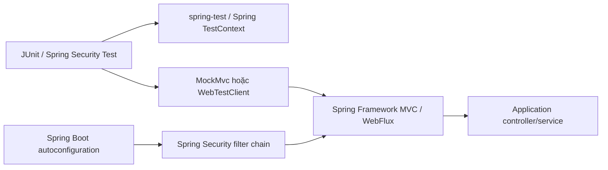

# Đồng bộ phiên bản Spring Boot, Spring Framework và Spring Security Test

Một ứng dụng Spring Security có thể chạy bình thường ở môi trường phát triển, nhưng khi nâng cấp dependency thì bộ kiểm thử `MockMvc`/`WebTestClient` bắt đầu lỗi `NoSuchMethodError`, không tìm được annotation, hoặc hành vi 401/403 khác trước. Có trường hợp test biên dịch được nhưng bỏ qua security filters, tạo ra kết quả “xanh” không còn chứng minh chính sách bảo mật.

Trong chương **Di chuyển và nâng cấp** của module `SPRING_SECURITY_TESTING`, bài học này giải thích cách **đồng bộ phiên bản Spring Boot, Spring Framework, Spring Security và artifact `spring-security-test`**, sau đó kiểm chứng bằng các test authentication, authorization và HTTP thực trên cả Servlet lẫn Reactive.

Thông điệp cốt lõi:

> **Không chọn bốn version number riêng rẽ rồi hy vọng chúng tương thích.** Hãy chọn một Spring Boot release line được hỗ trợ, sử dụng dependency management/BOM của dòng đó, kiểm tra dependency graph thực được resolve ở cả runtime lẫn test, rồi chạy lại các chính sách bảo mật quan trọng.

Các version số minh họa trong bài là **placeholder hoặc ví dụ theo thế hệ**, không phải bảng chứng nhận tương thích cho mọi bản phát hành. Trước khi nâng cấp production, phải kiểm tra release notes/migration guide chính thức của đúng phiên bản đích, yêu cầu Java, Gradle/Maven và các thư viện bên thứ ba.

## 1. Vì sao đồng bộ phiên bản lại là yêu cầu bảo mật?

Spring Security không tồn tại độc lập. Một request đi qua nhiều lớp:



Một bài test có thể dùng cùng lúc:

- `spring-security-test`: `@WithMockUser`, `SecurityMockMvcRequestPostProcessors.jwt()`, `oauth2Login()`, `SecurityMockServerConfigurers.mockJwt()`, các security test matchers và configurers.
- `spring-test`: TestContext, `MockMvc` support, `MockHttpServletRequest`, `WebTestClient` integration, testing annotations.
- `spring-security-core`, `spring-security-web`, `spring-security-config`, các artifact OAuth2: logic production về context, filter chain, authentication và authorization.
- `spring-webmvc` hoặc `spring-webflux`: web runtime thực của ứng dụng.
- `spring-boot-test`, `spring-boot-test-autoconfigure`, `spring-boot-starter-test`: bootstrap Spring Boot test context và auto-configuration.
- JUnit Jupiter, Mockito, Reactor Test, servlet container/test HTTP client: những phụ thuộc được dùng trong từng loại test.

Khi classpath trộn các thế hệ không tương thích, test có thể lỗi ngay ở khởi tạo context. Nguy hiểm hơn, một thay đổi cấu hình hoặc API có thể làm test **không còn chạy qua ranh giới mà người viết nghĩ nó đang kiểm tra**.

Ví dụ một controller trả 200 dưới test với `@AutoConfigureMockMvc(addFilters = false)` không chứng minh URL thực sự được bảo vệ, dù bản thân test chạy thành công sau nâng cấp.

## 2. Hiểu đúng quan hệ phiên bản: Boot chọn một hệ sinh thái

Một phát hành Spring Boot quản lý một tập các dependency tương thích, bao gồm các thành phần Spring Framework và Spring Security. Artifact `spring-security-test` thuộc **cùng hệ sinh thái Spring Security** với runtime security modules của ứng dụng.

### 2.1. Không ép “cùng số version” cho mọi dự án

| Thành phần | Cách quyết định version thông thường | Nguy cơ khi tự pin |
| --- | --- | --- |
| Spring Boot plugin và starters | Chọn một release line Boot được hỗ trợ | Starter/plugin/BOM không nhất quán |
| Spring Boot dependency management/BOM | Đi cùng phiên bản Boot đã chọn | Phiên bản thư viện transitively resolved bất ngờ |
| Spring Framework, gồm `spring-test` | Do Boot dependency management quản lý | `spring-test` khác thế hệ `spring-webmvc/webflux` |
| Spring Security runtime modules | Do Boot quản lý thông qua dependency management phù hợp | `spring-security-web`, `core`, `config`, OAuth2 khác thế hệ |
| `spring-security-test` | Cùng version line Spring Security được Boot quản lý | Test configurer/annotations khác API runtime |
| JUnit, Mockito, Reactor Test | Ưu tiên versions Boot hỗ trợ | Test APIs khác versions mà Boot/test infrastructure mong đợi |
| Java, Maven/Gradle | Theo yêu cầu của Boot và plugin đích | Build lỗi do compiler/plugin trước khi đến security tests |

“Đồng bộ” có nghĩa **dùng một tổ hợp được release train hỗ trợ**, chứ không phải tất cả module mang cùng số `x.y.z`. Spring Boot, Framework và Security là các dự án khác nhau với chu kỳ/major riêng.

Ví dụ theo thế hệ để định hướng, không dùng như compatibility matrix cho mọi patch:

- Spring Boot 2.x truyền thống hoạt động trên thế hệ Spring Framework 5.x/Spring Security 5.x và Java/Servlet API theo kiến trúc tương ứng.
- Spring Boot 3.x chuyển sang nền Spring Framework 6.x, Spring Security 6.x và namespace Jakarta Servlet (nếu dùng Servlet).
- Với các thế hệ Spring Boot **sau 3.x**, phải đọc migration guide đúng đích để xác định Framework/Security, Java baseline, package test auto-configuration và những thay đổi tương thích; không áp dụng máy móc import hoặc dependency từ bài mẫu Boot 3.x.

**Không suy luận:** “Boot 3.2.0 thì `spring-security-test` phải là 3.2.0”. Spring Security có release number riêng. Hãy xem phiên bản thực do Boot BOM quản lý.

### 2.2. Tại sao spring-security-test cần đi cùng runtime Security?

`spring-security-test` không phải một bản thay thế cho `spring-security-web`. Nó cung cấp helper để tạo principals, request post-processors và test matchers kết hợp với các lớp runtime Security.

Một phiên bản `spring-security-test` khác thế hệ có thể:

- Tham chiếu method/constructor đã đổi trong runtime Security.
- Mong chờ test integration với `spring-test` hoặc Servlet/Jakarta APIs ở thế hệ khác.
- Thêm/bỏ overload của `jwt()`, `oauth2Login()`, `oidcLogin()` hay Reactive configurers.
- Cho phép compile ở một module nhưng gặp `NoSuchMethodError` hoặc `NoClassDefFoundError` khi thực thi.

Ngay cả khi helper hoạt động, **policy assertions vẫn cần chạy** vì nâng cấp có thể thay đổi default entry point, matcher, exception behavior hoặc cách xử lý request tùy cấu hình.

## 3. Quản lý version bằng Spring Boot BOM trong Gradle

Trong phần lớn ứng dụng Spring Boot, cách đơn giản nhất là để plugin và dependency management của Boot quyết định versions cho Spring Framework, Security và các testing dependencies.

Ví dụ Gradle Groovy DSL dưới đây là **mẫu cần điền hai plugin version phù hợp**. Không copy placeholder nguyên văn vào build:

```groovy
plugins {
    id 'java'
    id 'org.springframework.boot' version '<BOOT_VERSION>'
    id 'io.spring.dependency-management' version '<COMPATIBLE_PLUGIN_VERSION>'
}

java {
    toolchain {
        languageVersion = JavaLanguageVersion.of(21)
    }
}

repositories {
    mavenCentral()
}

dependencies {
    implementation 'org.springframework.boot:spring-boot-starter-web'
    implementation 'org.springframework.boot:spring-boot-starter-security'

    testImplementation 'org.springframework.boot:spring-boot-starter-test'
    testImplementation 'org.springframework.security:spring-security-test'
}

tasks.named('test') {
    useJUnitPlatform()
}
```

Khi Spring Boot Gradle plugin được dùng cùng `io.spring.dependency-management`, Spring Boot dependency management có thể tự cấu hình BOM phù hợp. Trong ví dụ, **không ghi version trực tiếp** sau:

```text
org.springframework.security:spring-security-test
org.springframework.security:spring-security-core
org.springframework:spring-test
org.springframework:spring-webmvc
```

Điều này cho phép Gradle resolve chúng theo phiên bản được quản lý, thay vì dùng riêng một release cho test support.

**Nếu không dùng dependency-management plugin**, Gradle có cơ chế native BOM/platform; cần import Spring Boot BOM đúng các configurations liên quan. Không giả định chỉ thêm Spring Boot plugin là mọi dependency thiếu version đều được quản lý theo cùng cách trong mọi cách cấu hình Gradle.

### 3.1. Gradle với native platform/BOM

Với một dự án cấu hình không sử dụng `io.spring.dependency-management`, mô hình khái niệm là:

```groovy
dependencies {
    implementation platform(
        'org.springframework.boot:spring-boot-dependencies:<BOOT_VERSION>'
    )

    testImplementation platform(
        'org.springframework.boot:spring-boot-dependencies:<BOOT_VERSION>'
    )

    implementation 'org.springframework.boot:spring-boot-starter-security'
    implementation 'org.springframework.boot:spring-boot-starter-web'

    testImplementation 'org.springframework.boot:spring-boot-starter-test'
    testImplementation 'org.springframework.security:spring-security-test'
}
```

Giữ `<BOOT_VERSION>` giống phiên bản Boot release được lựa chọn, thay placeholder trước khi chạy. Một số source sets/configurations đặc biệt (integrationTest, testFixtures, functionalTest) có thể cần được quản lý dependency rõ ràng; hãy kiểm tra từng classpath thay vì giả định BOM tự áp dụng cho tất cả.

**Không import đồng thời nhiều BOM có khả năng quản lý cùng Spring Security versions mà không hiểu thứ tự/ưu tiên.** Ví dụ tự import một Spring Security BOM khác line để “lấy API mới” có thể khiến `spring-security-test` và `spring-security-web` lệch nhau. Nếu cần nâng riêng một nhóm dependency, phải đánh giá toàn bộ compatibility, không chỉ sửa một jar.

### 3.2. Nhìn dependency graph thực tế

Sau khi thay version, **đừng chỉ đọc `build.gradle`**. Cần xem kết quả dependency resolution:

```bash
./gradlew dependencies --configuration runtimeClasspath
./gradlew dependencies --configuration testRuntimeClasspath

./gradlew dependencyInsight \
  --configuration testRuntimeClasspath \
  --dependency spring-security-test

./gradlew dependencyInsight \
  --configuration testRuntimeClasspath \
  --dependency spring-security-core

./gradlew dependencyInsight \
  --configuration testRuntimeClasspath \
  --dependency spring-test
```

Trong Windows, dùng `gradlew.bat` và cú pháp xuống dòng phù hợp với PowerShell/cmd (hoặc viết cả lệnh trên một dòng). Các dấu `\\` cuối dòng ở ví dụ là cú pháp shell kiểu Unix.

Khi đọc output, chú ý:

- Version **selected** sau conflict resolution, không chỉ version **requested**.
- Vì sao version được chọn: BOM/platform, constraint, direct version, forced dependency, resolution strategy.
- Một dependency do module thứ ba kéo vào `spring-security-core`/`spring-test` không mong muốn.
- Cùng artifact có selected version khác nhau giữa `runtimeClasspath` và `testRuntimeClasspath`.
- Test fixtures hoặc custom source sets có classpath riêng.

Có nhiều request version khác nhau trong đồ thị chưa chắc là lỗi nếu resolver chọn một phiên bản nhất quán. Nhưng khi selected version không thuộc tổ hợp được Boot hỗ trợ, phải xác định nguồn override.

## 4. Quản lý version bằng Maven parent hoặc BOM

Với Maven, có hai mô hình phổ biến.

### 4.1. Dùng spring-boot-starter-parent

```xml
<project xmlns="http://maven.apache.org/POM/4.0.0"
         xmlns:xsi="http://www.w3.org/2001/XMLSchema-instance"
         xsi:schemaLocation="http://maven.apache.org/POM/4.0.0
         https://maven.apache.org/xsd/maven-4.0.0.xsd">
    <modelVersion>4.0.0</modelVersion>

    <parent>
        <groupId>org.springframework.boot</groupId>
        <artifactId>spring-boot-starter-parent</artifactId>
        <version>BOOT_VERSION</version>
        <relativePath/>
    </parent>

    <groupId>com.example</groupId>
    <artifactId>security-testing-demo</artifactId>
    <version>1.0.0-SNAPSHOT</version>

    <dependencies>
        <dependency>
            <groupId>org.springframework.boot</groupId>
            <artifactId>spring-boot-starter-web</artifactId>
        </dependency>
        <dependency>
            <groupId>org.springframework.boot</groupId>
            <artifactId>spring-boot-starter-security</artifactId>
        </dependency>
        <dependency>
            <groupId>org.springframework.boot</groupId>
            <artifactId>spring-boot-starter-test</artifactId>
            <scope>test</scope>
        </dependency>
        <dependency>
            <groupId>org.springframework.security</groupId>
            <artifactId>spring-security-test</artifactId>
            <scope>test</scope>
        </dependency>
    </dependencies>
</project>
```

Đây là **template**: thay `BOOT_VERSION` bằng version Spring Boot đã xác minh và bổ sung cấu hình compiler/plugins theo nhu cầu. Nếu dùng parent của tổ chức, có thể không kế thừa Spring Boot parent, khi đó nên import BOM thay vì tự gán version cho từng dependency.

### 4.2. Import BOM trong dependencyManagement

```xml
<dependencyManagement>
    <dependencies>
        <dependency>
            <groupId>org.springframework.boot</groupId>
            <artifactId>spring-boot-dependencies</artifactId>
            <version>BOOT_VERSION</version>
            <type>pom</type>
            <scope>import</scope>
        </dependency>
    </dependencies>
</dependencyManagement>
```

Khi chỉ import BOM, các plugin/build settings mà `spring-boot-starter-parent` thường cung cấp **không tự được kế thừa**. Cần cấu hình compiler, Surefire/Failsafe, Java release và các plugin khác tương thích với Boot/JUnit platform của dự án.

Với Maven, có thể xem effective POM và dependency tree:

```bash
./mvnw help:effective-pom

./mvnw dependency:tree -Dincludes=org.springframework.security
./mvnw dependency:tree -Dincludes=org.springframework:spring-test
./mvnw dependency:tree -Dincludes=org.springframework.boot

./mvnw test
```

Maven Wrapper là `mvnw`/`mvnw.cmd` tùy hệ điều hành. Một số terminal coi `-Dincludes=...` là chuỗi cần quote; điều chỉnh cú pháp cho shell đang dùng.

**Quy tắc kiểm tra giống Gradle:** không kết luận chỉ từ pom khai báo; phải xem dependency versions được quản lý/thực sự resolve và classpath chạy test.

## 5. Một bảng kiểm kê dependency trước nâng cấp

Trước khi đổi Boot version, tạo bảng ghi trạng thái hiện tại. Mục đích là nhận biết **bản nâng cấp đã đổi gì**, không chỉ xem còn biên dịch được hay không.

| Nhóm | Cần ghi nhận | Cách xác minh |
| --- | --- | --- |
| Boot | Plugin/parent/BOM version | Build script/effective POM |
| Framework | `spring-core`, `spring-context`, `spring-test`, `spring-webmvc` hoặc `spring-webflux` | Dependency tree/runtime vs test |
| Security | `spring-security-core`, `web`, `config`, `test`, OAuth2 artifacts | Dependency insight/tree |
| Java/Jakarta | JDK toolchain, `jakarta.servlet.*` hay `javax.servlet.*` | Compiler + dependency graph |
| Test infrastructure | JUnit Jupiter, Mockito, Reactor Test, servlet mocks | Test classpath và smoke tests |
| Runtime boundary | Servlet hoặc Reactive, embedded server | Boot startup + ứng dụng thực |
| Security contracts | URL matchers, session/CSRF policy, token validation | Regression test matrix |
| External compatibility | IdP, JDBC driver, Redis/session, JWKS, Testcontainers, proxy | Integration environment |

Bảng này nên được lưu trong change request/upgrade checklist của nhóm, không nhất thiết sinh thành file mới. Với nhiệm vụ STEP 4 NEW hiện tại, bài học chỉ mô tả quy trình, không can thiệp vào build files của dự án.

### 5.1. Dấu hiệu classpath đã bị “lệch”

Một số dấu hiệu khi nâng cấp:

- `NoSuchMethodError`, `NoClassDefFoundError`, `AbstractMethodError` ở startup hoặc khi chạy MockMvc/WebTestClient.
- Một class test compile nhưng annotation/configurer không còn được nhận diện theo package cũ.
- `ClassCastException` liên quan loại `Authentication`, các mock request/response hoặc servlet API.
- `ApplicationContext` không khởi tạo do thiếu bean, autoconfiguration hoặc SecurityFilterChain không phù hợp.
- Test HTTP status đổi từ 401 sang redirect hoặc ngược lại do entry point/configuration thay đổi.
- Test “thành công” vì security filters bị vô hiệu hóa hoặc request không đi qua chain.

**Không mọi lỗi 401/403 đều do version mismatch.** Nó cũng có thể là lỗi security policy hoặc cấu hình. Vì vậy hãy tách việc kiểm tra dependency graph và việc kiểm tra behavior; không giải quyết mọi thất bại bằng cách force version.

## 6. Migration theo thế hệ: Servlet namespace và test imports

Một bước chuyển lớn trong nhiều dự án Java là migration sang namespace Jakarta khi di chuyển từ dòng Spring Boot 2.x/Spring Framework 5.x tới Boot 3.x/Framework 6.x.

Ví dụ Servlet filter cũ:

```java
// Phong cách thế hệ Servlet API cũ:
import javax.servlet.FilterChain;
import javax.servlet.http.HttpServletRequest;
import javax.servlet.http.HttpServletResponse;
```

Trong ứng dụng Servlet trên nền Jakarta:

```java
// Thế hệ Jakarta Servlet:
import jakarta.servlet.FilterChain;
import jakarta.servlet.http.HttpServletRequest;
import jakarta.servlet.http.HttpServletResponse;
```

Điều này ảnh hưởng đến:

- Custom `OncePerRequestFilter`/`GenericFilterBean` và `FilterChain`.
- `AuthenticationConverter` nhận servlet request, custom security config.
- Spring MVC controllers, interceptors, `MockHttpServletRequest`/`MockHttpServletResponse` test setup.
- Dependencies/thư viện bên thứ ba vẫn dùng `javax.servlet.*`.
- Tomcat/Jetty/Undertow và servlet API phù hợp với Boot/Framework release.

**Không chỉ search-and-replace import**: kiểm tra thư viện hỗ trợ Jakarta, Java baseline và mọi interface method signature đã đổi. Nếu test code còn compile với một `javax.servlet.*` jar được pin riêng, điều đó không chứng minh runtime Spring Security Jakarta có thể sử dụng object đó.

### 6.1. Rà lại các API configuration đã được thay đổi

Khi di chuyển qua các major Security releases, một số kiểu DSL/cấu hình thay đổi. Ví dụ, code cũ có thể dùng cấu hình dựa vào adapter hoặc lối gọi DSL cũ; code mới thường định nghĩa `SecurityFilterChain` bean và sử dụng lambda DSL.

Ví dụ style hiện hành trên nhiều bản Security 6.x:

```java
import org.springframework.context.annotation.Bean;
import org.springframework.security.config.annotation.web.builders.HttpSecurity;
import org.springframework.security.web.SecurityFilterChain;

@Bean
SecurityFilterChain apiSecurity(HttpSecurity http) throws Exception {
    return http
        .authorizeHttpRequests(auth -> auth
            .requestMatchers("/api/admin").hasRole("ADMIN")
            .requestMatchers("/api/**").authenticated()
            .anyRequest().permitAll()
        )
        .httpBasic(basic -> {})
        .build();
}
```

Đoạn này minh họa thiết kế dùng bean và lambda, không xác định mọi default hay đề xuất copy nguyên vào mọi phiên bản. Với API thật, cần xét CSRF, session, authentication entry points và OAuth2/resource server configuration của ứng dụng.

Khi nâng cấp Security, phải kiểm tra cả behavior URL matcher:

- Endpoint nào đang match với chain nào?
- Rule `hasRole("ADMIN")` có kỳ vọng `ROLE_ADMIN` không?
- Rule `hasAuthority("SCOPE_orders.read")` dùng authority chính xác không?
- Custom filter được gắn đúng thứ tự, không đăng ký đôi qua Servlet container và security chain?
- Fallback `anyRequest()` có vô tình trở thành `permitAll()` không?

Version upgrade là lúc policy drift có thể xuất hiện. Các bài test deny phải bắt được drift đó.

## 7. Spring Security Test API và Spring TestContext sau migration

Sử dụng `spring-security-test` đúng release line không có nghĩa tất cả test methods/annotations sẽ không cần sửa. Một số đổi thay đến từ **Spring Framework TestContext** hoặc **Spring Boot test auto-configuration**, không phải chỉ từ Spring Security Test.

### 7.1. Những thành phần cần kiểm tra lại

| Khu vực | Ví dụ | Câu hỏi migration |
| --- | --- | --- |
| Principal test | `@WithMockUser`, `@WithUserDetails`, `@WithSecurityContext` | Test listener và context lifecycle còn hoạt động đúng không? |
| Servlet MockMvc | `springSecurity()`, `user()`, `csrf()`, `httpBasic()`, `jwt()` | Filter chain có được tích hợp? |
| Reactive WebTestClient | `SecurityMockServerConfigurers.springSecurity()`, `mockUser()`, `mockJwt()` | WebFlux context và Reactive Security có được bind đúng? |
| OAuth2/OIDC | `oauth2Login()`, `oidcLogin()`, `mockOAuth2Client()` | Fixtures/claims/authorized client tương thích với APIs đang dùng? |
| Spring TestContext | `@SpringBootTest`, `@WebMvcTest`, `@WebFluxTest`, mocking annotations | Package/bean override strategy có thay đổi? |
| HTTP responses | 401/403, `WWW-Authenticate`, redirect, CSRF cookies | Behavior được cấu hình và assertion có đúng contract? |

**Ví dụ về bean overriding/mocking:** Với các thế hệ Spring Framework mới có `@MockitoBean`, package thường thấy là `org.springframework.test.context.bean.override.mockito.MockitoBean`. Một số phiên bản Spring Boot cũ dùng `@MockBean` của Boot test. Khi đổi phiên bản phải kiểm tra release notes và API hiện diện trong classpath, thay vì đồng loạt đổi import theo một hướng dẫn không xét phiên bản đích.

Dùng `@MockitoBean` để thay một dependency có chủ đích khác với dùng `@WithMockUser` để cấp danh tính cho request. Không xem chúng là cơ chế thay thế nhau.

### 7.2. Smoke test @WithMockUser với Servlet

Một test nhỏ có thể chứng minh security filter chain được gắn và context test helper được đọc:

```java
import org.junit.jupiter.api.Test;
import org.springframework.beans.factory.annotation.Autowired;
import org.springframework.boot.test.autoconfigure.web.servlet.AutoConfigureMockMvc;
import org.springframework.boot.test.context.SpringBootTest;
import org.springframework.security.test.context.support.WithMockUser;
import org.springframework.test.web.servlet.MockMvc;

import static org.springframework.test.web.servlet.request.MockMvcRequestBuilders.get;
import static org.springframework.test.web.servlet.result.MockMvcResultMatchers.status;

@SpringBootTest
@AutoConfigureMockMvc
class SecurityAfterUpgradeSmokeTest {

    @Autowired
    MockMvc mvc;

    @Test
    void anonymousCannotAccessProtectedApi() throws Exception {
        mvc.perform(get("/api/me"))
            .andExpect(status().isUnauthorized());
    }

    @Test
    @WithMockUser(username = "alice")
    void mockUserCanAccessProtectedApi() throws Exception {
        mvc.perform(get("/api/me"))
            .andExpect(status().isOk());
    }
}
```

**Tiền điều kiện:** API `/api/me` phải tồn tại, được bảo vệ bởi `authenticated()` và dùng entry point trả 401 (ví dụ HTTP Basic API). Với form login, anonymous có thể nhận 302 redirect, vì vậy assertion phải theo behavior đã cấu hình.

Test này giúp phát hiện mất wiring Spring Security Test/MockMvc; **không** chứng minh password/provider/decoder thật. Cần một test credentials riêng ở tầng integration.

### 7.3. Khi tự dựng MockMvc

Nếu ứng dụng tự tạo `MockMvc` bằng `MockMvcBuilders.webAppContextSetup(...)`:

```java
import static org.springframework.security.test.web.servlet.setup
    .SecurityMockMvcConfigurers.springSecurity;

MockMvc mvc = MockMvcBuilders
    .webAppContextSetup(webApplicationContext)
    .apply(springSecurity())
    .build();
```

Điều này tích hợp Spring Security filter chain với MockMvc và test support. Khi nâng cấp, không thay bằng `standaloneSetup(controller)` rồi giữ nguyên các assertion 200 như một kiểm chứng URL security. `standaloneSetup` phù hợp hơn với controller unit/slice test không yêu cầu full security integration.

### 7.4. Các package test auto-configuration có thể thay đổi giữa major lines

Ví dụ các imports như `@AutoConfigureMockMvc`, `@WebMvcTest` hoặc `@WebFluxTest` có thể thuộc các package test support khác nhau giữa các dòng Spring Boot lớn. Nếu test không compile sau major upgrade, hãy kiểm tra **Javadoc/migration guide của chính Boot version đích**, không ép class cũ từ artifact `spring-boot-test-autoconfigure` khác thế hệ để “khôi phục” import.

Đừng nhầm một compile error của Boot test auto-configuration với việc thiếu `spring-security-test`. Hai nhóm có ownership khác nhau.

## 8. Kiểm tra WebFlux/WebTestClient sau khi đổi versions

Một application dùng Spring WebFlux cần cùng sự nhất quán:

- `spring-webflux`, `spring-web`, `spring-core`, `spring-test` thuộc tổ hợp được Boot quản lý.
- `spring-security-web`, `spring-security-config`, `spring-security-test` và OAuth2 artifacts tương thích.
- Reactor Core/Reactor Test phù hợp với release train.
- `WebTestClient` được cấu hình đúng theo ranh giới (mock server hay live server).

Ví dụ test Reactive trong bộ nhớ:

```java
import org.junit.jupiter.api.BeforeEach;
import org.junit.jupiter.api.Test;
import org.springframework.beans.factory.annotation.Autowired;
import org.springframework.boot.test.context.SpringBootTest;
import org.springframework.context.ApplicationContext;
import org.springframework.test.web.reactive.server.WebTestClient;

import static org.springframework.security.test.web.reactive.server
    .SecurityMockServerConfigurers.mockUser;
import static org.springframework.security.test.web.reactive.server
    .SecurityMockServerConfigurers.springSecurity;

@SpringBootTest(
    webEnvironment = SpringBootTest.WebEnvironment.MOCK
)
class ReactiveSecurityUpgradeSmokeTest {

    @Autowired
    ApplicationContext context;

    WebTestClient client;

    @BeforeEach
    void setUp() {
        client = WebTestClient.bindToApplicationContext(context)
            .apply(springSecurity())
            .configureClient()
            .build();
    }

    @Test
    void mockUserReachesProtectedReactiveHandler() {
        client.mutateWith(mockUser("alice"))
            .get()
            .uri("/api/me")
            .exchange()
            .expectStatus().isOk();
    }
}
```

Đây là test **WebFlux**, không phải một cách dùng `mockUser()` qua TCP tới server. Khi cấu hình `bindToServer()` tới random port, request phải mang credentials thật theo HTTP (Basic/Bearer/cookie), không thể tin rằng configurer mock principal của local test được server bên kia tiếp nhận.

### 8.1. Reactor Context khác ThreadLocal

Sau nâng cấp, các test bất đồng bộ có thể bị ảnh hưởng bởi thay đổi executor/Reactive scheduling hoặc context propagation configuration. Trên Servlet, `SecurityContextHolder` thường dùng ThreadLocal; trên WebFlux, `ReactiveSecurityContextHolder` đọc Reactor Context của subscriber.

Một reactive service test có thể dùng:

```java
Mono<String> currentName =
    ReactiveSecurityContextHolder.getContext()
        .map(ctx -> ctx.getAuthentication().getName());

StepVerifier.create(
        currentName.contextWrite(
            ReactiveSecurityContextHolder.withAuthentication(
                UsernamePasswordAuthenticationToken.authenticated(
                    "alice", null, List.of()
                )
            )
        )
    )
    .expectNext("alice")
    .verifyComplete();
```

Đây là code minh họa cần imports tương ứng của Reactor Test, Spring Security và Java collections. Nó xác minh **context propagation của publisher**, không xác minh HTTP login. Sau migration, nên giữ cả test request WebFlux và test service/reactive context nếu kiến trúc phụ thuộc ngữ cảnh bất đồng bộ.

## 9. OAuth2, JWT, OIDC và opaque token: chú ý artifact boundary

Khi dự án sử dụng OAuth2 Client hoặc Resource Server, số lượng Spring Security artifacts tăng lên:

```text
spring-security-oauth2-client
spring-security-oauth2-core
spring-security-oauth2-jose
spring-security-oauth2-resource-server
spring-security-test
spring-security-config
spring-security-web
spring-security-core
```

Nhiều artifact có thể được kéo transitively qua starters. Khi thêm explicit version cho một artifact “để fix lỗi test”, nguy cơ lệch classpath càng lớn. Nên giữ chúng dưới cùng BOM/release train trừ khi có lý do override được kiểm chứng.

### 9.1. Phân biệt helper test và đường protocol thực

| Test helper | Điều được tạo giả lập | Điều không được chạy bởi chính helper |
| --- | --- | --- |
| `with(jwt())` | `JwtAuthenticationToken` với claims/authorities kiểm thử | `JwtDecoder` kiểm tra chữ ký |
| `with(opaqueToken())` | Principal/authorities cho opaque bearer | HTTP token introspection |
| `with(oauth2Login())` | `OAuth2User` đã login trong test | Browser redirect, state, authorization code exchange |
| `with(oidcLogin())` | `OidcUser` và ID token object giả lập | Chữ ký ID token, issuer/audience/nonce validation thật |
| `mockJwt()`, `mockOidcLogin()` | Reactive authentication fixture | Bearer decoder hoặc OIDC callback thật |

Sau upgrade, những helper này có thể vẫn trả 200 dù authentication pipeline production bị thay đổi. Vì vậy suite cần có các bài **credentials/token thực sự đi qua filter**:

- Basic username/password sai phải bị từ chối.
- Bearer JWT đã ký với test key đúng được chấp nhận; signature/issuer/expiry sai bị từ chối.
- Opaque token inactive bị introspector thật/HTTP stub từ chối.
- OAuth2/OIDC callback `state` sai bị từ chối; token exchange được quan sát qua HTTP stub.
- Authenticated user không có authority đúng bị 403.

Nếu upgrade làm đổi login redirect URL, `WWW-Authenticate` header hay default entry point, hãy điều tra rồi cập nhật test theo **security contract được phê duyệt**, không chỉ sửa expected status cho suite xanh.

### 9.2. Token validator có thể thay đổi kết quả sau nâng cấp

JWT/OIDC validation phụ thuộc thuật toán, JWK Set, issuer, audience (nếu cấu hình), thời hạn và clock skew. Test cần ghi rõ policy muốn chứng minh. Không mặc định rằng việc nâng `spring-security-test` giúp kiểm tra JWT signature trong test dùng `jwt()`; helper vẫn bypass decoder khi tự dựng authentication.

Đối với `@WithMockUser`, test vẫn không kiểm tra password validation sau migration. Khi nâng BCrypt/AuthenticationProvider/Resource Server code, cần request mang credential thật hoặc test provider riêng.

## 10. Phân tầng test hồi quy để tìm lỗi đúng chỗ

Một quy trình nâng cấp nên có ít nhất bốn nhóm test, từ nhanh đến sâu.

| Tầng | Công cụ | Regression chính cần bắt |
| --- | --- | --- |
| Unit/contract | JUnit, Mockito, StepVerifier | Auth converter, authorities mapper, validators và reactive context |
| Servlet web | MockMvc + security filters | 200/401/403, CSRF, form login, security context và URL matchers |
| Reactive web | WebTestClient mock server + springSecurity() | WebFilter chain, principal, scope/role, Reactor Context |
| Live HTTP/protocol | Random port + WebTestClient.bindToServer(), local IdP/stubs | HTTP header/cookie, session persistence, JWT/JWK/introspection và OAuth2 callback |

Không nhất thiết mọi dự án có đủ cả Servlet và Reactive. Nếu ứng dụng chỉ dùng Servlet, tập trung vào đường đó; nếu chỉ dùng WebFlux, không cố chạy MockMvc như một bằng chứng WebFilter chain.

### 10.1. Một bộ acceptance matrix tối thiểu

| Policy | Ca thành công | Ca từ chối | Bằng chứng kỳ vọng |
| --- | --- | --- | --- |
| API cần login | Auth hợp lệ → 200 | Anonymous → 401/redirect | Security filters còn chạy |
| Endpoint admin | `ROLE_ADMIN` → 200 | `ROLE_USER` → 403 | Authority mapping không trôi |
| HTTP Basic | Password đúng → 200 | Password sai → 401 | Provider/encoder thật |
| CSRF ở browser session | Token hợp lệ → được xử lý | Thiếu/sai token → 403 | CsrfFilter/WebFilter còn hoạt động |
| JWT Bearer | Signed JWT đúng → 200 | Sai signature/expired → 401 | Decoder/validators thật |
| OAuth2 login | Callback/state đúng → login | State sai → failure | Repository/filter vẫn khớp |
| Session sau login | Cookie/session sau login → truy cập được | Cookie cũ sau logout → không còn quyền | Session strategy không lệch |
| Reactive context | Alice/Bob đọc đúng theo subscription | Không có context → không rò rỉ Alice | Reactor context propagation |

**Mỗi nhóm chỉ chứng minh điều được đưa qua ranh giới của nó.** `@WithMockUser` rất hữu ích để kiểm tra rule admin, nhưng không thay test password. `with(jwt())` hữu ích cho scope, nhưng không thay test decoder.

### 10.2. MockMvc test minh họa rule không bị mở ngoài ý muốn

Ví dụ policy `GET /api/admin` chỉ dành cho `ROLE_ADMIN`:

```java
import org.junit.jupiter.api.Test;
import org.springframework.beans.factory.annotation.Autowired;
import org.springframework.boot.test.autoconfigure.web.servlet.AutoConfigureMockMvc;
import org.springframework.boot.test.context.SpringBootTest;
import org.springframework.test.web.servlet.MockMvc;

import static org.springframework.security.test.web.servlet.request
    .SecurityMockMvcRequestPostProcessors.user;
import static org.springframework.test.web.servlet.request
    .MockMvcRequestBuilders.get;
import static org.springframework.test.web.servlet.result
    .MockMvcResultMatchers.status;

@SpringBootTest
@AutoConfigureMockMvc
class UpgradeAuthorizationRegressionTest {

    @Autowired
    MockMvc mvc;

    @Test
    void adminCanAccess() throws Exception {
        mvc.perform(get("/api/admin")
                .with(user("admin").roles("ADMIN")))
            .andExpect(status().isOk());
    }

    @Test
    void normalUserIsForbidden() throws Exception {
        mvc.perform(get("/api/admin")
                .with(user("alice").roles("USER")))
            .andExpect(status().isForbidden());
    }
}
```

Tiền điều kiện là controller có `/api/admin` và filter chain thực dùng `hasRole("ADMIN")`. Test cần được cấu hình để **không bỏ qua security filters**. Nếu sau upgrade rule vô tình thành `permitAll()`, negative test sẽ thất bại, cảnh báo sớm hơn test “admin 200” đơn độc.

## 11. Quy trình nâng cấp có thể thực hiện theo từng bước

### Bước 1 — Chốt baseline trước khi đổi version

Ghi lại:

- Version Spring Boot hiện tại và bản đích đã xác minh.
- JVM/Gradle/Maven, Servlet/Jakarta hoặc WebFlux ecosystem.
- Dependency graph ở `runtimeClasspath` và `testRuntimeClasspath`.
- Các test authentication/authorization/CSRF/OAuth2/session quan trọng hiện đang xanh.
- Những test được skip hoặc external services không thể chạy ở local.
- Những override versions đã tồn tại (plugin, BOM, direct version, forced transitive dependency).

Nếu baseline vốn đỏ, đừng ghi “upgrade gây lỗi” mà không biết lỗi đã có từ trước.

### Bước 2 — Chọn release line và đọc migration guides

Xác định:

- Bản Spring Boot đang được hỗ trợ và yêu cầu Java toolchain.
- Spring Framework/Spring Security release lines được Boot version đó quản lý.
- Thay đổi về configuration DSL, deprecations/removals, Jakarta/Servlet, matcher APIs.
- Spring Boot test auto-configuration packages và Spring TestContext annotations.
- Compatibility của JDBC, Redis/session, HTTP clients, Testcontainers, OAuth2/JWT/JWK dependencies.
- Mức độ hỗ trợ của build tools và CI images.

**Không ghép Boot major mới với spring-security-test từ major cũ chỉ để giữ lại một helper đã quen.** Nếu API test thay đổi, cập nhật code và assertions theo contract mới.

### Bước 3 — Sửa BOM/parent/plugin trước, bỏ pin không cần thiết

Đồng bộ nguồn quản lý dependency. Ưu tiên thay một điểm version chính (Boot parent/plugin/BOM) và để dependency management chọn các Spring versions.

Đối với direct overrides còn lại, ghi rõ:

- Vì sao override cần thiết?
- Có tương thích với release train đích không?
- Ai sở hữu việc xóa override?
- Có test nào kiểm tra hành vi bị ảnh hưởng không?

Đừng sửa dependency trực tiếp trong 10 module bằng 10 versions riêng để “cho compile”.

### Bước 4 — Xem dependency graph rồi compile test

Gradle:

```bash
./gradlew dependencies --configuration testRuntimeClasspath
./gradlew dependencyInsight --configuration testRuntimeClasspath --dependency spring-security-test
./gradlew dependencyInsight --configuration testRuntimeClasspath --dependency spring-security-web
./gradlew dependencyInsight --configuration testRuntimeClasspath --dependency spring-test

./gradlew testClasses
```

Maven:

```bash
./mvnw dependency:tree -Dincludes=org.springframework.security
./mvnw dependency:tree -Dincludes=org.springframework
./mvnw test-compile
```

Nếu `spring-test` version khác thế hệ Spring Framework runtime, hoặc `spring-security-test` không tương thích với Security core/web/config, sửa dependency management **trước** khi debug từng exception từ test.

### Bước 5 — Chạy suite theo ranh giới

Chạy lần lượt:

1. Unit/contract tests không cần context.
2. MockMvc/Spring Security Servlet integration.
3. WebFlux/WebTestClient integration (nếu có).
4. Live HTTP tests và local token/introspection/IdP stubs.
5. External/browser suite khi môi trường được cung cấp và hợp đồng yêu cầu.

Ghi rõ từng suite đã chạy, thời gian, số test và kết quả. Một PR chỉ chạy `@WithMockUser` tests không được báo “toàn bộ OAuth2/JWT integration đã pass”.

### Bước 6 — Đối chiếu thay đổi hành vi theo policy, không chỉ status code

Nếu `GET /api/me` từ 401 chuyển thành 302, điều tra entry point/config mới. Nếu JWT sai chữ ký bỗng được chấp nhận, đó là regression nghiêm trọng. Nếu POST thiếu CSRF trả 200, phải xem CSRF filter còn chạy không. Nếu test OIDC callback sai state bỗng thành công, cần chặn upgrade trước khi hiểu rõ lý do.

Khi behavior mới được phê duyệt, cập nhật assertion với lời giải thích. Không sửa test chỉ để “xanh” khi acceptance criterion bảo mật chưa thay đổi.

### Bước 7 — Chuẩn hóa CI và rollback plan

CI phải:

- Dùng Java/Gradle/Maven tương thích release đích.
- Chạy một tập security regression đủ rộng trước merge.
- Chạy test HTTP/protocol theo mức ưu tiên của tổ chức.
- Giữ báo cáo lỗi khi job fail, không ẩn stack trace cần thiết.
- Không log raw password, Bearer token, session ID hay client secret.
- Có khả năng quay về dependency graph cũ nếu phát hiện issue nghiêm trọng.

Việc “đã đổi version thành công” chỉ là đầu vào của quá trình nghiệm thu, không phải định nghĩa hoàn thành.

## 12. Xử lý lỗi thường gặp sau khi nâng cấp

### 12.1. NoSuchMethodError trong spring-security-test

**Dấu hiệu:** test compile được nhưng runtime gọi helper/configurer gặp `NoSuchMethodError`.

**Cách xử lý:**

1. Kiểm tra `spring-security-test` đã resolve version gì trong `testRuntimeClasspath`.
2. So sánh với `spring-security-core/web/config` và các OAuth2 artifacts.
3. Kiểm tra `spring-test` và Framework runtime versions.
4. Tìm direct override, BOM khác line, transitively forced version hoặc dependency lock cũ.
5. Đồng bộ qua BOM rồi chạy lại test nhỏ nhất.

Đừng thêm một jar Security cũ vào test classpath chỉ để đáp ứng method thiếu, vì có thể tạo lỗi khác trong filter chain.

### 12.2. Không tìm thấy annotation hoặc package

**Dấu hiệu:** lỗi compile ở `@AutoConfigureMockMvc`, `@WebMvcTest`, `@MockitoBean` hoặc các imports của TestContext.

**Cách xử lý:** xác định annotation thuộc Spring Boot Test, Spring Framework Test hay Spring Security Test; mở API/migration documentation của **phiên bản đích** và sửa import/dependency tương ứng. Không gán lỗi cho `spring-security-test` khi annotation thực chất thuộc `spring-test`.

### 12.3. Mockito/JUnit không tương thích

**Dấu hiệu:** test context khởi động lỗi do mocking engine, JUnit extension, Byte Buddy, Java version hoặc plugin.

**Cách xử lý:** ưu tiên tổ hợp Mockito/JUnit do Boot quản lý; kiểm tra các dependency do tổ chức pin lại; kiểm tra JDK toolchain/CI runner. Một lỗi mocking không có nghĩa SecurityFilterChain đang sai. Test không chạy được thì chưa có bất kỳ kết luận nào về chính sách bảo mật.

### 12.4. 401/403/302 thay đổi bất ngờ

**Dấu hiệu:** request trước đây trả 401 nay redirect; hoặc một endpoint sai CSRF trả 403.

**Cách xử lý:** xem đúng filter chain, entry point, `Accept` header, authorization matcher, session/CSRF config và authentication trạng thái. Viết assertion có tiền điều kiện rõ, ví dụ:

- Anonymous ở API dùng Basic/Bearer → 401 theo contract.
- Browser chưa login → có thể 302 đến login.
- Authenticated nhưng thiếu role → 403.
- POST thiếu CSRF → 403 nếu bảo vệ CSRF bật.

Không kết luận “lỗi dependency” chỉ từ một khác biệt status.

### 12.5. MockMvc không áp dụng security filter

**Dấu hiệu:** tất cả test 200 dù policy đòi authentication.

**Cách xử lý:** kiểm tra `@AutoConfigureMockMvc(addFilters = false)`, `standaloneSetup(...)`, request matchers và cấu hình `springSecurity()` khi dựng MockMvc thủ công. Sau nâng cấp, nên có negative test anonymous để xác nhận đường bảo vệ thực sự tồn tại.

### 12.6. WebTestClient không thấy mockUser hoặc security context

**Dấu hiệu:** Reactive test dùng `mockUser()` nhưng handler vẫn thấy anonymous hoặc 401.

**Cách xử lý:** xác nhận đang dùng WebFlux mock-server với `.apply(springSecurity())` hoặc auto-config phù hợp. Nếu đang dùng `bindToServer()` tới server live, mock principal phía client **không được truyền qua HTTP**. Phải gửi Basic/Bearer/cookie thực khi cần kiểm thử qua mạng.

### 12.7. Lỗi chỉ xuất hiện trong CI

**Dấu hiệu:** local pass, CI fail.

**Cách xử lý:** so sánh Java version, Gradle/Maven wrapper, dependency cache/lockfiles, OS, locale/time zone, parallelism, env vars, test ports, HTTP stubs và containers. JWT expiry, OAuth2 state/session, asynchronous/reactive context và random ports là nguồn flaky phổ biến. Không chạy lại vô hạn để ẩn lỗi; phải tìm ranh giới không được cô lập.

## 13. CI gate kiểm tra sự nhất quán của phiên bản và chính sách

Một pipeline nâng cấp nên có **hai loại kiểm tra bổ sung nhau**:

1. **Classpath consistency gate:** build/test dependencies resolve theo BOM, không có override mất kiểm soát, test compile.
2. **Security behavior gate:** các policy quan trọng còn đúng trong filter chain và HTTP/protocol boundaries.

Ví dụ Gradle pipeline tối giản (tham khảo):

```yaml
name: Security upgrade regression

on:
  pull_request:

permissions:
  contents: read

jobs:
  security-regression:
    runs-on: ubuntu-latest

    steps:
      - uses: actions/checkout@v4

      - uses: actions/setup-java@v4
        with:
          distribution: temurin
          java-version: '21'

      - uses: gradle/actions/setup-gradle@v4

      - name: Compile security tests
        run: ./gradlew --no-daemon testClasses

      - name: Unit and web security regression
        run: ./gradlew --no-daemon test

      - name: Collect reports even on test failure
        if: always()
        uses: actions/upload-artifact@v4
        with:
          name: security-regression-reports
          path: |
            **/build/test-results/**
            **/build/reports/tests/**
          if-no-files-found: warn
```

Đây là workflow **minh họa** cần cập nhật JDK, action versions và tasks theo dự án. Nên pin third-party actions theo commit SHA được review trong CI production, cấp quyền tối thiểu và bảo vệ test secrets. Nếu có `httpIntegrationTest` hoặc suites OAuth2/browser quan trọng, phải chạy thêm chúng theo chính sách CI; mẫu phía trên **không** tự bao phủ những tests ngoài task `test`.

### 13.1. Báo cáo upgrade nên chứa những gì?

| Mục | Ví dụ nội dung |
| --- | --- |
| Release target | Boot release và các Framework/Security versions thực được BOM resolve |
| Build tooling | JDK, Gradle/Maven wrapper, JUnit/Mockito versions |
| Overrides | Danh sách explicit pins/BOM khác và lý do |
| Security configuration delta | Thay đổi DSL, matchers, filter ordering, CSRF, OAuth2 settings |
| Tests thực thi | Unit, MockMvc, WebTestClient, HTTP, external; số lượng pass/fail/skip |
| Behavior delta | URL/response/authorization contract nào đã đổi và lý do được duyệt |
| Risks/deferred tests | IdP/browser/proxy môi trường chưa chạy được |
| Rollback | Reference commit/BOM lock trước upgrade và tiêu chí rollback |

Một báo cáo chỉ nói “build xanh” không cho biết test có đang sử dụng Security runtime versions đúng hay không, hoặc chính sách deny có còn được bảo vệ.

## 14. Bài tập: phát hiện và sửa một trường hợp lệch version giả định

Giả sử bạn nhận một dự án Spring Boot mà trong build có một khai báo dạng:

```groovy
dependencies {
    implementation 'org.springframework.boot:spring-boot-starter-security'

    // Ví dụ một override cần điều tra, không phải cách cấu hình khuyến nghị:
    testImplementation 'org.springframework.security:spring-security-test:SECURITY_VERSION_OLD'

    testImplementation 'org.springframework.boot:spring-boot-starter-test'
}
```

Bản nâng cấp Boot đã thay đổi Security runtime, nhưng version `spring-security-test` vẫn được pin ở line cũ.

Hãy làm theo thứ tự:

1. **Không đoán version đúng chỉ từ tên Boot.** Xem dependency graph của `runtimeClasspath` và `testRuntimeClasspath`.
2. Xác định artifact `spring-security-core`, `web`, `config` và `test` đang resolve phiên bản nào.
3. Nếu không có lý do override được chứng minh, **bỏ explicit version** ở `spring-security-test` để BOM chọn.
4. Kiểm tra thêm `spring-test`, `spring-webmvc/webflux`, JUnit, Mockito, Reactor Test; không chỉ dừng ở một jar.
5. Compile test, chạy smoke tests `@WithMockUser`/MockMvc hoặc WebTestClient tương ứng.
6. Chạy credential/token validation tests để chắc chắn filter/provider/decoder thực được sử dụng.
7. Chạy negative cases anonymous/insufficient-authority, JWT invalid, CSRF và OAuth2 callback nếu app có.
8. Ghi nhận những thay đổi import/API đã phải sửa và bằng chứng CI sau upgrade.

### Câu hỏi kiểm tra hiểu biết

- Vì sao “cùng major version” giữa `spring-security-test` và `spring-security-core` chưa đủ để đảm bảo mọi API hoạt động?  
  → Vì minor/patch cùng release train, Framework/TestContext, Boot auto-config và transitives cũng ảnh hưởng.
- Vì sao `@WithMockUser` test xanh chưa chứng minh mật khẩu được kiểm tra sau nâng cấp?  
  → Nó cung cấp sẵn authentication cho test, bypass password verification.
- Vì sao test dùng `with(jwt())` không chứng minh `JwtDecoder` còn tương thích với key/JWK/issuer?  
  → Helper cấp authentication giả; decoder không xử lý compact JWT thực.
- Vì sao `NoSuchMethodError` phải kiểm tra runtime/test classpaths trước khi sửa code business?  
  → Đây thường là dấu hiệu thiếu hoặc lệch binary APIs trong dependency graph.
- Vì sao phải có negative authorization test khi nâng cấp?  
  → Một rule vô tình thành `permitAll()` vẫn có thể khiến positive 200 test xanh.

**Tiêu chí hoàn thành:** Người học mô tả được phiên bản Spring Boot quyết định một tập Framework/Security dependencies tương thích, cấu hình BOM/parent đúng cho Gradle hoặc Maven, xác minh `spring-security-test` không bị pin lệch so với runtime, và chạy bộ hồi quy đủ để chứng minh **xác thực, phân quyền, CSRF, session, JWT/OAuth2/OIDC** vẫn hoạt động theo chính sách. Việc nâng cấp chỉ được xem là thành công khi **cả dependency graph lẫn behavior của các security boundaries đều được kiểm chứng**, không chỉ khi source code biên dịch.

