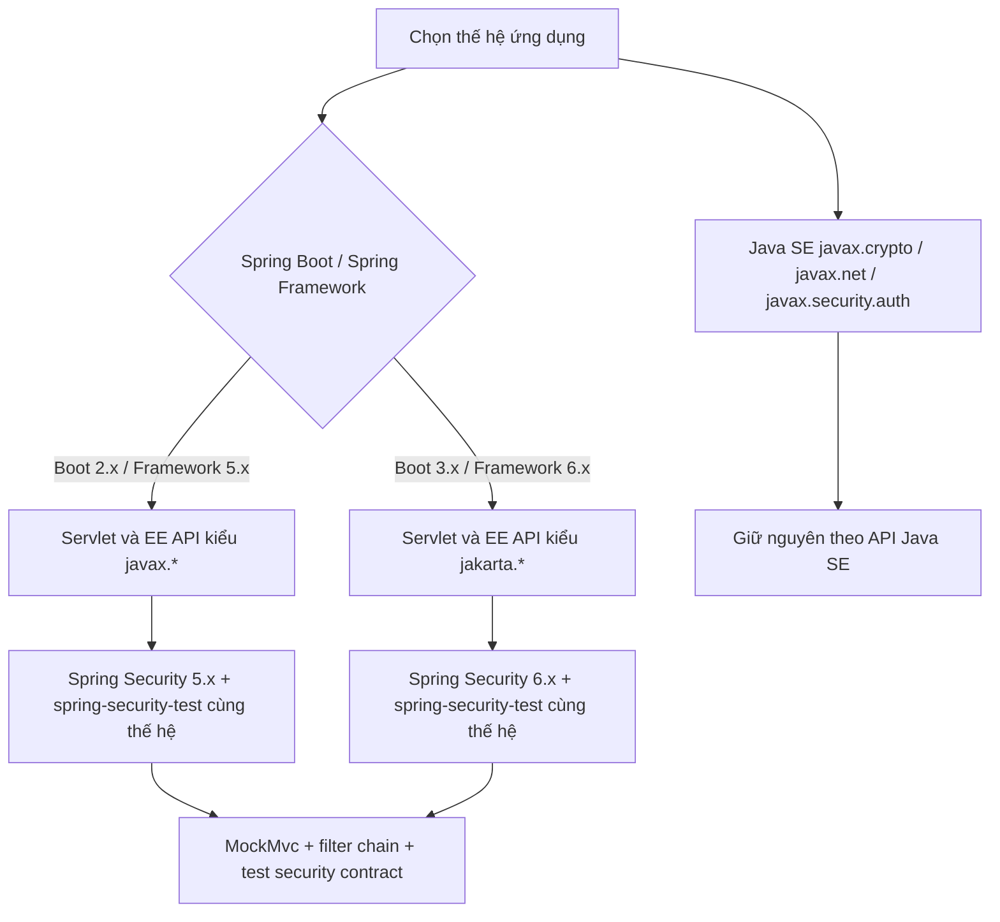

# Đổi namespace javax sang jakarta theo thế hệ ứng dụng

Một lỗi thường xuất hiện khi nâng cấp Spring Security không nằm trong quy tắc `hasRole()` hay `@WithMockUser`, mà nằm ở **kiểu Servlet mà ứng dụng và thư viện test đang sử dụng**. Ví dụ, một custom filter được viết với `javax.servlet.http.HttpServletRequest` cho Spring Boot 2.x không thể đơn giản được đưa nguyên bản vào ứng dụng Spring Boot 3.x đang dùng `jakarta.servlet.http.HttpServletRequest`. Dù hai tên class có cùng phần sau, chúng thuộc **hai namespace và hai kiểu Java khác nhau**.

Bài thuộc chương **Di chuyển và nâng cấp** của module **SPRING_SECURITY_TESTING**. Mục tiêu là giúp người học kiểm chứng xác thực, phân quyền và HTTP protection bằng `spring-security-test` trong cả Servlet và Reactive, đặc biệt khi nâng cấp làm thay đổi dependency, filter chain, API và các annotation. Nội dung tập trung vào câu hỏi: **ở thế hệ ứng dụng nào thì dùng `javax`, khi nào chuyển sang `jakarta`, và dùng các test nào để bảo đảm chính sách bảo mật vẫn hoạt động?**

## 1. Vì sao có hai namespace?

Các đặc tả Java EE từng dùng package `javax.*`. Khi Jakarta EE phát triển các thế hệ API mới, nhiều namespace thuộc Java EE được đổi thành `jakarta.*`. Spring Framework 6 và Spring Boot 3 chuyển sang các API Jakarta EE tương thích, vì thế ứng dụng Servlet cần các kiểu `jakarta.servlet.*`, `jakarta.validation.*`, `jakarta.persistence.*` và những namespace Jakarta liên quan.

Điều quan trọng:

- **Không phải mọi `javax.*` đều đổi.** `javax.crypto`, `javax.net.ssl`, `javax.security.auth`, `javax.xml.parsers`, `javax.sql` thuộc Java SE vẫn giữ nguyên trong các ứng dụng Java hiện đại.
- Package của **Spring Security Test** như `org.springframework.security.test.context.support.WithMockUser` **không đổi thành** `jakarta.security.test.*`. Các helper `user()`, `jwt()`, `csrf()`, `oauth2Login()` cũng vẫn ở package Spring Security Test.
- Thay import không tự giải quyết mọi vấn đề nâng cấp: cấu hình `SecurityFilterChain`, cách matcher HTTP, method security, phiên bản thư viện và cách tạo mock request cũng cần được kiểm chứng.
- Một project có thể cùng lúc có package Java SE `javax.*` hợp lệ và Jakarta EE `jakarta.*` hợp lệ; **không chạy một lệnh replace toàn repository**.

Sơ đồ tư duy:



## 2. Bảng quyết định theo thế hệ

| Hệ ứng dụng điển hình | Namespace Servlet / Validation / JPA | Spring Security Test | Java tối thiểu liên quan | Lưu ý |
| --- | --- | --- | --- | --- |
| Spring Boot 2.7, Spring Framework 5.3, Spring Security 5.x | `javax.servlet`, `javax.validation`, `javax.persistence` | `spring-security-test` thuộc dòng Spring Security 5.x tương thích | Boot 2.7 có thể chạy trên Java 8+ trong phạm vi hỗ trợ | Phù hợp codebase **chưa nâng lên Spring Framework 6** |
| Spring Boot 3.x, Spring Framework 6.x, Spring Security 6.x | `jakarta.servlet`, `jakarta.validation`, `jakarta.persistence` | `spring-security-test` thuộc dòng Spring Security 6.x tương thích | **Java 17 trở lên** | Cần Servlet container và dependency đã hỗ trợ Jakarta |
| Các thế hệ Spring Boot/Spring Security mới hơn dựa trên Jakarta | Tiếp tục dùng Jakarta EE API theo dependency được quản lý | Chọn bản được BOM/Boot quản lý và kiểm tra migration guide của phiên bản mục tiêu | Theo tài liệu của phiên bản đang dùng | Không suy đoán mọi API đều giữ nguyên giữa các major release |

**Cách chọn:** xem version Spring Boot, Spring Framework, Spring Security và starter đang được dùng trong **chính ứng dụng**, rồi chọn import theo thế hệ đó. Không chọn import vì một đoạn code trên mạng “mới hơn”. Nếu project đang ở Boot 2.7 và chưa nâng cấp runtime, đổi riêng `javax.servlet` thành `jakarta.servlet` thường là **sai hướng**.

Khi nâng Spring Boot 2.7 lên 3.x, đừng cố giữ một thư viện filter đã biên dịch với Servlet `javax` rồi bổ sung `javax.servlet-api` cạnh `jakarta.servlet-api` để “hết báo lỗi”: việc có cả hai classpath không làm chúng trở thành cùng interface.

### Spring Security 5.8 là bước đệm, không phải Jakarta Servlet

Trong kế hoạch nâng cấp, Spring Security 5.8 thường được dùng làm **bước chuẩn bị** các thay đổi API/configuration trước khi chuyển lên Spring Security 6. Tuy nhiên, dòng 5.x vẫn thuộc nền Spring Framework 5/`javax.servlet`. Đừng hiểu “đã nâng Security lên 5.8” có nghĩa code Servlet đã có thể nhập `jakarta.servlet.Filter`.

## 3. Những import cần đổi và những import phải giữ

Bảng dưới đây mô tả các chuyển đổi thường gặp khi **nâng toàn ứng dụng Servlet từ nền Boot 2/Security 5 sang Boot 3/Security 6**:

| Trước nâng cấp | Sau nâng cấp | Bối cảnh |
| --- | --- | --- |
| `javax.servlet.Filter` | `jakarta.servlet.Filter` | Servlet filter tùy chỉnh |
| `javax.servlet.FilterChain` | `jakarta.servlet.FilterChain` | Phương thức `doFilter` |
| `javax.servlet.ServletException` | `jakarta.servlet.ServletException` | Chữ ký method filter |
| `javax.servlet.http.HttpServletRequest` | `jakarta.servlet.http.HttpServletRequest` | Request trong filter/controller |
| `javax.servlet.http.HttpServletResponse` | `jakarta.servlet.http.HttpServletResponse` | Response trong filter/controller |
| `javax.servlet.http.Cookie` | `jakarta.servlet.http.Cookie` | Cookie của Servlet |
| `javax.validation.Valid` | `jakarta.validation.Valid` | Bean Validation |
| `javax.validation.constraints.NotBlank` | `jakarta.validation.constraints.NotBlank` | Validation annotation |
| `javax.persistence.Entity` | `jakarta.persistence.Entity` | JPA/Hibernate đời mới |
| `javax.annotation.PostConstruct` | `jakarta.annotation.PostConstruct` | Lifecycle annotation |
| `javax.annotation.security.RolesAllowed` | `jakarta.annotation.security.RolesAllowed` | JSR-250 method security |
| `javax.transaction.Transactional` | `jakarta.transaction.Transactional` | Jakarta Transactions (nếu đang dùng) |

Đối với transactional service theo Spring, thường ưu tiên `org.springframework.transaction.annotation.Transactional`, vì API đó vẫn ở package Spring và hỗ trợ các tùy chọn `propagation`, `isolation`, `readOnly`. Không đổi import Spring này thành `jakarta.transaction.Transactional` chỉ vì thấy từ khóa “transaction”.

Những import **không** đổi:

```java
// Java SE: vẫn là javax, không đổi máy móc sang jakarta.
import javax.crypto.Cipher;
import javax.net.ssl.SSLContext;
import javax.security.auth.Subject;
import javax.security.auth.x500.X500Principal;
import javax.xml.parsers.DocumentBuilderFactory;
import javax.sql.DataSource;

// Spring Security / Spring Test: tên package vẫn ở org.springframework...
import org.springframework.security.core.context.SecurityContextHolder;
import org.springframework.security.test.context.support.WithMockUser;
import org.springframework.security.web.SecurityFilterChain;
import org.springframework.mock.web.MockHttpServletRequest;
```

Nếu một IDE gợi ý đổi `javax.security.auth.Subject` sang `jakarta.security.auth.Subject`, hãy kiểm tra lại: đó không phải phép đổi tên hợp lệ cho Java SE. **Chỉ di chuyển API Java EE/Jakarta EE được hệ ứng dụng mục tiêu sử dụng**.

## 4. Custom filter Servlet trước và sau nâng cấp

Giả sử ứng dụng có filter kiểm tra một header bổ trợ `X-Request-Marker` trước khi đi tới controller. Header này **không cấp danh tính**, chỉ được dùng như ví dụ để minh họa việc chuyển signature Servlet đúng cách. Việc xác thực và phân quyền vẫn do `SecurityFilterChain` đảm nhiệm.

### Trên Spring Boot 2.x / Spring Security 5.x

```java
import java.io.IOException;
import javax.servlet.FilterChain;
import javax.servlet.ServletException;
import javax.servlet.http.HttpServletRequest;
import javax.servlet.http.HttpServletResponse;

import org.springframework.web.filter.OncePerRequestFilter;

public class RequestMarkerFilter extends OncePerRequestFilter {

    @Override
    protected void doFilterInternal(
            HttpServletRequest request,
            HttpServletResponse response,
            FilterChain chain) throws ServletException, IOException {

        String marker = request.getHeader("X-Request-Marker");
        if (marker != null && !marker.matches("[A-Za-z0-9-]{1,32}")) {
            response.sendError(HttpServletResponse.SC_BAD_REQUEST);
            return;
        }

        chain.doFilter(request, response);
    }
}
```

### Trên Spring Boot 3.x / Spring Security 6.x

Logic và package của `OncePerRequestFilter` không đổi, nhưng **toàn bộ các kiểu Servlet trong method signature** phải là `jakarta`:

```java
import java.io.IOException;
import jakarta.servlet.FilterChain;
import jakarta.servlet.ServletException;
import jakarta.servlet.http.HttpServletRequest;
import jakarta.servlet.http.HttpServletResponse;

import org.springframework.web.filter.OncePerRequestFilter;

public class RequestMarkerFilter extends OncePerRequestFilter {

    @Override
    protected void doFilterInternal(
            HttpServletRequest request,
            HttpServletResponse response,
            FilterChain chain) throws ServletException, IOException {

        String marker = request.getHeader("X-Request-Marker");
        if (marker != null && !marker.matches("[A-Za-z0-9-]{1,32}")) {
            response.sendError(HttpServletResponse.SC_BAD_REQUEST);
            return;
        }

        chain.doFilter(request, response);
    }
}
```

Điểm kiểm chứng quan trọng: trên Spring Framework 6, `OncePerRequestFilter.doFilterInternal` nhận **`jakarta.servlet.http.HttpServletRequest`, `jakarta.servlet.http.HttpServletResponse` và `jakarta.servlet.FilterChain`**. Nếu subclass còn dùng `javax.servlet.*`, `@Override` có thể báo không override được method; đó là tín hiệu đúng của lỗi không tương thích API.

### Tránh “sửa” bằng classpath trộn hai thế hệ

Không khắc phục lỗi filter bằng cách thêm cả:

```text
javax.servlet:javax.servlet-api
jakarta.servlet:jakarta.servlet-api
```

vào cùng một module Boot 3 rồi tiếp tục truyền `javax.servlet.http.HttpServletRequest` cho Spring Framework 6. Đây là hai kiểu riêng biệt. Phương án đúng là nâng **source và các thư viện tích hợp tương ứng**. Nếu thư viện của bên thứ ba vẫn dùng `javax.servlet`, hãy tìm bản tương thích Jakarta hoặc thay thư viện; không tự cast hai request type với nhau.

Một custom `Filter` được đăng ký cả như `@Component` **và** thêm qua `.addFilterBefore(...)` có thể bị gọi hai lần nếu còn được container đăng ký độc lập. Khi muốn filter chỉ thuộc Spring Security, tạo instance qua cấu hình `SecurityFilterChain` có chủ đích; viết test đếm số lần chạy nếu cần.

## 5. Cấu hình Spring Security thay đổi ngoài namespace

Nâng cấp Security 5 sang 6 còn ảnh hưởng API cấu hình và method security. Không coi mọi lỗi nâng cấp là do `javax`:

| Thiết kế cũ thường gặp | Hướng dùng trong Security 6 | Điều test cần bảo đảm |
| --- | --- | --- |
| Kế thừa `WebSecurityConfigurerAdapter` | Khai báo bean `SecurityFilterChain` | Mỗi endpoint vẫn qua đúng filter chain |
| `authorizeRequests()`, `antMatchers(...)` | `authorizeHttpRequests()`, `requestMatchers(...)` | Matching path/method đúng với policy |
| `@EnableGlobalMethodSecurity(...)` | `@EnableMethodSecurity(...)` | Method security thực sự được kích hoạt |
| `javax.annotation.security.RolesAllowed` | `jakarta.annotation.security.RolesAllowed` | Quy tắc JSR-250 còn áp dụng |
| Security config bị mock/tắt trong test | Giữ bean cấu hình thật khi integration test | Không có endpoint bị `permitAll()` ngoài ý muốn |
| Thay matcher mà không xét khác biệt ngữ nghĩa | Xem xét đường dẫn, servlet path, path pattern/matcher | Test cả đường hợp lệ, đường gần giống và HTTP method khác |

Trong các phiên bản Spring Security, API DSL và cách khớp matcher có thể tiếp tục thay đổi. Khi nâng cấp, tra migration guide **đúng phiên bản nguồn và đích**, không copy một snippet DSL chỉ vì nó đã biên dịch.

## 6. Ứng dụng Boot 3 mẫu: filter Jakarta và method security

Ta xây dựng một ứng dụng Servlet với ba chức năng:

- `GET /api/profile`: dành cho bất kỳ người dùng đã xác thực, trả tên principal.
- `GET /api/reports`: được bảo vệ **ở service method** bằng `@RolesAllowed("ADMIN")`.
- `POST /api/items`: dành cho người đã xác thực, đồng thời phải thỏa CSRF mặc định.

Phần cấu hình Spring Security 6:

```java
import org.springframework.context.annotation.Bean;
import org.springframework.context.annotation.Configuration;
import org.springframework.security.config.Customizer;
import org.springframework.security.config.annotation.method.configuration.EnableMethodSecurity;
import org.springframework.security.config.annotation.web.builders.HttpSecurity;
import org.springframework.security.web.SecurityFilterChain;
import org.springframework.security.web.authentication.UsernamePasswordAuthenticationFilter;

@Configuration
@EnableMethodSecurity(jsr250Enabled = true)
class MigratedSecurityConfig {

    @Bean
    SecurityFilterChain securityFilterChain(HttpSecurity http)
            throws Exception {

        return http
            .authorizeHttpRequests(auth -> auth
                .requestMatchers("/api/**").authenticated()
                .anyRequest().denyAll())
            .httpBasic(Customizer.withDefaults())
            .addFilterBefore(
                new RequestMarkerFilter(),
                UsernamePasswordAuthenticationFilter.class)
            .build();
    }
}
```

`@EnableMethodSecurity(jsr250Enabled = true)` là điều kiện cho `@RolesAllowed` được thực thi theo cấu hình này. Nếu bỏ nó trong quá trình nâng cấp, ứng dụng có thể vẫn cho request đi tới service nhưng **quyết định phân quyền ở method bị mất**.

Service với annotation Jakarta:

```java
import jakarta.annotation.security.RolesAllowed;

import org.springframework.stereotype.Service;

@Service
class ReportService {

    @RolesAllowed("ADMIN")
    public String readReports() {
        return "confidential-reports";
    }
}
```

Controller:

```java
import java.security.Principal;

import org.springframework.http.HttpStatus;
import org.springframework.http.ResponseEntity;
import org.springframework.web.bind.annotation.GetMapping;
import org.springframework.web.bind.annotation.PostMapping;
import org.springframework.web.bind.annotation.RestController;

@RestController
class MigratedApiController {

    private final ReportService reports;

    MigratedApiController(ReportService reports) {
        this.reports = reports;
    }

    @GetMapping("/api/profile")
    String profile(Principal principal) {
        return principal.getName();
    }

    @GetMapping("/api/reports")
    String reports() {
        return reports.readReports();
    }

    @PostMapping("/api/items")
    ResponseEntity<String> createItem() {
        return ResponseEntity.status(HttpStatus.CREATED)
            .body("item-created");
    }
}
```

Ví dụ này **không gán `ROLE_ADMIN` từ header**; quyền chỉ được cấp qua Authentication do Spring Security tạo. `RequestMarkerFilter` chỉ kiểm header và cho request tiếp tục, không thay thế cơ chế authentication.

### Dependency căn bản cho Boot 3

```gradle
dependencies {
    implementation("org.springframework.boot:spring-boot-starter-web")
    implementation("org.springframework.boot:spring-boot-starter-security")

    testImplementation("org.springframework.boot:spring-boot-starter-test")
    testImplementation("org.springframework.security:spring-security-test")
}
```

Dự án dùng Spring Boot plugin/BOM để quản lý version tương thích; không cần gắn version riêng cho `spring-security-test`. Nếu dùng `@Valid`/Jakarta Bean Validation, cần thêm starter validation tương ứng. Với code JPA, cần starter data-jpa tương thích với Jakarta Persistence.

## 7. MockMvc xác minh hành vi sau nâng cấp

Một số project nâng cấp **biên dịch thành công** nhưng security filter/method rule không còn được áp dụng vì cấu hình hoặc slice test đã thay đổi. Bộ test sau bảo vệ ba điểm: filter Jakarta được chạy, request authentication đúng và `@RolesAllowed` tiếp tục chặn role không phù hợp.

```java
import org.junit.jupiter.api.Test;
import org.springframework.beans.factory.annotation.Autowired;
import org.springframework.boot.test.autoconfigure.web.servlet.AutoConfigureMockMvc;
import org.springframework.boot.test.context.SpringBootTest;
import org.springframework.test.web.servlet.MockMvc;

import static org.springframework.security.test.web.servlet.request.SecurityMockMvcRequestPostProcessors.csrf;
import static org.springframework.security.test.web.servlet.request.SecurityMockMvcRequestPostProcessors.user;
import static org.springframework.test.web.servlet.request.MockMvcRequestBuilders.get;
import static org.springframework.test.web.servlet.request.MockMvcRequestBuilders.post;
import static org.springframework.test.web.servlet.result.MockMvcResultMatchers.content;
import static org.springframework.test.web.servlet.result.MockMvcResultMatchers.status;

@SpringBootTest
@AutoConfigureMockMvc
class JakartaMigrationSecurityContractTests {

    @Autowired
    MockMvc mvc;

    @Test
    void anonymous_whenReadingProfile_isUnauthorized()
            throws Exception {
        mvc.perform(get("/api/profile"))
            .andExpect(status().isUnauthorized());
    }

    @Test
    void authenticatedUser_whenReadingProfile_isAllowed()
            throws Exception {
        mvc.perform(get("/api/profile")
                .with(user("alice").roles("USER")))
            .andExpect(status().isOk())
            .andExpect(content().string("alice"));
    }

    @Test
    void malformedMarker_whenReadingProfile_isBadRequest()
            throws Exception {
        mvc.perform(get("/api/profile")
                .with(user("alice").roles("USER"))
                .header("X-Request-Marker", "contains spaces"))
            .andExpect(status().isBadRequest());
    }

    @Test
    void regularUser_whenReadingAdminReport_isForbidden()
            throws Exception {
        mvc.perform(get("/api/reports")
                .with(user("alice").roles("USER")))
            .andExpect(status().isForbidden());
    }

    @Test
    void admin_whenReadingAdminReport_isAllowed()
            throws Exception {
        mvc.perform(get("/api/reports")
                .with(user("admin").roles("ADMIN")))
            .andExpect(status().isOk())
            .andExpect(content().string("confidential-reports"));
    }

    @Test
    void authenticatedUserWithoutCsrf_whenCreatingItem_isForbidden()
            throws Exception {
        mvc.perform(post("/api/items")
                .with(user("alice").roles("USER")))
            .andExpect(status().isForbidden());
    }

    @Test
    void authenticatedUserWithCsrf_whenCreatingItem_isCreated()
            throws Exception {
        mvc.perform(post("/api/items")
                .with(user("alice").roles("USER"))
                .with(csrf()))
            .andExpect(status().isCreated())
            .andExpect(content().string("item-created"));
    }
}
```

Các test dùng `user()`/ `csrf()` của `spring-security-test` để cung cấp dữ liệu request; chúng không kiểm tra mật khẩu HTTP Basic thật. Test `malformedMarker_whenReadingProfile_isBadRequest` đảm bảo `RequestMarkerFilter` **đang nằm trong SecurityFilterChain**: nếu filter vô tình bị bỏ khỏi cấu hình, test có khả năng nhận 200 và thất bại.

Hai test role là **cặp đối chứng** cho `@RolesAllowed("ADMIN")`. Nếu method security không được bật hoặc annotation chuyển sai namespace, request với `ROLE_USER` có nguy cơ nhận 200. Chỉ kiểm tra ca admin thành công sẽ không bắt được lỗi ấy.

Hai test POST tương tự kiểm chứng rằng CSRF vẫn được áp dụng, thay vì toàn bộ POST bị `.csrf(...disable)` trong lúc nâng cấp.

**Lưu ý phạm vi:** `@SpringBootTest + @AutoConfigureMockMvc` sử dụng ApplicationContext và SecurityFilterChain thật của ứng dụng. Nếu đổi sang `MockMvcBuilders.standaloneSetup(controller)` mà không tích hợp security filter, các test có thể không còn đo được chính sách trên; không đổi chiến lược test khi di chuyển namespace mà không đánh giá khác biệt.

## 8. Những API spring-security-test nào đổi và không đổi?

Trọng tâm migration `javax` → `jakarta` **không nằm ở việc đổi tên các helper Spring Security Test**:

```java
import org.springframework.security.test.context.support.WithMockUser;

import static org.springframework.security.test.web.servlet.request.SecurityMockMvcRequestPostProcessors.user;
import static org.springframework.security.test.web.servlet.request.SecurityMockMvcRequestPostProcessors.csrf;
```

Các API như `@WithMockUser`, `SecurityContextHolder`, `MockMvc`, `MockHttpServletRequest`, `MockMvcRequestBuilders` vẫn ở package `org.springframework...` tương ứng. Nhưng các class Mock Servlet trong Spring Framework 6 sử dụng type **Jakarta Servlet** bên dưới.

Khi test có code tự xây request, filter hoặc Servlet listener:

```java
import jakarta.servlet.FilterChain;
import jakarta.servlet.http.HttpServletRequest;
import jakarta.servlet.http.HttpServletResponse;

import org.springframework.mock.web.MockHttpServletRequest;
import org.springframework.mock.web.MockHttpServletResponse;
```

Không viết `javax.servlet.http.HttpServletRequest request = new MockHttpServletRequest();` trong Boot 3. Mặc dù tên `MockHttpServletRequest` vẫn là package Spring, object này thực thi API Jakarta Servlet và **không** là `javax.servlet.http.HttpServletRequest`.

### @WithMockUser không kiểm chứng namespace Servlet hoặc login thật

Một test đơn giản:

```java
@Test
@WithMockUser(username = "alice")
void alice_whenReadingProfile_isAllowed() throws Exception {
    mvc.perform(get("/api/profile"))
        .andExpect(status().isOk());
}
```

giúp kiểm tra policy trên một request đã được gắn Authentication giả. Nó **không** chứng minh custom `javax` filter cũ đã được di chuyển đúng; test `malformedMarker...` ở mục 7 mới kiểm tra sự hiện diện filter. Nó cũng không kiểm tra HTTP Basic password, JWT signature hay OAuth2/OIDC callback.

Do đó, sau nâng cấp cần tổ chức **nhiều loại test có mục tiêu rõ**, không chỉ giữ lại các `@WithMockUser` happy-path tests.

## 9. Bean Validation, JPA và JSR-250 liên quan gì đến security tests?

Lỗi namespace không chỉ nằm ở Servlet filter; các annotation đi qua controller, service và persistence cũng liên quan.

### Bean Validation

Trước nâng cấp:

```java
import javax.validation.Valid;
import javax.validation.constraints.NotBlank;
```

Sau nâng cấp Boot 3:

```java
import jakarta.validation.Valid;
import jakarta.validation.constraints.NotBlank;
```

Nếu DTO dùng validation constraint nhưng project thiếu `spring-boot-starter-validation`, test `POST` với dữ liệu rỗng có thể không bị từ chối như mong đợi. Không kết luận rằng security đã chặn hoặc cho qua chỉ từ status 400/403; cần cô lập CSRF, authentication và validation input trong test. Một test kiểm tra DTO invalid nên gửi authentication + CSRF **hợp lệ** để request đi đến Bean Validation.

### Jakarta Persistence và transaction

Trước:

```java
import javax.persistence.Entity;
import javax.persistence.Id;
```

Sau:

```java
import jakarta.persistence.Entity;
import jakarta.persistence.Id;
```

JPA có thể ảnh hưởng test authorization dựa trên owner/tenant. Nếu repository/service không khởi tạo đúng do annotation sai namespace, HTTP 500 chưa phải là bằng chứng rằng user thiếu quyền. Hãy kiểm tra datasource/JPA schema, sau đó viết các test 401/403/200 tương ứng.

### JSR-250 RolesAllowed

Trước:

```java
import javax.annotation.security.RolesAllowed;
```

Sau:

```java
import jakarta.annotation.security.RolesAllowed;
```

Đồng thời cần `@EnableMethodSecurity(jsr250Enabled = true)` ở cấu hình phù hợp. Một bài test `admin_whenReadingAdminReport_isAllowed()` **không đủ**: thiếu test `regularUser_whenReadingAdminReport_isForbidden()` có thể che việc `@RolesAllowed` không còn được đánh giá.

## 10. JWT, OAuth2/OIDC và SAML2: namespace đúng không có nghĩa flow đúng

Khi nâng cấp một ứng dụng Resource Server hoặc OAuth2 Client, nhiều helper của `spring-security-test` vẫn hoạt động với cùng tên nhưng **giới hạn của chúng không thay đổi**:

| Test giả lập | Kiểm tra tốt | Không tự chứng minh |
| --- | --- | --- |
| Servlet `with(jwt())` | Authority/scope của `JwtAuthenticationToken` đã giả | Decoder xác minh chữ ký, issuer, audience, hết hạn |
| `with(opaqueToken())` | Quy tắc phân quyền với principal đã introspect giả | HTTP introspection và `active=false` thật |
| `with(oauth2Login())` | Controller sau OAuth2 login với `OAuth2User` | Authorization Code, state, token exchange |
| `with(oidcLogin())` | Controller sau OIDC login với `OidcUser` | ID token signature, issuer, nonce, JWKS |
| `with(oauth2Client("catalog"))` | `@RegisteredOAuth2AuthorizedClient` được cấp client giả | Cấp/refresh token từ Authorization Server |
| `@WithMockUser` | Rule role/authenticated trong test context | Password thật, Basic/form login hoặc Servlet filter tùy chỉnh |

Một migration test ở mức authentication mechanism cần gửi request qua **filter/decoder/provider thực**, ví dụ:

- Resource Server: gửi `Authorization: Bearer <JWT đã ký>` và kiểm thử chữ ký đúng/sai, issuer, audience, expiration; dùng khóa test phù hợp với decoder.
- Opaque token: mock introspection endpoint cục bộ để kiểm tra `active=true/false`, scope và failure handling.
- OAuth2/OIDC: dùng mock Authorization Server hoặc IdP test để kiểm tra redirect, callback, state, token endpoint, JWT/OIDC claims và session.
- SAML2: kiểm tra ACS, assertion chữ ký và điều kiện qua IdP/fixture test đã ký hợp lệ, không thay bằng `@WithMockUser`.

Nếu chỉ thay `javax.servlet` bằng `jakarta.servlet` rồi thấy `with(jwt())` vẫn cho HTTP 200, không thể kết luận **JWT verification của production** còn đúng sau nâng cấp. Cần có negative test dùng token thật đi qua decoder.

## 11. Reactive / WebTestClient có cần đổi servlet namespace không?

Ứng dụng **WebFlux thuần Reactive** dùng `ServerWebExchange`, `SecurityWebFilterChain`, `ReactiveSecurityContextHolder` và `WebTestClient`. Những API Spring này **không phải Servlet API**, vì thế không tự chuyển:

```text
org.springframework.web.server.ServerWebExchange
org.springframework.security.web.server.SecurityWebFilterChain
org.springframework.security.core.context.ReactiveSecurityContextHolder
org.springframework.test.web.reactive.server.WebTestClient
```

thành tên `jakarta.servlet.*`.

Ví dụ kiểm thử Reactive authorization vẫn dùng helper:

```java
import org.junit.jupiter.api.BeforeEach;
import org.junit.jupiter.api.Test;
import org.springframework.beans.factory.annotation.Autowired;
import org.springframework.boot.test.context.SpringBootTest;
import org.springframework.context.ApplicationContext;
import org.springframework.test.web.reactive.server.WebTestClient;

import static org.springframework.security.test.web.reactive.server.SecurityMockServerConfigurers.mockUser;
import static org.springframework.security.test.web.reactive.server.SecurityMockServerConfigurers.springSecurity;

@SpringBootTest(webEnvironment = SpringBootTest.WebEnvironment.MOCK)
class ReactiveAuthorizationMigrationTests {

    @Autowired
    ApplicationContext context;

    WebTestClient client;

    @BeforeEach
    void setUp() {
        client = WebTestClient.bindToApplicationContext(context)
            .apply(springSecurity())
            .configureClient()
            .build();
    }

    @Test
    void reactiveReader_whenReadingReports_isAllowed() {
        client.mutateWith(mockUser("alice").roles("READER"))
            .get().uri("/api/reports")
            .exchange()
            .expectStatus().isOk();
    }
}
```

Đoạn trên **giả định một ứng dụng WebFlux riêng** có `SecurityWebFilterChain` và controller `GET /api/reports` chấp nhận `ROLE_READER`; không thể chạy nguyên xi trong ứng dụng Servlet mẫu ở mục 6. Trong WebFlux, nếu ứng dụng dùng Bean Validation/JPA qua thư viện tương thích Jakarta hoặc có Servlet adapter/gateway, dependency ngoài reactive security vẫn có thể cần migration. Không dùng việc “không import `javax.servlet` trực tiếp” để kết luận toàn bộ dependency tree tương thích.

`WebTestClient.bindToServer()` gửi HTTP thật; `mockUser()` và `mockJwt()` là mock mutator dành cho mock WebFlux server **không** gửi Authentication object xuyên mạng. Khi nâng cấp remote server, cần kiểm chứng bằng credential HTTP thật tương ứng.

## 12. Chẩn đoán lỗi thường gặp

| Hiện tượng | Khả năng nguyên nhân | Điều cần làm |
| --- | --- | --- |
| `package javax.servlet does not exist` trong Boot 3 | Source vẫn import Java EE Servlet | Đổi toàn bộ signature custom filter sang `jakarta.servlet` |
| `method does not override or implement` ở `doFilterInternal` | Subclass nhận `javax.servlet` nhưng superclass yêu cầu `jakarta.servlet` | Đồng bộ kiểu request/response/chain/exception |
| `ClassCastException` giữa `javax.servlet...` và `jakarta.servlet...` | Có hai thế hệ Servlet API cùng classpath/integration | Nâng thư viện hoặc bỏ adapter sai, không cast |
| `NoClassDefFoundError: javax/servlet/Filter` | JAR bên thứ ba biên dịch với Servlet cũ | Chọn bản tương thích Jakarta hoặc thay lib |
| `NoSuchMethodError`/lỗi linkage ở Spring/Security/Test | Trộn version không tương thích giữa Spring Boot, Framework, Security | Dùng BOM, dependency management và kiểm tra dependency tree |
| MockMvc trả 200 cho request đáng lẽ bị 403 | Mất method security, `@RolesAllowed` sai namespace hoặc chain bị bypass | Test thiếu quyền, kiểm `@EnableMethodSecurity(jsr250Enabled=true)` |
| MockMvc không chạy custom filter | Filter không còn được đăng ký hoặc test dùng `standaloneSetup` không apply filter | Thử request marker sai, kiểm tra chain thực |
| POST bị 403 dù có role | Thiếu CSRF chứ không phải authorization | Cung cấp `csrf()` ở mock request và test riêng CSRF |
| Test dùng `@WithMockUser` pass nhưng HTTP Basic/JWT thật fail | Mock bỏ qua cơ chế xác thực | Bổ sung test đăng nhập/decoder thực |
| Bean Validation không chạy | Thiếu starter validation hoặc dùng annotation sai thế hệ | Dùng `jakarta.validation`, kiểm dependency và negative test |
| JPA không nhận Entity | Entity annotation sai thế hệ hoặc provider không tương thích | Dùng `jakarta.persistence`, nâng Hibernate/JPA adapter theo BOM |
| Hành vi matcher khác sau nâng | Thay `antMatchers` sang `requestMatchers` mà không kiểm path semantics | Test path, HTTP method, trailing slash và servlet mapping |

Không coi một request trả **500** là một test security thành công chỉ vì người dùng không lấy được dữ liệu. Security regression tests nên khẳng định **HTTP decision đúng** (401/403/redirect/200) với tiền điều kiện xác thực và CSRF có kiểm soát.

## 13. Quy trình nâng cấp an toàn cho codebase và CI

Hãy nâng cấp theo các giai đoạn có kết quả kiểm chứng rõ:

1. **Chụp baseline trên phiên bản cũ.** Ghi lại test kết quả anonymous, role đủ/thiếu, CSRF, session và JWT/OAuth2/OIDC flow thật nếu có. Không bắt đầu bằng việc xóa những test đang thất bại.
2. **Phân loại các import `javax.*`.** Nhóm Servlet, Validation, JPA, Annotation, Transactions (Jakarta EE) riêng với Crypto/SSL/Security Auth/XML/SQL của Java SE.
3. **Đồng bộ dependency theo thế hệ.** Nâng Spring Boot, Spring Framework, Spring Security, `spring-security-test`, Servlet container và thư viện tích hợp; không đặt nhiều version Spring khác nhau trừ khi có lý do tương thích được xác minh.
4. **Sửa source chính.** Thay import thuộc Jakarta EE, cập nhật signature custom filter/listener và cấu hình SecurityFilterChain/method security đúng API phiên bản đích.
5. **Sửa test code.** Tất cả mock `HttpServletRequest`, `FilterChain`, `Cookie`, exception Servlet phải cùng thế hệ `jakarta`; giữ nguyên package test helper Spring.
6. **Kiểm thử negative paths trước.** Anonymous không được vào route bảo vệ; thiếu role trả 403; thiếu CSRF bị chặn; custom filter vẫn từ chối malformed request. Những ca này phát hiện trường hợp nâng cấp vô tình mở rộng quyền.
7. **Kiểm chứng authentication thật.** Nếu dùng Basic/JWT/OAuth2/OIDC/SAML2, cho cơ chế tương ứng chạy với fixture được kiểm soát, không chỉ dùng mock principal.
8. **Kiểm tra môi trường chạy.** Servlet container Jakarta-compatible, Java toolchain, Testcontainers/mock IdP (nếu có), reverse proxy và cookie/header behavior.
9. **Chạy CI và so sánh baseline.** Giữ JUnit XML/HTML reports, xác định lỗi do namespace, config hay policy; không loại bỏ test vì flakiness khi chưa điều tra.
10. **Bảo đảm rollback kế hoạch nâng cấp**, không phải chỉ `@Transactional` rollback dữ liệu test: có thể cần lộ trình revert dependency/config và tương thích deployment khi còn service cũ.

Ví dụ câu lệnh kiểm tra dependency **để người học chạy trong môi trường dự án**, không phải lệnh đã thực thi trong bài viết:

```bash
# Xem thư viện và các version được resolve cho test.
./gradlew dependencies --configuration testRuntimeClasspath

# Lần theo dependency cũ nếu còn trong classpath.
./gradlew dependencyInsight --dependency javax.servlet --configuration testRuntimeClasspath
./gradlew dependencyInsight --dependency jakarta.servlet --configuration testRuntimeClasspath

# Chạy test hiện có và xuất báo cáo JUnit.
./gradlew test
```

Trong CI dùng Java toolchain đúng với major release đích (Boot 3 cần Java 17+), đồng thời kiểm tra code ở các module phụ; một adapter cũ trong module ít chạy vẫn có thể kéo `javax.servlet` trở lại runtime.

### Không đổi mã nguồn production chỉ để test pass

Nếu các test MockMvc cũ lỗi vì thay `WebSecurityConfigurerAdapter`, cách sửa đúng không phải đổi mọi endpoint thành `permitAll()`, bỏ CSRF hoặc tắt method security. Hãy xây dựng `SecurityFilterChain` tương đương về chính sách, đổi mock setup theo API mới và giữ các assertion **cả được phép lẫn bị từ chối**.

## 14. Bài tập thực hành

1. Trong một codebase Boot 2.7/Security 5.x, thống kê `javax.servlet`, `javax.persistence`, `javax.validation`, `javax.annotation.security` và `javax.crypto`. Giải thích vì sao không được thay tất cả cùng lúc.
2. Chuyển `RequestMarkerFilter` ở mục 4 từ `javax.servlet` sang `jakarta.servlet`, giữ nguyên logic. Kiểm tra toàn bộ các kiểu trong chữ ký method, kể cả `ServletException`.
3. Tạo Boot 3 app có `SecurityFilterChain` từ mục 6. Gửi request GET có `X-Request-Marker` chứa khoảng trắng và xác minh nhận 400, không phải 200.
4. Cấu hình `@EnableMethodSecurity(jsr250Enabled=true)` và `jakarta.annotation.security.RolesAllowed`. Viết hai test: user thiếu `ROLE_ADMIN` nhận 403 và admin nhận 200.
5. Bỏ `jsr250Enabled=true` trong một nhánh thử nghiệm. Quan sát negative test ở mục 7 phát hiện `@RolesAllowed` không còn được thực thi ra sao.
6. Gọi `POST /api/items` bằng `user("alice")` nhưng thiếu `csrf()`, rồi thêm `csrf()`. Đặt tên test nói rõ danh tính, hành động và quyết định dự kiến.
7. Tạo hai test cho JWT: một test `with(jwt())` kiểm tra scope, một test gửi JWT ký thật sai issuer qua decoder thật. Nêu vì sao hai bài kiểm thử chứng minh hai điều khác nhau.
8. Chạy `dependencyInsight` cho các dependency Servlet và giải thích vì sao chỉ thêm `javax.servlet-api` vào Boot 3 không giải quyết được binary incompatibility.
9. Viết một controller WebFlux và WebTestClient test cho role `READER`. Xác định package Spring không cần đổi, package Jakarta nào có thể vẫn xuất hiện ở tầng validation/persistence.
10. Lập bảng trước/sau nâng cấp cho anonymous, user, admin, CSRF, JWT sai chữ ký, OAuth2 callback sai state. Mỗi row ghi code HTTP, loại test, fixture và hành vi mong đợi.

## 15. Ghi nhớ

- **Chọn namespace theo nền ứng dụng và dependency đồng bộ:** Boot 2/Framework 5/Security 5 thường đi với `javax.servlet`; Boot 3/Framework 6/Security 6 dùng `jakarta.servlet`.
- **Không replace toàn bộ `javax.*`.** Nhiều package Java SE như `javax.crypto`, `javax.net.ssl` và `javax.security.auth` phải giữ nguyên.
- **Custom filter, servlet request và test doubles phải dùng cùng một API Servlet.** `javax.servlet.Filter` và `jakarta.servlet.Filter` không thể được coi là một.
- **Các helper spring-security-test vẫn ở `org.springframework.security.test...`.** Thay Servlet import không đồng nghĩa phải đổi `@WithMockUser`, `MockMvc` hay `SecurityContextHolder`.
- **Nâng cấp không chỉ là rename package.** Cần xem `SecurityFilterChain`, `requestMatchers`, `@EnableMethodSecurity`, JSR-250 và behavior filter.
- **Kiểm thử các đường bị chặn quan trọng hơn việc chỉ thấy 200.** Anonymous, thiếu quyền, thiếu CSRF, header/filter sai và token thật không hợp lệ phải tiếp tục bị từ chối.
- **Mock principal không thay thế integration test xác thực.** Các helper JWT/OAuth2/OIDC giả lập có phạm vi rõ; muốn đo chữ ký/callback cần cho bộ xác minh thật chạy.
- **WebFlux không dựa vào Servlet API**, nhưng ứng dụng Reactive vẫn có thể cần Jakarta EE namespace ở validation/JPA hoặc những adapter khác.
- **Dùng CI để đo tính tương đương về chính sách, không chỉ tình trạng biên dịch.** Những test báo lỗi 401/403, xác thực thật và cấu hình startup là hàng rào bảo vệ sau migration.

Trong **SPRING_SECURITY_TESTING**, việc thay `javax` bằng `jakarta` chỉ hoàn tất khi **mã nguồn, dependency, runtime và các phép kiểm thử bảo mật cùng dùng đúng thế hệ API**, và khi chính sách cho phép hoặc từ chối HTTP **vẫn được thực thi đúng như trước nâng cấp**.

### Tài liệu tham khảo

- [Spring Boot 3.0 Migration Guide — Jakarta EE](https://github.com/spring-projects/spring-boot/wiki/Spring-Boot-3.0-Migration-Guide)
- [Spring Security — Migrate to Spring Security 6](https://docs.spring.io/spring-security/reference/migration/index.html)
- [Spring Security — Testing Servlet applications](https://docs.spring.io/spring-security/reference/servlet/test/index.html)
- [Spring Security — Testing WebFlux applications](https://docs.spring.io/spring-security/reference/reactive/test/index.html)

