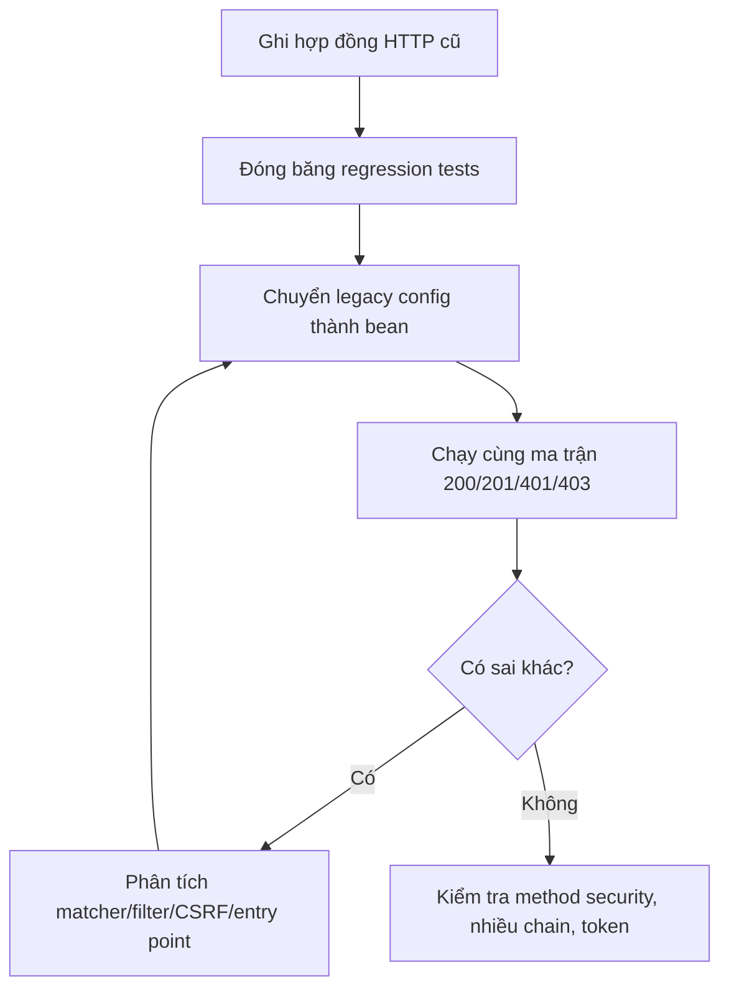

# Chuyển cấu hình bảo mật legacy sang bean SecurityFilterChain khi phù hợp

Trong chương **Di chuyển và nâng cấp** của module **SPRING_SECURITY_TESTING**, chúng ta kiểm chứng xác thực, phân quyền và bảo vệ HTTP thực tế bằng `spring-security-test` trên ứng dụng Servlet và Reactive. Bộ công cụ `MockMvc`, `WebTestClient`, `@WithMockUser`, `SecurityContext` cùng JWT/OAuth2/OIDC giả lập giúp phát hiện request được phép hoặc bị từ chối sai chính sách. Khi nâng cấp Spring Security, **giữ nguyên hành vi bảo mật quan trọng hơn việc chỉ khiến source code biên dịch**.

Một tình huống phổ biến: dự án Servlet lâu năm cấu hình bảo mật bằng class `extends WebSecurityConfigurerAdapter`, `configure(HttpSecurity)`, `authorizeRequests()` và `antMatchers()`. Sang thế hệ Spring Security 6, `WebSecurityConfigurerAdapter` đã bị loại bỏ; cách cấu hình được khuyến nghị là **khai báo bean `SecurityFilterChain`**, với DSL `authorizeHttpRequests(...)` và `requestMatchers(...)` thích hợp. Thay đổi này ảnh hưởng đến nơi khai báo rule, authentication, filter và đôi khi cả cách matcher được chọn.

Bài này hướng dẫn di chuyển có kiểm soát, không chỉ thay từ khóa: lập bảng hành vi cũ, tạo cấu hình bean mới, viết **regression test HTTP** cho `200`/`201`/`401`/`403` và CSRF, rồi rà soát nhiều filter chain, method security, JWT/OAuth2 và khác biệt của WebFlux. Ví dụ tập trung vào **Spring MVC Servlet** dùng Spring Boot 3.x/Spring Security 6.x; các bản Spring Security mới hơn phải được đối chiếu tài liệu tương ứng khi áp dụng.

## 1. Khi nào cần di chuyển và khi nào không nên chuyển máy móc?

| Tình huống | Hướng xử lý | Vì sao |
| --- | --- | --- |
| Dự án vẫn dùng `WebSecurityConfigurerAdapter` và chuẩn bị lên Spring Security 6 | Chuyển sang bean `SecurityFilterChain` trước hoặc trong lộ trình nâng cấp | Adapter không còn tồn tại trong phiên bản đích |
| Dự án Servlet đã có `@Bean SecurityFilterChain` | Không tạo thêm adapter hoặc viết lại toàn bộ chỉ vì “nâng cấp” | Tập trung đối chiếu thay đổi API và hành vi thực |
| Ứng dụng có nhiều cấu hình adapter với `@Order` | Chuyển thành **nhiều** bean chain có matcher và thứ tự tường minh | Tránh thay đổi tập URL được bảo vệ hoặc chain bị che khuất |
| Ứng dụng WebFlux vốn dùng `SecurityWebFilterChain` | Dùng DSL Reactive của `ServerHttpSecurity`, không áp dụng nguyên mẫu Servlet | Hai stack dùng filter/context và API khác nhau |
| Test chỉ kiểm tra controller bằng mock service | Bổ sung ít nhất một lớp kiểm thử có **filter chain thật** | Test controller đơn lẻ không chứng minh policy vẫn được áp dụng |

**Phân biệt:** chuyển sang bean `SecurityFilterChain` là thay đổi mô hình cấu hình, **không phải lý do để nới lỏng bảo mật**. Không tắt CSRF, cho phép mọi request hoặc bỏ qua filter tùy biến chỉ để test chuyển xanh.

Hệ sinh thái Spring Security 6/Spring Boot 3 cũng chuyển từ nhiều API `javax.servlet.*` sang `jakarta.servlet.*`, và Spring Boot 3 có baseline Java 17. Đây là phạm vi di chuyển framework rộng hơn; tài liệu tập trung vào cấu hình security và test bảo vệ HTTP, nhưng quá trình nâng cấp thực tế phải kiểm tra cả Java, Servlet API và dependency tương thích.

## 2. Chụp lại “hợp đồng bảo mật” trước khi chỉnh code

Giả sử một ứng dụng quản lý báo cáo có chính sách:

- `GET /public/ping` mở cho anonymous.
- `GET /api/reports/{id}` chỉ người có `ROLE_VIEWER` hoặc `ROLE_EDITOR` được xem.
- `POST /api/reports` chỉ `ROLE_EDITOR` được tạo, với CSRF hợp lệ khi CSRF bật.
- Các request khác bị từ chối theo `denyAll`.
- Người chưa đăng nhập truy cập endpoint bảo vệ nhận `401` qua HTTP Basic entry point.
- Người đăng nhập nhưng thiếu role nhận `403`.

Trước khi nâng cấp, lập bảng kỳ vọng độc lập với implementation:

| Request | Danh tính | CSRF | Kết quả mong đợi |
| --- | --- | --- | --- |
| `GET /public/ping` | Anonymous | Không cần | `200`, body `pong` |
| `GET /api/reports/42` | Anonymous | Không cần | `401` |
| `GET /api/reports/42` | `ROLE_GUEST` | Không cần | `403` |
| `GET /api/reports/42` | `ROLE_VIEWER` | Không cần | `200` |
| `POST /api/reports` | `ROLE_VIEWER` | Có | `403` |
| `POST /api/reports` | `ROLE_EDITOR` | Có | `201` |
| `POST /api/reports` | `ROLE_EDITOR` | Không | `403` do CSRF |
| `GET /api/reports/42` | Sai Basic password | Không cần | `401` |

Những hàng **401**, **403**, **200** và **201** đều quan trọng. Nếu chỉ giữ một test “đăng nhập rồi đọc được báo cáo”, cấu hình mới có thể vô tình cho anonymous vào mà suite vẫn xanh.



Không tính expected status bằng chính logic hiện tại của `SecurityFilterChain` rồi dùng nó làm oracle cho test; nếu cả rule và expected cùng bị thay sai, test sẽ không phát hiện.

## 3. Mẫu legacy: `WebSecurityConfigurerAdapter` và `antMatchers`

Ví dụ tương thích về mặt ý tưởng với **Spring Security 5.x**, dùng để nhận diện cấu hình cũ khi di chuyển. **Không chép đoạn này vào project Spring Security 6:** class adapter và các lời gọi legacy đã bị loại bỏ hoặc thay đổi.

```java
// Legacy Spring Security 5.x — chỉ để đối chiếu.
@Configuration
@EnableWebSecurity
class LegacyWebSecurity extends WebSecurityConfigurerAdapter {

    @Override
    protected void configure(HttpSecurity http) throws Exception {
        http.authorizeRequests()
                .antMatchers("/public/**").permitAll()
                .antMatchers(HttpMethod.GET, "/api/reports/**")
                    .hasAnyRole("VIEWER", "EDITOR")
                .antMatchers(HttpMethod.POST, "/api/reports")
                    .hasRole("EDITOR")
                .anyRequest().denyAll()
            .and()
                .httpBasic()
            .and()
                .formLogin().disable();
    }
}
```

Các phần cần giữ khi di chuyển là **thứ tự rule** và ý nghĩa của từng route:

- Rule công khai xuất hiện trước `anyRequest().denyAll()`.
- Matcher GET đọc báo cáo không cấp quyền cho POST hay DELETE.
- `hasAnyRole("VIEWER", "EDITOR")` tìm authorities `ROLE_VIEWER` hoặc `ROLE_EDITOR` theo tiền tố role mặc định.
- `httpBasic()` cung cấp cơ chế xác thực cần thiết cho test credential thật.
- `formLogin().disable()` giúp ví dụ API tránh redirect tới form login; một ứng dụng dùng session/form login thực tế **không được tự tiện tắt** khi di chuyển.
- CSRF không bị tắt; với cấu hình Servlet mặc định, request thay đổi dữ liệu vẫn cần token phù hợp.

Ngoài `configure(HttpSecurity)`, dự án legacy còn có thể override `configure(AuthenticationManagerBuilder)`, `configure(WebSecurity)`, đăng ký custom filter và bật method security. **Không chỉ chuyển một method rồi bỏ quên các phần còn lại.**

## 4. Mẫu bean `SecurityFilterChain` tương đương

Ví dụ hiện đại cho **Spring Boot 3.x / Spring Security 6.x** (Servlet):

```java
package example.migration;

import org.springframework.context.annotation.Bean;
import org.springframework.context.annotation.Configuration;
import org.springframework.http.HttpMethod;
import org.springframework.security.config.Customizer;
import org.springframework.security.config.annotation.web.builders.HttpSecurity;
import org.springframework.security.config.annotation.web.configuration.EnableWebSecurity;
import org.springframework.security.config.annotation.web.configurers.AbstractHttpConfigurer;
import org.springframework.security.core.userdetails.User;
import org.springframework.security.core.userdetails.UserDetailsService;
import org.springframework.security.provisioning.InMemoryUserDetailsManager;
import org.springframework.security.web.SecurityFilterChain;

@Configuration
@EnableWebSecurity
class MigratedSecurityConfig {

    @Bean
    SecurityFilterChain securityFilterChain(HttpSecurity http)
            throws Exception {
        return http
            .authorizeHttpRequests(authorize -> authorize
                .requestMatchers("/public/**").permitAll()
                .requestMatchers(
                        HttpMethod.GET, "/api/reports/**")
                    .hasAnyRole("VIEWER", "EDITOR")
                .requestMatchers(
                        HttpMethod.POST, "/api/reports")
                    .hasRole("EDITOR")
                .anyRequest().denyAll())
            .httpBasic(Customizer.withDefaults())
            .formLogin(AbstractHttpConfigurer::disable)
            // CSRF vẫn bật mặc định trong cấu hình Servlet.
            .build();
    }

    @Bean
    UserDetailsService users() {
        return new InMemoryUserDetailsManager(
            User.withUsername("viewer")
                .password("{noop}pw").roles("VIEWER").build(),
            User.withUsername("editor")
                .password("{noop}pw").roles("EDITOR").build(),
            User.withUsername("guest")
                .password("{noop}pw").roles("GUEST").build());
    }
}
```

`{noop}` chỉ được dùng để dựng **credential giả trong test**, không dùng làm chính sách mật khẩu production. Ứng dụng thật nên dùng `PasswordEncoder` thích hợp, user store/provider thực và quy trình nâng cấp hash tương ứng.

### Thay đổi cốt lõi

| Legacy | Cấu hình bean | Điều cần kiểm chứng |
| --- | --- | --- |
| `extends WebSecurityConfigurerAdapter` | Bean `SecurityFilterChain` | Spring dùng đúng chain khi request đến |
| `configure(HttpSecurity)` | `securityFilterChain(HttpSecurity http)` trả `http.build()` | DSL được áp dụng một lần đúng scope |
| `authorizeRequests()` | `authorizeHttpRequests(...)` | Không đánh mất rule ở request authorization |
| `antMatchers("/path/**")` | `requestMatchers("/path/**")` phù hợp stack | URI/method/servlet path được match đúng |
| Chuỗi `.and()` | Lambda DSL `authorize -> authorize...` | Thứ tự rule và các configurers vẫn đúng |
| Cấu hình user trong adapter | Bean `UserDetailsService` hoặc `AuthenticationProvider` | Cơ chế authentication thực vẫn hoạt động |
| `configure(WebSecurity)` và `web.ignoring()` | Xem xét `WebSecurityCustomizer` hoặc `permitAll` | Không vô tình bỏ security headers và các filter |
| Adapter có `@Order` | Bean `SecurityFilterChain` có `@Order`, `securityMatcher` | Không đổi chain áp dụng cho các URL |

**`requestMatchers` không phải chỉ là thao tác thay chuỗi tên.** Matcher được chọn và cách hiểu path có thể phụ thuộc Web MVC có mặt trên classpath, servlet path, loại `RequestMatcher` và cấu hình framework. Với đường dẫn đặc biệt, encoded path, nhiều servlet hoặc một matcher legacy phức tạp, hãy dùng matcher tường minh và kiểm tra bằng request tích hợp.

## 5. Controller tối thiểu để kiểm chứng cả hai hướng được phép/từ chối

Các endpoint này không truy cập database để test tập trung vào wiring security; dùng trong test ở mục kế tiếp:

```java
package example.migration;

import org.springframework.http.HttpStatus;
import org.springframework.http.ResponseEntity;
import org.springframework.web.bind.annotation.GetMapping;
import org.springframework.web.bind.annotation.PathVariable;
import org.springframework.web.bind.annotation.PostMapping;
import org.springframework.web.bind.annotation.RequestBody;
import org.springframework.web.bind.annotation.RestController;

@RestController
class ReportController {

    record Report(long id, String title) {}
    record NewReport(String title) {}

    @GetMapping("/public/ping")
    String ping() {
        return "pong";
    }

    @GetMapping("/api/reports/{id}")
    Report read(@PathVariable("id") long id) {
        return new Report(id, "draft");
    }

    @PostMapping("/api/reports")
    ResponseEntity<Report> create(
            @RequestBody NewReport request) {
        return ResponseEntity.status(HttpStatus.CREATED)
                .body(new Report(100L, request.title()));
    }
}
```

Controller không chứa `if (hasRole)`; policy nằm trong `SecurityFilterChain`. Test tích hợp sau sẽ phát hiện lỗi cấu hình khiến request không đúng role vẫn chạy vào handler. Nếu ứng dụng thật còn có `@PreAuthorize`, quyền tenant/owner, token converter hoặc repository, cần giữ thêm một số test kết nối những tầng đó.

## 6. Regression test với `MockMvc` và HTTP Basic thật

Ở đây ta tạo một Spring Boot test application nhỏ để chạy **bean bảo mật vừa di chuyển** cùng controller thực. `httpBasic(...)` của `spring-security-test` gửi header Basic; `BasicAuthenticationFilter` và `UserDetailsService` của test xử lý credential thật trong filter chain. Khác với `@WithMockUser`, cách này giúp phát hiện lỗi Basic filter/entry point khi chuyển cấu hình.

```java
package example.migration;

import static org.springframework.security.test.web.servlet.request
        .SecurityMockMvcRequestPostProcessors.csrf;
import static org.springframework.security.test.web.servlet.request
        .SecurityMockMvcRequestPostProcessors.httpBasic;
import static org.springframework.test.web.servlet.request
        .MockMvcRequestBuilders.get;
import static org.springframework.test.web.servlet.request
        .MockMvcRequestBuilders.post;
import static org.springframework.test.web.servlet.result
        .MockMvcResultMatchers.content;
import static org.springframework.test.web.servlet.result
        .MockMvcResultMatchers.jsonPath;
import static org.springframework.test.web.servlet.result
        .MockMvcResultMatchers.status;

import org.junit.jupiter.api.Test;
import org.springframework.beans.factory.annotation.Autowired;
import org.springframework.boot.SpringBootConfiguration;
import org.springframework.boot.autoconfigure.EnableAutoConfiguration;
import org.springframework.boot.test.autoconfigure.web.servlet.AutoConfigureMockMvc;
import org.springframework.boot.test.context.SpringBootTest;
import org.springframework.context.annotation.Import;
import org.springframework.http.MediaType;
import org.springframework.test.web.servlet.MockMvc;

@SpringBootTest(classes = SecurityMigrationIT.TestApp.class)
@AutoConfigureMockMvc
class SecurityMigrationIT {

    @SpringBootConfiguration
    @EnableAutoConfiguration
    @Import({MigratedSecurityConfig.class, ReportController.class})
    static class TestApp {}

    @Autowired
    MockMvc mvc;

    @Test
    void publicEndpoint_khongCanDangNhap() throws Exception {
        mvc.perform(get("/public/ping"))
            .andExpect(status().isOk())
            .andExpect(content().string("pong"));
    }

    @Test
    void anonymous_khongDuocDocBaoCao() throws Exception {
        mvc.perform(get("/api/reports/42"))
            .andExpect(status().isUnauthorized());
    }

    @Test
    void guestDaDangNhapNhungThieuRole_tra403()
            throws Exception {
        mvc.perform(get("/api/reports/42")
                .with(httpBasic("guest", "pw")))
            .andExpect(status().isForbidden());
    }

    @Test
    void viewerDuocDocBaoCao() throws Exception {
        mvc.perform(get("/api/reports/42")
                .with(httpBasic("viewer", "pw")))
            .andExpect(status().isOk())
            .andExpect(jsonPath("$.id").value(42))
            .andExpect(jsonPath("$.title").value("draft"));
    }

    @Test
    void viewerKhongDuocTaoBaoCao_duCoCsrf()
            throws Exception {
        mvc.perform(post("/api/reports")
                .with(httpBasic("viewer", "pw"))
                .with(csrf())
                .contentType(MediaType.APPLICATION_JSON)
                .content("{\"title\":\"new report\"}"))
            .andExpect(status().isForbidden());
    }

    @Test
    void editorDuocTaoBaoCaoKhiCoCsrf()
            throws Exception {
        mvc.perform(post("/api/reports")
                .with(httpBasic("editor", "pw"))
                .with(csrf())
                .contentType(MediaType.APPLICATION_JSON)
                .content("{\"title\":\"new report\"}"))
            .andExpect(status().isCreated())
            .andExpect(jsonPath("$.id").value(100))
            .andExpect(jsonPath("$.title").value("new report"));
    }

    @Test
    void editorThieuCsrf_tra403() throws Exception {
        mvc.perform(post("/api/reports")
                .with(httpBasic("editor", "pw"))
                .contentType(MediaType.APPLICATION_JSON)
                .content("{\"title\":\"new report\"}"))
            .andExpect(status().isForbidden());
    }

    @Test
    void matKhauSai_tra401() throws Exception {
        mvc.perform(get("/api/reports/42")
                .with(httpBasic("viewer", "wrong-password")))
            .andExpect(status().isUnauthorized());
    }
}
```

Tám ca này kiểm chứng:

1. Route công khai vẫn được xử lý (`200`).
2. Endpoint bảo vệ thực sự chặn anonymous (`401`).
3. Người đăng nhập nhưng thiếu authority bị từ chối (`403`).
4. Role được phép đi đến đúng controller và nhận body đúng (`200`).
5. POST không bị lỏng rule vì wildcard GET hoặc `anyRequest` sai (`403`).
6. Người có role hợp lệ và CSRF hợp lệ tạo được báo cáo (`201`).
7. CSRF vẫn bảo vệ request ghi (`403`).
8. Basic authentication vẫn từ chối password sai (`401`).

**Không dùng `@AutoConfigureMockMvc(addFilters = false)` cho test này** vì nó có thể loại bỏ chính security filters đang cần kiểm chứng. Với `@WebMvcTest` chỉ nạp một phần context, phải import đúng security config để tránh vô tình test một default chain khác hoặc bypass chain production.

## 7. Bảo toàn thứ tự matcher và khác biệt giữa `securityMatcher` / `requestMatchers`

Trong Spring Security Servlet, đây là hai mức lựa chọn khác nhau:

```java
http.securityMatcher("/api/**")
    .authorizeHttpRequests(auth -> auth
        .requestMatchers(HttpMethod.GET, "/api/reports/**")
            .hasRole("VIEWER")
        .anyRequest().denyAll());
```

- `securityMatcher("/api/**")` quyết định **toàn bộ `SecurityFilterChain` có áp dụng cho request không**.
- `requestMatchers(...)` bên trong `authorizeHttpRequests` xác định **quyết định authorization khi request đã vào chain**.
- `anyRequest().denyAll()` chỉ từ chối các request **đã đi vào chain đó**, không tự bảo vệ URL bên ngoài `securityMatcher`.

Một lỗi di chuyển nguy hiểm là lấy matcher chỉ bảo vệ phần adapter cũ và đặt nhầm vào cấp bean mới, làm nhiều endpoint không còn được security chain nào xử lý. Cũng nguy hiểm nếu đưa `requestMatchers("/**").permitAll()` lên trước mọi rule riêng: các rule phía sau có thể không bao giờ được kiểm tra.

### Ví dụ sai và sửa

```java
// SAI: Rule công khai quá rộng che mất các rule sau.
http.authorizeHttpRequests(auth -> auth
    .requestMatchers("/**").permitAll()
    .requestMatchers("/api/admin/**").hasRole("ADMIN"));

// ĐÚNG với hợp đồng ví dụ: cụ thể trước, fallback rõ ràng.
http.authorizeHttpRequests(auth -> auth
    .requestMatchers("/public/**").permitAll()
    .requestMatchers("/api/admin/**").hasRole("ADMIN")
    .anyRequest().denyAll());
```

Đoạn trên chỉ minh họa thứ tự matcher, không phải một `SecurityFilterChain` hoàn chỉnh. Test phải gửi request tới URL thật của các nhóm matcher, bao gồm đường dẫn cạnh biên như `/api/reports/42`, `/api/reports-extra/42`, phương thức khác GET và đường dẫn ngoài `/api/**`.

## 8. Nhiều bean `SecurityFilterChain`: thứ tự, fallback và filter riêng

Nếu legacy có nhiều adapter cho admin/API/web, thường cần nhiều bean chain:

```java
import org.springframework.context.annotation.Bean;
import org.springframework.core.annotation.Order;
import org.springframework.security.config.Customizer;
import org.springframework.security.config.annotation.web.builders.HttpSecurity;
import org.springframework.security.web.SecurityFilterChain;

@Bean
@Order(1)
SecurityFilterChain adminChain(HttpSecurity http) throws Exception {
    return http
        .securityMatcher("/admin/**")
        .authorizeHttpRequests(auth -> auth
            .anyRequest().hasRole("ADMIN"))
        .httpBasic(Customizer.withDefaults())
        .build();
}

@Bean
@Order(2)
SecurityFilterChain fallbackChain(HttpSecurity http) throws Exception {
    return http
        .authorizeHttpRequests(auth -> auth
            .requestMatchers("/public/**").permitAll()
            .anyRequest().authenticated())
        .httpBasic(Customizer.withDefaults())
        .build();
}
```

Hai method này thuộc một class `@Configuration` được Spring quản lý. `FilterChainProxy` dùng **chain đầu tiên khớp** request; nó **không** gộp filters của các chain khác nhau. Vì thế:

| Request | Chain dự kiến | Kiểm tra tối thiểu |
| --- | --- | --- |
| `GET /admin/status` | `adminChain` | ADMIN thành công; VIEWER `403`; anonymous `401` |
| `GET /public/ping` | `fallbackChain` | Anonymous được phép |
| `GET /api/reports/42` | `fallbackChain` | Anonymous bị chặn; đăng nhập theo policy của fallback |
| `GET /not-matched` | `fallbackChain` | Không vô tình rơi khỏi mọi security chain |

Một fallback chain **không có `securityMatcher`** trong ví dụ này bảo vệ những request không khớp admin chain. Nếu đặt một chain matcher quá rộng lên trước admin chain, admin chain sẽ không chạy. Khi nâng cấp, hãy test ít nhất một URL đại diện cho mỗi chain, một URL ngoài phạm vi và một URL bị từ chối.

Custom `Filter` thuộc chain nào thì thêm đúng chain đó bằng `addFilterBefore`/`addFilterAfter` với mốc phù hợp. Không dựa vào `@Order` trên một Servlet filter để tự quyết định vị trí nội bộ trong `SecurityFilterChain`. Tránh đăng ký cùng filter hai lần (tự động tại servlet container và thêm bằng `HttpSecurity`).

## 9. UserDetailsService, AuthenticationManager và PasswordEncoder sau migration

Legacy có thể khai báo xác thực bằng:

```java
// Legacy: minh họa chỗ từng cấu hình xác thực.
@Override
protected void configure(AuthenticationManagerBuilder auth)
        throws Exception {
    auth.inMemoryAuthentication()
        .withUser("viewer")
        .password("{noop}pw")
        .roles("VIEWER");
}
```

Trong mô hình bean mới, một đường di chuyển rõ ràng là cung cấp `UserDetailsService` và `PasswordEncoder` bằng bean khi phù hợp với loại authentication:

```java
import org.springframework.context.annotation.Bean;
import org.springframework.security.core.userdetails.User;
import org.springframework.security.core.userdetails.UserDetailsService;
import org.springframework.security.crypto.factory.PasswordEncoderFactories;
import org.springframework.security.crypto.password.PasswordEncoder;
import org.springframework.security.provisioning.InMemoryUserDetailsManager;

@Bean
PasswordEncoder passwordEncoder() {
    return PasswordEncoderFactories.createDelegatingPasswordEncoder();
}

@Bean
UserDetailsService userDetailsService(PasswordEncoder encoder) {
    return new InMemoryUserDetailsManager(
        User.withUsername("viewer")
            .password(encoder.encode("test-only-password"))
            .roles("VIEWER")
            .build());
}
```

Trong một test fixture có `{noop}` như mục 4, mật khẩu đã được đánh dấu encoding ID và chỉ phục vụ ví dụ. Trong production, mật khẩu cần được hash bằng encoder an toàn và chính sách quản lý secret thích hợp.

Nếu legacy dùng custom `AuthenticationProvider` (LDAP, multi-factor, external user store), hãy khai báo/đăng ký provider phù hợp, ví dụ `http.authenticationProvider(provider)` cho chain cần dùng, và test cả credential hợp lệ/sai. Không thay nó bằng in-memory users rồi khẳng định đã giữ nguyên đường xác thực production.

Một số hệ thống cần bean `AuthenticationManager` vì service riêng phụ thuộc trực tiếp nó. Khi đó có thể sử dụng `AuthenticationConfiguration#getAuthenticationManager()` hoặc xây dựng manager riêng theo thiết kế. **Không tạo bean `AuthenticationManager` chỉ vì adapter cũ từng expose manager nếu ứng dụng không dùng bean đó**, cũng không giả định mọi chain chia sẻ cùng provider.

## 10. Phân biệt `web.ignoring()` với `permitAll()`

Legacy thường dùng:

```java
// Legacy; ví dụ nhận diện khi di chuyển.
@Override
public void configure(WebSecurity web) {
    web.ignoring().antMatchers("/assets/**");
}
```

Khi filter chain **bỏ qua hoàn toàn** URL, những security filters áp dụng bởi chain đó không chạy. Điều này khác `permitAll()`: request vẫn đi qua chuỗi filter (nếu chain match), chỉ được **cho phép tại điểm authorization**. Do vậy, các hành vi như security headers, context và các filter ghi nhận request có thể khác nhau.

Với tài nguyên tĩnh, thường nên xem xét cấu hình:

```java
http.authorizeHttpRequests(auth -> auth
    .requestMatchers("/assets/**").permitAll()
    .anyRequest().authenticated());
```

Nếu thật sự cần bỏ qua tài nguyên ở tầng WebSecurity, có thể dùng `WebSecurityCustomizer` tương ứng với phiên bản; chỉ sử dụng sau khi đánh giá các filter/security headers cần có. Test ít nhất một URL tài nguyên công khai và các header bảo mật quan trọng theo hợp đồng ứng dụng. **Không đổi một rule `permitAll` thành `ignoring` chỉ vì cả hai đều trả `200`.**

## 11. Method security và cấu hình cũ ngoài HTTP

Ở một số dự án legacy, quyền không nằm hoàn toàn trong `HttpSecurity` mà còn ở service:

```java
import org.springframework.security.access.prepost.PreAuthorize;
import org.springframework.security.core.parameters.P;

// Bean tenantGuard được ứng dụng cung cấp, kiểm tra membership thực.
@PreAuthorize("hasRole('EDITOR') and "
        + "@tenantGuard.isMember(authentication.name, #tenantId)")
public void update(@P("tenantId") String tenantId) {
    // Cập nhật dữ liệu khi caller có quyền và thuộc tenant.
}
```

Trong Spring Security 6, cấu hình thường dùng là `@EnableMethodSecurity` thay cho cơ chế legacy `@EnableGlobalMethodSecurity(prePostEnabled = true)` (cần so với phiên bản cụ thể). Ví dụ:

```java
import org.springframework.context.annotation.Configuration;
import org.springframework.security.config.annotation.method.configuration.EnableMethodSecurity;

@Configuration
@EnableMethodSecurity
class MethodSecurityConfiguration {}
```

**Vị trí quan trọng:** ví dụ cần bean `tenantGuard` do ứng dụng khai báo và phương thức `isMember(username, tenantId)`. Không giả định `Authentication.details` luôn mang `tenantId`, vì kiểu details phụ thuộc cơ chế xác thực. Method security dựa trên Spring AOP/proxy; một lời gọi nội bộ cùng bean (`self-invocation`) có thể không đi qua proxy. Nếu chuyển `SecurityFilterChain` thành công nhưng quên bật method security hoặc gọi service ngoài proxy, test HTTP route vẫn có thể `200` trong khi tenant/owner restriction đã biến mất.

Hãy giữ một test tích hợp đi qua **controller → service proxy thật → repository/guard thật** cho rule nghiệp vụ quan trọng, bên cạnh test matcher HTTP. Nếu SpEL phụ thuộc tên tham số, bảo đảm compiler metadata hoặc `@P("tenantId")` phù hợp. Không mặc định rằng có `@PreAuthorize` trong source là chắc chắn nó được thi hành.

## 12. CSRF, CORS, session và OAuth2 không được “reset về mặc định” vô ý

Khi di chuyển, kiểm tra từng cơ chế đã được bật/tắt trong ứng dụng cũ:

| Cơ chế | Nguy cơ migration | Test bảo vệ hành vi |
| --- | --- | --- |
| CSRF | Bị tắt toàn cục để “sửa 403” hoặc bị bật lại ngoài chủ ý | POST có/không có CSRF; bảo vệ form/session |
| CORS | Preflight bị 401/403 hoặc origin không được phép được chấp nhận | OPTIONS preflight và headers theo CORS policy |
| Session | Stateless API vô tình tạo session hoặc login web mất session | Cookie, session creation, login/logout nếu được dùng |
| Form login | API từ 401 đổi thành 302/redirect, hoặc trang login không còn hoạt động | Anonymous tới route bảo vệ, login success/failure, redirect |
| HTTP Basic | Password đúng/sai không còn xử lý qua filter | 200/401 với HTTP Basic thật |
| JWT resource server | Decoder, claim converter hoặc issuer/audience bị đổi | Bearer token thật: thành công/401/403 |
| OAuth2 Client / OIDC Login | Thay đổi client registration, authorized client, callback hoặc UserInfo mapping | Test IdP/token endpoint giả theo trust boundary |
| Custom filter | Filter đặt sai vị trí so với authentication/authorization | Trace request trước/sau filter, đặc biệt ca 401/403 |
| Security headers | Bỏ `SecurityFilterChain` ở một URL làm thiếu header | Assert headers trên response thuộc phạm vi bảo vệ |

### Ví dụ OAuth2 Resource Server

Với API nhận JWT, bean chain mới thường có dạng:

```java
@Bean
SecurityFilterChain bearerSecurity(HttpSecurity http)
        throws Exception {
    return http
        .securityMatcher("/api/**")
        .authorizeHttpRequests(auth -> auth
            .requestMatchers("/api/public/**").permitAll()
            .requestMatchers("/api/reports/**")
                .hasAuthority("SCOPE_reports.read")
            .anyRequest().authenticated())
        .oauth2ResourceServer(resourceServer ->
            resourceServer.jwt(Customizer.withDefaults()))
        .build();
}
```

Đây là **cấu hình minh họa**, cần `JwtDecoder` và authorization server/issuer setup thích hợp, và phải quyết định chính sách CSRF dựa trên loại client/cách lưu credential. `jwt()` của MockMvc giúp giả lập `JwtAuthenticationToken` để test scope, **không kiểm tra chữ ký/decoder**. Muốn chứng minh đường Bearer hoạt động sau migration, gửi `Authorization: Bearer <signed-test-token>` và kiểm tra decoder thật của test, token sai và token thiếu scope.

Với session/form login, không tắt CSRF chỉ vì chuyển sang bean. Với hệ thống API thực sự stateless nhận token hoàn toàn trong header và không dựa vào cookie để xác thực, CSRF có thể được xử lý khác; lựa chọn phải được ghi trong threat model và regression test, không sao chép `csrf(AbstractHttpConfigurer::disable)` thiếu cân nhắc.

## 13. Ứng dụng Reactive không dùng mẫu adapter của Servlet

Spring WebFlux sử dụng `SecurityWebFilterChain`, `ServerHttpSecurity` và `ReactiveSecurityContextHolder`. Không chuyển Servlet `HttpSecurity`/`SecurityFilterChain` thành bean rồi mong nó bảo vệ Reactive handlers.

Ví dụ WebFlux:

```java
import org.springframework.context.annotation.Bean;
import org.springframework.context.annotation.Configuration;
import org.springframework.security.config.Customizer;
import org.springframework.security.config.annotation.web.reactive.EnableWebFluxSecurity;
import org.springframework.security.config.web.server.ServerHttpSecurity;
import org.springframework.security.web.server.SecurityWebFilterChain;

@Configuration
@EnableWebFluxSecurity
class ReactiveSecurityConfig {

    @Bean
    SecurityWebFilterChain webFluxSecurity(ServerHttpSecurity http) {
        return http
            .authorizeExchange(exchange -> exchange
                .pathMatchers("/public/**").permitAll()
                .pathMatchers("/api/reports/**").authenticated()
                .anyExchange().denyAll())
            .httpBasic(Customizer.withDefaults())
            .build();
    }
}
```

Test với `WebTestClient`:

```java
import static org.springframework.security.test.web.reactive.server
        .SecurityMockServerConfigurers.mockUser;
import static org.springframework.security.test.web.reactive.server
        .SecurityMockServerConfigurers.springSecurity;

WebTestClient client = WebTestClient.bindToApplicationContext(context)
        .apply(springSecurity())
        .configureClient()
        .build();

client.get().uri("/api/reports/42")
        .exchange()
        .expectStatus().isUnauthorized();

client.mutateWith(mockUser("alice").roles("VIEWER"))
        .get().uri("/api/reports/42")
        .exchange()
        .expectStatus().isOk();
```

Đoạn test giả định `context` là WebFlux application context có handler `/api/reports/42` và `SecurityWebFilterChain` tương ứng. `mockUser()` mô phỏng principal cho authorization; nó không kiểm tra password Basic. Nếu mục tiêu là xác minh cơ chế xác thực Reactive thật, phải gửi Basic/Bearer header qua `WebTestClient` và cấu hình authentication manager/decoder phù hợp.

## 14. Quy trình nâng cấp có thể kiểm toán

Một lộ trình dễ thực hiện trong pull request:

1. **Kiểm kê cấu hình cũ:** adapter classes, thứ tự `@Order`, matcher, `HttpSecurity`, `WebSecurity`, authentication provider, password encoder, custom filters, method security, login/session, JWT/OAuth2.
2. **Chụp hành vi hiện tại bằng test:** có ca anonymous, đúng credential/role, thiếu quyền, sai credential, CSRF và URL ngoài phạm vi. Phân biệt expected theo hợp đồng với behavior cũ có thể đã là bug.
3. **Chuyển từng chain có chủ đích:** khai báo bean `SecurityFilterChain`, chọn `securityMatcher`, đưa authorization rules vào `authorizeHttpRequests` theo đúng thứ tự, cấu hình authentication và filters.
4. **Xác định fallback:** nếu có nhiều chain, test endpoint không khớp các matcher riêng để tránh URL không được bảo vệ.
5. **Di chuyển các thành phần ngoài HTTP:** `UserDetailsService`/`AuthenticationProvider`, method security, password encoder, CSRF/CORS, session, OIDC/JWT; tránh thay đổi hành vi đồng thời với việc sửa cấu trúc nếu không cần.
6. **Chạy regression suite:** `MockMvc` trên Servlet hoặc `WebTestClient` trên WebFlux; kiểm tra status, body và side effect đối với request ghi.
7. **Mở rộng test trust boundary:** ít nhất một đường Bearer token/đăng nhập thực với test IdP/decoder khi ứng dụng phụ thuộc vào nó, không chỉ dùng mock principal.
8. **Review diff và triển khai:** đánh giá thay đổi permissions theo bảng, không chỉ kiểm tra build xanh; theo dõi các request 401/403 sau deployment theo quy trình vận hành.

Một pull request dễ review nên tách **refactor cấu hình** và **thay đổi chính sách quyền** thành hai mục rõ ràng. Nếu phải thay đổi policy, cập nhật bảng expected với lý do nghiệp vụ và reviewer phù hợp, không chấp nhận test mới vì “code mới đang trả vậy”.

## 15. Những lỗi migration dễ tạo lỗ hổng hoặc test xanh giả

**Chỉ đổi `antMatchers` thành `requestMatchers` rồi không kiểm thử URI thực.** Đường dẫn nhiều servlet, context path, trailing slash, query string và phương thức HTTP có thể khiến matcher khác mong đợi. Giữ một bộ test URL đại diện, kể cả trường hợp không được match.

**Đặt `anyRequest().permitAll()` vì thấy nhiều 403 sau khi nâng cấp.** Đây có thể là thay đổi bảo mật nguy hiểm, khiến resource được bảo vệ trở thành công khai. Đừng sửa policy để né lỗi cấu hình.

**Dùng `@WithMockUser` làm bằng chứng HTTP Basic còn hoạt động.** Annotation đặt authentication giả; nó không xác minh credential. Dùng `httpBasic(...)` hoặc header thật để chạy filter.

**Nhầm `securityMatcher` với `requestMatchers`.** Đặt `securityMatcher("/api/**")` lên một chain có thể khiến request ngoài `/api` không còn đi qua chain nào. Dùng fallback chain hoặc matcher phù hợp.

**Bỏ quên `@EnableMethodSecurity`.** Service vẫn có annotation `@PreAuthorize` nhưng method security proxy không áp dụng. Giữ test tích hợp qua service thật.

**Tắt CSRF chỉ để POST test xanh.** Cần tách test thiếu quyền và test thiếu CSRF. Với `MockMvc` dùng `csrf()` để chứng minh policy role khi CSRF được bật.

**Không khôi phục đúng authentication provider.** In-memory users test không phải thay thế cho provider LDAP/OIDC/custom trong production. Trước khi merge, kiểm tra beans và cơ chế mã hóa mật khẩu thật.

**Đổi `ignoring` và `permitAll` như hai cấu hình tương đương.** Kết quả `200` có thể giống nhau, nhưng security filters/headers có thể khác.

**Không xét nhiều chain và `@Order`.** Chain fallback đặt trước có thể che khuất admin chain. Test mỗi chain, kể cả điều kiện từ chối.

**Giả định `jwt()`/`opaqueToken()` đã kiểm tra decoder.** Những post-processors mô phỏng authentication. Test token thật cần decoder/introspector và credential phù hợp.

**Bỏ qua trạng thái session và filter tùy biến.** Một route chuyển từ 401 sang 302 hoặc filter chỉ còn chạy trên vài URL có thể khiến behavior thay đổi dù happy-path 200 vẫn xanh.

## 16. Ma trận xác minh sau migration

| Khu vực | Ca tối thiểu | Dấu hiệu PASS |
| --- | --- | --- |
| Public path | Anonymous GET public | `200` và nội dung đúng |
| Authentication | Anonymous, password sai, password đúng | `401`, `401`, rồi request hợp lệ |
| Role/authority | Guest, viewer, editor | `403`/`200`/`201` theo policy |
| HTTP method | GET và POST tới report | Không cấp quyền POST chỉ vì GET được phép |
| CSRF | Editor POST không/có token | `403` và `201` theo contract |
| Multiple chains | URL admin, API, fallback | Chain đúng áp dụng, không URL nào vô tình bỏ lọt |
| Method security | Sai tenant/owner dù role đúng | `403` hoặc `404` theo policy dữ liệu |
| JWT/OAuth2 | Token thật đúng/sai/scope thiếu | `200`/`401`/`403` theo cấu hình test |
| Filter riêng | Request thành công và bị chặn | Filter chạy ở đúng vị trí, không bị đăng ký kép |
| State và side effect | Request ghi trái quyền | Không có bản ghi/event phát sinh |

Không cần lập toàn bộ tích Descartes của role × endpoint × method ở tầng integration nếu unit test đã kiểm tra đầy đủ. Chọn các ca **đại diện cho ranh giới có thể thay đổi khi di chuyển**, và bổ sung ca theo rủi ro (matcher đặc biệt, filter tùy biến, nhiều chain, OIDC callback).

## 17. Checklist trước khi công bố hoàn thành nâng cấp

- Tất cả legacy `WebSecurityConfigurerAdapter` cần di chuyển đã được thay bằng bean `SecurityFilterChain` phù hợp, hoặc đã được ghi nhận ngoại lệ dựa trên phiên bản thực.
- Đã đối chiếu hợp đồng bảo mật cũ và mới, không dùng việc biên dịch thành công làm bằng chứng rằng quyền truy cập được bảo toàn.
- Đã bảo toàn thứ tự `requestMatchers`, các HTTP methods, fallback và phạm vi `securityMatcher`.
- Có `@Bean`/provider/authentication manager cần thiết; không để password encoder sai hoặc user store bị thay ngoài ý muốn.
- Kiểm tra `@EnableMethodSecurity` và method proxy cho các rule ngoài `HttpSecurity`.
- Kiểm tra custom filters, CSRF, CORS, form login, session và security headers theo threat model sản phẩm.
- Regression tests có **200/201/401/403**, credential hợp lệ/sai, thiếu role, đủ role và thiếu CSRF khi áp dụng.
- Có ít nhất một test chạy **filter chain thật** (không chỉ `@WithMockUser`) cho mỗi cơ chế authentication quan trọng.
- Nếu ứng dụng dùng JWT/OAuth2/OIDC, test mock identity được tách khỏi test ký số/introspection/login protocol.
- Với nhiều chain, đã test URL thuộc từng matcher và một URL không thuộc các matcher riêng.
- Không dùng `@DirtiesContext` hoặc thay đổi expected status bừa bãi để che lỗi migration; xác định nguyên nhân tại đúng tầng.
- Test Servlet dùng `MockMvc` và `SecurityFilterChain`; test Reactive dùng `WebTestClient` và `SecurityWebFilterChain`.

**Kết luận:** chuyển từ cấu hình legacy sang bean `SecurityFilterChain` là cơ hội làm rõ hệ thống bảo mật bằng những bean và rule có thể kiểm chứng, nhưng cũng là thời điểm dễ tạo hồi quy nghiêm trọng. Một bộ `spring-security-test` có cả **ca được phép, ca thiếu danh tính, ca thiếu quyền và ca bị CSRF chặn** sẽ bảo đảm việc nâng cấp giữ được hợp đồng HTTP và những lớp bảo vệ cần thiết, thay vì chỉ thay đổi cú pháp cho vừa phiên bản framework.
