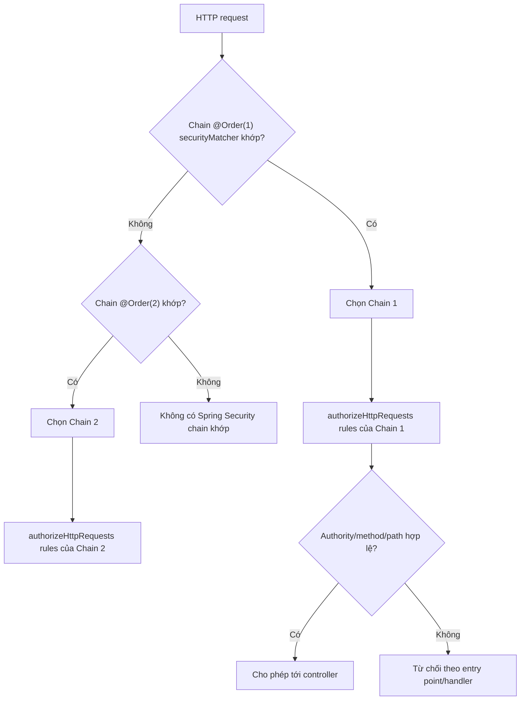

# Đối chiếu matcher và cách xử lý đường dẫn sau nâng cấp

## 1. Vì sao nâng cấp Spring Security có thể làm thay đổi quyền truy cập HTTP?

Một ứng dụng trước khi nâng cấp có thể bảo vệ API bằng cấu hình:

```java
// Ví dụ API cũ, dùng để nhận diện trong quá trình migration.
http.authorizeRequests()
    .antMatchers("/api/admin/**").hasRole("ADMIN")
    .antMatchers("/public/**").permitAll()
    .anyRequest().authenticated();
```

Sau khi chuyển sang API cấu hình hiện đại của Spring Security 6, một lập trình viên có thể thay bằng:

```java
http.authorizeHttpRequests(auth -> auth
    .requestMatchers("/api/admin/**").hasRole("ADMIN")
    .requestMatchers("/public/**").permitAll()
    .anyRequest().authenticated()
);
```

Nhìn bên ngoài, hai cấu hình có vẻ tương đương. Tuy nhiên, **không nên kết luận tất cả request sẽ có cùng kết quả chỉ từ việc chuỗi pattern giống nhau**. Việc lựa chọn loại `RequestMatcher`, quy tắc của Spring MVC, Servlet mapping, context path, thứ tự rule và thứ tự các security filter chain có thể thay đổi cách một URL khớp với chính sách. Các khác biệt nhỏ liên quan dấu gạch chéo cuối, path được mã hóa hoặc HTTP method còn có thể làm một endpoint bị bảo vệ sai hoặc vô tình trở thành công khai.

Chủ đề này thuộc chương **Di chuyển và nâng cấp** của module **SPRING_SECURITY_TESTING**. Trong module, người học sử dụng `spring-security-test` để kiểm chứng xác thực, phân quyền và bảo vệ HTTP trên **Servlet** và **Reactive**, với `MockMvc`, `WebTestClient`, `@WithMockUser`, `SecurityContext` và JWT/OAuth2/OIDC giả lập. Mục tiêu của bài là xây dựng cách **đối chiếu đường dẫn và matcher trước/sau nâng cấp bằng hành vi HTTP**, thay vì chỉ sửa lỗi biên dịch.

Sau bài học, bạn có thể:

- Phân biệt `securityMatcher(...)` (phạm vi một filter chain) và `requestMatchers(...)` (quy tắc phân quyền bên trong chain).
- Hiểu sự khác biệt giữa Ant-style matching, MVC-aware matching và path pattern matching; biết khi nào phải chọn matcher tường minh.
- Xác định tác động của `contextPath`, `servletPath`, đường dẫn từ proxy và mapping của `DispatcherServlet`.
- Viết ma trận test cho anonymous, user thiếu quyền, user đủ quyền trên **cùng URI/method** trước và sau migration.
- Kiểm tra trailing slash, HTTP method, version prefix, đường dẫn encode, dispatcher type và nhiều filter chains mà không đưa ra giả định thiếu căn cứ.
- Tránh trường hợp test “đủ quyền trả 200” vẫn xanh khi filter bị bỏ hoặc route được đặt `permitAll`.
- Tổ chức regression suite và tiêu chí đưa bản nâng cấp lên CI/release.

## 2. Những thay đổi cần nhận diện trong quá trình migration

### 2.1. API cấu hình mới không đồng nghĩa mọi pattern đều có ngữ nghĩa cũ

Trong các dòng Spring Security hiện đại, `authorizeHttpRequests(...)` là cách cấu hình phân quyền được dùng phổ biến thay cho API `authorizeRequests(...)` cũ. Các helper cũ như `antMatchers(...)` và `mvcMatchers(...)` không còn được dùng theo cùng cú pháp trên `authorizeHttpRequests`; thường chúng được chuyển sang `requestMatchers(...)` hoặc một `RequestMatcher` tường minh.

Một số điểm cần rà soát:

| Trước khi nâng cấp | Sau khi nâng cấp | Điều phải xác nhận |
|---|---|---|
| `authorizeRequests()` | `authorizeHttpRequests(...)` | Authorization manager, thứ tự rule và kết quả deny/allow |
| `antMatchers("/api/**")` | `requestMatchers("/api/**")` hoặc matcher tường minh | Loại matcher thực tế và ngữ nghĩa đường dẫn |
| `mvcMatchers("/api/**")` | MVC-aware `RequestMatcher` phù hợp | Có `HandlerMappingIntrospector` và Servlet mapping đúng không |
| `antMatcher(...)` dùng cho toàn `HttpSecurity` | `securityMatcher(...)` | Chain nào áp dụng cho URI thực tế |
| `WebSecurityConfigurerAdapter` | Bean `SecurityFilterChain` | Số chain, `@Order` và fallback |
| `permitAll()` cho public endpoint | Vẫn có `permitAll()` | Pattern công khai có bao trùm API nhạy cảm không |
| Match trailing slash theo thói quen cũ | Phụ thuộc parser/matcher và cấu hình MVC hiện tại | `/resource` và `/resource/` có cùng hành vi hay không |
| Chỉ test `@WithMockUser` với URL hợp lệ | MockMvc/WebTestClient test cả được phép và bị chặn | Security filters đã thực sự chạy chưa |

**Giới hạn theo phiên bản:** Chi tiết matcher mà Spring Security chọn từ overload nhận `String` có thể phụ thuộc **phiên bản Spring Security**, môi trường MVC và cấu hình được bật. Không viết quy tắc “`requestMatchers(String)` luôn là Ant matcher” hoặc “luôn là MVC matcher” cho mọi phiên bản hiện tại và tương lai. Khi migration, kiểm tra dependency thực tế và chọn matcher tường minh nếu việc phân biệt ảnh hưởng bảo mật.

### 2.2. Bean SecurityFilterChain thay cho cấu hình adapter

Một cấu hình bean Servlet hiện đại:

```java
@Configuration
@EnableWebSecurity
class ApiSecurity {

    @Bean
    SecurityFilterChain filterChain(HttpSecurity http)
            throws Exception {

        return http
            .authorizeHttpRequests(auth -> auth
                .requestMatchers("/public/**").permitAll()
                .requestMatchers(HttpMethod.GET, "/api/reports/**")
                    .hasAuthority("SCOPE_reports:read")
                .anyRequest().denyAll()
            )
            .oauth2ResourceServer(oauth2 ->
                oauth2.jwt(Customizer.withDefaults()))
            .sessionManagement(session ->
                session.sessionCreationPolicy(
                    SessionCreationPolicy.STATELESS))
            .csrf(AbstractHttpConfigurer::disable)
            .build();
    }
}
```

Cấu hình minh họa dành cho API stateless sử dụng Bearer JWT; không tắt CSRF theo thói quen nếu ứng dụng dùng cookie/session của trình duyệt.

Các import liên quan: `@Configuration`, `@Bean`, `@EnableWebSecurity`, `HttpSecurity`, `SecurityFilterChain`, `HttpMethod`, `Customizer`, `SessionCreationPolicy` và `AbstractHttpConfigurer`.

## 3. Ba lớp đường dẫn phải được hiểu riêng

Khi nhận một request Servlet, có thể có:

- **URL từ trình duyệt:** ví dụ `https://app.example.test/portal/app/api/reports/42`.
- **`contextPath`:** ví dụ `/portal` khi ứng dụng được deploy dưới một context.
- **`servletPath` và `pathInfo`:** phụ thuộc `DispatcherServlet` có được map tại `/`, `/app/*` hay một đường khác.
- **Đường dẫn mà controller nhận diện:** ví dụ `/api/reports/42` theo cấu hình Servlet/MVC.
- **Đường dẫn matcher sử dụng:** phụ thuộc matcher và mức độ tích hợp MVC, không nên suy từ URL thô.

```text
External URL:
  https://app.example.test/portal/app/api/reports/42
                                |---- path -----|

Ví dụ một Servlet mapping /app/*:
  contextPath  = /portal
  servletPath  = /app
  pathInfo     = /api/reports/42

MVC mapping:
  @GetMapping("/api/reports/{id}")
```

Các thành phần trên chỉ là một **ví dụ mapping cụ thể**. Nếu `DispatcherServlet` được map tại `/`, `servletPath`/`pathInfo` có thể khác. Reverse proxy cũng có thể thêm hoặc loại prefix trước khi request đi vào ứng dụng. Một test đặt sai `servletPath` có thể cho 404 dù URL mà client production gửi là hợp lệ.

### 3.1. Vì sao path nhìn giống nhau nhưng matcher cho kết quả khác?

Giả sử bạn muốn bảo vệ tất cả `GET /api/reports/**`. Những request dưới đây cần được đánh giá riêng:

| URL/path | Câu hỏi bắt buộc |
|---|---|
| `/api/reports/42` | Route chuẩn có được bảo vệ? |
| `/api/reports/42/` | Parser/controller có chấp nhận trailing slash không? |
| `/api/reports/export` | Đây có phải endpoint nhạy cảm cùng policy không? |
| `/api/reports` | Root của collection có cần rule riêng không? |
| `/api/reports//42` | Firewall/server normalize hay từ chối? |
| `/api/reports/%2e%2e/admin` | Decode/normalization/firewall có từ chối hay biến đổi? |
| `/api/reports/42;format=json` | Semicolon/matrix parameters có được chấp nhận không? |
| `/v2/api/reports/42` | Prefix version mới có được bảo vệ không? |
| `/portal/api/reports/42` | Prefix này là context path hay path nghiệp vụ? |
| `POST /api/reports/42` | Matcher chỉ định GET có bảo vệ POST không? |

**Không dự đoán cứng status cho các đường dẫn bất thường.** Tùy Servlet container, reverse proxy, `StrictHttpFirewall`, MVC parser và các setting, chúng có thể bị từ chối sớm, normalize hoặc đến controller với một path khác. Điều cần kiểm tra là **không thể dùng biến thể đường dẫn để vượt qua authorization** và kết quả phải tuân theo hợp đồng đã xác định.

### 3.2. Một ví dụ lỗi khi nhầm contextPath với path nghiệp vụ

Giả sử ứng dụng production chạy dưới `/portal` và controller mapping là `/api/reports/42`. Một rule viết:

```java
.requestMatchers("/portal/api/reports/**")
    .hasAuthority("SCOPE_reports:read")
```

có thể sai nếu matcher thực tế hoạt động trên đường dẫn **bên trong application context**. Rule `/api/reports/**` mới là pattern cần xét trong trường hợp đó.

Tuy nhiên, nếu `/portal` là prefix do router của ứng dụng định nghĩa chứ không phải Servlet context path, không được tự bỏ nó. **Chụp lại request thực tế** và cấu hình server/test, không đoán dựa trên chuỗi URL nhìn thấy ở trình duyệt.

## 4. So sánh các kiểu RequestMatcher ở Servlet

Spring Security có nhiều implementation `RequestMatcher`. Đối với migration, các tên quan trọng gồm:

| Matcher | Đặc điểm | Khi nào hữu ích |
|---|---|---|
| `AntPathRequestMatcher` | Matching theo kiểu Ant; sử dụng trong nhiều cấu hình cũ | Đối chiếu hành vi legacy; chú ý deprecation theo phiên bản |
| `MvcRequestMatcher` | Sử dụng nhận thức về matching của Spring MVC thông qua `HandlerMappingIntrospector` | Ứng dụng Servlet MVC cần đồng bộ route và security |
| `PathPatternRequestMatcher` | Dựa trên `PathPattern`, theo hệ API/phiên bản hỗ trợ | Khi chuẩn hóa path matching hiện đại có chủ đích |
| `RegexRequestMatcher` | Dùng regex tự định nghĩa | Các pattern đặc biệt; phải review kỹ anchoring và escaping |
| `DispatcherTypeRequestMatcher` | Match theo dispatcher type | Kiểm soát FORWARD/ERROR/ASYNC khi policy yêu cầu |
| Custom `RequestMatcher` | Tự xét method/path/headers/điều kiện khác | Khi rule phức tạp và có test đầy đủ |

Không khuyến khích thay toàn bộ matcher bằng regex chỉ để “giữ hành vi cũ”. Regex tự viết rất dễ mở rộng quyền ngoài dự kiến khi không anchor hoặc khi xử lý encoded path khác với controller.

### 4.1. MvcRequestMatcher và servletPath

Với ứng dụng Spring MVC đặt `DispatcherServlet` tại `/app/*`, có thể cần cấu hình rõ Servlet path khi dùng MVC-aware matcher:

```java
@Bean
SecurityFilterChain mvcSecurity(
        HttpSecurity http,
        HandlerMappingIntrospector introspector)
        throws Exception {

    MvcRequestMatcher.Builder mvc =
        new MvcRequestMatcher.Builder(introspector)
            .servletPath("/app");

    return http
        .authorizeHttpRequests(auth -> auth
            .requestMatchers(
                mvc.pattern(HttpMethod.GET, "/api/reports/**"))
                .hasAuthority("SCOPE_reports:read")
            .anyRequest().denyAll()
        )
        .httpBasic(Customizer.withDefaults())
        .build();
}
```

Đây là ví dụ dành cho **hệ phiên bản Spring Security còn cung cấp API `MvcRequestMatcher.Builder`**. Với dòng phiên bản mới hơn chuyển mạnh sang `PathPatternRequestMatcher`, cần sử dụng API tương ứng phiên bản đang chạy; không sao chép nguyên snippet của một dòng khác rồi kết luận matcher đã tương đương.

`servletPath("/app")` là một phần của **Servlet mapping**, không phải `contextPath`. Để test chính xác, mock request phải có thông tin servlet path nhất quán với `DispatcherServlet` thực tế.

### 4.2. Không trộn khái niệm securityMatcher và requestMatchers

`HttpSecurity.securityMatcher(...)` giới hạn **request nào được cả SecurityFilterChain xử lý**:

```java
http.securityMatcher("/api/**");
```

`authorizeHttpRequests().requestMatchers(...)` là rule **nằm trong một chain đã được chọn**:

```java
http.authorizeHttpRequests(auth -> auth
    .requestMatchers(HttpMethod.GET, "/api/reports/**")
        .hasAuthority("SCOPE_reports:read")
    .anyRequest().denyAll()
);
```

Nếu `securityMatcher` không khớp, toàn bộ cấu hình authorization của chain đó **không được áp dụng**. Nếu một chain khác khớp trước, chain dự kiến cũng không được chạy.



Đây là nguyên nhân phổ biến khiến migration trông như đã thêm rule `hasRole`/`hasAuthority` nhưng request vẫn được `permitAll` ở một chain ưu tiên cao hơn.

## 5. Thứ tự rule có thể làm một pattern an toàn bị “nuốt”

Một cấu hình không nên có:

```java
.authorizeHttpRequests(auth -> auth
    .requestMatchers("/api/**").permitAll()
    .requestMatchers("/api/reports/**")
        .hasAuthority("SCOPE_reports:read")
    .anyRequest().authenticated()
)
```

Đối với `/api/reports/42`, matcher tổng quát có thể được xét trước và trả phép, khiến rule cụ thể phía dưới **không còn cơ hội áp dụng**. Một positive test có principal đủ quyền vẫn trả 200, nhưng **anonymous cũng có thể đọc được**.

Sửa theo ý định nghiệp vụ:

```java
.authorizeHttpRequests(auth -> auth
    .requestMatchers("/public/**").permitAll()
    .requestMatchers(HttpMethod.GET, "/api/reports/**")
        .hasAuthority("SCOPE_reports:read")
    .anyRequest().denyAll()
)
```

Các rule nên đi từ cụ thể đến tổng quát khi có chồng lấn. Đừng chỉ dựa vào thứ tự trông hợp lý mà bỏ test negative.

### 5.1. Multiple SecurityFilterChain cần fallback rõ ràng

Ví dụ một API chain và một fallback chain:

```java
@Configuration
@EnableWebSecurity
class MultiChainSecurity {

    @Bean
    @Order(1)
    SecurityFilterChain api(HttpSecurity http)
            throws Exception {
        return http
            .securityMatcher("/api/**")
            .authorizeHttpRequests(auth -> auth
                .requestMatchers(
                    HttpMethod.GET, "/api/reports/**")
                    .hasAuthority("SCOPE_reports:read")
                .anyRequest().denyAll()
            )
            .oauth2ResourceServer(oauth2 ->
                oauth2.jwt(Customizer.withDefaults()))
            .csrf(AbstractHttpConfigurer::disable)
            .build();
    }

    @Bean
    @Order(2)
    SecurityFilterChain fallback(HttpSecurity http)
            throws Exception {
        return http
            .authorizeHttpRequests(auth -> auth
                .requestMatchers("/public/**").permitAll()
                .anyRequest().denyAll()
            )
            .build();
    }
}
```

Với cấu hình này, chain API xử lý `/api/**`, còn fallback bao phủ các request khác. `@Order(1)` cao hơn `@Order(2)`. Trong hệ thống thật, cần test những route thuộc cả hai miền, những route không thuộc miền nào và những request có HTTP method khác.

Nếu sửa chain API thành `securityMatcher("/legacy-api/**")` nhưng controller đã chuyển sang `/api/reports/42`, request có thể rơi vào fallback, hoặc không được bảo vệ nếu thiếu fallback. **Kết quả phải được xác nhận bằng HTTP**, không chỉ bằng việc kiểm tra bean có tồn tại.

## 6. Đặt hợp đồng test trước khi sửa matcher

Trước nâng cấp, lập một **behavioral contract** cho endpoint:

| Request | Principal/authority | Kỳ vọng ví dụ |
|---|---|---|
| `GET /api/reports/42` | Anonymous | 401 |
| `GET /api/reports/42` | `SCOPE_profile` | 403 |
| `GET /api/reports/42` | `SCOPE_reports:read` | 200 |
| `GET /api/reports/export` | Anonymous | 401 |
| `GET /api/reports/export` | `SCOPE_profile` | 403 |
| `GET /api/reports/export` | `SCOPE_reports:read` | 200 hoặc kết quả nghiệp vụ hợp lệ |
| `POST /api/reports/42` | User đủ quyền đọc nhưng không có quyền ghi | Bị từ chối theo policy |
| `GET /public/ping` | Anonymous | 200 |
| `GET /api/unknown` | Anonymous | Không lộ nội dung private; theo fallback policy |
| `GET /api/reports/42/` | Anonymous | Không truy cập dữ liệu; status tùy path policy |

Dòng `GET /api/reports/export` chỉ có expected 200 nếu ứng dụng thực sự có endpoint export; hãy xác nhận route tồn tại trước khi coi 404 là regression. Với tài nguyên nhạy cảm, nên có ca kiểm tra **từng HTTP method được hỗ trợ**.

**Mục tiêu của migration:** một test phải phân biệt được cấu hình an toàn và cấu hình `permitAll`. Nếu chỉ có ca 200 của user đủ quyền, cả hai cấu hình đều có thể PASS.

## 7. MockMvc: kiểm thử chính sách sau nâng cấp bằng HTTP thực của test context

Ví dụ bên dưới dùng Spring Boot 3, Spring Security 6 và JUnit Jupiter; với phiên bản khác cần đối chiếu API tương ứng. Mục tiêu của `MockMvc` là chạy qua **Servlet security filter chain được nạp thật trong application context**, không mở network port.

### 7.1. Dependency và controller mẫu

```kotlin
// build.gradle.kts - ví dụ dependency, không cần pin version thủ công
dependencies {
    implementation("org.springframework.boot:spring-boot-starter-web")
    implementation("org.springframework.boot:spring-boot-starter-security")
    implementation("org.springframework.boot:spring-boot-starter-oauth2-resource-server")

    testImplementation("org.springframework.boot:spring-boot-starter-test")
    testImplementation("org.springframework.security:spring-security-test")
}
```

```java
record ReportView(long id, String title) {}

@RestController
class ReportsController {

    @GetMapping("/api/reports/{id}")
    ReportView get(@PathVariable long id) {
        return new ReportView(id, "report-" + id);
    }

    @GetMapping("/public/ping")
    String ping() {
        return "pong";
    }
}
```

Controller không tự kiểm tra quyền. `SecurityFilterChain` phải chặn request sai trước khi handler trả dữ liệu. Nếu test bỏ filter hoặc rule vô tình `permitAll`, controller sẽ dễ dàng trả 200, giúp **negative tests** phát hiện lỗi.

### 7.2. Test-only JwtDecoder cho các ca authorization giả lập

Vì chain có `oauth2ResourceServer().jwt()`, test context có thể cần `JwtDecoder`. Chúng ta dùng một bean test-only:

```java
@TestConfiguration
class TestOnlyJwtDecoder {

    @Bean
    JwtDecoder jwtDecoder() {
        return token -> {
            throw new BadJwtException(
                "Signed JWT is verified in separate tests");
        };
    }
}
```

Bean này không dùng ở production. Helper `SecurityMockMvcRequestPostProcessors.jwt()` tạo `JwtAuthenticationToken` giả lập nên các ca test dưới đây **không kiểm tra chữ ký JWT, issuer, audience hoặc JWKS**. Nếu muốn test token thật, sử dụng decoder tin cậy khóa test và gửi `Authorization: Bearer ...` qua HTTP.

### 7.3. Bộ test regression cho một path chính

```java
@SpringBootTest
@AutoConfigureMockMvc
@Import(TestOnlyJwtDecoder.class)
class ReportMatcherRegressionMvcTest {

    @Autowired
    MockMvc mvc;

    private static RequestPostProcessor reader(
            String subject, String authority) {
        return jwt()
            .jwt(token -> token.subject(subject))
            .authorities(
                new SimpleGrantedAuthority(authority));
    }

    @Test
    void anonymousCannotReadReport() throws Exception {
        mvc.perform(get("/api/reports/42"))
            .andExpect(status().isUnauthorized());
    }

    @Test
    void authenticatedWithoutScopeIsForbidden()
            throws Exception {
        mvc.perform(get("/api/reports/42")
                .with(reader("bob", "SCOPE_profile")))
            .andExpect(status().isForbidden());
    }

    @Test
    void readerCanReadReport() throws Exception {
        mvc.perform(get("/api/reports/42")
                .with(reader(
                    "alice", "SCOPE_reports:read")))
            .andExpect(status().isOk())
            .andExpect(jsonPath("$.id").value(42))
            .andExpect(jsonPath("$.title")
                .value("report-42"));
    }

    @Test
    void unrelatedRoleCannotReplaceScope()
            throws Exception {
        mvc.perform(get("/api/reports/42")
                .with(reader("carol", "ROLE_ADMIN")))
            .andExpect(status().isForbidden());
    }

    @Test
    void publicPingRemainsPublic() throws Exception {
        mvc.perform(get("/public/ping"))
            .andExpect(status().isOk())
            .andExpect(content().string("pong"));
    }
}
```

Import trọng tâm: `@SpringBootTest`, `@AutoConfigureMockMvc`, `@Import`, `@Autowired`, `@Test`, `MockMvc`, `RequestPostProcessor`, `SimpleGrantedAuthority`. Static imports: `SecurityMockMvcRequestPostProcessors.jwt`, `MockMvcRequestBuilders.get`, `MockMvcResultMatchers.status/jsonPath/content`.

**Điều kiện để ví dụ hoạt động đúng:** application context phải nạp `ReportsController`, một security chain đúng policy cho `/api/reports/**` và test-only decoder. `@AutoConfigureMockMvc` không được đặt `addFilters = false`; nếu tự dựng MockMvc, phải cấu hình Spring Security tương ứng.

### 7.4. Mutation check để chứng minh suite không “xanh giả”

Sau khi đã có baseline an toàn, thử thay một cấu hình trong nhánh thử nghiệm tạm:

```java
// Chỉ dùng để kiểm chứng sức phát hiện của test,
// KHÔNG merge cấu hình này.
.requestMatchers("/api/reports/**").permitAll()
```

Kỳ vọng:

- Ca reader nhận 200 có thể **vẫn PASS**.
- Ca anonymous 401 phải **FAIL** vì người chưa xác thực được vào controller.
- Ca thiếu scope 403 phải **FAIL** vì `permitAll` bỏ yêu cầu scope.

Tương tự, nếu vô tình dùng `@AutoConfigureMockMvc(addFilters = false)`, ca đọc đủ quyền vẫn có thể 200 nhưng các ca từ chối phải đỏ. Đây là bằng chứng test đang phụ thuộc vào **security filter thực sự chạy**, không chỉ controller trả dữ liệu.

Không giữ mutation trong mã phát hành.

## 8. Test context path và servlet path: tránh đối chiếu sai đường dẫn

Khi application chạy dưới context path `/portal`, URI bên ngoài có thể là `/portal/api/reports/42`. Một biến thể MockMvc request diễn đạt rõ context:

```java
mvc.perform(
        get("/portal/api/reports/42")
            .contextPath("/portal")
            .with(reader(
                "alice", "SCOPE_reports:read"))
    )
    .andExpect(status().isOk())
    .andExpect(jsonPath("$.id").value(42));
```

Ví dụ giả định `DispatcherServlet` của test có mapping phù hợp và request đến cùng controller `/api/reports/{id}`. `contextPath("/portal")` là metadata của mock Servlet request; không phải tự động đổi controller mapping thành `/portal/api/reports/{id}`.

### 8.1. Khi ứng dụng có DispatcherServlet mapping đặc biệt

Giả sử `DispatcherServlet` được map dưới `/app/*`, còn controller dùng `@GetMapping("/api/reports/{id}")`. Khi đó có thể cần đồng bộ:

- Property cấu hình Servlet path, ví dụ `spring.mvc.servlet.path=/app` khi ứng dụng dùng đường dẫn đó.
- MVC-aware matcher với `servletPath("/app")` nếu API/version yêu cầu.
- Mock request có `requestURI`, `contextPath`, `servletPath` và `pathInfo` hợp lệ.
- Forwarded prefix/host từ reverse proxy nếu được ứng dụng chủ động tin cậy.

Một test chỉ dùng `get("/app/api/reports/42")` nhưng không mô phỏng đúng Servlet mapping có thể nhận 404 và bị hiểu nhầm là security đang từ chối. Không dùng 404 làm bằng chứng duy nhất; phải có **positive control** với principal đủ quyền nhận đúng tài nguyên.

### 8.2. Dispatcher type: FORWARD, ERROR và ASYNC

Sau upgrade, ứng dụng có thể thấy authorization rules áp dụng khác với quá trình xử lý `ERROR`, `FORWARD` hoặc `ASYNC`. Với Servlet, có thể cấu hình rule tường minh theo dispatcher type khi hợp đồng yêu cầu:

```java
.authorizeHttpRequests(auth -> auth
    .dispatcherTypeMatchers(
        DispatcherType.ERROR,
        DispatcherType.FORWARD)
        .permitAll()
    .requestMatchers(HttpMethod.GET, "/api/reports/**")
        .hasAuthority("SCOPE_reports:read")
    .anyRequest().denyAll()
)
```

Đây **không** phải khuyến nghị cho phép vô điều kiện mọi FORWARD/ERROR trong mọi ứng dụng. Một internal forward tới tài nguyên nhạy cảm vẫn có thể cần policy riêng. Test phải đảm bảo việc nới matcher dispatcher type không tạo đường vòng để truy cập nội dung riêng tư.

Đối với controller async, test MockMvc thường cần `request().asyncStarted()` và `asyncDispatch(...)` trước khi assert response cuối. Nếu ca bị 403 ở dispatcher thứ hai sau upgrade, kiểm tra loại dispatcher, context propagation và chính sách của ứng dụng thay vì chỉ sửa `permitAll` đại trà.

## 9. Trailing slash và path normalization: đừng đoán theo trí nhớ

Một số phiên bản Spring MVC/Spring Security đã thay đổi cách xử lý trailing slash hoặc chuyển sang các parser/path matcher mới. Vì thế `/api/reports/42` và `/api/reports/42/` **không mặc nhiên đồng nghĩa**.

Các tình huống có thể xảy ra:

1. Controller chỉ map path không slash, còn security pattern có thể match cả hai → URL slash trả 404 sau khi đi qua filter.
2. Controller có route alias chấp nhận slash, nhưng security rule không match alias → rủi ro nếu fallback `permitAll` hoặc chain khác.
3. Proxy normalize slash trước khi request tới app → behavior trên đường mạng khác với MockMvc.
4. Firewall từ chối path chứa `//`, encoded slash, semicolon hoặc ký tự không được phép → request không đến MVC handler.

### 9.1. Test theo contract “không bao giờ đọc trái phép”

Một test đối chứng hữu ích cho path có slash:

```java
@Test
void trailingSlashMustNotBypassAuthorization()
        throws Exception {
    MvcResult response = mvc.perform(
            get("/api/reports/42/"))
        .andReturn();

    // Contract tối thiểu: không được trả dữ liệu private.
    assertThat(response.getResponse().getStatus())
        .isNotEqualTo(200);

    assertThat(response.getResponse().getContentAsString())
        .doesNotContain("report-42");
}
```

**Điều kiện quan trọng:** Test trên chỉ có ý nghĩa khi URL chính `/api/reports/42` đã được xác nhận tồn tại và reader có thể đọc. Nếu ứng dụng chủ ý hỗ trợ `/api/reports/42/` như alias, nên thêm test reader 200 và anonymous bị chặn ở đúng alias, với expected status cụ thể.

`StrictHttpFirewall` có thể từ chối một số URL bất thường bằng exception trước khi tạo response bình thường trong MockMvc; với trường hợp như encoded slash, hãy test ở tầng phù hợp và kiểm tra rõ “bị từ chối an toàn”, thay vì khăng khăng rằng mọi biến thể đều trả 401.

### 9.2. URL encoding và encoded traversal

Không mặc định một chuỗi thô như `%2F` hoặc `%2e%2e` sẽ đi nguyên đến controller. Nó có thể bị browser, proxy, container, firewall hoặc MVC xử lý theo những cách khác nhau.

Một bộ test có giá trị nên ghi nhận:

- **Raw path:** URL trên HTTP client trước khi gửi.
- **Request URI mà Servlet nhận:** sau khi proxy/container đã xử lý.
- **Matcher được chọn:** chain, rule và matcher implementation.
- **Controller mapping:** có route nào thực sự được gọi không?
- **Kết quả cuối:** có trả dữ liệu hoặc thực hiện tác vụ ngoài quyền không?

Không vô hiệu hóa firewall hoặc cho phép `..`/encoded slash chỉ để làm test migration xanh. Nếu hệ thống thật cần một dạng URL đặc biệt, cấu hình phải được đánh giá rủi ro và có test cho cả **đường được phép** lẫn **đường không được phép**.

## 10. Phân biệt requestMatchers theo HTTP method

Matcher chỉ xét path có thể không phân biệt GET, POST, PUT, DELETE; overload có `HttpMethod` sẽ ràng buộc method.

```java
.requestMatchers(HttpMethod.GET, "/api/reports/**")
    .hasAuthority("SCOPE_reports:read")
.requestMatchers(HttpMethod.POST, "/api/reports/**")
    .hasAuthority("SCOPE_reports:write")
.anyRequest().denyAll()
```

Không suy rằng POST cũng được bảo vệ bởi rule GET nếu fallback cho phép request. Migration nên rà soát mọi method handler:

| Endpoint | Chức năng | Quyền ví dụ | Negative control |
|---|---|---|---|
| GET `/api/reports/42` | Đọc | `SCOPE_reports:read` | Anonymous và user thiếu scope |
| POST `/api/reports` | Tạo | `SCOPE_reports:write` | Reader không được tạo |
| PUT `/api/reports/42` | Cập nhật | `SCOPE_reports:write` + owner/tenant | Reader/tenant khác không sửa |
| DELETE `/api/reports/42` | Xóa | `SCOPE_reports:delete` + owner/tenant | User không đủ quyền không xóa |
| GET `/public/ping` | Health/public | `permitAll` | Anonymous vẫn 200 |

Đối với browser app dùng cookie/session, các method ghi còn cần **CSRF**. Một test thiếu scope nhận 403 có thể do CSRF chặn trước khi authorization; vì vậy phải tách test “đủ quyền nhưng không CSRF” khỏi test “thiếu quyền nhưng có CSRF hợp lệ”.

### 10.1. Matcher không tự hiểu query parameter là một phần path

`GET /api/reports/42?format=csv` và `GET /api/reports/42?format=json` có cùng path. Matcher dạng path không tự phân quyền dựa trên `format`. Nếu `format=csv` kích hoạt export nhạy cảm, service/controller phải có authorization đúng cho chức năng đó hoặc dùng endpoint/path riêng có rule rõ ràng.

Tương tự, `tenantId`, `userId` hay `returnUrl` do client gửi trong query không được dùng như bằng chứng quyền truy cập. Security chain kiểm tra authority chung; object-level authorization vẫn phải xác minh tenant/owner dựa trên danh tính tin cậy.

## 11. Reactive WebFlux: pathMatchers không phải Servlet requestMatchers

Spring WebFlux sử dụng `SecurityWebFilterChain` và `ServerHttpSecurity`. Cấu hình rule thường dùng `pathMatchers(...)`, không phải `HttpSecurity.authorizeHttpRequests(...)`.

```java
@Configuration
@EnableWebFluxSecurity
class ReactiveApiSecurity {

    @Bean
    SecurityWebFilterChain api(ServerHttpSecurity http) {
        return http
            .authorizeExchange(exchanges -> exchanges
                .pathMatchers("/public/**").permitAll()
                .pathMatchers(
                    HttpMethod.GET, "/api/reports/**")
                    .hasAuthority("SCOPE_reports:read")
                .anyExchange().denyAll()
            )
            .oauth2ResourceServer(oauth2 ->
                oauth2.jwt(Customizer.withDefaults()))
            .httpBasic(
                ServerHttpSecurity.HttpBasicSpec::disable)
            .formLogin(
                ServerHttpSecurity.FormLoginSpec::disable)
            .csrf(ServerHttpSecurity.CsrfSpec::disable)
            .build();
    }
}
```

Reactive path matching dựa trên các khái niệm và cấu hình của WebFlux, **không có `DispatcherServlet`/`servletPath` của Servlet**. Không port nguyên một giả định về `MvcRequestMatcher` sang `ServerWebExchangeMatcher`. Nếu WebFlux app có base path, proxy prefix hay router function, cần test chính xác URL mà `WebTestClient` gửi và endpoint thực nhận.

### 11.1. Test Reactive cùng ma trận 401/403/200

```java
@RestController
class ReactiveReportsController {

    @GetMapping("/api/reports/{id}")
    Mono<ReportView> get(@PathVariable long id) {
        return Mono.just(
            new ReportView(id, "report-" + id));
    }

    @GetMapping("/public/ping")
    Mono<String> ping() {
        return Mono.just("pong");
    }
}
```

Khi test dùng `mockJwt()`, ứng dụng Reactive cần `ReactiveJwtDecoder` hoặc cấu hình Resource Server tương đương để dựng security chain. Có thể cấp decoder test-only luôn từ chối token thật:

```java
@TestConfiguration
class TestOnlyReactiveJwtDecoder {

    @Bean
    ReactiveJwtDecoder reactiveJwtDecoder() {
        return token -> Mono.error(new BadJwtException(
            "Signed tokens are verified separately"));
    }
}
```

```java
@SpringBootTest(
    webEnvironment = SpringBootTest.WebEnvironment.MOCK)
@AutoConfigureWebTestClient
@Import(TestOnlyReactiveJwtDecoder.class)
class ReactiveMatcherRegressionTest {

    @Autowired
    WebTestClient client;

    @Test
    void anonymousIsUnauthorized() {
        client.get().uri("/api/reports/42")
            .exchange()
            .expectStatus().isUnauthorized();
    }

    @Test
    void wrongScopeIsForbidden() {
        client.mutateWith(mockJwt()
                .jwt(jwt -> jwt.subject("bob"))
                .authorities(
                    new SimpleGrantedAuthority(
                        "SCOPE_profile")))
            .get().uri("/api/reports/42")
            .exchange()
            .expectStatus().isForbidden();
    }

    @Test
    void readerCanRead() {
        client.mutateWith(mockJwt()
                .jwt(jwt -> jwt.subject("alice"))
                .authorities(
                    new SimpleGrantedAuthority(
                        "SCOPE_reports:read")))
            .get().uri("/api/reports/42")
            .exchange()
            .expectStatus().isOk()
            .expectBody()
            .jsonPath("$.title")
            .isEqualTo("report-42");
    }

    @Test
    void publicPingStillWorks() {
        client.get().uri("/public/ping")
            .exchange()
            .expectStatus().isOk();
    }
}
```

Ví dụ cần ứng dụng **WebFlux** với `ReactiveApiSecurity`, `ReactiveReportsController` và decoder test. Không nạp đồng thời ứng dụng Servlet/MVC khác vào cùng context rồi mặc định mọi bean vẫn chạy theo WebFlux.

### 11.2. WebTestClient gắn đúng hạ tầng security

Khi dựng WebTestClient thủ công:

```java
WebTestClient client = WebTestClient
    .bindToApplicationContext(applicationContext)
    .apply(springSecurity())
    .build();
```

`springSecurity()` trong ví dụ là `SecurityMockServerConfigurers.springSecurity`, không phải helper của MockMvc. Client chỉ bind controller riêng bằng `bindToController(...)` **không tự đảm bảo** sử dụng `SecurityWebFilterChain` của ứng dụng. Do đó 200 ở controller-only test không được xem là bằng chứng security matcher đã đúng.

Khi dùng `RANDOM_PORT`, request qua HTTP thật cần token được ký thật và decoder test đúng; `mutateWith(mockJwt())` không gửi authentication giả lập qua TCP.

## 12. Debug bằng chain selection nhưng không dừng ở bean tồn tại

Với Servlet, `FilterChainProxy` quản lý danh sách `SecurityFilterChain`. Khi nghi matcher bị thay đổi, có thể xem chain nào khớp với request.

```java
@Autowired
@Qualifier("springSecurityFilterChain")
FilterChainProxy springSecurityFilterChain;

@Test
void hasAChainForApiRequest() {
    MockHttpServletRequest request =
        new MockHttpServletRequest(
            "GET", "/api/reports/42");
    request.setServletPath("/api/reports/42");

    SecurityFilterChain selected =
        springSecurityFilterChain.getFilterChains()
            .stream()
            .filter(chain -> chain.matches(request))
            .findFirst()
            .orElseThrow();

    assertThat(selected.getFilters()).isNotEmpty();
}
```

Đây là **diagnostic test**, không đủ để chứng minh authorization đúng: một chain có filters vẫn có thể `permitAll`. Request diagnostic cần đặt context path/servlet path chính xác; nếu MVC matcher phụ thuộc mapping infrastructure, nên dùng test HTTP/MockMvc để kiểm chứng cuối cùng.

### 12.1. Nếu anonymous đột nhiên được 200

Hãy kiểm tra theo thứ tự:

1. Controller có đúng route không? Có positive control 200 cho user đủ quyền không?
2. `MockMvc` có gắn `springSecurityFilterChain` không, hay dùng `addFilters=false`/`standaloneSetup`?
3. `securityMatcher(...)` có chọn đúng chain cho request URI và method không?
4. Có `@Order` nào khiến chain `permitAll` được chọn trước không?
5. Trong chain đã chọn, rule tổng quát có đứng trước rule bảo vệ không?
6. Matcher cũ mới có cùng nhận thức về `contextPath`, `servletPath` và trailing slash không?
7. Test có mang `@WithMockUser` cấp lớp hoặc client đã mutate với admin mặc định không?
8. Nếu rule nằm tại method, `@EnableMethodSecurity`/`@EnableReactiveMethodSecurity` có được bật và gọi qua proxy không?
9. Request có bị proxy, firewall hoặc container biến đổi path trước khi đến chain không?
10. Có test riêng cho encoded path/method khác hoặc một alternate route cùng tài nguyên không?

Không “sửa” vấn đề bằng cách bỏ rule hoặc thêm `permitAll` cho endpoint nhạy cảm.

## 13. Từ 401, 403, 404 đến 302: cách đọc kết quả sau upgrade

| Quan sát | Có thể là đúng | Chưa thể kết luận |
|---|---|---|
| Anonymous API Bearer trả 401 | Chain đã yêu cầu authentication | Mọi route alternate được bảo vệ |
| Authenticated thiếu scope trả 403 | Authorization đã từ chối | Dữ liệu đúng tenant hoặc owner |
| Reader nhận 200 | Endpoint tồn tại và rule cho phép | Anonymous có bị chặn không? |
| URL trailing slash trả 404 | Controller không map alias | Alias khác có bị mở qua fallback không? |
| URL có percent-encoding bị từ chối sớm | Firewall/container hoạt động | Mọi biến thể URI đều an toàn |
| Browser anonymous trả 302 | Form/OAuth2 login entry point | JWT Resource Server API cũng phải 302 |
| Request mới trả 404 sau migration | Path/controller mapping hoặc Servlet mapping thay đổi | Chắc chắn bảo mật đúng vì không thấy tài nguyên |
| Test 200 pass khi filters tắt | Controller hoạt động | Authorization được kiểm chứng |
| Test với mockJwt pass, bearer thật 401 | Rule đúng cho principal giả lập | Decoder/JWKS/token thật hợp lệ |

**Mấu chốt:** kết quả 404/302 không tự chứng minh matcher đã bảo vệ endpoint. Có thể request rơi vào route sai, bị redirect không liên quan, hoặc không đi qua chain. Tối thiểu cần một người dùng đủ quyền **truy cập thành công cùng route/method**, sau đó một người thiếu quyền **bị từ chối**.

## 14. Khi nào phải thử token và OAuth2/OIDC thật?

`spring-security-test` cung cấp các helper:

| Công cụ | Cấp độ kiểm thử | Không kiểm chứng |
|---|---|---|
| Servlet `@WithMockUser` / `with(user(...))` | Authorization cho user/role giả | Password login và mapping user thật |
| Servlet `with(jwt())` | Authorization với JWT principal giả | Chữ ký JWT, `iss`, `aud`, `exp` và decoder |
| Servlet `with(oauth2Login())` | Controller với OAuth2User đã login | Authorization redirect, state, code exchange |
| Servlet `with(oidcLogin())` | Controller với OIDC principal | ID Token signature, nonce và UserInfo network |
| Reactive `mockUser()` / `mockJwt()` | Reactive authorization/mock exchange | Bearer token thật qua HTTP server |
| Reactive `mockOAuth2Login()` / `mockOidcLogin()` | Principal sau login giả lập | OAuth2/OIDC callback và token endpoint |

Test matcher thường cần **mock principal** để kiểm soát chính xác quyền và trạng thái 401/403/200. Nhưng khi nâng cấp phiên bản lớn, cũng nên có một lớp integration test gửi **signed test bearer JWT** qua `Authorization` header, dùng `JwtDecoder`/`ReactiveJwtDecoder` thật và xác nhận token invalid 401, token valid thiếu quyền 403, token valid đủ quyền 200.

Nếu ứng dụng dùng OAuth2 Login, hãy thêm test redirect URL `client_id`, `redirect_uri`, `scope`, `state` và callback theo môi trường test. **Nâng cấp matcher không tự chứng minh OAuth2 flow còn đúng**, cũng như OAuth2 login mock không chứng minh path matching an toàn.

## 15. Tổ chức regression suite trong CI và rollout

Một đợt migration có thể được chia thành ba lớp:

1. **Baseline trước nâng cấp:** ghi rõ version, servlet mapping, context path, số security chains và kết quả của những route quan trọng.
2. **Behavioral regression sau nâng cấp:** chạy lại cùng ma trận URI/method/user với phiên bản mới, so sánh 200/401/403/404/302 theo hợp đồng và ghi nhận khác biệt được chấp nhận.
3. **Live HTTP kiểm chứng cuối:** chạy test server `RANDOM_PORT`/môi trường staging với credential test thực; kiểm tra proxy prefix, encoded path, reverse proxy/TLS và các integration quan trọng.

### 15.1. Bảng migration checklist

| Khu vực | Test tối thiểu |
|---|---|
| SecurityFilterChain selection | Mọi route private khớp chain mong đợi |
| Request authorization | Anonymous/thiếu quyền/đủ quyền trên cùng URI/method |
| Public endpoints | Anonymous vẫn truy cập được đúng public route |
| Context path | Path có context đúng và controller mapping không đổi |
| Custom Servlet path | MVC matcher và DispatcherServlet mapping nhất quán |
| Trailing slash | Không xuất hiện alternate path cho phép trái phép |
| Encoded/malformed path | Firewall/server từ chối an toàn; không trả dữ liệu nhạy cảm |
| HTTP methods | GET/POST/PUT/DELETE không vô tình chia sẻ quyền |
| Multiple chains | `@Order`, `securityMatcher` và fallback không mở route |
| Dispatcher types | ERROR/FORWARD/ASYNC vẫn có policy được kiểm chứng |
| Method security | `@PreAuthorize`/`@PostAuthorize` hoặc Reactive tương ứng vẫn hoạt động |
| JWT/OAuth2/OIDC | Test mock để kiểm tra rule; test thật để xác minh decoder/flow |
| Data isolation | Không lộ tài liệu khác owner/tenant vì route mới |
| CI | Tất cả negative tests được discovery và thực sự chạy |

### 15.2. CI chỉ PASS khi ca bảo mật được thực thi

Một job test thành công nhưng bỏ qua toàn bộ security tests do tag/filter/test source set **không chứng minh** migration an toàn. Cần kiểm tra JUnit report hoặc test count để biết ít nhất những ca:

- Anonymous bị từ chối.
- Principal đã xác thực thiếu authority bị từ chối.
- Principal đủ quyền đọc được route chuẩn.
- Một alternate URL/method có rủi ro được xử lý đúng contract.

Nếu dùng Gradle, `./gradlew test` chỉ chạy test source set gắn với task đó; test thuộc `integrationTest` cần task riêng trong pipeline nếu đã được dự án khai báo. Không dùng `ignoreFailures` hoặc `|| true` để che regression authorization.

### 15.3. Kiểm thử mutation của rule

Sau khi regression suite chạy xanh với cấu hình đúng, thử **trong nhánh cục bộ**:

1. Đổi `hasAuthority("SCOPE_reports:read")` thành `permitAll()`.
2. Thử đặt một matcher `/api/**` công khai trước rule cụ thể.
3. Thử bỏ security filters khỏi `MockMvc`.
4. Thử đổi `securityMatcher("/api/**")` thành prefix không khớp.
5. Thử đảo `@Order` của chain private và public trong một cấu hình có overlap.
6. Thử vô hiệu hóa method security nếu policy nằm ở service.

Bộ test mạnh phải **đỏ ở những thay đổi làm mất bảo vệ**, đặc biệt là test anonymous và thiếu authority. Sau khi kiểm chứng sức phát hiện, khôi phục cấu hình đúng trước commit; mutation không phải cấu hình để triển khai.

## 16. Những lỗi migration hay gặp

| Triệu chứng | Nguyên nhân có thể | Hướng kiểm tra |
|---|---|---|
| `requestMatchers` compile nhưng rule không chạy | Loại matcher/Servlet mapping khác dự kiến | Dùng HTTP negative controls và matcher tường minh |
| Anonymous GET private trả 200 | `permitAll` rộng, sai chain hoặc filter không gắn | Kiểm tra `securityMatcher`, `@Order`, `addFilters` |
| Người có quyền bị 404 | Controller route, contextPath hoặc servletPath lệch | Dùng positive control, inspect request metadata |
| URL có dấu `/` cuối khác hành vi trước | Trailing slash/parser/mapping đã thay | Test alias và xác định contract rõ |
| Route export bị mở | Matcher chỉ cover một path/method cũ | Kiểm tra tất cả endpoint mới và phương thức |
| API trả 302 thay vì 401 | Browser chain được chọn, login entry point | Kiểm tra chain selection và bearer config |
| Test `@WithMockUser` pass, live JWT fail | Mock bỏ qua decoder/JWKS | Kiểm tra signed bearer token thật |
| Có `SecurityFilterChain` bean nhưng private route mở | Chain không khớp hoặc rule `permitAll` | Kiểm tra chain được chọn + 401/403 |
| Error dispatch bị chặn ngoài dự kiến | Dispatcher type policy thay đổi | Test ERROR/FORWARD/ASYNC theo contract |
| Encoded URL bị RequestRejectedException | Firewall từ chối path bất thường | Không tắt firewall bừa; test HTTP behavior |
| Multipart/upload không chạy sau upgrade | CSRF/matcher/servlet mapping khác | Tách permission, CSRF và parser |
| WebFlux test 200 không có security | Client bind controller-only | Bind application context + `springSecurity()` |
| CI xanh nhưng thiếu security regression | Test filter/tag/source set loại ca bảo mật | Kiểm tra JUnit XML và test count |

## 17. Bài thực hành tổng hợp

Dùng ứng dụng mẫu `ReportsController` và security chain đúng chính sách. Trong một nhánh migration thử nghiệm:

1. Viết test `GET /api/reports/42` với anonymous → 401, principal thiếu `SCOPE_reports:read` → 403, reader → 200 + body đúng.
2. Viết test `GET /public/ping` với anonymous → 200.
3. So sánh `GET /api/reports/42/` với `GET /api/reports/42`, xác định policy trailing slash và không cho truy cập trái phép.
4. Mô phỏng ứng dụng có `contextPath=/portal`, xác minh URI bên ngoài khác route MVC nhưng quyền không đổi.
5. Nếu sử dụng `DispatcherServlet` dưới `/app/*`, dùng MVC-aware matcher với `servletPath` phù hợp và test cả request URI lẫn controller mapping.
6. Cấu hình hai chains với `@Order` rõ ràng, thêm fallback deny và kiểm tra chain được chọn cho API/public route.
7. Thử đổi `requestMatchers("/api/reports/**")` thành `permitAll`, xác nhận negative tests đỏ.
8. Thử thêm `requestMatchers("/api/**").permitAll()` trước rule cụ thể, xác nhận regression suite phát hiện.
9. Thử tắt filters trong MockMvc, xác nhận ca 200 có thể vẫn xanh nhưng ca 401/403 đỏ.
10. Thêm POST/PUT/DELETE với quyền riêng và test thiếu scope hoặc thiếu CSRF nếu kiến trúc có cookie/session.
11. Kiểm tra `FORWARD`/`ERROR` nếu ứng dụng có dispatch đặc biệt, không thêm permitAll toàn cục nếu không có lý do.
12. Lặp lại ma trận ở WebFlux bằng `WebTestClient` và `SecurityWebFilterChain` thật.
13. Nếu sử dụng bearer JWT thật, thêm HTTP test gửi token ký bằng khóa thử nghiệm để kiểm tra decoder và authority converter.
14. Báo cáo rõ sự khác nhau giữa behavior trước/sau nâng cấp: **được chấp nhận có chủ đích**, **vi phạm hợp đồng** hoặc **cần thêm thông tin**.

### Checklist trước khi đánh dấu migration an toàn

- [ ] Đã thống kê private/public endpoints và HTTP methods quan trọng.
- [ ] Đã hiểu loại matcher thực tế, không chỉ chuỗi pattern.
- [ ] Đã phân biệt `securityMatcher` và `requestMatchers`.
- [ ] Đã đối chiếu contextPath/servletPath/DispatcherServlet mapping.
- [ ] Đã test route chuẩn và những biến thể có rủi ro.
- [ ] Đã có positive control: user đủ quyền truy cập được đúng tài nguyên.
- [ ] Đã có negative controls: anonymous và thiếu quyền bị từ chối.
- [ ] Đã kiểm tra filter chain hiện diện và chạy trong test.
- [ ] Đã kiểm tra các chain ưu tiên và fallback.
- [ ] Đã kiểm tra khác biệt Servlet vs WebFlux khi phù hợp.
- [ ] Đã xác minh test mock không bị nhầm là token/OAuth2/OIDC validation thật.
- [ ] Đã xác minh CI thực sự thực thi các security regression tests.

**Tiêu chí hoàn thành:** Việc chuyển matcher sau nâng cấp chỉ được coi là an toàn khi **cùng đường dẫn nghiệp vụ được bảo vệ đúng trước và sau migration**: người có quyền vẫn thực hiện được thao tác; anonymous hoặc người thiếu quyền vẫn bị từ chối; các biến thể về context path, servlet path, trailing slash, method và filter-chain selection không tạo đường vòng. Đừng kết luận migration PASS chỉ vì mã biên dịch thành công, bean `SecurityFilterChain` tồn tại, hoặc test có `@WithMockUser`/`jwt()` trả 200. Hãy dùng **ma trận HTTP positive + negative**, kiểm tra chain/matcher thật, và ghi rõ phạm vi của các mock so với xác minh token hay OAuth2/OIDC thực.
