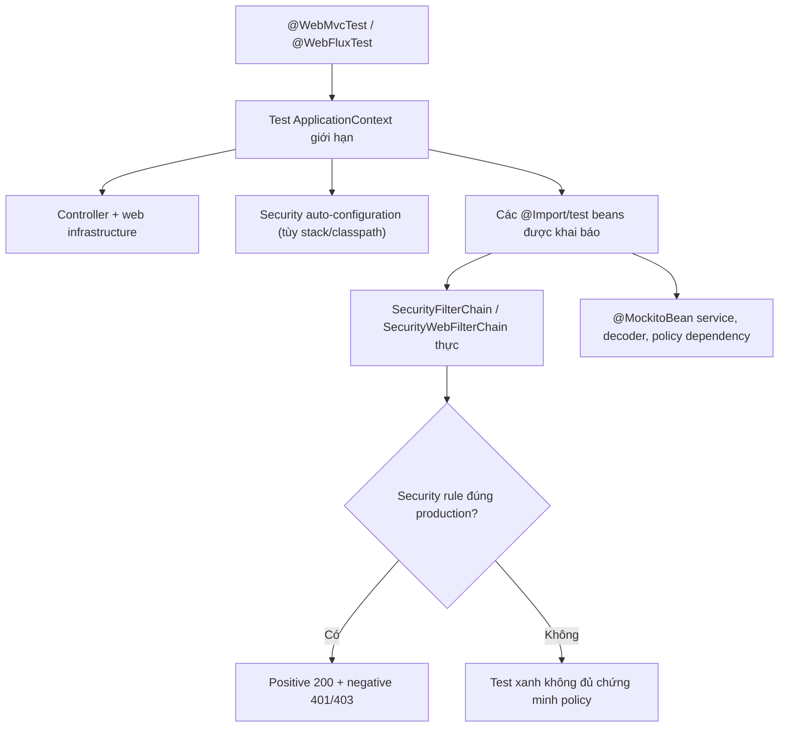

# Kiểm tra package và cấu hình test slice theo phiên bản Spring Boot

Khi nâng cấp Spring Boot, một bài kiểm thử Spring Security có thể hỏng ngay ở dòng `import`, không tạo được `ApplicationContext`, hoặc nguy hiểm hơn: **vẫn xanh nhưng không chạy đúng security configuration**. Ví dụ, test `@WebMvcTest` cũ có thể mất bean `SecurityFilterChain` tùy biến, khiến kết quả `401/403` đến từ security mặc định thay vì policy thực. Hoặc một test `@WebFluxTest` tạo principal bằng `mockJwt()` rồi bị hiểu sai là đã kiểm tra chữ ký token.

Bài thuộc chương **Di chuyển và nâng cấp** của module **SPRING_SECURITY_TESTING**. Chúng ta tập trung vào cách **kiểm tra package và cấu hình test slice theo phiên bản Spring Boot**, từ nền tảng Boot 2.x qua 3.x đến kiến trúc module hóa trong Boot 4.x. Nội dung liên hệ trực tiếp với `spring-security-test`, `MockMvc`, `WebTestClient`, `@WithMockUser`, `SecurityContext` và helper JWT/OAuth2/OIDC trên ứng dụng Servlet và Reactive.

Mục tiêu không phải thay mọi import bằng một lệnh tìm–thay mù quáng, mà là giữ đúng **ba hợp đồng**:

1. **Hợp đồng biên dịch:** Java, Jakarta, Spring Boot test annotation, Mockito integration và starter đang dùng thuộc phiên bản thực tế của dự án.
2. **Hợp đồng ApplicationContext:** slice chỉ mang controller/web infrastructure và các bean bảo mật **được chủ động đưa vào**; dependency còn thiếu phải được import/mock đúng tầng.
3. **Hợp đồng hành vi:** sau khi nâng cấp, đường **được phép** và **bị từ chối** vẫn đúng chính sách, không chỉ là “context loads”.

## 1. Những thay đổi cần phân loại trước khi sửa test

Một lỗi nâng cấp có thể nằm ở nhiều lớp:

| Lớp thay đổi | Ví dụ biểu hiện | Cách kiểm tra đúng |
| --- | --- | --- |
| JDK và framework baseline | Test không biên dịch, class file version không hợp lệ | JDK/toolchain, Spring Boot và Spring Framework cùng thế hệ |
| Jakarta namespace | `javax.servlet.http.HttpServletRequest` không còn biên dịch với Boot 3+ | Đổi đúng API thuộc Jakarta EE sang `jakarta.servlet.*` |
| Spring Security DSL | `WebSecurityConfigurerAdapter`, `antMatchers` không tồn tại trong Spring Security 6 | Dùng bean `SecurityFilterChain` và `requestMatchers` |
| Mock bean annotation | `@MockBean` bị deprecate rồi loại khỏi Boot 4 | Dùng Spring Framework `@MockitoBean`/`@MockitoSpyBean` nơi được hỗ trợ |
| Test slice annotation package | `@WebMvcTest` hoặc `@WebFluxTest` import từ package Boot 3 không tồn tại trong Boot 4 | Đối chiếu package theo major version |
| Test starter/module | Dependency test cũ không còn mang Spring Security Test hoặc slice module cần dùng | Thêm các starter test theo công nghệ ở Boot 4 |
| Slice filtering | Thiếu `@Service`, `SecurityWebFilterChain` hoặc `JwtDecoder` | `@Import` bean thật, `@MockitoBean` dependency phù hợp |
| Security behavior | Test không còn ra `401/403`, hoặc `200` ngoài ý muốn | Positive + negative HTTP tests trên chain thật |
| Authentication boundary | `@WithMockUser`/`mockJwt()` cho phép test pass | Phân biệt helper giả với Basic/Bearer/IdP thực |

**Không suy luận phiên bản chỉ từ tên package dự án hoặc tutorial đang đọc.** Trước khi chỉnh code, xác định **phiên bản Boot đang được resolve trong build** cùng phiên bản Spring Framework/Security thực tế do BOM/plugin quản lý. Không nên ép phiên bản Spring Security riêng tùy tiện khi chưa kiểm tra compatibility matrix.

## 2. Bảng đối chiếu Spring Boot 2.x, 3.x và 4.x

Bảng sau nhấn vào những thay đổi ảnh hưởng trực tiếp đến kiểm thử bảo mật:

| Chủ đề | Boot 2.7 / Security 5.7–5.8 | Boot 3.0–3.3 / Security 6 | Boot 3.4–3.5 | Boot 4.x |
| --- | --- | --- | --- | --- |
| Java baseline | Java 8/11 hoặc mới hơn tùy version; Boot 2.7 hỗ trợ Java 8+ | Java 17+ | Java 17+ | Java 17+; kiểm tra yêu cầu chính xác của bản phát hành |
| Servlet API | `javax.servlet.*` | `jakarta.servlet.*` | `jakarta.servlet.*` | `jakarta.servlet.*` |
| Web security configuration | Có thể còn mẫu legacy, nên dùng `SecurityFilterChain` | `WebSecurityConfigurerAdapter` đã bị loại | `SecurityFilterChain` | `SecurityFilterChain` |
| `@WebMvcTest` | `org.springframework.boot.test.autoconfigure.web.servlet` | Cùng package Boot 2 | Cùng package Boot 3 | `org.springframework.boot.webmvc.test.autoconfigure` |
| `@WebFluxTest` | `org.springframework.boot.test.autoconfigure.web.reactive` | Cùng package Boot 2 | Cùng package Boot 3 | `org.springframework.boot.webflux.test.autoconfigure` |
| Mock dependency bean | `@MockBean` của Boot | `@MockBean` của Boot | `@MockitoBean` của Spring Framework 6.2+ được ưu tiên; `@MockBean` deprecated | `@MockBean`/`@SpyBean` đã bị loại; dùng `@MockitoBean`/`@MockitoSpyBean` |
| Test dependencies | `spring-boot-starter-test` và `spring-security-test` | Tương tự | Tương tự | Module hóa: `spring-boot-starter-webmvc-test`, `spring-boot-starter-webflux-test`, `spring-boot-starter-security-test` |
| HTTP client integration test | `TestRestTemplate` theo package Boot cũ | Package Boot test web client | Package Boot test web client | `TestRestTemplate` chuyển sang module/package `org.springframework.boot.resttestclient` |
| Test server | `@SpringBootTest(RANDOM_PORT)` | Tương tự | Tương tự | Tương tự, nhưng kiểm tra test starter và annotation mới |

Bảng chỉ là **điểm khởi đầu cho migration**. Ở các patch releases, kiểm tra Javadoc đúng phiên bản đang dùng; không lấy tài liệu Boot 4 để sửa import trong dự án Boot 3.3 hoặc ngược lại.

### 2.1. Vì sao Boot 4 dễ gây nhầm hơn đổi một annotation?

Spring Boot 4 tách nhiều hỗ trợ thành các module công nghệ riêng. Vì vậy một dự án có thể **biên dịch Java business code** nhưng test slice thiếu class khi chưa khai báo starter test mới. Cần sửa đồng thời:

- Dependency runtime/starter cho Servlet hoặc Reactive.
- Dependency test starter tương ứng với MVC/WebFlux.
- Dependency test starter cho Spring Security.
- Package import của những annotation do Spring Boot cung cấp.
- Các override/mock và configuration chỉ xuất hiện trong test context.

Một lỗi `cannot find symbol WebMvcTest` có thể do **sai import** hoặc **không có module test MVC**; chỉ thay import mà không cập nhật dependency có thể vẫn thất bại.

## 3. Kiểm tra đúng package: những gì đổi và không đổi

### 3.1. Import test slice theo major version

Đối với **Boot 2.7 và Boot 3.x**:

```java
import org.springframework.boot.test.autoconfigure.web.servlet.WebMvcTest;
import org.springframework.boot.test.autoconfigure.web.servlet.AutoConfigureMockMvc;

import org.springframework.boot.test.autoconfigure.web.reactive.WebFluxTest;
import org.springframework.boot.test.autoconfigure.web.reactive.AutoConfigureWebTestClient;
```

Đối với **Boot 4.x**:

```java
import org.springframework.boot.webmvc.test.autoconfigure.WebMvcTest;
import org.springframework.boot.webmvc.test.autoconfigure.AutoConfigureMockMvc;

import org.springframework.boot.webflux.test.autoconfigure.WebFluxTest;
import org.springframework.boot.webflux.test.autoconfigure.AutoConfigureWebTestClient;
```

Mỗi code block trên đại diện cho **một thế hệ**, không import cả hai bộ vào cùng file. Tên annotation về mặt ý nghĩa vẫn tương tự, nhưng **fully qualified name đã thay đổi** ở Boot 4.

Ngoài test slice, `@SpringBootTest` vẫn thuộc `org.springframework.boot.test.context.SpringBootTest`; `@Import` vẫn thuộc `org.springframework.context.annotation.Import`; `@WithMockUser` vẫn thuộc `org.springframework.security.test.context.support.WithMockUser`. Vì thế **không được replace toàn bộ package `org.springframework.boot.test.*` thành một package duy nhất**.

### 3.2. @MockBean so với @MockitoBean

Trong Boot 3.3 trở về trước, cách viết phổ biến:

```java
import org.springframework.boot.test.mock.mockito.MockBean;

@WebMvcTest(controllers = ReportsController.class)
class ReportsSliceTest {
    @MockBean ReportsService service;
}
```

Với Boot 3.4+ (Spring Framework 6.2+) và Boot 4, ưu tiên:

```java
import org.springframework.test.context.bean.override.mockito.MockitoBean;

@WebMvcTest(controllers = ReportsController.class)
class ReportsSliceTest {
    @MockitoBean ReportsService service;
}
```

`@MockBean`/`@SpyBean` của Boot đã bị deprecate ở thế hệ 3.4 và bị loại trong Boot 4. `@MockitoBean`/`@MockitoSpyBean` là cơ chế **bean override của Spring Framework**, không phải rename import trong cùng thư viện Spring Boot.

Lưu ý về khác biệt:

- `@MockitoBean` thường đặt trên **field của test** hoặc type-level phù hợp, không đặt tùy tiện trong `@Configuration` rồi mong Spring coi đó là bean definition như một số mẫu `@MockBean` cũ.
- Với nhiều bean cùng type, dùng `@Qualifier` hoặc tên bean để override **đúng bean**; tránh vô tình thay sai `JwtDecoder` hay service.
- Override tạo mock khi không có bean có thể che một lỗi cấu hình production. Nếu mục đích là bảo đảm bean **phải tồn tại**, kiểm tra các tùy chọn nghiêm ngặt như `enforceOverride` và behavior theo Spring Framework version.
- `@MockitoSpyBean` cần bean thật để spy và có ràng buộc khác `@MockitoBean`; đừng thay máy móc toàn bộ spy thành mock.

Sau migration, luôn chạy một **negative security test**. Việc Mockito hoạt động chưa chứng minh Spring AOP, filter chain hoặc JWT converter được nạp đúng.

### 3.3. javax.servlet sang jakarta.servlet trong Boot 3+

Ví dụ một Servlet filter cũ:

```java
// Boot 2.x / Spring Framework 5:
import javax.servlet.FilterChain;
import javax.servlet.ServletException;
import javax.servlet.http.HttpServletRequest;
import javax.servlet.http.HttpServletResponse;
```

Với Boot 3+:

```java
import jakarta.servlet.FilterChain;
import jakarta.servlet.ServletException;
import jakarta.servlet.http.HttpServletRequest;
import jakarta.servlet.http.HttpServletResponse;
```

Cần sửa cả **mã production và test helpers** nếu chúng dùng Servlet APIs. Các thành phần Jakarta EE khác như `javax.validation.*`, `javax.persistence.*` (nếu có) cũng cần migration đúng API. Tuy nhiên không phải **mọi** namespace bắt đầu bằng `javax` đều chuyển sang `jakarta`: các API Java SE như `javax.crypto` hoặc `javax.sql` có tên riêng và không được đổi máy móc.

Nếu test hỏng ở `MockHttpServletRequest` hoặc filter nhận sai kiểu request, kiểm tra đặc biệt việc module cũ còn kéo `javax.servlet-api` xung đột với container Jakarta.

### 3.4. Security API thay đổi theo thế hệ

Một cấu hình cũ từng dùng:

```java
// Mẫu cũ để nhận diện khi review migration:
http.authorizeRequests()
    .antMatchers("/api/admin/**").hasRole("ADMIN")
    .anyRequest().authenticated();
```

Cách viết bean `SecurityFilterChain` với API mới:

```java
@Configuration
class HttpSecurityConfig {

    @Bean
    SecurityFilterChain filterChain(HttpSecurity http) throws Exception {
        return http
            .authorizeHttpRequests(auth -> auth
                .requestMatchers("/api/admin/**").hasRole("ADMIN")
                .anyRequest().authenticated()
            )
            .httpBasic(Customizer.withDefaults())
            .build();
    }
}
```

`WebSecurityConfigurerAdapter` đã bị loại ở Spring Security 6. Khi migration từ Boot 2, cần chuyển sang cấu hình bean; đồng thời kiểm tra lại **thứ tự matcher**, `securityMatcher`, nhiều filter chains và fallback deny/default. Việc code biên dịch không bảo đảm các route được bảo vệ như trước.

Với method security, cách hiện đại là `@EnableMethodSecurity` thay cho `@EnableGlobalMethodSecurity` trong cấu hình thế hệ mới. Nếu test mock service mang `@PreAuthorize`, method security của service đó **không được kiểm chứng**. Hãy giữ service thật khi mục tiêu là policy ở method.

## 4. Starter và classpath test: Boot 3 so với Boot 4

Đối với một dự án **Boot 3.x Servlet** thường dùng:

```groovy
dependencies {
    implementation 'org.springframework.boot:spring-boot-starter-web'
    implementation 'org.springframework.boot:spring-boot-starter-security'

    testImplementation 'org.springframework.boot:spring-boot-starter-test'
    testImplementation 'org.springframework.security:spring-security-test'
}
```

Đối với **Boot 3.x Reactive**:

```groovy
dependencies {
    implementation 'org.springframework.boot:spring-boot-starter-webflux'
    implementation 'org.springframework.boot:spring-boot-starter-security'

    testImplementation 'org.springframework.boot:spring-boot-starter-test'
    testImplementation 'org.springframework.security:spring-security-test'
}
```

Đối với **Boot 4.x Servlet**, các starter được chuyên biệt hóa:

```groovy
dependencies {
    implementation 'org.springframework.boot:spring-boot-starter-webmvc'
    implementation 'org.springframework.boot:spring-boot-starter-security'

    testImplementation 'org.springframework.boot:spring-boot-starter-webmvc-test'
    testImplementation 'org.springframework.boot:spring-boot-starter-security-test'
}
```

Đối với **Boot 4.x Reactive**:

```groovy
dependencies {
    implementation 'org.springframework.boot:spring-boot-starter-webflux'
    implementation 'org.springframework.boot:spring-boot-starter-security'

    testImplementation 'org.springframework.boot:spring-boot-starter-webflux-test'
    testImplementation 'org.springframework.boot:spring-boot-starter-security-test'
}
```

Các đoạn trên là **nhóm dependency nền tảng**, không liệt kê mọi dependency nghiệp vụ, JSON hoặc OAuth2. Boot 4 còn có những test starter cho các công nghệ khác; test starter công nghệ thường kéo common test starter transitively. Khi dự án dùng cả MVC, WebClient, JWT, persistence hoặc cơ chế khác, bổ sung starter tương ứng theo dependency graph và migration guide chính thức.

Đặc biệt khi chuyển sang Boot 4, hỗ trợ `@WithMockUser` và `@WithUserDetails` cần được cung cấp **đúng cách qua `spring-boot-starter-security-test`**, không chỉ sao chép nguyên build.gradle của Boot 3 rồi cho rằng mọi test integration vẫn được kích hoạt.

### 4.1. Đừng kéo cả MVC và WebFlux mà không biết app type

Nếu một ứng dụng Boot có cả hai web stacks trên classpath, lựa chọn Servlet/Reactive và auto-configuration có thể thay đổi theo dependency, property hoặc test slice. Một `@WebFluxTest` dành cho WebFlux controller không được dùng để kiểm thử Servlet `HttpSecurity`; tương tự `@WebMvcTest` không thay cho test `SecurityWebFilterChain`.

| Servlet stack | Reactive stack |
| --- | --- |
| `HttpSecurity` | `ServerHttpSecurity` |
| `SecurityFilterChain` | `SecurityWebFilterChain` |
| `JwtDecoder` | `ReactiveJwtDecoder` |
| `OpaqueTokenIntrospector` | `ReactiveOpaqueTokenIntrospector` |
| `MockMvc` | `WebTestClient` |
| `@WebMvcTest` | `@WebFluxTest` |

Đây là **sự khác biệt stack**, không đơn thuần là một thay đổi package giữa Boot 3 và Boot 4.

## 5. Test slice thực sự nạp những bean nào?

`@WebMvcTest` chỉ tập trung vào các thành phần MVC; `@WebFluxTest` tập trung các thành phần WebFlux. Chúng không khởi động toàn bộ ứng dụng như `@SpringBootTest`. Một số web security auto-configuration có thể được nạp theo classpath, nhưng các `@Configuration` tùy biến của bạn **không mặc nhiên được import đầy đủ**.



**Không được suy luận từ HTTP status đơn lẻ rằng chain production đang chạy.** Nếu `@WebMvcTest` chỉ trả `401` cho anonymous vì security mặc định chặn mọi request, nó không chứng minh custom rule `hasAuthority("SCOPE_reports.read")` đã được nạp.

### 5.1. Ba câu hỏi kiểm tra từng dependency

1. Bean thuộc **web slice** (controller, Jackson, converter, filter được hỗ trợ) hay thuộc **business layer** (`@Service`, repository)?
2. Bean thuộc **policy cần kiểm tra** (security configuration, authorization manager, converter) hay chỉ là một dependency ngoài như database/HTTP client?
3. Nếu import cấu hình policy thật, nó cần thêm bean nào: `JwtDecoder`, `ReactiveJwtDecoder`, `AuthenticationProvider`, `ReactiveUserDetailsService` hoặc bean custom?

Với bean business layer, thường dùng `@MockitoBean`. Với policy, nên `@Import` **implementation thật**. Với dependency ngoài, mock/fake đúng tầng. Một test thiếu bean không nên được “chữa” bằng cách gỡ luôn security chain khỏi context.

## 6. Ví dụ Servlet: @WebMvcTest theo đúng cấu hình security

Ví dụ chạy với Boot 3.4+ hoặc Boot 4 khi import đúng annotation phiên bản và có dependency test tương ứng. Phần nội dung các class Spring Security là chung; package của `@WebMvcTest` và `@AutoConfigureMockMvc` chọn theo mục 3.

### 6.1. Controller và service

```java
record ReportDto(String id, String owner) {}

interface ReportService {
    ReportDto find(String id);
}

@RestController
class ReportsController {

    private final ReportService service;

    ReportsController(ReportService service) {
        this.service = service;
    }

    @GetMapping("/api/reports/{id}")
    ReportDto get(@PathVariable String id) {
        return service.find(id);
    }
}
```

Service chỉ là interface để slice mock dependency. Mục tiêu ở đây là **security rule tại HTTP boundary**, không phải policy method-level trên implementation service.

### 6.2. Đưa SecurityFilterChain thật vào slice

```java
@Configuration(proxyBeanMethods = false)
class ReportsHttpSecurity {

    @Bean
    SecurityFilterChain apiSecurity(HttpSecurity http) throws Exception {
        return http
            .authorizeHttpRequests(auth -> auth
                .requestMatchers(HttpMethod.GET, "/api/reports/**")
                    .hasAuthority("SCOPE_reports.read")
                .anyRequest().denyAll()
            )
            .httpBasic(Customizer.withDefaults())
            .build();
    }
}
```

Với HTTP Basic, request anonymous vào route bảo vệ thường nhận `401`; user đã được xác thực nhưng không có scope nhận `403`. Nếu production dùng form login, OAuth2 login hoặc custom entry point, kết quả có thể là redirect hoặc body lỗi khác; cần sửa assertions cho phù hợp **chính sách thật**.

### 6.3. Test MVC slice: một ca allow và hai ca deny

```java
@WebMvcTest(controllers = ReportsController.class)
@Import(ReportsHttpSecurity.class)
class ReportsMvcSliceTest {

    @Autowired MockMvc mvc;

    @MockitoBean ReportService service;

    @Test
    @WithMockUser(
        username = "alice",
        authorities = "SCOPE_reports.read"
    )
    void readerCanReadReports() throws Exception {
        when(service.find("r-1"))
            .thenReturn(new ReportDto("r-1", "alice"));

        mvc.perform(get("/api/reports/r-1"))
            .andExpect(status().isOk())
            .andExpect(jsonPath("$.owner").value("alice"));

        verify(service).find("r-1");
    }

    @Test
    @WithMockUser(
        username = "bob",
        authorities = "SCOPE_other.read"
    )
    void authenticatedWithoutScopeGets403() throws Exception {
        mvc.perform(get("/api/reports/r-1"))
            .andExpect(status().isForbidden());

        verifyNoInteractions(service);
    }

    @Test
    void anonymousGets401() throws Exception {
        mvc.perform(get("/api/reports/r-1"))
            .andExpect(status().isUnauthorized());

        verifyNoInteractions(service);
    }
}
```

Import `@MockitoBean` từ Spring Framework như mục 3.2; các import JUnit, Mockito, AssertJ và Spring MVC Test được lược bỏ trong ví dụ. Nếu test ở Boot 3.3 trở về trước, chuyển riêng field đó sang `@MockBean`.

**Giá trị của cặp allow/deny:** nếu ai đó bỏ `@Import(ReportsHttpSecurity.class)`, test có thể chuyển sang default policy hoặc fail context. Nhờ test scope đúng và scope sai, bạn có thêm bằng chứng policy chi tiết đang được áp dụng, thay vì chỉ một ca anonymous.

### 6.4. Lỗi @WithMockUser(roles) và authorities khi migration

`@WithMockUser(roles = "ADMIN")` thường tạo authority `ROLE_ADMIN`; nó **không** tự tạo `SCOPE_reports.read`. Nếu rule dùng `hasAuthority("SCOPE_reports.read")`, hãy dùng:

```java
@WithMockUser(authorities = "SCOPE_reports.read")
```

Nếu rule dùng `hasRole("ADMIN")`, test có thể dùng:

```java
@WithMockUser(roles = "ADMIN")
```

Một `403` sau nâng cấp có thể chỉ là test fixture đang cấp **sai authority**; đừng sửa production security rule thành `permitAll()` để làm test xanh.

## 7. WebFlux slice: @WebFluxTest và SecurityWebFilterChain

Ví dụ WebFlux phải ở một **ứng dụng/test context Reactive riêng**. Không import `HttpSecurity` Servlet vào slice Reactive.

```java
record ReactiveReportDto(String id, String owner) {}

interface ReactiveReportService {
    Mono<ReactiveReportDto> find(String id);
}

@RestController
class ReactiveReportsController {

    private final ReactiveReportService service;

    ReactiveReportsController(ReactiveReportService service) {
        this.service = service;
    }

    @GetMapping("/reactive/reports/{id}")
    Mono<ReactiveReportDto> get(@PathVariable String id) {
        return service.find(id);
    }
}
```

Cấu hình security:

```java
@Configuration(proxyBeanMethods = false)
@EnableWebFluxSecurity
class ReactiveReportsSecurity {

    @Bean
    SecurityWebFilterChain security(ServerHttpSecurity http) {
        return http
            .authorizeExchange(auth -> auth
                .pathMatchers(HttpMethod.GET, "/reactive/reports/**")
                    .hasAuthority("SCOPE_reports.read")
                .anyExchange().denyAll()
            )
            .httpBasic(Customizer.withDefaults())
            .build();
    }
}
```

Test:

```java
@WebFluxTest(controllers = ReactiveReportsController.class)
@Import(ReactiveReportsSecurity.class)
class ReportsWebFluxSliceTest {

    @Autowired WebTestClient client;

    @MockitoBean ReactiveReportService service;

    @Test
    void authorizedUserMayRead() {
        when(service.find("r-1"))
            .thenReturn(Mono.just(
                new ReactiveReportDto("r-1", "alice")
            ));

        client.mutateWith(mockUser("alice").authorities(
                new SimpleGrantedAuthority("SCOPE_reports.read")
            ))
            .get().uri("/reactive/reports/r-1")
            .exchange()
            .expectStatus().isOk()
            .expectBody()
            .jsonPath("$.owner").isEqualTo("alice");

        verify(service).find("r-1");
    }

    @Test
    void insufficientAuthorityGets403() {
        client.mutateWith(mockUser("bob").authorities(
                new SimpleGrantedAuthority("SCOPE_other.read")
            ))
            .get().uri("/reactive/reports/r-1")
            .exchange()
            .expectStatus().isForbidden();

        verifyNoInteractions(service);
    }

    @Test
    void anonymousGets401() {
        client.get()
            .uri("/reactive/reports/r-1")
            .exchange()
            .expectStatus().isUnauthorized();

        verifyNoInteractions(service);
    }
}
```

`mockUser()` nằm trong `SecurityMockServerConfigurers` của `spring-security-test`. Với `@WebFluxTest` và auto-configured `WebTestClient`, test client thông thường đã được cấu hình với application context. Nếu **tự** tạo client, dùng:

```java
WebTestClient client = WebTestClient
    .bindToApplicationContext(applicationContext)
    .apply(springSecurity())
    .configureClient()
    .build();
```

Không nên dùng `bindToController(controller)` rồi kết luận rằng toàn bộ production `SecurityWebFilterChain` đang chạy. Cũng không dùng `bindToServer()` gọi một server ngoài và nghĩ `mockUser()` sẽ tự chuyển thành HTTP credential trên network.

## 8. Resource Server test slice: decoder có cần được mock?

Khi ứng dụng cấu hình JWT Resource Server, security chain có thể cần `JwtDecoder` (Servlet) hoặc `ReactiveJwtDecoder` (Reactive) lúc khởi tạo. Trong một test slice, auto-configuration liên quan có thể bị giới hạn, dẫn đến lỗi thiếu decoder.

Ví dụ test Servlet với policy JWT:

```java
@Configuration(proxyBeanMethods = false)
class ReportsJwtSecurity {

    @Bean
    SecurityFilterChain jwtSecurity(HttpSecurity http)
            throws Exception {
        return http
            .authorizeHttpRequests(auth -> auth
                .requestMatchers("/api/reports/**")
                    .hasAuthority("SCOPE_reports.read")
                .anyRequest().denyAll()
            )
            .oauth2ResourceServer(oauth2 ->
                oauth2.jwt(Customizer.withDefaults())
            )
            .build();
    }
}
```

Trong **test class JWT riêng**, dùng:

```java
@WebMvcTest(controllers = ReportsController.class)
@Import(ReportsJwtSecurity.class)
class JwtReportsSliceTest {

    @Autowired MockMvc mvc;

    @MockitoBean ReportService service;
    @MockitoBean JwtDecoder jwtDecoder;

    @Test
    void mockJwtChecksPolicyButNotSignature() throws Exception {
        when(service.find("r-1"))
            .thenReturn(new ReportDto("r-1", "alice"));

        mvc.perform(get("/api/reports/r-1")
                .with(jwt().authorities(
                    new SimpleGrantedAuthority("SCOPE_reports.read")
                )))
            .andExpect(status().isOk());

        verifyNoInteractions(jwtDecoder);
    }
}
```

`jwt()` của `SecurityMockMvcRequestPostProcessors` dựng authentication giả, nên **không gọi decoder thật**. Bean `@MockitoBean JwtDecoder` có thể chỉ cần cho chain khởi tạo. Khi muốn kiểm tra Bearer header/decoder interface, gửi `Authorization: Bearer fixture` và stub `JwtDecoder.decode("fixture")`. Khi muốn kiểm tra signature/expiration, dùng decoder thật và compact JWS ký bằng khóa test.

Trong WebFlux tương đương, dùng `ReactiveJwtDecoder` và `mockJwt()`; không trộn type Servlet/reactive. Để kiểm tra OAuth2/OIDC login thật hoặc opaque introspection, test slice dùng mutator **không đủ**: bổ sung integration test với cookie/session/callback/HTTP token endpoints phù hợp.

### 8.1. Boot 4 còn thay đổi các OAuth2 starter names

Trong Boot 4, nhiều starter được đặt tên thể hiện rõ Spring Security:

```groovy
// Ví dụ một ứng dụng Boot 4 làm OAuth2 Resource Server:
implementation 'org.springframework.boot:spring-boot-starter-security-oauth2-resource-server'
testImplementation 'org.springframework.boot:spring-boot-starter-security-test'
testImplementation 'org.springframework.boot:spring-boot-starter-webmvc-test'
```

Trong Boot 3, starter Resource Server thường là `spring-boot-starter-oauth2-resource-server`. Ở Boot 4, tên cũ có thể còn tương thích theo cơ chế deprecated starter trong giai đoạn nâng cấp, nhưng nên chuyển sang tên mới theo migration guide và kiểm tra dependency graph.

## 9. Method security và test slice: nguy cơ ngộ nhận khi mock service

Giả sử implementation service có:

```java
@Service
class ReportApprovalService {

    @PreAuthorize("hasAuthority('SCOPE_reports.approve')")
    public void approve(String reportId) {
        // Thao tác nhạy cảm với report.
    }
}
```

Nếu `@WebMvcTest` chỉ nạp controller và bạn dùng:

```java
@MockitoBean ReportApprovalService approvalService;
```

thì `@PreAuthorize` trên implementation thực không được thực thi. Test có thể `200` với user thiếu scope nếu HTTP security chỉ kiểm tra `authenticated()`. Đây **không phải bug của annotation mock**; đó là giới hạn của test slice và phạm vi bạn đã thay thế.

Khi mục tiêu là **method security**:

- Nạp service thực qua Spring AOP proxy và bật `@EnableMethodSecurity`, mock repository/dependency dưới nó.
- Dùng `@SpringBootTest` nếu cấu hình liên quan quá lớn để thể hiện trong slice.
- Viết test âm tính chứng minh người thiếu scope bị từ chối **trước khi có side effect**.
- Với Reactive, tương ứng dùng `@EnableReactiveMethodSecurity` và method trả `Mono`/`Flux` theo cách supported.

Sau khi migration, chỉ kiểm tra `contextLoads()` không bắt được việc `@EnableMethodSecurity` bị bỏ, proxy không được tạo hoặc service bị mock nhầm.

## 10. Những điều không nên làm để “sửa” test slice

### 10.1. Tắt filters hoặc bỏ security auto-configuration

```java
@AutoConfigureMockMvc(addFilters = false)
```

Giúp một số test controller chạy nhưng **vô hiệu hóa kiểm tra HTTP security**. Nếu mục tiêu là kiểm thử `401/403` hoặc CSRF, đừng dùng thiết lập này. Có thể tách một lớp test controller không cần security, nhưng phải có lớp test khác dùng filter chain thật.

Tương tự, exclude `SecurityAutoConfiguration` hoặc thêm `permitAll()` chỉ để context chạy được sẽ làm mất policy đang muốn chứng minh. Hãy sửa thiếu bean và test setup thay vì hạ bảo mật.

### 10.2. Chỉ thử anonymous và thấy 401

Nếu production policy yêu cầu `SCOPE_reports.read`, còn default security chỉ yêu cầu login, cả hai đều có thể trả `401` cho anonymous. Chỉ test anonymous không phân biệt được chúng. Phải thêm ca authenticated **có** scope (`200`) và **không** có scope (`403`).

### 10.3. Trộn @WebMvcTest và @SpringBootTest

`@WebMvcTest` là một test slice với bootstrapper riêng; `@SpringBootTest` là full-context bootstrapper. Đừng đặt cả hai lên cùng một class để “nạp thêm bean”. Nếu slice cần dependency cụ thể, dùng `@Import` hoặc `@MockitoBean`; nếu thật sự muốn full context, dùng `@SpringBootTest` kết hợp `@AutoConfigureMockMvc`.

### 10.4. Đổi sang @MockitoBean nhưng đặt sai vị trí

`@MockitoBean` từ Spring Framework có quy tắc khác `@MockBean` cũ. Đừng kỳ vọng annotation field đặt trong `@TestConfiguration` sẽ hoạt động giống một bean khai báo thông thường. Đặt ở test class hoặc dùng type-level đúng contract; nếu cần mock có cấu hình phức tạp, cân nhắc `@Bean` fake/test implementation được đặt trong `@TestConfiguration` thay vì abuse annotation override.

### 10.5. Chỉ sửa import mà không sửa dependency

Trong Boot 4, `@WebMvcTest` nằm trong module test MVC riêng. Khi chỉ chuyển import mà vẫn thiếu `spring-boot-starter-webmvc-test`, lỗi `package does not exist` chưa hết. Hãy kiểm tra dependency management, đặc biệt các module test bị tách và Spring Security Test starter.

### 10.6. Sửa package Mockito bằng cách thêm dependency chồng chéo

Không nên thêm một phiên bản Mockito, JUnit, Spring Framework hoặc Spring Security khác major chỉ để làm `@MockBean`/`@MockitoBean` biên dịch. Làm vậy dễ tạo các lỗi classpath khó tái hiện. Ưu tiên BOM/plugin của Boot đúng version; nếu cần override, phải có lý do và kiểm tra compatibility thực.

## 11. Chẩn đoán lỗi nâng cấp theo triệu chứng

| Triệu chứng | Nguyên nhân thường gặp | Cách kiểm tra/sửa |
| --- | --- | --- |
| `package org.springframework.boot.test.autoconfigure.web.servlet does not exist` ở Boot 4 | Package `@WebMvcTest` đã chuyển | Import `org.springframework.boot.webmvc.test.autoconfigure.WebMvcTest` và thêm MVC test starter |
| `cannot find symbol MockBean` ở Boot 4 | Annotation Boot đã bị loại | Dùng `org.springframework.test.context.bean.override.mockito.MockitoBean` |
| `MockitoBean cannot be resolved` ở Boot 3.2/3.3 | Chưa có Spring Framework 6.2 | Dùng `@MockBean` tương thích hoặc nâng Spring Boot theo lộ trình |
| `javax.servlet.*` không tồn tại trên Boot 3+ | Jakarta migration | Dùng `jakarta.servlet.*`, kiểm tra dependency xung đột |
| `WebSecurityConfigurerAdapter` không tồn tại | Spring Security 6+ | Bean `SecurityFilterChain` + DSL mới |
| `Unable to find a @SpringBootConfiguration` | Test package nằm ngoài vùng tìm application config | Kiểm tra vị trí test hoặc cấu hình context rõ |
| `NoSuchBeanDefinitionException: ReportService` | Service không thuộc MVC/WebFlux slice | Mock service qua annotation đúng thế hệ |
| `NoSuchBeanDefinitionException: JwtDecoder` | Security JWT chain đã import nhưng decoder thiếu | Mock decoder cho test policy, dùng decoder thật cho crypto test |
| `NoSuchBeanDefinitionException: ReactiveJwtDecoder` | Dùng JWT trong WebFlux nhưng thiếu bean reactive | Cung cấp đúng reactive decoder/test config |
| `No qualifying bean of type SecurityFilterChain` hoặc default policy khác | Cấu hình security tùy biến không nằm trong slice | `@Import` đúng configuration hoặc full context |
| `403` khi POST dù authority đúng | CSRF token thiếu hoặc policy khác | Phân biệt CSRF với authorization; dùng `csrf()` nếu policy cần |
| `@WithMockUser` không có tác dụng | Thiếu security test infrastructure/listener/starter phù hợp | Kiểm tra Boot 4 `spring-boot-starter-security-test` và binding test client |
| `WebTestClient` có nhưng `mockUser()` không áp dụng | Client tự bind chưa gắn security context hoặc gọi server thật | `bindToApplicationContext(...).apply(springSecurity())` khi in-process |
| `@PreAuthorize` không bị từ chối | Mock service hoặc chưa bật method security | Test service thật qua proxy, `@EnableMethodSecurity` |
| `@SpringBootTest` không inject MockMvc ở Boot 4 | Chưa auto-configure MockMvc | Thêm `@AutoConfigureMockMvc` và test starter phù hợp |
| `TestRestTemplate` không tìm thấy trong Boot 4 | Tách module và đổi package | Module `spring-boot-resttestclient`/test starter phù hợp, import đúng package |
| Test suite chỉ chạy một phần | JUnit tags/source set/test task khác | Kiểm tra Gradle/Maven task và số test thực thi |

Mục tiêu của bảng là xác định **root cause**, không lấy status `401/403` làm dấu hiệu duy nhất của cấu hình đúng.

## 12. Boot 4: những thay đổi test infrastructure dễ bỏ sót

Bên cạnh package của test slice, migration guide Boot 4 nhấn mạnh các chi tiết:

1. **Test module theo công nghệ:** class test nằm ở module MVC/WebFlux/Security tương ứng. Một starter test “chung” không còn là giả định đủ cho mọi test stack.
2. **Loại bỏ Boot `@MockBean` và `@SpyBean`:** chuyển sang annotations của Spring Framework.
3. **Hỗ trợ `@WithMockUser`:** dùng security test starter phù hợp khi nâng cấp dependency test.
4. **`@SpringBootTest` + MockMvc:** thêm `@AutoConfigureMockMvc` để rõ cấu hình MVC test; không phụ thuộc việc bean MockMvc tự xuất hiện.
5. **`TestRestTemplate`:** package và module thay đổi; có thể cần thêm test-scoped dependency `org.springframework.boot:spring-boot-resttestclient` và runtime `spring-boot-restclient` tùy thiết lập. Đối chiếu Javadoc của version đang dùng.
6. **`@PropertyMapping` và các tùy chọn HTMLUnit:** một số thuộc tính test configuration chuyển package/cấu trúc, nên khi compile lỗi annotation attribute, đọc hướng dẫn Boot 4 thay vì sửa bằng cast hoặc code phản xạ.
7. **Test listener/Mockito integration:** khi dùng Mockito `@Mock`/`@Captor` standalone, kiểm tra `MockitoExtension` thay vì trông đợi một Spring Boot listener cũ đã bị loại.

Đây là lý do **migration phải có bước kiểm tra compile + runtime behavior**. Một thay đổi classpath thành công có thể vẫn làm test không chạy đúng security integration.

## 13. Test suite xác nhận migration: không chỉ context loads

Một ma trận cần chạy lại sau khi đổi phiên bản:

| Ca bắt buộc | Servlet MockMvc | WebFlux WebTestClient | Integration HTTP |
| --- | --- | --- | --- |
| Endpoint public vẫn mở theo policy | `200` | `200` | `200` |
| Endpoint protected, anonymous | `401` hoặc redirect | `401` hoặc redirect | Gửi request không credential |
| Đã xác thực, sai authority | `403` | `403` | Credential hợp lệ nhưng thiếu scope |
| Đã xác thực, authority đúng | `200`, principal đúng | `200`, principal đúng | HTTP credential hợp lệ |
| POST không có CSRF (khi bật CSRF) | `403` | `403` | Token/cookie thiếu |
| POST có CSRF (khi yêu cầu) | `200/201` | `200/201` | Token/cookie thực |
| JWT helper cho phép/deny | `jwt()` policy | `mockJwt()` policy | Không thay thế JWT thật |
| JWT sai chữ ký/hết hạn | Test với decoder thật khác | Test với decoder thật khác | `401` từ Bearer JWS |
| Method security | Service thật qua proxy | Reactive service thật | Full context nếu phù hợp |
| Tenant/owner khác | `403/404` theo policy | `403/404` theo policy | IDOR/cross-tenant test |
| Custom filter/entry point | Filter thật | Reactive WebFilter thật | Credential header qua wire |

Đặc biệt lưu ý:

- `@WithMockUser`, `jwt()`, `mockJwt()` và `mockOidcLogin()` tạo sẵn authentication; chúng **không** tự chứng minh mật khẩu, JWT signature, opaque introspection hay OAuth2 redirect/state/code exchange.
- `@WebMvcTest` có thể mock service; điều đó không kiểm tra `@PreAuthorize` của service thực.
- `@WebFluxTest` cần đúng `SecurityWebFilterChain` và Reactor Context; không dùng Servlet `SecurityContextHolder` để giả lập identity reactive.
- `@SpringBootTest(RANDOM_PORT)` cho HTTP server thật; annotation mock auth trên test thread không tự chuyển qua network.

**Tiêu chí sau nâng cấp:** các test *được phép* và *bị từ chối* vẫn cho kết quả đúng, bean policy được nạp đúng, và những bước authentication mà test slice đã giả lập được kiểm tra bổ sung ở tầng tích hợp cần thiết.

## 14. Lộ trình nâng cấp có kiểm soát

### Bước 1 — Xác định baseline thực

Ghi lại:

- Spring Boot plugin/BOM và phiên bản Java.
- Phiên bản Spring Framework/Security thực tế đã resolve.
- Runtime stack (Servlet, Reactive hoặc cả hai cho những mục đích khác nhau).
- Danh sách test slices `@WebMvcTest`, `@WebFluxTest`, `@DataJpaTest` nếu có, và những annotation mock đang dùng.
- Những security configurations được `@Import`, các custom filters, method security và các dependency ngoài như JWT decoder.
- Ma trận `200/401/403` cùng critical policies đang được kiểm chứng.

Chạy baseline suite trên phiên bản cũ trước khi sửa, lưu kết quả test và các giới hạn đã biết.

### Bước 2 — Nâng build/JDK theo ma trận tương thích

Dùng Java toolchain và dependency management thống nhất; không nâng Spring Security lên một major khác trước rồi giữ Boot cũ nếu không có chiến lược tương thích rõ. Kiểm tra các Jakarta imports trong production/test khi chuyển Boot 2 → 3. Với Boot 4, cập nhật test starters và package mới.

Nếu đổi nhiều major cùng lúc, cân nhắc đi qua một phiên bản trung gian để phân lập lỗi về build, Jakarta, DSL, Mockito hay moduleization.

### Bước 3 — Sửa cấu hình security trước khi sửa assertions

Chuyển `WebSecurityConfigurerAdapter`/`antMatchers` sang DSL hiện đại, xác định lại `SecurityFilterChain`/`SecurityWebFilterChain`. Giữ nguyên ý nghĩa các rule, thứ tự matcher, entry points và fallback. Không sửa expected `401/403` để hợp thức hóa một policy vô tình thay đổi.

### Bước 4 — Sửa test dependencies, imports, mock annotations

Thực hiện theo **đúng cột phiên bản**:

```text
Boot 3.3 hoặc cũ hơn:
  @WebMvcTest / @WebFluxTest từ org.springframework.boot.test.autoconfigure...
  @MockBean từ org.springframework.boot.test.mock.mockito

Boot 3.4–3.5:
  Các test slice vẫn ở package org.springframework.boot.test.autoconfigure...
  Ưu tiên @MockitoBean từ Spring Framework 6.2+

Boot 4.x:
  @WebMvcTest -> org.springframework.boot.webmvc.test.autoconfigure
  @WebFluxTest -> org.springframework.boot.webflux.test.autoconfigure
  @MockitoBean / @MockitoSpyBean -> Spring Framework
  Có test starter MVC/WebFlux/Security tương ứng
```

Nếu test đang dùng `@MockBean` bên trong `@Configuration`, cần **thiết kế lại vị trí override**, không chỉ thay import.

### Bước 5 — Tái khẳng định ranh giới slice

Mỗi class test phải trả lời:

- Controller đang được kiểm tra là class nào?
- Security configuration nào được nạp qua `@Import`?
- Dependency nào bị mock, và có đang mock mất policy cần kiểm chứng không?
- Request chạy qua filters thật không?
- User/authority/tenant từ đâu đến?
- Khi dùng JWT/OAuth2/OIDC mutator, validation thực có được test ở nơi khác không?

### Bước 6 — Chạy test và kiểm tra kết quả thực

Theo quy trình dự án, biên dịch và chạy unit/slice tests, integration tests cùng các contract tests. Không chỉ xem build xanh: đối chiếu **số lượng test**, danh sách skipped, JUnit reports, status từng security case và stacktrace của các lỗi context.

Không thay `addFilters=false` hoặc `permitAll()` để nhanh chóng làm suite xanh nếu mục tiêu chính là security regression.

### Bước 7 — Cập nhật CI và tài liệu migration

Tài liệu nâng cấp nên chỉ rõ import nào thay, test starter nào cần thêm, policy nào đã được test, bước nào chưa có integration test. Có thể thêm linter/static check để phát hiện `@MockBean` trong nhánh Boot 4 hoặc `javax.servlet` trong nhánh Boot 3+, nhưng cần loại trừ hợp lý theo project structure.

## 15. Bài thực hành

1. Chuẩn bị một test `@WebMvcTest` dùng `@MockBean` và import Boot 3.3. Ghi lại source import cùng behavior khi người có/không có `SCOPE_reports.read` truy cập endpoint.
2. Với Boot 3.4+, chuyển từ `@MockBean` sang `@MockitoBean` (Spring Framework 6.2+) trong test class; không thay các rule security. Kiểm tra ba ca `200/401/403`.
3. Khi đi lên Boot 4, đổi package `@WebMvcTest`/`@AutoConfigureMockMvc` và thêm `spring-boot-starter-webmvc-test`, `spring-boot-starter-security-test`. Chạy lại test; giải thích vì sao thiếu test starter có thể gây lỗi import dù business code không đổi.
4. Dựng biến thể `@WebFluxTest` cho `ReactiveReportsController`, dùng `SecurityWebFilterChain` thật và mock service reactive. Chạy hai ca scope đúng/sai và anonymous, sau đó thử bỏ `@Import(ReactiveReportsSecurity.class)` trên một nhánh thử nghiệm để quan sát test nào phát hiện policy bị thay.
5. Chuyển một Servlet filter test từ `javax.servlet.*` sang `jakarta.servlet.*` và kiểm tra không kéo thư viện Servlet 2.x cũ vào classpath Boot 3+.
6. Thêm JWT Resource Server vào một test class riêng, dùng `@MockitoBean JwtDecoder` và `jwt()` để kiểm tra authorization. Viết thêm HTTP integration test Bearer JWT đã ký thật và token sai chữ ký để xác nhận decoder.
7. Thử mock service mang `@PreAuthorize`; giải thích tại sao test controller không còn bảo vệ method policy. Khôi phục service thật ở một integration test.
8. Lập bảng thay đổi build/import/bean theo phiên bản; kèm danh sách `200/401/403`, số test đã chạy và những lớp validation hiện còn giả lập.

**Tiêu chí hoàn thành:** sau migration, các annotation test slice đến từ **đúng package và module** của Spring Boot đang dùng; các bean bảo mật và phụ thuộc được nạp đúng phạm vi; Mockito override hoạt động theo thế hệ; và bộ test chứng minh cả **đường cho phép lẫn đường từ chối** chứ không chỉ biên dịch hoặc tải context thành công.

## Tài liệu tham khảo

- [Spring Boot 4.0 Migration Guide](https://github.com/spring-projects/spring-boot/wiki/Spring-Boot-4.0-Migration-Guide): module/test starter mới, package organization, thay thế `@MockBean` và các thay đổi testing.
- [Spring Boot 3.5 — Testing Spring Boot Applications](https://docs.spring.io/spring-boot/3.5/reference/testing/spring-boot-applications.html): `@WebMvcTest`, `@WebFluxTest` và phạm vi slice.
- [Spring Boot 4 — WebMvcTest Javadoc](https://docs.spring.io/spring-boot/4.0/api/java/org/springframework/boot/webmvc/test/autoconfigure/WebMvcTest.html): package và các thành phần auto-configured.
- [Spring Boot 4 — WebFluxTest Javadoc](https://docs.spring.io/spring-boot/4.0/api/java/org/springframework/boot/webflux/test/autoconfigure/WebFluxTest.html): package, bean scanning và `WebTestClient`.
- [Spring Framework — Bean Override in Tests](https://docs.spring.io/spring-framework/reference/testing/testcontext-framework/bean-overriding.html): `@MockitoBean`, `@MockitoSpyBean` và override semantics.
- [Spring Security — MockMvc Setup](https://docs.spring.io/spring-security/reference/servlet/test/mockmvc/setup.html): tích hợp security filters vào `MockMvc`.
- [Spring Security — WebTestClient Setup](https://docs.spring.io/spring-security/reference/reactive/test/web/setup.html): reactive `springSecurity()` và `WebTestClient`.
- [Spring Security — Servlet Authorization](https://docs.spring.io/spring-security/reference/servlet/authorization/authorize-http-requests.html): `authorizeHttpRequests` và request matchers.
- [Spring Security — Method Security](https://docs.spring.io/spring-security/reference/servlet/authorization/method-security.html): proxy và `@PreAuthorize`.
