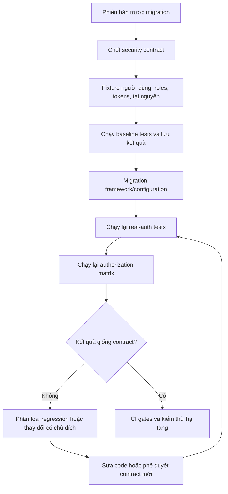

# Chạy lại ca xác thực thật cùng ma trận phân quyền sau chuyển đổi

Nâng cấp Spring Boot, Spring Security hoặc chuyển ứng dụng từ Servlet sang Reactive không chỉ là việc sửa API đã bị deprecated rồi chờ project biên dịch thành công. Một ứng dụng vẫn có thể khởi động và các test `@WithMockUser` vẫn xanh, nhưng **password thật không được xác minh**, JWT decoder dùng sai issuer, một request matcher không còn bảo vệ URL cũ, hoặc authority được ánh xạ khác trước. Những sai lệch này đặc biệt nguy hiểm vì chúng có thể thay đổi quyền truy cập mà không tạo lỗi compile-time.

Bài này thuộc chương **Di chuyển và nâng cấp** của module **SPRING_SECURITY_TESTING**. Module phục vụ việc kiểm chứng xác thực, phân quyền và bảo vệ HTTP thực tế bằng `spring-security-test` trên ứng dụng Servlet và Reactive, sử dụng MockMvc, WebTestClient, `@WithMockUser`, SecurityContext, JWT/OAuth2/OIDC giả lập và các ca được phép hoặc bị từ chối. Trọng tâm bài học là **chạy lại một luồng xác thực thật bằng credential thử nghiệm** và **tái kiểm tra ma trận phân quyền đầy đủ sau chuyển đổi**, thay vì chỉ chạy lại các mock principal hoặc happy path.

> **Thông điệp chính:** sau migration, cần kiểm tra lại hai cánh cửa độc lập: **authentication** (*ai đã đăng nhập, bằng cơ chế nào, credential có được xác minh không?*) và **authorization** (*người ấy được làm gì, trên tài nguyên nào?*). Một bộ test chỉ kiểm tra một trong hai cửa không chứng minh hệ thống vẫn an toàn.

## 1. “Chạy lại” nghĩa là giữ contract cũ và đối chiếu hệ thống mới

Một kế hoạch migration nghiêm túc cần có **baseline** ở phiên bản cũ. Baseline là kỳ vọng của API trước chuyển đổi: status code, redirect, cookie/session, HTTP headers và đặc biệt là quyền truy cập. Khi chuyển sang phiên bản mới, giữ nguyên các kịch bản quan trọng rồi chạy lại trên implementation mới.



**Không so sánh một cách mù quáng mọi chi tiết:** có những thay đổi được chấp nhận như chuyển response unauthorized từ redirect HTML sang JSON 401 cho REST API, hoặc bỏ một endpoint legacy. Nhưng mỗi khác biệt phải có **lý do và kỳ vọng được cập nhật có kiểm soát**, chứ không chỉ sửa assertion để test xanh.

Một bản ghi baseline tối thiểu gồm:

| Trường | Giá trị ví dụ | Vai trò |
| --- | --- | --- |
| Tính năng | Tạo đơn hàng | Hành động được bảo vệ |
| HTTP method/path | `POST /api/orders` | Ranh giới security matcher |
| Danh tính | Alice (reader), Bob (writer) | Phân biệt chủ thể |
| Cơ chế xác thực | HTTP Basic, LDAP, JWT, OIDC | Cách credential được kiểm chứng |
| Credential | Password/token giả trong fixture | Dữ liệu đầu vào thử nghiệm |
| Quyền kỳ vọng | `SCOPE_orders.read` / `SCOPE_orders.write` | Chính sách phân quyền |
| Status/response | 201, 401, 403, redirect hoặc error JSON | Contract HTTP |
| Side effect | OrderService/DB có hoặc không được gọi | Ngăn hành động trái phép |
| Session/cookie | Có/không và vòng đời | Tính liên tục của đăng nhập |
| Phiên bản | Trước/sau migration | Truy vết kết quả |

## 2. Các thay đổi khi nâng cấp dễ làm lệch security contract

Khi nâng cấp Spring Security 5.x → 6.x hoặc Spring Boot 2.x → 3.x, cần rà soát các khu vực thường chịu tác động. Những mục dưới là **điểm kiểm tra hồi quy**, không có nghĩa tất cả đều thay đổi trong mọi bản nâng cấp:

| Khu vực | Điều cần xác nhận sau chuyển đổi | Ca regression quan trọng |
| --- | --- | --- |
| **Java/Jakarta** | `javax.servlet.*` được thay bằng `jakarta.servlet.*` khi sang Spring Framework 6/Boot 3 | Filter/controller còn chạy và không bị bỏ khỏi chain |
| **SecurityFilterChain** | Bean-based `SecurityFilterChain` thay cho kiểu kế thừa `WebSecurityConfigurerAdapter` cũ | Mọi URL cũ vẫn đi đúng chain |
| **Request matching** | `authorizeHttpRequests`, `requestMatchers`, servlet path, matcher order | URL cho phép/bị chặn đúng như baseline |
| **Method security** | `@EnableMethodSecurity` / `@EnableReactiveMethodSecurity` và proxy | `@PreAuthorize` thật sự có hiệu lực |
| **Authority mapping** | `ROLE_`, `SCOPE_`, JWT claims và converter | Role/scope không tự tăng hoặc mất |
| **CSRF/CORS** | Rule cho unsafe methods và CORS preflight | 403 đúng nguyên nhân, OPTIONS không bị chặn nhầm |
| **Session/SecurityContext** | Lưu/khôi phục context, login/logout, session fixation | Logout xong không truy cập được bằng session cũ |
| **Password encoding** | `PasswordEncoder`, prefix `{bcrypt}`/delegating, legacy hashes | Credential đúng được nhận, sai bị từ chối |
| **JWT Resource Server** | Decoder, JWK, issuer/audience, clock skew | Token sai chữ ký/issuer/audience/expiry bị 401 |
| **OAuth2/OIDC Login** | Client registration, redirect URI, state/nonce, authorized client | Flow thật hoạt động, token sai không tạo login |
| **LDAP** | User search, bind DN/password, group-to-authority | Password sai 401, group thiếu quyền 403 |
| **Reactive** | `SecurityWebFilterChain` và Reactor Context | Không mất/leak Authentication giữa subscriptions |

Không dùng hàng “application starts” để thay thế bất kỳ ca bảo mật nào. Một security chain bỏ mất `.authorizeHttpRequests(...)` vẫn có thể biên dịch và server vẫn có thể khởi động.

## 3. Thiết kế ma trận phân quyền trước khi viết test

Giả sử ứng dụng có ba endpoint:

- `GET /api/orders/{id}`: người dùng phải có `SCOPE_orders.read`.
- `POST /api/orders`: phải có `SCOPE_orders.write` và CSRF hợp lệ theo chính sách ví dụ.
- `GET /api/admin/audit`: phải có `ROLE_ADMIN`.

Có bốn danh tính:

| Identity fixture | Trạng thái xác thực | Authorities | Ý nghĩa |
| --- | --- | --- | --- |
| Anonymous | Chưa có Authentication | — | Không được vào endpoint bảo vệ |
| Alice | Password đúng | `SCOPE_orders.read` | Chỉ đọc |
| Bob | Password đúng | `SCOPE_orders.read`, `SCOPE_orders.write` | Đọc và ghi |
| Charlie | Password đúng | `ROLE_AUDITOR` | Có đăng nhập, không có scope orders |
| Admin | Password đúng | `ROLE_ADMIN` | Truy cập audit, không tự có scope orders |

Ma trận hồi quy mức URL:

| Request | Anonymous | Alice | Bob | Charlie | Admin |
| --- | --- | --- | --- | --- | --- |
| `GET /api/orders/o-1` | 401 | 200 | 200 | 403 | 403 |
| `POST /api/orders`, **có CSRF** | 401/403 tùy CSRF processing | 403 | 201 | 403 | 403 |
| `POST /api/orders`, **không CSRF** | 403 theo cấu hình mẫu | 403 | 403 | 403 | 403 |
| `GET /api/admin/audit` | 401 | 403 | 403 | 403 | 200 |

**Ghi chú về cột anonymous ở POST:** nếu CSRF filter chạy trước authentication và request đã có CSRF token hợp lệ, HTTP entry point mới xử lý việc chưa đăng nhập (ví dụ 401). Nếu thiếu CSRF token, request có thể dừng ở **403 do CSRF** trước khi xét authentication. Để kiểm chứng 401 của anonymous trên POST, phải cung cấp CSRF hợp lệ; để kiểm chứng CSRF, cố ý bỏ token ở một test khác.

Ma trận chỉ là **mức URL**. Nếu GET của Alice đọc được order của Bob chỉ vì Alice có scope read, ứng dụng còn thiếu kiểm tra quyền **trên đối tượng/tenant**. Phải có ma trận thứ hai cho object ownership ở service/repository.

Đường dẫn `/api/admin/audit` là **ca mở rộng của ma trận toàn ứng dụng**. Mini-app ở mục 5 cố ý chỉ triển khai hai endpoint orders, nên `anyRequest().denyAll()` sẽ từ chối đường dẫn audit; muốn thực thi ca Admin=200, cần bổ sung controller và rule `hasRole("ADMIN")` vào cấu hình production/test tương ứng.

## 4. Xác thực thật khác mock principal ở điểm nào?

Trong Spring Security Test, các công cụ phổ biến đều hữu ích, nhưng không thay thế được nhau:

| Công cụ | Có đi qua cơ chế kiểm credential thật? | Dùng cho |
| --- | --- | --- |
| `@WithMockUser` | **Không** | Method/controller đã có Authentication giả |
| `MockMvc.with(user("alice"))` | **Không** | HTTP authorization với principal giả |
| `MockMvc.with(jwt())` | **Không kiểm chữ ký JWT** | JWT authorities/claims theo fixture |
| `WebTestClient.mutateWith(mockJwt())` | **Không kiểm chữ ký JWT** | Reactive Resource Server authorization |
| `oauth2Login()` / `mockOAuth2Login()` | **Không làm authorization code flow** | Controller sau login |
| `MockMvc.with(httpBasic("alice", "password"))` | **Có**, nếu chain dùng AuthenticationProvider thật | HTTP Basic qua `AuthenticationManager` |
| `MockMvc.perform(formLogin().with(csrf()))` | **Có**, nếu form filter/provider thật | Form login, handler, session |
| Bearer token **được ký bằng test key** qua header HTTP | **Có**, nếu cấu hình decoder/validator thật | Signature, issuer, audience, expiry |
| LDAP bind với embedded server test | **Có** | DN search, bind, password/group mapping |
| OAuth2/OIDC flow với provider test | **Có** trong phạm vi provider stub | State, redirect, code/token exchange, ID Token |

Trong bảng, “thật” nghĩa là **pipeline xác thực được chạy**, với credential và hạ tầng **do bài test kiểm soát**. Nó không có nghĩa được phép gửi tài khoản hoặc secret production vào test. Đồng thời, một test HTTP Basic với người dùng in-memory chứng minh pipeline Basic và password encoder, **không chứng minh LDAP/OIDC production**.

## 5. Ví dụ Servlet: controller được bảo vệ sau migration

Sau đây là một mini-application dùng cho bài thực hành. Nó chạy trên Java 17+, Spring Boot 3.4+/Spring Security 6.x và JUnit 5. Những lớp độc lập có thể được đặt trong các file Java tương ứng; các đoạn mã dùng các import đã hiển thị hoặc import từ IDE.

```java
import org.springframework.http.*;
import org.springframework.security.core.Authentication;
import org.springframework.web.bind.annotation.*;

record OrderInput(String sku) {}
record OrderView(String id, String owner) {}

interface OrderService {
    OrderView find(String id, String requester);
    OrderView create(String sku, String requester);
}

@RestController
@RequestMapping("/api/orders")
class OrderController {
    private final OrderService orders;

    OrderController(OrderService orders) {
        this.orders = orders;
    }

    @GetMapping("/{id}")
    OrderView find(@PathVariable String id, Authentication auth) {
        return orders.find(id, auth.getName());
    }

    @PostMapping
    ResponseEntity<OrderView> create(
            @RequestBody OrderInput input, Authentication auth) {
        OrderView created = orders.create(input.sku(), auth.getName());
        return ResponseEntity.status(HttpStatus.CREATED).body(created);
    }
}
```

Controller chuyển danh tính đang xác thực tới service. Trong production, `OrderService.find` phải kiểm tra quyền truy cập **trên order cụ thể**; scope URL không tự thực thi owner/tenant isolation. Đoạn ví dụ sẽ kiểm tra riêng ranh giới HTTP trước khi đi sâu vào DB.

### SecurityFilterChain sau migration

```java
import org.springframework.context.annotation.*;
import org.springframework.http.HttpMethod;
import org.springframework.security.config.Customizer;
import org.springframework.security.config.annotation.web.builders.HttpSecurity;
import org.springframework.security.config.annotation.web.configurers.AbstractHttpConfigurer;
import org.springframework.security.web.SecurityFilterChain;

@Configuration
class MigratedOrderSecurity {

    @Bean
    SecurityFilterChain orderSecurity(HttpSecurity http) throws Exception {
        return http
            .authorizeHttpRequests(registry -> registry
                .requestMatchers(HttpMethod.GET, "/api/orders/*")
                    .hasAuthority("SCOPE_orders.read")
                .requestMatchers(HttpMethod.POST, "/api/orders")
                    .hasAuthority("SCOPE_orders.write")
                .anyRequest().denyAll())
            .httpBasic(Customizer.withDefaults())
            .formLogin(AbstractHttpConfigurer::disable)
            // Giữ CSRF bật để kiểm tra POST trong ví dụ.
            .build();
    }
}
```

Cấu hình này cho GET của Alice và Bob, cho POST của Bob, chặn Charlie, và yêu cầu Authentication cho các endpoint bảo vệ. Nó dùng **HTTP Basic** với challenge 401; không bật form login để tránh redirect HTML trong ma trận API. Nếu muốn form login, hãy thử ở một lớp/config khác, không trộn cả hai kỳ vọng vào cùng một test không rõ entry point.

**Điểm migration cần đối chiếu:** thứ tự `requestMatchers`; quy tắc method cụ thể; đường dẫn `/api/orders/*` so với `/api/orders/**`; servlet path/context path nếu có; matcher cho những endpoint không nằm trong ví dụ. Không được tự động đổi `anyRequest().denyAll()` thành `permitAll()` chỉ để vượt qua test.

## 6. Fixture người dùng thật cho AuthenticationManager

Để kiểm chứng credential qua HTTP Basic mà không cần hạ tầng bên ngoài, tạo `UserDetailsService` và `PasswordEncoder` **test-only**. Chúng vẫn được gọi qua `BasicAuthenticationFilter → AuthenticationManager → DaoAuthenticationProvider` của Spring Security.

```java
import org.springframework.boot.test.context.TestConfiguration;
import org.springframework.context.annotation.Bean;
import org.springframework.security.core.userdetails.*;
import org.springframework.security.crypto.bcrypt.BCryptPasswordEncoder;
import org.springframework.security.crypto.password.PasswordEncoder;

@TestConfiguration(proxyBeanMethods = false)
class TestPasswordIdentity {

    @Bean
    PasswordEncoder testPasswordEncoder() {
        return new BCryptPasswordEncoder();
    }

    @Bean
    UserDetailsService testUsers(PasswordEncoder encoder) {
        UserDetails alice = User.withUsername("alice")
            .password(encoder.encode("alice-password"))
            .authorities("SCOPE_orders.read")
            .build();

        UserDetails bob = User.withUsername("bob")
            .password(encoder.encode("bob-password"))
            .authorities("SCOPE_orders.read", "SCOPE_orders.write")
            .build();

        UserDetails charlie = User.withUsername("charlie")
            .password(encoder.encode("charlie-password"))
            .authorities("ROLE_AUDITOR")
            .build();

        return new InMemoryUserDetailsManager(alice, bob, charlie);
    }
}
```

Test này **không** dùng `@WithMockUser` để chứng minh password. Nó sử dụng credential test riêng, được BCrypt xác minh bởi provider. Tuy nhiên, nó **không kiểm tra user repository, LDAP bind hoặc OIDC provider production**: nếu ứng dụng thật dùng các hệ thống đó, cần bổ sung integration test với đúng provider.

Để tránh nạp nhầm SecurityFilterChain production khác vào mini-app, một test Spring Boot context độc lập có thể cấu hình:

```java
import org.springframework.boot.SpringBootConfiguration;
import org.springframework.boot.autoconfigure.EnableAutoConfiguration;
import org.springframework.context.annotation.Import;

@SpringBootConfiguration
@EnableAutoConfiguration
@Import({MigratedOrderSecurity.class, OrderController.class})
class MigrationMiniApplication {
}
```

Với migration thật trong một codebase đã có Spring Boot application, **ưu tiên dùng configuration production đang được nâng cấp** và chỉ thay user store/provider **theo test profile**. Mini-app ở đây giúp minh họa cú pháp và đường đi HTTP; nếu chỉ test một security config sao chép riêng cho test, kết quả không đủ chứng minh cấu hình production đã được di chuyển đúng.

## 7. MockMvc integration: gửi username/password để thử xác thực thật

Trong lớp test sau, `httpBasic(...)` đưa header Authorization lên request. Nó không tạo Authentication sẵn như `user(...)`. Điều kiện là `SecurityFilterChain` thật được áp dụng và AuthenticationManager thực sự dùng `UserDetailsService`/PasswordEncoder fixture.

```java
import org.junit.jupiter.api.Test;
import org.springframework.beans.factory.annotation.Autowired;
import org.springframework.boot.test.autoconfigure.web.servlet.AutoConfigureMockMvc;
import org.springframework.boot.test.context.SpringBootTest;
import org.springframework.context.annotation.Import;
import org.springframework.http.MediaType;
import org.springframework.test.context.bean.override.mockito.MockitoBean;
import org.springframework.test.web.servlet.MockMvc;

import static org.mockito.Mockito.*;
import static org.springframework.security.test.web.servlet.request
    .SecurityMockMvcRequestPostProcessors.httpBasic;
import static org.springframework.security.test.web.servlet.request
    .SecurityMockMvcRequestPostProcessors.csrf;
import static org.springframework.test.web.servlet.request.MockMvcRequestBuilders.*;
import static org.springframework.test.web.servlet.result.MockMvcResultMatchers.*;

@SpringBootTest(classes = MigrationMiniApplication.class)
@AutoConfigureMockMvc
@Import(TestPasswordIdentity.class)
class RealBasicAuthenticationRegressionTest {

    @Autowired MockMvc mvc;
    @MockitoBean OrderService orders;

    @Test
    void correctPasswordAuthenticatesAliceAndReturnsHerIdentity()
            throws Exception {
        when(orders.find("o-1", "alice"))
            .thenReturn(new OrderView("o-1", "alice"));

        mvc.perform(get("/api/orders/o-1")
                .with(httpBasic("alice", "alice-password")))
            .andExpect(status().isOk())
            .andExpect(jsonPath("$.owner").value("alice"));

        verify(orders, times(1)).find("o-1", "alice");
        verifyNoMoreInteractions(orders);
    }

    @Test
    void wrongPasswordIsRejectedBeforeBusiness() throws Exception {
        mvc.perform(get("/api/orders/o-1")
                .with(httpBasic("alice", "incorrect")))
            .andExpect(status().isUnauthorized());

        verifyNoInteractions(orders);
    }

    @Test
    void unknownUserIsRejected() throws Exception {
        mvc.perform(get("/api/orders/o-1")
                .with(httpBasic("unknown", "guess")))
            .andExpect(status().isUnauthorized());

        verifyNoInteractions(orders);
    }

    @Test
    void anonymousGetIsRejected() throws Exception {
        mvc.perform(get("/api/orders/o-1"))
            .andExpect(status().isUnauthorized());

        verifyNoInteractions(orders);
    }

    @Test
    void authenticatedWithoutReadScopeGets403() throws Exception {
        mvc.perform(get("/api/orders/o-1")
                .with(httpBasic("charlie", "charlie-password")))
            .andExpect(status().isForbidden());

        verifyNoInteractions(orders);
    }
}
```

Kết quả minh họa:

| Kịch bản | Password có được provider kiểm tra? | Kỳ vọng |
| --- | --- | --- |
| Alice đúng password | Có | 200, owner Alice |
| Alice sai password | Có, không khớp | 401, service không gọi |
| User không tồn tại | Có thử lookup nhưng không có user | 401, service không gọi |
| Anonymous | Không có credential | 401, service không gọi |
| Charlie đúng password nhưng thiếu scope read | Có, xác thực thành công | 403, service không gọi |

Ở test MVC, `@MockitoBean` được dùng ở **service nghiệp vụ**, không phải `AuthenticationManager`. Nhờ vậy luồng xác thực vẫn được kiểm chứng; ta có thể xác nhận nghiệp vụ không chạy ở các nhánh từ chối. Annotation `@MockitoBean` phù hợp Spring Framework 6.2+/Spring Boot 3.4+; dự án phiên bản cũ phải dùng API mock bean tương ứng.

## 8. Chạy ma trận POST: quyền ghi và CSRF là hai điều kiện khác nhau

Thêm vào lớp `RealBasicAuthenticationRegressionTest`:

```java
@Test
void readerWithValidCsrfStillCannotWrite() throws Exception {
    mvc.perform(post("/api/orders")
            .with(httpBasic("alice", "alice-password"))
            .with(csrf())
            .contentType(MediaType.APPLICATION_JSON)
            .content("{\"sku\":\"BOOK-1\"}"))
        .andExpect(status().isForbidden());

    verifyNoInteractions(orders);
}

@Test
void writerWithValidCsrfCanWrite() throws Exception {
    when(orders.create("BOOK-1", "bob"))
        .thenReturn(new OrderView("o-2", "bob"));

    mvc.perform(post("/api/orders")
            .with(httpBasic("bob", "bob-password"))
            .with(csrf())
            .contentType(MediaType.APPLICATION_JSON)
            .content("{\"sku\":\"BOOK-1\"}"))
        .andExpect(status().isCreated())
        .andExpect(jsonPath("$.owner").value("bob"));

    verify(orders, times(1)).create("BOOK-1", "bob");
    verifyNoMoreInteractions(orders);
}

@Test
void writerWithoutCsrfGets403BeforeController() throws Exception {
    mvc.perform(post("/api/orders")
            .with(httpBasic("bob", "bob-password"))
            .contentType(MediaType.APPLICATION_JSON)
            .content("{\"sku\":\"BOOK-1\"}"))
        .andExpect(status().isForbidden());

    verifyNoInteractions(orders);
}

@Test
void anonymousPostWithCsrfCannotWrite() throws Exception {
    mvc.perform(post("/api/orders")
            .with(csrf())
            .contentType(MediaType.APPLICATION_JSON)
            .content("{\"sku\":\"BOOK-1\"}"))
        .andExpect(status().isUnauthorized());

    verifyNoInteractions(orders);
}
```

Không dùng riêng một ca `403` thiếu CSRF để kết luận role/scope được bảo vệ. **Reader + CSRF hợp lệ** phải nhận `403` do thiếu `SCOPE_orders.write`. **Writer + CSRF hợp lệ** phải thành công. **Writer không CSRF** phải bị chặn vì CSRF. Đây là ba điều kiện khác nhau, cần giữ ba assertions độc lập sau khi nâng cấp.

Một số API stateless chỉ nhận bearer tokens có thể cấu hình CSRF khác với web application dùng cookie/session. Khi nâng cấp, đừng bật/tắt CSRF theo thói quen: cần giữ chính sách đúng mô hình threat của ứng dụng và có test minh bạch cho cấu hình đó.

## 9. Đừng làm “real auth” thành mock sau migration

Một anti-pattern thường gặp trong quá trình sửa test cho phiên bản mới:

```java
// Không dùng cách này để chứng minh password đã được xác minh.
mvc.perform(get("/api/orders/o-1")
        .with(user("alice").authorities(
            new SimpleGrantedAuthority("SCOPE_orders.read"))))
    .andExpect(status().isOk());
```

Đoạn trên vẫn hữu ích trong **bộ fast** để kiểm tra HTTP authorization. Nhưng nó bỏ qua password encoder, lookup user, LDAP bind và cơ chế đăng nhập. Nếu migration làm hỏng `UserDetailsService` hoặc `AuthenticationProvider`, test vẫn có thể xanh.

Trong **real-auth suite**, thay bằng:

```java
mvc.perform(get("/api/orders/o-1")
        .with(httpBasic("alice", "alice-password")))
    .andExpect(status().isOk());
```

Cần giữ cả **đúng password** và **sai password**. Test chỉ xác nhận credential đúng được chấp nhận chưa đủ để phát hiện một provider bị cấu hình “allow all”. Nếu sau migration test sai password cũng nhận 200, đó là lỗi nghiêm trọng.

Dù dùng HTTP Basic thật, còn một giới hạn quan trọng: fixture in-memory chỉ kiểm tra pipeline Basic và DaoAuthenticationProvider. Nếu production dùng LDAP/JDBC/OIDC, phải có ca chạy qua **provider đó**.

## 10. HTTP Basic khác form login và session regression

Một hệ thống có thể dùng form login thay vì HTTP Basic. Khi đó “real authentication” nên bao gồm:

1. Gửi `POST /login` với username/password thử nghiệm và CSRF hợp lệ nếu đang bật CSRF.
2. Xác nhận success/failure handler phản hồi theo **contract thực tế** (thường redirect, nhưng có thể tùy biến thành 204/401 cho API).
3. Giữ HTTP session/cookie được thiết lập sau login.
4. Gửi request tiếp theo **không có `@WithMockUser`/`user(...)` và không truyền lại password**; xác nhận SecurityContext được khôi phục từ session.
5. Logout/invalidate, dùng lại session cũ: endpoint riêng tư phải bị từ chối.
6. Đăng nhập Alice/Bob trên hai session khác nhau, xen kẽ request và kiểm tra không rò rỉ danh tính.

Ví dụ với `MockMvc` ở **cấu hình khác có bật form login**, dùng HTTP request thật:

```java
import org.springframework.mock.web.MockHttpSession;
import org.springframework.test.web.servlet.MvcResult;
import static org.springframework.security.test.web.servlet.request
    .SecurityMockMvcRequestPostProcessors.csrf;
import static org.springframework.test.web.servlet.request.MockMvcRequestBuilders.post;

MvcResult result = mvc.perform(post("/login")
        .with(csrf())
        .param("username", "alice")
        .param("password", "alice-password"))
    .andExpect(status().is3xxRedirection())
    .andReturn();

MockHttpSession session =
    (MockHttpSession) result.getRequest().getSession(false);

// Chỉ sau khi đã có session hợp lệ:
mvc.perform(get("/api/orders/o-1").session(session))
    .andExpect(status().isOk());
```

Đoạn này là **khung**: cần có form login filter, session policy cho phép lưu SecurityContext, service stub hoặc dữ liệu thật của `o-1`. Không chạy nó trong mini-app ở mục 5 vì mini-app đã **tắt** form login. Bài test hoàn chỉnh phải xác minh session không null, assert identity/owner và thêm ca wrong-password; không chỉ kiểm tra redirect chung chung.

**Điểm migration nhạy cảm:** thay đổi cách lưu `SecurityContext`, filter order, session fixation strategy hoặc logout handler có thể khiến POST login thành công nhưng request tiếp theo trở thành anonymous. Ca hai-request qua session phát hiện điều này tốt hơn test chỉ nhìn status login.

## 11. JWT thật sau nâng cấp: phải đi qua chữ ký và validator

Với OAuth2 Resource Server, không thể chứng minh decoder hoạt động nếu vẫn dùng `.with(jwt())` của MockMvc hoặc `mockJwt()` của WebTestClient. Hai công cụ này đã cung cấp Authentication giả, bỏ qua bước đọc và xác minh bearer token.

Với JWT tích hợp thật, cần:

- Một test RSA/EC key pair hoặc JWKS server chỉ dành cho test.
- JWT **được ký** bằng private key test, gửi qua HTTP header `Authorization: Bearer ...`.
- Spring Security `JwtDecoder` / `ReactiveJwtDecoder` thật, dùng public key/JWK test.
- Validator cho chữ ký, expiry, issuer và **audience nếu policy yêu cầu**.
- Converter claims → authorities thật; kiểm tra `scope`/`scp` và prefix `SCOPE_`.
- Ma trận token hợp lệ/không hợp lệ + truy cập được phép/bị từ chối.

### Ví dụ tạo JWT RS256 fixture bằng Nimbus

```java
import java.security.interfaces.RSAPrivateKey;
import java.time.Instant;
import java.util.Date;
import com.nimbusds.jose.*;
import com.nimbusds.jose.crypto.RSASSASigner;
import com.nimbusds.jwt.*;

static String signedToken(
        RSAPrivateKey key, String subject, String scope,
        Instant now) throws Exception {
    JWTClaimsSet claims = new JWTClaimsSet.Builder()
        .subject(subject)
        .issuer("https://issuer.example.test")
        .audience("orders-api")
        .issueTime(Date.from(now))
        .expirationTime(Date.from(now.plusSeconds(300)))
        .claim("scope", scope)
        .build();

    SignedJWT jwt = new SignedJWT(
        new JWSHeader(JWSAlgorithm.RS256), claims);
    jwt.sign(new RSASSASigner(key));
    return jwt.serialize();
}
```

Trong test fixture, tạo cặp RSA key bằng `KeyPairGenerator` (ví dụ 2048 bit) và chỉ đưa **public key** cho decoder. Khi cần một ca chữ ký sai, ký token bằng cặp key **khác** rồi gửi đến decoder đang tin public key gốc.

### Ví dụ decoder có validator issuer và audience

```java
import java.security.interfaces.RSAPublicKey;
import org.springframework.security.oauth2.core.*;
import org.springframework.security.oauth2.jwt.*;

static JwtDecoder testDecoder(RSAPublicKey publicKey) {
    NimbusJwtDecoder decoder =
        NimbusJwtDecoder.withPublicKey(publicKey).build();

    OAuth2TokenValidator<Jwt> issuerAndTime =
        JwtValidators.createDefaultWithIssuer(
            "https://issuer.example.test");

    OAuth2TokenValidator<Jwt> audience = jwt ->
        jwt.getAudience().contains("orders-api")
            ? OAuth2TokenValidatorResult.success()
            : OAuth2TokenValidatorResult.failure(
                new OAuth2Error(
                    "invalid_token", "Invalid audience", null));

    decoder.setJwtValidator(
        new DelegatingOAuth2TokenValidator<>(
            issuerAndTime, audience));
    return decoder;
}
```

Khi ứng dụng dùng JWT resource server, cấu hình `SecurityFilterChain` phải có `.oauth2ResourceServer(oauth2 -> oauth2.jwt(Customizer.withDefaults()))` và bean `JwtDecoder` thật. Test gửi token bằng:

```java
import org.springframework.http.HttpHeaders;

String bearer = signedToken(
    testPrivateKey, "alice", "orders.read", Instant.now());

mvc.perform(get("/api/orders/o-1")
        .header(HttpHeaders.AUTHORIZATION, "Bearer " + bearer))
    .andExpect(status().isOk());
```

Đoạn trên là **một phần của test JWT riêng**, không chạy dưới mini-app HTTP Basic ở mục 5 nếu chưa cấu hình Resource Server/JwtDecoder. Nó phải có data/service fixture để HTTP 200 có nghĩa.

**Ma trận JWT regression:**

| Token | Authentication | Authorization | Kết quả thường mong đợi |
| --- | --- | --- | --- |
| RS256 ký đúng, iss/aud/exp hợp lệ, đủ scope | Pass | Pass | 200/2xx |
| Token ký bằng key không được tin cậy | Fail chữ ký | Không tới controller | 401 |
| Token hết hạn | Fail validator expiry | Không tới controller | 401 |
| Issuer sai | Fail validator issuer | Không tới controller | 401 |
| Audience sai với policy bật audience check | Fail validator audience | Không tới controller | 401 |
| JWT hợp lệ nhưng thiếu `SCOPE_orders.read` | Pass | Fail authority | 403 |
| Không có bearer token | Không xác thực | — | 401/entry point theo API |
| `alg` không được decoder chấp nhận | Fail | — | 401 |

**Chú ý:** chỉ cấu hình `issuer-uri` hoặc public-key decoder chưa chắc đã kiểm audience theo contract của bạn. Nếu hệ thống cần audience validation, hãy xác nhận validator thật đang được cấu hình và test phải đỏ với audience sai. Đừng “thử” audience sai rồi nhận 200 mà sửa ma trận thành 200.

## 12. LDAP và password migration: test bind và group mapping thật

Nếu ứng dụng dùng LDAP hoặc Active Directory, test dùng `@WithMockUser("alice")` chỉ xác minh quyền sau khi Authentication đã có. Migration có thể làm sai:

- LDAP URL / base DN, group search base, user search filter.
- LDAP bind DN, password encoder/manager, cách đối xử với tài khoản bị khóa.
- Group membership → `ROLE_...`; khác biệt chữ hoa, prefix, nested groups.
- Filter chain xử lý HTTP Basic hoặc form login khi LDAP server không sẵn sàng.

Dùng LDAP server test (UnboundID embedded, OpenLDAP container hoặc môi trường test chuyên biệt) với người dùng và nhóm giả:

| LDAP fixture | Password | Nhóm | Expected |
| --- | --- | --- | --- |
| Alice | Đúng | readers | GET read 200, POST write 403 |
| Bob | Đúng | writers | POST write 2xx nếu nhóm được ánh xạ |
| Alice | Sai | readers | 401 |
| Unknown user | Bất kỳ | — | 401 |

Ví dụ integration qua `httpBasic(...)`, **với AuthenticationProvider được nối tới LDAP test server thật**:

```java
mvc.perform(get("/api/ldap-profile")
        .with(httpBasic("alice", "alice-test-password")))
    .andExpect(status().isOk());

mvc.perform(get("/api/ldap-profile")
        .with(httpBasic("alice", "wrong-password")))
    .andExpect(status().isUnauthorized());
```

Endpoint và server trong snippet này thuộc **môi trường LDAP integration riêng**, không nằm trong mini-app Basic in-memory ở mục 5. Cần thêm test kiểm tra nhóm LDAP được ánh xạ thành authority đang được HTTP/method security sử dụng. Nếu password đúng mà không đủ quyền, kết quả cần là **403 sau xác thực**, không phải 401.

Không sử dụng LDAP production hoặc tài khoản nhân viên thật. Máy chủ test cần fixture riêng, port ngẫu nhiên/loopback khi có thể và cleanup entry phù hợp.

## 13. OAuth2/OIDC Login: kiểm tra lại flow thực, không chỉ principal giả

Với OAuth2 Client hoặc OIDC Login, migration có thể phá vỡ:

- `ClientRegistration`, `registrationId`, redirect URI và endpoint discovery.
- Tham số `state` / PKCE verifier, cơ chế callback và token exchange.
- OIDC ID Token: `iss`, `aud`, `nonce`, chữ ký và thời hạn.
- UserInfo mapping và `@AuthenticationPrincipal` nhận đúng `OAuth2User`/`OidcUser`.
- Authorized-client persistence, refresh token và phân tách giữa Alice/Bob.
- Session sau login/logout hoặc chuyển tài khoản.

Bộ fast vẫn nên giữ `oauth2Login()` / `mockOAuth2Login()` / `oidcLogin()` / `mockOidcLogin()` để test controller và mapping danh tính. Nhưng bộ integration cần một **authorization/OIDC server do test sở hữu** hoặc stub đủ hành vi giao thức.

Một kế hoạch integration OIDC điển hình:

1. Mở login endpoint → kiểm tra redirect sang authorization endpoint của test provider.
2. Theo dõi correlation state và callback; kiểm tra state sai bị từ chối.
3. Provider trả authorization code thử nghiệm → ứng dụng exchange tại token endpoint.
4. Provider phát ID Token được ký bằng key test, có issuer/audience/nonce/exp phù hợp → login thành công.
5. Gửi request kế tiếp với session/cookie có từ login → principal và claims đúng.
6. Thử ID Token chữ ký sai/issuer sai/nonce sai → **không** tạo phiên đăng nhập hợp lệ.
7. Alice và Bob login trong session riêng → không dùng authorized client hoặc access token của nhau.
8. Logout/thu hồi authorized client → không tự tái sử dụng token cũ nếu policy cấm.

Đây là **kịch bản hệ thống**, không phải một snippet `mockOidcLogin()` có thể thay thế. Các HTTP status/redirect cụ thể tùy login entry point và error handler; test phải theo contract đã chốt ở baseline.

## 14. Request matcher và security chain phải được chạy lại theo URL thực

Một thay đổi matcher có thể nghiêm trọng hơn một exception runtime. Ví dụ trong migration, developer sửa:

```java
// Ý định: chỉ POST /api/orders cần scope write.
.requestMatchers(HttpMethod.POST, "/api/orders")
    .hasAuthority("SCOPE_orders.write")
```

Nhưng vô tình thêm `.anyRequest().permitAll()`, hoặc thay wildcard để endpoint nhạy cảm mới không nằm trong matcher. Happy-path Bob vẫn xanh; chỉ các ca âm tính mới phát hiện policy bị nới.

Bổ sung kiểm thử cho:

- **HTTP methods**: GET/POST/PUT/PATCH/DELETE/OPTIONS trên cùng path không tự có quyền giống nhau.
- **Static paths và path variables**: `/api/orders`, `/api/orders/123`, `/api/orders/123/items`.
- **Trailing slash và encoding**: hành vi phụ thuộc MVC/WebFlux path matcher và cách server chuẩn hóa đường dẫn.
- **Servlet path/context path**: ứng dụng sau migration có thể mount dưới prefix khác.
- **Nhiều SecurityFilterChain**: `securityMatcher` + `@Order` phải khớp; “default chain” không được âm thầm cho phép request.
- **DispatcherType FORWARD/ERROR**: kiểm tra quyền tương ứng với forwarding/error dispatch nếu ứng dụng sử dụng chúng.
- **CORS preflight**: `OPTIONS` từ browser không được bị xử lý như một request tạo dữ liệu, nhưng CORS không được biến thành lỗ hổng bypass authorization.

Khi URL mới xuất hiện trong phiên bản target, bổ sung **ít nhất một ca bị từ chối** trước khi viết happy path. Mặc định từ chối những đường dẫn không công bố thường an toàn hơn mặc định cho phép trong một REST API nhạy cảm.

## 15. Role và scope sau migration: tránh cấp quyền sai vì prefix

Spring Security thường dùng:

- `hasRole("ADMIN")` tương đương kiểm `ROLE_ADMIN` với mặc định role prefix.
- `hasAuthority("ROLE_ADMIN")` kiểm đúng chuỗi authority đã nêu.
- JWT Resource Server thường ánh xạ `scope` hoặc `scp` thành `SCOPE_...` qua converter mặc định, nhưng ứng dụng có thể dùng custom converter.

Bảng đối chiếu ví dụ:

| Nguồn | Giá trị vào | Authority ứng dụng mong đợi | Rule |
| --- | --- | --- | --- |
| Database role | ADMIN | `ROLE_ADMIN` | `hasRole("ADMIN")` |
| LDAP group | `cn=editors` | `ROLE_EDITORS` | `hasRole("EDITORS")` |
| JWT scope | `orders.read` | `SCOPE_orders.read` | `hasAuthority("SCOPE_orders.read")` |
| JWT custom claim | `permissions=["ORDER_WRITE"]` | Theo converter do ứng dụng định nghĩa | Theo contract riêng |

**Không tự động coi claim `role` hoặc `permissions` trong JWT là `GrantedAuthority`** nếu converter production chưa làm điều đó. Một test `.with(jwt().authorities(...))` có thể vượt qua bước converter, nên phải có một integration test với bearer token thật để kiểm chứng mapping sau migration.

Một cặp test hữu ích:

1. Token thật có `scope=orders.read` → GET được phép, POST bị 403.
2. Token thật có `scope=orders.write` → POST được phép (và CSRF theo chính sách tương ứng), nhưng không suy ra có scope read nếu không được cấp.

Nếu có thay đổi rule từ `ROLE_` sang `SCOPE_` trong migration, cập nhật ma trận theo quyết định security design được review, không chỉ đổi chuỗi trong test cho pass.

## 16. Object-level authorization và dữ liệu thật sau migration

Ma trận HTTP role/scope chỉ bảo vệ **loại hành động**. Nó chưa chắc bảo vệ **bản ghi cụ thể**. Ví dụ Alice có `SCOPE_orders.read` nhưng không được xem order thuộc Bob.

Thiết kế thêm một ma trận cấp tài nguyên:

| Danh tính | Tài nguyên | Quyền API | Kỳ vọng | Side effect |
| --- | --- | --- | --- | --- |
| Alice | Order của Alice | read | 200 | Không đổi dữ liệu |
| Alice | Order của Bob | read | 403 **hoặc** 404 theo contract | Không lộ dữ liệu Bob |
| Bob | Order của Bob | read | 200 | Không đổi dữ liệu |
| Charlie | Order của Alice | không có read | 403 | Không gọi nghiệp vụ đọc nhạy cảm |
| Bob | Tạo order thuộc Bob | write | 201 | Owner là Bob |
| Bob | Cố gửi owner="alice" trong body | write | Bị bỏ qua/reject theo contract | Không tạo order trái owner |

Trong test MVC với mock `OrderService`, chỉ có thể chứng minh controller truyền `auth.getName()`; không thể chứng minh repository hoặc query đã lọc theo tenant. Vì vậy sau migration cần **một bài integration với service/repository thật**, dữ liệu Alice/Bob thực sự tồn tại, để xác minh không đọc/ghi chéo.

Một service trả `404` thay vì `403` cho tài nguyên không thuộc owner có thể là chính sách chống lộ sự tồn tại của đối tượng. Hãy chốt contract trước khi so sánh baseline; không kết luận 404 là lỗi nếu đó là chủ đích.

## 17. Negative test phải xác minh nghiệp vụ không chạy

Sau khi nâng cấp, một endpoint có thể trả 403 nhưng đã gọi service trước khi từ chối. Điều này nguy hiểm với thao tác ghi dữ liệu.

Với MockMvc có `@MockitoBean OrderService`:

```java
mvc.perform(post("/api/orders")
        .with(httpBasic("alice", "alice-password"))
        .with(csrf())
        .contentType(MediaType.APPLICATION_JSON)
        .content("{\"sku\":\"BOOK-1\"}"))
    .andExpect(status().isForbidden());

verifyNoInteractions(orders);
```

Trong ca thành công, xác minh collaborator được gọi đúng một lần với **owner hiện tại**:

```java
when(orders.create("BOOK-1", "bob"))
    .thenReturn(new OrderView("o-2", "bob"));

mvc.perform(post("/api/orders")
        .with(httpBasic("bob", "bob-password"))
        .with(csrf())
        .contentType(MediaType.APPLICATION_JSON)
        .content("{\"sku\":\"BOOK-1\"}"))
    .andExpect(status().isCreated());

verify(orders, times(1)).create("BOOK-1", "bob");
```

Nếu ứng dụng dùng `@PreAuthorize` ở service, request có thể đã tới **proxy của service** nhưng bị chặn trước method body. Khi ấy cần xác minh collaborator gây tác dụng phụ **bên trong method** (repository, message publisher), không giả định proxy chưa được gọi. Ở WebFlux, `StepVerifier` xác minh lỗi bảo mật trên publisher và collaborator chưa được subscribe/gọi.

## 18. Reactive migration: kiểm tra cả WebFilter và method security

Nếu migration có chuyển Servlet → WebFlux, bộ thử cần thay đổi công cụ, nhưng **ma trận contract** vẫn giữ:

| Servlet | Reactive | Điều vẫn phải kiểm chứng |
| --- | --- | --- |
| `MockMvc` | `WebTestClient` | Response HTTP và principal |
| `SecurityFilterChain` | `SecurityWebFilterChain` | Rule URL và authentication entry point |
| `HttpSecurity` | `ServerHttpSecurity` | CSRF, CORS, authorize exchanges |
| `@WithMockUser` / `user()` | `mockUser()` | Principal/authority mô phỏng |
| `jwt()` | `mockJwt()` | Authorization với JWT giả |
| `SecurityContextHolder` | `ReactiveSecurityContextHolder` | Context theo subscription |
| Servlet method security | `@EnableReactiveMethodSecurity` | Proxy và rule `@PreAuthorize` |

Ví dụ WebTestClient **mock context** (bộ fast):

```java
import static org.springframework.security.test.web.reactive.server
    .SecurityMockServerConfigurers.mockUser;

WebTestClient reader = baseClient.mutateWith(
    mockUser("alice").authorities(
        new SimpleGrantedAuthority("SCOPE_orders.read")));

reader.get().uri("/api/orders/o-1")
    .exchange()
    .expectStatus().isOk();
```

Cần `baseClient` được bind vào context Reactive có `SecurityWebFilterChain` và đã `apply(springSecurity())`; endpoint/service fixture trả response phù hợp. Mẫu trên **không** chứng minh LDAP/JWT credential thật.

Với kiểm thử Reactive method security trực tiếp:

```java
import static org.springframework.security.core.context
    .ReactiveSecurityContextHolder.withAuthentication;

Authentication alice =
    UsernamePasswordAuthenticationToken.authenticated(
        "alice", null,
        List.of(new SimpleGrantedAuthority("SCOPE_orders.read")));

StepVerifier.create(
        orderServiceReactive.read("o-1")
            .contextWrite(withAuthentication(alice)))
    .expectNextMatches(order -> order.owner().equals("alice"))
    .verifyComplete();
```

Mẫu này yêu cầu một bean Reactive service có proxy `@EnableReactiveMethodSecurity`, dữ liệu kiểm thử và publisher phù hợp. Muốn kiểm tra bearer token thật trong WebFlux, **không** dùng `mockJwt()`; gửi HTTP Authorization Bearer vào WebTestClient đã bind với Resource Server sử dụng `ReactiveJwtDecoder` thật.

## 19. Mẫu ma trận regression đầy đủ theo cơ chế xác thực

Một bảng thực dụng cho migration lớn có thể sử dụng các nhóm sau:

| ID | Cơ chế | Input | Expected | Đường chứng minh |
| --- | --- | --- | --- | --- |
| BASIC-01 | Basic | Username/password hợp lệ | 200 | Filter + provider thật |
| BASIC-02 | Basic | Password sai | 401 | Provider từ chối, không gọi service |
| BASIC-03 | Basic | User không tồn tại | 401 | User lookup fail |
| AUTHZ-01 | Scope | Alice chỉ đọc → POST + CSRF | 403 | Có auth nhưng không đủ quyền |
| AUTHZ-02 | Scope | Bob ghi → POST + CSRF | 201 | Owner Bob, service gọi một lần |
| CSRF-01 | CSRF | Bob ghi → POST thiếu CSRF | 403 | Không bị nhầm với thiếu role |
| URL-01 | Matcher | URL không được khai báo | 403/401 theo chain | Default deny |
| JWT-01 | JWT | Chữ ký hợp lệ/đủ scope | 2xx | Decoder + converter thật |
| JWT-02 | JWT | Chữ ký sai / expired / wrong issuer | 401 | Validator thật |
| JWT-03 | JWT | Token hợp lệ thiếu scope | 403 | Authorization thật |
| LDAP-01 | LDAP | Password đúng, group phù hợp | 2xx | LDAP bind + group search |
| LDAP-02 | LDAP | Password sai | 401 | LDAP bind thất bại |
| LDAP-03 | LDAP | Password đúng, group thiếu | 403 | Xác thực thành công, thiếu role |
| OIDC-01 | OIDC | Code + ID token hợp lệ | Login thành công | Callback/session/claims |
| OIDC-02 | OIDC | State/nonce/issuer sai | Không tạo phiên hợp lệ | Negative protocol test |
| SESSION-01 | Session | Logout rồi dùng cookie cũ | Không truy cập được | Session persistence/revocation |
| TENANT-01 | Object | Alice yêu cầu order Bob | 403/404 | Real service/repository |
| REACT-01 | Reactive | Alice/Bob qua hai subscriptions | Không lẫn principal | Reactor context |
| SIDE-01 | Side effect | Denied POST | Không ghi DB/queue | Verify hoặc DB assertion |

**Không nhất thiết ứng dụng nào cũng có đủ Basic, LDAP, JWT và OIDC.** Chọn những dòng ứng với cơ chế production đang dùng; giữ ít nhất một ca **credential hợp lệ** và một ca **credential không hợp lệ** cho mỗi cơ chế thật sự tồn tại. Các nhánh authorization phải bao gồm cả cho phép và từ chối.

## 20. Tổ chức bộ test trong CI trước và sau migration

Nên chia ít nhất hai tầng:

- **Fast security tests:** MockMvc/WebTestClient với principal giả, converter tests, method security và logic thuần. Chạy nhanh trên mọi pull request.
- **Real-auth / infrastructure tests:** HTTP Basic qua provider, JWT ký test và decoder thật, LDAP embedded, OIDC provider stub, database thật và session. Chạy trong CI có hạ tầng, đặt làm **required check** nếu bảo vệ luồng nhạy cảm.

Một ví dụ JUnit 5:

```java
import org.junit.jupiter.api.Tag;

@Tag("real-auth")
class RealBasicAuthenticationRegressionTest {
    // Các ca từ mục 7 và 8.
}

@Tag("infra")
class LdapBindRegressionIT {
    // Chạy với embedded LDAP/test server và credential giả.
}
```

Đừng chỉ gắn tag rồi tin rằng CI tự chạy chúng. Gradle `test` hoặc `integrationTest` phải có filter phù hợp; một task `realAuthTest` được khai báo riêng nếu cần. Với việc chuyển phiên bản lớn, các ca âm tính về chữ ký JWT, password sai, group role và tenant crossing nên là **gates trước merge**, không chỉ là test nightly có thể bị bỏ qua.

Trong pipeline, giữ artifact/report theo task và xuất số test **executed, failed, skipped**. Một job trả exit code 0 nhưng không discover được test nào không phải bằng chứng migration thành công. Nếu chạy Testcontainers/LDAP stub, hạ tầng không có sẵn phải là **failure rõ ràng** đối với required job, không auto-skip lặng lẽ.

## 21. Chạy baseline và target theo cùng dữ liệu, nhưng không chia sẻ state

Muốn đối chiếu hai phiên bản công bằng:

1. **Chốt cùng security contract** và cùng danh sách principal/authority.
2. **Cấp dữ liệu giả tương đương** cho cả hai môi trường; không lấy DB/LDAP production làm fixture.
3. **Không cho hai test suites dùng chung database/schema có thể bị sửa**, session store, Redis namespace hoặc OAuth2 authorized-client repository.
4. **Dùng test keys/issuers khác production**; tạo JWT với thời gian phù hợp (hoặc dùng Clock test) để tránh flaky do hết hạn giữa các lần chạy.
5. **Ghi rõ expected vs actual** theo từng ca, cả HTTP status lẫn side effect.
6. **Phân loại delta**: breaking change có chủ đích; lỗi cấu hình; lỗi authority mapping; thiếu test; sai môi trường.
7. **Sửa và chạy lại toàn ma trận**, không chỉ test đã thất bại.
8. **Kiểm tra chạy độc lập và chạy suite** để phát hiện dữ liệu ca trước còn sót.

Ví dụ bảng đối chiếu:

| Case | Baseline | Sau migration lần đầu | Quyết định |
| --- | --- | --- | --- |
| JWT sai issuer | 401 | 200 | **Regression bảo mật**, kiểm tra validator |
| Bob không có write scope | 403 | 403 | PASS, kiểm tra thêm CSRF để xác nhận nguyên nhân |
| LDAP Alice đúng password | 200 | 401 | Lỗi kết nối/bind/search/group, cần điều tra |
| Alice đọc order Bob | 404 | 200 | **Rò rỉ dữ liệu**, chặn release |
| Form login success | 302 | 204 | Chỉ chấp nhận nếu contract API đã được duyệt |

Không “sửa” regression bảo mật bằng cách nới rule hay bỏ assertions. Một ứng dụng sau migration trả ít lỗi hơn chưa chắc là tốt hơn: có thể nó đã vô tình cho phép nhiều hơn.

## 22. Chẩn đoán nhanh khi kết quả khác baseline

| Biểu hiện | Nguyên nhân thường gặp | Nơi nên kiểm tra trước |
| --- | --- | --- |
| Mọi credential đều 401 | Provider/decoder không được đăng ký, password encoder sai, LDAP URL sai | AuthenticationManager, chain được chọn, fixture |
| Sai password vẫn 200 | Test dùng `@WithMockUser`/`user()` hoặc auth provider quá dễ dãi | Xác minh request có credential thật và provider |
| User có role nhưng 403 | Prefix `ROLE_`/`SCOPE_`, converter, group mapping | `Authentication.getAuthorities()` trong test |
| Tất cả POST đều 403 | Thiếu CSRF token, thay đổi CSRF policy | CSRF filter trước khi kết luận thiếu scope |
| Anonymous nhận 302 thay vì 401 | Bật form login entry point | Chain/entry point, contract browser vs API |
| JWT wrong-audience nhận 200 | Audience validator chưa bật | `JwtDecoder` và `OAuth2TokenValidator` |
| JWT scope hợp lệ nhưng 403 | Converter bỏ scope, prefix sai | JWT claim mapping |
| Test method-security xanh dù bỏ `@PreAuthorize` | Bean không qua proxy hoặc chỉ assert success | `@EnableMethodSecurity`, negative test |
| Bob đọc được order Alice | Thiếu owner/tenant predicate hoặc cache key sai | Service/repository và auth principal |
| Sau login request kế tiếp thành anonymous | Session/security context không được lưu/khôi phục | Session policy, SecurityContextRepository |
| Test riêng xanh, suite đỏ | Dữ liệu DB/LDAP, mock, token/session còn sót | Isolation, fixture và cleanup |
| CI báo xanh mà không có JWT/LDAP test | Tag/source set/task bị lọc hoặc skipped | Gradle discovery/report/executed count |

Tránh giải quyết lỗi bằng tăng timeout hoặc retry vô hạn khi nguyên nhân thực là sai khóa, sai issuer, filter order, dữ liệu stale hoặc quyền đã bị nới. Mỗi sửa đổi cần được xác nhận bằng **ca âm tính** tương ứng.

## 23. Bài thực hành: migration không làm mất xác thực và phân quyền

Giả sử bạn nâng cấp một API quản lý tài liệu từ phiên bản Spring Security cũ sang mới. Ứng dụng có HTTP Basic cho internal API, JWT cho external API, PostgreSQL để lưu tài liệu và một WebFlux endpoint báo cáo.

Hãy thực hiện:

1. Ghi baseline cho `GET /api/documents/{id}`, `POST /api/documents` và endpoint admin: anonymous, reader, writer, admin; ghi cả 401/403/2xx và side effects.
2. Chuyển cấu hình sang `SecurityFilterChain` và `authorizeHttpRequests` phù hợp phiên bản mục tiêu; giữ nguyên rule theo method/path, không đổi policy khi chưa được duyệt.
3. Viết test **real HTTP Basic**: credential đúng 200/201, password sai 401, user không tồn tại 401, authenticated thiếu scope 403.
4. Tách riêng POST có và không có CSRF; bảo đảm 403 thiếu quyền không bị che bởi 403 do CSRF.
5. Viết một integration test JWT: token ký test hợp lệ được chấp nhận, chữ ký sai/expired/wrong issuer/wrong audience bị 401, token hợp lệ thiếu scope bị 403.
6. Kiểm tra claims → authorities thật qua converter sau migration, không dùng `jwt().authorities(...)` để thay thế.
7. Seed hai document thuộc Alice/Bob ở DB test; Alice không được đọc document Bob, Bob không tự ghi dưới owner Alice.
8. Thử một phương thức có `@PreAuthorize`; xác nhận khi thiếu quyền repository/message publisher **không bị gọi**.
9. Với WebFlux endpoint, dùng WebTestClient để kiểm tra HTTP và `StepVerifier + contextWrite` để kiểm tra Reactive method security; không để context của hai subscriptions lẫn nhau.
10. Nếu có LDAP/OIDC production, thêm ca bind/callback thật dùng server thử nghiệm độc lập; không chỉ dùng `@WithMockUser` hoặc `mockOidcLogin()`.
11. Chạy cùng ma trận trước/sau migration với fixture tương đương; lập bảng delta và phân loại mọi khác biệt.
12. Đưa cả fast tests và real-auth tests vào CI gates; xác nhận không có test bị skipped hoặc không được discover.

**Tiêu chí hoàn thành:** biết phân biệt “đã mock Authentication” với “đã xác minh credential”, xây được ma trận HTTP và object-level authorization, kiểm tra 401/403/CSRF đúng nguyên nhân, chứng minh nghiệp vụ không chạy khi bị từ chối, phát hiện sai decoder/group/authority mapping sau nâng cấp, và không chấp nhận regression bảo mật chỉ để làm test xanh.

### Tài liệu tham khảo

- [Spring Security — Migration](https://docs.spring.io/spring-security/reference/migration/index.html): các hướng dẫn chuyển phiên bản và lưu ý breaking changes.
- [Spring Security — Servlet Architecture](https://docs.spring.io/spring-security/reference/servlet/architecture.html): filter chain, authentication và exception translation.
- [Spring Security — Servlet Testing with MockMvc](https://docs.spring.io/spring-security/reference/servlet/test/mockmvc/index.html): tích hợp Spring Security và request postprocessors.
- [Spring Security — OAuth2 Resource Server JWT](https://docs.spring.io/spring-security/reference/servlet/oauth2/resource-server/jwt.html): JWT decoder, validation và authority mapping.
- [Spring Security — LDAP Authentication](https://docs.spring.io/spring-security/reference/servlet/authentication/passwords/ldap.html): bind, user search và group authority.
- [Spring Security — Reactive Testing](https://docs.spring.io/spring-security/reference/reactive/test/index.html): WebTestClient và mock security.
- [Spring Security — Method Security](https://docs.spring.io/spring-security/reference/servlet/authorization/method-security.html): `@EnableMethodSecurity` và `@PreAuthorize`.
- [Spring Framework — TestContext Framework](https://docs.spring.io/spring-framework/reference/testing/testcontext-framework.html): context lifecycle và integration test isolation.
