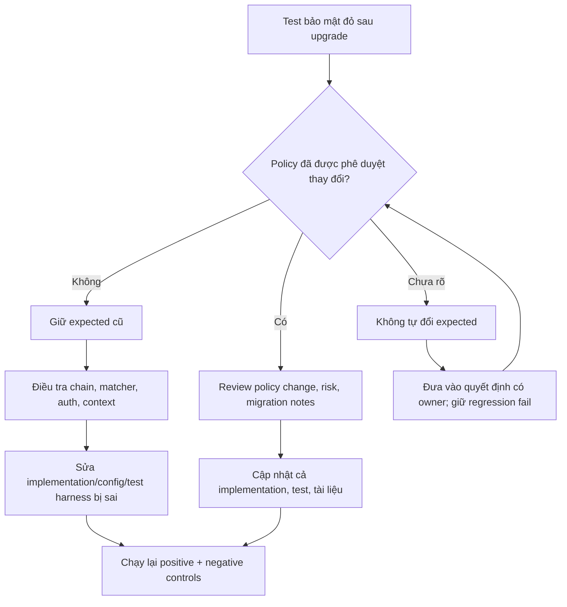
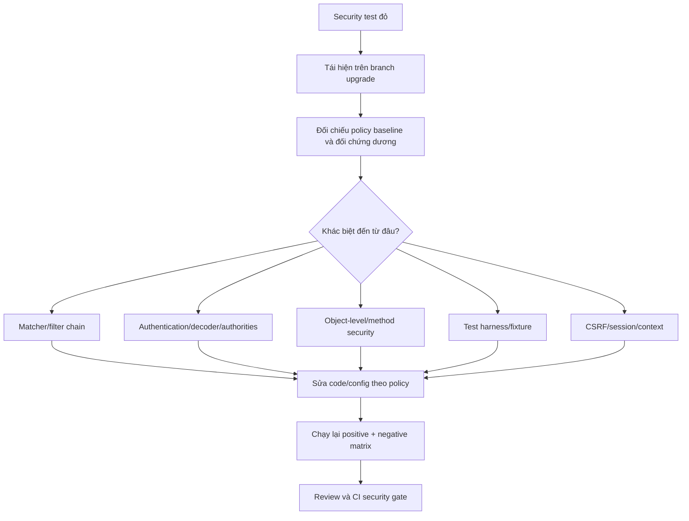

# Không cập nhật kết quả mong đợi chỉ để che một thay đổi chính sách ngoài ý muốn

Sau khi nâng cấp Spring Boot hoặc Spring Security, một test từng kỳ vọng `403 Forbidden` có thể bất ngờ nhận `200 OK`. Có người sửa ngay `andExpect(status().isForbidden())` thành `andExpect(status().isOk())` để pipeline CI xanh trở lại. Nhưng với phần mềm có dữ liệu riêng tư, việc sửa kết quả mong đợi như vậy có thể **biến một lỗi phân quyền thành hành vi được chấp nhận chính thức**.

Một tình huống ngược lại cũng nguy hiểm: test trước đây cho phép người dùng hợp lệ đọc tài nguyên, nay trả `401` hoặc `403`; đội ngũ sửa assertion theo response mới mà không điều tra nguyên nhân. Kết quả là một tính năng bị khóa ngoài ý muốn, hoặc một lớp security thay đổi đến mức test không còn đi qua cơ chế xác thực thật.

Bài này thuộc chương **Di chuyển và nâng cấp** của module **SPRING_SECURITY_TESTING**. Module tập trung kiểm chứng xác thực, phân quyền và bảo vệ HTTP thực tế bằng `spring-security-test` trên ứng dụng Servlet và Reactive. Người học sử dụng `MockMvc`, `WebTestClient`, `@WithMockUser`, `SecurityContext`, JWT/OAuth2/OIDC giả lập và các trường hợp được phép hoặc bị từ chối. Trọng tâm bài là **giữ nguyên ý nghĩa của các kiểm thử bảo mật khi framework thay đổi**, phân biệt lỗi hồi quy với thay đổi chính sách đã được phê duyệt, và không dùng việc cập nhật expected result để che một lỗ hổng.

> **Quy tắc nền tảng:** Test bảo mật là một dạng *hợp đồng được kiểm chứng*, không phải bản sao của hành vi hiện tại. Khi actual khác expected sau nâng cấp, cần xác định **hợp đồng mong muốn** bằng bằng chứng độc lập, rồi sửa cấu hình, code hoặc test tương ứng. Không lấy response hiện tại làm chân lý chỉ vì nó làm CI đỏ.

## 1. Phân biệt hành vi quan sát với chính sách được chấp thuận

Trong test thông thường, ta có:

```text
Input → Application under test → Actual result
                                   |
                                 so sánh
                                   |
                           Expected result
```

Đối với bảo mật, **expected result phải đến từ chính sách đã được thống nhất**: ai được làm gì, đối với tài nguyên nào, với điều kiện xác thực và ngữ cảnh nào.

Ví dụ:

| Tình huống | Chính sách đã thống nhất | Expected |
|---|---|---|
| Không có credential gọi API riêng tư | Bắt buộc xác thực | `401` |
| JWT hợp lệ nhưng thiếu `reports.read` | Không được đọc báo cáo | `403` |
| JWT hợp lệ có scope, nhưng user Alice yêu cầu báo cáo của Bob | Không vượt quyền sở hữu | `403` hoặc `404` theo contract |
| JWT hợp lệ, đúng scope và owner | Được đọc báo cáo | `200` và đúng nội dung |
| JWT sai chữ ký/issuer/audience | Không chấp nhận token | `401` |
| User hợp lệ gửi thao tác ghi nhưng thiếu CSRF trong ứng dụng dùng cookie/session | Chặn request không có CSRF | Thường `403` |
| Admin thao tác với dữ liệu ngoài tenant được phép | Không vượt ranh giới tenant | Từ chối theo contract |

Status chỉ là một phần của kết quả. Với request bị từ chối, còn phải kiểm **không lộ dữ liệu và không ghi tác dụng phụ trái phép**. Với request được phép, phải kiểm danh tính và tài nguyên đúng, tránh một endpoint trả `200` nhưng chứa dữ liệu của người khác.

### 1.1. Một test đỏ có thể là tín hiệu tốt

Khi đổi framework khiến test truy cập trái phép từ `403` sang `200`, test đỏ đang hoàn thành chức năng cảnh báo. Việc đổi expected sang `200` làm mất tín hiệu ấy. Cần hỏi:

1. Có thay đổi chính sách được phê duyệt cho phép hành vi đó không?
2. Endpoint có chạy qua đúng `SecurityFilterChain`/`SecurityWebFilterChain` không?
3. JWT authorities có được map đúng không?
4. Matcher có còn khớp URL, HTTP method và dispatcher type không?
5. Method-level authorization có còn hoạt động không?
6. Test có đang bypass filter bằng một cách dựng client khác không?
7. Response `200` có thật sự đến từ tài nguyên được bảo vệ hay là mock endpoint?

Khi không có quyết định chính sách rõ ràng, **giữ assertion bảo mật hiện tại** và điều tra.

### 1.2. “Framework đổi mặc định” không đồng nghĩa “sản phẩm được phép đổi policy”

Spring Security có thể thay API DSL, cơ chế lưu SecurityContext, lựa chọn matcher hoặc các thành phần được cấu hình mặc định giữa các thế hệ. Một thay đổi kỹ thuật không tự tạo ra quyền nghiệp vụ mới cho người dùng. Trong migration, trách nhiệm của dự án là **biểu đạt lại cùng chính sách** bằng cấu hình mới, hoặc ghi nhận một thay đổi chính sách có chủ đích.

## 2. Ba trường hợp khi expected và actual không khớp



**Trường hợp A — Regression không mong muốn:** User không được phép bỗng nhận `200`. Sửa code/cấu hình để khôi phục hợp đồng. Không đổi expected.

**Trường hợp B — Chính sách thực sự được thay đổi có chủ đích:** Ví dụ sản phẩm chuyển từ “chỉ owner được xem” sang “owner hoặc auditor được xem”, có đánh giá rủi ro và duyệt. Khi đó cập nhật implementation, tests, tài liệu và migration note **như một thay đổi policy rõ ràng**.

**Trường hợp C — Test viết sai từ trước:** Có thể test cũ từng kỳ vọng sai, hoặc phụ thuộc implementation chi tiết không thuộc contract. Được phép sửa expected sau khi có bằng chứng và review, nhưng **không** viện cớ “framework upgrade” để bỏ qua việc chứng minh.

### 2.1. Một thay đổi expected cần có nguồn độc lập

Nguồn phù hợp có thể là:

- Quy tắc phân quyền/tenant đã được duyệt.
- Yêu cầu sản phẩm hoặc security acceptance criteria.
- API contract được thống nhất với client.
- Quyết định kiến trúc/ADR có rủi ro và phương án rollback.
- Lịch sử test và endpoint behavior trước upgrade, được dùng như bằng chứng tham khảo.
- Review của owner tính năng và người chịu trách nhiệm security.

Không dùng riêng “actual status mà framework hiện trả” làm lý do thay expected.

## 3. Anti-pattern: cập nhật assertion cho khớp response

**Trước nâng cấp:**

```java
@Test
void aliceCannotReadBobsReport() throws Exception {
    mvc.perform(get("/api/reports/{id}", bobReportId)
            .with(jwt()
                .jwt(j -> j.subject("alice"))
                .authorities(
                    new SimpleGrantedAuthority(
                        "SCOPE_reports.read"))))
        .andExpect(status().isForbidden());
}
```

**Sau nâng cấp, test nhận `200` — cách “sửa” sai:**

```java
// ANTI-PATTERN: chỉ đổi kết quả mong đợi theo hành vi lỗi.
mvc.perform(get("/api/reports/{id}", bobReportId)
        .with(jwt()
            .jwt(j -> j.subject("alice"))
            .authorities(
                new SimpleGrantedAuthority(
                    "SCOPE_reports.read"))))
    .andExpect(status().isOk());
```

Test nay xanh, nhưng quyền sở hữu báo cáo của Bob đã bị phá. Một reviewer chỉ thấy thay đổi một dòng `isForbidden()` → `isOk()` có thể bỏ sót rằng đó là **mở rộng quyền truy cập**.

**Cách xử lý đúng:**

1. Giữ test âm tính Alice/Bob.
2. Kiểm test dương Bob đọc báo cáo của mình vẫn `200`.
3. Ghi nhận response thực tế, principal, authorities và filter chain được dùng, **không log raw token**.
4. Xác định nơi kiểm owner: service, method security, repository query hoặc HTTP authorization.
5. Sửa chỗ kiểm owner bị bỏ qua.
6. Bổ sung assertion body không chứa dữ liệu Bob nếu bị từ chối.
7. Chạy test cả Servlet/Reactive khi sản phẩm hỗ trợ hai stack.
8. Chỉ sửa expected nếu có quyết định thay đổi chính sách đã được chấp thuận.

### 3.1. Phản ví dụ đảo chiều

Nếu test hợp lệ trước đây `200` nhưng sau nâng cấp `403`, không vội đổi thành `isForbidden()` để “chấp nhận security nghiêm hơn”. Hãy kiểm có phải do thiếu CSRF token trên request POST, JWT converter làm mất scope, matcher quá rộng, context không được lưu hoặc một chain mới chặn nhầm. **Từ chối quá mức cũng là regression về tính năng**.

## 4. Dựng “security contract” trước khi nâng cấp

Trước khi đổi dependency/framework, chốt một ma trận expected có chủ sở hữu. Ví dụ ứng dụng báo cáo dùng OAuth2 Resource Server và yêu cầu `SCOPE_reports.read`:

| ID | Principal | Credential | Resource | Điều kiện khác | Expected |
|---|---|---|---|---|---|
| P01 | Alice | JWT hợp lệ, scope đọc | Báo cáo Alice | Owner đúng | `200` |
| P02 | Alice | JWT hợp lệ, scope đọc | Báo cáo Bob | Owner sai | `403` |
| P03 | Alice | JWT hợp lệ, không scope đọc | Báo cáo Alice | Thiếu authority | `403` |
| P04 | Anonymous | Không token | Báo cáo Alice | Chưa đăng nhập | `401` |
| P05 | Alice | JWT sai chữ ký | Báo cáo Alice | Token không hợp lệ | `401` |
| P06 | Alice | JWT sai audience | Báo cáo Alice | Token không dành cho API | `401` |
| P07 | Alice | JWT hết hạn | Báo cáo Alice | Hết thời gian | `401` |
| P08 | Bob | JWT hợp lệ, scope đọc | Báo cáo Bob | Owner đúng | `200` |
| P09 | Alice | JWT hợp lệ, scope duyệt | POST approve của Bob | Owner sai | Từ chối, DB không đổi |
| P10 | Alice | JWT hợp lệ, scope duyệt | POST approve của Alice | Owner đúng | Thành công, event đúng |
| P11 | Alice | Login session hợp lệ | POST có CSRF bắt buộc | Thiếu CSRF | `403` |
| P12 | Alice | Login session hợp lệ | POST có CSRF hợp lệ | Đủ quyền | Thành công |
| P13 | Tenant A | JWT hợp lệ | Dữ liệu Tenant B | Sai tenant | Không vượt tenant |
| P14 | Alice | JWT hợp lệ | Endpoint chưa được khai báo | Matcher fallback | Từ chối, không open-by-default |

Không cần đặt các status giả định trên vào mọi sản phẩm; chúng là **contract minh họa**. Ví dụ `403`/`404` khi không có quyền xem một đối tượng phải theo chính sách tránh lộ sự tồn tại tài nguyên. Các case cần được ghi nhận trước migration, không viết lại sau khi thấy actual.

### 4.1. Phải có đối chứng dương

Nếu chỉ test `403`, một security chain chặn **tất cả** request cũng làm suite xanh. Vì thế mỗi nhóm từ chối cần một ca cùng URL/điều kiện hợp lệ được cho phép.

Ví dụ:
- Alice đọc Bob `403` và Bob đọc Bob `200`.
- Thiếu scope `403` và có scope `200`.
- JWT signature sai `401` và JWT ký đúng `200`.
- CSRF thiếu `403` và CSRF đúng với cùng principal/URL thành công.
- Tenant A không đọc Tenant B, nhưng đọc được tài nguyên của Tenant A.

Tổ hợp này giúp xác định **đúng cơ chế đang được kiểm**, không chỉ status hiện ra tình cờ.

## 5. Snapshot hành vi an toàn trước migration

Một đường baseline có ích gồm:

1. Ghi các security tests thành **test names biểu đạt chính sách**: `aliceCannotReadBobsReport`, không phải `shouldReturn403`.
2. Ghi framework/dependency version được kiểm, commit baseline và test matrix.
3. Chạy suite trên môi trường và database test cô lập.
4. Chỉ ghi **metadata chẩn đoán**: route template, method, status, outcome, request ID, loại Authentication và authority count nếu cần.
5. Ghi policy owner, phạm vi test và các ngoại lệ đã duyệt.
6. Lưu test reports như artifact chỉ khi không chứa access token, cookie, password hoặc raw authorization code.
7. Chạy cùng input trên branch nâng cấp để so sánh.

Không lưu JWT thật, session cookie hoặc request body có PII vào snapshot “golden output”. Đặc biệt, không gọi `MockMvcResultHandlers.print()` bừa bãi với request có Bearer token chỉ để ghi baseline.

### 5.1. Test snapshot không phải policy tự thân

Một snapshot có thể chứa response sai của phiên bản cũ. Nó chỉ là **bằng chứng lịch sử**, còn policy là quy tắc đã được phê duyệt. Khi snapshot và policy mâu thuẫn, phải điều tra cả hai; không khẳng định snapshot luôn đúng hoặc expected hiện tại luôn đúng.

## 6. Một ứng dụng Servlet minh họa ranh giới quyền

Giả sử API stateless nhận Bearer JWT, yêu cầu scope đọc ở tầng HTTP và owner ở tầng service.

```java
@Configuration(proxyBeanMethods = false)
@EnableWebSecurity
class ApiSecurityConfiguration {

    @Bean
    SecurityFilterChain apiChain(HttpSecurity http)
            throws Exception {

        return http
            .securityMatcher("/api/**")
            .csrf(AbstractHttpConfigurer::disable)
            .sessionManagement(session -> session
                .sessionCreationPolicy(
                    SessionCreationPolicy.STATELESS))
            .httpBasic(AbstractHttpConfigurer::disable)
            .formLogin(AbstractHttpConfigurer::disable)
            .authorizeHttpRequests(auth -> auth
                .requestMatchers(
                    HttpMethod.GET, "/api/reports/**")
                    .hasAuthority("SCOPE_reports.read")
                .anyRequest().denyAll())
            .oauth2ResourceServer(oauth2 -> oauth2
                .jwt(Customizer.withDefaults()))
            .build();
    }
}
```

Import chính:

```java
import org.springframework.context.annotation.Bean;
import org.springframework.context.annotation.Configuration;
import org.springframework.http.HttpMethod;
import org.springframework.security.config.Customizer;
import org.springframework.security.config.annotation.web.configuration.EnableWebSecurity;
import org.springframework.security.config.annotation.web.builders.HttpSecurity;
import org.springframework.security.config.annotation.web.configurers.AbstractHttpConfigurer;
import org.springframework.security.config.http.SessionCreationPolicy;
import org.springframework.security.web.SecurityFilterChain;
```

Ví dụ **chỉ** bảo vệ API Bearer stateless; vì không dựa vào cookie browser tự gửi nên CSRF được tắt **cho chain này** theo thiết kế minh họa. Không tự sao chép `.csrf(disable)` vào web app session/cookie. Trong hệ thống thật, API ngoài `/api/**` còn cần **một chain fallback có chủ ý**; không coi các URL không khớp chain này là đã được bảo vệ.

### 6.1. Object-level authorization nằm ở service

```java
@Service
class ReportService {

    private final ReportRepository reports;

    ReportService(ReportRepository reports) {
        this.reports = reports;
    }

    @Transactional(readOnly = true)
    ReportView read(UUID id, String principalSubject) {
        ReportEntity entity = reports.findById(id)
            .orElseThrow(() ->
                new ResponseStatusException(
                    HttpStatus.NOT_FOUND));

        if (!entity.getOwnerSubject()
                .equals(principalSubject)) {
            throw new AccessDeniedException(
                "Report is not owned by principal");
        }

        return new ReportView(
            entity.getId(),
            entity.getTitle(),
            entity.getContent());
    }
}
```

Controller:

```java
@RestController
@RequestMapping("/api/reports")
class ReportController {

    private final ReportService service;

    ReportController(ReportService service) {
        this.service = service;
    }

    @GetMapping("/{id}")
    ReportView one(
            @PathVariable UUID id,
            Authentication authentication) {

        return service.read(
            id, authentication.getName());
    }
}
```

`ReportRepository`, `ReportEntity` và `ReportView` là các thành phần domain giả định; cần định nghĩa để chạy ví dụ. Lấy `authentication.getName()` từ đối tượng đã xác thực, không tin header `X-User` do client cung cấp.

**Một điểm dễ vỡ khi nâng cấp:** Tầng HTTP chỉ kiểm `SCOPE_reports.read`. Nếu refactor loại bỏ owner check ở `ReportService` hoặc thay `findByOwner...` bằng `findById`, user có scope đọc sẽ xem được mọi báo cáo. Test status phải đo **quyền trên đối tượng**, không chỉ `hasAuthority` ở filter.

### 6.2. Cẩn thận với thông báo lỗi

`AccessDeniedException` message trong ví dụ dùng để minh họa, không phải nội dung được phép trả nguyên vẹn cho client. Error handler cần kiểm soát message và response không lộ tên/ID/metadata nhạy cảm của Bob. Với API dùng `404` để che resource, chuyển policy nhất quán và test response phù hợp.

## 7. MockMvc tests làm hợp đồng bảo mật sống

Giả sử Spring Boot test nạp `SecurityFilterChain`, controller, service và database test. Dùng `jwt()` để cô lập authorization/ownership khỏi việc ký token.

```java
@SpringBootTest
@AutoConfigureMockMvc
class ReportsSecurityRegressionIT {

    @Autowired
    MockMvc mvc;

    @Autowired
    ReportRepository reports;

    UUID aliceReportId;
    UUID bobReportId;

    @BeforeEach
    void seed() {
        // Repository/fixture thực phải cô lập per test.
        aliceReportId = reports.save(
            ReportEntity.ownedBy("alice",
                "Alice note", "ALICE_PRIVATE_MARKER"))
            .getId();

        bobReportId = reports.save(
            ReportEntity.ownedBy("bob",
                "Bob note", "BOB_PRIVATE_MARKER"))
            .getId();
    }

    // Test methods ở dưới.
}
```

Ở database dùng chung cho suite song song, dùng schema/container/namespace riêng; không `deleteAll()` bừa bãi. Trong HTTP integration test cần kiểm commit, tránh `@Transactional` trên class test khiến kết quả từ transaction của test thread che hành vi thực.

### 7.1. Đối chứng dương: Alice được xem của Alice

```java
@Test
void aliceMayReadHerOwnReport() throws Exception {
    mvc.perform(get(
            "/api/reports/{id}", aliceReportId)
            .with(jwt()
                .jwt(j -> j.subject("alice"))
                .authorities(
                    new SimpleGrantedAuthority(
                        "SCOPE_reports.read"))))
        .andExpect(status().isOk())
        .andExpect(jsonPath("$.id")
            .value(aliceReportId.toString()))
        .andExpect(jsonPath("$.content")
            .value("ALICE_PRIVATE_MARKER"));
}
```

Test xác minh endpoint thật nhận identity Alice từ Spring Security Test, scope đúng và nội dung không bị lấy từ một báo cáo khác.

### 7.2. Đối chứng âm: Alice không xem được của Bob

```java
@Test
void aliceCannotReadBobsReport()
        throws Exception {

    mvc.perform(get(
            "/api/reports/{id}", bobReportId)
            .with(jwt()
                .jwt(j -> j.subject("alice"))
                .authorities(
                    new SimpleGrantedAuthority(
                        "SCOPE_reports.read"))))
        .andExpect(status().isForbidden())
        .andExpect(content().string(
            not(containsString(
                "BOB_PRIVATE_MARKER"))));
}
```

Import kiểm body:

```java
import static org.hamcrest.Matchers.containsString;
import static org.hamcrest.Matchers.not;
import static org.springframework.test.web.servlet.result
    .MockMvcResultMatchers.content;
```

Nếu test này chuyển từ `403` sang `200` khi nâng cấp, **không sửa expected**. Cần tìm hiểu owner check, filter mapping, controller mapping hoặc cách principal được đưa vào service. Nếu policy của sản phẩm trả `404`, expected đã thống nhất tương ứng; không tự ý đổi `403` ↔ `404` theo actual.

### 7.3. Đã có authentication nhưng thiếu authority

```java
@Test
void tokenWithoutReadScopeIsForbidden()
        throws Exception {

    mvc.perform(get(
            "/api/reports/{id}", aliceReportId)
            .with(jwt()
                .jwt(j -> j.subject("alice"))
                .authorities(
                    new SimpleGrantedAuthority(
                        "SCOPE_reports.export"))))
        .andExpect(status().isForbidden());
}
```

### 7.4. Request không xác thực

```java
@Test
void anonymousCannotReadReports()
        throws Exception {

    mvc.perform(get(
            "/api/reports/{id}", aliceReportId))
        .andExpect(status().isUnauthorized());
}
```

Trong API Bearer-only của mục 6, không có CSRF trên GET và không có session login; `401` là kỳ vọng hợp lý. Với ứng dụng có entry point tùy biến, có thể là redirect hoặc response riêng theo contract. Điều quan trọng là **không được đọc nội dung riêng tư**.

### 7.5. Bob được xem đúng của Bob

```java
@Test
void bobMayReadBobsReport() throws Exception {
    mvc.perform(get(
            "/api/reports/{id}", bobReportId)
            .with(jwt()
                .jwt(j -> j.subject("bob"))
                .authorities(
                    new SimpleGrantedAuthority(
                        "SCOPE_reports.read"))))
        .andExpect(status().isOk())
        .andExpect(jsonPath("$.content")
            .value("BOB_PRIVATE_MARKER"));
}
```

Test dương Bob là đối chứng quan trọng cho âm tính Alice/Bob. Nếu cả hai đều bị `403`, có thể nguyên nhân là cấu hình matcher chặn hết, không phải object ownership hoạt động đúng.

### 7.6. Import và test harness

```java
import java.util.UUID;
import org.junit.jupiter.api.BeforeEach;
import org.junit.jupiter.api.Test;
import org.springframework.beans.factory.annotation.Autowired;
import org.springframework.boot.test.autoconfigure.web.servlet.AutoConfigureMockMvc;
import org.springframework.boot.test.context.SpringBootTest;
import org.springframework.security.core.authority.SimpleGrantedAuthority;
import org.springframework.test.web.servlet.MockMvc;

import static org.springframework.security.test.web.servlet.request
    .SecurityMockMvcRequestPostProcessors.jwt;
import static org.springframework.test.web.servlet.request
    .MockMvcRequestBuilders.get;
import static org.springframework.test.web.servlet.result
    .MockMvcResultMatchers.jsonPath;
import static org.springframework.test.web.servlet.result
    .MockMvcResultMatchers.status;
```

Những test trên dùng **JWT authentication giả lập**. Chúng kiểm authorization và logic phía server, không xác minh decoder JWT, issuer/audience hoặc signature production. Để đảm bảo upgrade không làm suy yếu xác thực token, bổ sung kiểm tra ký thật ở một tầng test khác.

## 8. Không đánh đồng 401, 403 và 404

Một thay đổi status có thể đến từ lỗi ở lớp khác, không phải chủ đích sửa quyền.

| Actual sau nâng cấp | Expected trước đó | Điều cần kiểm trước khi sửa test |
|---|---|---|
| `200` | `403` | Policy bị mở, matcher không match, method security tắt, owner check bị bỏ |
| `403` | `200` | Scope mapping đổi, CSRF, chain quá rộng, user/tenant sai |
| `401` | `200` | Không có SecurityContext, JWT decoder/issuer/audience sai, session không được lưu |
| `403` | `401` | CSRF chạy trước auth, custom entry point, test có authentication giả |
| `401` | `403` | Authentication thất bại trước khi tới authorization, JWT expired/sai issuer |
| `404` | `403` | Có chính sách che existence được duyệt hay route biến mất? |
| `302` | `401` | Form login/redirect đang xử lý API lẽ ra dùng Bearer |
| `500` | `403` | Lỗi filter/method/service bị đổi thành exception không map đúng |

**Không coi tất cả thay đổi status đều có cùng mức nghiêm trọng.** `403 → 200` trên tài nguyên riêng tư thường có rủi ro nghiêm trọng về bảo mật. `403 → 404` có thể là policy che tài nguyên đúng chủ đích nhưng vẫn cần review. `200 → 403` làm hỏng quyền của user hợp lệ. Mỗi trường hợp cần root cause.

### 8.1. CSRF là một nguồn `403` thường bị hiểu nhầm

Giả sử ứng dụng dùng session/cookie và có endpoint POST. Một test không gửi CSRF token nhận `403` có thể đang đo **CSRF filter**, không phải thiếu role:

```java
mvc.perform(post("/api/orders/{id}/approve", id)
        .with(user("alice").roles("APPROVER")))
    .andExpect(status().isForbidden());
```

Nếu mục tiêu test là authorization, cần cung cấp CSRF hợp lệ trong môi trường yêu cầu:

```java
mvc.perform(post("/api/orders/{id}/approve", id)
        .with(user("alice").roles("VIEWER"))
        .with(csrf()))
    .andExpect(status().isForbidden());
```

Sau đó có ca đối chứng `APPROVER` và CSRF đúng thành công. Cần thêm test thiếu CSRF **riêng** để đảm bảo lớp bảo vệ ấy vẫn tồn tại.

Không tắt `.csrf()` để chuyển test từ `403` sang `200` nếu ứng dụng dùng cookie/session và chính sách cần CSRF. Việc thay này có thể tạo lỗ hổng thật thay vì sửa test.

## 9. Kiểm matcher sau khi đổi Security DSL

Các thế hệ Spring Security có thể dùng DSL khác nhau. Ví dụ các đoạn cấu hình cũ dùng `antMatchers(...)`/`mvcMatchers(...)`, còn cấu hình mới thường dùng `authorizeHttpRequests` và `requestMatchers(...)`. Việc chuyển cú pháp phải **giữ nguyên tập request được bảo vệ**.

Một pattern không an toàn về ngữ nghĩa:

```java
// Ví dụ lỗi: chỉ yêu cầu authentication, quên scope.
http.authorizeHttpRequests(auth -> auth
    .requestMatchers("/api/reports/**")
        .authenticated()
    .anyRequest().permitAll());
```

Đoạn này có thể cho bất kỳ user đã xác thực nào đọc mọi báo cáo nếu service không kiểm owner, và cho phép các URL còn lại đi qua. Thay vì “sửa” test từ chối bằng expected mới, cần khôi phục policy:

```java
http.authorizeHttpRequests(auth -> auth
    .requestMatchers(
        HttpMethod.GET, "/api/reports/**")
        .hasAuthority("SCOPE_reports.read")
    .anyRequest().denyAll());
```

**Chú ý đến pattern matcher thật của dự án:**

- Servlet `requestMatchers` có thể chọn matcher dựa trên MVC context và thư viện hiện diện; không giả định mọi deployment giống nhau.
- WebFlux dùng `authorizeExchange`/`pathMatchers`, không dùng các cấu hình Servlet cho Reactor request.
- Servlet path, context path, trailing slash, encoded URL, method và dispatcher type có thể ảnh hưởng matching.
- Một `securityMatcher(...)` trên chain quyết định **chain có áp dụng hay không**, khác với `requestMatchers(...)` nằm bên trong authorization rules.
- Matcher quá rộng hoặc quá hẹp đều tạo regression.
- Mọi URL không được chain xử lý cần có fallback chain/chính sách rõ ràng. `anyRequest().denyAll()` **bên trong một chain** không bảo vệ request nằm ngoài chain đó.

### 9.1. Kiểm đúng chain khi có nhiều SecurityFilterChain

```java
@Bean
@Order(1)
SecurityFilterChain api(HttpSecurity http)
        throws Exception {
    return http
        .securityMatcher("/api/**")
        .authorizeHttpRequests(auth -> auth
            .anyRequest().authenticated())
        .oauth2ResourceServer(oauth2 -> oauth2
            .jwt(Customizer.withDefaults()))
        .build();
}

@Bean
@Order(2)
SecurityFilterChain fallback(HttpSecurity http)
        throws Exception {
    return http
        .authorizeHttpRequests(auth -> auth
            .anyRequest().denyAll())
        .build();
}
```

Đây là **skeleton minh họa thứ tự chain**, chưa bao gồm yêu cầu scope và owner nên **không được dùng nguyên văn** như chính sách báo cáo ở các mục trước. Điểm chính: `@Order(1)` và `securityMatcher("/api/**")` quyết định chain được chọn; fallback chỉ xử lý request không do chain trước bắt.

Một migration có thể làm endpoint đi nhầm chain, khiến authentication entry point đổi thành login redirect hoặc policy trở nên lỏng. Cần test các URL ranh giới: `/api/reports/x`, URL ngoài `/api`, HTTP method khác và các đường dẫn phụ liên quan.

### 9.2. `web.ignoring()` và `permitAll()` không tương đương

Khi bypass Spring Security filter chain hoàn toàn bằng ignore rule, request có thể không nhận các security headers, SecurityContext handling hoặc các filter khác. `permitAll()` vẫn đi qua chain, chỉ không yêu cầu authorization trên matcher tương ứng.

Nếu migration thay `permitAll` bằng ignoring vì muốn test từ chối “hết fail”, cần đánh giá rõ tác dụng lên filter chain và security headers. Với static resources, có trường hợp ignore là hợp lý theo cấu hình, nhưng không chuyển endpoint business nhạy cảm sang ignore.

## 10. Method security có thể âm thầm biến mất

Một ứng dụng có thể có:

```java
@Service
class ApprovalService {

    @PreAuthorize(
        "hasAuthority('SCOPE_orders.approve')")
    public void approve(UUID id) {
        // Thực hiện nghiệp vụ.
    }
}
```

Nếu migration quên bật cấu hình hỗ trợ method security, annotation có thể không được áp dụng như mong muốn. Với Spring Security hiện đại, thường dùng:

```java
@Configuration
@EnableMethodSecurity
class MethodSecurityConfiguration {
}
```

Cần kiểm:

- `@EnableMethodSecurity` được nạp trong context đang chạy.
- Phương thức nằm trên bean Spring và được gọi qua proxy khi cơ chế cần proxy.
- Không tự gọi nội bộ một method được annotate rồi giả định proxy intercept.
- Expression có `hasRole`/`hasAuthority` đúng naming convention.
- Bảo vệ cả entry point trực tiếp gọi service, không chỉ HTTP controller.
- Reactive method security dùng cơ chế/cấu hình tương ứng và publisher-based context, không suy từ `SecurityContextHolder` ThreadLocal.

Một test HTTP `403` chỉ kiểm endpoint cụ thể; nếu service còn được gọi từ scheduled job, message listener hoặc một controller khác, cần thêm test ở ranh giới phù hợp để bảo đảm method security vẫn có hiệu lực.

### 10.1. Không sửa annotation để khớp test xanh

Nếu service từng yêu cầu `SCOPE_orders.approve` mà sau migration test role `USER` thất bại, đừng đổi `@PreAuthorize` thành `isAuthenticated()` chỉ để test dương qua. Phải xác định authority converter, nguồn danh tính và policy được duyệt.

## 11. JWT scope/role converter là điểm đổi policy phổ biến

Trong Spring Security Resource Server, converter mặc định thường ánh xạ claim scope thành authority với prefix `SCOPE_`. Nhưng ứng dụng có thể tùy biến để đọc roles/permissions từ claim khác.

Ví dụ test với mock authorities:

```java
mvc.perform(get("/api/reports/{id}", id)
        .with(jwt()
            .jwt(j -> j.claim(
                "scope", "reports.read"))
            .authorities(
                new SimpleGrantedAuthority(
                    "SCOPE_reports.read"))))
    .andExpect(status().isOk());
```

Test này **tự gắn authority**, nên không chứng minh converter production đọc `"scope"` đúng. Nếu migration làm converter trả authority sai, test vẫn xanh.

Để kiểm converter:

1. Dùng unit test riêng cho `Converter<Jwt, ...>` thật với raw claims.
2. Hoặc gửi JWT ký thật qua HTTP, giữ `JwtDecoder`/`ReactiveJwtDecoder`, validators và converter production.
3. Assert token scope đúng được phép, scope sai bị từ chối.
4. Assert JWT đã hết hạn, sai issuer/audience hoặc signature bị `401`.
5. Kiểm claim format string/list và prefix `SCOPE_` hoặc `ROLE_` đúng theo policy.
6. Không cho test tự set `.authorities(...)` trong ca tuyên bố kiểm claim mapping production.

### 11.1. `roles("ADMIN")` và `authorities("SCOPE_...")` không thay cho nhau

Trong test dùng `@WithMockUser(roles = "ADMIN")`, Spring Security thường tạo authority `ROLE_ADMIN`. Đây không tương đương `SCOPE_reports.approve`.

```java
@WithMockUser(roles = "ADMIN")
// Thường cung cấp ROLE_ADMIN, không phải SCOPE_reports.approve.
```

Nếu endpoint đòi scope, test phải cung cấp đúng authority hoặc dùng JWT theo policy:

```java
@WithMockUser(
    authorities = "SCOPE_reports.read")
// Cấp authority trực tiếp cho test.
```

Annotation giúp unit/HTTP authorization test với danh tính giả lập; nó **không** chứng minh JWT parser, chữ ký, issuer/audience hoặc OAuth2/OIDC login thật.

### 11.2. Không cho phép fallback rộng khi converter mất scope

Một thay đổi nguy hiểm:

```java
// Trước: chỉ token có quyền đọc được vào.
.hasAuthority("SCOPE_reports.read")

// Sau: cho tất cả token hợp lệ, vì test thiếu scope bị đỏ.
.authenticated()
```

Sửa trên đổi policy từ “có quyền đọc báo cáo” thành “có tài khoản là đọc được”. Cần sửa converter hoặc fixture/logic sai thay vì giảm yêu cầu bảo mật.

## 12. SecurityContext persistence và session sau nâng cấp

Ở Servlet, `SecurityContextHolder` mặc định dùng ThreadLocal. Cấu hình quản lý repository và lưu context có thể khác giữa các thế hệ Spring Security. Trong mô hình dùng `SecurityContextHolderFilter`, lưu authentication giữa request có thể yêu cầu **save tường minh** vào `SecurityContextRepository`.

Một regression thường thấy:

1. Login POST trả thành công.
2. Request tiếp theo dùng cùng session bị `401`/redirect login.
3. Test thay expected request hai thành “chưa đăng nhập” để phù hợp actual.

Đó không mặc nhiên là chính sách mới. Có thể authentication chỉ được đặt vào holder request đầu mà chưa được lưu qua repository đúng cách.

Một flow test stateful cần:

- Login thật hoặc fixture login theo phạm vi test.
- Giữ cookie/session từ response đầu.
- Request thứ hai **không gắn lại `@WithMockUser`/`.with(user())`**.
- Kiểm server nạp đúng principal đã lưu.
- Khi logout, request thứ ba không còn được phép.
- Kiểm session fixation protection và CSRF theo hợp đồng nếu liên quan.

**Phân biệt:** `SecurityContextHolder.clearContext()` dọn context ThreadLocal hiện tại, **không tự động xóa session đã lưu** hay thu hồi access token JWT. Test cần đọc hành vi request tiếp theo để đánh giá persistence thật.

### 12.1. Một API stateless cũng cần đối chứng không rò rỉ

Trong API Bearer-only:

```text
Request 1: Bearer JWT Alice hợp lệ → 200
Request 2: không Bearer → 401
Request 3: Bearer JWT Bob hợp lệ → dữ liệu Bob
```

Nếu request 2 vẫn có Alice, hoặc request 3 trả dữ liệu Alice, đó là lỗi nghiêm trọng về context lifecycle hoặc state/shared cache. Không sửa expected request 2 thành `200` vì “client còn dùng cùng kết nối”.

## 13. Test harness có thể che sự thay đổi chính sách

Không phải mọi test đỏ/xanh đều phản ánh production. Trong migration, test setup đôi khi bị thay đổi cùng source:

| Thay đổi trong test | Rủi ro |
|---|---|
| Đổi `@SpringBootTest` thành `@WebMvcTest` nhưng không import security config | Chain production không còn được nạp |
| Dùng `MockMvcBuilders.standaloneSetup(...)` | Có thể bypass Spring Security filters |
| Thêm `.with(user("admin"))` vào mọi request | Ca “anonymous” không còn vô danh |
| Thêm `@WithMockUser` ở cấp class | Mọi test có authentication mặc định |
| Dùng `mockJwt()` cho test kiểm signature | Decoder/validators không chạy |
| Mock `JwtDecoder`/`ReactiveJwtDecoder` | Không chứng minh xác minh token thật |
| Bỏ `springSecurity()` khi bind WebTestClient tự dựng | Security test integration có thể thiếu |
| `@MockBean`/`@MockitoBean` service chứa owner policy | Không kiểm object-level authorization |
| Thêm `.csrf().disable()` trong test config | Có thể che CSRF regression |
| Sửa URL test sang endpoint permitAll | Test không còn bao phủ route cần bảo vệ |
| Đổi annotation `@WithMockUser(roles = ...)` | Authorities của test khác policy production |
| Sửa report/fixture để tài nguyên thuộc Alice thay vì Bob | Ca vượt quyền trở thành ca hợp lệ |

Hãy review **diff của test harness** như review code bảo mật. Một refactor trông như làm test ngắn hơn có thể làm mất toàn bộ filter chain.

### 13.1. Test chính sách cần bảo đảm filter thật đang chạy

Với Spring MVC:

```java
@SpringBootTest
@AutoConfigureMockMvc
class ProtectedApiIT {
    @Autowired MockMvc mvc;
}
```

Spring Boot thường cấu hình MockMvc với application context và filters; tuy nhiên cần kiểm đúng web application type, security chain và test configuration thực tế. Nếu tự dựng MockMvc:

```java
MockMvc mvc = MockMvcBuilders
    .webAppContextSetup(context)
    .apply(springSecurity())
    .build();
```

`springSecurity()` là configurer từ `SecurityMockMvcConfigurers`. Test `anonymousCannotReadReports()` là một **canary quan trọng**: nếu thiếu token mà `200`, phải điều tra chain/test harness ngay.

Không dừng ở duy nhất canary vô danh: một route có thể yêu cầu authentication nhưng bỏ mất scope, nên vẫn cần test thiếu authority và sai owner.

## 14. Nâng cấp trong ứng dụng Reactive: WebTestClient phải đi đúng chain

WebFlux dùng `SecurityWebFilterChain`, `ServerHttpSecurity` và Reactor Context. Đừng chuyển cấu hình Servlet rồi giả định `MockMvc` bao phủ WebFlux.

Ví dụ chính sách Reactive tương ứng:

```java
@Bean
SecurityWebFilterChain reactiveApi(
        ServerHttpSecurity http) {

    return http
        .authorizeExchange(exchanges -> exchanges
            .pathMatchers(
                HttpMethod.GET,
                "/api/reports/**")
                .hasAuthority("SCOPE_reports.read")
            .anyExchange().denyAll())
        .httpBasic(
            ServerHttpSecurity.HttpBasicSpec::disable)
        .formLogin(
            ServerHttpSecurity.FormLoginSpec::disable)
        .oauth2ResourceServer(oauth2 -> oauth2
            .jwt(Customizer.withDefaults()))
        .build();
}
```

Đoạn trên là skeleton theo policy đọc scope, chưa thêm owner check và các chain khác; ứng dụng thật cần giữ đúng resource policy và CSRF/session contract.

### 14.1. WebTestClient với principal giả lập

Trong test bind vào Spring WebFlux application context có Spring Security Test support:

```java
client.mutateWith(mockJwt()
        .jwt(j -> j.subject("alice"))
        .authorities(
            new SimpleGrantedAuthority(
                "SCOPE_reports.read")))
    .get()
    .uri("/api/reports/{id}", aliceReportId)
    .exchange()
    .expectStatus().isOk();
```

Đối chứng sai owner:

```java
client.mutateWith(mockJwt()
        .jwt(j -> j.subject("alice"))
        .authorities(
            new SimpleGrantedAuthority(
                "SCOPE_reports.read")))
    .get()
    .uri("/api/reports/{id}", bobReportId)
    .exchange()
    .expectStatus().isForbidden();
```

Khi tự dựng client:

```java
WebTestClient client =
    WebTestClient.bindToApplicationContext(context)
        .apply(springSecurity())
        .configureClient()
        .build();
```

Các static imports:

```java
import static org.springframework.security.test.web.reactive.server
    .SecurityMockServerConfigurers.mockJwt;
import static org.springframework.security.test.web.reactive.server
    .SecurityMockServerConfigurers.springSecurity;
```

Một client bind trực tiếp tới **HTTP server độc lập** không thể chuyển `mockJwt()` thành authentication của server qua mạng. Nếu mục tiêu upgrade là decoder/validator thật, dùng `WebTestClient.bindToServer()` gửi Bearer JWT ký thật.

### 14.2. Reactor Context khác SecurityContextHolder của test thread

Một service Reactive cần lấy danh tính bằng `ReactiveSecurityContextHolder` hoặc principal do framework truyền vào, không dựa `SecurityContextHolder` ThreadLocal của JUnit thread.

```java
Mono<String> subject =
    ReactiveSecurityContextHolder.getContext()
        .map(SecurityContext::getAuthentication)
        .map(Authentication::getName);
```

Trong unit test:

```java
Mono<String> asAlice = subject.contextWrite(
    ReactiveSecurityContextHolder
        .withAuthentication(alice));

StepVerifier.create(asAlice)
    .expectNext("alice")
    .expectComplete()
    .verify(Duration.ofSeconds(2));
```

Nếu migration đổi threading/scheduler và test mất principal, hãy kiểm cách truyền Reactor Context và test setup, **không** thay expected từ Alice sang anonymous để cho test xanh.

## 15. Kiểm JWT thật: phân biệt security regression với mock behavior

Bộ test `jwt()`/`mockJwt()` rất nhanh để kiểm authorization. Nhưng khi nâng cấp các thành phần OAuth2 Resource Server, cần ít nhất một nhóm **HTTP integration** dùng JWT ký thật và decoder/validators production.

Ví dụ skeleton:

```java
@SpringBootTest(
    webEnvironment =
        SpringBootTest.WebEnvironment.RANDOM_PORT)
class BearerPolicyRealHttpIT {

    @LocalServerPort
    int port;

    WebTestClient client;

    @BeforeEach
    void bind() {
        client = WebTestClient.bindToServer()
            .baseUrl("http://localhost:" + port)
            .responseTimeout(Duration.ofSeconds(3))
            .build();
    }

    @Test
    void validSignedJwtCanReadOwnedReport() {
        String token = testTokens.signedAccessToken(
            "alice", "reports.read");

        client.get()
            .uri("/api/reports/{id}", aliceReportId)
            .headers(h -> h.setBearerAuth(token))
            .exchange()
            .expectStatus().isOk();
    }
}
```

`testTokens` và fixture IDs là helper giả định. Test cần một JWT được ký bằng private key test, public key tương ứng ở JWKS test, issuer/audience/time còn hiệu lực và converter thật. Với ứng dụng dùng opaque token, cần introspection test server thay vì JWT decoder.

### 15.1. Ma trận validator cần giữ sau migration

| Token | Điều kiện sai | Kỳ vọng |
|---|---|---|
| Không có | Thiếu Bearer | `401` |
| Malformed | Không parse JWT | `401` |
| JWT ký bằng key lạ | Chữ ký sai | `401` |
| JWT ký đúng, issuer khác | `iss` sai | `401` |
| JWT ký đúng, audience khác | `aud` sai theo policy | `401` |
| JWT ký đúng, quá hạn | `exp` sai | `401` |
| JWT ký đúng, `nbf` tương lai | Chưa hiệu lực | `401` |
| JWT hợp lệ thiếu scope | Thiếu quyền | `403` |
| JWT hợp lệ đúng scope nhưng sai owner | Không sở hữu | `403/404` |
| JWT hợp lệ đủ scope và owner | Tất cả đúng | `200` |

**Cách kiểm một validator:** giữ các điều kiện khác hợp lệ, chỉ cố ý làm sai một điều kiện. Một token vừa sai chữ ký vừa hết hạn nhận `401` không chứng minh validator thời gian vẫn được bật.

### 15.2. Không vô hiệu hóa validator để sửa test

Một thay đổi như bỏ kiểm audience hoặc issuer chỉ để test token fixture cũ được chấp nhận lại có thể mở API cho token dành cho service khác. Phải sửa fixture tương thích đúng policy, hoặc sửa cấu hình validator nếu bị sai **theo hợp đồng đã duyệt**, không nới rộng trust boundary cho tiện migration.

## 16. Kiểm side effects, không chỉ HTTP status

Giả sử `POST /api/orders/{id}/approve` trả `403` cho Alice khi order thuộc Bob. Assertion status đúng vẫn chưa chứng minh DB giữ nguyên nếu việc ghi đã xảy ra trước authorization.

Một ca mạnh hơn:

```java
@Test
void deniedApprovalDoesNotWriteOrPublish()
        throws Exception {

    String cid = "deny-" + UUID.randomUUID();

    OrderStatus before = orders
        .findById(bobOrderId)
        .orElseThrow()
        .getStatus();

    mvc.perform(post(
            "/api/orders/{id}/approve", bobOrderId)
            .with(jwt()
                .jwt(j -> j.subject("alice"))
                .authorities(
                    new SimpleGrantedAuthority(
                        "SCOPE_orders.approve")))
            .header("X-Correlation-ID", cid))
        .andExpect(status().isForbidden());

    assertThat(orders.findById(bobOrderId)
        .orElseThrow().getStatus())
        .isEqualTo(before);

    assertThat(outbox.findByCorrelationId(cid))
        .isEmpty();
}
```

Ở đây `orders`, `outbox` và endpoint là giả định của bài thực hành. Cấu hình CSRF của API test phải được xử lý đúng để `403` thực sự đến từ owner policy, không phải thiếu CSRF.

Nếu business command được enqueue bất đồng bộ, một query DB **ngay sau response** có thể chưa bắt được side effect đến muộn. Bổ sung kiểm cổng enqueue/spy, test-controlled gate hoặc quan sát hữu hạn theo contract; phân biệt audit về deny (được phép ghi) với business event `ORDER_APPROVED` (không được ghi).

### 16.1. “Cập nhật expected” có thể che lỗi dữ liệu dù status đổi ít

Giả sử policy mới được duyệt đổi từ `403` sang `404` để tránh lộ sự tồn tại resource. Nếu test chỉ đổi status mà không giữ assertion body/DB, implementation có thể trả `404` **sau khi đã ghi sự kiện thành công**. Một approved policy change phải cập nhật **toàn bộ hậu điều kiện**, không chỉ một dòng status.

## 17. Khi policy thật sự đổi: thay đổi expected như thế nào?

Sửa expected là đúng **khi yêu cầu đã thay đổi có chủ đích**, nhưng cần thực hiện công khai và có kiểm soát.

Ví dụ quyết định mới: nhóm `AUDITOR` được xem báo cáo thuộc tenant họ phụ trách nhưng không được sửa. Quy trình:

1. Ghi policy cũ: owner được đọc; không owner bị từ chối.
2. Ghi policy mới: owner **hoặc** auditor cùng tenant được đọc.
3. Xác định tenant boundary, thời hạn quyền, audit requirement và dữ liệu được phép xem.
4. Có review/approval từ owner sản phẩm và security.
5. Sửa authorization policy trong application đúng phạm vi.
6. **Giữ test cũ** cho người không được phép; **thêm** test auditor hợp lệ.
7. Thêm ca auditor ngoài tenant vẫn bị từ chối.
8. Thêm ca auditor không được sửa/xóa nếu chỉ có quyền đọc.
9. Cập nhật API/security contract và migration notes.
10. Rollout qua feature flag hoặc kế hoạch rollback khi rủi ro đáng kể.
11. Đối chiếu monitoring/audit trên staging/canary sau deploy.

### 17.1. Bảng before/after có ý nghĩa hơn việc đổi status hàng loạt

| Principal | Resource | Trước | Sau đã duyệt |
|---|---|---|---|
| Owner Alice | Báo cáo Alice | `200` | `200` |
| Bob (không owner/auditor) | Báo cáo Alice | `403` | `403` |
| Auditor tenant A | Báo cáo Alice thuộc tenant A | `403` | `200` |
| Auditor tenant B | Báo cáo Alice tenant A | `403` | `403` |
| Auditor tenant A | Sửa báo cáo Alice | `403` | `403` |
| Anonymous | Báo cáo Alice | `401` | `401` |

Một thay đổi policy tốt có ranh giới rõ. Nếu code sau migration chỉ đổi `.hasAuthority(...)` thành `.authenticated()`, tất cả user đăng nhập có thể được mở quyền, vượt xa chính sách auditor đã duyệt.

## 18. Quy trình chẩn đoán test đỏ trước khi sửa assertion

Một workflow có thể thực hiện trong pull request nâng cấp:



### Bước 1 — Phân loại request thực sự

Ghi method, **route template**, status, principal type, authority names đã được kiểm soát (nếu không nhạy cảm) và request/correlation ID. Không dump raw Bearer token, Cookie, client secret hay full JWT claims vào CI log.

### Bước 2 — So với baseline có chủ sở hữu

Hỏi expected hiện tại mô tả một chính sách nào: yêu cầu scope, role, owner, tenant, CSRF hay validation token? Nếu test name mơ hồ (`test403`) cần mô tả lại intent, **không** đổi kỳ vọng trước.

### Bước 3 — Tìm đúng điểm chuyển trạng thái

- `401`: thất bại trước khi có authentication đáng tin?
- `403`: authorization decision hay CSRF?
- `200`: filter có chạy, owner check có chạy?
- `404`: service cố ý che object hay URL không còn map?
- `302`: login entry point thay vì Bearer response?
- `500`: exception translation/transaction/handler lỗi?

### Bước 4 — Dùng test đối chứng

Cùng route nhưng đổi **một yếu tố**: token có/không scope, đúng/sai owner, có/không CSRF, issuer đúng/sai. Tránh token sai đồng thời nhiều điều kiện vì không biết check nào tác dụng.

### Bước 5 — Sửa đúng tầng

- Matcher sai → sửa chain/rule mapping.
- Converter sai → sửa mapping raw claims thành authorities.
- Method security mất → bật đúng config/proxy/call path.
- Test harness bypass security → nạp filter thật.
- Fixture bị sai → sửa fixture sao cho đúng policy.
- Policy đổi có chủ đích → cập nhật contract/test/code qua review.

### Bước 6 — Chạy full regression

Chạy dương/âm và kiểm hậu điều kiện DB/event. Nếu sản phẩm có Servlet và Reactive, kiểm cả hai stack ở những endpoint tương ứng. Không kết luận chỉ từ một test `status()`.

## 19. Những cách “làm CI xanh” cần từ chối

| Thao tác | Vì sao nguy hiểm | Thay thế |
|---|---|---|
| Đổi `403` thành `200` theo actual | Hợp thức hóa mở quyền | Điều tra policy và filter |
| Đổi `200` thành `403` theo actual | Hợp thức hóa chặn người hợp lệ | Kiểm scope, CSRF, matcher |
| Xóa negative test | Mất regression guard | Sửa nguyên nhân, giữ test |
| `@Disabled` vô thời hạn | Che lỗi khỏi CI | Tạo blocker với owner/expiry rõ nếu bất khả kháng |
| Dùng `permitAll()` cho endpoint | Bỏ authorization | Sửa rule cụ thể |
| `anyRequest().permitAll()` | Mở rộng bề mặt không kiểm soát | Fallback `denyAll` theo policy |
| Mock decoder trong mọi test | Bỏ qua signature/issuer/audience | Có real-token suite |
| Dùng admin principal cho tất cả fixtures | Không phát hiện thiếu quyền | Dùng least-privilege actors |
| Loại bỏ `@EnableMethodSecurity` để test pass | Bypass method guard | Kiểm proxy/config |
| Tắt CSRF bừa bãi | Có thể mở CSRF vulnerability | Gửi CSRF token đúng theo stack |
| Dùng `web.ignoring()` với API business | Bypass filters | Dùng chain và rules |
| Thay owner check bằng `authenticated()` | Mở object access | Giữ object-level policy |
| Test chỉ assert HTTP | Bỏ qua side effects | Kiểm DB/outbox/events |
| Regenerate snapshot rồi commit | Chuẩn hóa output sai | Human review diff và policy intent |
| Ignore failure vì “framework upgrade” | Bỏ qua regression nghiêm trọng | Triage theo mức rủi ro |

Đôi khi phải quarantine test bị flaky do môi trường, nhưng **không** được quarantine một test đang báo lỗ hổng phân quyền mà chưa có kiểm soát rủi ro rõ ràng. Một test security fail phải được xem là tín hiệu cần điều tra, không chỉ “nhiễu CI”.

## 20. CI gate cho thay đổi chính sách

Một pipeline cho migration nên có các nhóm kiểm:

1. **Compile/config migration:** test context khởi tạo với SecurityFilterChain đúng.
2. **Unit policy tests:** decision rule cho roles/scopes/owner/tenant.
3. **MockMvc/WebTestClient authorization tests:** positive và negative matrix.
4. **Real token integration:** signature/issuer/audience/expiry/converter thật.
5. **Data side-effect tests:** request bị từ chối không ghi state/command/event trái phép.
6. **Session/CSRF tests:** nếu sản phẩm dùng cookie/login.
7. **Reactive context tests:** nếu có WebFlux/async propagation.
8. **Diff review:** mọi thay đổi assertion 401/403/404/200, matcher hoặc permission cần giải thích.
9. **Release/canary verification:** kiểm hành vi đã duyệt ở staging trước production.

### 20.1. Review nghiêm ngặt cho “security-sensitive diff”

Trong pull request, đánh dấu các vùng cần người review phù hợp:

```text
SecurityFilterChain / SecurityWebFilterChain
requestMatchers / securityMatcher / pathMatchers
authorizeHttpRequests / authorizeExchange
@PreAuthorize / @PostAuthorize / @EnableMethodSecurity
JwtDecoder / ReactiveJwtDecoder / validators
JwtAuthenticationConverter / authorities mapping
CsrfFilter / CSRF config
SecurityContextRepository / session policy
AuthenticationEntryPoint / AccessDeniedHandler
OAuth2 Login / OIDC Client Registration
expected: 401 / 403 / 404 / 200 / 302
fixtures: principal, roles, authorities, tenant, owner
```

Danh sách này là gợi ý cho **review**, không phải chỉ dẫn phải thay tất cả thành phần khi upgrade. Scope thay đổi càng nhỏ càng dễ tìm root cause.

### 20.2. Một mẫu ghi nhận thay đổi expected hợp lệ

```text
Policy change ID: SEC-CHANGE-...
Owner: nhóm sở hữu endpoint và security reviewer
Endpoint / method: GET /api/reports/{id}
Old policy: chỉ owner
New policy: owner hoặc auditor cùng tenant
Risk: nguy cơ lộ báo cáo giữa tenants
Approved: ngày, người duyệt, lý do
Code change: rule và object-level policy
Test change: thêm auditor cùng tenant 200,
             giữ cross-tenant 403,
             giữ anonymous 401,
             giữ thiếu scope 403
Data checks: không lộ body của tenant khác
Rollback: cách tắt quyền mới nếu có sự cố
```

Đó là cách thay expected có trách nhiệm: **dựa trên policy đã thay đổi**, có đủ bằng chứng rằng các giới hạn bảo mật còn lại không bị mở.

## 21. Đối chứng trên nhiều loại authentication

Nâng cấp có thể ảnh hưởng nhiều cơ chế với đường test khác nhau.

### 21.1. Servlet session và @WithMockUser

`@WithMockUser` phù hợp khi service/policy chỉ cần một `Authentication` giả lập. Nhưng nó không chứng minh password encoder/login flow/session persistence. Nếu cần kiểm login, phải chạy flow phù hợp và kiểm request tiếp theo không thêm mock authentication.

### 21.2. JWT Resource Server

`jwt()` trên MockMvc và `mockJwt()` trên WebTestClient tạo token/authentication giả lập. Dùng chúng để test rules/owner nhanh; cần test Bearer ký thật để kiểm decoder và validators.

### 21.3. OAuth2 Client và OIDC Login

`oauth2Login()` hoặc `oidcLogin()` giả lập principal đã đăng nhập. Nếu migration thay `redirect_uri`, `state`, PKCE, token exchange hoặc OIDC nonce validation, không thể chỉ cập nhật expected của test `oidcLogin()` vì test ấy không chạy login flow thật. Cần một IdP test/sandbox và HTTP/session/callback assertions độc lập.

### 21.4. Opaque token

Nếu ứng dụng dùng introspection, việc cập nhật expected cho token `active=false` thành `200` sẽ mở quyền nghiêm trọng. Test phải giữ `OpaqueTokenIntrospector`/Reactive equivalent và introspection response test, thay vì ép chuỗi opaque qua JWT decoder.

## 22. Kiểm tra redirect, CSRF và session trong upgrade

Một migration không chỉ thay status. Có thể thay:

- Login redirect từ API trả `401` sang `302` tới form login.
- `SameSite`, `Secure`, `HttpOnly` của session cookie.
- Thời điểm tạo/rotate session sau login.
- CSRF token repository và cách gửi token trong test.
- Logout handler, invalidation, session persistence.
- Authorization Code/OIDC callback matcher.
- Security headers như `X-Content-Type-Options`, CSP (nếu cấu hình), cache headers.

Đừng đổi `expectStatus().isUnauthorized()` thành `is3xxRedirection()` trên API Bearer chỉ vì response mới redirect sau nâng cấp. Trước tiên xác nhận endpoint đó có phải API machine-to-machine theo policy hay một trang web dành cho browser.

Một test session cần ít nhất **hai request**: sau login thành công, request thứ hai chỉ dùng session cookie; sau logout, request thứ ba bị yêu cầu xác thực lại. Dùng `@WithMockUser` cho request thứ hai có thể che việc context không được lưu.

## 23. Một bộ regression matrix tối thiểu cho migration

| ID | Nhóm | Input | Expected theo contract |
|---|---|---|---|
| M01 | Authentication | Anonymous vào private API | `401`/entry point được duyệt |
| M02 | Authentication | Token sai signature | Từ chối, không side effect |
| M03 | Authentication | Token sai issuer | Từ chối |
| M04 | Authentication | Token sai audience | Từ chối |
| M05 | Authentication | Token expired | Từ chối |
| M06 | Authorization | Đã xác thực thiếu scope | `403`, không đọc/ghi |
| M07 | Authorization | Đủ scope và owner | `200`, body đúng |
| M08 | Authorization | Đủ scope, sai owner | `403/404`, không lộ dữ liệu |
| M09 | Authorization | Đủ scope, sai tenant | Từ chối, không side effect |
| M10 | Authorization | User ADMIN theo role thật | Theo policy, không tự động mọi quyền |
| M11 | Method security | Gọi service thiếu quyền | Bị từ chối |
| M12 | Matcher | URL lạ/HTTP method không khai báo | Deny theo fallback |
| M13 | CSRF | Session POST thiếu CSRF | `403` nếu policy bật |
| M14 | CSRF | Session POST đủ CSRF và quyền | Cho phép |
| M15 | Session | Login rồi request tiếp cùng session | Identity được giữ đúng |
| M16 | Session | Logout rồi request tiếp | Không dùng session cũ |
| M17 | Reactive | Mock JWT WebTestClient đủ scope | Thành công |
| M18 | Reactive | Mock JWT thiếu scope | Từ chối |
| M19 | Reactive | Reactor publisher đổi scheduler | Không mất identity đúng |
| M20 | Side effects | Ghi trái phép bị từ chối | DB/outbox không đổi |
| M21 | Side effects | Ghi hợp lệ | DB/outbox đúng actor |
| M22 | OIDC | Mock principal | Kiểm business policy, không lẫn với flow thật |
| M23 | OAuth2/OIDC E2E | Callback sai state/code/nonce | Không tạo session hợp lệ |
| M24 | CI | Negative test bị thay expected | Phải có review policy |
| M25 | Concurrency | Alice/Bob request song song | Không lẫn SecurityContext |
| M26 | Audit | Từ chối truy cập | Có audit phù hợp, không log token |

Một suite không cần chạy toàn bộ E2E chậm trên mọi commit, nhưng **mọi lối mở rộng quyền quan trọng phải có guard tự động**, và phải có một đường CI/staging kiểm thực tế với token/flow/DB tương ứng.

## 24. Tập luyện: phát hiện “sửa test để CI xanh” trong code review

### Tình huống A — `403 → 200` với cùng principal

Diff:

```diff
- .andExpect(status().isForbidden());
+ .andExpect(status().isOk());
```

Không có thay đổi yêu cầu, endpoint vẫn là báo cáo của Bob và request từ Alice.

**Đáp án:** Không chấp nhận chỉ riêng diff này. Yêu cầu tái hiện với policy baseline, kiểm owner và security chain, bổ sung test không lộ nội dung Bob, sửa implementation nếu quyền bị mở.

### Tình huống B — `200 → 403` sau chuyển CSRF config

Test POST của user hợp lệ trước đây có `.with(csrf())`, sau refactor bị xóa và kết quả `403`. Tác giả đề xuất đổi expected sang `403`.

**Đáp án:** Kiểm policy CSRF; nếu yêu cầu vẫn cho phép user hợp lệ thực hiện thao tác với token CSRF, cần khôi phục `.with(csrf())` và giữ test dương. Test **thiếu CSRF** là ca âm tính riêng.

### Tình huống C — JWT mock vẫn xanh, token thật bị `401`

Test `mockJwt()` đủ scope nhận `200`, nhưng JWT ký thật từ IdP test không được chấp nhận sau upgrade.

**Đáp án:** Không xóa integration test. Kiểm JWKS URI, key/algorithm, issuer/audience, clock/expiry, decoder và converter. Mock test chỉ chứng minh authorization sau khi authentication tồn tại.

### Tình huống D — Đổi từ `@WithMockUser` sang `.with(jwt())`

Một endpoint chuyển sang JWT Resource Server; test dùng role `USER` mất quyền, nhưng endpoint policy yêu cầu `SCOPE_reports.read`.

**Đáp án:** Điều chỉnh fixture để **mô phỏng đúng danh tính và authority mà policy quy định**, đồng thời giữ negative cases. Không đổi policy thành `authenticated()` chỉ vì role và scope khác cách biểu diễn.

### Tình huống E — SecurityMatcher không còn khớp

Một chain được giới hạn bằng `securityMatcher("/api/internal/**")`, nhưng endpoint thực là `/internal/api/reports`. Test vô danh bất ngờ `200` vì không có fallback chain phù hợp.

**Đáp án:** Sửa matcher/fallback chain và kiểm route thực. Không sửa expected thành `200`.

### Tình huống F — Đổi `403` thành `404` để che resource

Product/security owner đã phê duyệt việc che sự tồn tại của báo cáo ngoài tenant.

**Đáp án:** Được phép cập nhật expected **nếu** giữ/viết thêm assertions body không lộ thông tin, DB không đổi, đúng owner vẫn `200`, và review policy có ghi nhận. Không chỉ đổi status rồi kết luận đã an toàn.

### Tình huống G — `@EnableMethodSecurity` bị bỏ khỏi cấu hình

Một service dùng `@PreAuthorize` được gọi từ hai HTTP endpoints. Sau migration, một endpoint thiếu HTTP guard trả `200` cho user thiếu quyền.

**Đáp án:** Khôi phục method security đúng cách, kiểm proxy và test cả hai đường gọi. Không sửa expected của endpoint yếu thành `200`.

### Tình huống H — Test bị `@Disabled` vì CI đang đỏ

Test `aliceCannotReadBobsReport` bị disable với lý do “security framework upgrade; investigate later”.

**Đáp án:** Đây là regression guard có mức ưu tiên cao, không nên bỏ khỏi CI vô thời hạn. Cần blocker owner và kiểm soát rủi ro; ưu tiên khôi phục bảo vệ trước merge/deploy.

## 25. Bài thực hành tổng hợp

**Bối cảnh:** Ứng dụng Spring Boot có REST API cho báo cáo, dùng JWT Resource Server. Branch A là phiên bản trước upgrade; branch B sử dụng framework mới.

### Phần A — Đóng băng hợp đồng trước nâng cấp

1. Tạo hai báo cáo: `aliceReport` và `bobReport`, đúng owner/tenant.
2. Viết test dương Alice đọc của Alice, Bob đọc của Bob.
3. Viết test âm Alice đọc của Bob, thiếu scope, không authentication.
4. Viết ca JWT thật sai signature, issuer, audience và hết hạn.
5. Tạo ca ghi bị từ chối rồi assert DB/outbox không đổi.
6. Chạy suite ở branch A, ghi baseline và chủ sở hữu policy.

### Phần B — Nâng cấp và triage

1. Nâng dependency/config trên branch B theo kế hoạch.
2. Chạy suite **không sửa expected**.
3. Với từng failure, ghi route, expected, actual và policy identifier.
4. Kiểm `SecurityFilterChain`, matcher, `JwtDecoder`, authorities converter, method security, CSRF và session.
5. Xác định lỗi thuộc implementation hay test harness.
6. Sửa lỗi, chạy lại positive/negative cùng cặp.
7. Không dùng `.permitAll()` hoặc `.authenticated()` để thay một rule scope/owner cũ mà chưa có quyết định.

### Phần C — Policy thay đổi thật

1. Viết quyết định cho phép auditor cùng tenant đọc báo cáo.
2. Chỉ thêm permission đủ cần thiết, không mở quyền mọi user.
3. Bổ sung test auditor đúng tenant `200`, auditor khác tenant `403/404`, auditor không có quyền ghi.
4. Ghi review và migration note.
5. Chạy lại regression matrix để đảm bảo user thường vẫn bị giới hạn.

### Phần D — Kiểm an toàn triển khai

1. Chạy HTTP integration với JWT ký thật trên staging/test runtime.
2. Đối chiếu unauthorized response với DB/outbox không đổi.
3. Kiểm log chẩn đoán không chứa Bearer token, Cookie hoặc password.
4. Có rollback plan nếu sau deploy phát hiện mở quyền.
5. Ghi rõ phần nào đã được kiểm bằng mock, phần nào chạy qua xác thực thật.

### Câu hỏi tự đánh giá

**1.** Test `403` bất ngờ trả `200`: có nên đổi expected ngay? **Không.** Xác minh chính sách và điều tra matcher, filter, owner policy trước.

**2.** Vì sao test chỉ có ca `403` chưa đủ? Vì một endpoint chặn mọi request cũng khiến test đó xanh; cần ca hợp lệ `200`.

**3.** `mockJwt()` với authority đúng có chứng minh converter sản phẩm vẫn hoạt động sau upgrade không? **Không.** Cần test converter/raw JWT hoặc Bearer ký thật.

**4.** Đổi `403` sang `404` có luôn là lỗi không? **Không.** Có thể là policy được duyệt để che existence, nhưng phải review và giữ hậu điều kiện bảo mật.

**5.** CSRF thiếu khiến request POST nhận `403`: có nên tắt CSRF để test authorization chạy? **Không mặc định.** Test authorization nên cung cấp CSRF token hợp lệ khi policy yêu cầu; test CSRF là ca riêng.

**6.** `SecurityContextHolder` đã có authentication trên JUnit thread: request WebFlux chắc chắn dùng identity đó chưa? **Chưa.** Reactive security context gắn với subscriber; dùng WebTestClient/Reactor Context đúng cách.

**7.** Request bị từ chối trả `403` nhưng outbox ghi `ORDER_APPROVED`: test status xanh đã đủ chưa? **Chưa.** Đây là tác dụng phụ trái phép, cần test trạng thái/event.

**8.** Điều kiện tối thiểu để đổi expected khi chính sách thật sự thay đổi? Có policy owner/approval, phạm vi quyền rõ ràng, sửa code/test/tài liệu nhất quán, và các test giới hạn quyền còn lại.

## 26. Checklist kiểm tra migration pull request

- [ ] Test name diễn tả chính sách, không chỉ HTTP status.
- [ ] Baseline được chốt trước khi nâng cấp.
- [ ] Mọi thay đổi expected `401/403/404/200/302` có lý do và owner.
- [ ] Có cả positive/negative controls cho mỗi policy.
- [ ] Không đổi matcher sang rộng hơn mà thiếu review.
- [ ] Security filter chain và fallback chain được kiểm đúng URL/method.
- [ ] Method security/owner policy không bị bỏ hoặc bypass.
- [ ] `ROLE_` và `SCOPE_` được phân biệt chính xác.
- [ ] Mock principal test không được gọi là JWT/OIDC verification E2E.
- [ ] Signature/issuer/audience/expiry/opaque introspection có integration tests.
- [ ] Session persistence được kiểm qua request tiếp theo.
- [ ] CSRF được kiểm riêng với cookie/session endpoints.
- [ ] WebFlux dùng `SecurityWebFilterChain` và Reactor Context đúng.
- [ ] Không có `permitAll`, `web.ignoring`, `@Disabled` xuất hiện để che failure.
- [ ] Ca bị từ chối kiểm không lộ body và không có business side effect.
- [ ] Changes trong test harness được review như changes trong security config.
- [ ] Không ghi raw token/cookie/client secret trong debug/CI reports.
- [ ] CI gate chạy trước merge; có kế hoạch rollback nếu policy thay đổi.
- [ ] Nếu chính sách đổi chủ đích, test mới thể hiện rõ giới hạn còn lại.
- [ ] Kết luận của PR nói rõ sự khác nhau giữa **policy change** và **framework migration**.

## 27. Tài liệu đối chiếu

- [Spring Security — Servlet Authorization](https://docs.spring.io/spring-security/reference/servlet/authorization/authorize-http-requests.html)
- [Spring Security — Security Filter Chain](https://docs.spring.io/spring-security/reference/servlet/architecture.html)
- [Spring Security — Method Security](https://docs.spring.io/spring-security/reference/servlet/authorization/method-security.html)
- [Spring Security — SecurityContextRepository](https://docs.spring.io/spring-security/reference/servlet/authentication/persistence.html)
- [Spring Security — CSRF](https://docs.spring.io/spring-security/reference/servlet/exploits/csrf.html)
- [Spring Security — MockMvc Testing](https://docs.spring.io/spring-security/reference/servlet/test/mockmvc/index.html)
- [Spring Security — OAuth2 Resource Server JWT (Servlet)](https://docs.spring.io/spring-security/reference/servlet/oauth2/resource-server/jwt.html)
- [Spring Security — WebFlux Authorization](https://docs.spring.io/spring-security/reference/reactive/authorization/authorize-http-requests.html)
- [Spring Security — WebFlux Testing](https://docs.spring.io/spring-security/reference/reactive/test/web/index.html)
- [Spring Security — Reactive OAuth2 Testing](https://docs.spring.io/spring-security/reference/reactive/test/web/oauth2.html)
- [Spring Framework — WebTestClient](https://docs.spring.io/spring-framework/reference/testing/webtestclient.html)
- [OWASP — Authorization Cheat Sheet](https://cheatsheetseries.owasp.org/cheatsheets/Authorization_Cheat_Sheet.html)

**Kết luận:** Nâng cấp framework là thay đổi công nghệ; thay đổi ai được phép truy cập tài nguyên là **quyết định chính sách**. Không được để một test đỏ sau upgrade tự động biến thành lý do cập nhật `expected` theo `actual`. Hãy giữ hợp đồng bảo mật, tìm nguyên nhân ở matcher, filter, converter, method security, session/CSRF và test harness, rồi kiểm lại cả trường hợp được phép, bị từ chối và hậu điều kiện dữ liệu. Nếu chính sách thật sự cần đổi, thay đổi ấy phải có người chịu trách nhiệm, được đánh giá rủi ro và được ghi thành test rõ ràng — không bị giấu trong một dòng `isForbidden()` đổi thành `isOk()`.
