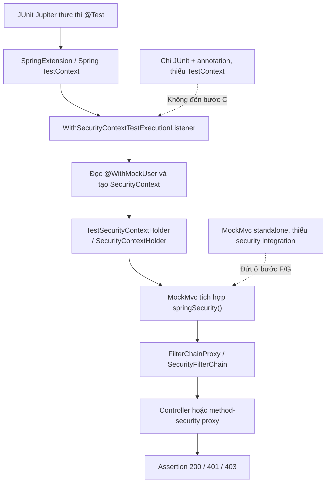
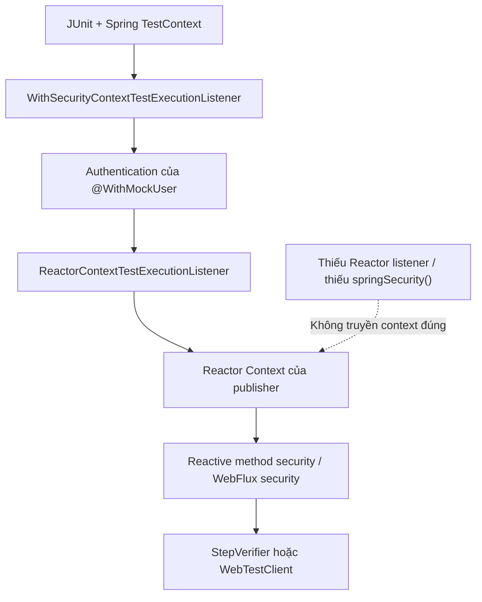
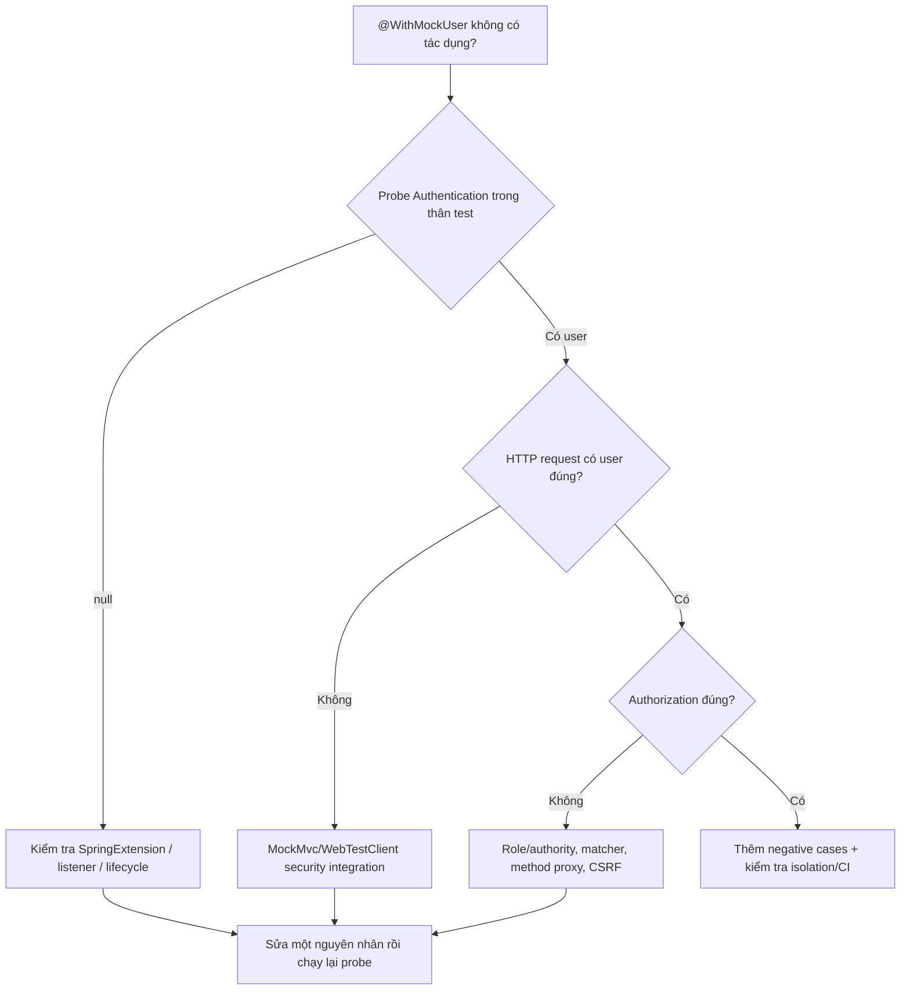

# @WithMockUser không có tác dụng vì test listener hoặc context chưa được nạp

## 1. Hiện tượng: đã khai báo @WithMockUser nhưng request vẫn bị từ chối

Bạn muốn kiểm tra endpoint `GET /api/me` chỉ dành cho người dùng đã đăng nhập. Bài test trông hợp lý:

```java
@Test
@WithMockUser(username = "alice", roles = "USER")
void meReturnsAlice() throws Exception {
    mvc.perform(get("/api/me"))
        .andExpect(status().isOk())
        .andExpect(jsonPath("$.username").value("alice"));
}
```

Tuy nhiên, một trong các triệu chứng sau xuất hiện:

- Request vẫn trả **401 Unauthorized** như anonymous.
- Request trả **403 Forbidden**, hoặc redirect **302** đến trang login thay vì 200.
- Controller đọc `Authentication` hoặc `@AuthenticationPrincipal` nhận giá trị `null`.
- Test gọi service có `@PreAuthorize` nhưng không nhận đúng Authentication, hoặc annotation không hề chặn lời gọi.
- Test WebFlux trả `Mono.empty()` khi đọc `ReactiveSecurityContextHolder.getContext()`.
- Một test hoạt động trên máy cục bộ nhưng thất bại trong CI hoặc khi chạy riêng.

Nguyên nhân có thể là **Spring TestContext/`WithSecurityContextTestExecutionListener` chưa chạy**, **hạ tầng HTTP test chưa tích hợp Spring Security**, hoặc **test đang gọi code ngoài Spring container/proxy**. Các hiện tượng trên cũng có thể bắt nguồn từ cấu hình authentication khác hoặc policy thật; không được khẳng định thiếu listener chỉ dựa vào mã trạng thái.

Đây là bài thuộc chương **Chẩn đoán sự cố** của module **SPRING_SECURITY_TESTING**. Module tập trung kiểm chứng xác thực, phân quyền và bảo vệ HTTP bằng `spring-security-test` trong Servlet/MockMvc và Reactive/WebTestClient; ngoài `@WithMockUser` còn có SecurityContext, JWT/OAuth2/OIDC giả lập và các ca được phép hoặc bị từ chối. Bài này đào sâu vào **cách làm cho test annotation thực sự tham gia vào execution context**, rồi xác nhận đúng security behavior thay vì chỉ làm test “xanh”.

Sau bài học, người học có thể:

1. Mô tả vai trò của `@WithMockUser`, `SpringExtension`, Spring TestContext và security test listener.
2. Kiểm tra xem annotation có tạo `Authentication` trong test hay chưa.
3. Gắn đúng SecurityFilterChain vào MockMvc; không nhầm `standaloneSetup` với `webAppContextSetup`.
4. Phân biệt `@SpringBootTest`, `@WebMvcTest` và việc thiếu `@AutoConfigureMockMvc`/security configuration.
5. Chẩn đoán `@PreAuthorize` không hoạt động vì thiếu `@EnableMethodSecurity` hoặc proxy.
6. Cấu hình tương ứng cho Reactive với `ReactorContextTestExecutionListener` và `WebTestClient`.
7. Xây dựng ma trận 200/401/403, log an toàn và quy trình sửa lỗi có thể lặp lại trong CI.

## 2. @WithMockUser thực chất làm gì?

`@WithMockUser` là annotation thuộc `spring-security-test`. Nó yêu cầu Spring Security Test **tạo một Authentication giả** có username và tập authorities/roles được chỉ định. Nó không tự gọi login endpoint, không xác minh mật khẩu và không phát JWT thật.

```java
import org.springframework.security.test.context.support.WithMockUser;

@Test
@WithMockUser(username = "alice", roles = {"USER", "REPORT_READER"})
void example() {
    // Cần hạ tầng Spring TestContext và security listeners.
}
```

Mặc định, với `roles = "USER"`, Authentication có authority `ROLE_USER`. Nếu security rule dùng `hasAuthority("SCOPE_reports.read")`, `@WithMockUser(roles = "USER")` **không** đáp ứng rule ấy; nên dùng `authorities = "SCOPE_reports.read"` cho kịch bản cần authority tương ứng.

### 2.1. Những điều annotation không tự làm

| Việc mong đợi | `@WithMockUser` có tự làm không? | Cần thành phần gì? |
| --- | --- | --- |
| Cung cấp username/roles cho Spring Security Test | **Có**, nếu listener chạy | Spring TestContext và `WithSecurityContextTestExecutionListener` |
| Khởi động Spring ApplicationContext | **Không** | `@SpringBootTest`, `@WebMvcTest`, `@SpringJUnitConfig`… |
| Tích hợp SecurityFilterChain vào MockMvc tùy chỉnh | **Không** | `springSecurity()` hoặc MockMvc được auto-configured đúng |
| Xác minh password với `UserDetailsService` | **Không** | HTTP Basic/form login qua authentication filter thực |
| Xác minh JWT signature/issuer/audience | **Không** | Resource server decoder và raw bearer token |
| Tạo principal kiểu `Jwt`/`OidcUser` | **Không** | `jwt()`/`mockJwt()` hoặc `oidcLogin()`/`mockOidcLogin()` |
| Kích hoạt method security proxy | **Không** | `@EnableMethodSecurity`/`@EnableReactiveMethodSecurity` và Spring bean |
| Bảo đảm request đi qua WebFilter Reactive | **Không** | `WebTestClient` và `springSecurity()` đúng stack |

Vì vậy không nên xem `@WithMockUser` như một lời gọi “đăng nhập người dùng” độc lập với Spring test infrastructure.

## 3. Đường đi từ annotation tới HTTP request

### 3.1. Trên Servlet/MockMvc



Đây là mô hình logic. `WithSecurityContextTestExecutionListener` thiết lập SecurityContext ở giai đoạn thích hợp của lifecycle test; `spring-security-test` còn cung cấp các request post-processors để tích hợp vào MockMvc. Nếu thiếu một mắt xích, annotation có thể có tác dụng **trong thân test** nhưng không truyền vào **request** được gửi qua MockMvc.

### 3.2. Trên Reactive/WebFlux



Servlet thường truy cập Authentication qua `SecurityContextHolder` trên luồng xử lý, trong khi Reactive security dùng `ReactiveSecurityContextHolder` và **Reactor Context**. Cùng một annotation nhưng hạ tầng test và điểm quan sát khác nhau.

## 4. Bước đầu tiên: có Spring TestContext hay chỉ có JUnit?

Một test sau **chưa được tích hợp Spring TestContext**, dù có dependency `spring-security-test`:

```java
import org.junit.jupiter.api.Test;
import org.springframework.security.test.context.support.WithMockUser;

class PlainJunitTest {

    @Test
    @WithMockUser(username = "alice")
    void thisAnnotationAloneDoesNotStartSpringTestContext() {
        // Không có SpringExtension/@SpringJUnitConfig/@SpringBootTest.
    }
}
```

JUnit Jupiter chỉ thấy một annotation Java; nó không tự biết phải tạo SecurityContext bằng factory của Spring Security. Để listener chạy, test phải được thực thi bởi **Spring TestContext Framework**.

Các cách phổ biến:

```java
// Spring Boot integration test:
@SpringBootTest
class FullContextTest { }

// Spring MVC slice:
@WebMvcTest(controllers = IdentityController.class)
class MvcSliceTest { }

// Spring Test không dùng Boot:
@SpringJUnitConfig(classes = MethodSecurityConfig.class)
class MethodSecurityTest { }

// Dạng khai báo tường minh:
@ExtendWith(SpringExtension.class)
@ContextConfiguration(classes = MethodSecurityConfig.class)
class AnotherMethodSecurityTest { }
```

Các annotation này **không thay thế hoàn toàn nhau**: `@WebMvcTest` chỉ nạp một test slice, `@SpringBootTest` nạp application context rộng hơn, còn `@SpringJUnitConfig` có thể dùng context tối thiểu cho service. Với Boot, `@SpringBootTest` và `@WebMvcTest` tích hợp `SpringExtension` theo cơ chế meta-annotation.

### 4.1. Đưa đúng dependency vào test classpath

Với Spring Boot 3.x:

```groovy
dependencies {
    implementation 'org.springframework.boot:spring-boot-starter-web'
    implementation 'org.springframework.boot:spring-boot-starter-security'

    testImplementation 'org.springframework.boot:spring-boot-starter-test'
    testImplementation 'org.springframework.security:spring-security-test'
}

tasks.named('test') {
    useJUnitPlatform()
}
```

`spring-boot-starter-test` cung cấp Spring Test/JUnit; `spring-security-test` cung cấp `@WithMockUser`, listener và các security test configurers. Các bản Spring Boot 4.x có cấu trúc test starter/package auto-configuration khác; dùng các dependency và import tương thích đúng BOM thay vì trộn mẫu Boot 3/4.

**Đừng suy luận “import @WithMockUser biên dịch được” nghĩa là listener đã chạy.** Một annotation có thể nằm trên classpath nhưng không có extension nào xử lý nó.

## 5. Kiểm tra WithSecurityContextTestExecutionListener có tham gia không

`WithSecurityContextTestExecutionListener` là thành phần của `spring-security-test` đọc annotation như `@WithMockUser`/`@WithUserDetails` hoặc annotation dùng `@WithSecurityContext` và tạo SecurityContext cho test.

Trong Spring TestContext thông thường, listener này có thể được đăng ký qua cơ chế tự động từ classpath. Tuy nhiên, nếu dự án tự thay danh sách listeners, vô tình bỏ listener mặc định hoặc dùng test runner/extension không đúng, annotation có thể không còn được xử lý.

### 5.1. Tình huống dễ làm mất listener

```java
@SpringJUnitConfig(classes = MethodSecurityConfig.class)
@TestExecutionListeners(
    listeners = {MyCustomTestExecutionListener.class},
    mergeMode = TestExecutionListeners.MergeMode.REPLACE_DEFAULTS)
class BrokenListenerSetup {
    // Dễ loại bỏ các listeners khác, gồm security listener cần thiết.
}
```

Khi `REPLACE_DEFAULTS` được dùng, danh sách tường minh thay thế bộ listeners mặc định; nếu không có `WithSecurityContextTestExecutionListener` trong danh sách cuối cùng, `@WithMockUser` không tạo context như mong đợi.

**Cách sửa ưu tiên:** merge listener riêng của dự án với defaults:

```java
@SpringJUnitConfig(classes = MethodSecurityConfig.class)
@TestExecutionListeners(
    listeners = {MyCustomTestExecutionListener.class},
    mergeMode = TestExecutionListeners.MergeMode.MERGE_WITH_DEFAULTS)
class FixedListenerSetup {
}
```

Nếu ứng dụng có hạ tầng đặc biệt và cần khai báo tường minh security listener:

```java
import org.springframework.security.test.context.support
    .WithSecurityContextTestExecutionListener;

@SpringJUnitConfig(classes = MethodSecurityConfig.class)
@TestExecutionListeners(
    listeners = WithSecurityContextTestExecutionListener.class,
    mergeMode = TestExecutionListeners.MergeMode.MERGE_WITH_DEFAULTS)
class ExplicitSecurityListenerTest {
}
```

Không nhất thiết copy khai báo này vào mọi class. Hãy xác định **danh sách listener thực sự hiệu lực** trước; đăng ký trùng lặp không làm bộ test an toàn hơn.

### 5.2. Một probe đơn giản để tách lỗi listener khỏi lỗi HTTP

Trong Servlet test được Spring quản lý:

```java
import static org.assertj.core.api.Assertions.assertThat;
import org.springframework.security.core.Authentication;
import org.springframework.security.core.context.SecurityContextHolder;

@Test
@WithMockUser(username = "alice", roles = "USER")
void securityContextIsPreparedForTestMethod() {
    Authentication auth =
        SecurityContextHolder.getContext().getAuthentication();

    assertThat(auth).isNotNull();
    assertThat(auth.getName()).isEqualTo("alice");
    assertThat(auth.getAuthorities())
        .extracting("authority")
        .contains("ROLE_USER");
}
```

Đây là **test chẩn đoán trong test thread**, chưa chứng minh HTTP request có user. Nếu nó thất bại, kiểm tra SpringExtension/TestContext/listener và thời điểm thiết lập context; nếu nó PASS nhưng `mvc.perform(...)` vẫn anonymous, chuyển sang kiểm tra **MockMvc setup** ở mục 7.

## 6. Thời điểm thiết lập context: setupBefore và @BeforeEach

`@WithMockUser` hỗ trợ thuộc tính `setupBefore`. Mặc định, Spring Security Test thường chuẩn bị context ở sự kiện `beforeTestMethod`, trước callback `@BeforeEach` của JUnit Jupiter.

```java
@Test
@WithMockUser(username = "alice")
void standardTiming() {
    // Context thường được thiết lập trước @BeforeEach.
}
```

Nếu thay:

```java
import org.springframework.security.test.context.support.TestExecutionEvent;

@Test
@WithMockUser(
    username = "alice",
    setupBefore = TestExecutionEvent.TEST_EXECUTION)
void laterTiming() {
    // Context được thiết lập ngay trước thân test,
    // sau khi @BeforeEach đã chạy.
}
```

thì một `@BeforeEach` đọc `SecurityContextHolder` sẽ **chưa thấy** Authentication mà annotation này sẽ tạo cho thân test. Không kết luận listener không chạy chỉ từ log của setup method.

**Cách xử lý:** nếu `@BeforeEach` thật sự cần Authentication đã được tạo, dùng timing mặc định hoặc chuyển phần kiểm tra sang thân test. Tránh tùy tiện tự thiết lập user ở `@BeforeEach` rồi ghi đè danh tính mà annotation sẽ cung cấp.

### 6.1. Trạng thái cũ cũng có thể gây hiểu nhầm

Nếu một test tự gọi `SecurityContextHolder.setContext(...)`, giữ `MockHttpSession` ở static field, hoặc reuse WebTestClient đã mutate với user khác, kết quả có thể phụ thuộc thứ tự chạy.

Tách fixture theo từng test, để Spring Security Test listeners dọn context, và chủ động cleanup mọi session/cookie/cache do test tự tạo. Đừng dùng `@TestMethodOrder` để che việc test B cần state từ test A.

## 7. Trường hợp phổ biến: @WithMockUser có tác dụng trong test nhưng không tới MockMvc

Một lỗi khác với thiếu listener: TestContext đã tạo user, nhưng MockMvc được dựng bằng hạ tầng **không gắn Spring Security**.

### 7.1. MockMvc standaloneSetup không tự nạp filter chain của ứng dụng

```java
MockMvc mvc = MockMvcBuilders
    .standaloneSetup(new IdentityController())
    .build();
```

`standaloneSetup` dùng để kiểm tra controller riêng, không tự tạo toàn bộ `WebApplicationContext` hoặc `FilterChainProxy`. Kể cả test có `@WithMockUser`, đây **chưa phải** một bài kiểm tra HTTP security có ý nghĩa. Một endpoint có thể trả 200 khi anonymous vì không có filter; hoặc controller không thấy principal đúng do setup chưa hỗ trợ các thành phần liên quan.

**Chọn đúng công cụ:** test controller thuần thì tạo principal/mock theo nhu cầu của controller, nhưng đừng tuyên bố filter chain đã chạy. Muốn kiểm chứng Spring Security, dùng WebApplicationContext và security configurer như sau.

### 7.2. Cấu hình thủ công đúng với webAppContextSetup

```java
import org.junit.jupiter.api.BeforeEach;
import org.springframework.beans.factory.annotation.Autowired;
import org.springframework.security.test.web.servlet.setup
    .SecurityMockMvcConfigurers;
import org.springframework.test.web.servlet.MockMvc;
import org.springframework.test.web.servlet.setup.MockMvcBuilders;
import org.springframework.web.context.WebApplicationContext;

class MvcSecurityTest {
    @Autowired WebApplicationContext webContext;
    MockMvc mvc;

    @BeforeEach
    void prepareMvc() {
        mvc = MockMvcBuilders
            .webAppContextSetup(webContext)
            .apply(SecurityMockMvcConfigurers.springSecurity())
            .build();
    }
}
```

Đoạn trên là **phần setup của một class Spring MVC test**, cần được đặt trong `@SpringBootTest`/`@SpringJUnitWebConfig` hoặc cấu hình TestContext có `WebApplicationContext` thật. `springSecurity()` tích hợp Spring Security test vào MockMvc, gồm filter chain và cách đưa SecurityContext do test chuẩn bị vào mock request.

Không áp dụng cùng security filter chain hai lần, chẳng hạn vừa `.apply(springSecurity())` vừa `.addFilters(springSecurityFilterChain)` với cùng instance. Điều đó có thể tạo hành vi lặp không mong muốn.

### 7.3. @AutoConfigureMockMvc và tùy chọn addFilters

Với Spring Boot, cách thường dùng là:

```java
@SpringBootTest
@AutoConfigureMockMvc
class MyHttpSecurityTest {
    @Autowired MockMvc mvc;
}
```

Bean MockMvc được Boot cấu hình theo application context. Nếu test khai báo:

```java
@AutoConfigureMockMvc(addFilters = false)
```

thì các filter đã bị loại khỏi MockMvc; đây **không phải** setup phù hợp để chứng minh HTTP security. Một test có thể trả 200 dù không có Authentication vì request không đi qua security filters. Bỏ `addFilters = false` khi cần kiểm thử bảo mật và xác minh các ca anonymous bị chặn.

Một controller được kiểm tra trực tiếp không có nghĩa custom `SecurityFilterChain` của ứng dụng đã được nạp; hãy kiểm tra từng lớp thay vì sửa annotation đến khi status mong muốn tình cờ xuất hiện.

## 8. Ví dụ Servlet tự chứa với Spring Boot Test

Để test có cơ sở rõ ràng, ví dụ sau khai báo một HTTP API và security policy. Với Spring Boot 3.x, cần starter Web, Security cùng các test dependencies như mục 4.

### 8.1. Controller

```java
import java.util.Map;
import org.springframework.security.core.Authentication;
import org.springframework.web.bind.annotation.GetMapping;
import org.springframework.web.bind.annotation.RestController;

@RestController
class IdentityController {

    @GetMapping("/api/me")
    Map<String, String> currentUser(Authentication authentication) {
        return Map.of("username", authentication.getName());
    }

    @GetMapping("/api/admin")
    String adminArea() {
        return "admin-only";
    }
}
```

### 8.2. Security configuration

```java
import org.springframework.context.annotation.Bean;
import org.springframework.context.annotation.Configuration;
import org.springframework.security.config.Customizer;
import org.springframework.security.config.annotation.web.builders.HttpSecurity;
import org.springframework.security.web.SecurityFilterChain;

@Configuration(proxyBeanMethods = false)
class DebugSecurityConfig {
    @Bean
    SecurityFilterChain chain(HttpSecurity http) throws Exception {
        return http
            .authorizeHttpRequests(auth -> auth
                .requestMatchers("/api/admin").hasRole("ADMIN")
                .requestMatchers("/api/me").authenticated()
                .anyRequest().denyAll())
            .httpBasic(Customizer.withDefaults())
            .formLogin(form -> form.disable())
            .build();
    }
}
```

Trong ví dụ, anonymous GET endpoint bảo vệ nhận 401 theo HTTP Basic entry point; user có `ROLE_USER` được gọi `/api/me` nhưng bị từ chối `/api/admin`; user có `ROLE_ADMIN` được phép.

### 8.3. Test application tối thiểu

```java
import org.springframework.boot.SpringBootConfiguration;
import org.springframework.boot.autoconfigure.EnableAutoConfiguration;
import org.springframework.context.annotation.Import;

@SpringBootConfiguration
@EnableAutoConfiguration
@Import({DebugSecurityConfig.class, IdentityController.class})
class DebugTestApplication {
}
```

### 8.4. Bộ test đối chứng

```java
import org.junit.jupiter.api.Test;
import org.springframework.beans.factory.annotation.Autowired;
import org.springframework.boot.test.autoconfigure.web.servlet
    .AutoConfigureMockMvc;
import org.springframework.boot.test.context.SpringBootTest;
import org.springframework.security.test.context.support.WithMockUser;
import org.springframework.test.web.servlet.MockMvc;

import static org.springframework.test.web.servlet.request
    .MockMvcRequestBuilders.get;
import static org.springframework.test.web.servlet.result
    .MockMvcResultMatchers.*;

@SpringBootTest(classes = DebugTestApplication.class)
@AutoConfigureMockMvc
class WithMockUserDiagnosticsTest {
    @Autowired MockMvc mvc;

    @Test
    void anonymousGets401() throws Exception {
        mvc.perform(get("/api/me"))
            .andExpect(status().isUnauthorized());
    }

    @Test
    @WithMockUser(username = "alice", roles = "USER")
    void mockAliceIsVisibleInController() throws Exception {
        mvc.perform(get("/api/me"))
            .andExpect(status().isOk())
            .andExpect(jsonPath("$.username").value("alice"));
    }

    @Test
    @WithMockUser(username = "alice", roles = "USER")
    void insufficientRoleGets403() throws Exception {
        mvc.perform(get("/api/admin"))
            .andExpect(status().isForbidden());
    }

    @Test
    @WithMockUser(username = "root", roles = "ADMIN")
    void adminGets200() throws Exception {
        mvc.perform(get("/api/admin"))
            .andExpect(status().isOk())
            .andExpect(content().string("admin-only"));
    }
}
```

Vì các test dùng GET, lỗi do CSRF không xen vào. Bộ test có **anonymous 401**, **đủ quyền 200**, **thiếu quyền 403** và **đúng danh tính trong controller**; nếu filter chain không được nạp hoặc `@WithMockUser` không truyền vào HTTP request, ít nhất một trong các ca đối chứng sẽ phát hiện.

**Chú ý:** `@WithMockUser` không gọi `UserDetailsService`, không cần đặt mật khẩu cho Alice. Để test password thật, tạo user store/password encoder test và gửi HTTP Basic/form credentials; không thay `@WithMockUser` bằng một token thật chỉ để chữa lỗi listener.

## 9. @WebMvcTest chỉ nạp slice, không phải toàn bộ ứng dụng

`@WebMvcTest` thích hợp kiểm tra controller MVC với phần hạ tầng Web MVC; có thể tự cấu hình MockMvc và security khi dependency phù hợp. Nhưng nó **không tự nạp mọi `@Configuration`/service của ứng dụng** như `@SpringBootTest`.

Ví dụ:

```java
@WebMvcTest(controllers = IdentityController.class)
@Import(DebugSecurityConfig.class)
class IdentityControllerSliceTest {
    @Autowired MockMvc mvc;

    @Test
    @WithMockUser(username = "alice")
    void userCanReadMe() throws Exception {
        mvc.perform(get("/api/me"))
            .andExpect(status().isOk());
    }
}
```

`@Import(DebugSecurityConfig.class)` yêu cầu slice nạp đúng custom security policy trong ví dụ. Nếu controller có dependency khác, dùng mock bean hoặc thêm test config phù hợp. Với các phiên bản Spring Boot khác nhau, đường import `@WebMvcTest`, `@AutoConfigureMockMvc` hoặc cơ chế mock bean có thể đổi package; dùng đúng package tương ứng.

**Một lỗi thường gặp:** trong `@WebMvcTest`, application security config bị loại khỏi slice nên framework dùng chain khác hoặc chỉ tạo default security. Người học thấy 401/403 nhưng diễn giải theo policy không hề được nạp. Hãy xác nhận **bean SecurityFilterChain nào thực sự ở trong context**.

Không import toàn bộ production config kéo theo database, Kafka và OAuth2 IdP thật chỉ để test một controller; có thể chọn test integration rộng hơn cho các trường hợp cần xác minh toàn chain.

## 10. @WithMockUser không thay cho đúng loại principal

Annotation này thường tạo principal dạng `org.springframework.security.core.userdetails.User` và Authentication dạng username/password. Nếu controller mong `Jwt`, `OidcUser` hoặc `OAuth2User` thì `@WithMockUser` không tạo đúng kiểu.

Ví dụ:

```java
@GetMapping("/api/jwt-subject")
String jwtSubject(@AuthenticationPrincipal Jwt jwt) {
    return jwt.getSubject();
}
```

Với `@WithMockUser`, tham số `Jwt` có thể là `null`, dẫn tới lỗi 500; **đó không chứng minh listener không chạy**. Spring Security test đã có user, nhưng là **sai loại principal**.

Đối với MockMvc, dùng `jwt()`:

```java
mvc.perform(get("/api/jwt-subject")
        .with(jwt().jwt(token -> token.subject("alice"))))
    .andExpect(status().isOk())
    .andExpect(content().string("alice"));
```

Đối với ứng dụng yêu cầu `OidcUser`, dùng `oidcLogin()`; đối với WebTestClient dùng `mockJwt()` hoặc `mockOidcLogin()`. Những helper này **vẫn là mock Authentication**, không chứng minh chữ ký JWT, OIDC nonce hay token exchange.

Nếu một custom method security expression đọc `authentication.details` hoặc principal domain riêng, phải cấp fixture đúng cấu trúc đó bằng `@WithSecurityContext` custom factory hoặc request post-processor phù hợp; không mong `@WithMockUser` tự dựng principal của dự án.

## 11. Listener hoạt động nhưng method security vẫn không chặn

Một trường hợp rất dễ nhầm: test có user và controller nhận đúng username, nhưng `@PreAuthorize` không hoạt động. Nguyên nhân có thể **không phải listener**, mà method-security interception chưa được bật hoặc không đi qua Spring proxy.

### 11.1. Cần bật method security

```java
import org.springframework.context.annotation.Bean;
import org.springframework.context.annotation.Configuration;
import org.springframework.security.config.annotation
    .method.configuration.EnableMethodSecurity;

@Configuration(proxyBeanMethods = false)
@EnableMethodSecurity
class MethodSecurityConfig {
    @Bean
    ReportsService reportsService() {
        return new ReportsService();
    }
}
```

Service:

```java
import org.springframework.security.access.prepost.PreAuthorize;

class ReportsService {
    @PreAuthorize("hasRole('ADMIN')")
    public String adminSummary() {
        return "classified";
    }
}
```

Test phải inject **bean được proxy**:

```java
@SpringJUnitConfig(classes = MethodSecurityConfig.class)
class ReportsServiceSecurityTest {
    @Autowired ReportsService service;

    @Test
    @WithMockUser(roles = "USER")
    void userCannotCallAdminMethod() {
        assertThatThrownBy(service::adminSummary)
            .isInstanceOf(AccessDeniedException.class);
    }

    @Test
    @WithMockUser(roles = "ADMIN")
    void adminCanCallMethod() {
        assertThat(service.adminSummary())
            .isEqualTo("classified");
    }
}
```

Nếu test gọi `new ReportsService().adminSummary()`, nó bỏ qua Spring proxy và annotation có thể không được xử lý. Tương tự, một method trong cùng class tự gọi method protected khác (**self-invocation**) có thể vượt qua proxy. Hãy kiểm tra đường gọi qua bean/interceptor, thay vì khẳng định `@WithMockUser` không có tác dụng.

### 11.2. Đừng nhầm quyền với listener

```java
@WithMockUser(roles = "ADMIN")              // ROLE_ADMIN
@WithMockUser(authorities = "SCOPE_read")    // SCOPE_read
```

Đây là **hai ví dụ annotation thay thế nhau**, không đặt chồng lên cùng method. Với role prefix mặc định, `hasRole("ADMIN")` tìm `ROLE_ADMIN`; `hasAuthority("ADMIN")` tìm chính chuỗi `ADMIN`. Khi thấy 403, xem authorities thực trong Authentication và expression hiện hành.

## 12. Bảo đảm HTTP SecurityFilterChain thực sự được áp dụng

Chỉ có user mock trong test chưa đủ. Một request phải đi qua chain được cấu hình đúng. Những lỗi thường gặp:

1. Không nạp bean `SecurityFilterChain` trong slice test.
2. Gọi `MockMvcBuilders.standaloneSetup(...)` nhưng tưởng toàn security chain đang chạy.
3. Đặt `@AutoConfigureMockMvc(addFilters = false)`.
4. Có nhiều `SecurityFilterChain` và matcher/`@Order` chọn chain khác với dự kiến.
5. `requestMatchers("/api/**").permitAll()` đặt trước rule bảo vệ cụ thể.
6. Test gọi một URI không tồn tại rồi nhầm 404 với lỗi security.
7. Một filter/custom `AuthenticationProvider` tự xóa hoặc thay Authentication mà `@WithMockUser` đã cấp.
8. Một request post-processor như `with(anonymous())` hoặc `with(authentication(...))` ghi đè danh tính annotation cho request cụ thể.

**Kiểm tra có hệ thống:** xác minh SecurityFilterChain beans và matcher, sau đó dùng request anonymous đến **endpoint tồn tại**. Nếu anonymous vẫn 200 ở một endpoint lẽ ra phải bảo vệ, đây là dấu hiệu chain/rule không có tác dụng; chưa cần sửa test listener.

### 12.1. Không lấy Spring bean filter làm bằng chứng duy nhất

`@Autowired FilterChainProxy` thành công chứng minh bean tồn tại, **không chứng minh** MockMvc hoặc request đã đi qua bean ấy. Cần một ca HTTP negative/positive theo policy, hoặc cấu hình MockMvc tường minh với `springSecurity()`.

Đối với form login, anonymous có thể nhận **302 redirect** thay vì 401; đó là behavior hợp lệ nếu entry point được cấu hình như vậy. Đối với POST, thiếu CSRF thường tạo **403** ngay cả khi người dùng có vai trò đúng. Chọn GET khi chẩn đoán ban đầu để tách yếu tố CSRF.

## 13. Reactive: ReactorContextTestExecutionListener là một mắt xích riêng

WebFlux không dùng Servlet SecurityContext theo `ThreadLocal` làm nguồn chính cho luồng Reactive. Nếu test gọi một service trả `Mono`/`Flux` có `@PreAuthorize`, Authentication phải có mặt trong **Reactor Context** của subscription.

Spring Security Test cung cấp:

```java
org.springframework.security.test.context.support
    .ReactorContextTestExecutionListener
```

Listener này phối hợp với `WithSecurityContextTestExecutionListener` để làm Authentication do test fixture tạo được sử dụng trong publisher Reactive. Nếu test custom listeners loại nó, `ReactiveSecurityContextHolder.getContext()` có thể rỗng và method security báo lỗi thiếu Authentication.

### 13.1. Cấu hình hai listener khi cần khai báo rõ

```java
import org.springframework.security.test.context.support
    .WithSecurityContextTestExecutionListener;
import org.springframework.security.test.context.support
    .ReactorContextTestExecutionListener;
import org.springframework.test.context.TestExecutionListeners;

@TestExecutionListeners(
    listeners = {
        WithSecurityContextTestExecutionListener.class,
        ReactorContextTestExecutionListener.class
    },
    mergeMode = TestExecutionListeners.MergeMode.MERGE_WITH_DEFAULTS)
class ReactiveListenerExample {
    // Dùng cùng @SpringJUnitConfig/@SpringBootTest phù hợp.
}
```

Không thêm listener Reactive vào mọi Servlet test chỉ để làm 401 hết xuất hiện. Chỉ dùng khi test thực sự có Reactive pipeline cần context tương ứng; tránh listener trùng nếu Spring Test đã đăng ký.

### 13.2. Test reactive method security bằng StepVerifier

Service:

```java
import reactor.core.publisher.Mono;
import org.springframework.security.access.prepost.PreAuthorize;
import org.springframework.security.core.context
    .ReactiveSecurityContextHolder;

class ReactiveReportService {

    @PreAuthorize("hasRole('READER')")
    public Mono<String> read() {
        return ReactiveSecurityContextHolder.getContext()
            .map(ctx -> ctx.getAuthentication().getName());
    }
}
```

Config:

```java
@Configuration(proxyBeanMethods = false)
@EnableReactiveMethodSecurity
class ReactiveMethodTestConfig {
    @Bean
    ReactiveReportService reactiveReportService() {
        return new ReactiveReportService();
    }
}
```

Test:

```java
@SpringJUnitConfig(classes = ReactiveMethodTestConfig.class)
@TestExecutionListeners(
    listeners = {
        WithSecurityContextTestExecutionListener.class,
        ReactorContextTestExecutionListener.class
    },
    mergeMode = TestExecutionListeners.MergeMode.MERGE_WITH_DEFAULTS)
class ReactiveReportServiceTest {
    @Autowired ReactiveReportService service;

    @Test
    @WithMockUser(username = "alice", roles = "READER")
    void readerGetsNameFromReactorContext() {
        StepVerifier.create(service.read())
            .expectNext("alice")
            .verifyComplete();
    }

    @Test
    @WithMockUser(username = "bob", roles = "GUEST")
    void guestIsDenied() {
        StepVerifier.create(service.read())
            .expectError(AccessDeniedException.class)
            .verify();
    }
}
```

Các đoạn này cần import Spring Test, JUnit, security classes và Reactor Test tương ứng; đây là **mẫu method-security** sử dụng bean do Spring tạo, không phải web integration test. `StepVerifier` mới kích hoạt subscription; chỉ gọi `service.read()` rồi assert `Mono` khác null chưa chứng minh `@PreAuthorize` đã chạy.

### 13.3. Gắn context thủ công để phân biệt lỗi listener

Một test Reactor riêng có thể đặt Authentication trực tiếp:

```java
Authentication alice =
    new UsernamePasswordAuthenticationToken(
        "alice", "unused",
        AuthorityUtils.createAuthorityList("ROLE_READER"));

Mono<String> name = service.read()
    .contextWrite(
        ReactiveSecurityContextHolder.withAuthentication(alice));

StepVerifier.create(name)
    .expectNext("alice")
    .verifyComplete();
```

Nếu cách này thành công nhưng `@WithMockUser` thất bại trên cùng Spring-managed service, đó là dấu hiệu **cần kiểm tra bridge qua Reactor listener/TestContext**. Nó chưa phải bằng chứng cuối cùng: vẫn phải đối chiếu lifecycle và đúng loại Authentication. Tránh để test luôn ghi context thủ công rồi tuyên bố annotation hoạt động.

## 14. WebTestClient cũng phải đi qua security WebFilters

Khi kiểm thử HTTP Reactive, client có thể được tạo từ controller riêng hoặc từ application context.

**Thiết lập có SecurityWebFilterChain:**

```java
WebTestClient client = WebTestClient
    .bindToApplicationContext(applicationContext)
    .apply(SecurityMockServerConfigurers.springSecurity())
    .configureClient()
    .build();
```

Với test đã gắn Spring TestContext và Reactive security listeners phù hợp:

```java
@Test
@WithMockUser(username = "alice", roles = "READER")
void reactiveEndpointCanReadUser() {
    client.get().uri("/api/whoami")
        .exchange()
        .expectStatus().isOk()
        .expectBody(String.class).isEqualTo("alice");
}
```

Ví dụ yêu cầu một WebFlux controller route `/api/whoami` trả tên Authentication trong Reactor Context, và `SecurityWebFilterChain` bảo vệ đúng endpoint. Nếu `bindToController(new Controller())` được dùng mà không tích hợp security filters, test đó chủ yếu kiểm tra controller, không chứng minh HTTP authorization.

Khi chỉ muốn kiểm tra identity theo **một request**, có thể dùng mutator trực tiếp:

```java
client.mutateWith(SecurityMockServerConfigurers
        .mockUser("alice").roles("READER"))
    .get().uri("/api/whoami")
    .exchange()
    .expectStatus().isOk();
```

**Phân biệt:** `mockUser()` là cách đặt user cho request mô phỏng của WebTestClient; `@WithMockUser` phụ thuộc TestContext/listener của test method. Nếu mutator chạy được nhưng annotation không chạy, hãy tìm lỗi listener hoặc cầu nối context; nếu cả hai đều thất bại, hãy xem client setup và security chain.

Với `WebTestClient.bindToServer()` kết nối tới HTTP server thật, **không thể gửi Authentication giả qua socket**. Hãy gửi Basic credentials, Bearer token, session cookie hoặc OAuth2 login flow thật tùy kiến trúc.

## 15. Chẩn đoán HTTP status đúng nguyên nhân

| Triệu chứng | Giả thuyết cần kiểm tra | Phép thử phân biệt |
| --- | --- | --- |
| `@WithMockUser` nhưng GET vẫn **401** | Listener chưa chạy; MockMvc không tích hợp; filter đã xóa Authentication | Probe SecurityContext trong thân test; thử `with(user(...))`; xem chain |
| GET được **302** đến login | Form-login entry point hoạt động, user chưa tới request | Kiểm tra `Location`, listener và MockMvc setup |
| GET trả **403** dù user có role | Sai role prefix, custom rule hoặc khác chain | In authorities an toàn và test user đủ/thiếu role trên GET |
| POST trả **403** dù đủ role | Có thể thiếu CSRF token | So sánh POST có/không `with(csrf())` cùng Authentication |
| GET anonymous trả **200** | Chain không nạp, `permitAll` hoặc test bypass filters | Đối chiếu matcher; bật filters; ca anonymous negative |
| Service với `@PreAuthorize` không bị chặn | Không bật method security, không có proxy hoặc self-invocation | Inject Spring bean, test thiếu quyền |
| Reactive `Mono` hoàn thành rỗng | Reactor Context thiếu Authentication, chưa subscribe đúng flow | StepVerifier + `ReactiveSecurityContextHolder` probe |
| HTTP trả **500** với `Jwt` principal null | User được tạo nhưng sai **principal type** | Thay `@WithMockUser` bằng `jwt()`/`mockJwt()` |
| Chạy riêng PASS, cả suite FAIL | Shared session, context, thread-local, state/cookie bị rò | Chạy ngẫu nhiên thứ tự; tạo fixture mỗi test |
| Chỉ CI FAIL | Profile/test classpath/context/versions khác | Kiểm tra dependency, test profile, setup/runner và logs |

Không suy ra duy nhất nguyên nhân từ status. **401, 403 và redirect** phụ thuộc entry point, CSRF, type of Authentication và policy thật.

## 16. Quy trình chẩn đoán 8 bước có thể lặp lại

### Bước 1 — Xác nhận annotation có nằm ở nơi test framework đọc

Đặt `@WithMockUser` trên method `@Test` hoặc trên class theo contract. Kiểm tra test chạy bằng JUnit Jupiter + `SpringExtension`/Spring TestContext, không chỉ bằng `org.junit.jupiter.api.Test` thuần.

### Bước 2 — Xác nhận dependency và listener

Kiểm tra `spring-security-test` nằm trong test classpath; xem có `@TestExecutionListeners(REPLACE_DEFAULTS)` hay listener tùy chỉnh nào vô tình loại `WithSecurityContextTestExecutionListener` không. Với Reactive, đối chiếu thêm `ReactorContextTestExecutionListener`.

### Bước 3 — Probe Authentication trong thân test

Đối với Servlet, đọc `SecurityContextHolder.getContext().getAuthentication()` trong thân test. Nếu null, ưu tiên khắc phục TestContext/listener trước khi sửa HTTP status. Nhớ xét `setupBefore = TEST_EXECUTION` nếu log trong `@BeforeEach`.

### Bước 4 — Kiểm tra đường đưa context vào request

MockMvc phải được Boot auto-configured với filters hoặc dùng `webAppContextSetup(context).apply(springSecurity())`. WebTestClient cần `bindToApplicationContext(context).apply(springSecurity())` khi kiểm tra mock WebFlux security.

### Bước 5 — Xác định chain/rule được nạp

Kiểm tra `SecurityFilterChain`/`SecurityWebFilterChain` từ application context test, các URL/method matchers, `@Order` và việc test slice có import config thật không. Không chỉ dựa vào tên file cấu hình.

### Bước 6 — Kiểm tra principal type và authorities

So sánh `ROLE_USER`, `SCOPE_...` hoặc principal domain mà controller/expression cần. Nếu cần `Jwt`/`OidcUser`, sử dụng helper phù hợp, không dùng `@WithMockUser` thay thế.

### Bước 7 — Kiểm tra behavior cả chiều cho phép và từ chối

Với một endpoint có thật, tạo ba request: anonymous, user đủ quyền, user thiếu quyền. Chọn GET để tránh nhiễu CSRF ở bước đầu. Sau đó mới kiểm tra POST/CSRF và các cơ chế login.

### Bước 8 — Kiểm tra sự cô lập khi chạy cả suite/CI

Không chia sẻ `MockHttpSession`, cookie, `SecurityContextHolder`, JWT fixture hoặc WebTestClient đã mutate giữa các test. Quan sát Spring TestContext cache khi bean có state; giữ logs an toàn, không lộ token/secret.



## 17. Bật log để quan sát mà không lộ credential

Trong **test profile** có thể điều chỉnh mức log:

```yaml
logging:
  level:
    org.springframework.security: DEBUG
    org.springframework.test.context: DEBUG
```

Các log giúp xác định security chain nào được tạo, request bị từ chối tại đâu và TestContext có được khởi tạo hay không. Khi cần trace sâu hơn, bật có chọn lọc cho logger cụ thể và tắt sau khi chẩn đoán.

**Tránh:** bật dump toàn bộ HTTP headers, raw JWT, session cookie, password, refresh token hoặc client secret vào CI logs. Với OAuth2/OIDC, các giá trị `state`, `nonce` và `Authorization` cũng có thể nhạy cảm. Log tên lớp, path đã làm sạch, authority và correlation ID an toàn sẽ hữu ích hơn.

### 17.1. So sánh kết quả theo lớp thay vì đọc stack trace một cách cảm tính

| Lớp cần xác minh | Tín hiệu |
| --- | --- |
| Spring TestContext | Bean được inject, `@SpringBootTest`/`@SpringJUnitConfig` hoạt động |
| WithSecurityContext listener | Test body thấy `Authentication.getName() == "alice"` |
| MockMvc integration | Controller request thấy đúng principal, anonymous bị chặn |
| Security chain | Rule áp dụng đúng path và HTTP method |
| Method security | Bean được proxy, `@PreAuthorize` từ chối user thiếu quyền |
| Reactor context | `StepVerifier` thấy user đúng hoặc lỗi authorization đúng |
| Giao thức thật | Basic/JWT/OIDC credential được filter/provider/decoder xác minh |

Tách các tín hiệu này giúp tránh sửa sai tầng: không cần thay JWT decoder khi vấn đề là không có TestContext; cũng không nên thêm listener để che việc security matcher đang `permitAll`.

## 18. Các tình huống nâng cao dễ gây ngộ nhận

**A. Có `@WithMockUser` nhưng custom filter thay Authentication.** Một filter đăng nhập riêng có thể tạo Authentication khác, xóa context hoặc chạy ở thứ tự khác. Kiểm tra code path và filter order; đừng cố ghi đè bằng user ở mọi request để bỏ qua logic production.

**B. Test annotation trên lớp nhưng test con ghi đè bằng annotation khác.** Spring Security Test tìm annotation theo quy tắc meta-annotation và cấu hình hiện hành. Kiểm tra annotation ở class/method và custom `@WithSecurityContext`; tránh giữ các fixture mâu thuẫn trong cùng test.

**C. Một `@MockBean`/`@MockitoBean` thay nhầm SecurityFilterChain, AuthenticationProvider hoặc service bảo mật.** Context có thể nạp một mock không đúng đường production. Kiểm tra bean definitions và mục tiêu test; không mock thành phần đang cần xác minh.

**D. `@Async`/executor tự tạo thread mới.** Với ThreadLocal-based SecurityContext, danh tính không tự truyền sang thread khác. Trường hợp cần propagating security context, cấu hình `DelegatingSecurityContextExecutor` hoặc giải pháp phù hợp; test listener không tự bảo đảm mọi thread nhận cùng Authentication.

**E. Code Reactive tạo subscription ngoài luồng.** Gọi `subscribe()` thủ công hoặc tự xây callback chain mới có thể làm mất Reactor Context mong đợi. Dùng reactive composition và `StepVerifier` thay vì dựa vào ThreadLocal.

**F. Request khác session.** MockMvc `with(user(...))` là request-scoped fixture; không tự chứng minh form login đã tạo session. Request tiếp theo không có fixture hoặc session/cookie phù hợp có thể là anonymous.

**G. Một ca 200 không đủ.** Nếu MockMvc không gắn filters, endpoint có thể cho phép tất cả. Bắt buộc thêm negative case anonymous và role không đủ.

**H. Maven/Gradle chạy khác IDE.** Đảm bảo cùng JUnit Platform, dependency versions và test profile. Không kết luận test đúng chỉ vì IDE riêng chạy thành công với context được cache từ lần trước.

**I. Đổi `@WithMockUser` thành `with(user())` làm test PASS.** Đây là tín hiệu chẩn đoán: request post-processor gắn Authentication trực tiếp, trong khi listener hoặc propagation của annotation có thể có vấn đề. Nó **không phải** giải pháp che giấu nguyên nhân nếu yêu cầu là kiểm tra annotation và lifecycle.

## 19. Ma trận bài tập chẩn đoán

| Bài thử | Điều cố ý làm | Kết quả cần quan sát | Cách sửa |
| --- | --- | --- | --- |
| JUnit thuần | Chỉ có `@Test + @WithMockUser` | Không tự có Spring Test security context | Thêm Spring TestContext phù hợp |
| Listener bị thay | `REPLACE_DEFAULTS` không có security listener | Annotation không tạo Authentication | Merge defaults hoặc đăng ký listener đúng |
| Timing | `setupBefore=TEST_EXECUTION` và đọc ở `@BeforeEach` | Setup chưa thấy user; thân test thấy | Dùng timing thích hợp |
| MockMvc standalone | Không nạp Spring Security | HTTP test không chứng minh chain | Dùng context setup và `springSecurity()` |
| MockMvc addFilters=false | Tắt filters trong HTTP test | Anonymous có thể đi vào controller | Bật filters |
| MVC slice thiếu config | `@WebMvcTest` không import custom chain | Policy khác mong đợi | Import config/mở rộng context |
| Principal sai loại | `@WithMockUser` cho endpoint cần `Jwt` | Principal null/sai kiểu | Dùng `jwt()` hoặc token thật |
| Sai role | `roles="USER"` cho rule `SCOPE_read` | 403 hợp lệ | Dùng authorities đúng |
| Method không proxy | `new Service()` + `@PreAuthorize` | Không bị chặn | Inject Spring bean + bật method security |
| Reactive thiếu bridge | Test Mono chỉ có Servlet-style context | Publisher không thấy auth | Reactor listener/contextWrite đúng |
| Reactive client thiếu chain | `bindToController` thuần | Không kiểm chứng HTTP security | `bindToApplicationContext(...).apply(springSecurity())` |
| CI lộ state | Reuse session/cookie/context | Pass/FAIL phụ thuộc thứ tự | Fixture per-test + cleanup |

### 19.1. Bài 1 — Reproduce và sửa lỗi listener

Tạo một JUnit test có `@WithMockUser` nhưng không có SpringExtension, sau đó thêm `@SpringJUnitConfig` với một test configuration tối thiểu. Viết probe đọc `SecurityContextHolder`. Dùng `@TestExecutionListeners(REPLACE_DEFAULTS)` để quan sát lỗi và khôi phục bằng `MERGE_WITH_DEFAULTS`.

### 19.2. Bài 2 — HTTP MockMvc

Dựng `IdentityController` và `DebugSecurityConfig` theo mục 8. Viết một test MockMvc standalone rồi chuyển sang `@SpringBootTest + @AutoConfigureMockMvc`. Đảm bảo ca anonymous 401, user thường 200 ở `/api/me` và 403 tại `/api/admin`, admin 200.

### 19.3. Bài 3 — Test slice và config

Chạy `@WebMvcTest` trên controller có custom security. Kiểm tra khi chưa import `DebugSecurityConfig` và sau khi import. Ghi lại chính bean/rule được nạp; không chấp nhận chỉ dựa vào mã 401/403.

### 19.4. Bài 4 — Method security proxy

Viết service có `@PreAuthorize("hasRole('ADMIN')")`; tạo test vừa gọi raw instance vừa gọi bean từ Spring context. Chỉ bean đã proxy mới phản ánh đầy đủ method security; dùng negative case để chứng minh.

### 19.5. Bài 5 — Reactive context

Tạo Reactive service `Mono<String>` có `@PreAuthorize` và `ReactiveSecurityContextHolder.getContext()`. Kiểm tra `@WithMockUser` với hai listeners, `StepVerifier` cho allowed/denied và đối chiếu với `contextWrite(withAuthentication(...))`.

### 19.6. Bài 6 — Sai principal type

Viết controller nhận `@AuthenticationPrincipal Jwt`. Thử `@WithMockUser` rồi `jwt()`. Phân biệt “listener không hoạt động” với “listener đã tạo Authentication nhưng principal không phải Jwt”.

### 19.7. Bài 7 — CI và cô lập test

Chạy test riêng, chạy toàn class, sau đó chạy theo thứ tự thay đổi. Loại bỏ shared `MockHttpSession`, static SecurityContext, WebTestClient mutated và bộ dữ liệu giả từ test trước. Ghi rõ bước nào cần Spring TestContext và bước nào cần security filter chain.

## 20. Checklist kết thúc và nguyên tắc rút ra

Trước khi tuyên bố đã sửa được lỗi `@WithMockUser`, xác minh tất cả tiêu chí phù hợp:

- Test có Spring TestContext (`SpringExtension`/annotation tương đương) và `spring-security-test`.
- `WithSecurityContextTestExecutionListener` thực sự tham gia; listener custom không vô tình thay defaults.
- Thời điểm `setupBefore` tương thích với nơi đang đọc context.
- Servlet test đọc thấy Authentication trong thân test, **và** request MockMvc nhìn thấy user đó.
- MockMvc có `SecurityFilterChain`/`springSecurity()` đúng; không dùng `addFilters=false` khi test security.
- Test slice nạp đúng custom policy, không chỉ default filter chain.
- Đường dẫn/method được bảo vệ thực; có ca anonymous bị từ chối, ca đủ quyền được phép và ca thiếu quyền bị chặn.
- Nếu dùng `@PreAuthorize`, service là bean/proxy với method security được bật.
- Nếu dùng WebFlux, Reactor Context và `ReactorContextTestExecutionListener`/`WebTestClient` được thiết lập đúng.
- Nếu cần `Jwt`/`OidcUser`, chọn fixture principal đúng loại; không nhầm với password/user mock.
- Không dùng kết quả mock để khẳng định password, JWT signature hay OAuth2/OIDC protocol đã được xác minh.
- Fixture, session và context không bị trộn giữa các test/CI jobs.

**Kết luận:** `@WithMockUser` chỉ là một mô tả fixture. Để nó tạo hiệu quả, Spring TestContext phải đọc annotation qua security listener, rồi hạ tầng test phải chuyển Authentication vào đúng **Servlet request**, **Spring method-security proxy** hoặc **Reactive publisher**. Sửa đúng mắt xích bị thiếu và giữ các ca negative đối chứng sẽ đáng tin cậy hơn việc thay đổi status assertion hay cấp quyền rộng để test đỗ.

## 21. Tài liệu tham khảo

- [Spring Security — Testing Method Security](https://docs.spring.io/spring-security/reference/servlet/test/method.html): `@WithMockUser`, `WithSecurityContextTestExecutionListener`, `setupBefore` và custom fixtures.
- [Spring Security — MockMvc Setup](https://docs.spring.io/spring-security/reference/servlet/test/mockmvc/setup.html): `MockMvcBuilders.webAppContextSetup` và `springSecurity()`.
- [Spring Security — MockMvc RequestPostProcessors](https://docs.spring.io/spring-security/reference/servlet/test/mockmvc/authentication.html): `with(user())` và mô phỏng Authentication.
- [Spring Security — Reactive Method Security Testing](https://docs.spring.io/spring-security/reference/reactive/test/method.html): `@WithMockUser`, `ReactorContextTestExecutionListener` và `StepVerifier`.
- [Spring Security — WebTestClient Setup](https://docs.spring.io/spring-security/reference/reactive/test/web/setup.html): tích hợp `SecurityWebFilterChain` vào WebTestClient.
- [Spring Security — Reactive Authentication Testing](https://docs.spring.io/spring-security/reference/reactive/test/web/authentication.html): `mockUser()` trên WebTestClient.
- [Spring Security — Testing OAuth2 (MockMvc)](https://docs.spring.io/spring-security/reference/servlet/test/mockmvc/oauth2.html): `jwt()`, `oauth2Login()` và `oidcLogin()`.
- [Spring Security — Reactive OAuth2 Testing](https://docs.spring.io/spring-security/reference/reactive/test/web/oauth2.html): `mockJwt()`, `mockOidcLogin()`.
- [Spring Security — Enable Method Security](https://docs.spring.io/spring-security/reference/servlet/authorization/method-security.html): `@EnableMethodSecurity` và proxy interception.
- [Spring Security — Reactive Method Security](https://docs.spring.io/spring-security/reference/reactive/authorization/method.html): `@EnableReactiveMethodSecurity` và Reactor Context.
- [Spring Framework — TestContext Framework](https://docs.spring.io/spring-framework/reference/testing/testcontext-framework.html): TestContext, `SpringExtension` và listener lifecycle.
- [Spring Framework — TestExecutionListeners](https://docs.spring.io/spring-framework/reference/testing/testcontext-framework/tel-config.html): merge mặc định và đăng ký custom listeners.
- [Spring Boot — Testing Spring Boot Applications](https://docs.spring.io/spring-boot/reference/testing/spring-boot-applications.html): `@SpringBootTest`, `@WebMvcTest`, `@AutoConfigureMockMvc` và test slices.
