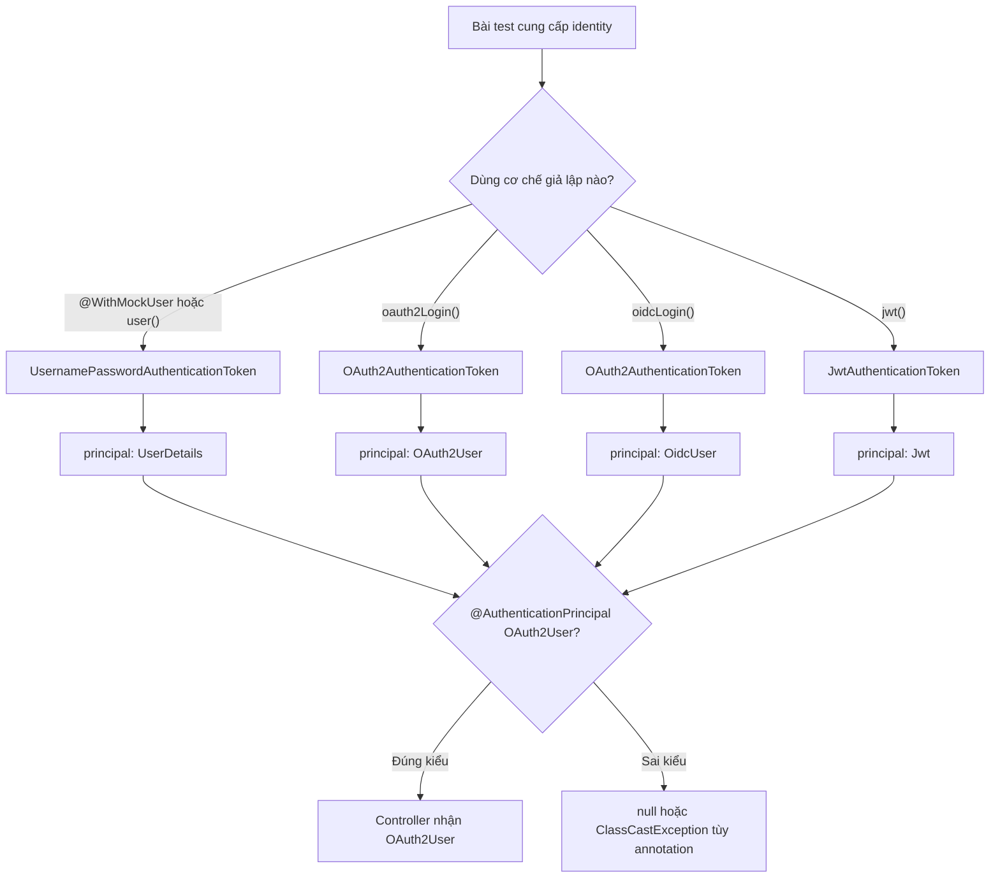
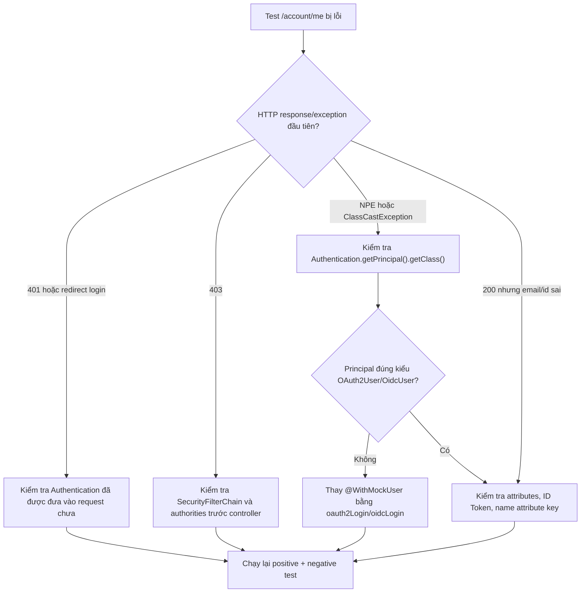

# Principal sai kiểu khi dùng người dùng thông thường cho controller OAuth2

Một bài test Spring Security có thể xác thực thành công nhưng vẫn thất bại khi controller nhận principal. Ví dụ, test gắn `@WithMockUser(username = "alice")` rồi gọi endpoint khai báo `@AuthenticationPrincipal OAuth2User user`. Test có một `Authentication` hợp lệ, nhưng principal thực tế là `org.springframework.security.core.userdetails.User` (một `UserDetails`), **không phải `OAuth2User`**. Vì thế Spring MVC không thể đưa đối tượng đó vào tham số đúng kiểu. Kết quả có thể là tham số `null`, lỗi `NullPointerException` khi controller truy cập attributes, hoặc `ClassCastException` nếu bật kiểm tra kiểu nghiêm ngặt.

Bài thuộc chương **Chẩn đoán sự cố** của module `SPRING_SECURITY_TESTING`, chuyên kiểm chứng xác thực, phân quyền và bảo vệ HTTP thực tế bằng `spring-security-test` trên Servlet và Reactive. Ta sẽ tìm nguyên nhân lỗi principal bằng `MockMvc`, `@WithMockUser`, `SecurityContext` và các post-processor `oauth2Login()`/`oidcLogin()`; tiếp đó đối chiếu với `jwt()`, `WebTestClient`, `mockOAuth2Login()` và `mockOidcLogin()`. Mục tiêu là xác định **đúng loại Authentication, đúng principal và đúng phạm vi kiểm thử**, thay vì thay đổi assertion để che lỗi.

> **Quy tắc xử lý:** Controller nhận `OAuth2User` thì giả lập **OAuth2 login principal**; controller nhận `OidcUser` thì giả lập **OIDC login principal**. `@WithMockUser` và `user()` chỉ cung cấp người dùng thông thường, dù bạn đặt bao nhiêu role hoặc authority đi nữa.

## 1. Triệu chứng: đã đăng nhập nhưng principal vẫn sai

Giả sử controller:

```java
import org.springframework.security.core.annotation.AuthenticationPrincipal;
import org.springframework.security.oauth2.core.user.OAuth2User;
import org.springframework.web.bind.annotation.GetMapping;
import org.springframework.web.bind.annotation.RestController;

@RestController
class AccountController {
    @GetMapping("/account/me")
    String me(@AuthenticationPrincipal OAuth2User user) {
        return user.getAttribute("email");
    }
}
```

Bài test có vẻ hợp lý:

```java
import org.junit.jupiter.api.Test;
import org.springframework.security.test.context.support.WithMockUser;

@Test
@WithMockUser(username = "alice", roles = "USER")
void accountProfile_canReadEmail() throws Exception {
    mockMvc.perform(get("/account/me"))
            .andExpect(status().isOk());
}
```

Nhưng nếu request đã đi đến controller, tham số `user` có thể là `null` bởi `@AuthenticationPrincipal` mặc định bỏ qua principal không cùng kiểu. Lời gọi `user.getAttribute("email")` sau đó gây `NullPointerException`. Đây **không nhất thiết là lỗi người dùng chưa đăng nhập**: Spring Security có thể đã xác thực user test, nhưng *kiểu principal* không đúng hợp đồng controller.

Một số biến thể hay gặp:

| Triệu chứng | Nguyên nhân có khả năng |
|---|---|
| `user == null` dù `Authentication.isAuthenticated() == true` | Principal từ `@WithMockUser` là `UserDetails`, không phải `OAuth2User`. |
| `NullPointerException` tại `user.getAttributes()` | Resolver trả `null` do không khớp kiểu, controller dereference ngay. |
| `ClassCastException` trong quá trình resolve argument | Controller đặt `@AuthenticationPrincipal(errorOnInvalidType = true)` và principal thực tế sai kiểu. |
| HTTP 403 trước khi vào controller | Security filter/method security từ chối authority; chưa đủ bằng chứng về principal mismatch. |
| HTTP 401 hoặc 302 tới login | Request chưa xác thực theo entry point; cần sửa authentication trước khi xét principal type. |
| `principal.getAttribute("email") == null` | Đã đúng kiểu `OAuth2User` nhưng attribute `email` chưa được mock hoặc provider không cấp claim đó. |
| `OidcUser` null khi dùng `oauth2Login()` | Chỉ mock OAuth2User thường, trong khi controller yêu cầu OIDC principal. |
| `Jwt` null khi dùng `oidcLogin()` | Controller đang mong Access Token JWT của Resource Server, không phải principal OIDC login. |

**Đừng sửa thành `Object principal` hoặc ép kiểu thủ công để test xanh.** Việc đó có thể bỏ qua hợp đồng type của controller và khiến sai lệch giữa login mechanism production với test tồn tại lâu hơn.

## 2. Ba lớp cần phân biệt: Authentication, principal và authorities

Trong Spring Security:

- `SecurityContext` chứa `Authentication` của request.
- `Authentication.getPrincipal()` trả đối tượng đại diện cho người dùng/token. Kiểu đối tượng phụ thuộc **cơ chế xác thực**.
- `Authentication.getAuthorities()` chứa authorities dùng cho `hasRole`/`hasAuthority`; nó **không tự thay đổi kiểu principal**.
- `@AuthenticationPrincipal` cố lấy `Authentication.getPrincipal()` và đưa vào tham số controller. Nó **không tạo OAuth2User từ username**.



Ma trận quy chiếu trong **Spring Security Test cho Servlet/MockMvc**:

| Test helper | Authentication điển hình | Principal thực tế | Endpoint phù hợp |
|---|---|---|---|
| `@WithMockUser` | `UsernamePasswordAuthenticationToken` | `UserDetails`, thường là `User` | `@AuthenticationPrincipal UserDetails` hoặc kiểm tra role/authority chung. |
| `.with(user("alice"))` | `UsernamePasswordAuthenticationToken` | `UserDetails` | Test Servlet authenticated user thông thường. |
| `.with(oauth2Login())` | `OAuth2AuthenticationToken` | `OAuth2User` | `@AuthenticationPrincipal OAuth2User`. |
| `.with(oidcLogin())` | `OAuth2AuthenticationToken` | `OidcUser`, cũng là `OAuth2User` | `@AuthenticationPrincipal OidcUser` hoặc `OAuth2User`. |
| `.with(jwt())` | `JwtAuthenticationToken` | `Jwt` | `@AuthenticationPrincipal Jwt`, resource server. |
| `.with(authentication(custom))` | Theo Authentication do test tạo | Theo `custom.getPrincipal()` | Chỉ phù hợp nếu tự xây đúng Authentication/principal contract. |

**Tính kế thừa quan trọng:** `OidcUser extends OAuth2User`. Vì vậy endpoint nhận `OAuth2User` thường nhận được principal từ `oidcLogin()`. Chiều ngược lại **không đúng**: một `DefaultOAuth2User` thường không phải `OidcUser` và không có ID Token.

### Role đúng không đồng nghĩa principal đúng

Một lời gọi như:

```java
mockMvc.perform(get("/account/me")
        .with(user("alice")
                .authorities(
                        new SimpleGrantedAuthority("PROFILE_READ"))));
```

có thể vượt qua `hasAuthority("PROFILE_READ")` của HTTP filter, nhưng `@AuthenticationPrincipal OAuth2User` vẫn sai kiểu. **Authorization** và **principal resolution** là hai bước riêng. HTTP 403 thường báo chưa vượt qua authorization; lỗi cast/null sau đó báo đã đi tới MVC controller nhưng principal không tương thích.

## 3. @AuthenticationPrincipal xử lý kiểu sai như thế nào?

Trong Spring MVC, `AuthenticationPrincipalArgumentResolver` đọc principal từ `Authentication` do `SecurityContextHolder` cung cấp. Với annotation:

```java
@GetMapping("/account/me")
String me(@AuthenticationPrincipal OAuth2User user) {
    // ...
}
```

Khi kiểu thực tế không gán được cho `OAuth2User`, mặc định `errorOnInvalidType=false` khiến resolver **trả `null`**. Điều này giải thích vì sao NPE trong controller có thể che đi lỗi nguyên nhân.

Để chẩn đoán rõ hơn, có thể bật:

```java
@GetMapping("/account/me")
String me(
        @AuthenticationPrincipal(errorOnInvalidType = true)
        OAuth2User user) {
    return user.getAttribute("email");
}
```

Với người dùng thông thường, resolver sẽ ném `ClassCastException` do principal không thuộc kiểu yêu cầu. Điều này giúp phát hiện **test setup sai** sớm hơn, nhưng cần xử lý lỗi có chủ đích nếu endpoint production chấp nhận nhiều cơ chế xác thực. Đừng biến lỗi lập trình này thành lời giải thích “client gửi token sai” nếu request đã được authentication filter chấp nhận.

Một cách khác là nhận `Authentication`:

```java
@GetMapping("/account/authentication-kind")
String authenticationKind(Authentication authentication) {
    return authentication.getClass().getSimpleName()
            + "/" + authentication.getPrincipal()
                    .getClass().getSimpleName();
}
```

Đoạn này hữu ích ở **controller chẩn đoán chỉ có trong test**, không nên vô tình công bố endpoint cho phép người ngoài dò cấu hình xác thực production. Khi không muốn thêm endpoint, đặt breakpoint hoặc quan sát `SecurityContextHolder.getContext().getAuthentication()` ngay trong test/handler phù hợp.

### Authentication không giống @AuthenticationPrincipal

Tham số `Authentication authentication` trong Spring MVC cho bạn **đối tượng Authentication**, còn `@AuthenticationPrincipal OAuth2User` lấy **authentication.getPrincipal()**. Vì thế một endpoint kiểm tra `authentication.getName()` có thể hoạt động với `@WithMockUser`, trong khi endpoint khác truy cập `user.getAttributes()` lại lỗi. Không dùng việc `authentication.getName()` có giá trị để suy ra principal chắc chắn là OAuth2/OIDC.

## 4. Tự chứng minh @WithMockUser tạo kiểu principal nào

Trước khi sửa controller hay test post-processor, có thể xác minh bằng một test nhỏ:

```java
import org.junit.jupiter.api.Test;
import org.springframework.security.core.context.SecurityContextHolder;
import org.springframework.security.core.userdetails.UserDetails;
import org.springframework.security.oauth2.core.user.OAuth2User;
import org.springframework.security.test.context.support.WithMockUser;

import static org.assertj.core.api.Assertions.assertThat;

@Test
@WithMockUser(username = "alice", authorities = "PROFILE_READ")
void withMockUserProvidesUserDetails_notOAuth2User() {
    var authentication = SecurityContextHolder.getContext()
            .getAuthentication();
    Object principal = authentication.getPrincipal();

    assertThat(authentication.isAuthenticated()).isTrue();
    assertThat(authentication.getName()).isEqualTo("alice");
    assertThat(principal).isInstanceOf(UserDetails.class);
    assertThat(principal).isNotInstanceOf(OAuth2User.class);
}
```

Đây là method **bên trong Spring TestContext/JUnit test class** có tích hợp `spring-security-test`. `@WithMockUser` cần `WithSecurityContextTestExecutionListener` phù hợp; với Spring Boot Test thông thường listener được tích hợp sẵn. Không chạy đoạn method như một class Java standalone chưa có test configuration.

Tương tự, `SecurityMockMvcRequestPostProcessors.user()` gắn user thường vào request Servlet, không tạo `OAuth2AuthenticationToken`. Tăng quyền:

```java
.with(user("alice").roles("USER", "ADMIN"))
```

vẫn không biến principal thành `OAuth2User`. Nếu controller yêu cầu claim `email`, `sub` hoặc `attributes` từ OAuth2 provider, chuyển sang test helper cho **đúng cơ chế** thay vì thêm roles.

## 5. Ví dụ controller rõ ràng về OAuth2 và OIDC

Ta xây dựng hai endpoint với hợp đồng riêng:

- `GET /account/me`: nhận `OAuth2User`, trả ID và email đã được giả lập hoặc cung cấp từ provider.
- `GET /account/oidc`: yêu cầu `OidcUser`, truy cập claim và ID Token đặc thù OIDC.

```java
import org.springframework.security.core.Authentication;
import org.springframework.security.core.annotation.AuthenticationPrincipal;
import org.springframework.security.oauth2.core.oidc.user.OidcUser;
import org.springframework.security.oauth2.core.user.OAuth2User;
import org.springframework.web.bind.annotation.GetMapping;
import org.springframework.web.bind.annotation.RestController;

record ProfileResponse(String id, String email, String authType) {}
record OidcProfileResponse(String subject, String email) {}

@RestController
class ProfileController {
    @GetMapping("/account/me")
    ProfileResponse me(
            @AuthenticationPrincipal(errorOnInvalidType = true)
            OAuth2User user,
            Authentication authentication) {
        return new ProfileResponse(
                user.getName(),
                user.getAttribute("email"),
                authentication.getClass().getSimpleName());
    }

    @GetMapping("/account/oidc")
    OidcProfileResponse oidc(
            @AuthenticationPrincipal(errorOnInvalidType = true)
            OidcUser user) {
        return new OidcProfileResponse(
                user.getSubject(),
                user.getEmail());
    }
}
```

Hai phương thức cố ý dùng `errorOnInvalidType=true` để sai kiểu hiển thị rõ. Với hệ thống thực tế, hãy bảo đảm authentication policy tương ứng: một endpoint yêu cầu OIDC principal không nên được phép chỉ bằng UsernamePasswordAuthenticationToken nếu controller không có nhánh xử lý riêng.

### HTTP authorization độc lập với kiểu principal

Ví dụ bảo vệ cả hai endpoint bằng authority `PROFILE_READ`:

```java
import org.springframework.context.annotation.Bean;
import org.springframework.context.annotation.Configuration;
import org.springframework.security.config.Customizer;
import org.springframework.security.config.annotation.web.builders.HttpSecurity;
import org.springframework.security.web.SecurityFilterChain;

@Configuration
class ProfileHttpSecurity {
    @Bean
    SecurityFilterChain profileChain(HttpSecurity http)
            throws Exception {
        return http
                .authorizeHttpRequests(auth -> auth
                        .requestMatchers("/account/me", "/account/oidc")
                            .hasAuthority("PROFILE_READ")
                        .anyRequest().denyAll())
                .httpBasic(Customizer.withDefaults())
                .build();
    }
}
```

Config này chọn HTTP Basic làm **entry point** để request anonymous nhận 401 trong ví dụ. Nó **không** bật OAuth2 login redirect thật: các bài test ở mục tiếp theo dùng `oauth2Login()`/`oidcLogin()` để mô phỏng trạng thái **sau khi login đã thành công**. Production muốn có login OAuth2/OIDC tương tác cần cấu hình `oauth2Login()`, `ClientRegistrationRepository` và các thành phần liên quan; không lấy một bài test sau-login để kết luận đã kiểm tra redirect/callback/token exchange.

## 6. MockMvc đúng cách: oauth2Login() tạo OAuth2User

`SecurityMockMvcRequestPostProcessors.oauth2Login()` của `spring-security-test` tạo một `OAuth2AuthenticationToken` có principal `OAuth2User` cho request. Nếu controller phụ thuộc `getAttributes()`, hãy cấp dữ liệu giống hợp đồng provider đang dùng và quyền cần thiết.

### 6.1. Dựng principal với DefaultOAuth2User

```java
import java.util.List;
import java.util.Map;
import org.springframework.security.core.authority.SimpleGrantedAuthority;
import org.springframework.security.oauth2.core.user.DefaultOAuth2User;
import org.springframework.security.oauth2.core.user.OAuth2User;

static OAuth2User profileUser(
        String id,
        String email,
        String authority) {
    return new DefaultOAuth2User(
            List.of(new SimpleGrantedAuthority(authority)),
            Map.of("id", id, "email", email),
            "id");
}
```

Tham số `"id"` cuối cùng là **name attribute key**: `getName()` lấy giá trị từ `attributes["id"]`. Với provider khác, tên có thể là `sub`, `login` hoặc key đã được chuẩn hóa trong custom `OAuth2UserService`. Nếu principal mock không có name key đó, việc xây dựng `DefaultOAuth2User` hoặc gọi `getName()` có thể thất bại. Không dùng chung một key theo suy đoán cho tất cả provider.

### 6.2. Test đầy đủ các nhánh 200/403/401

Ví dụ dưới đây giả định Spring Boot application đang quét `ProfileController` và `ProfileHttpSecurity` ở mục 5, cùng dependency `spring-boot-starter-web`, `spring-boot-starter-security`, `spring-security-oauth2-client`, `spring-boot-starter-test` và `spring-security-test`.

```java
import org.junit.jupiter.api.Test;
import org.springframework.beans.factory.annotation.Autowired;
import org.springframework.boot.test.autoconfigure.web.servlet.AutoConfigureMockMvc;
import org.springframework.boot.test.context.SpringBootTest;
import org.springframework.test.web.servlet.MockMvc;

import static org.springframework.security.test.web.servlet.request
        .SecurityMockMvcRequestPostProcessors.oauth2Login;
import static org.springframework.test.web.servlet.request.MockMvcRequestBuilders.get;
import static org.springframework.test.web.servlet.result.MockMvcResultMatchers.*;

@SpringBootTest
@AutoConfigureMockMvc
class OAuth2ProfileMvcTest {
    @Autowired
    MockMvc mvc;

    @Test
    void oauth2UserWithReadAuthority_isResolvedByController()
            throws Exception {
        mvc.perform(get("/account/me")
                        .with(oauth2Login()
                                .oauth2User(profileUser(
                                        "provider-user-42",
                                        "alice@example.test",
                                        "PROFILE_READ"))))
                .andExpect(status().isOk())
                .andExpect(jsonPath("$.id")
                        .value("provider-user-42"))
                .andExpect(jsonPath("$.email")
                        .value("alice@example.test"))
                .andExpect(jsonPath("$.authType")
                        .value("OAuth2AuthenticationToken"));
    }

    @Test
    void oauth2PrincipalWithoutReadAuthority_isForbidden()
            throws Exception {
        mvc.perform(get("/account/me")
                        .with(oauth2Login()
                                .oauth2User(profileUser(
                                        "provider-user-42",
                                        "alice@example.test",
                                        "PROFILE_WRITE"))))
                .andExpect(status().isForbidden());
    }

    @Test
    void anonymousRequest_doesNotReachProtectedController()
            throws Exception {
        mvc.perform(get("/account/me"))
                .andExpect(status().isUnauthorized());
    }
}
```

Hàm `profileUser(...)` ở mục 6.1 cần được đặt **trong test class** hoặc utility test được import phù hợp. Test sử dụng `@SpringBootTest` và `@AutoConfigureMockMvc` để chạy với `SecurityFilterChain` thật, không dùng `MockMvcBuilders.standaloneSetup(...)` thiếu filter chain rồi kết luận authorization đúng.

**Ba kết quả nói lên ba điều khác nhau:**

1. **200:** `PROFILE_READ` đủ, `OAuth2User` đúng kiểu, name attribute và email được controller đọc thành công.
2. **403:** test vẫn dùng **đúng kiểu OAuth2 principal**, nhưng thiếu authority. Điều này cô lập vấn đề authorization khỏi lỗi principal type.
3. **401:** không có Authentication khi HTTP Basic entry point yêu cầu đăng nhập, nên controller không được gọi.

Các mã 401/403 phụ thuộc chính sách filter chain hiện hành. Với form login, anonymous thường nhận 302 tới trang login; với custom entry point, mã có thể khác. Quan trọng là không đánh đồng kết quả 403 với `@AuthenticationPrincipal` trả null.

### 6.3. Dùng oauth2Login().attributes() khi chỉ cần thay claims

Trong trường hợp không cần tùy chỉnh toàn bộ `OAuth2User`, Spring Security Test hỗ trợ cấu hình thuộc tính mặc định:

```java
mvc.perform(get("/account/me")
        .with(oauth2Login()
                .attributes(attributes -> {
                    attributes.put("id", "provider-user-42");
                    attributes.put("email", "alice@example.test");
                })));
```

Đoạn này minh họa cách chỉnh **attributes**. Để test `/account/me` trong cấu hình mục 5, còn phải cung cấp authority `PROFILE_READ` tương ứng, chẳng hạn qua `.authorities(...)` của OAuth2 login post-processor hoặc custom OAuth2User như ví dụ đầy đủ ở trên. Nếu default name attribute key của post-processor khác `id`, `getName()` có thể không trả `provider-user-42`; khi cần assert identity chính xác, custom `DefaultOAuth2User` với key tường minh là rõ ràng hơn.

Đừng chỉ thêm claim `email` rồi gọi test thành công nếu endpoint đang cần kiểm tra **ID thực của provider**. `getName()`, `getAttribute("sub")` và `getAttribute("email")` có ngữ nghĩa khác nhau; lựa chọn phải theo mapping thật của ứng dụng.

## 7. OIDC: dùng oidcLogin() khi controller đòi OidcUser

OIDC là tầng nhận diện người dùng trên OAuth2. `OidcUser` bổ sung ID Token cùng các claim OIDC tiêu chuẩn như `sub`, `email`. Một principal `DefaultOAuth2User` thông thường không chứa ID Token và không thể ép thành `OidcUser`.

Với endpoint:

```java
@GetMapping("/account/oidc")
OidcProfileResponse oidc(
        @AuthenticationPrincipal(errorOnInvalidType = true)
        OidcUser user) {
    return new OidcProfileResponse(
            user.getSubject(),
            user.getEmail());
}
```

Hãy dùng `SecurityMockMvcRequestPostProcessors.oidcLogin()`:

```java
import org.junit.jupiter.api.Test;
import org.springframework.security.core.authority.SimpleGrantedAuthority;

import static org.springframework.security.test.web.servlet.request
        .SecurityMockMvcRequestPostProcessors.oidcLogin;
import static org.springframework.test.web.servlet.request.MockMvcRequestBuilders.get;
import static org.springframework.test.web.servlet.result.MockMvcResultMatchers.*;

@Test
void oidcLoginExposesOidcPrincipalAndIdTokenClaims()
        throws Exception {
    mvc.perform(get("/account/oidc")
                    .with(oidcLogin()
                            .idToken(token -> token
                                    .claim("sub", "oidc-subject-77")
                                    .claim("email", "alice@example.test"))
                            .authorities(new SimpleGrantedAuthority(
                                    "PROFILE_READ"))))
            .andExpect(status().isOk())
            .andExpect(jsonPath("$.subject")
                    .value("oidc-subject-77"))
            .andExpect(jsonPath("$.email")
                    .value("alice@example.test"));
}
```

Đoạn này là một test method thuộc **lớp có `MockMvc mvc` và Spring context** như mục 6. Với cùng endpoint, `oauth2Login()` chỉ cung cấp `OAuth2User` thông thường; `@AuthenticationPrincipal OidcUser` sẽ không nhận đúng kiểu. Việc tên helper “OAuth2 login” gần giống “OIDC login” không làm hai principal giống hệt nhau.

**Không đánh đồng OIDC ID Token và JWT access token của Resource Server.** Một ID Token phục vụ xác thực danh tính với client, trong khi Bearer access token phục vụ API có issuer/audience/scope tương ứng. `oidcLogin()` tạo OIDC principal giả lập để kiểm thử controller **sau login**, không chứng minh validation chữ ký ID Token, `nonce`, authorization code exchange hay user-info endpoint thực sự hoạt động.

### OAuth2User có nhận OidcUser không?

Có, vì `OidcUser` kế thừa `OAuth2User`. Một controller khai báo `@AuthenticationPrincipal OAuth2User` có thể dùng cả `oauth2Login()` và `oidcLogin()` nếu chỉ cần những method từ `OAuth2User`. Tuy nhiên, một controller yêu cầu `OidcUser.getIdToken()` phải kiểm thử bằng principal OIDC thực sự. Đổi chữ ký controller thành kiểu cha chỉ để nhận mock sai loại có thể khiến những thuộc tính OIDC bị bỏ qua.

### Claim email có thể không tồn tại

Không phải mọi provider luôn trả claim `email`, và email có thể không được xác minh. Một test cấp `email` đầy đủ chỉ chứng minh trường hợp happy path; thêm ca thiếu email hoặc không được xác thực nếu ứng dụng có fallback:

```java
import java.time.Instant;
import java.util.Map;
import org.springframework.security.oauth2.core.oidc.OidcIdToken;

Instant now = Instant.now();
OidcIdToken idToken = new OidcIdToken(
        "fixture-only-id-token",
        now,
        now.plusSeconds(300),
        Map.of("sub", "oidc-subject-77"));

// Bài test sử dụng oidcLogin().idToken(idToken).
// ID Token cố ý có sub nhưng không có email.
assertThat(idToken.getClaims()).doesNotContainKey("email");
```

Đây là đoạn fixture **trong lớp test**, không phải ID Token hợp lệ đã được xác minh bởi IdP. Với `oidcLogin().idToken(idToken)`, controller phải xử lý `getEmail() == null` theo contract của sản phẩm thay vì mặc định email luôn xuất hiện. Nếu cần xác minh cấu trúc ID Token/claim validation thực, hãy test bộ xử lý giao thức với token ký thật và validator, không dựa vào fixture này.

## 8. JWT Resource Server: jwt() không tương đương oauth2Login()

Một ứng dụng cũng có thể có controller:

```java
import org.springframework.security.core.annotation.AuthenticationPrincipal;
import org.springframework.security.oauth2.jwt.Jwt;

@GetMapping("/api/token-subject")
String tokenSubject(@AuthenticationPrincipal Jwt jwt) {
    return jwt.getSubject();
}
```

Endpoint này chờ `Jwt` từ `JwtAuthenticationToken` do OAuth2 Resource Server tạo ra. `@WithMockUser` không phù hợp, nhưng `oauth2Login()` và `oidcLogin()` **cũng không đúng kiểu**, dù OIDC ID Token bản chất thường là JWT.

Với MockMvc cần dùng:

```java
import static org.springframework.security.test.web.servlet.request
        .SecurityMockMvcRequestPostProcessors.jwt;

mvc.perform(get("/api/token-subject")
        .with(jwt().jwt(token -> token
                .subject("resource-user-42"))))
        .andExpect(status().isOk())
        .andExpect(content().string("resource-user-42"));
```

Đoạn này giả định endpoint đã được Spring Security bảo vệ và cho phép JWT Authentication của test; nếu chain yêu cầu `SCOPE_*`, phải cấp authority tương ứng. `jwt()` **không giải mã hoặc kiểm tra chữ ký bearer token thật**, cũng không xác minh issuer/audience/expiry bằng `JwtDecoder` production. Test chữ ký cần gửi JWT ký thật qua header `Authorization: Bearer ...`, kết nối decoder/JWKS test server thật theo mục tiêu kiểm thử.

## 9. @AuthenticationPrincipal(expression = ...) cũng cần đúng kiểu

Một controller có thể truy cập claim bằng Spring Expression Language:

```java
@GetMapping("/account/email")
String email(
        @AuthenticationPrincipal(
                expression = "attributes['email']")
        String email) {
    return email;
}
```

Biểu thức `attributes['email']` được đánh giá **trên principal**, không phải trên `Authentication`. Nếu principal là `DefaultOAuth2User`, thuộc tính `attributes` có ý nghĩa. Nếu test dùng `@WithMockUser`, principal là `UserDetails` và không có map `attributes` như OAuth2User: expression có thể thất bại khi đánh giá, chứ không nhất thiết đơn giản trả `null`.

Với OIDC, có thể lấy `email` bằng `OidcUser.getEmail()` hoặc attributes tùy contract. Với JWT Resource Server, có thể dùng biểu thức trên `Jwt` theo API claim của nó, không bê nguyên `attributes['email']` từ OAuth2User sang. Mỗi principal type có bộ thuộc tính và phương thức riêng; test phải khớp kiểu dữ liệu controller thực sự cần.

**Lưu ý cú pháp:** `errorOnInvalidType` kiểm tra **kiểu kết quả cuối cùng** sau khi áp dụng expression. Nó không phải cơ chế tự động chuyển một `UserDetails` thành `OAuth2User`, cũng không giải quyết một property SpEL không tồn tại.

## 10. Quy trình chẩn đoán có hệ thống: lỗi ở filter, principal hay claims?

Khi một controller OAuth2 “không thấy user”, không nên thay đổi hàng loạt security config rồi chạy lại may rủi. Hãy xác định **request dừng tại lớp nào**.



### Bước 1 — Xác nhận test có đi qua filter chain thật

Với `@SpringBootTest` và `@AutoConfigureMockMvc`, Spring Boot có thể tự nạp security filters vào `MockMvc`. Nếu dựng client thủ công, dùng context có Spring Security:

```java
import org.springframework.beans.factory.annotation.Autowired;
import org.springframework.web.context.WebApplicationContext;
import org.springframework.test.web.servlet.MockMvc;
import org.springframework.test.web.servlet.setup.MockMvcBuilders;

import static org.springframework.security.test.web.servlet.setup
        .SecurityMockMvcConfigurers.springSecurity;

@Autowired
WebApplicationContext webApplicationContext;

MockMvc mvc;

@BeforeEach
void setUp() {
    mvc = MockMvcBuilders
            .webAppContextSetup(webApplicationContext)
            .apply(springSecurity())
            .build();
}
```

Đây là đoạn **thành viên trong lớp test**, không phải class độc lập. Với `@WebMvcTest`, cần chắc chắn Spring MVC slice đã import security config cần đo. Nếu cấu hình test dùng `@AutoConfigureMockMvc(addFilters = false)`, bạn có thể vô tình bỏ qua filter bảo mật và nhận HTTP 200 ngay cả khi production yêu cầu 401/403.

`MockMvcBuilders.standaloneSetup(controller)` thích hợp cho unit test MVC logic đơn giản, nhưng **không mặc nhiên dựng SecurityFilterChain và Spring Security argument resolution như môi trường thật**. Để kiểm tra Spring Security Test integration, ưu tiên `webAppContextSetup(...).apply(springSecurity())` hoặc cấu hình Spring Boot tương đương.

### Bước 2 — Tách authentication khỏi authorization

Giả lập đúng kiểu principal **và** cấp authority hợp lệ trước. Nếu request trả 200, thử giữ nguyên principal nhưng xóa/thay authority để kỳ vọng 403. Điều này chứng minh filter chain kiểm tra quyền.

Nếu chỉ đổi `@WithMockUser(roles="ADMIN")` thành `@WithMockUser(roles="USER")` mà controller tiếp tục bị NPE, bạn vẫn chưa sửa được **principal type**. Ngược lại, sửa `OAuth2User` đúng kiểu nhưng nhận 403 có thể là security rule từ chối trước controller.

### Bước 3 — Xem Authentication của request tại đúng thời điểm

Khi debug, theo dõi:

```java
Authentication authentication =
        SecurityContextHolder.getContext().getAuthentication();

System.out.println(authentication.getClass().getName());
System.out.println(authentication.getPrincipal().getClass().getName());
System.out.println(authentication.getAuthorities());
```

Đoạn này chỉ dùng **trong một vị trí an toàn đang xử lý request Servlet hoặc trong test có context hợp lệ**. Đừng giả định rằng đọc `SecurityContextHolder` từ thread test **sau** `mockMvc.perform(...)` luôn thấy Authentication của request: filter chain có thể đã dọn SecurityContext ở cuối request. Khi cần, sử dụng debugger, test-only interceptor/handler hoặc assertion ngay trong phạm vi request.

Không log nguyên access token, ID Token, bearer cookie, email riêng tư hay toàn bộ claim nhạy cảm vào pipeline CI. Với lỗi kiểu, **tên class và authority names** thường đã đủ để xác định nhánh sai; chỉ bật debug logging tạm thời và giới hạn dữ liệu.

### Bước 4 — Kiểm tra nơi claim được tạo và được đọc

Với `OAuth2User`, thử đặt tên thuộc tính theo cách ứng dụng dùng:

```java
OAuth2User principal = new DefaultOAuth2User(
        List.of(new SimpleGrantedAuthority("PROFILE_READ")),
        Map.of(
                "id", "provider-user-42",
                "email", "alice@example.test"),
        "id");

assertThat(principal.getName())
        .isEqualTo("provider-user-42");
assertThat(principal.<String>getAttribute("email"))
        .isEqualTo("alice@example.test");
```

Trong production, user attributes có thể đi qua `OAuth2UserService` tùy chỉnh để chuẩn hóa email và ID. `oauth2Login()` test post-processor không tự gọi HTTP UserInfo endpoint hay thực thi toàn bộ custom mapping của dịch vụ production. Nếu cần kiểm thử chính logic converter/mapper đó, dùng unit test trực tiếp cho `OAuth2UserService` và integration test qua luồng login thật với IdP stub.

### Bước 5 — Đối chiếu HTTP result với exception gốc

| Quan sát từ test | Điều nên kiểm tra tiếp |
|---|---|
| `status().isUnauthorized()` | Có `SecurityContext` không? Authorization header/cookie/entry point có đúng không? |
| `status().isForbidden()` | Quyền trong `OAuth2AuthenticationToken` và luật `hasAuthority`/`hasRole` có khớp không? |
| Servlet exception do `ClassCastException` | `@AuthenticationPrincipal(errorOnInvalidType=true)` với principal `UserDetails`/`Jwt` sai kiểu? |
| `NullPointerException` tại `getAttribute` | Tham số `OAuth2User` bị resolver gán null? Kiểm tra default behavior và loại Authentication. |
| Email null nhưng `user.getName()` đúng | Claim email thiếu hoặc không được mapping; đó **không nhất thiết là sai kiểu principal**. |
| OIDC `getIdToken()` không có | Test dùng `oauth2Login` thường thay vì `oidcLogin`, hoặc custom OidcUser test thiếu token. |
| Test 200 khi security dự kiến phải chặn | Có đang dùng `standaloneSetup`/`addFilters=false` hay security config bị loại khỏi slice? |

Một test HTTP tốt cần có **cả ca được phép và ca bị từ chối**. Nếu mọi request đều trả 403, bạn chưa biết principal có đúng hay không; nếu mọi request đều 200, có thể security filter không hoạt động.

## 11. WebFlux: dùng mockOAuth2Login()/mockOidcLogin() của Reactive

Trên WebFlux, controller vẫn có thể nhận `@AuthenticationPrincipal OAuth2User` hoặc `OidcUser`, nhưng cách tích hợp authentication vào `WebTestClient` khác Servlet. **Không dùng** `SecurityMockMvcRequestPostProcessors.oauth2Login()` của `MockMvc` cho request Reactive.

| Servlet/MockMvc | WebFlux/WebTestClient |
|---|---|
| `.with(oauth2Login())` | `.mutateWith(mockOAuth2Login())` |
| `.with(oidcLogin())` | `.mutateWith(mockOidcLogin())` |
| `.with(jwt())` | `.mutateWith(mockJwt())` |
| `.with(user("alice"))` | `.mutateWith(mockUser("alice"))` |
| `MockMvcBuilders...apply(springSecurity())` | `WebTestClient.bindToApplicationContext(context).apply(springSecurity())` |
| Servlet `SecurityContextHolder` theo request | Reactive `SecurityContext` trong Reactor context |

### SecurityWebFilterChain và controller Reactive minh họa

```java
import org.springframework.context.annotation.Bean;
import org.springframework.context.annotation.Configuration;
import org.springframework.security.config.Customizer;
import org.springframework.security.config.annotation.web.reactive.EnableWebFluxSecurity;
import org.springframework.security.config.web.server.ServerHttpSecurity;
import org.springframework.security.web.server.SecurityWebFilterChain;

@Configuration
@EnableWebFluxSecurity
class ReactiveProfileSecurity {
    @Bean
    SecurityWebFilterChain profileChain(ServerHttpSecurity http) {
        return http
                .authorizeExchange(auth -> auth
                        .pathMatchers("/reactive/account/**")
                            .hasAuthority("PROFILE_READ")
                        .anyExchange().denyAll())
                .httpBasic(Customizer.withDefaults())
                .build();
    }
}
```

```java
import org.springframework.security.core.annotation.AuthenticationPrincipal;
import org.springframework.security.oauth2.core.user.OAuth2User;
import org.springframework.web.bind.annotation.GetMapping;
import org.springframework.web.bind.annotation.RestController;
import reactor.core.publisher.Mono;

@RestController
class ReactiveProfileController {
    @GetMapping("/reactive/account/me")
    Mono<ProfileResponse> me(
            @AuthenticationPrincipal(errorOnInvalidType = true)
            OAuth2User user) {
        return Mono.just(new ProfileResponse(
                user.getName(),
                user.getAttribute("email"),
                "ReactiveOAuth2User"));
    }
}
```

Ở đây `ProfileResponse` là record của mục 5, dùng lại trong ví dụ Reactive. Tương tự Servlet, method yêu cầu `OAuth2User` nên `mockUser()` thông thường không tạo đúng principal, dù có đủ authority.

### WebTestClient với đúng OAuth2 principal

```java
import org.junit.jupiter.api.BeforeEach;
import org.junit.jupiter.api.Test;
import org.springframework.beans.factory.annotation.Autowired;
import org.springframework.boot.test.context.SpringBootTest;
import org.springframework.context.ApplicationContext;
import org.springframework.test.web.reactive.server.WebTestClient;

import static org.springframework.security.test.web.reactive.server
        .SecurityMockServerConfigurers.mockOAuth2Login;
import static org.springframework.security.test.web.reactive.server
        .SecurityMockServerConfigurers.springSecurity;

@SpringBootTest(webEnvironment = SpringBootTest.WebEnvironment.MOCK)
class ReactiveOAuth2ProfileTest {
    @Autowired ApplicationContext context;

    WebTestClient client;

    @BeforeEach
    void setUp() {
        client = WebTestClient.bindToApplicationContext(context)
                .apply(springSecurity())
                .configureClient()
                .build();
    }

    @Test
    void oauth2UserIsCorrectlyResolved() {
        client.mutateWith(mockOAuth2Login()
                        .oauth2User(profileUser(
                                "provider-user-42",
                                "alice@example.test",
                                "PROFILE_READ")))
                .get()
                .uri("/reactive/account/me")
                .exchange()
                .expectStatus().isOk()
                .expectBody()
                .jsonPath("$.id")
                .isEqualTo("provider-user-42")
                .jsonPath("$.email")
                .isEqualTo("alice@example.test");
    }
}
```

Mẫu test giả định Spring Boot app **chạy WebFlux** với controller và security chain Reactive ở trên; không được mang controller Servlet/`SecurityFilterChain` vào rồi suy kết quả giống hệt. Hàm `profileUser` ở mục 6.1 phải được đặt trong lớp test hoặc utility import được.

Nếu controller yêu cầu `OidcUser`, thay bằng `mockOidcLogin()` và cấp ID Token/UserInfo claims cần dùng. Với `WebTestClient.bindToServer()` gọi server HTTP thật, một `mockOAuth2Login()` được gắn lên test client **không tự tiêm SecurityContext vào server**; phải thực hiện login thật hoặc gửi session/cookie/token hợp lệ từ server.

Trong Reactive, việc tự gọi `SecurityContextHolder.getContext().setAuthentication(...)` trên thread JUnit không bảo đảm principal xuất hiện trong Reactor pipeline. Dùng đúng `SecurityMockServerConfigurers` hoặc `ReactiveSecurityContextHolder.withAuthentication(...)` cho các unit test Publisher riêng.

## 12. Khi cần nhiều test OAuth2: fixture tái sử dụng nhưng vẫn giữ đúng kiểu

Nếu hàng chục lớp test cùng dùng `DefaultOAuth2User`, đừng sao chép những map attributes khó đọc ở khắp nơi. Có thể xây dựng một **test fixture factory** dùng chung:

```java
import java.util.List;
import java.util.Map;
import org.springframework.security.core.authority.SimpleGrantedAuthority;
import org.springframework.security.oauth2.core.user.DefaultOAuth2User;
import org.springframework.security.oauth2.core.user.OAuth2User;

final class OAuth2UserFixtures {
    private OAuth2UserFixtures() {}

    static OAuth2User reader(String providerId) {
        return new DefaultOAuth2User(
                List.of(new SimpleGrantedAuthority("PROFILE_READ")),
                Map.of(
                        "id", providerId,
                        "email", providerId + "@example.test"),
                "id");
    }

    static OAuth2User withoutProfilePermission(String providerId) {
        return new DefaultOAuth2User(
                List.of(new SimpleGrantedAuthority("PROFILE_WRITE")),
                Map.of(
                        "id", providerId,
                        "email", providerId + "@example.test"),
                "id");
    }
}
```

Sau đó:

```java
mvc.perform(get("/account/me")
        .with(oauth2Login().oauth2User(
                OAuth2UserFixtures.reader("user-42"))))
        .andExpect(status().isOk());
```

Fixture phải thể hiện **cơ chế xác thực và quyền có ý nghĩa**. Đừng tạo một factory cấp `ROLE_ADMIN` hoặc mọi `SCOPE_*` cho mọi user vì như vậy test âm tính dễ bị biến thành test dương tính giả.

### Dùng @WithSecurityContext nếu phải có annotation tùy chỉnh

Khi dự án muốn cú pháp annotation trên nhiều method, có thể tạo một meta-annotation với `@WithSecurityContext` và một `WithSecurityContextFactory` trả đúng `OAuth2AuthenticationToken`:

```java
import java.lang.annotation.ElementType;
import java.lang.annotation.Retention;
import java.lang.annotation.RetentionPolicy;
import java.lang.annotation.Target;
import java.util.List;
import java.util.Map;
import org.springframework.security.core.context.SecurityContext;
import org.springframework.security.core.context.SecurityContextHolder;
import org.springframework.security.core.authority.SimpleGrantedAuthority;
import org.springframework.security.oauth2.client.authentication
        .OAuth2AuthenticationToken;
import org.springframework.security.oauth2.core.user.DefaultOAuth2User;
import org.springframework.security.test.context.support.WithSecurityContext;
import org.springframework.security.test.context.support
        .WithSecurityContextFactory;

@Target({ElementType.METHOD, ElementType.TYPE})
@Retention(RetentionPolicy.RUNTIME)
@WithSecurityContext(factory =
        WithTestOAuth2UserFactory.class)
@interface WithTestOAuth2User {
    String id() default "provider-user-42";
}

final class WithTestOAuth2UserFactory
        implements WithSecurityContextFactory<WithTestOAuth2User> {
    @Override
    public SecurityContext createSecurityContext(
            WithTestOAuth2User annotation) {
        var user = new DefaultOAuth2User(
                List.of(new SimpleGrantedAuthority("PROFILE_READ")),
                Map.of(
                        "id", annotation.id(),
                        "email", "alice@example.test"),
                "id");

        var authentication = new OAuth2AuthenticationToken(
                user,
                user.getAuthorities(),
                "test");
        var context = SecurityContextHolder.createEmptyContext();
        context.setAuthentication(authentication);
        return context;
    }
}
```

Trong Spring TestContext có `WithSecurityContextTestExecutionListener`, một test method có thể dùng:

```java
@Test
@WithTestOAuth2User(id = "provider-user-77")
void profileCanReadAuthenticatedOAuth2Principal()
        throws Exception {
    mvc.perform(get("/account/me"))
            .andExpect(status().isOk())
            .andExpect(jsonPath("$.id")
                    .value("provider-user-77"));
}
```

Factory ở trên phục vụ **Authentication và principal**, không tự tạo `OAuth2AuthorizedClient` hay các thông tin token lưu trong authorized-client repository. Nếu controller còn sử dụng `@RegisteredOAuth2AuthorizedClient`, cần tạo fixture tương ứng hoặc dùng post-processor cung cấp authorized-client state phù hợp. Không biến một annotation đơn giản thành giả lập toàn bộ OAuth2 protocol mà không kiểm chứng rõ phạm vi.

**Chọn mức độ đơn giản phù hợp:** Với 1–2 test, `.with(oauth2Login())` hoặc `.with(oidcLogin())` rõ ràng hơn nhiều so với tự làm một annotation. Chỉ dùng factory khi có một hợp đồng fixture nhất quán, cần tái sử dụng và đã kiểm thử chính factory đó.

## 13. Đổi loại principal đúng chưa có nghĩa đã kiểm tra login protocol

Một bài test controller sau-login cần một Authentication đúng kiểu; nó **không** tự kiểm tra được những bước OAuth2/OIDC mà browser và authorization server phải thực hiện.

| Mục tiêu | Test phù hợp | Điều chưa được chứng minh nếu chỉ mock principal |
|---|---|---|
| Controller đọc `OAuth2User` và email | `MockMvc.with(oauth2Login())` | HTTP redirect tới IdP, callback, token exchange. |
| Controller đọc `OidcUser` và ID Token claims | `MockMvc.with(oidcLogin())` | `nonce`, ID Token signature, issuer/audience, claim validation. |
| Endpoint API đọc JWT access token | `MockMvc.with(jwt())` | Chữ ký JWT, JWKS rotation, real bearer authentication. |
| Method security sau OAuth2 login | Giữ bean thật; `oauth2Login()` và assertion 200/403 | OAuth2 client/IdP thực sự có tạo user như mock không. |
| Luồng đăng nhập OAuth2 thật | HTTP login redirect + callback với test IdP | Chỉ được chứng minh khi đi qua filters và HTTP endpoints thật trong test. |
| Custom OAuth2UserService mapping | Unit test user service + tích hợp mock IdP | Chỉ gắn map attributes qua `oauth2Login()` bỏ qua service mapping. |

Với luồng OAuth2 thật, cần kiểm tra `state` gắn với session, callback đúng/sai, token endpoint, các lỗi provider, cookie/`SecurityContext` sau callback, rồi mới gọi endpoint của controller. Với OIDC còn phải kiểm tra ID Token/nonce/claim validation. Phải phân biệt rõ **test sau khi đã login** và **test giao thức login**; hai nhóm có mục tiêu khác nhau và nên tồn tại song song trong một bộ regression suite.

### Controller chấp nhận nhiều cơ chế xác thực thì sao?

Nếu cùng một endpoint chấp nhận cả form login, OAuth2 login và bearer JWT, tham số `@AuthenticationPrincipal OAuth2User` là một hợp đồng hẹp. Đừng ép cả `UserDetails` và `Jwt` thành `OAuth2User` chỉ để giữ một controller:

- Có thể chuẩn hóa identity qua một **domain principal adapter** ở security layer, được sinh nhất quán từ các authentication mechanisms.
- Hoặc controller nhận `Authentication` và gọi một service chuyên chuyển từng subtype sang `CurrentUser` nội bộ, có test cho nhánh không hỗ trợ.
- Hoặc tách route/controller theo cơ chế xác thực nếu chính sách bảo mật và claim contract khác nhau.

Không nên viết một loạt `instanceof` trong nhiều controller mà không xác định rõ principal nào được chấp nhận và dữ liệu tin cậy đến từ đâu. Với JWT/OIDC, claim `sub` cần được gắn với issuer/tenant phù hợp khi ánh xạ sang user nội bộ; hai provider khác nhau có thể dùng cùng một chuỗi `sub`.

## 14. Ma trận bài test tối thiểu để tránh hồi quy

| Ca kiểm thử | Cơ chế giả lập | Principal mong đợi | Kết quả |
|---|---|---|---|
| A. OAuth2 profile hợp lệ | `oauth2Login()` + `PROFILE_READ` | `OAuth2User` | **200**, ID/email đúng. |
| B. OAuth2 thiếu quyền | `oauth2Login()` + `PROFILE_WRITE` | `OAuth2User` | **403**, không gọi nghiệp vụ bảo vệ. |
| C. Không xác thực | Không post-processor | Không có principal hợp lệ | **401** với Basic entry point ví dụ. |
| D. Người dùng thường trong controller OAuth2 | `@WithMockUser` + đủ authority | `UserDetails`, sai kiểu | Bằng chứng mismatch: `null` hoặc exception, **không** coi đây là test 200 hợp lệ. |
| E. OIDC profile hợp lệ | `oidcLogin()` + `PROFILE_READ` | `OidcUser` | **200**, subject/email theo fixture. |
| F. OAuth2 thường gọi OIDC-only controller | `oauth2Login()` | `OAuth2User`, không phải OidcUser | Bị phát hiện sai kiểu, không đọc được ID Token. |
| G. JWT Resource Server | `jwt()` với claim/authority phù hợp | `Jwt` | Controller nhận JWT, không nhận OAuth2User. |
| H. Attribute `email` không tồn tại | OAuth2/OIDC fixture thiếu email | Đúng kiểu, thiếu dữ liệu | Controller xử lý thiếu claim theo contract, không NPE ngẫu nhiên. |
| I. Sai `nameAttributeKey` | `DefaultOAuth2User` mapping sai | OAuth2User không có tên mong đợi | Test ID/provider mapping phát hiện. |
| J. Reactive OAuth2 profile | `mockOAuth2Login()` | `OAuth2User` trong Reactor context | **200** khi đủ quyền, 403 khi thiếu quyền. |
| K. Login protocol thật | HTTP redirect/callback với test IdP | Authentication được tạo bởi login filter | Kiểm tra `state`/`nonce`/token/claims theo yêu cầu riêng. |

Ma trận cần được điều chỉnh theo security policy thật, không mặc định mọi project dùng `PROFILE_READ` hoặc HTTP Basic. Nhưng phải có ít nhất một ca **đúng kiểu + đủ quyền**, một ca **đúng kiểu + thiếu quyền** và một ca xác minh **kiểu principal thông thường không phù hợp với controller OAuth2**. Nếu chỉ có các ca âm tính, một filter chặn mọi request có thể làm suite xanh giả.

## 15. Checklist xử lý sự cố

- [ ] Đã đọc chữ ký controller: `@AuthenticationPrincipal OAuth2User`, `OidcUser`, `Jwt` hay `UserDetails`?
- [ ] Đã xác định chính xác `Authentication.getClass()` và `Authentication.getPrincipal().getClass()` trong request?
- [ ] Không nhầm `@WithMockUser`/`user()` với một `OAuth2User`, dù authorities trùng nhau.
- [ ] Servlet controller OAuth2 dùng `SecurityMockMvcRequestPostProcessors.oauth2Login()` hoặc custom `OAuth2AuthenticationToken` đúng kiểu.
- [ ] Controller OIDC-only dùng `oidcLogin()` với ID Token claims cần thiết; không dùng OAuth2User thường.
- [ ] Resource Server controller nhận JWT dùng `jwt()`, không dùng `oidcLogin()` thay cho Bearer Access Token.
- [ ] Nếu dùng `DefaultOAuth2User`, có name attribute key chính xác và attributes theo hợp đồng provider.
- [ ] Đã phân biệt 401/302 do chưa xác thực, 403 do thiếu quyền, và NPE/ClassCastException do principal sai kiểu.
- [ ] `MockMvc` được nối với Spring Security filter chain thật; không vô tình tắt filters hoặc test sai MVC slice.
- [ ] Nếu dùng `@AuthenticationPrincipal(expression = ...)`, biểu thức tương thích với kiểu principal thật.
- [ ] Có ca đúng quyền dẫn đến 200 và ca sai quyền bị từ chối; không chỉ sửa mock để một request thành công.
- [ ] Không đọc `SecurityContextHolder` sai thời điểm rồi tưởng request không có Authentication.
- [ ] Reactive test dùng `WebTestClient` với `mockOAuth2Login()/mockOidcLogin()` và Reactor context, không dùng post-processor Servlet.
- [ ] Đã tách kiểm thử controller sau-login khỏi kiểm thử OAuth2/OIDC login protocol và chữ ký JWT/ID Token thật.
- [ ] Không log raw tokens/claims nhạy cảm khi debug; fixture không chứa credentials production.

**Kết luận:** Lỗi principal sai kiểu không nhất thiết xuất phát từ thiếu đăng nhập. `@WithMockUser` xác thực người dùng thông thường bằng `UserDetails`, trong khi controller OAuth2/OIDC yêu cầu `OAuth2User` hoặc `OidcUser` với claims tương ứng. Hãy sửa **test authentication mechanism** bằng `oauth2Login()` hoặc `oidcLogin()`, giữ nguyên phân quyền có chủ đích, kiểm tra cả nhánh 200/403 và chỉ dùng `jwt()` khi endpoint thực sự là Resource Server. Đúng kiểu principal là điều kiện để test controller đáng tin; xác thực giao thức thật cần một bộ kiểm thử riêng.
