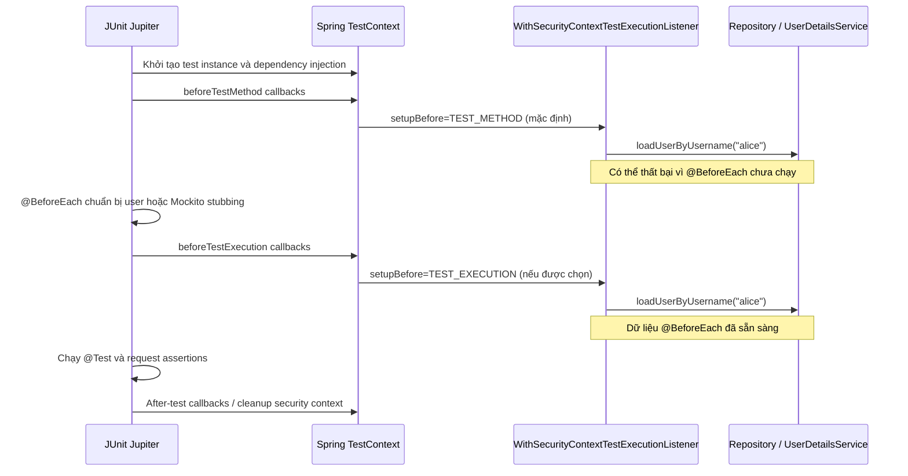
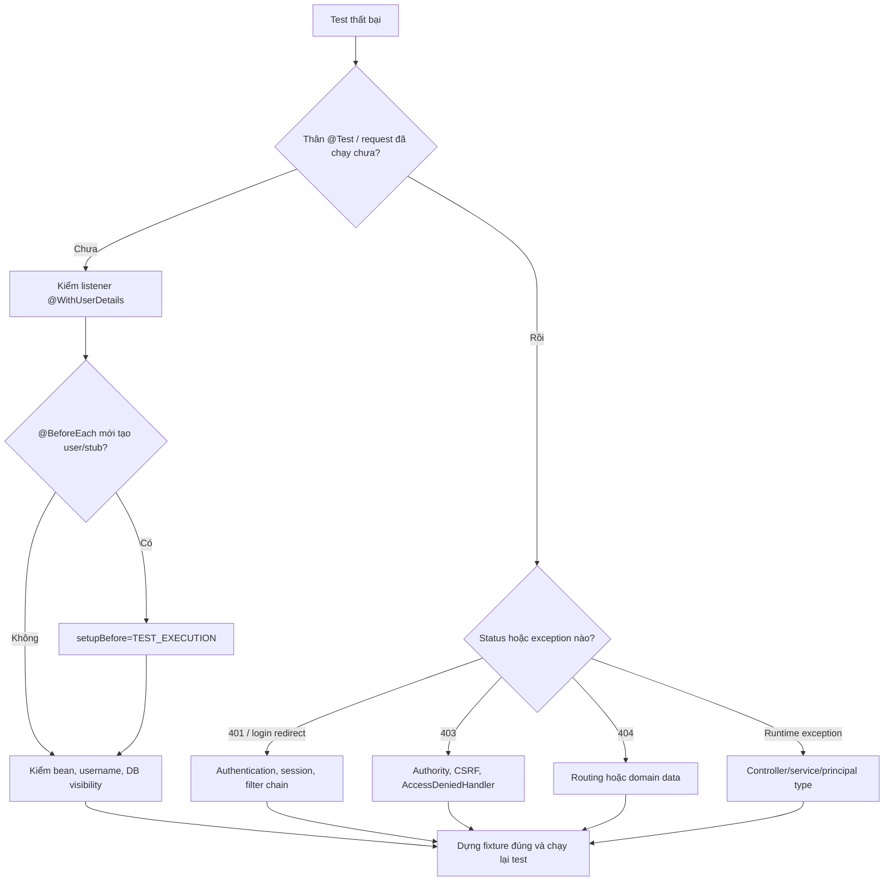

# UserDetails không tồn tại ở thời điểm annotation được xử lý

Một test Spring Security có thể thất bại **trước khi câu lệnh đầu tiên trong `@Test` được chạy**. Test đã có `@WithUserDetails("alice")`; database cũng có đoạn tạo user `alice` trong `@BeforeEach`; nhưng kết quả lại là `UsernameNotFoundException` hoặc một lỗi tạo `SecurityContext` từ test listener. Vấn đề thường không phải controller trả sai 401/403, mà là **Spring Security Test tìm `UserDetails` quá sớm**, trước khi dữ liệu hoặc mock của test được chuẩn bị.

Trong chương **Chẩn đoán sự cố** của module **SPRING_SECURITY_TESTING**, bài này tập trung vào thời điểm annotation được xử lý, cách `@WithUserDetails` lấy thông tin từ `UserDetailsService`, và phương pháp khắc phục đúng tầng. Mục tiêu của module là kiểm chứng xác thực, phân quyền và bảo vệ HTTP thực tế bằng `spring-security-test` trên **Servlet** qua `MockMvc` và **Reactive** qua `WebTestClient`, cùng `@WithMockUser`, `SecurityContext`, JWT/OAuth2/OIDC giả lập và các ca được phép hoặc bị từ chối.

**Kết luận trọng tâm:** `@WithUserDetails` không có nhiệm vụ tạo user. Nó **gọi `UserDetailsService` để tìm một user đã tồn tại** vào một thời điểm của vòng đời test. Muốn test thành công, cần bảo đảm cả **bean tra cứu, dữ liệu user và thời điểm tra cứu** đều đúng.

## 1. Nhận biết lỗi đến từ test listener, không phải HTTP authorization

Những dấu hiệu thường gặp:

- Test có `@WithUserDetails("alice")`, nhưng báo `UsernameNotFoundException: alice` hoặc ngoại lệ tương đương từ `loadUserByUsername("alice")`.
- Breakpoint/log trong phương thức `@Test` chưa chạy; `MockMvc.perform(...)` hoặc `WebTestClient.exchange()` chưa được gọi.
- Đặt breakpoint trong `@BeforeEach` mới thấy hàm tạo user còn chưa được thực thi khi lookup xảy ra.
- Mockito `UserDetailsService` chưa có stub nên `loadUserByUsername(...)` trả `null`, từ đó làm factory tạo context thất bại.
- Dùng `@WebMvcTest` hoặc một test slice nhưng `UserDetailsService` thực của ứng dụng không xuất hiện trong application context.
- Có nhiều `UserDetailsService` hoặc tên bean khác với tên được chỉ định trong annotation.

Ví dụ khung test dễ gặp:

```java
@SpringBootTest
@AutoConfigureMockMvc
class AccountSecurityTest {

    @Autowired UserRepository userRepository;
    @Autowired MockMvc mockMvc;

    @BeforeEach
    void createUser() {
        userRepository.save(
            new AppUser("alice", "encoded-password"));
    }

    @Test
    @WithUserDetails("alice")
    void aliceCanReadProfile() throws Exception {
        mockMvc.perform(get("/api/me"))
                .andExpect(status().isOk());
    }
}
```

Đây là **mẫu lỗi về thứ tự**, không phải đoạn test độc lập có đủ `AppUser`, repository, mapping và security configuration. Tại cấu hình mặc định của `@WithUserDetails`, listener có thể tìm `alice` **trước** `@BeforeEach.createUser()`; vì vậy cả đoạn tạo dữ liệu đúng cũng không giúp được lookup ở thời điểm đó.

### Phân biệt với các loại lỗi khác

| Triệu chứng | Tầng lỗi có khả năng cao | Hướng điều tra |
|---|---|---|
| `UsernameNotFoundException` khi annotation tạo context | Fixture/listener/`UserDetailsService` | Thời điểm setup và dữ liệu user |
| `NoSuchBeanDefinitionException` hoặc không tìm được `UserDetailsService` | Spring TestContext | Test slice, bean/import |
| Có nhiều service và bean lookup bị mơ hồ | Spring bean selection | `userDetailsServiceBeanName` |
| `MockMvc` trả 401 sau khi đã gọi endpoint | Authentication/filter chain | Test đã gắn principal vào request đúng chưa? |
| `MockMvc` trả 403 | Authorization/CSRF | Role/authority, CSRF policy |
| Test báo 404 | Routing hoặc dữ liệu miền | Route mapping, resource existence |
| JWT/OIDC test fail vì issuer, chữ ký, nonce | Token validation thật | Decoder/IdP, không nhầm với lookup `UserDetails` |

Không sửa một lỗi annotation bị xử lý sớm bằng cách nới `authorizeHttpRequests(...).permitAll()`. Điều đó có thể khiến endpoint mất bảo vệ mà **chưa giải quyết được nguyên nhân UserDetails không tồn tại**.

## 2. @WithMockUser và @WithUserDetails thực sự khác nhau

Hai annotation này không phải hai cách viết tương đương:

| Đặc điểm | `@WithMockUser` | `@WithUserDetails` |
|---|---|---|
| Nguồn principal | Spring Security Test tự tạo principal giả từ annotation | `UserDetailsService.loadUserByUsername(...)` |
| Có cần user trong database? | **Không** | **Có**, nếu service tra cứu từ database |
| Có cần `UserDetailsService` bean? | Không cho hành vi mock mặc định | **Có**, bean đúng tên/loại |
| Kiểm tra cấu hình role/authority nào? | Theo `roles` hoặc `authorities` khai báo | Theo `UserDetails.getAuthorities()` trả về |
| Principal tùy chỉnh của ứng dụng | Không mặc nhiên dùng domain principal tùy chỉnh | Có thể dùng principal từ `UserDetailsService` |
| Kiểm password, user bị khóa có đăng nhập được không? | Không | **Cũng không tự chứng minh** cơ chế xác thực đăng nhập |
| Thời điểm setup | Listener Spring Security Test | Listener Spring Security Test; cần có dữ liệu khi lookup |

Ví dụ không cần user thật:

```java
@Test
@WithMockUser(
    username = "alice",
    authorities = {"ROLE_READER"})
void canReadWithMockPrincipal() throws Exception {
    mockMvc.perform(get("/api/me"))
            .andExpect(status().isOk());
}
```

Ví dụ cần `UserDetailsService`:

```java
@Test
@WithUserDetails("alice")
void canReadWithPrincipalFromUserDetailsService()
        throws Exception {
    mockMvc.perform(get("/api/me"))
            .andExpect(status().isOk());
}
```

Nếu chỉ muốn kiểm controller và rule `hasRole("READER")`, `@WithMockUser` có thể là lựa chọn đơn giản. Nếu controller cần một `CustomUserDetails` với `tenantId`, `accountId` hoặc dữ liệu đặc thù từ service, `@WithUserDetails` sẽ gần với principal của ứng dụng hơn **với điều kiện fixture tồn tại đúng thời điểm**.

**Giới hạn cần nhớ:** Ngay cả khi `UserDetailsService` trả user đang bị khóa, việc dựng một authentication giả từ `@WithUserDetails` không bắt buộc đi qua `AuthenticationManager`, password check hoặc cơ chế xét tài khoản bị khóa của login thực. Muốn chứng minh login từ chối user disabled/locked, cần test authentication provider/HTTP login thật.

## 3. Annotation được xử lý vào thời điểm nào?

Spring Security Test dùng `WithSecurityContextTestExecutionListener` để đọc annotation được hỗ trợ, dựng `SecurityContext` và dọn context sau test. Điểm quyết định nằm ở thuộc tính `setupBefore`.

Thông thường, `@WithUserDetails` mặc định:

```java
@WithUserDetails(
    value = "alice",
    setupBefore = TestExecutionEvent.TEST_METHOD)
```

Thời điểm `TEST_METHOD` tương ứng với callback **Spring TestExecutionListener.beforeTestMethod**. Trong một test JUnit Jupiter tích hợp Spring đúng cách, callback này xảy ra **trước `@BeforeEach` của JUnit**.

Nếu chọn:

```java
@WithUserDetails(
    value = "alice",
    setupBefore = TestExecutionEvent.TEST_EXECUTION)
```

context được tạo trong **beforeTestExecution**, thường **sau `@BeforeEach` và trước thân method `@Test`**.

### Dòng thời gian



Sơ đồ minh họa hai **lựa chọn** thiết lập; một annotation trong một test sử dụng thời điểm nó được cấu hình, không nhất thiết thực hiện cả hai lượt lookup.

| Mốc | Sự kiện | User tạo trong `@BeforeEach` đã tồn tại? |
|---|---|---|
| Trước `beforeTestMethod` | Spring context/injection đã sẵn sàng | Chưa, nếu chỉ tạo ở `@BeforeEach` |
| `beforeTestMethod` | Listener xử lý `TEST_METHOD` | **Chưa** |
| `@BeforeEach` | Test tạo fixture/stub service | **Có** sau khi hoàn tất setup |
| `beforeTestExecution` | Listener xử lý `TEST_EXECUTION` | **Có**, nếu setup đã thành công |
| `@Test` | Method kiểm HTTP/service | Có, trừ khi bị cleanup hoặc transaction khác làm không nhìn thấy |

**Phân biệt:** `TEST_METHOD` và `TEST_EXECUTION` là giá trị `TestExecutionEvent` của Spring Security Test, không phải cách đặt lifecycle trong JUnit `@TestInstance`. Đổi `@TestInstance(PER_CLASS)` không sửa thứ tự listener trước `@BeforeEach`.

## 4. Cách sửa phổ biến nhất: setupBefore = TEST_EXECUTION

Khi dữ liệu chỉ được chuẩn bị trong `@BeforeEach`, ta chuyển thời điểm tạo context:

```java
import org.junit.jupiter.api.BeforeEach;
import org.junit.jupiter.api.Test;
import org.springframework.security.test.context.support.TestExecutionEvent;
import org.springframework.security.test.context.support.WithUserDetails;

@SpringBootTest
@AutoConfigureMockMvc
class AccountSecurityTest {

    @Autowired UserRepository users;
    @Autowired MockMvc mvc;

    @BeforeEach
    void prepareAlice() {
        users.save(UserFixtures.aliceReader());
    }

    @Test
    @WithUserDetails(
        value = "alice",
        setupBefore = TestExecutionEvent.TEST_EXECUTION)
    void aliceHasReadAccess() throws Exception {
        mvc.perform(get("/api/me"))
                .andExpect(status().isOk());
    }
}
```

Đây là **mẫu tích hợp**; `UserRepository`, `UserFixtures` và endpoint `/api/me` thuộc ứng dụng minh họa, cần triển khai riêng để chạy. Điểm cần kiểm là **annotation không tìm Alice trước khi `prepareAlice()` hoàn tất**.

Khi chuyển sang `TEST_EXECUTION`, vẫn cần bảo đảm:

- `users.save(...)` đã thật sự làm dữ liệu có thể đọc theo transaction visibility của `UserDetailsService`.
- Tên username mà service dùng đúng là `alice`; không nhầm email/display name.
- Bean `UserDetailsService` trong test context truy vấn **cùng database/schema** nơi `@BeforeEach` đã lưu user.
- Không có test khác xóa bản ghi trong lúc listener thực hiện lookup.
- Dữ liệu user có authorities đúng với rule của endpoint.

**Quan trọng:** `TEST_EXECUTION` sửa **lỗi thời điểm chuẩn bị fixture trong `@BeforeEach`**, không sửa một bean lookup sai, username sai, DB khác hoặc mapping `UserDetailsService` hỏng.

### Khi dùng @BeforeEach để stub một UserDetailsService mock

Lỗi tương tự xuất hiện dù không có database:

```java
// Trong một Spring test có UserDetailsService bean được mock
// bằng @MockitoBean (mới) hoặc @MockBean (dự án cũ).

@MockitoBean
UserDetailsService userDetailsService;

@BeforeEach
void stubAlice() {
    UserDetails alice = User.withUsername("alice")
            .password("{noop}not-real")
            .authorities("ROLE_READER")
            .build();

    when(userDetailsService.loadUserByUsername("alice"))
            .thenReturn(alice);
}

@Test
@WithUserDetails(
    value = "alice",
    setupBefore = TestExecutionEvent.TEST_EXECUTION)
void readWithStubbedUserDetails() throws Exception {
    mvc.perform(get("/api/me"))
            .andExpect(status().isOk());
}
```

Khi `setupBefore=TEST_METHOD`, Spring Security Test gọi mock **trước khi `stubAlice()` chạy**. Mockito trả giá trị mặc định (thường `null`) và việc tạo Authentication có thể thất bại. Chuyển sang `TEST_EXECUTION` khiến stubbing hoàn tất trước khi factory gọi service.

Mẫu này cần một test class Spring với MockMvc và security chain thực sự được cấu hình. `@MockitoBean` là annotation của Spring Framework ở các phiên bản hỗ trợ; các dự án Spring Boot cũ có thể dùng `@MockBean`, đã được thay thế/deprecated ở các thế hệ mới. Không khai báo cả hai trên cùng bean nếu không có lý do đặc biệt.

### Vì sao không stub trong thân @Test?

```java
@Test
@WithUserDetails("alice")
void wrongOrder() {
    when(userDetailsService.loadUserByUsername("alice"))
        .thenReturn(alice);
    // Quá muộn: listener đã tra user trước dòng này.
}
```

Một exception trong test listener **không bị `assertThrows(...)` trong thân `@Test` bắt được**, vì thân method chưa bắt đầu. Muốn kiểm behavior tạo context, phải tách unit test factory/service hoặc cấu hình fixture đúng trước listener.

## 5. Cách ổn định khác: user đã tồn tại khi context được dựng

Nếu test dùng cùng một tập user cố định, có thể cấu hình `UserDetailsService` test với dữ liệu **sẵn từ lúc bean được tạo**, không phụ thuộc `@BeforeEach`:

```java
import org.springframework.boot.test.context.TestConfiguration;
import org.springframework.context.annotation.Bean;
import org.springframework.security.core.userdetails.User;
import org.springframework.security.core.userdetails.UserDetailsService;
import org.springframework.security.provisioning.InMemoryUserDetailsManager;

@TestConfiguration
class FixedUsersTestConfig {

    @Bean
    UserDetailsService testUserDetailsService() {
        return new InMemoryUserDetailsManager(
            User.withUsername("alice")
                .password("{noop}test-only")
                .authorities("ROLE_READER")
                .build(),
            User.withUsername("bob")
                .password("{noop}test-only")
                .authorities("ROLE_GUEST")
                .build());
    }
}
```

Import cấu hình này vào test context có phạm vi phù hợp:

```java
@SpringBootTest
@AutoConfigureMockMvc
@Import(FixedUsersTestConfig.class)
class FixedPrincipalSecurityTest {

    @Autowired MockMvc mvc;

    @Test
    @WithUserDetails("alice")
    void aliceCanRead() throws Exception {
        mvc.perform(get("/api/me"))
            .andExpect(status().isOk());
    }
}
```

User đã nằm trong `InMemoryUserDetailsManager` khi bean được khởi tạo, nên lần lookup mặc định trước `@BeforeEach` có thể thành công. Đây là lựa chọn gọn khi không cần kiểm persistence của production repository.

**Cẩn trọng với nhiều bean cùng loại:** nếu ứng dụng có sẵn một `UserDetailsService` production và test import thêm service khác, việc chọn bean có thể mơ hồ. Hãy quyết định cấu hình test thay thế hay chỉ định bean bằng tên; không thêm một bean rồi mặc nhiên nghĩ annotation sẽ chọn đúng.

### Dữ liệu database được seed từ trước

Một test database có thể tạo user bằng migration/fixture setup khi application context khởi động, hoặc một quy trình test preparation chạy **trước listener**. Điều kiện cốt lõi là: tại thời điểm `@WithUserDetails` lookup, user **đã được commit/hiển thị trong đúng transaction/schema**.

Với `@Sql`, thời điểm thực thi script còn phụ thuộc `SqlScriptsTestExecutionListener` và execution phase. Nếu cần dựa vào việc setup trong `@BeforeEach`, `TEST_EXECUTION` là giải pháp dễ đọc và ít phụ thuộc tương tác thứ tự listener hơn. Không đưa ra giả định rằng mọi `@Sql` script luôn hoàn thành trước mọi security listener, đặc biệt khi dự án tùy chỉnh thứ tự hoặc listeners.

## 6. Không tìm được UserDetailsService bean trong test context

Một loại lỗi khác xảy ra **dù user có trong database**: annotation chạy trong một Spring application context **không chứa bean `UserDetailsService` mà bạn nghĩ đang dùng**.

Điều này thường xuất hiện với test slice:

```java
@WebMvcTest(controllers = MeController.class)
class MeControllerTest {

    @Autowired MockMvc mvc;

    @Test
    @WithUserDetails("alice")
    void readsAlice() throws Exception {
        mvc.perform(get("/api/me"))
            .andExpect(status().isOk());
    }
}
```

`@WebMvcTest` chỉ nạp một lát cắt phục vụ MVC, không phải toàn bộ component graph/repositories của ứng dụng. Một `CustomUserDetailsService` được khai báo trong layer service có thể **không được phát hiện**. Tùy auto-configuration và cấu hình hiện tại, test có thể không có bean phù hợp hoặc có một service mặc định **không chứa alice**. Cần xác minh trường hợp cụ thể.

**Hai hướng giải quyết có chủ đích:**

1. Nếu chỉ muốn test **controller + HTTP authorization**, tạo user giả bằng `@WithMockUser` hoặc `.with(user(...))`; không kéo database/repository vào một MVC slice chỉ để có tên principal.
2. Nếu cần đúng principal `UserDetails` từ service, đưa `UserDetailsService` test vào slice bằng `@Import(...)` hoặc test configuration, rồi bảo đảm có user `alice` trước khi annotation lookup.

Ví dụ bổ sung bean vào MVC slice:

```java
@WebMvcTest(controllers = MeController.class)
@Import({
    FixedUsersTestConfig.class,
    MvcSecurityTestConfig.class
})
class MeControllerSliceTest {

    @Autowired MockMvc mvc;

    @Test
    @WithUserDetails("alice")
    void aliceCanRead() throws Exception {
        mvc.perform(get("/api/me"))
            .andExpect(status().isOk())
            .andExpect(jsonPath("$.name").value("alice"));
    }
}
```

`FixedUsersTestConfig` đã được mô tả ở mục 5. `MvcSecurityTestConfig` là cấu hình `SecurityFilterChain` dành cho test, ví dụ:

```java
@TestConfiguration
class MvcSecurityTestConfig {

    @Bean
    SecurityFilterChain filterChain(HttpSecurity http)
            throws Exception {
        return http
            .authorizeHttpRequests(auth -> auth
                .requestMatchers("/api/me").hasRole("READER")
                .anyRequest().denyAll())
            .httpBasic(Customizer.withDefaults())
            .build();
    }
}
```

Controller minh họa, dùng chính `Authentication` của request:

```java
@RestController
class MeController {
    @GetMapping("/api/me")
    Map<String, String> me(Authentication authentication) {
        return Map.of("name", authentication.getName());
    }
}
```

Nhóm snippet trên ghép thành một fixture Spring MVC khi bổ sung imports phù hợp (`MockMvc`, Spring MVC annotations, `HttpSecurity`, `SecurityFilterChain`, `Customizer`, `Map`). Nó kiểm tra chính sách `ROLE_READER` thông qua filter chain; **không** thực thi login/password check.

### Không tự động tăng phạm vi lên @SpringBootTest

Chuyển mọi test sang `@SpringBootTest` có thể khiến bean xuất hiện, nhưng cũng khởi tạo database, IdP clients, cache và hạ tầng không liên quan. Test chậm hơn và dễ bị phụ thuộc môi trường. Chọn phạm vi nhỏ nhất đủ kiểm chứng:

| Mục tiêu | Test phù hợp |
|---|---|
| Controller trả thông tin identity từ user giả | `@WebMvcTest` + `@WithMockUser` |
| Controller cần `CustomUserDetails` và authorities thật của fixture | `@WebMvcTest` + service fixture + `@WithUserDetails` |
| Kiểm mapping `UserDetailsService` từ repository | Service/repository integration test |
| Kiểm filter chain cùng database và session thật | `@SpringBootTest` + `@AutoConfigureMockMvc` |
| Kiểm login/password thực sự | AuthenticationManager hoặc HTTP login end-to-end |

Nếu service của ứng dụng được tạo qua bean condition/profile, hãy kiểm profile, `@ConditionalOn...` và cấu hình test slice. Việc import một service có nhiều dependency không tự bảo đảm những dependency đó cũng có mặt; có thể cần bean test thay thế có phạm vi xác định.

## 7. Có nhiều UserDetailsService: chỉ rõ bean cần dùng

Một ứng dụng có thể có service khác nhau cho nhân viên và đối tác:

```java
@Bean("employeeUserDetailsService")
UserDetailsService employeeUsers() {
    return new InMemoryUserDetailsManager(
        User.withUsername("alice")
            .password("{noop}test-only")
            .authorities("ROLE_EMPLOYEE")
            .build());
}

@Bean("partnerUserDetailsService")
UserDetailsService partnerUsers() {
    return new InMemoryUserDetailsManager(
        User.withUsername("partner-1")
            .password("{noop}test-only")
            .authorities("ROLE_PARTNER")
            .build());
}
```

Khi có nhiều bean cùng loại, annotation nên chỉ rõ bean:

```java
@Test
@WithUserDetails(
    value = "alice",
    userDetailsServiceBeanName = "employeeUserDetailsService")
void usesEmployeeDirectory() throws Exception {
    mvc.perform(get("/employee/me"))
        .andExpect(status().isOk());
}
```

Nếu `userDetailsServiceBeanName` bị viết sai, factory có thể không tìm ra service dù user tồn tại ở service khác. Nếu bean đúng nhưng lookup tên user không tồn tại trong service đó, vẫn báo không tìm thấy user.

**Phân biệt tên:**

- `value = "alice"` của `@WithUserDetails` là **username gửi vào `loadUserByUsername`**, không phải tên bean.
- `userDetailsServiceBeanName = "employeeUserDetailsService"` là **tên Spring bean**, không phải role hay registration ID.
- `@WithUserDetails` không tự biết user nằm ở service nào dựa vào path request hoặc tenant claim.

Khi role thực tế xuất hiện như `ROLE_EMPLOYEE`, rule `hasRole("EMPLOYEE")` kiểm chuỗi authority đó theo role prefix thông thường. Đừng dùng `hasAuthority("EMPLOYEE")` rồi quy lỗi 403 thành user không tồn tại.

## 8. Username, email và tenant: “có bản ghi” chưa có nghĩa lookup thành công

Một hệ thống có thể đăng nhập bằng email nhưng test dùng nickname:

```java
// Repository có record:
// username = "alice"
// email    = "alice@example.test"

@WithUserDetails("alice@example.test")
```

Nếu `UserDetailsService.loadUserByUsername(...)` chỉ tra cột `username`, nó sẽ không tìm thấy record. Ngược lại, nếu service tra theo email, `@WithUserDetails("alice")` có thể không đúng.

Thêm các nguyên nhân thường bị bỏ sót:

- **Case sensitivity:** `Alice` không tự động bằng `alice`; tùy logic normalizer/SQL collation.
- **Whitespace:** `"alice "` không nhất thiết được trim trước khi lookup.
- **Tenant:** cùng username có thể nằm ở hai tenant; service test cần xác định tenant context hoặc query key đúng.
- **Soft delete / active flag:** repository filter có thể loại record đã vô hiệu.
- **Chưa flush/commit:** đoạn insert chạy nhưng một transaction khác chưa nhìn thấy.
- **Khác datasource/schema:** setup và lookup có thể trỏ vào hai H2/Testcontainers schemas không giống nhau.
- **Service cache:** cache trả bản ghi cũ hoặc không thấy user vừa thêm nếu không có invalidation phù hợp.

Khi debug, nên gọi trực tiếp service **trong một phép kiểm riêng** để xác minh hợp đồng lookup:

```java
@Test
void fixtureUserCanBeLoadedByTheConfiguredService() {
    UserDetails alice = userDetailsService
            .loadUserByUsername("alice");

    assertThat(alice.getUsername()).isEqualTo("alice");
    assertThat(alice.getAuthorities())
            .extracting(GrantedAuthority::getAuthority)
            .contains("ROLE_READER");
}
```

Test này chỉ xác minh service tìm được user **khi thân method chạy**. Nó không chứng minh user đã tồn tại **trước `@BeforeEach`**, do đó không dùng kết quả của nó để kết luận `setupBefore=TEST_METHOD` chắc chắn thành công.

## 9. Database và transaction: dữ liệu có thật nhưng chưa nhìn thấy

Trong test dùng database, có ba lớp cần kiểm:

1. **Dữ liệu đã được tạo chưa?** `repository.save(...)` có chạy trước lookup không?
2. **Service tra cùng nơi không?** Datasource/schema/profile/test container có giống nhau không?
3. **Transaction có nhìn thấy dữ liệu không?** Insert đã được flush/commit khi lookup xảy ra ở transaction/thread khác chưa?

### Khi dữ liệu được tạo trong @BeforeEach

Với test-managed transaction đồng bộ trong cùng thread, `@BeforeEach` và `beforeTestExecution` có thể thấy cùng transactional context. Dùng `TEST_EXECUTION` để đưa lookup xuống sau setup. Nhưng không giả định điều đó áp dụng cho một HTTP server ở thread khác:

```text
JUnit test thread:
  begin test transaction -> @BeforeEach insert alice
  -> listener @WithUserDetails lookup
  -> @Test body / HTTP request

Live HTTP server thread:
  request -> service transaction độc lập
```

Nếu dùng `@SpringBootTest(webEnvironment = RANDOM_PORT)`, HTTP server chạy riêng và có thể không thấy dữ liệu chưa commit của test-managed transaction; dù **listener ở test thread** đã tra được alice, endpoint server có thể vẫn không thấy record. `@Transactional` đặt trên test **không tự động** gộp mọi server request vào transaction của test.

### Khi dùng MockMvc

`MockMvc` thường mô phỏng Servlet request trong tiến trình test và có thể hoạt động trong test-managed transaction, tùy luồng thực thi/controller/service. Nếu backend dùng `@Async`, message listener hoặc luồng riêng, visibility lại khác. Vì vậy cần kiểm đường dữ liệu thực tế chứ không coi `MockMvc` và live server tương đương transaction-wise.

### Khi dùng reactive repository

Với R2DBC, `save(...)` thường trả publisher:

```java
Mono<UserRecord> saved = repository.save(testUser);
// Chỉ tạo Mono; chưa bảo đảm insert hoàn tất.
```

Nếu test setup không subscribe/await publisher, dữ liệu có thể chưa tồn tại khi annotation lookup. Cũng cần phân biệt service `ReactiveUserDetailsService` (reactive) với `UserDetailsService` (imperative) mà `@WithUserDetails` dựa vào. Đừng dùng `block()` trong WebFlux handler để ép một service reactive thành imperative; nếu test integration cần setup dữ liệu reactive, hoàn tất publisher trong **test harness** và dùng công cụ mock identity phù hợp với WebFlux.

### Không cố sửa thứ tự bằng sleep

`Thread.sleep(1000)` không tạo user sớm hơn `@WithUserDetails`. Nếu listener chạy **trước `@BeforeEach`**, chờ thêm chỉ khiến test chậm. Nếu dữ liệu commit bất đồng bộ, hãy có tín hiệu hoàn tất xác định thay vì đoán thời gian.

## 10. Test context và mock bean lifecycle

Khi dùng Mockito-backed `UserDetailsService` trong Spring Test:

| Tình huống | Kết quả có thể gặp | Giải pháp |
|---|---|---|
| Mock được stub trong `@BeforeEach`; annotation mặc định | Listener gọi mock trước stubbing | `setupBefore=TEST_EXECUTION` |
| Mock được stub trong thân `@Test` | Luôn quá muộn cho annotation lookup | Setup trước event hoặc không dùng annotation |
| Mock được khai báo nhưng không stub đúng username | Trả null/không tìm thấy user | Dùng đúng argument và kiểm stubbing |
| Cả real service và mock service cùng tồn tại | Chọn sai bean hoặc mơ hồ | Thay đúng bean, chọn name rõ |
| Test slice không có service cần thiết | Không tra cứu được user | `@Import` fixture service hoặc `@WithMockUser` |
| Nhiều tests cùng thay stubbing trên singleton mock | Behavior thay đổi khi parallel | Không reset/stub chung đồng thời; tách context/test |

Đặc biệt, Spring TestContext có thể cache application context giữa nhiều test classes. Một mock `UserDetailsService`, fake repository hoặc cache đặt trong context có thể được dùng lại theo cấu hình test. Không để test A `reset(mock)` hoặc thay behavior của cùng bean khi test B đang để listener `@WithUserDetails` tra user.

Ví dụ “ổn định khi chạy riêng nhưng lỗi khi chạy song song”:

```text
Test A (@BeforeEach): stub alice -> UserDetails Alice
Test B (@BeforeEach): reset shared UserDetailsService mock
Test A (beforeTestExecution): lookup alice -> null
Test A: lỗi tạo SecurityContext trước @Test
```

Sơ đồ trên là một **race có thể xảy ra khi chia sẻ mock sai cách**. Cách tốt hơn là có bean/mock/fixture riêng cho lớp test, hoặc dùng một service test bất biến chứa các users cố định. Không khắc phục bằng cách dùng chung static `SecurityContext` giữa hai tests, vì như vậy có thể gây rò rỉ danh tính.

## 11. Reactive/WebFlux: UserDetailsService và ReactiveUserDetailsService không giống nhau

Trong Reactive, xác thực username/password thường được cấu hình với `ReactiveUserDetailsService`, ví dụ:

```java
@Bean
ReactiveUserDetailsService reactiveUsers() {
    UserDetails alice = User.withUsername("alice")
        .password("{noop}test-only")
        .authorities("ROLE_READER")
        .build();
    return username -> "alice".equals(username)
            ? Mono.just(alice)
            : Mono.empty();
}
```

Bean trên **không phải `UserDetailsService` imperative**. Một `@WithUserDetails("alice")` tìm kiếm bean của API imperative có thể không tra được user dù reactive login thật hoạt động. Không cần tạo adapter blocking chỉ để làm annotation pass.

Để test WebFlux authorization với user giả, dùng helper Reactive:

```java
import static org.springframework.security.test.web.reactive.server
        .SecurityMockServerConfigurers.mockUser;

webTestClient
    .mutateWith(mockUser("alice").roles("READER"))
    .get().uri("/api/me")
    .exchange()
    .expectStatus().isOk()
    .expectBody()
    .jsonPath("$.name").isEqualTo("alice");
```

Hoặc dùng `UserDetails` test do factory dựng:

```java
UserDetails alice = User.withUsername("alice")
    .password("{noop}test-only")
    .authorities("ROLE_READER")
    .build();

webTestClient
    .mutateWith(mockUser(alice))
    .get().uri("/api/me")
    .exchange()
    .expectStatus().isOk();
```

Hai ví dụ giả định `WebTestClient` đã gắn `SecurityWebFilterChain` và route phù hợp. Chúng giả lập Authentication **ngay trên HTTP test exchange**, không tra `ReactiveUserDetailsService` và không kiểm password login thực.

### Khi muốn kiểm ReactiveUserDetailsService thật

Hãy kiểm trực tiếp publisher và ca không tồn tại:

```java
StepVerifier.create(
        reactiveUserDetailsService.findByUsername("alice"))
    .assertNext(user -> {
        assertThat(user.getUsername()).isEqualTo("alice");
        assertThat(user.getAuthorities())
            .extracting(GrantedAuthority::getAuthority)
            .contains("ROLE_READER");
    })
    .verifyComplete();

StepVerifier.create(
        reactiveUserDetailsService.findByUsername("unknown"))
    .verifyComplete();
```

Sau đó, nếu mục tiêu là HTTP authentication, bật `httpBasic()`/login theo security config và gửi credentials qua WebTestClient, không `mutateWith(mockUser(...))`. Cần bảo đảm test password encoder/provider và web filter thực sự được chạy.

### Test Mono trực tiếp cần Reactor Context đúng

Nếu chỉ test service dùng identity đã xác thực:

```java
Authentication alice = new UsernamePasswordAuthenticationToken(
    "alice", "not-real",
    List.of(new SimpleGrantedAuthority("ROLE_READER")));

Mono<String> principalName = ReactiveSecurityContextHolder
    .getContext()
    .map(context -> context.getAuthentication().getName());

StepVerifier.create(principalName.contextWrite(
        ReactiveSecurityContextHolder.withAuthentication(alice)))
    .expectNext("alice")
    .verifyComplete();
```

Đây là kiểm tra **truyền context theo subscription**. Không chứng minh user có trong database hoặc password được xác minh. Hơn nữa, `@WithMockUser` trong Reactive test phụ thuộc test listeners và cơ chế Reactor Context tương ứng; với direct publisher, `contextWrite(...)` làm tiền điều kiện explicit và dễ đọc.

## 12. Quy trình chẩn đoán từ stack trace đến nguyên nhân

Một cách điều tra hiệu quả là **xác định chính xác thời điểm exception xảy ra**, sau đó mới sửa fixture.

### Bước 1 — Xác nhận exception xuất hiện trước HTTP request

Đặt breakpoint vào:

- `@BeforeEach` của test;
- `UserDetailsService.loadUserByUsername(...)`;
- dòng `mockMvc.perform(...)` hoặc `webTestClient.exchange()`.

Quan sát thứ tự. Nếu service lookup xảy ra trước cả `@BeforeEach` và method test, hãy kiểm `setupBefore` trước khi sửa controller/security rule.

Một stack trace có thể có các frame tương tự:

```text
WithSecurityContextTestExecutionListener.beforeTestMethod(...)
WithUserDetailsSecurityContextFactory.createSecurityContext(...)
UserDetailsService.loadUserByUsername("alice")
UsernameNotFoundException: alice
```

Đây là **minh họa các tên thành phần**, không phải stack trace nguyên văn cho mọi phiên bản. Factory có thể bọc hoặc chuyển ngoại lệ; việc xác định nguồn lỗi quan trọng hơn khớp chính xác câu chữ exception.

### Bước 2 — Kiểm tra annotation đang đặt ở đâu

`@WithUserDetails` có thể đặt ở **method** hoặc **class**:

```java
@WithUserDetails("alice")
class AccountTests {
    @Test
    void testOne() {}

    @Test
    void testTwo() {}
}
```

Với annotation cấp class, **mọi method chịu tác động** trong phạm vi đó có thể khiến listener lookup Alice, kể cả test không trực tiếp cần principal. Nếu test riêng muốn kiểm anonymous hoặc failure khi user chưa tồn tại, việc đặt annotation cấp class có thể che mục tiêu của test hoặc gây lỗi sớm.

Ưu tiên gắn annotation ở method khi các ca có identity khác nhau. Nếu dùng meta-annotation tùy chỉnh tích hợp `@WithSecurityContext`, kiểm cả `setupBefore` của annotation đó và factory tạo context, không chỉ những chỗ xuất hiện `@WithUserDetails` tường minh.

### Bước 3 — Kiểm tra bean loại nào và được chọn như thế nào

Trong application context:

```java
@Autowired ApplicationContext context;

@Test
void showsAvailableUserDetailsServiceBeans() {
    Map<String, UserDetailsService> beans =
            context.getBeansOfType(UserDetailsService.class);

    assertThat(beans).containsKey(
        "employeeUserDetailsService");
}
```

Đoạn này dành cho test có service với tên bean trên. Nếu không có service hay tên khác, cần sửa cấu hình test hoặc `userDetailsServiceBeanName`. Không cần in toàn bộ bean object, datasource credentials hay dữ liệu nhạy cảm ra CI log.

Trong test Reactive, kiểm thêm loại `ReactiveUserDetailsService` thay vì giả định nó tự tương đương với `UserDetailsService`.

### Bước 4 — Kiểm giá trị lookup và nơi chứa dữ liệu

Kiểm:

- Giá trị truyền vào `@WithUserDetails(value = "...")` có đúng key service dùng không?
- `UserDetailsService` có lookup theo username, email hay tenant composite key?
- Repo và service có cùng datasource/schema/profile không?
- Nếu dùng mock, stub đã được cấu hình **trước** `beforeTestExecution` hay chưa?
- Nếu dùng transaction, dữ liệu có nhìn thấy ở cùng transaction/thread không?
- Nếu dùng dữ liệu giả lập, service có thực sự trả một đối tượng `UserDetails` không null?

Đừng để test “sửa” `UsernameNotFoundException` bằng cách thêm default user có mọi authority. Fixture đó có thể làm test được phép nhưng **mất khả năng kiểm negative case**.

### Bước 5 — Phân biệt lỗi setup với lỗi HTTP/security policy

Sau khi annotation lookup thành công, **bây giờ** mới xem:

1. Spring Security filter chain đã được áp dụng cho `MockMvc`/`WebTestClient` chưa?
2. Principal có đúng kiểu mà controller mong đợi không?
3. Authorities có đúng `ROLE_READER` hoặc `SCOPE_xxx` theo policy không?
4. POST có yêu cầu CSRF không?
5. Request đang bị 401, 403, 404 hay redirect? Nguyên nhân nào ở đúng tầng?

Một 401 sau khi annotation đã thiết lập user thành công thường không phải “user chưa tồn tại”. Nó có thể là test client bỏ qua Spring Security configurer, session/dispatch không truyền context, hoặc endpoint/chain khác cấu hình. Ngược lại, một 403 có thể là **test đúng** nếu user có role không được phép.



## 13. Mẫu test đối chứng sau khi sửa UserDetails lookup

Một regression suite tốt không dừng ở “Alice lookup thành công”. Hãy chứng minh HTTP policy hoạt động đúng với Alice, Bob và anonymous. Dùng `FixedUsersTestConfig` và `MvcSecurityTestConfig` ở các mục trước:

```java
@WebMvcTest(controllers = MeController.class)
@Import({FixedUsersTestConfig.class, MvcSecurityTestConfig.class})
class UserDetailsAuthorizationRegressionTest {

    @Autowired MockMvc mvc;

    @Test
    @WithUserDetails("alice")
    void readerCanReadProfile() throws Exception {
        mvc.perform(get("/api/me"))
            .andExpect(status().isOk())
            .andExpect(jsonPath("$.name").value("alice"));
    }

    @Test
    @WithUserDetails("bob")
    void guestCannotReadReaderProfile() throws Exception {
        mvc.perform(get("/api/me"))
            .andExpect(status().isForbidden());
    }

    @Test
    void anonymousRequestIsRejected() throws Exception {
        mvc.perform(get("/api/me"))
            .andExpect(status().isUnauthorized());
    }
}
```

Với cấu hình đã cho:

- Alice có `ROLE_READER` nên qua `hasRole("READER")` và nhận 200.
- Bob có `ROLE_GUEST` nên được xác thực giả lập nhưng không đủ quyền, nhận 403.
- Anonymous bị `httpBasic()` entry point từ chối, thường trả 401.

Những kỳ vọng này thuộc fixture trong bài. Nếu ứng dụng dùng form/OIDC login, anonymous có thể bị redirect 302; nếu cấu hình access-denied handler riêng, phản hồi cũng có thể khác. Vẫn phải giữ **đối chứng không đủ quyền** để test bảo vệ thực tế, không nới rule thành `permitAll()` nhằm che lỗi setup.

### Khi user được tạo trong @BeforeEach

Với service database hoặc mock cần chuẩn bị mỗi test, lặp lại các case nhưng khai báo:

```java
@BeforeEach
void prepareUsers() {
    users.save(UserFixtures.aliceReader());
    users.save(UserFixtures.bobGuest());
}

@Test
@WithUserDetails(
    value = "alice",
    setupBefore = TestExecutionEvent.TEST_EXECUTION)
void readerCanAccessAfterFixtureSetup() throws Exception {
    mvc.perform(get("/api/me"))
        .andExpect(status().isOk());
}

@Test
@WithUserDetails(
    value = "bob",
    setupBefore = TestExecutionEvent.TEST_EXECUTION)
void guestIsForbiddenAfterFixtureSetup() throws Exception {
    mvc.perform(get("/api/me"))
        .andExpect(status().isForbidden());
}
```

Đoạn này là ví dụ trong class có repository và controller thích hợp, không phải file compile độc lập. Quan trọng là **cả hai annotations đều dùng `TEST_EXECUTION`**, vì dữ liệu cho cả Alice/Bob chỉ được tạo trong `@BeforeEach`.

Một cách khác là biến user thành fixture tồn tại từ khi bean/context được tạo, rồi tiếp tục dùng mặc định `TEST_METHOD`. Chọn **một mô hình fixture** nhất quán cho suite, tránh vừa seed toàn cục vừa lặp insert gây unique constraint.

## 14. Khi nào không nên dùng @WithUserDetails?

`@WithUserDetails` phù hợp khi test cần một `UserDetails` cụ thể **do service tạo ra**, bao gồm principal tùy chỉnh hoặc authorities được xác định từ user record. Không phải test nào cũng cần tới nó.

| Mục tiêu kiểm thử | Lựa chọn ưu tiên | Lý do |
|---|---|---|
| Controller chỉ dùng tên và role | `@WithMockUser` hoặc `user(...)` | Không phụ thuộc database/service |
| Controller cần principal UserDetails thực của ứng dụng | `@WithUserDetails` | Tra user từ service và dùng authorities thực của fixture |
| Cần kiểm exception khi username không tồn tại | Unit/integration test `UserDetailsService.loadUserByUsername` | Exception được assert trực tiếp trong test body |
| Cần kiểm password sai hoặc tài khoản locked | Test `AuthenticationManager`/HTTP login thật | Annotation bypass cơ chế chứng thực |
| JWT Resource Server | Servlet `jwt()` hoặc Reactive `mockJwt()` cho authorization | Principal đúng kiểu `JwtAuthenticationToken` |
| OIDC Login | `oidcLogin()`/`mockOidcLogin()` cho post-login | `OidcUser`, không phải UserDetails |
| WebFlux dùng ReactiveUserDetailsService | `mockUser()` hoặc direct reactive service test | Không ép imperative service vào Reactive |
| Kiểm OAuth2/OIDC Authorization Code flow thật | Mock IdP, callback, token/JWKS integration | Principal mock không tạo HTTP token request |

Ví dụ nếu controller khai báo:

```java
@GetMapping("/api/tenant")
String tenant(@AuthenticationPrincipal CustomUserDetails user) {
    return user.getTenantId();
}
```

`@WithMockUser` mặc định không dựng `CustomUserDetails`, nên method có thể nhận `null` hoặc lỗi khi dùng. Trong trường hợp đó, `@WithUserDetails` hoặc một request post-processor dựng đúng principal có thể phù hợp hơn. Tuy nhiên, nếu chỉ muốn test logic tenant authorization, nên tách nó khỏi login/password mechanism để các negative cases được kiểm rõ.

### Dùng request post-processor thay cho listener khi dữ liệu chuẩn bị muộn

Nếu user chỉ được dựng trong thân test và không muốn dùng annotation listener:

```java
@Test
void principalCreatedInsideTestCanBeUsedOnRequest()
        throws Exception {
    UserDetails alice = User.withUsername("alice")
        .password("{noop}test-only")
        .authorities("ROLE_READER")
        .build();

    mvc.perform(get("/api/me").with(user(alice)))
        .andExpect(status().isOk());
}
```

`.with(user(alice))` lấy đối tượng tạo ngay trong test, nên không phụ thuộc `@WithUserDetails` setup timing. **Nhưng** nó cũng không tra database hoặc xác thực password. Nếu câu hỏi đang kiểm `UserDetailsService`, vẫn phải có test riêng cho service.

## 15. Những cách “sửa nhanh” dễ làm hỏng ý nghĩa bảo mật

| Thao tác | Vì sao có vấn đề | Giải pháp tốt hơn |
|---|---|---|
| Đổi `@WithUserDetails` thành `@WithMockUser(roles="ADMIN")` trên mọi test | Có thể cấp quyền cao ngoài ý định, che lỗi role thực | Chọn helper theo mục tiêu, role tối thiểu |
| Cho `permitAll()` để 401/403 biến mất | Bỏ chính sách bảo vệ HTTP | Giữ rule và sửa fixture/context |
| `Thread.sleep()` trước thân test | Không sửa lookup xảy ra trước test | Dùng `setupBefore=TEST_EXECUTION` hoặc seed sớm |
| Tự ghi `SecurityContextHolder` vào biến static | Rò rỉ principal giữa tests/threads | Context theo request/test, cleanup chuẩn |
| Tạo một user mặc định khi lookup thất bại | Có thể chuyển failure thành authentication trái phép | Để service báo lỗi, sửa dữ liệu test |
| Dùng shared mock/DB rồi `reset()` trong `@BeforeEach` khi chạy parallel | Race với test khác đang tạo context | Mock/database fixture tách biệt |
| Vô hiệu Spring Security Test listener | Annotation không còn tác dụng; test có thể bị 401 | Cấu hình đúng listener và setup timing |
| Dùng `block()` trong reactive handler để gọi user service | Chặn event-loop, tách khỏi reactive design | MockReactive identity hoặc xử lý publisher đúng |

**Đặc biệt:** `UsernameNotFoundException` khi annotation lookup là lỗi của **dữ liệu/fixture chuẩn bị trong test** cho mục tiêu `@WithUserDetails`. Không nên vì sửa test mà thay production `UserDetailsService` thành service luôn trả user fallback. Với xác thực thật, username không tồn tại phải được xử lý an toàn qua cơ chế authentication đã định.

## 16. Tương tác với TestExecutionListeners tùy chỉnh

Một test có thể khai báo:

```java
@TestExecutionListeners(
    listeners = CustomFixtureListener.class,
    mergeMode = TestExecutionListeners.MergeMode.REPLACE_DEFAULTS)
```

Nếu thay toàn bộ listener mặc định mà không giữ lại các listener cần thiết, test có thể **không** còn `WithSecurityContextTestExecutionListener` hoặc các thành phần Spring TestContext khác. Khi đó biểu hiện có thể là annotation không thiết lập principal, thay vì lỗi UserDetails không tồn tại.

Không tùy tiện dùng `REPLACE_DEFAULTS` chỉ để thêm một listener test. Cân nhắc `MERGE_WITH_DEFAULTS` và kiểm thứ tự khi custom listener phải tạo user **trước** security listener. Nếu dùng `setupBefore=TEST_EXECUTION`, custom listener và fixture setup vẫn phải hoàn tất trước `beforeTestExecution` tương ứng.

### Thứ tự @BeforeEach trong class kế thừa

JUnit Jupiter có quy tắc gọi `@BeforeEach` của superclass và subclass. Nếu superclass seed user còn subclass reset repository sau đó, tại `beforeTestExecution` user có thể đã biến mất. Ngược lại, nếu subclass tạo user sau cleanup hợp lệ, `TEST_EXECUTION` sẽ thấy dữ liệu cuối cùng.

Khi lỗi chỉ xuất hiện ở class kế thừa:

- Kiểm các method `@BeforeEach` ở superclass/subclass.
- Kiểm `@AfterEach` hoặc reset hooks có bị dùng sai phase không.
- Kiểm class-level `@WithUserDetails` có áp lên những method không cần principal không.
- Kiểm JUnit lifecycle `PER_CLASS` và shared fields khi chạy parallel.

Sửa bằng cách **sắp xếp fixture rõ ràng**; không dựa vào thứ tự methods cùng tên hoặc thủ thuật annotation để né một reset chạy sai.

## 17. Ma trận xác định nguyên nhân và cách sửa

| Điều đang quan sát | Dấu hiệu xác nhận | Cách sửa ưu tiên | Test đối chứng |
|---|---|---|---|
| Data insert ở `@BeforeEach` nhưng lookup chạy trước | Breakpoint lookup đến trước setup | `setupBefore=TEST_EXECUTION` | User tìm được; endpoint được phép 200 |
| Mock service stub trong `@BeforeEach` nhưng listener thấy null | Mockito chưa nhận `when(...).thenReturn(...)` | Đổi event, không stub trong thân `@Test` | Service được gọi với username đúng |
| Không có `UserDetailsService` bean | Spring context thiếu bean hoặc slice không import | Import fixture service hoặc chọn `@WithMockUser` | Lookup bean by type thành công |
| Có nhiều `UserDetailsService` | Nhiều bean cùng interface | Chọn `userDetailsServiceBeanName` | Alice dùng đúng authorities của service |
| Username khác key repository | Alice/email/case/tenant không khớp | Sửa fixture key, không tạo fallback | Service tra đúng username |
| User chưa commit hoặc khác DB | Test setup thấy record nhưng service lookup không thấy | Đồng bộ transaction/DB, hoàn tất insert | Service thấy data tại đúng mốc |
| User bị lọc do soft delete | Query thêm điều kiện active/tenant | Seed record trạng thái hợp lệ hoặc test negative riêng | Active user được đọc; inactive từ chối |
| WebFlux chỉ có `ReactiveUserDetailsService` | Không có imperative service | Dùng `mockUser()`/reactive service test | WebTestClient thấy principal đúng |
| Listener bị thay thế | `@TestExecutionListeners(REPLACE_DEFAULTS)` | Giữ listener mặc định cần thiết | Annotation tạo context đúng |
| User lookup được nhưng HTTP 403 | Authorities không hợp lệ hoặc CSRF | Điều chỉnh authorities/CSRF fixture, không nới policy | User đủ quyền 200, thiếu quyền 403 |
| Test chỉ fail song song | Shared mock/DB cache bị reset | Tách state và fixture theo test | Chạy concurrent ổn định |

**Đừng thay đổi nhiều điều cùng lúc.** Ví dụ, nếu nghi ngờ `@BeforeEach` quá muộn, trước hết chỉ đổi `setupBefore`. Nếu vẫn báo không có user, kiểm bean và username. Nếu chuyển sang `@WithMockUser` rồi mọi test chạy xanh, ta mới chỉ chứng minh một hướng mock principal hoạt động—**chưa chứng minh lỗi của user service đã được giải quyết**.

## 18. Checklist chẩn đoán trước khi đóng lỗi

Một checklist ngắn giúp đảm bảo lỗi không tái xuất hiện ở CI:

- [ ] Có đầy đủ dependency `spring-security-test` và cơ chế Spring TestContext/extension phù hợp.
- [ ] Test biết rõ principal được tạo bởi `@WithMockUser`, `@WithUserDetails` hay request post-processor.
- [ ] Nếu dùng `@WithUserDetails`, có bean `UserDetailsService` đúng tên/loại trong **application context của test**, không chỉ trong production.
- [ ] Giá trị `value` trùng key được `loadUserByUsername(...)` tra cứu; không nhầm email, display name hoặc tenant.
- [ ] Data/stub tồn tại **trước event** mà `setupBefore` đã chọn.
- [ ] User tạo trong `@BeforeEach` dùng `TEST_EXECUTION` hoặc được seed sớm hơn listener mặc định.
- [ ] Mock không bị reset sau khi stub hoặc bị class khác thay đổi trong lúc chạy parallel.
- [ ] Với database, setup và lookup dùng cùng datasource/schema; transaction visibility đã kiểm.
- [ ] Nếu dùng `@WebMvcTest`, đã import bean/factory cần thiết hoặc dùng mock principal phù hợp.
- [ ] Nếu có nhiều `UserDetailsService`, annotation đã chọn chính xác bean.
- [ ] WebFlux không cố dùng imperative `@WithUserDetails` để kiểm một `ReactiveUserDetailsService` duy nhất.
- [ ] Một test có user đủ quyền được phép, user thiếu quyền bị từ chối, anonymous bị từ chối theo entry point.
- [ ] Không để các cách sửa tạo principal admin mặc định hoặc vô hiệu HTTP security.
- [ ] Không diễn giải việc annotation thành công là bằng chứng login/password/JWT/OIDC token validation thật đã hoạt động.
- [ ] Chạy lại cả test class và những test lân cận theo nhiều thứ tự để loại trừ shared fixture/race.

## 19. Bài thực hành: từ lỗi annotation đến regression tests

Giả sử ứng dụng Servlet quản lý hồ sơ. `GET /api/me` yêu cầu `ROLE_READER` và trả tên user. `UserDetailsService` truy vấn bảng `app_user` theo username. Test đang có:

```java
@BeforeEach
void setup() {
    users.save(UserFixtures.aliceReader());
}

@Test
@WithUserDetails("alice")
void readMyProfile() throws Exception {
    mvc.perform(get("/api/me"))
        .andExpect(status().isOk());
}
```

Khi chạy, test báo `UsernameNotFoundException` trước khi bước `mvc.perform(...)` bắt đầu. Hãy giải quyết theo trình tự:

1. **Xác minh thứ tự.** Đặt breakpoint ở `@BeforeEach`, `UserDetailsService.loadUserByUsername("alice")` và thân `@Test`. Ghi nhận lookup chạy trước setup.
2. **Sửa đúng mốc.** Chuyển annotation sang `setupBefore=TestExecutionEvent.TEST_EXECUTION`. Không thêm sleep hoặc bỏ HTTP security.
3. **Kiểm bean.** Nếu lỗi vẫn còn, dùng `ApplicationContext.getBeansOfType(UserDetailsService.class)` kiểm đúng service. Nếu test đang dùng `@WebMvcTest`, import một service fixture phù hợp.
4. **Kiểm username.** Nếu `UserDetailsService` tra email, điều chỉnh `@WithUserDetails(value=...)` hoặc fixture theo contract.
5. **Kiểm database.** Xác minh repository setup và service dùng cùng schema và transaction nhìn thấy record.
6. **Kiểm quyền.** Tạo Bob có `ROLE_GUEST`. Test Bob nhận 403 khi GET `/api/me`; Alice vẫn nhận 200.
7. **Kiểm anonymous.** Gửi request không gắn principal; mong 401 hoặc redirect login theo entry point.
8. **Kiểm mock service.** Viết một bản dùng `@MockitoBean UserDetailsService`; stub trong `@BeforeEach` và chứng minh `TEST_EXECUTION` tránh lookup quá sớm.
9. **Kiểm sai username có chủ đích.** Unit test gọi `loadUserByUsername("unknown")` và assert `UsernameNotFoundException`. Không dùng `@WithUserDetails("unknown")` để đợi catch trong thân test vì listener thất bại trước đó.
10. **Chạy song song.** Bảo đảm không có class khác reset shared mock hoặc xóa user record trong khi listener đang tra cứu.

### Bài thực hành mở rộng cho Reactive

Giả sử một ứng dụng WebFlux chỉ có bean `ReactiveUserDetailsService`. Hãy:

1. Giải thích tại sao `@WithUserDetails` dựa vào `UserDetailsService` imperative không phù hợp để kiểm tìm user reactive.
2. Dùng `StepVerifier` kiểm `findByUsername("alice")` phát user có `ROLE_READER`, `findByUsername("unknown")` hoàn tất rỗng hoặc theo contract.
3. Dùng `WebTestClient.mutateWith(mockUser("alice").roles("READER"))` kiểm endpoint được phép và `mockUser("bob").roles("GUEST")` kiểm endpoint bị từ chối.
4. Nếu mục tiêu là password login thật, cấu hình `SecurityWebFilterChain`/password encoder và gửi HTTP credentials thay vì `mockUser()`; so sánh hai loại phép thử.
5. Tạo hai subscriptions có authentication khác nhau bằng `ReactiveSecurityContextHolder.withAuthentication(...)` và chứng minh không có trộn principal.

### Câu hỏi tự kiểm tra

**Câu 1.** Tại sao user được lưu trong `@BeforeEach` nhưng `@WithUserDetails("alice")` vẫn báo không tồn tại?

**Trả lời:** Vì mặc định annotation được Spring Security Test xử lý ở `beforeTestMethod`, sớm hơn `@BeforeEach` của JUnit. Cần user sẵn sàng trước thời điểm đó hoặc chọn `setupBefore=TEST_EXECUTION`.

**Câu 2.** Nếu đổi sang `TEST_EXECUTION` mà vẫn không tìm thấy Alice, cần xem đâu?

**Trả lời:** Kiểm bean `UserDetailsService`, username/tenant lookup, datasource, transaction visibility, mock stubbing và khả năng test khác xóa/reset fixture.

**Câu 3.** `@WithMockUser("alice")` chạy xanh có chứng minh `UserDetailsService` tra được Alice không?

**Trả lời:** Không. `@WithMockUser` tự tạo principal giả, không bắt buộc gọi user service.

**Câu 4.** Test dùng `@WithUserDetails` và trả 200 có chứng minh password đúng và tài khoản đang active không?

**Trả lời:** Không. Annotation chủ yếu dựng `SecurityContext` từ `UserDetails` được trả về; cần test authentication mechanism thực để kiểm password và account-status checks.

**Câu 5.** Một WebFlux test chỉ có `ReactiveUserDetailsService` nên ưu tiên helper gì để kiểm authorization?

**Trả lời:** Dùng `mockUser()` của `SecurityMockServerConfigurers` trên WebTestClient, hoặc gắn `ReactiveSecurityContextHolder` khi test publisher trực tiếp. Test `ReactiveUserDetailsService` riêng bằng `StepVerifier`.

**Tiêu chí hoàn thành:** Người học xác định được **annotation lookup xảy ra trước hay sau fixture setup**, chọn đúng `TestExecutionEvent`, xác minh `UserDetailsService` bean và username thực sự tồn tại đúng thời điểm, phân biệt lỗi setup với lỗi 401/403, và giữ được **các ca được phép lẫn bị từ chối** mà không làm yếu security configuration. Một test dùng principal giả xanh không thay thế kiểm chứng password, JWT/OIDC hay login flow thật.
