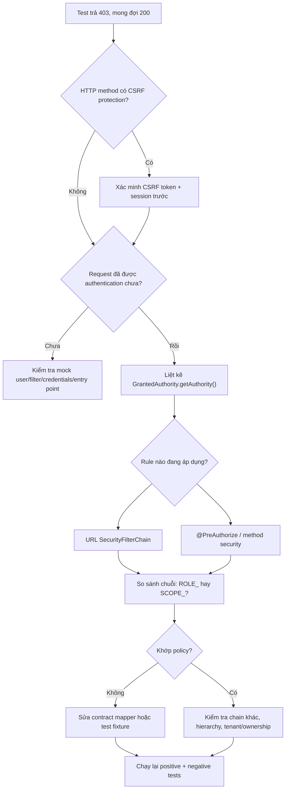

# Nhầm roles với authorities hoặc lặp tiền tố ROLE_

Một bài kiểm thử phân quyền có thể thất bại với HTTP **403 Forbidden** dù người học chắc chắn đã cấp “quyền ADMIN” cho user kiểm thử. Lỗi đôi khi nằm ở việc nhầm giữa `roles` và `authorities`: dữ liệu thực sự nằm trong `Authentication.getAuthorities()` là `ROLE_ADMIN`, nhưng rule lại kiểm tra `ADMIN`; hoặc ứng dụng tạo ra `ROLE_ROLE_ADMIN` do ghép tiền tố hai lần.

Trong chương **Chẩn đoán sự cố** của module `SPRING_SECURITY_TESTING`, bài này hướng dẫn xác định đúng nguồn lỗi: **test fixture**, **cách ánh xạ role/claim**, **biểu thức authorization**, hay **filter chain/method security**. Các ví dụ bao gồm `@WithMockUser`, `MockMvc`, `WebTestClient` và JWT/OAuth2 để người học kiểm chứng cả trường hợp được phép và bị từ chối, thay vì chỉ sửa test cho trả 200.

> **Quy tắc cần nhớ:** Trong cấu hình mặc định, `hasRole("ADMIN")` kiểm tra một authority có tên **`ROLE_ADMIN`**, còn `hasAuthority("ADMIN")` kiểm tra **chính xác** chuỗi `ADMIN`. `roles("ADMIN")` trong các helper thường **tạo** `ROLE_ADMIN`; `authorities("ROLE_ADMIN")` sử dụng nguyên chuỗi đã đưa vào.

Không phải mọi hệ thống đều giữ tiền tố mặc định: một số dự án cấu hình `GrantedAuthorityDefaults`, custom expression handlers, converter hoặc authorization managers. Vì thế, hãy kiểm tra **danh sách authorities thực tế** và **rule thực tế** trước khi kết luận chỉ từ tên “role”.

## 1. Phân biệt role và GrantedAuthority

Spring Security đưa các quyền đã được công nhận vào `Authentication.getAuthorities()` dưới dạng các đối tượng triển khai `GrantedAuthority`. Với `SimpleGrantedAuthority`, thông tin quyết định là chuỗi trả về từ `getAuthority()`.

Ví dụ:

```java
Authentication authentication =
    SecurityContextHolder.getContext().getAuthentication();

authentication.getAuthorities().forEach(authority ->
    System.out.println(authority.getAuthority())
);
```

Trong một request của Alice, kết quả **có thể** là:

```text
ROLE_ADMIN
SCOPE_orders.read
```

Đây là **hai chuỗi authority độc lập**. `ROLE_ADMIN` không tự hàm ý `SCOPE_orders.read`; tương tự, có `SCOPE_orders.read` không mặc nhiên trở thành `ROLE_ADMIN`.

**Role** trong Spring Security thường là một quy ước đặt tên authority với tiền tố `ROLE_`. Nó không bắt buộc là một kiểu token khác biệt. Nhiều phương thức cấu hình dùng tên “role” để tự thêm tiền tố, còn phương thức “authority” nhận đúng chuỗi mong muốn.

### 1.1. Các phép kiểm tra thông dụng

| Biểu thức / API | Giá trị kỳ vọng trong `GrantedAuthority.getAuthority()` khi dùng tiền tố mặc định |
| --- | --- |
| `hasRole("ADMIN")` | `ROLE_ADMIN` |
| `hasAnyRole("ADMIN", "SUPPORT")` | `ROLE_ADMIN` hoặc `ROLE_SUPPORT` |
| `hasAuthority("ROLE_ADMIN")` | `ROLE_ADMIN` |
| `hasAuthority("ADMIN")` | `ADMIN` |
| `hasAuthority("SCOPE_orders.read")` | `SCOPE_orders.read` |
| `hasAnyAuthority("ROLE_ADMIN", "SCOPE_orders.read")` | Một trong hai chuỗi nêu trên |

Chính sách có thể thay đổi nếu sử dụng role hierarchy, custom role prefix hoặc authorization manager đặc biệt. Bảng trên mô tả hành vi thông dụng của các cấu hình mặc định, là điểm khởi đầu tốt để chẩn đoán.

### 1.2. Vì sao “người dùng có role ADMIN” vẫn nhận 403?

Câu “Alice có ADMIN” chưa đủ để debug. Cần viết lại thành ba thông tin cụ thể:

1. **Authentication:** user đã được xác thực chưa? `Authentication.isAuthenticated()` có giá trị nào, có phải anonymous không?
2. **Authorities thực tế:** chuỗi trong `authentication.getAuthorities()` là `ADMIN`, `ROLE_ADMIN` hay `ROLE_ROLE_ADMIN`?
3. **Rule:** endpoint đang dùng `hasRole("ADMIN")`, `hasAuthority("ADMIN")` hay `hasAuthority("ROLE_ADMIN")`, và có một rule khác trong filter chain/method security không?

Chỉ khi biết cả ba mới kết luận được lỗi. Nếu request chưa được xác thực, 401 hoặc redirect có thể xảy ra trước cả bước so sánh role.

## 2. Cách các helper trong spring-security-test tạo authorities

Các API tên gần giống nhau nhưng **không nhận cùng loại giá trị**.

```java
// Dùng role name, không có tiền tố.
@WithMockUser(username = "alice", roles = "ADMIN")

// Dùng chính xác authority string, đã có tiền tố.
@WithMockUser(username = "alice", authorities = "ROLE_ADMIN")
```

Trong cấu hình mặc định của test support, hai khai báo trên tạo cùng một authority quan trọng: `ROLE_ADMIN`.

Trái lại:

```java
@WithMockUser(username = "alice", authorities = "ADMIN")
```

tạo authority chính xác là `ADMIN`, **không** tự chuyển thành `ROLE_ADMIN`. Nếu endpoint dùng `hasRole("ADMIN")`, Alice ở ví dụ thứ ba thường nhận 403.

### 2.1. Bảng tra nhanh những cặp dễ nhầm

| Cách cấp quyền trong test | Authority được tạo | Rule thường cho phép |
| --- | --- | --- |
| `@WithMockUser(roles = "ADMIN")` | `ROLE_ADMIN` | `hasRole("ADMIN")` |
| `@WithMockUser(authorities = "ROLE_ADMIN")` | `ROLE_ADMIN` | `hasAuthority("ROLE_ADMIN")` hoặc `hasRole("ADMIN")` |
| `@WithMockUser(authorities = "ADMIN")` | `ADMIN` | `hasAuthority("ADMIN")` |
| `with(user("alice").roles("ADMIN"))` | `ROLE_ADMIN` | `hasRole("ADMIN")` |
| `with(user("alice").authorities(new SimpleGrantedAuthority("ROLE_ADMIN")))` | `ROLE_ADMIN` | `hasRole("ADMIN")` |
| `mockUser("alice").roles("ADMIN")` trong WebFlux | `ROLE_ADMIN` | Reactive `hasRole("ADMIN")` |
| JWT scope `admin` theo mapping mặc định | Thường là `SCOPE_admin` | `hasAuthority("SCOPE_admin")` |

Không phải test helper nào cũng tự đưa roles từ một JWT claim thành `ROLE_...`. Riêng JWT, cần phân biệt **claims của token**, **GrantedAuthorities được converter tạo**, và **test postprocessor có thể bypass converter**.

### 2.2. Tránh truyền tiền tố vào API roles(...)

Sai lầm phổ biến:

```java
// Không nên làm:
@WithMockUser(roles = "ROLE_ADMIN")

// Hoặc:
mvc.perform(get("/api/admin")
    .with(user("alice").roles("ROLE_ADMIN")));
```

Những API `roles(...)` phổ biến của Spring Security Test dự kiến tên role **không có `ROLE_`**, và thường từ chối input đã có tiền tố bằng lỗi trong test setup. Lỗi xảy ra trước khi kiểm tra HTTP, nên không nên diễn giải nó là endpoint trả 403.

Cách sửa:

```java
// Chọn một trong hai:
@WithMockUser(roles = "ADMIN")

// Hoặc nếu dữ liệu đã là authority string:
@WithMockUser(authorities = "ROLE_ADMIN")
```

**Đừng “sửa” bằng cách dùng `roles("ROLE_ROLE_ADMIN")`.** Điều đó chỉ thêm một lớp nhầm lẫn. Hãy quyết định rõ giá trị ở ranh giới là **tên role** (`ADMIN`) hay **chuỗi authority đã hoàn chỉnh** (`ROLE_ADMIN`).

## 3. Khi nào xuất hiện ROLE_ROLE_ADMIN?

Trường hợp lặp tiền tố thường đến từ **hai bước cùng làm công việc thêm `ROLE_`**.

Ví dụ một hệ thống lưu role trong database dưới dạng `ROLE_ADMIN`. Service tải role rồi lại ghép thêm:

```java
String storedRole = "ROLE_ADMIN";

// Sai nếu dữ liệu trong DB đã có prefix:
GrantedAuthority authority =
    new SimpleGrantedAuthority("ROLE_" + storedRole);

// Kết quả: ROLE_ROLE_ADMIN
```

Với endpoint:

```java
.requestMatchers("/api/admin").hasRole("ADMIN")
```

rule tìm `ROLE_ADMIN`, nhưng user chỉ có `ROLE_ROLE_ADMIN`, nên request bị 403 dù tên chuỗi có chứa “ADMIN”.

### 3.1. Bốn nguồn dẫn đến tiền tố lặp

1. **Database/enum lưu role đã có prefix**, service vẫn nối `"ROLE_" + role`.
2. **JWT converter được cấu hình `ROLE_`**, trong khi JWT claim `roles` đã chứa `ROLE_ADMIN`.
3. **Tầng mapper hoặc adapter làm chuẩn hóa nhiều lần**, ví dụ user-details mapper đã prefix nhưng test fixture lại prefix thêm.
4. **Cấu hình migration**, chuyển từ lưu `ADMIN` sang `ROLE_ADMIN` nhưng logic cũ vẫn bổ sung prefix.

Cần xem input/output tại mỗi điểm, thay vì sửa quyền của tất cả endpoint để chấp nhận một authority bị lặp.

### 3.2. Chuẩn hóa role nên xảy ra ở một nơi

Chọn **một contract lưu trữ**, ví dụ:

- DB hoặc domain layer lưu role logic `ADMIN`, không có prefix.
- Tầng chuyển role logic sang Spring Security `GrantedAuthority` thêm `ROLE_` **một lần**.
- Các tầng đã nhận `GrantedAuthority` không tiếp tục biến đổi tiền tố.

Ví dụ:

```java
import org.springframework.security.core.GrantedAuthority;
import org.springframework.security.core.authority.SimpleGrantedAuthority;

static GrantedAuthority toAuthority(String roleName) {
    if (roleName == null || roleName.isBlank()) {
        throw new IllegalArgumentException("Missing role name");
    }
    if (roleName.startsWith("ROLE_")) {
        throw new IllegalArgumentException(
            "Expected a domain role without ROLE_ prefix"
        );
    }
    return new SimpleGrantedAuthority("ROLE_" + roleName);
}
```

Hợp đồng **từ chối input đã prefix** có thể phù hợp khi dữ liệu nguồn được quy định là role name. Trong hệ thống đang lưu authorities hoàn chỉnh, đừng dùng mapper này; hãy giữ nguyên `ROLE_ADMIN` từ nguồn đã được tin cậy.

Không nên coi `startsWith("ROLE_")` là cơ chế xác thực dữ liệu đầu vào đến từ client. Việc client tự gửi `ROLE_ADMIN` không được biến thành quyền admin chỉ vì chuỗi có đúng định dạng. Nguồn role phải đáng tin (user store, IdP claim đã được xác minh, mapping theo policy).

### 3.3. Unit test phát hiện lặp tiền tố

```java
import org.junit.jupiter.api.Test;
import static org.assertj.core.api.Assertions.assertThat;
import static org.junit.jupiter.api.Assertions.assertThatThrownBy;

class RoleAuthorityMapperTest {

    @Test
    void plainDomainRoleGetsOnePrefix() {
        assertThat(toAuthority("ADMIN").getAuthority())
            .isEqualTo("ROLE_ADMIN");
    }

    @Test
    void alreadyPrefixedInputIsRejectedByContract() {
        assertThatThrownBy(() -> toAuthority("ROLE_ADMIN"))
            .isInstanceOf(IllegalArgumentException.class);
    }
}
```

Nếu domain contract của bạn chủ đích cho phép cả `ADMIN` lẫn `ROLE_ADMIN`, có thể làm chuẩn hóa idempotent, nhưng cần viết quy tắc rõ ràng và test mọi trường hợp. Đừng âm thầm chấp nhận input `ROLE_ROLE_ADMIN` rồi “sửa” nó bằng cách xóa prefix nhiều lần, vì như vậy lỗi upstream sẽ khó phát hiện.

## 4. Ví dụ Spring MVC: hasRole và hasAuthority không thay thế tùy tiện

Giả sử một ứng dụng Spring Boot Servlet có hai endpoint:

- `GET /api/admin`: yêu cầu role admin.
- `GET /api/audit`: yêu cầu một authority nghiệp vụ chính xác `audit:read`.

### 4.1. SecurityFilterChain

```java
import org.springframework.context.annotation.Bean;
import org.springframework.context.annotation.Configuration;
import org.springframework.security.config.Customizer;
import org.springframework.security.config.annotation.web.builders.HttpSecurity;
import org.springframework.security.web.SecurityFilterChain;

@Configuration
class AuthorityDemoSecurityConfig {

    @Bean
    SecurityFilterChain securityFilterChain(HttpSecurity http)
            throws Exception {
        return http
            .authorizeHttpRequests(auth -> auth
                .requestMatchers("/api/admin").hasRole("ADMIN")
                .requestMatchers("/api/audit")
                    .hasAuthority("audit:read")
                .anyRequest().authenticated()
            )
            .httpBasic(Customizer.withDefaults())
            .build();
    }
}
```

Có thể dùng `hasAuthority("ROLE_ADMIN")` thay cho `hasRole("ADMIN")` **trong trường hợp này**, nếu muốn viết rõ authority đầy đủ. Không dùng `hasAuthority("ADMIN")` chỉ vì thấy chữ “ADMIN” trong cấu hình cũ; nó yêu cầu một chuỗi khác.

### 4.2. Controller trả dữ liệu đơn giản

```java
import org.springframework.web.bind.annotation.GetMapping;
import org.springframework.web.bind.annotation.RestController;

@RestController
class AuthorityDemoController {

    @GetMapping("/api/admin")
    String admin() {
        return "admin-only";
    }

    @GetMapping("/api/audit")
    String audit() {
        return "audit-visible";
    }
}
```

Endpoint GET giúp test phân quyền không bị nhiễu bởi CSRF. Nếu test một POST bị 403, phải kiểm tra thêm CSRF trước khi kết luận thiếu role.

### 4.3. Tạo MockMvc test chứa cả trường hợp đúng và sai

Dependency ví dụ:

```groovy
dependencies {
    implementation 'org.springframework.boot:spring-boot-starter-web'
    implementation 'org.springframework.boot:spring-boot-starter-security'

    testImplementation 'org.springframework.boot:spring-boot-starter-test'
    testImplementation 'org.springframework.security:spring-security-test'
}
```

Một test class có thể viết:

```java
import org.junit.jupiter.api.Test;
import org.springframework.beans.factory.annotation.Autowired;
import org.springframework.boot.test.autoconfigure.web.servlet.AutoConfigureMockMvc;
import org.springframework.boot.test.context.SpringBootTest;
import org.springframework.test.web.servlet.MockMvc;

import static org.springframework.security.test.web.servlet.request
    .SecurityMockMvcRequestPostProcessors.user;
import static org.springframework.test.web.servlet.request
    .MockMvcRequestBuilders.get;
import static org.springframework.test.web.servlet.result
    .MockMvcResultMatchers.content;
import static org.springframework.test.web.servlet.result
    .MockMvcResultMatchers.status;

@SpringBootTest
@AutoConfigureMockMvc
class RoleVersusAuthorityMvcTest {

    @Autowired
    MockMvc mvc;

    @Test
    void adminRoleProducesRoleAdminAuthority() throws Exception {
        mvc.perform(get("/api/admin")
                .with(user("alice").roles("ADMIN")))
            .andExpect(status().isOk())
            .andExpect(content().string("admin-only"));
    }

    @Test
    void exactRoleAdminAuthorityAlsoPasses() throws Exception {
        mvc.perform(get("/api/admin")
                .with(user("alice").authorities(
                    new org.springframework.security.core.authority
                        .SimpleGrantedAuthority("ROLE_ADMIN"))))
            .andExpect(status().isOk());
    }

    @Test
    void unprefixedAdminAuthorityDoesNotPassHasRole()
            throws Exception {
        mvc.perform(get("/api/admin")
                .with(user("alice").authorities(
                    new org.springframework.security.core.authority
                        .SimpleGrantedAuthority("ADMIN"))))
            .andExpect(status().isForbidden());
    }

    @Test
    void duplicatedRolePrefixDoesNotPassHasRole()
            throws Exception {
        mvc.perform(get("/api/admin")
                .with(user("alice").authorities(
                    new org.springframework.security.core.authority
                        .SimpleGrantedAuthority("ROLE_ROLE_ADMIN"))))
            .andExpect(status().isForbidden());
    }

    @Test
    void independentBusinessAuthorityIsCheckedLiterally()
            throws Exception {
        mvc.perform(get("/api/audit")
                .with(user("alice").authorities(
                    new org.springframework.security.core.authority
                        .SimpleGrantedAuthority("audit:read"))))
            .andExpect(status().isOk())
            .andExpect(content().string("audit-visible"));
    }

    @Test
    void havingAdminRoleDoesNotImplyAuditReadAuthority()
            throws Exception {
        mvc.perform(get("/api/audit")
                .with(user("alice").roles("ADMIN")))
            .andExpect(status().isForbidden());
    }
}
```

Bộ test chứng minh **chuỗi GrantedAuthority và URL rule** có khớp nhau hay không. Nó chưa xác minh password Alice vì `with(user(...))` tạo authentication trực tiếp trong test. Nếu cần kiểm tra credentials thật, dùng `httpBasic("alice", "password")` với `UserDetailsService` và `AuthenticationProvider` phù hợp.

### 4.4. Không chỉ assert 200

Một bài test chỉ có:

```java
mvc.perform(get("/api/admin")
        .with(user("alice").roles("ADMIN")))
    .andExpect(status().isOk());
```

không bắt được việc ai đó sửa `hasRole("ADMIN")` thành `permitAll()`. Cần có ca deny với anonymous và user không đủ quyền. Với ứng dụng HTTP Basic API ví dụ, request anonymous sẽ thường nhận 401:

```java
@Test
void anonymousCannotAccessAdminEndpoint() throws Exception {
    mvc.perform(get("/api/admin"))
        .andExpect(status().isUnauthorized());
}
```

Trong ứng dụng form login, request anonymous có thể chuyển hướng đến `/login` thay vì 401. Test phải kiểm tra entry point đã được cấu hình, không coi mọi 403 đều là lỗi prefix.

## 5. Chẩn đoán lỗi @WithMockUser khi kết quả khác mong đợi

`@WithMockUser` thiết lập authentication trong test security context. Cách khai báo rất quan trọng.

### 5.1. Hai ca tương đương theo quy ước mặc định

```java
@Test
@WithMockUser(username = "alice", roles = "ADMIN")
void worksWithRole() throws Exception {
    mvc.perform(get("/api/admin"))
        .andExpect(status().isOk());
}

@Test
@WithMockUser(username = "alice",
              authorities = "ROLE_ADMIN")
void worksWithExactAuthority() throws Exception {
    mvc.perform(get("/api/admin"))
        .andExpect(status().isOk());
}
```

Import `org.springframework.security.test.context.support.WithMockUser`. Với security filters và listener của Spring Security Test được tích hợp, cả hai cấp authority cần thiết cho `hasRole("ADMIN")`.

### 5.2. Cặp không tương đương

```java
@Test
@WithMockUser(username = "alice",
              authorities = "ADMIN")
void bareAuthorityDoesNotMeetRoleRule() throws Exception {
    mvc.perform(get("/api/admin"))
        .andExpect(status().isForbidden());
}
```

Không nên đổi `hasRole("ADMIN")` thành `hasAuthority("ADMIN")` chỉ để test xanh nếu chính sách sản phẩm thực sự lưu role `ROLE_ADMIN`. Hãy sửa test fixture hoặc tầng mapper nào bị sai theo đúng contract nguồn dữ liệu.

### 5.3. Không khai báo roles và authorities như thể chúng được cộng dồn

Ví dụ không phù hợp:

```java
// Không coi đây là cách cộng thêm hai nhóm quyền:
@WithMockUser(roles = "ADMIN",
              authorities = "SCOPE_reports.read")
```

Ở các phiên bản Spring Security Test thông dụng, factory cho `@WithMockUser` không cho phép đồng thời cung cấp `roles` và `authorities` không rỗng. Nếu cần một principal có **cả** `ROLE_ADMIN` và `SCOPE_reports.read`, hãy dùng `authorities` cho cả hai chuỗi:

```java
@WithMockUser(authorities = {
    "ROLE_ADMIN", "SCOPE_reports.read"
})
```

Tương tự với `with(user(...).authorities(...))`: đưa đủ `SimpleGrantedAuthority` vào cùng danh sách, tránh giả định `roles(...)` và `authorities(...)` trong builder sẽ tự cộng dồn trong mọi cách dùng.

## 6. Quan sát Authentication và authorities thực sự nhận được

Khi bài test trả 403, đừng sửa ngẫu nhiên tên role. Cần chẩn đoán ở ranh giới thích hợp.

### 6.1. Đọc authorities trong unit test

Nếu hệ thống có `UserDetailsService`, test riêng mapper/user service:

```java
import org.junit.jupiter.api.Test;
import org.springframework.security.core.userdetails.UserDetails;

import static org.assertj.core.api.Assertions.assertThat;

@Test
void loadedUserHasExpectedAuthorities() {
    UserDetails alice = userDetailsService
        .loadUserByUsername("alice");

    assertThat(alice.getAuthorities())
        .extracting("authority")
        .contains("ROLE_ADMIN")
        .doesNotContain("ROLE_ROLE_ADMIN");
}
```

Khi test này thất bại, lỗi có thể ở mapping từ database/roles/claims sang authorities. Không cần chạy full HTTP integration để chứng minh một chuỗi mapper bị lặp tiền tố.

Nếu dùng `User.withUsername(...).roles("ADMIN")` cho fixture, hãy kiểm tra kết quả thực sự là `ROLE_ADMIN`. Không thêm `ROLE_` một lần nữa ở phần chuyển đối tượng user sang `GrantedAuthority`.

### 6.2. Kiểm tra Authentication trong MockMvc response matchers

Spring Security Test có matcher:

```java
import static org.springframework.security.test.web.servlet.response
    .SecurityMockMvcResultMatchers.authenticated;

mvc.perform(get("/api/admin")
        .with(user("alice").roles("ADMIN")))
    .andExpect(status().isOk())
    .andExpect(authenticated()
        .withAuthorities(
            new SimpleGrantedAuthority("ROLE_ADMIN")
        ));
```

Snippet dùng import `SimpleGrantedAuthority` từ `org.springframework.security.core.authority`. Matcher này cung cấp thêm một assertion về authentication trong request test; nó không thay kiểm tra HTTP Basic/JWT decoder thực khi mục tiêu là xác minh credentials.

Nếu matcher không phù hợp với cách test hiện tại, có thể kiểm tra `Authentication.getAuthorities()` tại một service fixture hoặc trong unit test mapper; đừng thêm endpoint công khai trả toàn bộ security context chỉ để debug production.

### 6.3. Chỉ in dữ liệu được phép khi debug

Trong môi trường test, việc in tạm **danh sách tên authorities** có thể hữu ích:

```java
List<String> authorityNames = authentication
    .getAuthorities()
    .stream()
    .map(GrantedAuthority::getAuthority)
    .toList();
```

Không log password, `Authorization` header, Bearer token, session cookie hoặc toàn bộ `Authentication.getCredentials()`. Khi gửi trace vào CI, cần giới hạn dữ liệu nhạy cảm và xóa log tạm sau điều tra.

### 6.4. Kiểm tra rule thực sự chạy ở tầng nào

Một request có thể bị chặn bởi nhiều lớp:

- `authorizeHttpRequests(...)` trong `SecurityFilterChain`.
- `@PreAuthorize(...)` hoặc `@PostAuthorize(...)` trong method security (khi được bật).
- `@Secured(...)` hoặc JSR-250 annotations khi được cấu hình.
- Domain-level ownership/tenant rules bên trong service.
- CSRF filter, login entry point hoặc custom authentication filter trước khi vào controller.

Nếu URL rule cấp quyền nhưng method rule từ chối, HTTP vẫn là 403. Việc sửa `hasRole(...)` ở URL layer chưa chắc thay đổi kết quả; hãy tìm cả method-level annotations.

## 7. Method Security: hasRole trong @PreAuthorize

Khi ứng dụng bật `@EnableMethodSecurity`, biểu thức bảo vệ service hoặc controller method có thể có các quy tắc tương tự URL authorization.

```java
import org.springframework.security.access.prepost.PreAuthorize;
import org.springframework.stereotype.Service;

@Service
class AdminAuditService {

    @PreAuthorize("hasRole('ADMIN')")
    public String onlyAdmin() {
        return "admin-result";
    }

    @PreAuthorize("hasAuthority('audit:read')")
    public String viewAudit() {
        return "audit-result";
    }
}
```

Với prefix mặc định:

- `onlyAdmin()` yêu cầu authority `ROLE_ADMIN`.
- `viewAudit()` yêu cầu chính xác `audit:read`.

Có thể test bằng Spring application context đã bật method security:

```java
import org.junit.jupiter.api.Test;
import org.springframework.beans.factory.annotation.Autowired;
import org.springframework.boot.test.context.SpringBootTest;
import org.springframework.security.access.AccessDeniedException;
import org.springframework.security.test.context.support.WithMockUser;

import static org.assertj.core.api.Assertions.assertThat;
import static org.assertj.core.api.Assertions.assertThatThrownBy;

@SpringBootTest
class AdminAuditMethodSecurityTest {

    @Autowired
    AdminAuditService service;

    @Test
    @WithMockUser(roles = "ADMIN")
    void adminCanInvokeProtectedService() {
        assertThat(service.onlyAdmin()).isEqualTo("admin-result");
    }

    @Test
    @WithMockUser(authorities = "ADMIN")
    void plainAdminAuthorityIsNotAdminRole() {
        assertThatThrownBy(() -> service.onlyAdmin())
            .isInstanceOf(AccessDeniedException.class);
    }
}
```

Để test có ý nghĩa, context phải có cấu hình `@EnableMethodSecurity` và lời gọi phải đi qua **Spring proxy** của service. Gọi trực tiếp `new AdminAuditService()` hoặc tự gọi method nội bộ trong cùng bean (self-invocation) có thể bỏ qua method security, làm test xanh giả.

### 7.1. @Secured và @RolesAllowed có quy ước khác nhau

Tùy cách bật method security:

- `@Secured("ROLE_ADMIN")` thường làm việc với chuỗi authority có prefix đầy đủ.
- `@RolesAllowed("ADMIN")` (JSR-250) thể hiện tên role và thường áp dụng quy tắc role prefix được cấu hình.
- `@PreAuthorize("hasRole('ADMIN')")` dùng phép kiểm role theo biểu thức.
- `@PreAuthorize("hasAuthority('ROLE_ADMIN')")` kiểm chuỗi chính xác.

Đừng thay `@Secured("ROLE_ADMIN")` bằng `@RolesAllowed("ROLE_ADMIN")` theo kiểu tìm-và-thay, vì semantics của annotation và cấu hình prefix có thể khác nhau. Xem method security được bật bằng những options nào trong version của ứng dụng.

## 8. JWT: SCOPE_ không phải ROLE_

Một nguồn lỗi rất thường gặp khi học Spring Security Resource Server: JWT có scope `admin` hoặc `orders.read`, nhưng endpoint dùng `hasRole("ADMIN")`. Spring Security JWT Resource Server mặc định thường ánh xạ các claims `scope` hoặc `scp` thành authorities với tiền tố **`SCOPE_`**, không phải `ROLE_`.

Ví dụ JWT payload mang:

```json
{
  "sub": "alice",
  "scope": "orders.read admin"
}
```

Với `JwtGrantedAuthoritiesConverter` mặc định trong nhiều phiên bản Security 6.x, các authority là:

```text
SCOPE_orders.read
SCOPE_admin
```

Do đó:

| Rule | Với token trên |
| --- | --- |
| `hasAuthority("SCOPE_orders.read")` | Cho phép nếu token được xác minh và request đã xác thực |
| `hasAuthority("SCOPE_admin")` | Cho phép nếu đủ điều kiện khác |
| `hasRole("ADMIN")` | **Không** tự khớp vì thiếu `ROLE_ADMIN` |
| `hasAuthority("ROLE_ADMIN")` | **Không** khớp |
| `hasAuthority("admin")` | **Không** khớp |

**Không tự quy đổi một scope thành role quản trị** nếu chính sách không cho phép. Scope thường là quyền được cấp cho token khi truy cập tài nguyên, còn role có thể đến từ nguồn quản lý người dùng/tổ chức khác. Nếu ứng dụng quyết định scope `admin` tương đương quyền quản trị, cần ghi rõ lý do và test chính sách đó.

### 8.1. Với JWT helper, claims không luôn quyết định authorities

Ví dụ:

```java
mvc.perform(get("/api/admin")
        .with(jwt().jwt(token ->
            token.claim("roles", List.of("ADMIN")))))
    .andExpect(status().isForbidden());
```

Đây là một **ca minh họa cho cấu hình thông dụng** khi `jwt()` postprocessor không được chỉ định authorities tùy biến. Việc thêm claim `roles` vào Jwt object không có nghĩa helper sẽ gọi `JwtAuthenticationConverter` production hoặc tự tạo `ROLE_ADMIN`. Các authorities của test postprocessor là dữ liệu cấu hình riêng.

Để test authorization rõ ràng, đặt authorities một cách tường minh:

```java
mvc.perform(get("/api/admin")
        .with(jwt().authorities(
            new SimpleGrantedAuthority("ROLE_ADMIN"))))
    .andExpect(status().isOk());
```

Nhưng đây vẫn là **authorization test với JWT giả lập**; nó không chứng minh JWT decoder đã kiểm tra chữ ký hoặc JWT claims được convert thành authorities thật. Khi test conversion, cần unit test converter; khi test xác thực Bearer thực, gửi compact JWT được ký bằng test key trong header HTTP.

### 8.2. Cấu hình JwtGrantedAuthoritiesConverter theo contract

Giả sử issuer tin cậy trả claim:

```json
{
  "sub": "alice",
  "roles": ["ADMIN", "SUPPORT"]
}
```

Nếu hệ thống *chủ đích* coi những role này thành Spring Security roles, có thể cấu hình converter để thêm `ROLE_` **một lần**.

```java
import org.springframework.context.annotation.Bean;
import org.springframework.security.oauth2.server.resource.authentication.JwtAuthenticationConverter;
import org.springframework.security.oauth2.server.resource.authentication.JwtGrantedAuthoritiesConverter;

@Bean
JwtAuthenticationConverter jwtAuthenticationConverter() {
    JwtGrantedAuthoritiesConverter granted =
        new JwtGrantedAuthoritiesConverter();

    granted.setAuthoritiesClaimName("roles");
    granted.setAuthorityPrefix("ROLE_");

    JwtAuthenticationConverter converter =
        new JwtAuthenticationConverter();
    converter.setJwtGrantedAuthoritiesConverter(granted);
    return converter;
}
```

Trong cấu hình Resource Server Servlet:

```java
http.oauth2ResourceServer(oauth2 ->
    oauth2.jwt(jwt -> jwt
        .jwtAuthenticationConverter(jwtAuthenticationConverter())
    )
);
```

Đây là các đoạn cấu hình lắp vào class Spring `@Configuration` và `SecurityFilterChain` có sẵn, không phải chương trình Java đứng độc lập. Đảm bảo `JwtDecoder` thật sự xác minh JWT từ issuer tin cậy trước khi những claims được dùng để cấp authorities.

**Cảnh báo:** Nếu claim `roles` đã chứa `ROLE_ADMIN`, converter trên sẽ tạo `ROLE_ROLE_ADMIN`. Trong trường hợp đó, sửa **contract input** hoặc mapping; đừng chỉ đổi rule thành `hasRole("ROLE_ADMIN")` rồi sinh thêm tiền tố.

### 8.3. Test riêng JWT authorities converter

Có thể unit test converter mà không gọi IdP:

```java
import java.util.List;

import org.junit.jupiter.api.Test;
import org.springframework.security.oauth2.jwt.Jwt;
import org.springframework.security.oauth2.server.resource.authentication.JwtGrantedAuthoritiesConverter;

import static org.assertj.core.api.Assertions.assertThat;

class JwtRoleConverterTest {

    @Test
    void mapsPlainRoleClaimToExactlyOneRolePrefix() {
        Jwt jwt = Jwt.withTokenValue("synthetic-token")
            .header("alg", "RS256")
            .claim("sub", "alice")
            .claim("roles", List.of("ADMIN"))
            .build();

        JwtGrantedAuthoritiesConverter converter =
            new JwtGrantedAuthoritiesConverter();
        converter.setAuthoritiesClaimName("roles");
        converter.setAuthorityPrefix("ROLE_");

        assertThat(converter.convert(jwt))
            .extracting("authority")
            .containsExactly("ROLE_ADMIN");
    }

    @Test
    void alreadyPrefixedClaimNeedsContractCorrection() {
        Jwt jwt = Jwt.withTokenValue("synthetic-token")
            .header("alg", "RS256")
            .claim("roles", List.of("ROLE_ADMIN"))
            .build();

        JwtGrantedAuthoritiesConverter converter =
            new JwtGrantedAuthoritiesConverter();
        converter.setAuthoritiesClaimName("roles");
        converter.setAuthorityPrefix("ROLE_");

        assertThat(converter.convert(jwt))
            .extracting("authority")
            .containsExactly("ROLE_ROLE_ADMIN");
    }
}
```

Bài test thứ hai **cố tình mô tả lỗi** để chẩn đoán. Kết quả `ROLE_ROLE_ADMIN` không phải một authority khuyến nghị; nó chứng minh converter không thể tự biết claim đã được prefix. Trong code production, hãy làm rõ hợp đồng với IdP hoặc thêm mapper an toàn, được test riêng.

`Jwt.withTokenValue(...)` trong unit test tạo object `Jwt` để kiểm tra converter; nó không tạo JWT chữ ký thật. Phần JWT decoder/cryptographic validation thuộc một test integration khác.

### 8.4. Nếu muốn giữ cả scopes và roles

Một ứng dụng có thể cần cả `SCOPE_orders.read` và `ROLE_ADMIN` trong cùng `JwtAuthenticationToken`. Khi đó chỉ dùng một `JwtGrantedAuthoritiesConverter` đọc claim `roles` có thể **làm mất** những scope authorities mặc định nếu không chủ động kết hợp hai nguồn.

Thiết kế có thể là:

1. Một converter lấy `scope`/`scp` thành `SCOPE_...`.
2. Một converter riêng lấy `roles` thành `ROLE_...` theo contract tin cậy.
3. Ghép hai danh sách, loại bỏ trùng hợp lệ khi cần.
4. Test cụ thể các trường hợp token có cả hai claim, chỉ một claim và claim rỗng.

Đây là vấn đề **mapping authorities** chứ không phải vấn đề “thêm role vào @WithMockUser”. Việc test giả lập `with(jwt().authorities(...))` không tự chứng minh production JWT converter đã được gọi.

## 9. OAuth2/OIDC principal cũng có thể khác role của ứng dụng

Với OAuth2 Login hoặc OIDC Login, principal thường có các authorities theo kiểu như `OAUTH2_USER`, `OIDC_USER` và những authorities phụ thuộc mapping của ứng dụng. Những thông tin này **không mặc nhiên** trở thành `ROLE_ADMIN` chỉ vì provider có claim `role=admin` hoặc người dùng thuộc một nhóm ở IdP.

Một endpoint được bảo vệ bằng:

```java
.requestMatchers("/api/admin").hasRole("ADMIN")
```

cần authentication của người dùng sau login có đúng authority tương ứng, thường là `ROLE_ADMIN`.

Trong bài test downstream authorization có thể dùng:

```java
import static org.springframework.security.test.web.servlet.request
    .SecurityMockMvcRequestPostProcessors.oidcLogin;

mvc.perform(get("/api/admin").with(
        oidcLogin().authorities(
            new SimpleGrantedAuthority("ROLE_ADMIN"))))
    .andExpect(status().isOk());
```

Nếu test sử dụng `oidcLogin()`/`oauth2Login()` tạo sẵn authorities, nó không kiểm tra `OAuth2UserService`, `OidcUserService` hoặc custom `GrantedAuthoritiesMapper` đã ánh xạ role thật từ IdP. Muốn kiểm tra quá trình mapping, có thể test mapper riêng hoặc chạy luồng OAuth2/OIDC thật với một local IdP stub và callback, rồi kiểm tra authorities sau login.

### 9.1. Đừng nhầm scope với application role

| Nguồn dữ liệu | Ví dụ | Có tự tạo ROLE_ADMIN không? |
| --- | --- | --- |
| OAuth2 scope | `admin`, `orders.read` | Không mặc nhiên |
| OIDC claim | `groups: ["admins"]` | Không, trừ khi ứng dụng cấu hình mapper |
| User database | `role: "ADMIN"` | Tùy mapper/UserDetailsService |
| Spring Security Test `roles("ADMIN")` | Input role trong test | Có, thường tạo `ROLE_ADMIN` |
| `SimpleGrantedAuthority("ROLE_ADMIN")` | Chuỗi authority đã hoàn chỉnh | Có chính chuỗi đó, không thêm tiền tố |

Test phải phù hợp với authority model thực sự của sản phẩm. Đừng chỉ đổi `hasRole("ADMIN")` thành `hasAuthority("SCOPE_admin")` nếu điều đó mở quyền admin rộng hơn chính sách cho phép.

## 10. Reactive WebFlux: quy tắc giống nhau, công cụ kiểm thử khác

Trong WebFlux, `SecurityWebFilterChain` có các matcher tương tự, nhưng test thường dùng `WebTestClient` thay vì MockMvc.

Ví dụ:

```java
import org.springframework.context.annotation.Bean;
import org.springframework.context.annotation.Configuration;
import org.springframework.security.config.web.server.ServerHttpSecurity;
import org.springframework.security.web.server.SecurityWebFilterChain;

@Configuration
class ReactiveAuthoritySecurityConfig {

    @Bean
    SecurityWebFilterChain securityWebFilterChain(
            ServerHttpSecurity http) {
        return http
            .authorizeExchange(exchanges -> exchanges
                .pathMatchers("/api/admin").hasRole("ADMIN")
                .pathMatchers("/api/audit")
                    .hasAuthority("audit:read")
                .anyExchange().authenticated()
            )
            .httpBasic(httpBasic -> {})
            .build();
    }
}
```

Cùng controller có thể viết bằng `Mono<String>` hoặc trả dữ liệu tương ứng. Test WebFlux trong bộ nhớ cần gắn Spring Security test configurer vào client:

```java
import org.junit.jupiter.api.BeforeEach;
import org.junit.jupiter.api.Test;
import org.springframework.beans.factory.annotation.Autowired;
import org.springframework.boot.test.context.SpringBootTest;
import org.springframework.context.ApplicationContext;
import org.springframework.test.web.reactive.server.WebTestClient;

import static org.springframework.security.test.web.reactive.server
    .SecurityMockServerConfigurers.mockUser;
import static org.springframework.security.test.web.reactive.server
    .SecurityMockServerConfigurers.springSecurity;

@SpringBootTest(
    webEnvironment = SpringBootTest.WebEnvironment.MOCK
)
class ReactiveAuthorityWebTest {

    @Autowired
    ApplicationContext context;

    WebTestClient client;

    @BeforeEach
    void setUp() {
        client = WebTestClient.bindToApplicationContext(context)
            .apply(springSecurity())
            .configureClient()
            .build();
    }

    @Test
    void adminRoleIsAccepted() {
        client.mutateWith(mockUser("alice").roles("ADMIN"))
            .get()
            .uri("/api/admin")
            .exchange()
            .expectStatus().isOk();
    }

    @Test
    void bareAdminAuthorityIsNotRoleAdmin() {
        client.mutateWith(mockUser("alice").authorities(
                new SimpleGrantedAuthority("ADMIN")))
            .get()
            .uri("/api/admin")
            .exchange()
            .expectStatus().isForbidden();
    }
}
```

Import `org.springframework.security.core.authority.SimpleGrantedAuthority` và bảo đảm ứng dụng WebFlux có endpoint `/api/admin`; ví dụ trên tập trung vào security config/test, không tái sử dụng controller Servlet cùng bean trong một context có cả Web MVC và WebFlux vô tình.

**Không nhầm `mockUser()` với HTTP Basic thật.** Mock principal cấp danh tính trực tiếp cho test server; nếu muốn kiểm tra `ReactiveAuthenticationManager`/password verification, gửi `Authorization: Basic ...` qua `WebTestClient` và giữ security filter chain, user details service, password encoder thực.

### 10.1. Reactor Context không làm thay đổi tên role

Spring Security Reactive sử dụng `ReactiveSecurityContextHolder` và Reactor Context để truyền authentication. Điều này khác ThreadLocal của Servlet, nhưng **GrantedAuthority.getAuthority() vẫn là chuỗi quyền** được authorization manager so sánh theo cấu hình.

Nếu user đúng ở controller nhưng `hasRole("ADMIN")` vẫn bị 403, hãy kiểm tra authorities chứ không tự giả định Reactor Context bị mất. Ngược lại, nếu không có authentication, cần điều tra security context/test setup hoặc HTTP credentials trước khi debug role prefix.

## 11. Có nên đổi role prefix toàn cục?

Spring Security có các điểm cấu hình như `GrantedAuthorityDefaults` cho phép thay đổi default role prefix trong những cơ chế nhất định (đặc biệt các biểu thức/method security tùy phiên bản). Một số hệ thống chủ động dùng authorities không có `ROLE_` để phù hợp với identity store.

Tuy nhiên, **thay prefix toàn cục không phải bước đầu tiên để sửa một test 403**:

- Nhiều method/DSL dùng role helper, authority manager hoặc custom mapper có thể áp dụng tiền tố theo những cách khác nhau.
- Với các phiên bản/cơ chế sử dụng `AuthorityAuthorizationManager.hasRole(...)`, semantics thêm `ROLE_` có thể khác với expression handler được tùy biến.
- `@WithMockUser(roles="ADMIN")` và `User.withUsername(...).roles("ADMIN")` có quy tắc riêng khi dựng test/user fixtures; không được giả định một bean đổi prefix sẽ tự đồng bộ tất cả chúng.
- Thay prefix có thể làm **mở rộng hoặc thu hẹp quyền** ở hàng chục endpoint/method, tạo regression bảo mật khó thấy.

Nếu sản phẩm thực sự cần bỏ hoặc thay prefix, hãy lập danh sách các rule `hasRole`/`hasAuthority`, annotations, user-details mappers, JWT/OIDC converters và test fixtures, rồi kiểm tra 200/403 với mọi loại principal. Không chỉ đổi config rồi sửa expected status cho test xanh.

### 11.1. Role hierarchy cũng không tự giải quyết tiền tố sai

Một role hierarchy kiểu “ADMIN bao hàm USER” chỉ có tác dụng khi các authorities đầu vào và authorization managers/hierarchy được cấu hình phù hợp. Nó không biến `ROLE_ROLE_ADMIN` thành `ROLE_ADMIN` hoặc `SCOPE_admin` thành `ROLE_ADMIN` một cách tự động.

Nếu hệ thống có `RoleHierarchy`, hãy test rõ một user có `ROLE_ADMIN` có được thừa hưởng quyền dự kiến hay không, và thiếu role đó thì vẫn bị từ chối. Không dùng hierarchy để che lỗi mapper tạo authority sai tên.

## 12. Chẩn đoán 403 theo thứ tự, tránh đoán mò

Khi một bài test đang kỳ vọng 200 nhưng nhận 403, có thể theo quy trình:



### 12.1. Checklist ngắn để khoanh vùng

1. **HTTP method:** GET hay POST? 403 có thể đến từ CSRF không?
2. **Authentication:** Có principal đúng không, hay anonymous? Request đã qua manager/decoder thật chưa?
3. **Authorities:** In đúng danh sách authority names, không suy từ database role label hoặc JWT claims.
4. **Prefix:** Có `ROLE_ADMIN`, `ADMIN`, `ROLE_ROLE_ADMIN` hay `SCOPE_admin`?
5. **Rule:** `hasRole("ADMIN")`, `hasAuthority("ROLE_ADMIN")`, `hasAuthority("ADMIN")` hay method security?
6. **Mapping:** Chuỗi đã được prefix bao nhiêu lần? Mapper có loại bỏ hoặc thay claims không?
7. **Filter chain:** Test có bật filters không, URL có match đúng chain không?
8. **Negative tests:** Anonymous và user thiếu quyền vẫn bị từ chối sau khi sửa chứ?

Phải xác định chính xác **tầng sai**, tránh sửa security policy để hợp thức hóa dữ liệu test đã bị lệch.

### 12.2. Phân biệt các kết quả 401, 403 và 302

| Kết quả | Diễn giải phổ biến | Điều cần xác minh |
| --- | --- | --- |
| **401 Unauthorized** | API cần credentials hoặc token đã bị từ chối | Header Basic/Bearer, provider, decoder, entry point |
| **403 Forbidden** | Đã xác thực nhưng không đủ authority, hoặc CSRF/AccessDenied chặn | Authorities/rule/CSRF và các filters |
| **302/303 redirect** | Browser login flow hoặc handler redirect | Header `Location`, session, success/failure handler |
| **200 OK** | Request được xử lý thành công | Có phải URL vô tình `permitAll()` hoặc security filters bị tắt? |

Không chỉ dùng HTTP status để kết luận “role prefix sai”. Một GET API thiếu credentials và một POST thiếu CSRF có thể đi theo nhánh hoàn toàn khác. Kiểm tra preconditions và filter chain trước.

## 13. Những cách sửa khiến test xanh giả

### 13.1. Tắt security filters trong MockMvc

```java
@AutoConfigureMockMvc(addFilters = false)
```

Nếu test được dùng để chứng minh `hasRole("ADMIN")`, việc tắt filters có thể khiến controller trả 200 cho cả anonymous. Chỉ dùng filter-disabled setup trong controller unit test có mục đích rõ, không coi đó là security integration test.

### 13.2. Chuyển sang permitAll() để “xử lý lỗi”

```java
// Sai nếu endpoint cần ADMIN:
.requestMatchers("/api/admin").permitAll()
```

Điều này làm mất policy, không sửa authority mapping. Luôn giữ negative test anonymous và non-admin để bắt regression.

### 13.3. Gắn @WithMockUser(roles="ADMIN") vào mọi ca

Việc cấp sẵn ADMIN trong test có thể che lỗi mapper từ JWT, database hay IdP. Hãy dùng fixture đúng mục tiêu: `@WithMockUser` để test authorization; HTTP Basic thực để test provider; Bearer JWT ký bằng test key để test decoder và claim converter.

### 13.4. Tự chèn ROLE_ vào JWT claims không có contract

Khi issuer cung cấp role `ADMIN`, converter có thể thêm `ROLE_`. Nếu test sửa JWT fixture thành `ROLE_ADMIN` nhưng converter vẫn thêm `ROLE_`, sẽ tạo trùng prefix. Claim phải phản ánh contract của IdP, không phải chuỗi authority đã được map.

### 13.5. Thay hasRole bằng hasAuthority nhưng không hiểu yêu cầu

Chuyển:

```java
hasRole("ADMIN")
```

thành:

```java
hasAuthority("ADMIN")
```

thay đổi chuỗi được kiểm tra. Trong hệ thống dùng `ROLE_ADMIN`, bước đổi này có thể khiến admin thật bị 403 hoặc người có authority `ADMIN` từ nguồn khác được cho qua. Chỉ đổi khi policy và dữ liệu nguồn có chủ đích thay đổi.

### 13.6. Bỏ qua authorities trên request thực

Test với `with(user("alice").roles("ADMIN"))` pass không chứng minh DB user Alice hoặc JWT thật đã có role đó. Khi bug xảy ra trên production, cần test tầng **role mapper hoặc authentication provider** cùng với một request đi qua filter chain.

### 13.7. Sửa global role prefix mà không rà các điểm gọi

Một bean cấu hình prefix có thể ảnh hưởng một số biểu thức nhưng không thay mọi helper/converter/authorization manager. Sau khi đổi, phải có regression suite cho Servlet URL rules, method security, WebFlux và token conversion theo đúng đường thực thi.

## 14. Ma trận kiểm thử tối thiểu chống lỗi role/authority

| Ca kiểm thử | Dữ liệu/actor | Rule | Kỳ vọng |
| --- | --- | --- | --- |
| Role name hợp lệ | `roles("ADMIN")` → `ROLE_ADMIN` | `hasRole("ADMIN")` | 200 |
| Full authority hợp lệ | `authorities("ROLE_ADMIN")` | `hasRole("ADMIN")` | 200 |
| Bare authority | `authorities("ADMIN")` | `hasRole("ADMIN")` | 403 |
| Lặp prefix | `authorities("ROLE_ROLE_ADMIN")` | `hasRole("ADMIN")` | 403 |
| Business authority | `authorities("audit:read")` | `hasAuthority("audit:read")` | 200 |
| Role không đồng nghĩa business permission | `roles("ADMIN")` | `hasAuthority("audit:read")` | 403 nếu không có mapper/hierarchy |
| Anonymous | Không authentication | `hasRole("ADMIN")` | 401 hoặc redirect theo entry point |
| JWT scope đúng | `SCOPE_orders.read` | `hasAuthority("SCOPE_orders.read")` | 200 với token hợp lệ |
| JWT scope không phải role | `SCOPE_admin` | `hasRole("ADMIN")` | 403 |
| JWT role mapper đúng | Claim `roles=["ADMIN"]` → `ROLE_ADMIN` | `hasRole("ADMIN")` | 200 |
| JWT mapper prefix trùng | Claim `roles=["ROLE_ADMIN"]` + prefix `ROLE_` | `hasRole("ADMIN")` | 403 |
| Method security | `@PreAuthorize("hasRole('ADMIN')")` | `ROLE_ADMIN` | Cho phép |
| CSRF đang chặn | POST không CSRF token | Bất kỳ rule role nào | Thường 403, không kết luận prefix |

Ma trận có thể chạy ở nhiều tầng:

- **Unit mapper:** xác minh input role/claim được chuyển thành đúng `GrantedAuthority.getAuthority()`.
- **MockMvc/WebTestClient:** xác minh URL security và method security cho phép hoặc từ chối đúng.
- **HTTP integration:** xác minh credentials/Bearer token thật tạo authorities mong đợi và được filters áp dụng.
- **OAuth2/OIDC protocol integration:** xác minh principal/authorities sau callback hoặc user service mapping từ dữ liệu IdP đã được xác thực.

## 15. Bài thực hành

Một dự án có endpoint `GET /api/admin` với `hasRole("ADMIN")`. User Alice từ DB có role `ROLE_ADMIN`; sau một thay đổi mapper, mọi admin nhận 403 dù unit test controller vẫn xanh.

Hãy làm lần lượt:

1. **Chứng minh output mapper:** Viết unit test cho service tạo `UserDetails`/`GrantedAuthority`, assert có `ROLE_ADMIN` và không có `ROLE_ROLE_ADMIN`.
2. **Kiểm tra test fixture:** Viết `MockMvc` test với `with(user("alice").roles("ADMIN"))` và với `authorities(new SimpleGrantedAuthority("ROLE_ADMIN"))`; cả hai phải được phép.
3. **Chứng minh nhánh từ chối:** Thử `authorities("ADMIN")` và `authorities("ROLE_ROLE_ADMIN")`, kỳ vọng 403; thử anonymous bị từ chối.
4. **Kiểm tra dữ liệu nguồn:** Nếu DB lưu `ROLE_ADMIN`, sửa mapper để không thêm prefix lần nữa; hoặc thống nhất domain contract lưu `ADMIN` rồi prefix đúng một lần.
5. **Kiểm tra token:** Nếu API còn dùng JWT, thử claim `roles=["ADMIN"]` cùng `JwtGrantedAuthoritiesConverter`, assert `ROLE_ADMIN`. Thử `roles=["ROLE_ADMIN"]` để chứng minh tình huống prefix trùng nếu mapper không được điều chỉnh.
6. **Kiểm tra method security/Reactive:** Nếu có `@PreAuthorize` hoặc WebFlux chain khác, chạy các ca 200/403 tương ứng; không mặc định sửa một URL rule sẽ sửa mọi rule.
7. **Regression suite:** Giữ negative tests sau khi sửa để bảo đảm không vô tình mở endpoint bằng `permitAll()` hoặc chuyển sang một authority khác chính sách.

**Tiêu chí hoàn thành:** Người học giải thích được rằng role name `ADMIN`, full authority `ROLE_ADMIN` và JWT scope authority `SCOPE_admin` **không phải cùng một chuỗi**; chứng minh được `roles("ADMIN")` thêm prefix trong khi `authorities("ROLE_ADMIN")` giữ nguyên; truy ra nơi tạo `ROLE_ROLE_ADMIN` và sửa đúng tầng ánh xạ. Sau sửa, test 200 cho người đủ quyền và 403 cho người thiếu quyền đều phải còn đúng, thay vì chỉ làm một bài test “xanh” bằng cách nới policy bảo mật.

