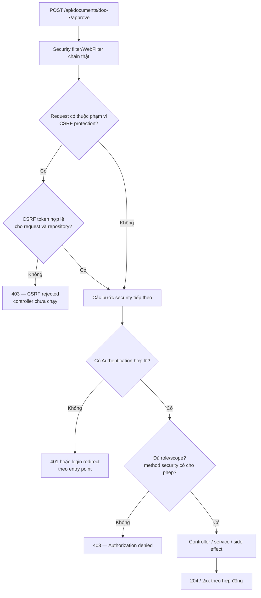
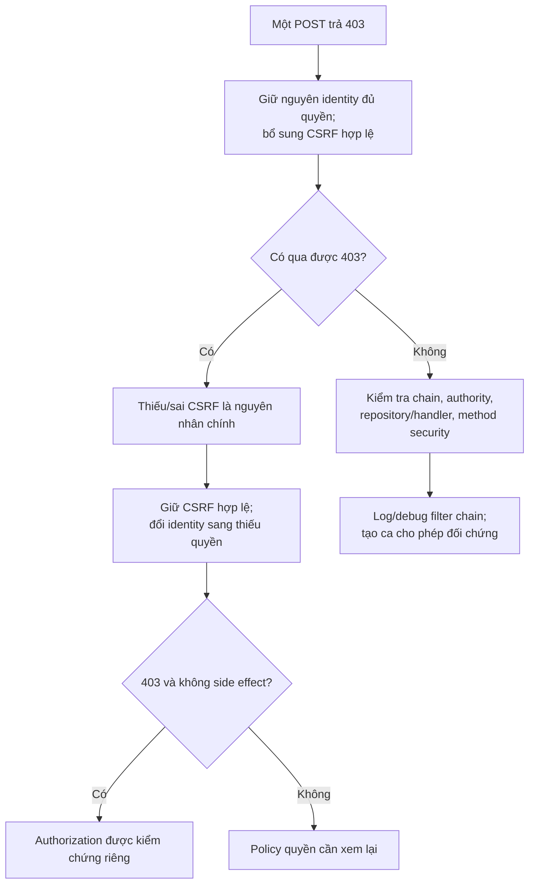
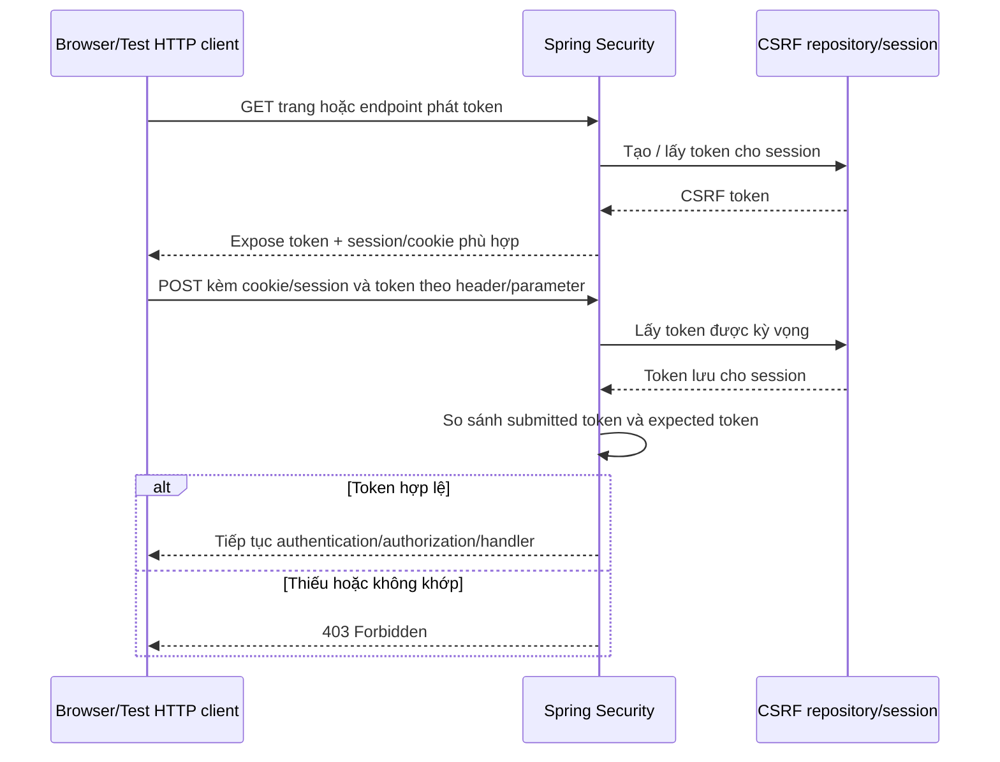

# 403 do CSRF nhưng bị hiểu là lỗi phân quyền

> **Chương:** Chẩn đoán sự cố  
> **Module:** `SPRING_SECURITY_TESTING`  
> **Mục tiêu:** Chẩn đoán chính xác một request bị `403 Forbidden` do CSRF thay vì do thiếu role/scope hoặc method security. Người học sử dụng `spring-security-test`, `MockMvc`, `WebTestClient`, `@WithMockUser`, `SecurityContext` và principal JWT/OAuth2/OIDC giả lập để thiết kế các ca được phép/bị từ chối **có đối chứng**, quan sát security filter chain và xác nhận không có side effect khi request bị chặn.

## 1. Một status 403 có thể che giấu hai nguyên nhân rất khác nhau

Giả sử API nội bộ nhận `POST /api/documents/doc-7/approve`, yêu cầu người dùng đã đăng nhập có `ROLE_APPROVER`. Một bài test viết:

```java
@Test
@WithMockUser(roles = "VIEWER")
void viewerCannotApprove() throws Exception {
    mvc.perform(post("/api/documents/doc-7/approve"))
        .andExpect(status().isForbidden());
}
```

Test xanh. Nhóm phát triển kết luận rule `hasRole("APPROVER")` đã hoạt động. Tuy nhiên, nếu ứng dụng đang bật CSRF, Spring Security có thể từ chối POST **trước khi kiểm tra role** vì request thiếu CSRF token. Thậm chí nếu ai đó vô tình thay rule thành `permitAll()`, test này vẫn có khả năng trả `403`.

Đây là dạng **false confidence**: assertion về HTTP status đúng, nhưng suy luận về nguyên nhân sai. Một regression test bảo mật có ý nghĩa phải phân biệt:

- **CSRF:** Request thay đổi trạng thái không đáp ứng chính sách chống Cross-Site Request Forgery.
- **Authorization:** Người dùng đã xác thực nhưng không có quyền đối với tài nguyên/hành động.
- **Authentication:** Request chưa có danh tính hợp lệ; tùy entry point có thể `401`, `302` hoặc một phản hồi khác.

Ba lớp kiểm soát có thể cùng áp dụng cho một request. Kết quả `403` không tự cho biết lớp nào đã từ chối.

### 1.1. Phân biệt tình huống bằng cách thay một biến mỗi lần

| Danh tính | Quyền cho POST | CSRF token | Kết quả mẫu | Nguyên nhân có thể suy ra |
| --- | --- | --- | --- | --- |
| Alice đã xác thực | Có `ROLE_APPROVER` | Thiếu | `403` | CSRF, vì quyền đã đủ |
| Bob đã xác thực | Chỉ `ROLE_VIEWER` | Hợp lệ | `403` | Authorization, vì CSRF đã đủ |
| Alice đã xác thực | Có `ROLE_APPROVER` | Hợp lệ | `204` | Đường thành công đi qua cả hai lớp |
| Anonymous | Không có | Hợp lệ | `401` hoặc redirect | Authentication/entry point, theo cấu hình |
| Anonymous | Không có | Thiếu | Thường `403` nếu CSRF kiểm tra trước | **Không kết luận** đây là lỗi role |

Các status trên giả định ví dụ giữ CSRF và HTTP Basic nhưng tắt form login. Khi ứng dụng dùng `oauth2Login()` hoặc custom entry point, một request anonymous có CSRF hợp lệ có thể chuyển hướng đến login thay vì trả `401`. Muốn phân tích nguyên nhân, phải xét cấu hình thực và giữ nguyên những biến không thuộc mục tiêu test.

## 2. CSRF được kiểm tra ở đâu?

Trong Spring Security Servlet, thành phần thường tham gia là `CsrfFilter`, `CsrfTokenRepository` và cơ chế xử lý token được cấu hình trong `HttpSecurity`. Trên WebFlux, thành phần tương ứng là `CsrfWebFilter` cùng `ServerCsrfTokenRepository` và `ServerHttpSecurity`.

Theo matcher CSRF mặc định, các phương thức HTTP được coi là an toàn như `GET`, `HEAD`, `OPTIONS` và `TRACE` thường **không yêu cầu CSRF token**; `POST`, `PUT`, `PATCH` và `DELETE` thường cần token. Đây không phải quy tắc bất biến: ứng dụng có thể tùy chỉnh matcher hoặc miễn trừ một số đường dẫn.

### 2.1. Mô hình đường đi của request



Sơ đồ biểu diễn tình huống điển hình nhằm chẩn đoán. Các filter khác có thể trả lỗi trước hoặc sau tùy chuỗi bảo mật và cấu hình ứng dụng. Một custom `AccessDeniedHandler` cũng có thể tạo body giống nhau cho cả hai loại `403`, vì vậy **không thể phân biệt chỉ bằng status hoặc JSON thông báo lỗi**.

### 2.2. CSRF token không phải credential hay authority

CSRF token giúp bảo vệ request trước nguy cơ trình duyệt tự động gửi credential đang có, ví dụ session cookie, khi bị trang khác dụ thực hiện một hành động. Nó **không xác thực** người dùng và **không cấp quyền**:

```text
Authentication:  Ai đang gửi request?
Authorization:   Người đó có quyền phê duyệt tài liệu không?
CSRF protection:  Request thay đổi trạng thái có thỏa điều kiện CSRF không?
```

Một người dùng đã xác thực bằng `@WithMockUser`, `oauth2Login()` hoặc `mockOidcLogin()` có thể có đủ role mà POST vẫn thiếu CSRF. Ngược lại, gửi CSRF token hợp lệ không biến request anonymous thành authenticated.

## 3. Quy trình chẩn đoán 403 trước khi sửa code

Khi thấy POST/DELETE nhận `403`, hãy đặt câu hỏi theo thứ tự:

1. **Request nào?** Xác nhận HTTP method, path, content type, security chain được chọn và hệ thống đang chạy Servlet hay WebFlux.
2. **CSRF có áp dụng?** Xem `csrf(...)`, request matcher, ignore matcher và cơ chế credential. Đừng suy đoán từ tên endpoint.
3. **Request có token không?** Nếu có, token đi bằng đúng header/parameter mà repository và handler mong đợi chưa?
4. **Token có thuộc đúng session/cookie/repository không?** Token bất kỳ tự viết không phải token hợp lệ. Việc session bị thay đổi có thể khiến token cũ bị từ chối.
5. **Principal đã xác thực chưa?** Xem có `Authentication` trong `SecurityContext`/Reactor Context, type và authorities chính xác.
6. **Phân quyền nào chạy?** Kiểm tra `requestMatchers(...)`, `hasRole/hasAuthority`, `@PreAuthorize` và policy owner/tenant.
7. **Đường thành công có tồn tại không?** Cùng request với đúng role và CSRF hợp lệ phải đi đến controller; nếu vẫn `403`, chưa tìm được nguyên nhân.
8. **Có side effect không?** Khi request bị chặn, nghiệp vụ ghi dữ liệu hoặc gọi outbound service không được thực thi.

### 3.1. Sơ đồ quyết định nhanh



**Không nên “sửa” `403` bằng cách tắt CSRF ngay lập tức.** Đầu tiên hãy xác định test đang thiếu dữ liệu cần thiết hay cấu hình CSRF của ứng dụng thật có vấn đề.

## 4. Dựng ví dụ Servlet có CSRF và phân quyền độc lập

Để mọi assertion đều có ý nghĩa, ví dụ giữ phần bảo mật thật và chỉ mock dependency ghi dữ liệu.

### 4.1. Cấu hình SecurityFilterChain

```java
@Configuration
@EnableWebSecurity
class DocumentSecurityConfig {

    @Bean
    SecurityFilterChain securityFilterChain(HttpSecurity http)
            throws Exception {
        return http
            .authorizeHttpRequests(auth -> auth
                .requestMatchers(
                    HttpMethod.GET, "/api/documents/**")
                .authenticated()
                .requestMatchers(
                    HttpMethod.POST, "/api/documents/*/approve")
                .hasRole("APPROVER")
                .anyRequest().denyAll())
            .httpBasic(Customizer.withDefaults())
            .formLogin(AbstractHttpConfigurer::disable)
            .csrf(Customizer.withDefaults())
            .build();
    }
}
```

Trong ví dụ này, `hasRole("APPROVER")` kiểm tra `ROLE_APPROVER` theo tiền tố role mặc định; `csrf(Customizer.withDefaults())` giữ CSRF được bật. Tắt form login để ca anonymous trên API dùng HTTP Basic entry point dễ kiểm tra bằng `401`. Không nên sao chép tùy tiện cấu hình này vào ứng dụng OIDC/session hoặc JWT stateless; mục 9 sẽ phân biệt.

### 4.2. Controller và lớp ghi dữ liệu

```java
public interface ApprovalWriter {
    void approve(String documentId);
}

@RestController
@RequestMapping("/api/documents")
class DocumentController {
    private final ApprovalWriter writer;

    DocumentController(ApprovalWriter writer) {
        this.writer = writer;
    }

    @GetMapping("/{id}")
    Map<String, String> get(@PathVariable String id) {
        return Map.of("id", id);
    }

    @PostMapping("/{id}/approve")
    ResponseEntity<Void> approve(@PathVariable String id) {
        writer.approve(id);
        return ResponseEntity.noContent().build();
    }
}
```

Đường thành công có status `204 No Content` và gọi `ApprovalWriter.approve(...)` đúng một lần. Test bị chặn cần thêm `verifyNoInteractions(writer)` để chứng minh controller chưa tạo side effect.

### 4.3. Nạp filter chain thật vào MockMvc

```java
@SpringBootTest
@AutoConfigureMockMvc(addFilters = true)
class DocumentCsrfDiagnosticsIT {

    @Autowired MockMvc mvc;

    @MockitoBean ApprovalWriter writer;

    // Các @Test dưới đây nằm trong lớp này.
}
```

`@MockitoBean` có trong Spring Framework 6.2+; trên một số dự án Spring Boot cũ hơn có thể dùng `@MockBean` tương ứng. Ví dụ giả định Spring Boot nạp `DocumentSecurityConfig` và `DocumentController` cùng dependency cần thiết. Nếu tự dựng MockMvc bằng `webAppContextSetup`, hãy áp dụng `SecurityMockMvcConfigurers.springSecurity()`; nếu dùng `standaloneSetup` mà không đưa filter chain vào thì đó không phải phép thử CSRF của ứng dụng.

Các import thường dùng trong những phương thức test tiếp theo:

```java
import org.springframework.security.test.context.support.WithMockUser;

import static org.springframework.security.test.web.servlet.request.SecurityMockMvcRequestPostProcessors.csrf;
import static org.springframework.test.web.servlet.request.MockMvcRequestBuilders.get;
import static org.springframework.test.web.servlet.request.MockMvcRequestBuilders.post;
import static org.springframework.test.web.servlet.result.MockMvcResultMatchers.*;
import static org.mockito.Mockito.*;
```

## 5. Bộ test xác định 403 do CSRF hay do authorization

### 5.1. Đúng role nhưng thiếu CSRF → 403 vì CSRF

```java
@Test
@WithMockUser(username = "alice", roles = "APPROVER")
void approverWithoutCsrfIsForbidden() throws Exception {
    mvc.perform(post("/api/documents/doc-7/approve"))
        .andExpect(status().isForbidden());

    verifyNoInteractions(writer);
}
```

Vì Alice có quyền `ROLE_APPROVER`, một `403` trong cấu hình minh họa là bằng chứng về hàng rào khác — ở đây là CSRF. Để vững chắc hơn, cần đối chiếu cùng Alice ở mục 5.3 với token hợp lệ.

### 5.2. Sai role nhưng CSRF hợp lệ → 403 vì authorization

```java
@Test
@WithMockUser(username = "bob", roles = "VIEWER")
void viewerWithValidCsrfIsForbidden() throws Exception {
    mvc.perform(post("/api/documents/doc-7/approve")
            .with(csrf()))
        .andExpect(status().isForbidden());

    verifyNoInteractions(writer);
}
```

`with(csrf())` bổ sung CSRF token hợp lệ trong MockMvc request. Nhờ đã loại nguyên nhân thiếu token, `403` lúc này kiểm chứng được rule `hasRole("APPROVER")`, miễn là test đang dùng đúng chain và controller như đã cấu hình.

**Phản ví dụ:** Nếu bỏ `with(csrf())` khỏi test này, dù ai đó sửa rule thành `permitAll()`, `403` do CSRF vẫn có thể khiến test xanh. Đó chính là lỗi chẩn đoán mà bài học cần tránh.

### 5.3. Đúng role và CSRF hợp lệ → 204

```java
@Test
@WithMockUser(username = "alice", roles = "APPROVER")
void approverWithValidCsrfCanApprove() throws Exception {
    mvc.perform(post("/api/documents/doc-7/approve")
            .with(csrf()))
        .andExpect(status().isNoContent());

    verify(writer).approve("doc-7");
}
```

Ca **thành công** là đối chứng bắt buộc. Nếu chỉ có những test `403`, hệ thống chặn tất cả request vẫn có thể thỏa bộ test. Với đường thành công, ta biết cả CSRF và authorization đều cho request đi tiếp đến business logic.

### 5.4. Token sai và token thiếu không phải hai loại quyền

```java
@Test
@WithMockUser(username = "alice", roles = "APPROVER")
void invalidCsrfTokenIsForbidden() throws Exception {
    mvc.perform(post("/api/documents/doc-7/approve")
            .with(csrf().useInvalidToken()))
        .andExpect(status().isForbidden());

    verifyNoInteractions(writer);
}
```

`csrf().useInvalidToken()` là tiện ích Spring Security Test dành cho MockMvc. Token thiếu và token sai đều thường dẫn đến `403` qua cơ chế CSRF nhưng là hai nhánh cần phân biệt khi kiểm tra request/header/session thực. Nếu ứng dụng có `CsrfTokenRepository` hoặc `CsrfTokenRequestHandler` tùy biến, phải kiểm chứng tương tác tương ứng.

### 5.5. Anonymous với CSRF hợp lệ: kiểm tra authentication riêng

```java
@Test
void anonymousWithValidCsrfStillCannotApprove() throws Exception {
    mvc.perform(post("/api/documents/doc-7/approve")
            .with(csrf()))
        .andExpect(status().isUnauthorized());

    verifyNoInteractions(writer);
}
```

Với HTTP Basic và form login đã tắt, request có CSRF hợp lệ nhưng chưa xác thực sẽ đi đến entry point và nhận `401` theo cấu hình ví dụ. Trong ứng dụng login bằng session/OAuth2, kết quả có thể là redirect `302`. Đừng kiểm tra anonymous POST thiếu CSRF để suy luận rằng authentication policy đúng: request có thể bị CSRF chặn trước.

### 5.6. GET cần quyền nhưng không cần CSRF theo mặc định

```java
@Test
@WithMockUser(username = "alice", roles = "VIEWER")
void authenticatedGetDoesNotNeedCsrfByDefault()
        throws Exception {
    mvc.perform(get("/api/documents/doc-7"))
        .andExpect(status().isOk())
        .andExpect(jsonPath("$.id").value("doc-7"));
}

@Test
void anonymousGetStillRequiresAuthentication()
        throws Exception {
    mvc.perform(get("/api/documents/doc-7"))
        .andExpect(status().isUnauthorized());
}
```

Lưu ý: `GET` không bị matcher CSRF mặc định yêu cầu token **không có nghĩa** `GET` tự động được phép. HTTP authorization là một điều kiện độc lập.

## 6. Nhận biết nguyên nhân 403 bằng bằng chứng, không bằng phỏng đoán

Trong ca thực tế, một lỗi có thể bắt nguồn từ cấu hình không giống ví dụ: nhiều chain, authorization manager tùy chỉnh, CSRF repository tùy chỉnh, filter bổ sung, hoặc method security. Khi đó, hãy kết hợp các bằng chứng sau.

| Bằng chứng | Cho biết điều gì | Giới hạn |
| --- | --- | --- |
| Đổi cùng user từ POST thiếu token sang POST có `csrf()` | Nếu kết quả thay đổi thành 2xx, CSRF là nguyên nhân mạnh | Còn phụ thuộc setup dữ liệu và chain |
| Giữ CSRF hợp lệ, đổi từ APPROVER sang VIEWER | Tách authorization khỏi CSRF | Cần đảm bảo request thực sự đi qua rule role |
| `verifyNoInteractions(writer)` | Không có side effect ở dependency được quan sát | Không thay kiểm tra mọi side effect khác |
| DEBUG/TRACE log của Spring Security | Gợi ý filter/authorization decision đang xử lý | Tên log và thông điệp thay đổi theo phiên bản |
| Kiểm tra `SecurityFilterChain` được chọn | Xác nhận matcher và rule đang áp dụng | Chỉ xem bean không thay kiểm tra HTTP hành vi |
| Kiểm tra `CsrfTokenRepository` và session | Xác nhận token được lưu/lấy đúng ngữ cảnh | Helper test có thể bypass vòng đời cookie/browser |
| Kiểm tra `Authentication` và authorities | Xác nhận principal và quyền thực dùng | Principal mock không chứng minh provider/decoder thật |

### 6.1. Bật log chẩn đoán có phạm vi trong test

```yaml
logging:
  level:
    org.springframework.security: DEBUG
```

Trong môi trường điều tra có kiểm soát, có thể tạm nâng một số package lên TRACE để xem thêm chi tiết matcher/filter. Tập trung xem request có đi qua `CsrfFilter`/`CsrfWebFilter`, authorization filter hoặc exception translation hay không. Không viết assertion phụ thuộc chuỗi DEBUG cụ thể: cách ghi log có thể thay đổi theo phiên bản.

**Bảo vệ log:** Không log giá trị raw CSRF token, cookie session, Bearer token, API key, mật khẩu, refresh token hoặc ID Token. Nếu cần lưu evidence, ghi method, path đã khử thông tin nhạy cảm, tên filter, status, correlation ID và tên rule; không thu credential thật vào CI artifact.

### 6.2. Không nhìn status từ custom AccessDeniedHandler một cách máy móc

Ứng dụng có thể gắn một `AccessDeniedHandler` trả cùng JSON:

```json
{"code":"ACCESS_DENIED","message":"Forbidden"}
```

...cho cả token CSRF thiếu lẫn permission thiếu. Khi handler này được áp dụng, JSON body không đủ để xác định nguyên nhân. Hãy giữ test đối chứng, xem exception/classification bên trong ở môi trường test hoặc bổ sung logging/metric phân loại có kiểm soát (không làm lộ chi tiết nhạy cảm cho client).

## 7. Vì sao với(csrf()) làm test xanh nhưng browser vẫn trả 403?

`with(csrf())` của MockMvc và `mutateWith(csrf())` của WebTestClient **tạo điều kiện CSRF hợp lệ trong môi trường test**. Chúng không mô phỏng trọn vẹn chuỗi browser nhận token, giữ session và gửi token về server qua cookie/header/form.

Một sản phẩm dùng session cookie có thể có đường GET lấy token, một cookie CSRF, JavaScript đính kèm CSRF header hoặc form hidden field. Nếu browser gửi thiếu header, gửi token từ phiên trước hoặc không giữ cookie session, POST thật vẫn bị từ chối dù bài test helper xanh.

### 7.1. Vòng đời CSRF token qua request thực



Mô hình này thay đổi chi tiết theo repository và handler:

- Servlet thường dùng `HttpSessionCsrfTokenRepository` theo cấu hình mặc định, nhưng có thể chuyển sang `CookieCsrfTokenRepository` hoặc repository riêng.
- WebFlux có repository cho `WebSession` và có thể dùng cookie-based repository theo thiết kế.
- Spring Security hiện đại có xử lý deferred CSRF token và cơ chế che giấu token nhằm giảm rủi ro BREACH; không được giả định raw token trong cookie luôn giống trực tiếp giá trị xuất ra giao diện ở mọi cấu hình.
- Ứng dụng SPA có thể cần cấu hình cách expose token và cách client gửi token tương ứng. Hãy kiểm tra hợp đồng của **phiên bản và handler đang dùng**, không áp dụng máy móc snippet của phiên bản khác.

### 7.2. Kịch bản kiểm thử nhiều request

```text
1. Khởi tạo một HTTP client/session riêng cho test.
2. GET endpoint hoặc trang mà ứng dụng thật dùng để đưa CSRF token cho client.
3. Giữ cookie/session được server cấp; lấy token từ nguồn mà giao diện
   được phép sử dụng (form, endpoint, cookie theo chính sách).
4. POST với cùng session và token đúng vào header/parameter đã quy định.
5. Assert thành công khi user có quyền.
6. POST với cùng session nhưng thiếu token hoặc token bị sửa → 403.
7. Đổi session hoặc logout rồi thử lại token cũ → kiểm tra hành vi
   theo repository/session policy đã cấu hình.
```

Với test cookie/session thật, hãy dùng `MockMvc` với session/cookie được mang qua các request hoặc HTTP client qua server local; **không dùng `csrf()` để thay thế bước 2–4** khi mục tiêu là kiểm tra frontend/backend token round trip. Token và session là hai giá trị cần kết hợp đúng; chỉ giữ mỗi token mà bỏ session có thể làm request thất bại.

### 7.3. CookieCsrfTokenRepository: nguồn token và quyền đọc cookie

Một số SPA dùng `CookieCsrfTokenRepository.withHttpOnlyFalse()` để JavaScript có thể đọc cookie CSRF; đây là lựa chọn cần cân nhắc trong kiến trúc cụ thể, không phải cấu hình bắt buộc. Cookie dùng để trao đổi CSRF token khác với cookie đăng nhập; việc cho JavaScript đọc CSRF cookie không có nghĩa được phép làm lộ session cookie hoặc access token.

Với các handler có cơ chế che giấu token, cookie value và submitted header có thể cần xử lý theo hợp đồng được cấu hình. Nếu test helper cho kết quả xanh mà browser thật `403`, hãy kiểm tra cả **header name, cookie path/domain, SameSite, session, token request handler và phía frontend**.

## 8. OAuth2/OIDC login: đã mock principal không có nghĩa có CSRF

Sau OAuth2 hoặc OIDC login, ứng dụng web thường dùng phiên/cookie để ghi nhận người dùng. `oauth2Login()`/`oidcLogin()` (Servlet) và `mockOAuth2Login()`/`mockOidcLogin()` (WebFlux) có thể tạo **principal đã đăng nhập** để test controller, nhưng vẫn không tự cấp một CSRF token cho mọi POST.

Servlet:

```java
@Test
void oidcUserStillNeedsCsrfForProtectedPost()
        throws Exception {
    mvc.perform(post("/portal/settings")
            .with(oidcLogin().authorities(
                new SimpleGrantedAuthority("ROLE_MEMBER"))))
        .andExpect(status().isForbidden());
}

@Test
void oidcUserWithCsrfReachesAuthorization()
        throws Exception {
    mvc.perform(post("/portal/settings")
            .with(oidcLogin().authorities(
                new SimpleGrantedAuthority("ROLE_MEMBER")))
            .with(csrf()))
        .andExpect(status().isNoContent());
}
```

Các đoạn trên là **mẫu điều kiện**, giả định `/portal/settings` tồn tại, yêu cầu `ROLE_MEMBER`, CSRF được bật và handler trả `204`. Nếu không thỏa các điều kiện đó, không được dùng `204` làm kỳ vọng cứng. Ca thứ nhất tách rõ identity đã có nhưng thiếu CSRF.

Trong WebFlux tương ứng:

```java
client.mutateWith(
        SecurityMockServerConfigurers.mockOidcLogin()
            .authorities(new SimpleGrantedAuthority("ROLE_MEMBER")))
    .mutateWith(SecurityMockServerConfigurers.csrf())
    .post()
    .uri("/portal/settings")
    .exchange()
    .expectStatus().isNoContent();
```

Đây cũng là mảnh minh họa cần có controller, WebFilter chain và fixture tương ứng.

**Ba khái niệm không được gộp:** CSRF token của ứng dụng dùng cho request thay đổi trạng thái; OAuth2 `state` ràng buộc authorization response với request đăng nhập; OIDC `nonce` ràng buộc ID Token theo flow. `csrf()` không kiểm tra `state`, PKCE, `nonce` hoặc chữ ký ID Token. Nếu cần bảo đảm OAuth2 callback, hãy có integration test mock IdP/JWKS và session thực.

## 9. API Bearer JWT có cần CSRF không?

Câu trả lời phụ thuộc **cách credential được gửi và security chain thực tế**. Một API chỉ chấp nhận Bearer token trong header `Authorization`, không dựa vào cookie/session tự động được browser đính kèm, thường có mô hình CSRF khác với web app dùng session cookie. Trong hệ thống đó, có thể có chính sách tắt CSRF cho đúng một vùng API stateless.

Nhưng hai tình huống sau không tương đương:

| Thiết kế | Hướng đánh giá CSRF |
| --- | --- |
| Resource server chỉ nhận token từ `Authorization: Bearer ...` do client chủ động đặt | Có thể không cần CSRF theo mô hình không dùng ambient credentials, sau khi phân tích kiến trúc |
| API vừa nhận JWT Bearer header, vừa nhận session/cookie login | Session/cookie có thể vẫn tạo bề mặt CSRF; không tắt chỉ vì có hỗ trợ JWT |
| JWT được đặt trong cookie và browser tự gửi cookie đó | Vẫn phải xem xét CSRF như thiết kế cookie-based authentication |
| API ở origin khác, dùng CORS | CORS không tự thay thế CSRF protection; xét credential model và policy riêng |

Nếu test `mockJwt()` hoặc `jwt()` gắn sẵn Authentication, POST vẫn có thể bị CSRF chặn khi CSRF đang bật. Helper JWT **không làm thay đổi matcher CSRF**.

### 9.1. Đừng tắt CSRF toàn ứng dụng để một test resource server xanh

Một cấu hình minh họa cho **vùng API chỉ dùng Bearer** trên Servlet:

```java
@Bean
@Order(1)
SecurityFilterChain statelessApi(HttpSecurity http)
        throws Exception {
    return http
        .securityMatcher("/api/**")
        .authorizeHttpRequests(auth -> auth
            .anyRequest().authenticated())
        .oauth2ResourceServer(oauth ->
            oauth.jwt(Customizer.withDefaults()))
        .sessionManagement(sm -> sm.sessionCreationPolicy(
            SessionCreationPolicy.STATELESS))
        .csrf(AbstractHttpConfigurer::disable)
        .build();
}
```

Đây chỉ là **một chain cho vùng API được phân tích là Bearer-only**. Cấu hình thực còn cần authorization theo scope, decoder/validator JWT và những chain riêng bảo vệ toàn bộ vùng khác. Nếu hệ thống có UI session, hãy giữ CSRF ở vùng đó, bao gồm các đường login/logout theo chính sách. Không nên đặt một chain stateless tổng quát nuốt luôn endpoint web dùng cookie.

**Dấu hiệu lỗi migration:** Test POST dùng `@WithMockUser` luôn `403`; ai đó thêm `csrf().disable()` cho cả ứng dụng; test bỗng `200` nhưng web session mất CSRF protection. Cách đúng là tách policy theo chain/vùng và chứng minh bằng cả test positive/negative phù hợp.

### 9.2. Phân biệt 401 do Bearer validation và 403 do role

Với resource server thật:

- Thiếu Bearer token, sai chữ ký, hết hạn hoặc issuer không hợp lệ có thể dẫn đến `401` theo Bearer authentication entry point.
- Token được xác thực nhưng thiếu scope/authority dẫn đến `403`.
- Token hợp lệ, đủ quyền nhưng POST vẫn thiếu CSRF ở chain đang bật CSRF có thể bị `403` **vì CSRF**, không phải do JWT.

`jwt()`/`mockJwt()` không chạy decoder. Nếu mục tiêu là xác minh JWT thực, gửi Bearer token ký bằng khóa test cùng JWKS/decoder/validator thật; không dùng test helper và tuyên bố đã kiểm tra chữ ký.

## 10. Reactive WebFlux: 403 do CsrfWebFilter cũng dễ bị nhầm

Trong WebFlux, CSRF được xử lý trong `SecurityWebFilterChain` và authentication/authorization thường được truy cập qua **Reactor Context**, không phải ThreadLocal Servlet. Vì thế không bê nguyên test MockMvc hoặc `SecurityContextHolder.getContext()` sang WebTestClient mà kỳ vọng kết quả giống hệt.

### 10.1. Cấu hình WebFlux ví dụ

```java
@Configuration
@EnableWebFluxSecurity
class ReactiveDocumentSecurity {

    @Bean
    SecurityWebFilterChain springSecurityFilterChain(
            ServerHttpSecurity http) {
        return http
            .authorizeExchange(exchanges -> exchanges
                .pathMatchers(HttpMethod.GET, "/api/documents/**")
                    .authenticated()
                .pathMatchers(
                    HttpMethod.POST, "/api/documents/*/approve")
                    .hasRole("APPROVER")
                .anyExchange().denyAll())
            .httpBasic(Customizer.withDefaults())
            .formLogin(ServerHttpSecurity.FormLoginSpec::disable)
            .csrf(Customizer.withDefaults())
            .build();
    }
}
```

Ví dụ giữ cùng ý nghĩa policy như phần Servlet: request GET cần xác thực; POST approve cần `ROLE_APPROVER` **và** CSRF. Spring Boot app phải thật sự chạy WebFlux (không bị cấu hình khởi chạy MVC do có cả hai web starters).

### 10.2. Controller và writer Reactive

```java
public interface ReactiveApprovalWriter {
    Mono<Void> approve(String documentId);
}

@RestController
@RequestMapping("/api/documents")
class ReactiveDocumentController {
    private final ReactiveApprovalWriter writer;

    ReactiveDocumentController(ReactiveApprovalWriter writer) {
        this.writer = writer;
    }

    @GetMapping("/{id}")
    Mono<Map<String, String>> get(@PathVariable String id) {
        return Mono.just(Map.of("id", id));
    }

    @PostMapping("/{id}/approve")
    Mono<ResponseEntity<Void>> approve(@PathVariable String id) {
        return writer.approve(id)
            .thenReturn(ResponseEntity.noContent().build());
    }
}
```

### 10.3. WebTestClient phải áp dụng security filters

```java
@SpringBootTest(
    webEnvironment = SpringBootTest.WebEnvironment.MOCK)
class ReactiveCsrfDiagnosticsIT {

    @Autowired ApplicationContext applicationContext;
    @MockitoBean ReactiveApprovalWriter writer;

    WebTestClient client;

    @BeforeEach
    void setUp() {
        client = WebTestClient
            .bindToApplicationContext(applicationContext)
            .apply(SecurityMockServerConfigurers.springSecurity())
            .configureClient()
            .build();
    }
}
```

Các test ở mục kế tiếp nằm trong class trên. `springSecurity()` là test configurer dành cho Reactive WebTestClient, không phải `SecurityMockMvcConfigurers.springSecurity()`. `@MockitoBean` có cùng yêu cầu phiên bản Spring Framework như ở ví dụ Servlet.

### 10.4. Test đối chứng với mockUser() và csrf()

**Đủ role, thiếu CSRF:**

```java
@Test
void reactiveApproverWithoutCsrfIsForbidden() {
    client.mutateWith(
            SecurityMockServerConfigurers.mockUser("alice")
                .roles("APPROVER"))
        .post()
        .uri("/api/documents/doc-7/approve")
        .exchange()
        .expectStatus().isForbidden();

    verifyNoInteractions(writer);
}
```

**Thiếu role, có CSRF:**

```java
@Test
void reactiveViewerWithCsrfIsForbidden() {
    client.mutateWith(
            SecurityMockServerConfigurers.mockUser("bob")
                .roles("VIEWER"))
        .mutateWith(SecurityMockServerConfigurers.csrf())
        .post()
        .uri("/api/documents/doc-7/approve")
        .exchange()
        .expectStatus().isForbidden();

    verifyNoInteractions(writer);
}
```

**Đủ role và CSRF:**

```java
@Test
void reactiveApproverWithCsrfCanApprove() {
    when(writer.approve("doc-7"))
        .thenReturn(Mono.empty());

    client.mutateWith(
            SecurityMockServerConfigurers.mockUser("alice")
                .roles("APPROVER"))
        .mutateWith(SecurityMockServerConfigurers.csrf())
        .post()
        .uri("/api/documents/doc-7/approve")
        .exchange()
        .expectStatus().isNoContent();

    verify(writer).approve("doc-7");
}
```

**Anonymous có CSRF:** Với cấu hình HTTP Basic của ví dụ, request chưa xác thực nhưng có CSRF hợp lệ bị từ chối do authentication:

```java
@Test
void reactiveAnonymousWithCsrfIsUnauthorized() {
    client.mutateWith(SecurityMockServerConfigurers.csrf())
        .post()
        .uri("/api/documents/doc-7/approve")
        .exchange()
        .expectStatus().isUnauthorized();

    verifyNoInteractions(writer);
}
```

Các mutator là công cụ test để thiết lập identity/token đúng cho **request từ client đã bind vào context**. Nếu dùng `WebTestClient.bindToServer()` để gọi server qua mạng, `mockUser()` hoặc `@WithMockUser` trong JUnit không tự truyền Authentication qua TCP; muốn test thực qua HTTP phải gửi credential/session/token đúng giao thức.

### 10.5. Kiểm tra Reactive Method Security khác với CSRF

Nếu service dùng `@PreAuthorize("hasRole('APPROVER')")` và `@EnableReactiveMethodSecurity`, một test gọi service bằng `StepVerifier` có thể trực tiếp quan sát `AccessDeniedException`:

```java
@Test
@WithMockUser(roles = "VIEWER")
void methodSecurityRejectsViewer() {
    StepVerifier.create(approvalService.approve("doc-7"))
        .expectError(AccessDeniedException.class)
        .verify();

    verifyNoInteractions(approvalRepository);
}
```

Đây là **khung test riêng**: `approvalService` phải là Spring bean thật có annotation và `approvalRepository` là dependency mock. Nó không gửi HTTP request, do đó **không kiểm tra CSRF**. Không được nhìn một `403` từ WebTestClient rồi kết luận `@PreAuthorize` đang hoạt động nếu request bị `CsrfWebFilter` từ chối trước khi service được gọi.

## 11. Các tình huống khó khiến 403 vẫn xuất hiện sau khi thêm csrf()

`with(csrf())` hoặc `mutateWith(csrf())` chỉ xử lý **một điều kiện**. Nếu thêm helper mà vẫn nhận `403`, đừng mặc định helper bị hỏng. Kiểm tra:

| Triệu chứng | Nguyên nhân có thể | Hành động chẩn đoán |
| --- | --- | --- |
| Có CSRF hợp lệ nhưng `403` | Thiếu role/scope | Giữ CSRF, đổi sang user đủ quyền; kiểm tra rule |
| Có CSRF hợp lệ nhưng `403` | `@PreAuthorize`, custom authorization manager hoặc owner/tenant policy từ chối | Test method security riêng và assert dữ liệu |
| Helper không ảnh hưởng kết quả | Client test chưa áp dụng đúng security chain | Kiểm tra MockMvc/WebTestClient setup và matcher |
| Browser gửi token nhưng vẫn `403` | Sai header/parameter name, session hoặc repository | Kiểm tra đường phát token, cookie và submitted value |
| Chỉ lỗi sau login/logout | CSRF token/session bị thay hoặc xoá | Kiểm tra session lifecycle và phát lại token |
| Chỉ lỗi trên `PATCH/DELETE` | Frontend không gửi CSRF theo method mới | Kiểm tra default matcher và HTTP client |
| POST form thành công, JSON POST bị `403` | JS không gắn CSRF header hoặc header bị proxy chặn | So sánh request thật, không chỉ body |
| Vùng API `/v2/**` khác `/v1/**` | Nhiều chain / CSRF matcher chọn khác | Kiểm tra `securityMatcher`, `@Order`, fallback chain |
| Reactivity gây lỗi khó tái hiện | Spring TestContext/Reactor Context không đúng hoặc subscription ngoài pipeline | Dùng `springSecurity()` và StepVerifier theo đúng tầng |
| Test PUT không gọi controller mà trả `403` | CSRF chặn trước khi parse body | Cấp CSRF hợp lệ rồi mới kiểm tra validation/business |

### 11.1. CSRF custom matcher và ignored paths

Ứng dụng có thể tùy chỉnh các đường được bảo vệ, ví dụ miễn CSRF cho một webhook ký HMAC nhưng vẫn bảo vệ session-based UI. Trong trường hợp đó:

- Đường cần CSRF: test đủ quyền/thiếu token → 403 và đủ cả hai → thành công.
- Đường được miễn CSRF: test cần chứng minh **cơ chế thay thế** như HMAC, mTLS hoặc Bearer-only thực sự được kiểm tra, không chỉ thấy POST không cần token.
- Đường biên: kiểm tra `/api/**`, `/portal/**`, HTTP method, path có trailing slash hoặc context path theo policy.

Không thêm ignore matcher rộng chỉ để “fix” một request đơn lẻ; quy tắc miễn trừ là quyết định kiến trúc bảo mật và cần regression test riêng.

### 11.2. Multipart, form login và logout

Form login và logout thường dùng POST và có thể cần CSRF khi CSRF bật. Một test login chỉ gửi username/password nhưng không gửi token có thể nhận `403` **trước khi password được kiểm tra**. Đừng kết luận `AuthenticationManager` không nhận tài khoản.

Trong MockMvc, cần cấu hình form login đúng và có thể dùng:

```java
mvc.perform(post("/login")
        .with(csrf())
        .param("username", "alice")
        .param("password", "test-password"))
    .andExpect(status().is3xxRedirection());
```

Ví dụ giả định form login chuẩn, user store và success handler hợp lệ. Sau login, hãy kiểm tra session và request tiếp theo nếu mục tiêu là xác minh đăng nhập; redirect `302` đơn lẻ chưa đủ. Tương tự với `POST /logout`, khi CSRF áp dụng phải kiểm tra token và trạng thái session sau logout.

Với multipart upload, phải kiểm tra cách token được gửi trong form/header và thứ tự security/multipart processing theo ứng dụng; test chỉ dùng `with(csrf())` có thể không phát hiện vấn đề mà browser gặp ở cấu hình multipart thật.

### 11.3. CORS preflight và CSRF không cùng mục đích

Request CORS preflight `OPTIONS` thường không bị CSRF matcher mặc định yêu cầu token. Nếu preflight bị từ chối, cần phân tích CORS/security filter ordering và authentication policy, không đổ lỗi CSRF theo phản xạ. Một preflight được chấp nhận cũng **không có nghĩa** POST thật không cần CSRF.

CORS chỉ quy định quyền truy cập tài nguyên cross-origin theo chính sách browser; không thay thế bảo vệ CSRF đối với credential tự động gửi. Luôn test cả preflight và request ghi thật khi hệ thống phục vụ web browser.

## 12. Phép thử mutation để chứng minh bộ test bắt đúng lỗi

Một cách suy nghĩ hữu ích là tưởng tượng có người sửa một rule bảo mật mà ta không mong muốn:

| Thay đổi sai giả định | Test nào phải đỏ? | Vì sao |
| --- | --- | --- |
| `hasRole("APPROVER")` bị đổi thành `permitAll()` | Viewer **có CSRF hợp lệ** | Không còn authorization chặn |
| CSRF bị tắt trên vùng session-based | Approver **thiếu CSRF** | Request không còn bị CSRF chặn |
| Filter chain không được áp dụng vào MockMvc | Anonymous và các ca thiếu quyền/token | Hành vi không còn theo policy |
| Controller gọi writer trước khi xử lý lỗi | Ca bị từ chối có `verifyNoInteractions(writer)` | Phát hiện side effect ngoài ý muốn |
| Resource Server không check scope | JWT đủ authentication nhưng thiếu scope | POST/GET thiếu scope có thể đi qua |
| Session/token repository không lưu đúng token | Chuỗi HTTP lấy token rồi POST | Request thực không thể vượt qua CSRF hợp lệ |

Không cần chạy mutation testing framework để hiểu nguyên tắc này. Khi review mỗi assertion, tự hỏi: **Nếu chính hàng rào mà tôi muốn kiểm tra biến mất, test này có thất bại không?** Nếu câu trả lời là “không chắc vì còn CSRF chặn”, test cần một đối chứng có CSRF hợp lệ.

### 12.1. Tránh test luôn kỳ vọng 403

Một bộ test chỉ có năm phương thức `expectStatus().isForbidden()` có thể xanh khi ứng dụng chặn mọi thứ. Để phát hiện regression, tối thiểu cần:

1. Một ca đúng quyền, thiếu token → `403`.
2. Một ca token đúng, thiếu quyền → `403`.
3. Một ca đủ cả hai → `2xx` và side effect chính xác.
4. Một ca anonymous có token đúng → `401/302` theo entry point.
5. Với API đọc, một ca GET xác thực đúng không cần token theo matcher mặc định.

Mỗi ca chỉ thay đổi một điều kiện và có tên nói rõ **lớp bảo mật được kiểm chứng**.

## 13. Bảng chẩn đoán nhanh trong thực tế

| Vấn đề được báo cáo | Không nên kết luận ngay | Kiểm tra tiếp |
| --- | --- | --- |
| “User ADMIN POST vẫn 403” | Role ADMIN sai | Kiểm tra CSRF token, chain, session rồi mới role |
| “Test viewer 403 nên quyền đã đúng” | Authorization đã được chứng minh | Thêm `csrf()` với viewer và ca approver thành công |
| “POST anonymous 403 thay vì 401” | Entry point sai | Đưa CSRF hợp lệ để tách authentication |
| “GET 200, POST 403 cùng một user” | Quyền đọc/ghi sai | Xem CSRF matcher trước, rồi rule HTTP method |
| “Thêm csrf() mà vẫn 403” | Helper không hoạt động | Kiểm tra authorities, method security, owner/tenant, chain |
| “Browser lỗi, MockMvc xanh” | Browser hỏng | Kiểm tra vòng đời session/cookie/token/header và SPA handler |
| “OAuth2 login thành công, lưu dữ liệu 403” | IdP không cấp scope | Kiểm tra CSRF của session POST và role riêng |
| “Resource server mockJwt POST 403” | JWT claim sai | Xem CSRF có bật ở API chain hay không |
| “PATCH lỗi nhưng GET bình thường” | Backend không hỗ trợ PATCH | Kiểm tra CSRF, rồi handler mapping/body validation |
| “Sau nâng cấp tất cả POST 403” | Chỉ cần tắt CSRF | Kiểm tra repository/handler, token exposure, matcher và policy thay đổi |
| “WebFlux test có @WithMockUser mà 403” | Reactor Context hỏng | Đầu tiên thêm `csrf()`, sau đó mới chẩn đoán context/method security |

## 14. Bài thực hành có kiểm soát

Xây dựng hai ứng dụng nhỏ: Servlet/MVC dùng MockMvc và WebFlux dùng WebTestClient. Mỗi ứng dụng có POST `/api/documents/{id}/approve` cần `ROLE_APPROVER`, CSRF enabled và dependency `ApprovalWriter` có thể theo dõi.

### 14.1. Yêu cầu với Servlet

1. Tạo Spring Security filter chain thật; để CSRF bật.
2. Chạy test `@WithMockUser(roles = "APPROVER")` không kèm `csrf()`, kỳ vọng `403` và không gọi writer.
3. Cấp `with(csrf())` cho cùng user, kỳ vọng `204` và gọi writer một lần.
4. Đổi thành `ROLE_VIEWER` nhưng giữ CSRF hợp lệ, kỳ vọng `403` và không gọi writer.
5. Thử `csrf().useInvalidToken()` với APPROVER, kỳ vọng `403`.
6. Anonymous có CSRF hợp lệ, kiểm tra `401` hoặc redirect theo entry point.
7. Test riêng GET với user hợp lệ không cần CSRF, nhưng anonymous vẫn bị chặn.

### 14.2. Yêu cầu với Reactive

1. Sử dụng `SecurityWebFilterChain` và `WebTestClient.bindToApplicationContext(...).apply(springSecurity())`.
2. Dùng `mockUser("alice").roles("APPROVER")` và `mockUser("bob").roles("VIEWER")`.
3. So sánh POST không có `mutateWith(csrf())` với POST có mutator ấy.
4. Verify không có side effect ở các nhánh bị chặn; thành công thì `Mono<Void>` hoàn thành và writer được gọi.
5. Nếu service có `@PreAuthorize`, dùng `StepVerifier` riêng để kiểm chứng method security.
6. Đổi mockUser thành `mockOidcLogin()` và giải thích vì sao principal đã login vẫn không tự giải quyết CSRF.

### 14.3. Yêu cầu chẩn đoán browser/session

Giữ một session thật qua ít nhất hai HTTP request: request lấy CSRF token và request POST sử dụng lại session với token đúng. Sau đó thử token thiếu, bị sửa và session khác. Ghi nhận chính xác header/parameter, repository, cookie và status, tránh đưa giá trị token hoặc session ID vào báo cáo.

### 14.4. Thử nghiệm “chống test xanh giả”

Sau khi viết bộ test, giả lập hai thay đổi **trên nhánh thử nghiệm**:

- Bỏ rule `hasRole("APPROVER")`. Ca VIEWER có CSRF hợp lệ phải thất bại.
- Tắt CSRF ở vùng session. Ca APPROVER thiếu CSRF phải thất bại.

Nếu một trong hai biến thể vẫn giữ toàn bộ test xanh, suite chưa tách đúng nguyên nhân `403`. Hoàn nguyên cấu hình sau thí nghiệm.

## 15. Checklist kết luận nguyên nhân trước khi sửa

```text
[ ] Đã xác định HTTP method và đường dẫn thực tế
[ ] Biết request được xử lý bởi SecurityFilterChain/SecurityWebFilterChain nào
[ ] Biết CSRF matcher có áp dụng cho request này hay không
[ ] Đã kiểm tra CSRF token thiếu/sai/đúng theo repository và session
[ ] Đã giữ nguyên identity đủ quyền khi test thiếu CSRF
[ ] Đã cấp CSRF hợp lệ khi test thiếu role/scope
[ ] Có đường thành công 2xx cho identity đủ quyền + CSRF đúng
[ ] Anonymous có CSRF hợp lệ được kiểm tra riêng theo entry point
[ ] Có assertion no-side-effect khi bị từ chối
[ ] Đã kiểm tra custom AccessDeniedHandler và log khi cần
[ ] MockMvc/WebTestClient thực sự dùng filter chain được kỳ vọng
[ ] Đã phân biệt session/cookie web app với Bearer-only API
[ ] Không nhầm OAuth2 state/OIDC nonce với CSRF token ứng dụng
[ ] Đã xác minh browser token round trip nếu sự cố chỉ xảy ra ngoài test
[ ] Không tắt CSRF toàn cục chỉ để làm một bài test xanh
```

**Ghi nhớ:** `403 Forbidden` chỉ là **kết quả**, không phải chẩn đoán. Khi CSRF đang bật, một POST có thể bị từ chối trước khi authorization được đánh giá. Muốn chứng minh **CSRF hoạt động**, dùng user đủ quyền nhưng thiếu/sai token; muốn chứng minh **phân quyền hoạt động**, dùng CSRF hợp lệ nhưng thiếu role/scope; muốn chứng minh ứng dụng không chặn nhầm mọi thứ, có ca **đủ quyền + CSRF hợp lệ** đi đến nghiệp vụ. Cặp đối chứng này cùng việc giữ filter chain thật và kiểm tra side effect là cách đáng tin để không hiểu nhầm 403 do CSRF thành lỗi phân quyền.
