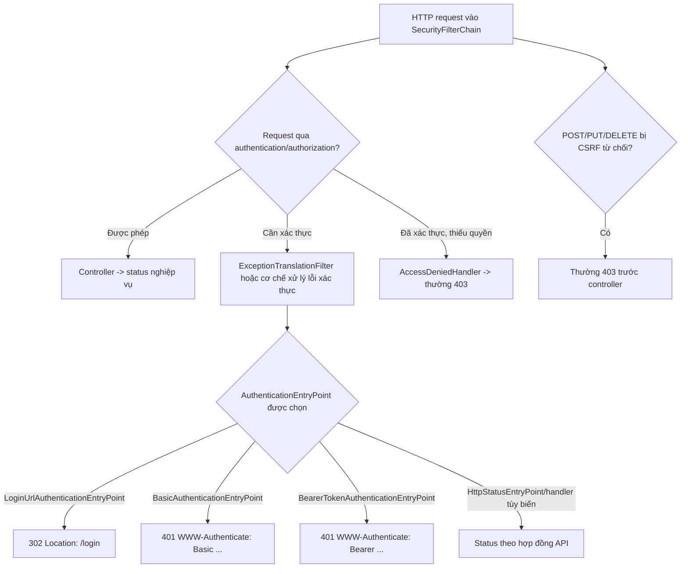

# 302 đến trang đăng nhập nhưng test lại mặc định chờ 401

Một phép thử Spring Security có thể thất bại với thông báo gần giống `Status expected:<401> but was:<302>`. Thường đây **không phải lỗi của MockMvc**. Ứng dụng đang xử lý request ẩn danh như một **trình duyệt cần chuyển đến trang đăng nhập**, trong khi bài test lại mặc định coi endpoint là **API cần trả `401 Unauthorized`**.

Hai cách phản hồi đều có thể đúng, tùy hợp đồng HTTP của ứng dụng:

- Với web page được bảo vệ bằng **form login**, response `302 Found` có `Location: /login` thường là hành vi mong đợi.
- Với REST API dùng **HTTP Basic, Bearer JWT hoặc opaque token**, request chưa được xác thực thường phải nhận `401 Unauthorized`, cùng `WWW-Authenticate` thích hợp theo cơ chế đã cấu hình.
- Với request **đã xác thực nhưng thiếu quyền**, response thường là `403 Forbidden`; nếu method không an toàn thiếu CSRF, `CsrfFilter` cũng có thể trả `403` trước khi tới bước phân quyền.

Trong chương **Chẩn đoán sự cố** của module **SPRING_SECURITY_TESTING**, ta sẽ xác định **ai tạo ra status 302**, tại sao bài test chờ 401, khi nào nên sửa **assertion** và khi nào phải sửa **cấu hình security**. Ví dụ chính dùng Spring Boot 3.x, Spring Security 6.x, Java 17+, Servlet và `MockMvc`; phần sau đối chiếu `WebTestClient`, Reactive, JWT/OAuth2/OIDC.

## 1. Đọc triệu chứng trước khi sửa code

Giả sử test viết:

```java
@Test
void anonymous_whenReadingReports_isUnauthorized() throws Exception {
    mvc.perform(get("/reports"))
        .andExpect(status().isUnauthorized());
}
```

Nhưng thực tế:

```text
Expected status: 401
Actual status:   302
Location:        /login
```

`status().isUnauthorized()` **chỉ là một assertion**. Nó không yêu cầu Spring Security chọn HTTP 401, không cấu hình entry point và không biến một web page thành API. `MockMvc` chạy các filter và ứng dụng theo cách đã thiết lập; nếu filter chain chọn redirect, kết quả 302 là tín hiệu để kiểm tra **hợp đồng** của route.

Một bước chẩn đoán nhanh:

```java
mvc.perform(get("/reports"))
    .andDo(print())
    .andExpect(status().is3xxRedirection())
    .andExpect(redirectedUrl("/login"));
```

Cần import:

```java
import static org.springframework.test.web.servlet.result.MockMvcResultHandlers.print;
import static org.springframework.test.web.servlet.result.MockMvcResultMatchers.redirectedUrl;
import static org.springframework.test.web.servlet.result.MockMvcResultMatchers.status;
```

Ví dụ `/login` là URL mặc định khi cấu hình form login và ứng dụng không có context path tùy chỉnh. Nếu ứng dụng dùng trang đăng nhập riêng, `Location` có thể khác. **Không tự đổi expectation sang 302 trước khi xác nhận endpoint thực sự là trang web dùng form login.**

## 2. Spring Security quyết định 302 hay 401 ở đâu?

Trong Servlet stack, một request đến vùng được bảo vệ nhưng chưa được xác thực thường được xử lý qua `ExceptionTranslationFilter` và một **`AuthenticationEntryPoint`** phù hợp.



Sơ đồ tóm tắt những trường hợp phổ biến. Spring Security có nhiều filter có thể tạo lỗi xác thực; không phải **mọi** response 401/302 đều đi qua một call path duy nhất. Nhưng `AuthenticationEntryPoint` là khái niệm quan trọng khi chẩn đoán redirect đăng nhập.

| Thành phần / cơ chế | Trường hợp thường gặp | Phản hồi tiêu biểu |
| --- | --- | --- |
| `LoginUrlAuthenticationEntryPoint` | Chưa đăng nhập vào trang web có `formLogin()` | 302 và `Location` tới trang login |
| `BasicAuthenticationEntryPoint` | API cần HTTP Basic, chưa có/không chấp nhận credentials | 401 và challenge `WWW-Authenticate: Basic ...` |
| `BearerTokenAuthenticationEntryPoint` | Resource Server nhận bearer token | 401 và `WWW-Authenticate: Bearer ...` |
| `AccessDeniedHandler` | Đã xác thực, không đủ authority | Thường 403 |
| `CsrfFilter` và xử lý access denied | POST có CSRF thiếu hoặc sai | Thường 403 |
| Handler nghiệp vụ / MVC | Controller chủ động redirect sau thao tác | 302/303 theo logic ứng dụng, **không nhất thiết là redirect login** |

**401 và 403 không đồng nghĩa.** Anonymous đòi truy cập protected resource thường phải được **yêu cầu xác thực**; một user đã xác thực nhưng thiếu `ROLE_ADMIN` phải được **từ chối phân quyền**. CSRF là một trục khác: thiếu token CSRF có thể gây 403 dù request ẩn danh, khiến test POST không đo được điều mình tưởng.

## 3. Tại sao có formLogin() là thấy 302?

Với form login, ứng dụng thường muốn đưa trình duyệt đến một trang để người dùng nhập thông tin xác thực. Khi chưa đăng nhập, `LoginUrlAuthenticationEntryPoint` phát một **redirect** thay vì trả JSON `401`.

Ví dụ cấu hình web đơn giản:

```java
@Bean
SecurityFilterChain webSecurity(HttpSecurity http) throws Exception {
    return http
        .authorizeHttpRequests(auth -> auth
            .requestMatchers("/public/**").permitAll()
            .anyRequest().authenticated())
        .formLogin(Customizer.withDefaults())
        .build();
}
```

Trong cấu hình minh họa này, GET `/reports` của user ẩn danh thường nhận:

```http
HTTP/1.1 302 Found
Location: /login
```

Còn GET `/login` được Spring Security phục vụ bằng trang đăng nhập mặc định khi ứng dụng không định nghĩa login page riêng. Phản hồi 302 **chưa có nghĩa user đăng nhập thành công**; nó chỉ cho biết bước xác thực tương tác được bắt đầu.

Nếu ứng dụng tùy biến `formLogin(form -> form.loginPage("/sign-in"))`, redirect sẽ tới `/sign-in` nếu cấu hình route tương ứng đầy đủ. Khi test, kiểm tra Location thực tế, đừng hardcode `/login` nếu sản phẩm đã đổi URL.

### Trường hợp bật cả formLogin và httpBasic

Một số dự án bật hai cơ chế trên **cùng filter chain**:

```java
http
    .formLogin(Customizer.withDefaults())
    .httpBasic(Customizer.withDefaults());
```

Spring Security có thể chọn `AuthenticationEntryPoint` theo **request matcher** và **content negotiation**, bao gồm `Accept` header, request kiểu browser hoặc request API. Ví dụ `Accept: text/html` có thể được hướng đến login page, trong khi client có nhu cầu API có thể nhận HTTP Basic challenge.

Vì vậy, trong mô hình hỗn hợp, chỉ nhìn thấy tên endpoint là `/api/...` chưa đủ. Cần kiểm tra **filter chain nào match**, các entry point được cấu hình và request headers cụ thể; không kết luận mọi GET không `Authorization` trong cùng chain luôn trả 302 hay luôn trả 401.

## 4. Chẩn đoán bằng một request nhỏ, không nới lỏng security

Trước khi sửa, hãy thu thập đủ ba thông tin: **status**, **header định tuyến** và **cấu hình entry point**.

```java
MvcResult result = mvc.perform(get("/reports")
        .accept(MediaType.TEXT_HTML))
    .andDo(print())
    .andReturn();

int status = result.getResponse().getStatus();
String location = result.getResponse().getHeader("Location");
String challenge = result.getResponse().getHeader("WWW-Authenticate");

System.out.printf("status=%d; location=%s; challenge=%s%n",
    status,
    location == null ? "<none>" : "<present>",
    challenge == null ? "<none>" : "<present>");
```

Cần import `org.springframework.http.MediaType` và `org.springframework.test.web.servlet.MvcResult`, cùng `get`/`print` như trên. Không in cookie phiên, access token, mật khẩu, Authorization header hoặc nội dung xác thực nhạy cảm vào CI logs. Để chẩn đoán local, có thể dùng `andDo(print())`, nhưng phải giới hạn thông tin in ra khi request có credentials thật.

Diễn giải kết quả:

- **302 + Location trang login**: request có thể đang đi qua entry point dành cho web. Kiểm tra route/chain và hợp đồng endpoint.
- **401 + `WWW-Authenticate: Basic`**: nhiều khả năng HTTP Basic entry point đã xử lý.
- **401 + `WWW-Authenticate: Bearer`**: nhiều khả năng OAuth2 Resource Server/Bearer entry point đã xử lý.
- **302 tới IdP hoặc `/oauth2/authorization/...`**: có thể là **OAuth2 login redirect**, không phải redirect form login `/login`.
- **302 tới URL nghiệp vụ**: xem controller, success handler và redirect logic; 302 không tự chứng minh user chưa đăng nhập.
- **403**: kiểm tra CSRF và authorities trước khi kết luận đây là lỗi authentication.

Có thể bật logging tạm trong môi trường test:

```properties
logging.level.org.springframework.security=DEBUG
logging.level.org.springframework.security.web.FilterChainProxy=TRACE
```

Chỉ dùng mức log chi tiết trong môi trường phát triển/CI được kiểm soát; chú ý lọc token, session và thông tin cá nhân. Thông điệp log giúp xác định filter chain nào xử lý request, nhưng format log **không nên trở thành một assertion cứng** vì có thể đổi giữa các version Spring Security.

## 5. Phân biệt hợp đồng web và API: cấu hình hai SecurityFilterChain

Nếu sản phẩm có cả trình duyệt và API, một giải pháp dễ kiểm chứng là cấu hình các chain có matcher rõ ràng:

- `/api/**`: HTTP Basic minh họa, trả `401` khi chưa có Authentication.
- `/web/**`: form login, redirect `302` đến `/login` khi chưa đăng nhập.
- `/public/**`: công khai, không cần authentication.

Với Spring Boot 3.x, Spring Security 6.x:

```gradle
dependencies {
    implementation("org.springframework.boot:spring-boot-starter-web")
    implementation("org.springframework.boot:spring-boot-starter-security")

    testImplementation("org.springframework.boot:spring-boot-starter-test")
    testImplementation("org.springframework.security:spring-security-test")
}
```

Security configuration:

```java
import org.springframework.context.annotation.Bean;
import org.springframework.context.annotation.Configuration;
import org.springframework.core.annotation.Order;
import org.springframework.security.config.Customizer;
import org.springframework.security.config.annotation.web.builders.HttpSecurity;
import org.springframework.security.web.SecurityFilterChain;

@Configuration
class SplitEntryPointSecurityConfig {

    @Bean
    @Order(1)
    SecurityFilterChain apiChain(HttpSecurity http) throws Exception {
        return http
            .securityMatcher("/api/**")
            .authorizeHttpRequests(auth -> auth
                .requestMatchers("/api/admin").hasRole("ADMIN")
                .anyRequest().authenticated())
            .httpBasic(Customizer.withDefaults())
            .build();
    }

    @Bean
    @Order(2)
    SecurityFilterChain webChain(HttpSecurity http) throws Exception {
        return http
            // Không giới hạn vào /web/**: chain fallback cũng xử lý
            // GET /login và POST /login do form login tạo ra.
            .authorizeHttpRequests(auth -> auth
                .requestMatchers("/public/**").permitAll()
                .requestMatchers("/web/admin").hasRole("ADMIN")
                .anyRequest().authenticated())
            .formLogin(Customizer.withDefaults())
            .build();
    }
}
```

Ở đây chỉ request **khớp `/api/**`** dùng `apiChain` do `@Order(1)`; các request còn lại dùng chain fallback. `/login` phải đi qua chain chứa `formLogin()`, nếu không trang đăng nhập mặc định và filter xử lý login có thể không hoạt động đúng.

Đây là **cấu hình minh họa** chứ không phải gợi ý thay một ứng dụng đang dùng Bearer JWT bằng HTTP Basic trong production. Với Resource Server, thay cơ chế API bằng `.oauth2ResourceServer(oauth2 -> oauth2.jwt(...))`, cấu hình decoder/issuer tương ứng và giữ rõ Bearer entry point.

Controller mẫu:

```java
import org.springframework.http.HttpStatus;
import org.springframework.http.ResponseEntity;
import org.springframework.web.bind.annotation.GetMapping;
import org.springframework.web.bind.annotation.PostMapping;
import org.springframework.web.bind.annotation.RestController;

@RestController
class EntryPointDemoController {

    @GetMapping("/api/reports")
    String apiReports() {
        return "api-reports";
    }

    @GetMapping("/web/reports")
    String webReports() {
        return "web-reports";
    }

    @GetMapping("/api/admin")
    String apiAdmin() {
        return "api-admin";
    }

    @GetMapping("/web/admin")
    String webAdmin() {
        return "web-admin";
    }

    @PostMapping("/web/reports")
    ResponseEntity<String> createWebReport() {
        return ResponseEntity.status(HttpStatus.CREATED)
            .body("created");
    }

    @GetMapping("/public/ping")
    String ping() {
        return "pong";
    }
}
```

Controller không tự trả 302 hoặc 401. Quyết định đó nằm trong Spring Security, trước khi yêu cầu ẩn danh được phép đến controller. Nhờ vậy, một test có thể kiểm tra **đúng entry point** mà không phụ thuộc dữ liệu nghiệp vụ.

## 6. MockMvc test 302, 401 và 403 bằng đúng tiền điều kiện

Dưới đây là bộ test dùng **SecurityFilterChain thật** trong ApplicationContext, tránh `standaloneSetup` không tích hợp filters:

```java
import org.junit.jupiter.api.Test;
import org.springframework.beans.factory.annotation.Autowired;
import org.springframework.boot.test.autoconfigure.web.servlet.AutoConfigureMockMvc;
import org.springframework.boot.test.context.SpringBootTest;
import org.springframework.http.HttpHeaders;
import org.springframework.test.web.servlet.MockMvc;

import static org.hamcrest.Matchers.startsWith;
import static org.springframework.security.test.web.servlet.request.SecurityMockMvcRequestPostProcessors.csrf;
import static org.springframework.security.test.web.servlet.request.SecurityMockMvcRequestPostProcessors.user;
import static org.springframework.test.web.servlet.request.MockMvcRequestBuilders.get;
import static org.springframework.test.web.servlet.request.MockMvcRequestBuilders.post;
import static org.springframework.test.web.servlet.result.MockMvcResultMatchers.content;
import static org.springframework.test.web.servlet.result.MockMvcResultMatchers.header;
import static org.springframework.test.web.servlet.result.MockMvcResultMatchers.redirectedUrl;
import static org.springframework.test.web.servlet.result.MockMvcResultMatchers.status;

@SpringBootTest
@AutoConfigureMockMvc
class EntryPointContractTests {

    @Autowired
    MockMvc mvc;

    @Test
    void anonymous_whenReadingWebReports_redirectsToLogin()
            throws Exception {
        mvc.perform(get("/web/reports"))
            .andExpect(status().is3xxRedirection())
            .andExpect(redirectedUrl("/login"));
    }

    @Test
    void anonymous_whenReadingApiReports_isUnauthorized()
            throws Exception {
        mvc.perform(get("/api/reports"))
            .andExpect(status().isUnauthorized())
            .andExpect(header().string(
                HttpHeaders.WWW_AUTHENTICATE, startsWith("Basic ")));
    }

    @Test
    void anonymous_whenOpeningGeneratedLoginPage_isAllowed()
            throws Exception {
        mvc.perform(get("/login"))
            .andExpect(status().isOk());
    }

    @Test
    void authenticatedUser_whenReadingWebReports_isAllowed()
            throws Exception {
        mvc.perform(get("/web/reports")
                .with(user("alice").roles("USER")))
            .andExpect(status().isOk())
            .andExpect(content().string("web-reports"));
    }

    @Test
    void authenticatedUser_whenReadingApiReports_isAllowed()
            throws Exception {
        mvc.perform(get("/api/reports")
                .with(user("alice").roles("USER")))
            .andExpect(status().isOk())
            .andExpect(content().string("api-reports"));
    }

    @Test
    void authenticatedUserWithoutAdminRole_whenReadingApiAdmin_isForbidden()
            throws Exception {
        mvc.perform(get("/api/admin")
                .with(user("alice").roles("USER")))
            .andExpect(status().isForbidden());
    }

    @Test
    void authenticatedUserWithoutAdminRole_whenReadingWebAdmin_isForbidden()
            throws Exception {
        mvc.perform(get("/web/admin")
                .with(user("alice").roles("USER")))
            .andExpect(status().isForbidden());
    }

    @Test
    void authenticatedUserWithoutCsrf_whenPostingWebReport_isForbidden()
            throws Exception {
        mvc.perform(post("/web/reports")
                .with(user("alice").roles("USER")))
            .andExpect(status().isForbidden());
    }

    @Test
    void authenticatedUserWithCsrf_whenPostingWebReport_isCreated()
            throws Exception {
        mvc.perform(post("/web/reports")
                .with(user("alice").roles("USER"))
                .with(csrf()))
            .andExpect(status().isCreated())
            .andExpect(content().string("created"));
    }

    @Test
    void anonymous_whenReadingPublicPing_isAllowed()
            throws Exception {
        mvc.perform(get("/public/ping"))
            .andExpect(status().isOk())
            .andExpect(content().string("pong"));
    }
}
```

Để đọc kết quả chính xác:

| Test | Danh tính và điều kiện | Kỳ vọng | Nguyên nhân |
| --- | --- | --- | --- |
| `anonymous_whenReadingWebReports_redirectsToLogin` | Anonymous GET web | 302 | Form login entry point |
| `anonymous_whenReadingApiReports_isUnauthorized` | Anonymous GET API | 401 + Basic challenge | API HTTP Basic entry point |
| `anonymous_whenOpeningGeneratedLoginPage_isAllowed` | GET trang login | 200 | Trang login phải phục vụ được |
| `authenticatedUser_whenReadingWebReports_isAllowed` | Mock principal hợp lệ | 200 | Đã có Authentication |
| `authenticatedUser_whenReadingApiReports_isAllowed` | Mock principal hợp lệ | 200 | API authorization thành công |
| `authenticatedUserWithoutAdminRole_whenReadingApiAdmin_isForbidden` | Đã xác thực nhưng thiếu role | 403 | `hasRole("ADMIN")` |
| `authenticatedUserWithoutAdminRole_whenReadingWebAdmin_isForbidden` | Đã xác thực nhưng thiếu role | 403 | Rule web admin |
| `authenticatedUserWithoutCsrf_whenPostingWebReport_isForbidden` | Có user, thiếu CSRF | 403 | CSRF bảo vệ phương thức POST |
| `authenticatedUserWithCsrf_whenPostingWebReport_isCreated` | Có user và CSRF | 201 | Controller được phép tạo |
| `anonymous_whenReadingPublicPing_isAllowed` | Anonymous GET public | 200 | `permitAll()` |

**Phạm vi test:** `.with(user("alice"))` và `.with(csrf())` của `spring-security-test` giả lập user và token CSRF trong MockMvc; các phép thử này đo **quyết định filter chain**, không chứng minh password, JWT signature hay luồng login thật đã được xác minh.

Nếu muốn kiểm tra HTTP Basic credentials, hãy thêm test `.with(httpBasic("alice", "correct-password"))` với `UserDetailsService`/password encoder thử nghiệm được cấu hình thực; không dùng `user()` rồi gọi đó là “password authentication test”.

## 7. Test chờ 401 nhưng được 302: quyết định sửa ở đâu?

Không có một cách sửa áp dụng cho mọi trường hợp. Hãy xác định **hợp đồng của endpoint** trước:

| Bối cảnh | 302 có đúng không? | Cách giải quyết |
| --- | --- | --- |
| Web page riêng tư, browser nên đi tới trang login | **Có** | Sửa test chờ redirect và xác nhận `Location` |
| REST API chuẩn cần 401/challenge khi thiếu token | **Không**, nếu contract yêu cầu 401 | Sửa `SecurityFilterChain`/entry point phù hợp API |
| Một chain chứa cả form và Basic, request test gửi `Accept: text/html` | Có thể | Xác định matcher/content negotiation và test request đúng loại client |
| API bị chain form login fallback bắt vì matcher sai | Thường **không** | Sửa `@Order`, `securityMatcher` và route scope |
| Request tới endpoint OAuth2/OIDC cần login tương tác | 302 có thể đúng | Kiểm tra redirect đến login/authorization endpoint và session/state |
| Request đã đăng nhập nhưng chỉ thấy 302 | Cần điều tra | Xem Authentication có thực được gắn vào request không, session/cookie có đúng không |
| Request POST thiếu CSRF nhưng test chờ redirect/401 | Không thể suy từ auth | Cung cấp CSRF hợp lệ để đo authentication, hoặc test CSRF riêng |
| `@WebMvcTest` chỉ tải một phần config, nhận 302 ngoài dự kiến | Có thể do config slice | Import security config phù hợp hoặc dùng `@SpringBootTest` khi muốn đo chain đầy đủ |
| API trả 302 sau controller redirect nghiệp vụ | Không nhất thiết liên quan auth | Kiểm tra handler/controller thay vì entry point |

Nếu **web page** được thiết kế sử dụng form login, test có thể viết:

```java
@Test
void anonymous_whenOpeningSettings_redirectsToLogin()
        throws Exception {
    mvc.perform(get("/settings"))
        .andExpect(status().is3xxRedirection())
        .andExpect(redirectedUrl("/login"));
}
```

Nếu **API** được thiết kế trả 401, không sửa test thành 302 chỉ để vượt CI. Hãy chỉ ra vì sao API chọn nhầm login entry point: cấu hình `formLogin()` trên chain API, thứ tự matcher, hoặc cấu hình exception handling. Sau khi sửa, giữ test 401 và thêm test 200/403 làm đối chứng.

### Sửa hợp đồng API mà không phá web login

Cách đặt `apiChain` ở mục 5 là một ví dụ. Nếu API dùng JWT, cấu hình chain tương ứng:

```java
@Bean
@Order(1)
SecurityFilterChain jwtApiChain(HttpSecurity http) throws Exception {
    return http
        .securityMatcher("/api/**")
        .authorizeHttpRequests(auth -> auth
            .anyRequest().authenticated())
        .oauth2ResourceServer(oauth2 ->
            oauth2.jwt(Customizer.withDefaults()))
        .build();
}
```

Đoạn này **thay thế** API Basic chain trong mục 5, không định nghĩa song song hai `@Order(1)` cùng matcher `/api/**`. Để khởi động được, phải cấu hình `JwtDecoder` và trust material/issuer phù hợp. Endpoint bearer sẽ thường trả 401 kèm `WWW-Authenticate: Bearer` cho request thiếu token, không redirect tới `/login`.

Trong trường hợp cần một API không sử dụng Basic challenge mà chỉ trả một status code, có thể cấu hình entry point kiểu `HttpStatusEntryPoint(HttpStatus.UNAUTHORIZED)` cho matcher được chỉ định. Nhưng nếu API tuân theo HTTP Basic hoặc OAuth2 Bearer, **đừng xóa `WWW-Authenticate`** chỉ để test nhận đúng 401: challenge là một phần hợp đồng giao thức.

## 8. Chẩn đoán filter chain và matcher trước tiên

Khi có nhiều chain, Spring Security chọn **chain đầu tiên khớp request**, theo thứ tự `@Order` hoặc cấu hình tương đương. Sau khi chọn một chain, Spring Security **không tự chạy thêm một chain khác** chỉ vì chain đầu không chứa cơ chế authentication mong muốn.

Ví dụ cấu hình dễ sai:

```java
@Bean
@Order(1)
SecurityFilterChain webFirst(HttpSecurity http) throws Exception {
    return http
        .securityMatcher("/**")
        .authorizeHttpRequests(a -> a.anyRequest().authenticated())
        .formLogin(Customizer.withDefaults())
        .build();
}

@Bean
@Order(2)
SecurityFilterChain apiSecond(HttpSecurity http) throws Exception {
    return http
        .securityMatcher("/api/**")
        .authorizeHttpRequests(a -> a.anyRequest().authenticated())
        .httpBasic(Customizer.withDefaults())
        .build();
}
```

Ở đây, `webFirst` khớp **mọi path**, kể cả `/api/reports`. `apiSecond` không bao giờ được chọn cho đường `/api/**`. Dù API chain có `httpBasic()`, request vẫn có thể nhận redirect form login.

Cách sửa: đặt matcher **cụ thể** `/api/**` trước chain **fallback**, tương tự mục 5.

Ngoài thứ tự matcher, kiểm tra:

1. **Servlet path và context path**: `/api/reports` có thật sự là path mà matcher đang thấy không? Các proxy hoặc `spring.mvc.servlet.path` có thể ảnh hưởng việc match.
2. **HTTP method**: một `requestMatcher(HttpMethod.GET, "/api/**")` không bao trùm POST; kiểm tra toàn bộ route được bảo vệ.
3. **Public endpoints**: `/login`, callback OAuth2/OIDC, static assets và error page cần policy phù hợp. Nếu bị redirect về chính chúng, ứng dụng có thể bị **redirect loop**.
4. **Filter order**: `ExceptionTranslationFilter`, `AuthorizationFilter` và authentication filters có thể thay đổi theo chain/config.
5. **Custom entry point**: `.exceptionHandling(...)` có thể ghi đè hành vi mặc định của form/Basic/Bearer.
6. **Test setup**: `@AutoConfigureMockMvc(addFilters = false)` hoặc `MockMvcBuilders.standaloneSetup(...)` không đại diện đúng filter chain của production; đừng “sửa” bằng cách bỏ filters.

Một đường test ổn định là `@SpringBootTest + @AutoConfigureMockMvc` cho tích hợp Servlet và `MockMvc` đã chạy Spring Security filters. Với `@WebMvcTest`, chỉ import các bean cần thiết, kiểm tra chính xác chain nào hiện diện trong slice. Không dựa vào behavior mặc định của slice để suy ra production nếu cấu hình khác.

## 9. 401, 403 và CSRF: lỗi kế tiếp sau khi sửa 302

Một ca test GET anonymous là cách tốt để cô lập authentication vì GET thường không cần CSRF token. Nhưng khi test POST, request không có CSRF hợp lệ có thể bị từ chối **trước khi vào authorization rule**.

Ví dụ test sai về kết luận:

```java
@Test
void anonymous_whenPostingReport_isUnauthorized() throws Exception {
    // Sai nếu thiếu CSRF làm request bị 403 trước khi đo login entry point.
    mvc.perform(post("/web/reports"))
        .andExpect(status().isUnauthorized());
}
```

Nếu mục tiêu là chứng minh **request ẩn danh không được tạo report**, có hai cách test riêng:

```java
// Kiểm tra CSRF thiếu bị chặn.
mvc.perform(post("/web/reports"))
    .andExpect(status().isForbidden());

// Kiểm tra trạng thái chưa xác thực sau khi đã đáp ứng CSRF.
mvc.perform(post("/web/reports").with(csrf()))
    .andExpect(status().is3xxRedirection())
    .andExpect(redirectedUrl("/login"));
```

Đối với chain form login như mục 5, kỳ vọng hai trường hợp trên minh họa đúng hai nguyên nhân. **Đừng kết luận rằng 403 trong POST anonymous chứng minh API có role check đúng**, và cũng đừng vô hiệu hóa CSRF production chỉ vì test chờ 302/401.

Trong một Resource Server stateless chỉ nhận Authorization Bearer header do client tự gửi, threat model CSRF có thể khác. Nhưng nếu ứng dụng dùng cookie/session và browser tự gửi credentials, CSRF cần được thiết kế/kiểm thử riêng.

## 10. Chẩn đoán RequestCache, session và redirect sau khi login

Trong form login, ngoài redirect **đến** trang login, còn có redirect **sau khi** login thành công về URL đã được yêu cầu trước đó. Đừng nhầm hai dấu hiệu:

```text
(1) GET /web/reports khi anonymous
    -> 302 Location: /login
    -> Có thể lưu request ban đầu qua RequestCache

(2) POST /login với credentials + CSRF/session hợp lệ
    -> Nếu xác thực thành công: có thể 302 về /web/reports
    -> Nếu xác thực thất bại: thường 302 tới /login?error

(3) GET /web/reports với session đã xác thực
    -> 200 theo policy
```

**Status 302 xuất hiện cả khi chưa đăng nhập, đăng nhập thành công và đăng nhập thất bại**. Muốn đánh giá một flow, cần kiểm tra `Location`, session và endpoint kế tiếp chứ không chỉ `is3xxRedirection()`.

Với `MockMvc`, `MockHttpSession` có thể được giữ và gửi lại theo ca test; với HTTP thật, dùng cookie phiên server cấp (ví dụ `JSESSIONID` ở Servlet) theo đúng lifecycle. `@WithMockUser` không tạo ra một phiên login HTTP thực để ứng dụng khác sử dụng.

Các điểm dễ làm test 302 ngoài dự kiến:

- Test tưởng đã có session nhưng thực tế gọi MockMvc với **request mới không gắn session**.
- Session cũ đã hết hạn hoặc authentication đã bị xóa sau logout.
- Redirect URL chứa `contextPath`, scheme hoặc host từ reverse proxy khác với chuỗi hardcode của test.
- Browser/client đi theo redirect tự động khiến test quan sát phản hồi cuối thay vì 302 đầu tiên. Trong trường hợp này cần cấu hình client hoặc ghi lại chuỗi redirect để xem **phản hồi gốc**.
- Test `@WithMockUser` ở class-level khiến “anonymous test” không còn anonymous; cần giữ fixture độc lập.

## 11. OAuth2/OIDC: không phải mọi redirect đều tới /login

Với `oauth2Login()`, request ẩn danh đến trang cần login có thể được chuyển hướng qua một trong các bước:

- Trang đăng nhập hoặc trang lựa chọn client registration.
- `/oauth2/authorization/{registrationId}` nếu ứng dụng có luồng bắt đầu login cụ thể.
- Authorization endpoint của IdP sau khi Spring Security phát authorization request.

Do đó, `302` ở một OAuth2/OIDC client **không tự chứng minh lỗi form login**. Một số cấu hình có nhiều registration hoặc custom login page dẫn đến URL khác nhau. Hãy phân biệt redirect **nội bộ** và redirect **tới IdP**, giữ đúng `state`, session, `redirect_uri` và khi áp dụng, PKCE/`nonce`.

Đặc biệt:

- `oauth2Login()` và `oidcLogin()` trong MockMvc giả lập Authentication sau login; chúng **không** thực hiện authorization code/token exchange hoặc verify ID token.
- Ca test login flow thật cần kiểm tra redirect ban đầu, callback code/state, token exchange, ID token/JWKS/nonce (OIDC), session/cookie và các trường hợp thất bại.
- Đừng gán `oauth2Login()` rồi dùng HTTP 200 để kết luận rằng luồng 302 tới IdP đã hoạt động.
- Nếu thiết kế API đáng lẽ trả 401 thay vì chuyển trình duyệt tới IdP, hãy dùng security chain và entry point riêng cho API, không ép API nhận flow interactive không mong muốn.

Một tên test tốt là `anonymous_whenOpeningBrowserDashboard_redirectsToOidcLogin()`, thay vì `anonymous_whenCallingApi_isUnauthorized()` nếu thứ đang kiểm tra thật sự là bước bắt đầu browser SSO.

## 12. JWT/opaque token: WWW-Authenticate quan trọng như status

Với OAuth2 Resource Server, `BearerTokenAuthenticationEntryPoint` thường cho response 401 cùng challenge:

```http
HTTP/1.1 401 Unauthorized
WWW-Authenticate: Bearer
```

Nếu token hiện diện nhưng không hợp lệ, challenge có thể kèm thông tin `error="invalid_token"` theo cách Spring Security cấu hình. Một JWT được xác thực thành công nhưng thiếu authority thường đi đến 403, có thể kèm thông tin `insufficient_scope` khi dùng Bearer-specific handling.

Test HTTP cho Resource Server nên phân biệt:

| Request | Kỳ vọng thông thường | Thành phần thực sự được kiểm chứng |
| --- | --- | --- |
| Không có Bearer token, route protected | 401 | Authentication entry point |
| Token hết hạn/sai chữ ký/sai issuer | 401 | `JwtDecoder` và validation nếu gửi JWT thật |
| Opaque token được introspect `active=false` | 401 | Introspection thực nếu gọi endpoint test |
| Token hợp lệ nhưng thiếu scope | 403 | Authorization / authority mapping |
| Token hợp lệ, đủ scope | 200/201/204 | Cho phép request và nghiệp vụ |
| Anonymous browser vào trang dùng form login | 302 | Web login entry point, **không phải Resource Server** |

`SecurityMockMvcRequestPostProcessors.jwt()` và `opaqueToken()` **bỏ qua bước xác minh bearer token thật** bằng cách cung cấp Authentication giả. Vì vậy, muốn test “JWT sai chữ ký bị trả 401”, phải gửi JWT thật qua `Authorization` để decoder chạy; không dùng `.with(jwt())` rồi tuyên bố đã kiểm chữ ký.

Tương tự trên Reactive, `mockJwt()`/ `mockOpaqueToken()` chỉ có ý nghĩa với mock server do `WebTestClient` kiểm soát; với `bindToServer()`, request phải có bearer token thật để server xác minh.

## 13. Reactive WebTestClient: cùng triệu chứng, stack khác

Trên Spring WebFlux, `SecurityWebFilterChain` sử dụng reactive authentication entry point và `ServerWebExchange`, không dùng trực tiếp `HttpServletRequest` hay `ExceptionTranslationFilter` của Servlet. Nhưng logic chẩn đoán vẫn giống nhau: **web form login có thể redirect, API authentication dùng Basic/Bearer thường trả 401**.

Ví dụ một WebFlux application đã có form login bảo vệ `/web/reports`:

```java
import org.junit.jupiter.api.BeforeEach;
import org.junit.jupiter.api.Test;
import org.springframework.beans.factory.annotation.Autowired;
import org.springframework.boot.test.context.SpringBootTest;
import org.springframework.context.ApplicationContext;
import org.springframework.test.web.reactive.server.WebTestClient;

import static org.springframework.security.test.web.reactive.server.SecurityMockServerConfigurers.mockUser;
import static org.springframework.security.test.web.reactive.server.SecurityMockServerConfigurers.springSecurity;

@SpringBootTest(webEnvironment = SpringBootTest.WebEnvironment.MOCK)
class ReactiveRedirectTroubleshootingTests {

    @Autowired
    ApplicationContext context;

    WebTestClient client;

    @BeforeEach
    void setUp() {
        client = WebTestClient.bindToApplicationContext(context)
            .apply(springSecurity())
            .configureClient()
            .build();
    }

    @Test
    void anonymous_whenOpeningWebPage_redirectsToLogin() {
        client.get().uri("/web/reports")
            .exchange()
            .expectStatus().is3xxRedirection();
    }

    @Test
    void authenticatedUser_whenOpeningWebPage_isAllowed() {
        client.mutateWith(mockUser("alice").roles("USER"))
            .get().uri("/web/reports")
            .exchange()
            .expectStatus().isOk();
    }
}
```

Ví dụ giả định `SecurityWebFilterChain` của ứng dụng WebFlux đã bật `formLogin()` với login URL thích hợp, và controller web trả 200. **Không chạy nguyên lớp này trong ứng dụng Servlet ở mục 5** hoặc coi `MockMvc` và `WebTestClient` là hai API setup thay thế trực tiếp. Khi kiểm tra API Reactive có Bearer, phải xây chain tương ứng và assert 401 + challenge trên request anonymous.

Có thể dùng:

```java
client.get().uri("/api/reports")
    .exchange()
    .expectStatus().isUnauthorized();
```

**Chỉ kỳ vọng 401 nếu cấu hình WebFlux API thực sự chọn Basic/Bearer entry point hoặc một entry point trả 401.** Nếu route bị form-login chain bắt, test lại thấy 302 và cần phân tích matcher như ở Servlet.

## 14. Trình tự chẩn đoán có thể áp dụng trên CI

Một quy trình ngắn giúp tránh chữa triệu chứng bằng cách thay policy:

1. **Xác nhận request**: method, path, servlet path, context path, `Accept`, `Content-Type`, Authorization header, session/cookie và CSRF (chỉ ghi metadata an toàn).
2. **Đọc response trước khi sửa test**: status, `Location`, `WWW-Authenticate`, response content type; kiểm tra có redirect tự động hay không.
3. **Xác nhận test stack**: `MockMvc` có filter chain thật không? `@WebMvcTest` slice khác `@SpringBootTest`? `WebTestClient` bind context hay bind server?
4. **Xác định filter chain match đầu tiên**: `@Order`, `securityMatcher`, route `/api/**` vs web fallback.
5. **Xác định AuthenticationEntryPoint**: form login `LoginUrlAuthenticationEntryPoint`, Basic, Bearer hoặc custom handler; kiểm tra content negotiation nếu dùng nhiều cơ chế trong một chain.
6. **Phân biệt thiếu authentication với thiếu quyền**: GET anonymous để đo login behavior, rồi test authenticated thiếu authority cho 403.
7. **Cô lập CSRF**: khi đo POST authorization, cung cấp CSRF hợp lệ; có một test riêng cho thiếu/sai CSRF.
8. **Kiểm tra session/login redirect**: phân biệt redirect tới login, login thành công và login lỗi; đừng chỉ assert 302.
9. **Quyết định sửa**: nếu contract web là redirect, đổi expectation; nếu contract API là 401, sửa chain/entry point, không đổi test để che regression.
10. **Khóa hành vi bằng test đối chứng**: web anonymous -> 302, API anonymous -> 401, user thiếu role -> 403, user đủ quyền -> 200, POST thiếu CSRF -> 403.
11. **Giữ CI dễ đọc**: tên test chỉ rõ identity/action/decision, ví dụ `anonymous_whenReadingApiReports_isUnauthorized` và `anonymous_whenReadingWebReports_redirectsToLogin`.
12. **Không in secrets vào logs/artifacts**: token, cookie và mã authorization cần được ẩn; chỉ giữ loại lỗi và URL đã làm sạch dữ liệu nhạy cảm.

Có thể tóm tắt như một cây quyết định:

```text
Test chờ 401 nhưng nhận 302
  |
  +-- Location có phải trang login?
  |      |
  |      +-- Có -> route này có chủ đích là web/form login?
  |      |            |
  |      |            +-- Có -> sửa assertion: 302 + Location
  |      |            |
  |      |            +-- Không -> kiểm matcher + AuthenticationEntryPoint API
  |      |
  |      +-- Không -> kiểm redirect OAuth2/OIDC, success handler,
  |                   business redirect hoặc reverse proxy
  |
  +-- Có đang test POST thiếu CSRF?
  |      |
  |      +-- Có -> bổ sung CSRF để kiểm riêng login/authorization
  |
  +-- Request có session/Authentication thực sự chưa?
         |
         +-- Chưa -> bảo đảm case thật sự anonymous
         +-- Có  -> kiểm 403/role, session restore hoặc filter khác
```

## 15. Bài tập thực hành

1. Tạo ứng dụng form login có `GET /web/reports` protected. Viết test anonymous kỳ vọng 401 để thấy thất bại, dùng `andDo(print())` tìm `Location`, rồi sửa test đúng contract `302 -> /login`.
2. Cùng ứng dụng, thêm chain `/api/**` dùng HTTP Basic trước web fallback. Viết test anonymous API kỳ vọng 401 và `WWW-Authenticate: Basic`.
3. Đảo thứ tự chain sao cho `/**` đứng trước `/api/**`. Quan sát API có thể bị chuyển tới trang login; khôi phục lại matcher cụ thể trước.
4. Bật đồng thời `formLogin()` và `httpBasic()` trên một chain trong môi trường thử nghiệm. Gửi `Accept: text/html` và `Accept: application/json`; kiểm tra entry point thực tế theo version/config, không đoán.
5. Viết test `authenticatedUserWithoutAdminRole_whenReadingApiAdmin_isForbidden` và test user có `ROLE_ADMIN` được phép. Giải thích vì sao hai test này khác anonymous 401.
6. POST `/web/reports` khi anonymous không có CSRF. Ghi status thật, rồi gửi `.with(csrf())` để cô lập nhánh redirect login. Tuyệt đối không tắt CSRF production chỉ để test qua.
7. Chạy một `@WebMvcTest` chỉ nạp controller, so sánh security config được đưa vào context với `@SpringBootTest`. Xác định vì sao các status có thể khác.
8. Với OAuth2/OIDC Login, viết test kiểm tra redirect bắt đầu authorization flow và ca callback sai `state`; phân biệt 302 trước login với redirect sau callback thất bại.
9. Với Resource Server JWT, viết hai test: anonymous nhận 401 + Bearer challenge, và token đã ký sai issuer bị decoder từ chối 401. Không dùng `jwt()` để tự nhận rằng đã xác minh issuer.
10. Dùng WebTestClient trong một ứng dụng WebFlux form login. So sánh anonymous 302 với `mockUser("alice")` 200; sau đó dùng client `bindToServer()` và credential thật để kiểm tra HTTP behavior.
11. Tạo một bảng theo dõi lỗi CI gồm method, route, identity, `Accept`, expected status, actual status, `Location`, chain được chọn. Với mỗi case, xác định sửa test hay sửa security config.

## 16. Ghi nhớ

- **302 tới `/login` và 401 đều có thể đúng**: quyết định phụ thuộc hợp đồng web form login hay API authentication.
- **`status().isUnauthorized()` không cấu hình Spring Security**. Nó chỉ kiểm tra kết quả của filter chain đang chạy.
- **AuthenticationEntryPoint là chìa khóa**: form login thường chuyển hướng, HTTP Basic/Bearer thường trả 401; cùng một chain có nhiều cơ chế có thể dùng matcher/content negotiation.
- **Thứ tự `SecurityFilterChain` quan trọng**: chain đầu tiên khớp request được chọn. `/**` đứng trước `/api/**` có thể bắt nhầm API.
- **302 không có nghĩa đã đăng nhập**. Cần xem `Location`, session và request tiếp theo; phân biệt redirect login, OAuth2 redirect và business redirect.
- **403 là nhánh khác 401/302**, và CSRF có thể gây 403 trước khi authentication/authorization được đánh giá như kỳ vọng.
- **Mock authentication không phải chứng thực HTTP thật**. `@WithMockUser`, `user()`, `jwt()`, `oauth2Login()` giúp test policy nhanh nhưng không thay bước password, decoder hay OAuth2/OIDC callback.
- **Dùng cấu hình riêng cho web và API khi contract khác nhau**, giữ nguyên các lớp bảo vệ production, không đổi `permitAll()` hay `.csrf().disable()` để làm test xanh.
- **Đặt tên test theo danh tính, hành động và quyết định** để CI chỉ ra ngay khi redirect hoặc HTTP status bị hồi quy.

Trong **SPRING_SECURITY_TESTING**, câu hỏi cần đặt khi test nhận 302 thay vì 401 không phải “làm sao ép MockMvc trả 401?”, mà là **“request này đang đi qua filter chain nào, entry point nào, và người dùng thực sự mong đợi một trang đăng nhập hay một phản hồi API?”**. Khi xác định đúng ba yếu tố đó, ta sẽ sửa đúng test hoặc security configuration mà không vô tình nới lỏng bảo mật.

