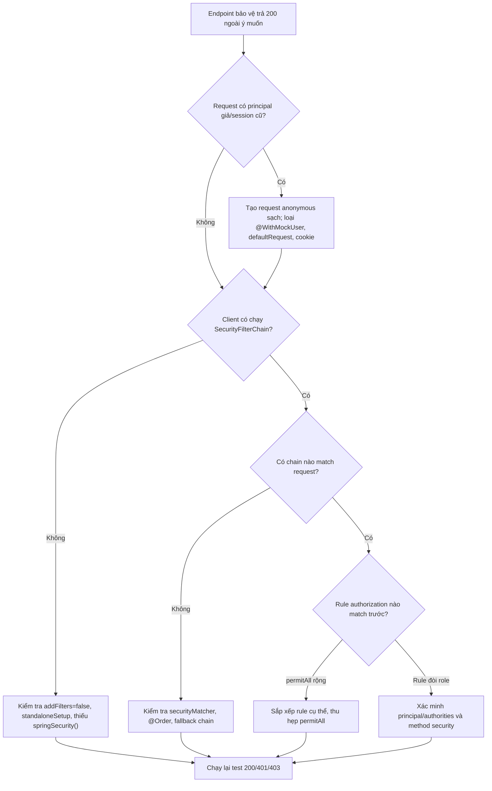

# Endpoint trả 200 vì filter bị tắt, matcher bỏ sót hoặc cấu hình permitAll

Trong chương **Chẩn đoán sự cố** của module **SPRING_SECURITY_TESTING**, chúng ta dùng `spring-security-test` để kiểm chứng **xác thực, phân quyền và bảo vệ HTTP** trên ứng dụng Servlet và Reactive. `MockMvc`, `WebTestClient`, `@WithMockUser`, `SecurityContext`, cùng JWT/OAuth2/OIDC giả lập giúp tạo các ca request **được phép** và **bị từ chối**. Một lỗi nguy hiểm là test hoặc API trả **`200 OK`** cho endpoint đáng lẽ phải từ chối người chưa xác thực hoặc người thiếu quyền.

Ví dụ, hợp đồng yêu cầu `GET /api/reports/42` chỉ dành cho `ROLE_ADMIN`. Thế nhưng test:

```java
mockMvc.perform(get("/api/reports/42"))
        .andExpect(status().isOk());
```

vẫn PASS khi không gửi credential. Có ít nhất ba lớp nguyên nhân cần tách riêng:

1. **Filter bị tắt hoặc không được gắn vào client test:** request đi thẳng tới MVC controller, bỏ qua `FilterChainProxy`.
2. **Matcher bỏ sót:** Spring Security có chạy ở ứng dụng, nhưng không có `SecurityFilterChain` nào được chọn cho URL/method thực tế.
3. **`permitAll` hoặc rule quá rộng:** request đi qua security chain, nhưng chính sách authorization cho phép nó vào controller.

Ngoài ra, một test có thể **tưởng mình đang gửi request anonymous** trong khi `@WithMockUser`, `defaultRequest`, session/cookie hoặc `jwt()` đã tạo sẵn authentication. Do vậy, `200` chỉ là một triệu chứng; cần tìm **request thực đi qua đâu, có principal nào và rule nào đã quyết định cho phép**.

## 1. Xác nhận `200` là lỗi hay đúng hợp đồng

Trước khi sửa cấu hình, ghi rõ một ma trận kỳ vọng **độc lập với implementation**. Với ứng dụng mẫu:

| Request | Danh tính | Chính sách | Kỳ vọng |
| --- | --- | --- | --- |
| `GET /public/ping` | Anonymous | `permitAll` | `200` |
| `GET /api/reports/42` | Anonymous | Phải đăng nhập, có `ROLE_ADMIN` | `401` với HTTP Basic entry point |
| `GET /api/reports/42` | `ROLE_VIEWER` | Thiếu role | `403` |
| `GET /api/reports/42` | `ROLE_ADMIN` | Đủ role | `200` |
| `GET /api/reports/42` | Sai mật khẩu Basic | Không xác thực được | `401` |
| `GET /api/unknown` | `ROLE_ADMIN` | Không có route được phép | `403` theo rule `denyAll` trong ví dụ |

**`401` và `403` không phải quy luật bất biến của mọi cấu hình.** API dùng HTTP Basic/Bearer có thể trả `401` cho anonymous; form login có thể redirect `302`; custom entry point có thể tạo phản hồi khác. Bài này chủ động dùng **HTTP Basic**, tắt form login và xác định fallback `denyAll` để các kỳ vọng minh bạch.

Trước khi kết luận một request `200` là bypass security, còn cần biết:

- Request đang gọi **đúng HTTP method, URI, context path và servlet path** hay không?
- Có header `Authorization`, cookie/session hoặc principal từ test fixture hay không?
- Body trả về có đúng controller mong đợi hay đến từ handler khác?
- Endpoint là public do hợp đồng nghiệp vụ, hay chỉ “được phép” ngoài ý muốn?

Một test chỉ assert status `200` không cho biết nó đến từ **đúng** handler, và càng không chứng minh authentication/authorization đang hoạt động.

## 2. Cây chẩn đoán nhanh: từ request đến policy



Hãy xử lý theo trình tự này thay vì sửa đồng thời `securityMatcher`, `requestMatchers`, CSRF, phương thức xác thực và test expected status. Khi sửa nhiều tầng cùng lúc, rất khó biết thay đổi nào đã giải quyết vấn đề.

## 3. Nguyên nhân thứ nhất: `MockMvc` không chạy Spring Security filters

Trong **Spring MVC Servlet**, `FilterChainProxy` là servlet filter điều phối các `SecurityFilterChain` bên trong. Nếu `MockMvc` bỏ qua lớp filter này, controller vẫn hoạt động bình thường. Điều đó tạo ra **false positive**: test `200` thành công vì security không hề được kiểm tra.

### 3.1. `standaloneSetup`: hữu ích cho controller, chưa đủ cho security

```java
import static org.springframework.test.web.servlet.request
        .MockMvcRequestBuilders.get;
import static org.springframework.test.web.servlet.result
        .MockMvcResultMatchers.status;

import org.springframework.test.web.servlet.MockMvc;
import org.springframework.test.web.servlet.setup.MockMvcBuilders;

MockMvc controllerOnly = MockMvcBuilders
        .standaloneSetup(new ReportController())
        .build();

controllerOnly.perform(get("/api/reports/42"))
        .andExpect(status().isOk()); // Không chứng minh đã được bảo vệ!
```

Ví dụ giả định `ReportController` là controller không có dependency và handler đọc báo cáo trả `200`. `standaloneSetup` phù hợp cho **unit/slice test controller**, nhưng không tự tải đầy đủ Spring Security application context hoặc security filters.

Nếu mục tiêu là xác nhận quyền HTTP, hãy dùng `WebApplicationContext` có security chain:

```java
import static org.springframework.security.test.web.servlet.setup
        .SecurityMockMvcConfigurers.springSecurity;

MockMvc secured = MockMvcBuilders.webAppContextSetup(context)
        .apply(springSecurity())
        .build();
```

`context` ở đây là `WebApplicationContext` của Servlet test, đã nạp `springSecurityFilterChain`. `.apply(springSecurity())` tích hợp Spring Security Test với `MockMvc`; nó không tự tạo policy nếu context thiếu cấu hình bảo mật.

### 3.2. `@AutoConfigureMockMvc(addFilters = false)`

Trên Spring Boot test, cấu hình sau là **chỉ báo cần kiểm tra ngay** khi endpoint bảo vệ bất ngờ trả `200`:

```java
@SpringBootTest
@AutoConfigureMockMvc(addFilters = false)
class ControllerWithoutServletFiltersTest {
    // Các Servlet Filter, gồm Spring Security filter, không
    // được auto-register vào MockMvc theo cấu hình này.
}
```

`addFilters = false` có thể được dùng có chủ đích để kiểm thử controller **không qua filters**. Nó **không** thích hợp nếu test tuyên bố đã chứng minh endpoint bị chặn bởi `SecurityFilterChain`. Với integration test bảo mật, dùng `@AutoConfigureMockMvc` và bảo đảm config đã nạp đúng filter chain.

`@WebMvcTest` cũng cần cẩn trọng: nó tải một phần context và thường tích hợp Spring Security theo cấu hình của slice, nhưng **không thể mặc định suy ra tất cả security bean production đã được nạp**. Một default security chain khác với production có thể khiến test PASS sai mục tiêu. Khi cần kiểm tra policy production, hãy import cấu hình liên quan hoặc dùng `@SpringBootTest` có phạm vi kiểm chứng rõ ràng.

## 4. Ví dụ đầy đủ: một cấu hình đúng và bộ hồi quy 200/401/403

Ta dựng một ứng dụng Spring MVC nhỏ để có **mốc đối chiếu** trước khi thử ba tình huống lỗi. Các ví dụ dùng Java 17+, Spring Boot 3.x, Spring Security 6.x, JUnit Jupiter và `spring-security-test`. Mật khẩu `{noop}` và users chỉ thuộc test fixture, không dùng trong production.

### 4.1. Controller của ứng dụng mẫu

```java
package example.securitydiagnostics;

import org.springframework.web.bind.annotation.GetMapping;
import org.springframework.web.bind.annotation.PathVariable;
import org.springframework.web.bind.annotation.RestController;

@RestController
class ReportController {

    @GetMapping("/public/ping")
    String ping() {
        return "pong";
    }

    @GetMapping("/api/reports/{id}")
    String read(@PathVariable("id") long id) {
        return "secret-report:" + id;
    }
}
```

### 4.2. Cấu hình filter chain thật

Không dùng matcher toàn chain hạn chế phạm vi trong ví dụ mốc; một chain với fallback `denyAll` sẽ bảo vệ tất cả request không được khai báo rõ:

```java
package example.securitydiagnostics;

import org.springframework.context.annotation.Bean;
import org.springframework.context.annotation.Configuration;
import org.springframework.security.config.Customizer;
import org.springframework.security.config.annotation.web.builders.HttpSecurity;
import org.springframework.security.config.annotation.web.configuration.EnableWebSecurity;
import org.springframework.security.config.annotation.web.configurers.AbstractHttpConfigurer;
import org.springframework.security.core.userdetails.User;
import org.springframework.security.core.userdetails.UserDetailsService;
import org.springframework.security.provisioning.InMemoryUserDetailsManager;
import org.springframework.security.web.SecurityFilterChain;

@Configuration
@EnableWebSecurity
class DiagnosticSecurityConfig {

    @Bean
    SecurityFilterChain apiSecurity(HttpSecurity http) throws Exception {
        return http.authorizeHttpRequests(auth -> auth
                    .requestMatchers("/public/ping").permitAll()
                    .requestMatchers("/api/reports/**").hasRole("ADMIN")
                    .anyRequest().denyAll())
                .httpBasic(Customizer.withDefaults())
                .formLogin(AbstractHttpConfigurer::disable)
                .build();
    }

    @Bean
    UserDetailsService users() {
        return new InMemoryUserDetailsManager(
                User.withUsername("viewer")
                    .password("{noop}pw").roles("VIEWER").build(),
                User.withUsername("admin")
                    .password("{noop}pw").roles("ADMIN").build());
    }
}
```

Chính sách yêu cầu authority `ROLE_ADMIN`. Spring Security mặc định thêm tiền tố `ROLE_` khi dùng `hasRole("ADMIN")`; trong test, `roles("ADMIN")` tạo `ROLE_ADMIN`. Không nhầm với authority `SCOPE_reports.read` của OAuth2 Resource Server.

### 4.3. Test sử dụng Spring Security filters thực

```java
package example.securitydiagnostics;

import static org.springframework.security.test.web.servlet.request
        .SecurityMockMvcRequestPostProcessors.httpBasic;
import static org.springframework.test.web.servlet.request
        .MockMvcRequestBuilders.get;
import static org.springframework.test.web.servlet.result
        .MockMvcResultMatchers.content;
import static org.springframework.test.web.servlet.result
        .MockMvcResultMatchers.header;
import static org.springframework.test.web.servlet.result
        .MockMvcResultMatchers.status;

import org.junit.jupiter.api.Test;
import org.springframework.beans.factory.annotation.Autowired;
import org.springframework.boot.SpringBootConfiguration;
import org.springframework.boot.autoconfigure.EnableAutoConfiguration;
import org.springframework.boot.test.autoconfigure.web.servlet.AutoConfigureMockMvc;
import org.springframework.boot.test.context.SpringBootTest;
import org.springframework.context.annotation.Import;
import org.springframework.test.web.servlet.MockMvc;

@SpringBootTest(classes = ReportSecurityRegressionTest.TestApp.class)
@AutoConfigureMockMvc
class ReportSecurityRegressionTest {

    @SpringBootConfiguration
    @EnableAutoConfiguration
    @Import({DiagnosticSecurityConfig.class, ReportController.class})
    static class TestApp {}

    @Autowired MockMvc mvc;

    @Test
    void publicEndpoint_anonymousDuoc200() throws Exception {
        mvc.perform(get("/public/ping"))
            .andExpect(status().isOk())
            .andExpect(content().string("pong"))
            .andExpect(header().string(
                    "X-Content-Type-Options", "nosniff"));
    }

    @Test
    void protectedEndpoint_anonymousPhai401() throws Exception {
        mvc.perform(get("/api/reports/42"))
            .andExpect(status().isUnauthorized());
    }

    @Test
    void viewerDaDangNhap_nhungThieuRolePhai403()
            throws Exception {
        mvc.perform(get("/api/reports/42")
                .with(httpBasic("viewer", "pw")))
            .andExpect(status().isForbidden());
    }

    @Test
    void adminDuRole_duoc200VaBodyDung() throws Exception {
        mvc.perform(get("/api/reports/42")
                .with(httpBasic("admin", "pw")))
            .andExpect(status().isOk())
            .andExpect(content().string("secret-report:42"));
    }

    @Test
    void saiMatKhauBasic_phai401() throws Exception {
        mvc.perform(get("/api/reports/42")
                .with(httpBasic("admin", "bad-password")))
            .andExpect(status().isUnauthorized());
    }

    @Test
    void duRoleNhungKhongCoRuleChoPhep_phai403()
            throws Exception {
        mvc.perform(get("/api/unknown")
                .with(httpBasic("admin", "pw")))
            .andExpect(status().isForbidden());
    }
}
```

Trong cấu hình mẫu, Spring Security mặc định thêm header `X-Content-Type-Options: nosniff`. Vì vậy một response public `200` **vẫn mang security header** nếu request đi qua chain. Đó là một tín hiệu hữu ích để phân biệt `permitAll` với filter bị bypass, **nhưng không phải bằng chứng tuyệt đối**: ứng dụng có thể chủ động tắt hoặc tự ghi header. Hãy kết hợp với test `401/403` ở endpoint bảo vệ.

**Giá trị của test âm tính:** nếu có người vô ý thêm `@AutoConfigureMockMvc(addFilters = false)`, thay cấu hình thành `permitAll` hoặc để request rơi ra khỏi mọi chain, test anonymous `401` sẽ đỏ. Nếu chỉ giữ test admin `200`, cả ba sai sót có thể bị bỏ qua.

## 5. Nguyên nhân thứ hai: `securityMatcher` bỏ sót endpoint

Một bean `SecurityFilterChain` không bắt buộc bảo vệ mọi URL. Khi đặt `securityMatcher(...)`, bạn đang giới hạn **phạm vi mà toàn bộ chain được áp dụng**.

Ví dụ cấu hình lỗi:

```java
@Bean
SecurityFilterChain onlyInternal(HttpSecurity http)
        throws Exception {
    return http
        // Chỉ chain này, chỉ áp dụng cho /api/internal/**.
        .securityMatcher("/api/internal/**")
        .authorizeHttpRequests(auth -> auth
            .anyRequest().hasRole("ADMIN"))
        .httpBasic(Customizer.withDefaults())
        .build();
}
```

Nếu **không có chain khác hoặc fallback chain**, `GET /api/reports/42` **không khớp** `/api/internal/**`. `FilterChainProxy` không tìm thấy `SecurityFilterChain` áp dụng; request có thể tới controller và trả `200` dù không có authentication. `anyRequest().hasRole("ADMIN")` ở đây chỉ có tác dụng **bên trong chain đã được chọn**.

Hai mức matcher khác nhau:

| API | Chọn cái gì? | Nếu không khớp |
| --- | --- | --- |
| `http.securityMatcher("/api/internal/**")` | Chọn có chạy **toàn bộ security chain** hay không | Filter của chain đó không được dùng cho request |
| `authorizeHttpRequests(auth -> auth.requestMatchers(...))` | Chọn **quy tắc quyền** trong chain đã được chọn | Xem rule tiếp theo hoặc `anyRequest` |
| `anyRequest().denyAll()` | Từ chối phần còn lại **trong chain hiện tại** | Không bảo vệ URL nằm ngoài `securityMatcher` |

### Cách sửa: matcher đúng và fallback rõ ràng

Nếu muốn API chain chỉ áp dụng cho `/api/**`, còn các URL khác vẫn được bảo vệ bởi fallback:

```java
@Bean
@Order(1)
SecurityFilterChain apiChain(HttpSecurity http) throws Exception {
    return http.securityMatcher("/api/**")
        .authorizeHttpRequests(auth -> auth
            .requestMatchers("/api/reports/**").hasRole("ADMIN")
            .anyRequest().denyAll())
        .httpBasic(Customizer.withDefaults())
        .build();
}

@Bean
@Order(2)
SecurityFilterChain fallbackChain(HttpSecurity http)
        throws Exception {
    return http
        // Không giới hạn bằng securityMatcher: nhận request còn lại.
        .authorizeHttpRequests(auth -> auth
            .requestMatchers("/public/**").permitAll()
            .anyRequest().denyAll())
        .httpBasic(Customizer.withDefaults())
        .build();
}
```

Trong một class `@Configuration` thực, cần import `@Bean`, `@Order`, `HttpSecurity`, `SecurityFilterChain` và `Customizer`. Đây là **ví dụ thay thế** cho chain một bean ở mục 4; không thêm đồng thời các bean có rule xung đột vào cùng test context. `@Order(1)` chọn API chain trước, fallback chọn những URL còn lại.

**Lỗi tinh vi:** đặt chain `securityMatcher("/**")` có `permitAll` với `@Order(1)` sẽ khiến chain `@Order(2)` dành cho admin/API **không bao giờ được chọn**. `FilterChainProxy` chọn **chain đầu tiên match**, không hợp nhất rules từ tất cả chains.

## 6. Nguyên nhân thứ ba: `permitAll` quá rộng hoặc được đặt sai thứ tự

`permitAll` là một quyết định authorization **có chủ đích**: nó cho phép cả anonymous và người đã xác thực truy cập tài nguyên được chỉ định. Nếu rule bị mở quá rộng, endpoint bảo vệ trả `200` vì policy **thực sự cho phép**.

Ví dụ sai:

```java
http.authorizeHttpRequests(auth -> auth
    .requestMatchers("/api/**").permitAll()
    .requestMatchers("/api/reports/**").hasRole("ADMIN")
    .anyRequest().denyAll());
```

Rule đầu đã match `/api/reports/42`, nên rule `hasRole("ADMIN")` sau đó không có cơ hội quyết định request. Tùy DSL và phiên bản, framework có thể chặn một số quy tắc vô hiệu hoặc chỉ cảnh báo, vì vậy phải kiểm tra cả cấu hình **và hành vi HTTP**.

Cách đúng theo hợp đồng ví dụ:

```java
http.authorizeHttpRequests(auth -> auth
    .requestMatchers("/public/**").permitAll()
    .requestMatchers("/api/reports/**").hasRole("ADMIN")
    .anyRequest().denyAll());
```

Một dạng lỗi khác là match **sai HTTP method**:

```java
// Chỉ chặn POST; GET có thể rơi xuống permitAll quá rộng.
http.authorizeHttpRequests(auth -> auth
    .requestMatchers(HttpMethod.POST, "/api/reports/**")
        .hasRole("ADMIN")
    .anyRequest().permitAll());
```

Với config này, `GET /api/reports/42` được fallback `permitAll` cho qua. Phải thêm rule `GET` phù hợp hoặc thay fallback bằng `denyAll`, theo contract thực tế. Cũng cần kiểm tra `/**`, `/api/*`, `/api/**`, path có context path, trailing slash, URL encoded hoặc nhiều servlet để tránh matcher có phạm vi khác kỳ vọng.

### `permitAll` khác hoàn toàn với `web.ignoring()`

| Cấu hình | Filter chain có chạy? | Authorization của endpoint | Điều đáng chú ý |
| --- | --- | --- | --- |
| `requestMatchers("/public/**").permitAll()` | **Có**, nếu chain match | Cho phép | Security headers và những filter khác vẫn có thể chạy |
| `web.ignoring().requestMatchers("/public/**")` | **Bỏ qua** Spring Security chain cho đường dẫn đó | Không còn được đánh giá trong chain | Có thể mất security headers/filter liên quan |
| Không `SecurityFilterChain` nào match | Không có security filters của chain áp dụng | Không có quyết định authorization từ chain | Handler có thể trả `200` nếu không có cơ chế bảo vệ khác |

Ví dụ `WebSecurityCustomizer` chỉ dành cho tài nguyên thực sự cần bỏ qua:

```java
@Bean
WebSecurityCustomizer webSecurityCustomizer() {
    return web -> web.ignoring()
            .requestMatchers("/static/public-assets/**");
}
```

Đừng chuyển một route cần policy sang `ignoring()` để “sửa lỗi 403”. Với phần lớn route public, `permitAll` thường giúp giữ các filter/security headers. **Một Basic credential sai có thể vẫn bị filter xác thực từ chối ngay trên route `permitAll`**, vì `permitAll` không tắt các authentication filters chạy trước authorization.

## 7. Dùng một probe filter để phân biệt “không chạy chain” và “permitAll”

Khi cần bằng chứng rõ ràng hơn security header, có thể tạm gắn **probe filter chỉ dành cho test/diagnostic** vào `SecurityFilterChain` đang kiểm tra. Probe ghi dấu vết lên `HttpServletRequest`, không log token hoặc password.

```java
import jakarta.servlet.FilterChain;
import jakarta.servlet.ServletException;
import jakarta.servlet.http.HttpServletRequest;
import jakarta.servlet.http.HttpServletResponse;
import java.io.IOException;
import org.springframework.web.filter.OncePerRequestFilter;

final class SecurityChainProbeFilter extends OncePerRequestFilter {
    @Override
    protected void doFilterInternal(
            HttpServletRequest request,
            HttpServletResponse response,
            FilterChain chain)
            throws ServletException, IOException {
        request.setAttribute("probe.security-chain-hit", Boolean.TRUE);
        chain.doFilter(request, response);
    }
}
```

Gắn probe vào chain được kiểm thử:

```java
http.addFilterBefore(new SecurityChainProbeFilter(),
        AuthorizationFilter.class);
```

Đoạn này cần import `org.springframework.security.web.access.intercept.AuthorizationFilter`, và phải thêm vào quá trình cấu hình `HttpSecurity` **trước `http.build()`**. Không khai báo probe như một bean Servlet filter được container tự đăng ký nếu mục tiêu là xác minh nó nằm **bên trong** security chain; đăng ký kép có thể làm test đánh lừa.

Trong `MockMvc`:

```java
import static org.hamcrest.Matchers.equalTo;
import static org.springframework.test.web.servlet.result
        .MockMvcResultMatchers.request;

mvc.perform(get("/public/ping"))
    .andExpect(status().isOk())
    .andExpect(request().attribute(
            "probe.security-chain-hit", equalTo(Boolean.TRUE)));
```

Nếu `/public/ping` được `permitAll` **bên trong chain chứa probe**, marker có mặt. Nếu request bị bỏ qua bởi `web.ignoring()`, do `securityMatcher` không match hoặc vì `MockMvc` không chạy filters, marker không có.

**Giới hạn chẩn đoán:** probe đặt trước `AuthorizationFilter` không nhất thiết chạy nếu một authentication filter **phía trước** đã dừng request (ví dụ HTTP Basic password sai). Vì vậy marker vắng trên request 401 không tự động chứng minh chain không chạy. Hãy sử dụng request public không mang credential hoặc so sánh nhiều ca; phối hợp probe với việc quan sát filter chain và test 401/403.

## 8. Kiểm tra danh sách SecurityFilterChain và chain được chọn

Trong Servlet, Spring Security dựng `FilterChainProxy` với một hoặc nhiều `SecurityFilterChain`. Ta có thể kiểm tra cấu trúc sau khi context đã khởi tạo:

```java
import static org.assertj.core.api.Assertions.assertThat;

import org.junit.jupiter.api.Test;
import org.springframework.beans.factory.annotation.Autowired;
import org.springframework.beans.factory.annotation.Qualifier;
import org.springframework.security.web.FilterChainProxy;
import org.springframework.security.web.SecurityFilterChain;

class SecurityChainStructureTest {

    @Autowired
    @Qualifier("springSecurityFilterChain")
    FilterChainProxy proxy;

    @Test
    void coFilterChainDuocKhoiTao() {
        assertThat(proxy.getFilterChains()).isNotEmpty();

        for (SecurityFilterChain chain : proxy.getFilterChains()) {
            assertThat(chain.getFilters()).isNotEmpty();
            // Nếu cần, xem tên loại filter; không in credential.
        }
    }
}
```

Ví dụ cần nằm trong **Spring test context có bean `springSecurityFilterChain`**, chẳng hạn `@SpringBootTest` của mục 4; test class rời rạc không có Spring Test extension sẽ không inject bean. Đừng chỉ kiểm tra `getFilterChains().size()` rồi kết luận URL của mình được bảo vệ. Một chain tồn tại **không đồng nghĩa** request cụ thể match chain ấy.

Nếu cần điều tra matcher, có thể duyệt `chain.matches(request)` với `MockHttpServletRequest` dựng **đúng** servlet path/context path/method như request thật. Tuy nhiên một số matcher dùng Spring MVC handler mapping hoặc servlet context, nên **HTTP integration test qua `MockMvc` vẫn là bằng chứng quyết định**, còn kiểm tra matcher thủ công chỉ hỗ trợ chẩn đoán.

### Các bằng chứng nên thu thập cùng nhau

- Test `GET /api/reports/42` anonymous trả `401` hay `200`?
- Response public có security headers mặc định không, nếu config chưa tắt chúng?
- Bean `springSecurityFilterChain` có mặt và đúng số chain dự kiến không?
- Chain nào match URL và theo thứ tự `@Order` nào?
- `probe.security-chain-hit` có xuất hiện ở request đã chọn đúng chain không?
- Có `@WithMockUser`, `jwt()`, session/cookie hoặc default request đang cấp sẵn authentication không?

Không log bearer token, cookie session, Basic password, client secret hoặc thông tin cá nhân vào CI log trong quá trình chẩn đoán.

## 9. Một request “anonymous” có thể thực ra đã có danh tính

Không phải mọi request thiếu header `Authorization` đều là anonymous trong test. Một số nguồn authentication khác:

| Nguồn | Ví dụ | Vì sao dễ làm endpoint trả 200 |
| --- | --- | --- |
| `@WithMockUser` | Annotation trên method hoặc class test | SecurityContext của test đã có role |
| `.with(user(...))` | Request post-processor của MockMvc | Tạo authentication giả trực tiếp |
| `.with(jwt())` / `opaqueToken()` | Mock token trong Resource Server test | Truyền authorities giả, không qua decoder |
| `MockMvcBuilders.defaultRequest(...)` | Gắn principal/session làm mặc định | Mọi request trong client kế thừa dữ liệu |
| `MockHttpSession` dùng lại | Request trước đã login | Request sau có session đã xác thực |
| `WebTestClient.mutateWith(mockUser())` | Client biến thể Reactive | Các request dùng client đó có authentication giả |
| Test custom `SecurityContextHolder` | Tự đặt thread-local rồi quên cleanup | Có thể làm sai phạm vi danh tính trong unit/integration test |

Ví dụ một request bị tưởng nhầm là anonymous:

```java
@Test
@WithMockUser(username = "admin", roles = "ADMIN")
void tenTestGhiAnonymousNhungThucTeLaAdmin() throws Exception {
    mvc.perform(get("/api/reports/42"))
        .andExpect(status().isOk());
}
```

Test này **được phép** trả `200` theo policy `ROLE_ADMIN`. Nó không chứng minh anonymous truy cập được. Muốn kiểm tra anonymous, dùng một method test **không** có `@WithMockUser`, không kế thừa annotation trên class và không dùng lại session/cookie đã login. Với case thật sự phải override mock context, cần thiết lập/clear context theo lifecycle phù hợp.

`@WithMockUser` và `jwt()` rất hữu ích cho test quyền, nhưng **không xác nhận authentication filter đã nhận và kiểm tra credential thật**. Để kiểm tra HTTP Basic, dùng `httpBasic(...)`; để kiểm tra JWT thực, gửi Bearer token đã ký bằng test key và cấu hình decoder tương ứng.

## 10. Diagnostic matrix: nhận diện nguyên nhân từ quan sát

| Quan sát có kiểm soát | Nghi vấn cao nhất | Bước kiểm tra kế tiếp |
| --- | --- | --- |
| `MockMvc` standalone trả 200, client Spring context trả 401 | Standalone không gắn security filter | Đảm bảo suite security dùng client có filter |
| `@AutoConfigureMockMvc(addFilters=false)` trả 200 | Filters bị bỏ qua trong test | Dùng auto-config filter mặc định |
| Endpoint A trả 401, endpoint B vẫn trả 200 anonymous | Matcher chain hoặc authorization rule của B sai | Kiểm tra `securityMatcher`, URL thực, `permitAll` |
| Request không có chain match dù bean security có tồn tại | `securityMatcher` quá hẹp hoặc chain thiếu fallback | Kiểm tra toàn bộ `@Order` và fallback |
| Chain match và probe chạy, nhưng anonymous vẫn 200 | `permitAll` quá rộng hoặc rule authorization sai | Kiểm tra thứ tự `requestMatchers` và HTTP method |
| Anonymous thật trả 401, `@WithMockUser` trả 200 | Hành vi đúng nếu role phù hợp | Không nhầm principal giả với anonymous |
| Admin có role nhưng trả 403 trên POST | CSRF hoặc authority/method không phù hợp | Tách `csrf()` khỏi test authorization |
| Test trả 302 thay vì 401 | Form login entry point | Xác nhận contract, không sửa mù status |
| `403` dù credential đúng và role đúng | `ROLE_` khác `SCOPE_`, guard tenant/owner hoặc method security | Kiểm tra rule ở service và authorities |
| Body 200 khác endpoint mong đợi | URI/mapping/controller khác | Assert body/handler, không chỉ HTTP status |

**Phân biệt ba lớp lỗi:** filter không chạy = không có enforcement từ chain; matcher không khớp = chain không được chọn hoặc rule khác được chọn; `permitAll` = chain chạy nhưng cho qua theo policy. Cách sửa và test hồi quy của mỗi nhóm khác nhau.

## 11. Các mốc đặc biệt: method security, CSRF và custom filters

Khi `SecurityFilterChain` hoạt động, endpoint vẫn có thể trả `200` do **method security không chạy**. Ví dụ `@PreAuthorize` trên service không có hiệu lực nếu thiếu `@EnableMethodSecurity` hoặc code gọi method qua self-invocation thay vì Spring proxy. Trong trường hợp đó, không chỉ xem `requestMatchers`; phải có một test HTTP đi tới service thực để chứng minh policy ở tầng method.

```java
@PreAuthorize("hasRole('ADMIN')")
public String adminOnly() {
    return "secret";
}
```

Muốn kiểm tra annotation này, test phải chạy qua bean proxy Spring và có cấu hình method security phù hợp. Gọi `new MyService().adminOnly()` trong unit test không chứng minh `@PreAuthorize` sẽ được thực thi.

Với CSRF trên Servlet, các request POST/PUT/PATCH/DELETE có thể bị từ chối `403` **trước khi** tới bước authorization. Do đó, khi debug **200 ngoài ý muốn** trên GET, thường nên bắt đầu bằng GET để loại trừ CSRF; khi cần test role trên POST, cấp CSRF hợp lệ bằng `.with(csrf())`. Có test thiếu CSRF riêng để chắc chắn không vô tình tắt cơ chế bảo vệ này.

Custom filter có thể bypass controller hoặc đặt sai vị trí. Ví dụ filter nhận JWT custom nhưng không từ chối token giả có thể đi qua một request đã có authentication yếu. Hãy quan sát thứ tự filter, xác định handler nào quyết định authentication/authorization và thêm ca token sai/chưa có quyền. Không biến debug log hoặc “filter đã được gọi” thành bằng chứng thay cho các assertion từ chối.

## 12. Biến thể WebFlux: `SecurityWebFilterChain` và `WebTestClient`

Spring WebFlux **không** dùng Servlet `FilterChainProxy`/`MockMvc` theo cùng cách. Nó sử dụng `SecurityWebFilterChain`, `WebFilter` và `ReactiveSecurityContextHolder`. Nhưng mô hình chẩn đoán vẫn giống nhau: client có chạy WebFlux security, chain có match exchange và authorization rule có đúng không?

Ví dụ security config WebFlux:

```java
import org.springframework.context.annotation.Bean;
import org.springframework.context.annotation.Configuration;
import org.springframework.security.config.Customizer;
import org.springframework.security.config.annotation.web.reactive.EnableWebFluxSecurity;
import org.springframework.security.config.web.server.ServerHttpSecurity;
import org.springframework.security.web.server.SecurityWebFilterChain;

@Configuration
@EnableWebFluxSecurity
class ReactiveDiagnosticSecurity {

    @Bean
    SecurityWebFilterChain webFluxSecurity(ServerHttpSecurity http) {
        return http.authorizeExchange(exchange -> exchange
                    .pathMatchers("/public/**").permitAll()
                    .pathMatchers("/api/reports/**").hasRole("ADMIN")
                    .anyExchange().denyAll())
                .httpBasic(Customizer.withDefaults())
                .build();
    }
}
```

Để kiểm tra rule qua WebFlux application context:

```java
import static org.springframework.security.test.web.reactive.server
        .SecurityMockServerConfigurers.mockUser;
import static org.springframework.security.test.web.reactive.server
        .SecurityMockServerConfigurers.springSecurity;

WebTestClient client = WebTestClient.bindToApplicationContext(context)
        .apply(springSecurity())
        .configureClient()
        .build();

client.get().uri("/api/reports/42")
        .exchange()
        .expectStatus().isUnauthorized();

client.mutateWith(mockUser("viewer").roles("VIEWER"))
    .get().uri("/api/reports/42")
    .exchange().expectStatus().isForbidden();

client.mutateWith(mockUser("admin").roles("ADMIN"))
    .get().uri("/api/reports/42")
    .exchange().expectStatus().isOk();
```

Ví dụ cần `context` WebFlux có handler `/api/reports/42` và config nêu trên; các lời gọi `mockUser()` **giả lập** danh tính trong Reactor context. Nếu dùng `WebTestClient.bindToController(...)` mà không cấu hình security filters, request có thể đi thẳng vào handler. Nếu dùng `bindToServer()`, bạn gửi HTTP thật tới server: mutation `mockUser()` ở client không trở thành credential HTTP cho server từ xa. Khi đó phải gửi Basic/Bearer header và cấu hình server security đúng cách.

### Matcher bỏ sót trong WebFlux

`ServerHttpSecurity.securityMatcher(...)` cũng giới hạn **toàn bộ security chain**. Với nhiều `SecurityWebFilterChain`, thứ tự `@Order` và matcher quyết định chain nào được chọn; `anyExchange().denyAll()` không bảo vệ exchange ngoài phạm vi chain. Một chain hẹp không có fallback có thể để endpoint khác không được kiểm tra bởi chain đó. Không lấy cú pháp `securityMatcher` từ `HttpSecurity` Servlet áp trực tiếp vào WebFlux mà thiếu `ServerWebExchangeMatcher` thích hợp.

## 13. Cách điều tra JWT/OAuth2/OIDC khi endpoint bất ngờ 200

Các post-processor thường gặp:

| Công cụ | Mục đích | Điều **không** được chứng minh |
| --- | --- | --- |
| `MockMvc.with(jwt())` | Giả lập `JwtAuthenticationToken` và authorities | Signature/issuer/audience/exp qua `JwtDecoder` |
| `MockMvc.with(opaqueToken())` | Giả lập opaque-token authentication | HTTP introspection endpoint thực |
| `WebTestClient.mutateWith(mockJwt())` | Giả lập authentication JWT ở WebFlux | Reactive JWT decoder và Bearer filter |
| `mockOidcLogin()` | Giả lập principal đã đăng nhập OIDC | Authorization code flow, nonce/state, ID token verification |
| `@WithMockUser` | Username/password authentication giả | Login/Basic credential verification |

Nếu API dự kiến từ chối Bearer token không hợp lệ mà test `.with(jwt())` vẫn trả `200`, kết quả đó có thể **đúng đối với bài test giả lập**: filter giải mã token đã bị bỏ qua theo mục tiêu test. Muốn chứng minh trust boundary thật, gửi `Authorization: Bearer ...` và dùng decoder/introspector phù hợp trong test context.

Khi một endpoint cần `SCOPE_reports.read` nhưng test `mockJwt()` chỉ cấp `ROLE_ADMIN`, hai authority không mặc nhiên tương đương. Đọc đúng `hasRole`, `hasAuthority` và converter claim→authority của ứng dụng. Cũng cần kiểm tra việc cấp `permitAll` cho login callback hay public metadata có vô tình áp lên mọi `/api/**` hay không.

## 14. Kỹ thuật debug có kiểm soát trong CI

Để tìm một request `200` bất ngờ, thứ tự kiểm tra an toàn và tái lập được:

1. **Cố định request:** method, URI, host/context path, headers không nhạy cảm, loại credential và expected status.
2. **Tạo hai ca đối lập:** anonymous phải từ chối và principal đủ quyền phải được phép.
3. **Xác minh client thực sự gắn security:** kiểm tra `@AutoConfigureMockMvc`, `standaloneSetup`, `springSecurity()`, test slice.
4. **Xem chain đang hoạt động:** `FilterChainProxy#getFilterChains()`, chain order, matcher, fallback và filter tùy biến.
5. **Xem authorization policy:** `permitAll`, thứ tự rule, `anyRequest`, method-specific matcher, security matcher phạm vi chain.
6. **Cô lập principal:** loại `@WithMockUser` mặc định, session cũ và mock JWT không cần thiết.
7. **Chỉ bật logging bảo mật có kiểm soát trên test profile** khi cần; tránh ghi token/password/cookie và không áp dụng DEBUG/TRACE tùy tiện ở production.
8. **Đổi một nguyên nhân một lần**, chạy lại cùng bộ ca và lưu test âm tính thành regression test.

Khi cần logging, cấu hình cục bộ cho test có thể như sau:

```properties
# Chỉ trong môi trường test được phép quan sát security decisions.
logging.level.org.springframework.security=DEBUG
```

Nên giới hạn log và lọc dữ liệu nhạy cảm trước khi đưa vào CI artifacts. Log security chỉ giúp **hỗ trợ giải thích** chain/filter/rule; nó không thay thế assertion HTTP và kiểm tra side effect.

## 15. Bộ ca hồi quy tối thiểu để lỗi `200` không tái diễn

| Ca test | Kỳ vọng theo cấu hình mốc | Lỗi ngăn được |
| --- | --- | --- |
| Public anonymous GET | `200` và body `pong` | Sửa security quá chặt, vô tình chặn public |
| Protected anonymous GET | `401` | Filter bị bỏ qua, matcher sót, permitAll quá rộng |
| Protected VIEWER GET | `403` | Rule role bị nới, sai authority |
| Protected ADMIN GET | `200`, body đúng | Cấu hình đúng quyền nhưng sai handler hoặc chặn quá mức |
| Basic password sai | `401` | Authentication filter/provider bị vô hiệu hoặc test chỉ dùng mock |
| URL không được phép | `403` với ADMIN | Fallback `denyAll` thực sự có hiệu lực |
| Public response có security header | Có nếu header defaults được bật | Phát hiện khả năng bypass filters trên public |
| POST đủ role, thiếu CSRF | `403` nếu CSRF bật | Tắt CSRF ngoài chủ đích |

Không cần lập hàng trăm tổ hợp ở tầng integration khi unit test authorization đã bao phủ các rule nhỏ. Nhưng **không được bỏ các ca từ chối**: chúng là bộ cảm biến sớm nhất khi một thay đổi matcher/filter/`permitAll` khiến policy bị mở rộng.

## 16. Những sai lầm nên tránh

**Nhìn thấy một bean `SecurityFilterChain` rồi kết luận mọi URL an toàn.** Một chain có matcher hẹp có thể không bảo vệ các URL khác. Cần test URL cụ thể và fallback.

**Thấy `200` rồi sửa expected thành `200` để pipeline xanh.** Chỉ sửa expected nếu hợp đồng nghiệp vụ chính thức thay đổi. Nếu không, đó là cách che một lỗ hổng.

**Dùng `standaloneSetup` cho security integration test.** Nó rất tốt để test controller nhưng cần gắn security filters đúng cách khi kiểm tra authorization.

**Dùng `@AutoConfigureMockMvc(addFilters = false)` trong test quyền.** Điều này có thể vô hiệu hóa cơ chế đang muốn kiểm tra.

**Nhầm `securityMatcher` và `requestMatchers`.** Một cái chọn chain, một cái chọn rule bên trong chain. `anyRequest().denyAll()` không có hiệu lực ngoài chain.

**Đặt wildcard `permitAll` trước rule riêng.** Rule hẹp không còn tác dụng; hãy sắp xếp lại và giữ negative test cho endpoint bảo vệ.

**Quên `@Order` khi có nhiều chain.** Chain rộng ở vị trí cao có thể che khuất toàn bộ API/admin chain.

**Cho rằng `permitAll` và `web.ignoring` giống nhau.** Cả hai có thể cho `200`, nhưng chỉ `permitAll` giữ đường đi qua security filters khi chain match.

**Lẫn `@WithMockUser` với anonymous.** Một request được dựng trong test đã có authentication có thể trả `200` hợp lệ; cần một test anonymous thật sự.

**Giả định 403 luôn do thiếu role.** Với POST, CSRF có thể từ chối trước khi kiểm tra quyền. Tách test role và test CSRF.

**Lấy `mockJwt()` làm bằng chứng decoder đã chạy.** Mock authentication bỏ qua nhiều bước xác minh credential; cần test Bearer token thật khi mục tiêu là trust boundary.

**Mở log nhạy cảm để debug.** Không đưa token, cookie, mật khẩu hoặc thông tin người dùng vào log CI hay báo cáo sự cố.

## 17. Checklist chốt nguyên nhân và sửa an toàn

- Endpoint có **hợp đồng quyền** được ghi rõ; `200` bất ngờ đã được tái hiện bằng request cụ thể.
- Test anonymous không mang `@WithMockUser`, principal mặc định, session đã login hoặc mock JWT ngoài chủ đích.
- Với Servlet, `MockMvc` chạy `springSecurityFilterChain`; không dùng `standaloneSetup`/`addFilters=false` cho test quyền.
- Với Reactive, `WebTestClient` được bind/apply WebFlux security đúng cách, hoặc server thật tự chạy `SecurityWebFilterChain`.
- Đã xác minh chain nào match URI/method thực tế, thứ tự `@Order` và fallback nếu có nhiều chain.
- Đã phân biệt `securityMatcher` (phạm vi chain) với `requestMatchers` (rule authorization).
- Rule `permitAll` chỉ bao phủ endpoint công khai; không có wildcard đặt trước rule nhạy cảm.
- Không dùng `web.ignoring` để bỏ qua route cần authentication, authorization hoặc security headers.
- Có ít nhất một test `401` chưa xác thực, một test `403` thiếu quyền, một test `200` đúng quyền và một test password/token sai.
- Với request ghi, đã tách CSRF và xác minh không có side effect khi request bị từ chối.
- Không lẫn `ROLE_*` với `SCOPE_*` hoặc cho rằng `@PreAuthorize` chạy khi service bị gọi ngoài proxy.
- Những thay đổi đã được giữ thành regression test, không chỉ sửa expected status cho trùng response hiện tại.

**Kết luận:** khi một endpoint bảo vệ trả `200` ngoài ý muốn, không thể chỉ nhìn controller hoặc mỗi dòng `hasRole(...)` để chẩn đoán. Hãy kiểm tra theo thứ tự **client có chạy security filters không → có chain match không → rule authorization nào quyết định → request thực có danh tính gì**. Ba nguyên nhân **filter bị tắt**, **matcher bỏ sót** và **`permitAll` quá rộng** có cách sửa khác nhau, nhưng đều cần được khóa lại bằng các ca HTTP âm tính `401/403` và ca dương tính `200` trên đúng Spring Security stack.
