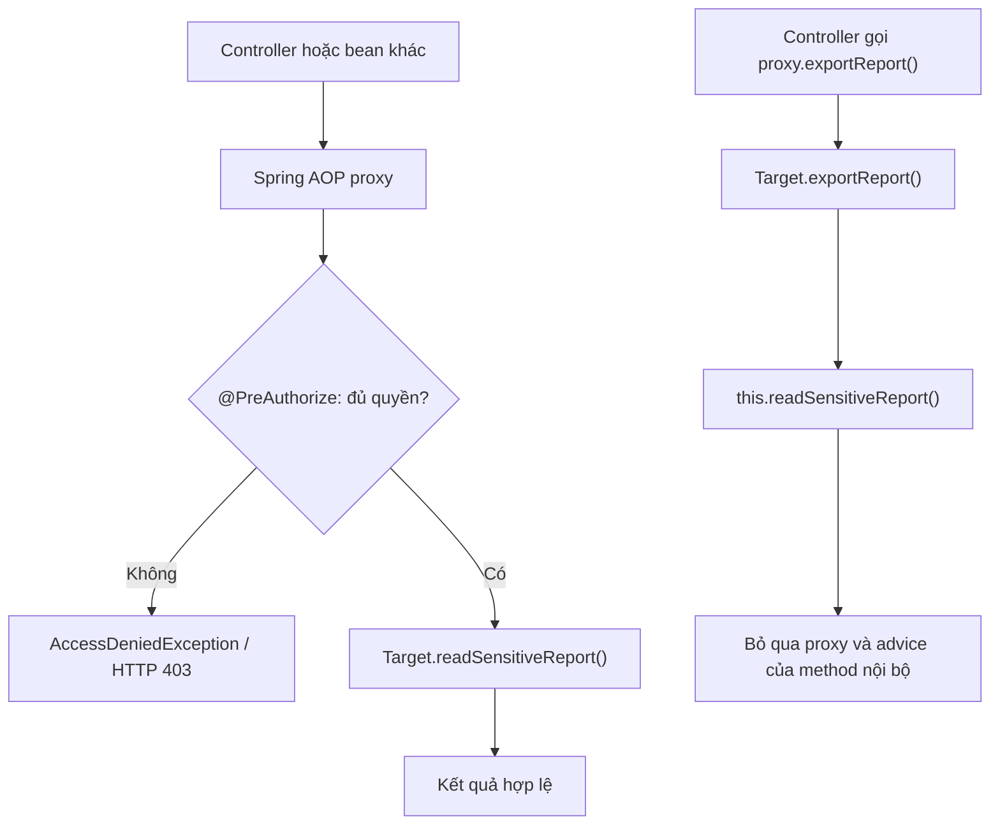
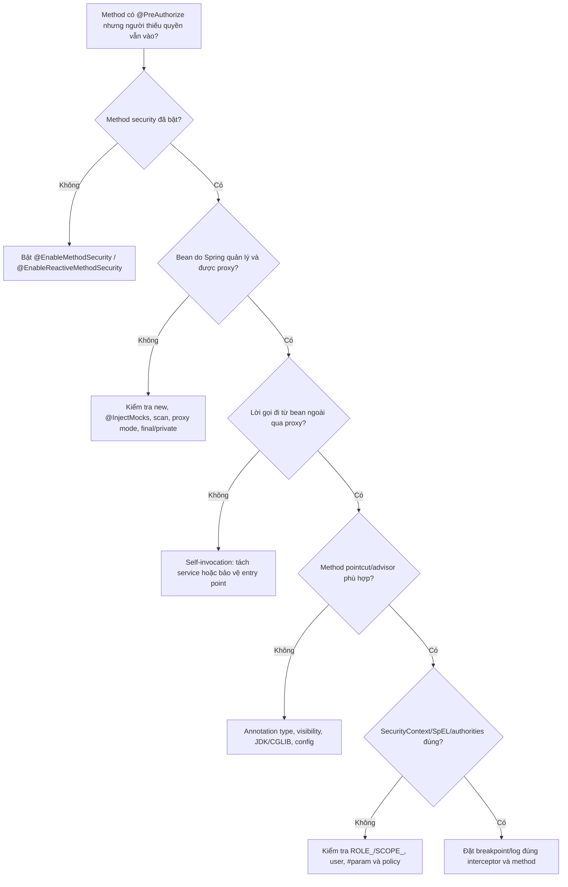

# Method security không chạy do gọi đối tượng không qua proxy

Một service có `@PreAuthorize("hasAuthority('REPORT_READ')")`, ứng dụng bật `@EnableMethodSecurity`, nhưng người dùng thiếu quyền vẫn đọc được báo cáo. Nếu gọi phương thức nhạy cảm trực tiếp từ controller thì 403; còn khi gọi gián tiếp qua một phương thức khác **trong cùng class** thì lại 200. Đây là dấu hiệu điển hình của **self-invocation bypass Spring AOP proxy**: lời gọi trực tiếp trên `this` không đi qua method-security interceptor.

Bài học thuộc chương **Chẩn đoán sự cố** của module **`SPRING_SECURITY_TESTING`**. Module hướng đến kiểm chứng xác thực, phân quyền và bảo vệ HTTP thực tế bằng `spring-security-test` trên Servlet/MockMvc và Reactive/WebTestClient, với `@WithMockUser`, `SecurityContext`, JWT/OAuth2/OIDC giả lập và các ca truy cập được phép hoặc bị từ chối. Bài này tập trung chẩn đoán **“Method security không chạy do gọi đối tượng không qua proxy”** và chuyển lỗi đó thành một bài kiểm thử hồi quy.

Kết thúc bài, bạn có thể:

- Giải thích đường đi `caller → Spring AOP proxy → method-security interceptor → target method`.
- Nhận ra self-invocation, `new Service()`, đối tượng `@InjectMocks` và các method không thể intercept bởi proxy.
- Dựng ca test **RED**: cùng principal thiếu quyền, gọi trực tiếp bị 403 nhưng gọi qua `this` trả dữ liệu trái phép.
- Sửa bằng cách tách hành vi có `@PreAuthorize` sang Spring bean khác rồi **inject bean đó**, hoặc bảo vệ đúng public entry point.
- Dùng `AopUtils`, `@SpringBootTest`, `MockMvc`, `@WithMockUser` và các negative controls để xác định lời gọi có đi qua proxy không.
- Áp dụng cùng tư duy cho Reactive Method Security bằng `StepVerifier`, Reactor Context và WebTestClient.
- Phân biệt lỗi proxy với lỗi bật annotation, SpEL/authority, HTTP filter, CSRF hoặc test fixture không hợp lệ.

## 1. Triệu chứng và bài toán cần giải

Một service trông có vẻ được bảo vệ:

```java
@Service
class ReportService {
    @PreAuthorize("hasAuthority('REPORT_READ')")
    public String readSensitiveReport() {
        return "confidential report";
    }

    public String exportReport() {
        // Gọi bên trong cùng object:
        return this.readSensitiveReport();
    }
}
```

Spring method security có thể chặn `service.readSensitiveReport()` khi một bean khác gọi **qua proxy**. Nhưng lời gọi `this.readSensitiveReport()` bên trong `exportReport()` diễn ra trên đối tượng đích, **không đi qua proxy lần thứ hai**, nên advice của `readSensitiveReport()` không chạy.

| Quan sát | Điều có thể suy ra | Điều chưa thể kết luận |
| --- | --- | --- |
| Gọi trực tiếp qua bean và thiếu quyền → `AccessDeniedException` | Interceptor chạy cho đường external call | Mọi đường gọi nội bộ cũng được bảo vệ |
| Gọi `exportReport()` và nhận dữ liệu | Nghi self-invocation bypass | Cần kiểm tra route, proxy, annotation thực tế |
| `AopUtils.isAopProxy(service)` là true | Bean đang inject là AOP proxy | Lời gọi qua `this` vẫn có thể bypass |
| MockMvc trả 403 | Một tầng bảo mật đã chặn | Có thể HTTP filter hoặc CSRF chặn trước method |
| `new ReportService().readSensitiveReport()` trả dữ liệu | Object do code tự tạo không có proxy | Production Spring bean cũng bỏ qua interceptor |
| `@WithMockUser(roles="ADMIN")` trả 200 | Test đã đặt một Authentication giả lập | Ca thiếu quyền sẽ bị từ chối đúng hay không |

Câu hỏi chẩn đoán cốt lõi: **“Lời gọi cụ thể đến method có đi vào Spring AOP proxy không?”** chứ không chỉ “method có gắn annotation không?”.

## 2. Cơ chế proxy và self-invocation

Khi `@EnableMethodSecurity` được bật, Spring Security đăng ký các advisors/interceptors phù hợp; chẳng hạn `AuthorizationManagerBeforeMethodInterceptor` xử lý `@PreAuthorize`. Chúng được gọi khi invocation đi qua **Spring AOP proxy** và khớp pointcut của method security.



**External invocation**: `controller → reportProxy.readSensitiveReport()`. Proxy có cơ hội xác minh `Authentication` và authorities trước khi thực hiện code.

**Internal invocation**: `controller → reportProxy.exportReport() → target.exportReport() → this.readSensitiveReport()`. `this` trỏ đến target đang chạy, không phải proxy, nên call cuối bypass advice. Ngay cả khi bỏ từ khóa `this`, ví dụ `return readSensitiveReport();`, đó vẫn là self-invocation.

Nếu chính `exportReport()` cũng có `@PreAuthorize`, lời gọi ban đầu qua proxy có thể được bảo vệ ở entry point đó. Tuy nhiên, điều này **không tự làm** annotation của `readSensitiveReport()` có hiệu lực trên call nội bộ, đặc biệt nếu method sau đòi một quyền chặt hơn.

### Proxy và target khác nhau như thế nào?

| Thành phần | Vai trò |
| --- | --- |
| Spring bean được inject | Có thể là proxy mang advisors |
| AOP proxy | Tiếp nhận external call, thực thi interceptors |
| Target object | Chứa business code; `this` bên trong là target |
| Method annotation | Metadata để advisor quyết định quyền **khi lời gọi đi qua proxy** |
| `SecurityContext` / `Authentication` | Danh tính và quyền được dùng **khi interceptor thực sự chạy** |

**Có SecurityContext đúng không sửa được lỗi bypass:** nếu interceptor chưa được gọi, biểu thức `@PreAuthorize` không được đánh giá.

## 3. Checklist phân loại trước khi sửa

Không phải mọi hiện tượng “`@PreAuthorize` không có tác dụng” đều là self-invocation.

| Nguyên nhân | Dấu hiệu | Kiểm tra |
| --- | --- | --- |
| Chưa bật method security | Ngay cả external bean call cũng không bị chặn | `@EnableMethodSecurity` đã được nạp vào context chưa? |
| Đối tượng tạo bằng `new` | Object không đi qua IoC/AOP | Có inject bean từ `ApplicationContext` không? |
| Self-invocation | External call bị deny; internal call trả dữ liệu | Có `this.securedMethod()` hoặc implicit self-call không? |
| Method không intercept được | CGLIB proxy không override được `private`/`final` | Kiểm tra visibility, final class/method và proxy mode |
| JDK proxy khác mong đợi | Injection/interface/method signature không khớp | Kiểm tra loại proxy, interface được public |
| Annotation loại khác chưa bật | `@Secured` hoặc `@RolesAllowed` không chạy | Bật đúng `securedEnabled`/`jsr250Enabled` |
| Biểu thức quyền sai | Advice chạy nhưng logic cấp quyền không như mong muốn | Kiểm tra `ROLE_`, `SCOPE_`, SpEL, tham số |
| Filter HTTP chặn trước | HTTP 403 dù service không được gọi | Cho HTTP layer pass để kiểm thử method layer |
| Test dùng Mockito object thay Spring bean | `@InjectMocks` không có Spring advisors | Dùng `@SpringBootTest` + `@Autowired` cho integration test |
| Test luôn có admin mock | Ca phủ định chưa từng tồn tại | Viết case thiếu authority riêng |

**Spring Boot Starter Security không tự kích hoạt method-level authorization.** Cấu hình Servlet của Spring Security 6.x cần bật rõ:

```java
import org.springframework.context.annotation.Configuration;
import org.springframework.security.config.annotation.method.configuration
        .EnableMethodSecurity;

@Configuration
@EnableMethodSecurity
class MethodSecurityConfiguration {}
```

`@EnableMethodSecurity` mặc định hỗ trợ `@PreAuthorize`, `@PostAuthorize` và các annotation pre/post phù hợp. `@Secured` và JSR-250 annotations cần bật tương ứng khi dùng:

```java
@EnableMethodSecurity(
        prePostEnabled = true,
        securedEnabled = true,
        jsr250Enabled = true)
```

`@EnableWebSecurity` dùng cho HTTP security, **không thay thế** cho `@EnableMethodSecurity`. Với WebFlux, chọn `@EnableReactiveMethodSecurity` chứ không áp cơ chế Servlet vào Reactor pipeline.

## 4. Ứng dụng Servlet mẫu tái hiện đúng lỗi

Ví dụ áp dụng Java 17+, Spring Boot 3.x và Spring Security 6.x. Các dependency điển hình:

```text
implementation:
  spring-boot-starter-web
  spring-boot-starter-security

testImplementation:
  spring-boot-starter-test
  spring-security-test
```

Bài test cố ý đặt HTTP authorization ở mức `authenticated()` thay vì `hasAuthority('REPORT_READ')`. Như thế các request có Authentication sẽ tới controller, **chính method security phải chặn thiếu quyền**. Nếu HTTP filter cũng đòi `REPORT_READ` thì 403 có thể xuất hiện **trước khi vào service** và che lỗi self-invocation.

### 4.1. Application và SecurityFilterChain

```java
import org.springframework.boot.SpringApplication;
import org.springframework.boot.autoconfigure.SpringBootApplication;

@SpringBootApplication
public class ProxyTroubleshootingApplication {
    public static void main(String[] args) {
        SpringApplication.run(ProxyTroubleshootingApplication.class, args);
    }
}
```

```java
import org.springframework.context.annotation.Bean;
import org.springframework.context.annotation.Configuration;
import org.springframework.security.config.Customizer;
import org.springframework.security.config.annotation.method.configuration
        .EnableMethodSecurity;
import org.springframework.security.config.annotation.web.builders.HttpSecurity;
import org.springframework.security.config.annotation.web.configurers
        .AbstractHttpConfigurer;
import org.springframework.security.web.SecurityFilterChain;

@Configuration
@EnableMethodSecurity
class ProxySecurityConfig {

    @Bean
    SecurityFilterChain securityFilterChain(HttpSecurity http)
            throws Exception {
        return http
                .authorizeHttpRequests(auth -> auth
                        .requestMatchers("/api/reports/**")
                            .authenticated()
                        .anyRequest().permitAll())
                .httpBasic(Customizer.withDefaults())
                .formLogin(AbstractHttpConfigurer::disable)
                .build();
    }
}
```

GET endpoints không cần CSRF token trong cấu hình thông thường. Với POST/DELETE, cần có valid CSRF nếu muốn kiểm chứng **method security** thay vì bị CSRF filter chặn trước.

### 4.2. Service cố ý sai: gọi method được bảo vệ qua `this`

```java
import org.springframework.security.access.prepost.PreAuthorize;
import org.springframework.stereotype.Service;

@Service
class LegacyReportService {

    @PreAuthorize("hasAuthority('REPORT_READ')")
    public String readSensitiveReport() {
        return "internal-report";
    }

    public String readViaThis() {
        // BUG: lời gọi nội bộ bypass proxy.
        return this.readSensitiveReport();
    }
}
```

Spring có thể tạo proxy cho `LegacyReportService` và bảo vệ `readSensitiveReport()` trên external call. Nhưng `readViaThis()` vẫn chạm thẳng vào implementation của method nội bộ. Đó là điều cần chứng minh bằng test.

### 4.3. Sửa bằng cách tách bean để có proxy boundary thật

```java
import org.springframework.security.access.prepost.PreAuthorize;
import org.springframework.stereotype.Service;

@Service
class ReportReader {
    @PreAuthorize("hasAuthority('REPORT_READ')")
    public String readSensitiveReport() {
        return "internal-report";
    }
}
```

```java
import org.springframework.stereotype.Service;

@Service
class ReportFacade {

    private final ReportReader reader;

    ReportFacade(ReportReader reader) {
        this.reader = reader;
    }

    public String readSafely() {
        // Đi qua proxy của ReportReader.
        return reader.readSensitiveReport();
    }
}
```

`ReportFacade` nhận `ReportReader` từ Spring container. Đối tượng được inject có thể được AOP wrap với method-security advisors; lời gọi `reader.readSensitiveReport()` từ facade sang bean khác là **external call qua proxy**, nên `@PreAuthorize` có hiệu lực.

### 4.4. Controller với ba đường đi đối chứng

```java
import org.springframework.web.bind.annotation.GetMapping;
import org.springframework.web.bind.annotation.RestController;

@RestController
class ReportController {

    private final LegacyReportService legacy;
    private final ReportFacade facade;

    ReportController(LegacyReportService legacy, ReportFacade facade) {
        this.legacy = legacy;
        this.facade = facade;
    }

    @GetMapping("/api/reports/direct")
    String direct() {
        return legacy.readSensitiveReport();
    }

    @GetMapping("/api/reports/unsafe")
    String unsafe() {
        return legacy.readViaThis();
    }

    @GetMapping("/api/reports/fixed")
    String fixed() {
        return facade.readSafely();
    }
}
```

| Route | Đường gọi | Alice thiếu `REPORT_READ` |
| --- | --- | --- |
| `/api/reports/direct` | Proxy → `@PreAuthorize` → target | `403` |
| `/api/reports/unsafe` | Proxy → target `readViaThis` → `this.readSensitiveReport()` | **200 — LỖI** |
| `/api/reports/fixed` | Facade → proxy `ReportReader` → `@PreAuthorize` | `403` |

**`/api/reports/unsafe` là mã có chủ đích không an toàn cho mục đích chẩn đoán.** Không triển khai route này ra production. Sau khi test tái hiện bug, sửa hoặc loại bỏ đường gọi bypass trước khi đưa suite vào CI.
## 5. Dùng MockMvc tạo test đỏ rồi sửa thành xanh

Dùng `@SpringBootTest` và `@AutoConfigureMockMvc` để controller gọi các bean/proxies thật của Spring context. Không dùng `MockMvcBuilders.standaloneSetup(new ReportController(...))` khi mục tiêu là kiểm tra hoạt động AOP của method security.

```java
import org.junit.jupiter.api.Test;
import org.springframework.aop.support.AopUtils;
import org.springframework.beans.factory.annotation.Autowired;
import org.springframework.boot.test.autoconfigure.web.servlet
        .AutoConfigureMockMvc;
import org.springframework.boot.test.context.SpringBootTest;
import org.springframework.security.core.authority.SimpleGrantedAuthority;
import org.springframework.test.web.servlet.MockMvc;

import static org.assertj.core.api.Assertions.assertThat;
import static org.springframework.security.test.web.servlet.request
        .SecurityMockMvcRequestPostProcessors.user;
import static org.springframework.test.web.servlet.request
        .MockMvcRequestBuilders.get;
import static org.springframework.test.web.servlet.result
        .MockMvcResultMatchers.*;

@SpringBootTest(classes = ProxyTroubleshootingApplication.class)
@AutoConfigureMockMvc
class ReportMethodSecurityMvcTest {

    @Autowired
    MockMvc mvc;

    @Autowired
    LegacyReportService legacy;

    @Autowired
    ReportReader reader;

    @Test
    void serviceBeansAreProxied() {
        assertThat(AopUtils.isAopProxy(legacy)).isTrue();
        assertThat(AopUtils.isAopProxy(reader)).isTrue();
    }

    @Test
    void directCallRejectsMissingReportAuthority()
            throws Exception {
        mvc.perform(get("/api/reports/direct")
                    .with(user("alice").roles("USER")))
                .andExpect(status().isForbidden());
    }

    @Test
    void refactoredCrossBeanCallRejectsMissingAuthority()
            throws Exception {
        mvc.perform(get("/api/reports/fixed")
                    .with(user("alice").roles("USER")))
                .andExpect(status().isForbidden());
    }

    @Test
    void authorizedCallerCanReadReport() throws Exception {
        mvc.perform(get("/api/reports/direct")
                    .with(user("auditor").authorities(
                            new SimpleGrantedAuthority("REPORT_READ"))))
                .andExpect(status().isOk())
                .andExpect(content().string("internal-report"));

        mvc.perform(get("/api/reports/fixed")
                    .with(user("auditor").authorities(
                            new SimpleGrantedAuthority("REPORT_READ"))))
                .andExpect(status().isOk())
                .andExpect(content().string("internal-report"));
    }

    @Test
    void anonymousCallIsRejectedAtHttpLayer()
            throws Exception {
        mvc.perform(get("/api/reports/fixed"))
                .andExpect(status().isUnauthorized());
    }
}
```

**Điểm quan trọng:** `user("alice")` tạo Authentication thử nghiệm để test authorization, không kiểm tra mật khẩu hoặc HTTP Basic login. Ca này giữ cho Alice đủ điều kiện vượt qua HTTP `authenticated()`, rồi để **method security** từ chối cô ấy do thiếu `REPORT_READ`.

### 5.1. Test RED tái hiện bypass

Thêm phép thử sau vào lớp `ReportMethodSecurityMvcTest`:

```java
@Test
void internalCallMustNotBypassReportAuthority()
        throws Exception {
    mvc.perform(get("/api/reports/unsafe")
                .with(user("alice").roles("USER")))
            .andExpect(status().isForbidden());
}
```

**Kỳ vọng bảo mật:** 403. **Kết quả thực tế với `LegacyReportService` lỗi:** 200 và body `internal-report`. Test sẽ **FAIL**. Đây là bằng chứng cụ thể rằng một user thiếu quyền đã thực hiện hành động bị cấm. Không sửa test thành `isOk()` chỉ để pipeline xanh.

Chạy theo tư duy **red → fix → green**:
1. Tái hiện bug với test 403 ở endpoint đang bypass (RED).
2. Refactor luồng gọi sang `ReportReader`/`ReportFacade` và sửa controller tương ứng.
3. Chạy lại **cùng negative test**: phải trả 403 (GREEN).
4. Kiểm tra user có `REPORT_READ` vẫn được 200 (positive control).
5. Xóa endpoint minh họa không an toàn và giữ ca hồi quy trên endpoint thật.

### 5.2. Tại sao test trả 403 vẫn có thể sai mục tiêu?

Nếu HTTP security đặt `.requestMatchers("/api/reports/**").hasAuthority("REPORT_READ")`, Alice thiếu quyền sẽ bị chặn **trước khi controller gọi method**. Khi đó `/api/reports/unsafe` cũng trả 403, khiến test không phát hiện self-invocation. Tương tự, một POST thiếu CSRF có thể bị `CsrfFilter` chặn trước. Muốn kiểm tra method security, các tầng trước đó phải cho request đi tiếp.

Test qua HTTP nên phân biệt:
- `401` anonymous: HTTP authentication entry point, không chứng minh method security.
- `403` từ HTTP role matcher: HTTP authorization, không chứng minh method security.
- `403` từ `@PreAuthorize` khi HTTP chỉ yêu cầu authenticated: **bằng chứng mạnh hơn** cho method security, nếu đã xác nhận Spring bean/proxy và call path.

### 5.3. Kiểm tra service bằng `@WithMockUser`

Có thể test method advisor mà không cần HTTP. Khi ấy inject **bean từ Spring container**, không tự `new`:

```java
import org.junit.jupiter.api.Test;
import org.springframework.beans.factory.annotation.Autowired;
import org.springframework.boot.test.context.SpringBootTest;
import org.springframework.security.access.AccessDeniedException;
import org.springframework.security.test.context.support.WithMockUser;

import static org.assertj.core.api.Assertions.assertThat;
import static org.assertj.core.api.Assertions.assertThatThrownBy;

@SpringBootTest(classes = ProxyTroubleshootingApplication.class)
class ReportMethodSecurityServiceTest {

    @Autowired
    ReportReader reader;

    @Autowired
    ReportFacade facade;

    @Test
    @WithMockUser(username = "alice", roles = "USER")
    void proxyRejectsCallerWithoutReportRead() {
        assertThatThrownBy(reader::readSensitiveReport)
                .isInstanceOf(AccessDeniedException.class);

        assertThatThrownBy(facade::readSafely)
                .isInstanceOf(AccessDeniedException.class);
    }

    @Test
    @WithMockUser(username = "auditor",
            authorities = "REPORT_READ")
    void proxyAllowsUserWithReportRead() {
        assertThat(reader.readSensitiveReport())
                .isEqualTo("internal-report");
    }
}
```

`@WithMockUser` tạo `UsernamePasswordAuthenticationToken` trong test SecurityContext; không cần tài khoản thật trong database. Nó phù hợp để chứng minh rule thực thi trong method interceptor. Với test plain JUnit tạo `new ReportReader()`, advice không có nên các ca denied sẽ không kiểm tra Spring Security.

## 6. Đọc proxy từ ApplicationContext: bằng chứng đúng mức

Đôi khi lỗi không phải self-invocation: test đã inject nhầm object, bean không được quét, hoặc JDK proxy expose một interface khác với kỳ vọng.

Công cụ AOP diagnostic:

```java
import org.junit.jupiter.api.Test;
import org.springframework.aop.framework.Advised;
import org.springframework.aop.support.AopUtils;
import org.springframework.beans.factory.annotation.Autowired;
import org.springframework.boot.test.context.SpringBootTest;

import static org.assertj.core.api.Assertions.assertThat;

@SpringBootTest(classes = ProxyTroubleshootingApplication.class)
class ReportProxyDiagnosticsTest {

    @Autowired
    ReportReader reader;

    @Test
    void inspectRealSpringBean() {
        assertThat(AopUtils.isAopProxy(reader)).isTrue();
        assertThat(AopUtils.getTargetClass(reader))
                .isEqualTo(ReportReader.class);

        System.out.println(
                "bean class = " + reader.getClass().getName());
        System.out.println(
                "JDK proxy = " + AopUtils.isJdkDynamicProxy(reader));
        System.out.println(
                "CGLIB proxy = " + AopUtils.isCglibProxy(reader));

        if (reader instanceof Advised advised) {
            for (var advisor : advised.getAdvisors()) {
                System.out.println(
                        advisor.getClass().getSimpleName());
            }
        }
    }
}
```

Đây là **diagnostic test**, không phải một bằng chứng riêng lẻ rằng mọi phương thức đã được bảo vệ. Một bean có thể đúng là proxy nhưng vẫn có self-invocation ở target. Với advisor names/class có thể thay đổi theo Spring version, đừng viết assertion cứng phụ thuộc một tên class sinh tự động.

**Lưu ý quyền riêng tư:** output trên chỉ in metadata về bean/proxy, không in `Authentication`, session, bearer token hoặc secrets. Khi bật trace logs bảo mật trong môi trường test, tránh đưa token và thông tin nhạy cảm vào CI artifacts.

### JDK dynamic proxy và class-based proxy

| Kiểu proxy | Cách hoạt động | Điều cần chú ý |
| --- | --- | --- |
| JDK dynamic proxy | Proxy triển khai interface và intercept lời gọi qua interface | Inject interface khi tương ứng; không mong proxy trực tiếp expose mọi method chỉ có trên class |
| Class-based (CGLIB) | Proxy kế thừa class đích, override method có thể intercept | `final` class/method và `private` method không thể override bằng subclass proxy |

**Cả hai kiểu proxy đều không tự sửa self-invocation.** Ép `proxyTargetClass=true` chỉ đổi cơ chế proxy, không biến `this.securedMethod()` thành external call.

Chú ý nuance: một `final` method của class có thể không intercept được khi dùng CGLIB, nhưng JDK dynamic proxy vẫn có thể intercept **lời gọi qua interface method** dù target implementation là final. Vì vậy không kết luận “mọi final method luôn không được bảo vệ” mà phải xét loại proxy và đường gọi cụ thể.

Khi dùng Kotlin, class/method mặc định `final`; cấu hình Kotlin Spring/all-open plugin hoặc thiết kế API phù hợp là cần thiết nếu Spring dùng subclass-based proxies. Một proxy không khởi tạo được do class final khác với trường hợp service chạy nhưng thiếu advice; xử lý theo lỗi thực tế.

## 7. Các cách sửa: chọn ranh giới có thể kiểm thử

### Lựa chọn A — Tách service (khuyến nghị)

Đưa method nhạy cảm sang `ReportReader`, rồi để `ReportFacade` gọi qua dependency được constructor-injected. Đây là giải pháp rõ ràng, dễ tái sử dụng và cho phép test độc lập.

```java
@Service
class ReportReader {
    @PreAuthorize("hasAuthority('REPORT_READ')")
    public String read() {
        return "internal-report";
    }
}

@Service
class ReportFacade {
    private final ReportReader reader;

    ReportFacade(ReportReader reader) {
        this.reader = reader;
    }

    public String export() {
        return reader.read(); // Gọi bean khác qua proxy.
    }
}
```

Đây là **biến thể rút gọn** của các lớp ở mục 4, không cần khai báo trùng các bean cùng tên trong một project. Chọn một triển khai nhất quán khi ghép mã mẫu.

### Lựa chọn B — Bảo vệ public entry point

Nếu tất cả cách truy cập một operation đều phải yêu cầu cùng quyền, có thể gắn `@PreAuthorize` lên entry method được các bean bên ngoài gọi:

```java
@PreAuthorize("hasAuthority('REPORT_READ')")
public String exportReport() {
    return this.readSensitiveReport();
}
```

Phương án này bảo vệ đường `external caller → proxy.exportReport()`. Tuy nhiên, việc gọi nội bộ `readSensitiveReport()` **vẫn bỏ qua annotation của nó**. Nếu method bên trong đòi một rule chặt hơn, hoặc còn đường gọi khác không có entry-point annotation, bạn vẫn phải sửa. Không dùng nó để phủ nhận sự tồn tại của self-invocation.

### Lựa chọn C — Self injection hoặc `AopContext` (không phải mặc định)

Có thể dùng self-reference được Spring inject để gọi qua proxy, nhưng cách đó dễ gây vòng phụ thuộc và khiến code khó hiểu. `AopContext.currentProxy()` cần cấu hình expose proxy và làm business code phụ thuộc trực tiếp Spring AOP; tài liệu Spring Framework khuyên ưu tiên **refactor để tránh self-invocation**. Đừng bật proxy exposure toàn ứng dụng chỉ để chữa một method call khi có thể tách service.

### Lựa chọn D — AspectJ weaving (trường hợp chuyên biệt)

AspectJ compile-time/load-time weaving có thể advice các lời gọi bên trong cùng class vì nó can thiệp bytecode thay vì chỉ intercept proxy boundary. Nhưng đây **không phải một switch đơn giản**: cần cấu hình advice mode, `spring-security-aspects` và weaving/tooling phù hợp, đồng thời kiểm tra tương thích với framework/version, build, test và runtime. Không tự đổi sang AspectJ trong bài debug chỉ vì test đỏ; phần lớn ứng dụng đơn giản hơn khi tách bean.

### Lựa chọn E — Giữ một policy check rõ ràng trong domain

Với các thao tác dữ liệu nhạy cảm, đừng dựa độc nhất vào một annotation trên method có thể bị gọi bằng nhiều lối. Có thể dùng một policy bean kiểm tra dữ liệu/tenant/owner tại domain boundary trước side effect; method security vẫn là một lớp bảo vệ. Policy check rõ ràng không thay cho việc hiểu và kiểm thử HTTP/method-level security, nhưng giảm nguy cơ hở quyền khi cấu trúc lời gọi thay đổi.

## 8. Reactive Method Security: cùng vấn đề proxy, khác cách mang Authentication

Trong WebFlux, method security sử dụng `@EnableReactiveMethodSecurity` và Reactor Context của subscriber. Nhưng **việc intercept invocation vẫn dựa trên proxy** (trừ khi ứng dụng chủ động chọn một cơ chế weaving khác). Do đó self-invocation có thể bypass advice giống ứng dụng Servlet.

### 8.1. Service Reactive lỗi và service đã sửa

Ví dụ đặt trong một **WebFlux-only test context** riêng, không đưa vào cùng demo Servlet ở các mục trên:

```java
import org.springframework.security.access.prepost.PreAuthorize;
import org.springframework.stereotype.Service;
import reactor.core.publisher.Mono;

@Service
class ReactiveLegacyReportService {

    @PreAuthorize("hasAuthority('REPORT_READ')")
    public Mono<String> read() {
        return Mono.just("internal-report");
    }

    public Mono<String> readViaThis() {
        // BUG: không qua proxy, không chạy advice của read().
        return this.read();
    }
}

@Service
class ReactiveReportReader {

    @PreAuthorize("hasAuthority('REPORT_READ')")
    public Mono<String> read() {
        return Mono.just("internal-report");
    }
}

@Service
class ReactiveReportFacade {
    private final ReactiveReportReader reader;

    ReactiveReportFacade(ReactiveReportReader reader) {
        this.reader = reader;
    }

    public Mono<String> readSafely() {
        return reader.read(); // Đi qua bean proxy.
    }
}
```

Với Spring Security Reactive hiện đại, method dùng Reactor `Mono`/`Flux` để đưa quyết định vào pipeline dựa trên subscriber context. Khi gọi method trực tiếp trên Spring proxy, interceptor tham gia lúc thích hợp; với `this.read()`, lời gọi **không đi qua proxy** để được intercept.

### 8.2. Unit/integration test dùng bean proxy và StepVerifier

```java
import java.util.List;
import org.junit.jupiter.api.Test;
import org.springframework.beans.factory.annotation.Autowired;
import org.springframework.context.annotation.Configuration;
import org.springframework.context.annotation.Import;
import org.springframework.security.access.AccessDeniedException;
import org.springframework.security.authentication
        .UsernamePasswordAuthenticationToken;
import org.springframework.security.config.annotation.method.configuration
        .EnableReactiveMethodSecurity;
import org.springframework.security.core.Authentication;
import org.springframework.security.core.authority.SimpleGrantedAuthority;
import org.springframework.security.core.context.ReactiveSecurityContextHolder;
import org.springframework.test.context.junit.jupiter.SpringJUnitConfig;
import reactor.test.StepVerifier;

@SpringJUnitConfig(classes = ReactiveReportProxyTest.TestConfig.class)
class ReactiveReportProxyTest {

    @Configuration
    @EnableReactiveMethodSecurity
    @Import({
        ReactiveLegacyReportService.class,
        ReactiveReportReader.class,
        ReactiveReportFacade.class
    })
    static class TestConfig {}

    @Autowired
    ReactiveLegacyReportService legacy;

    @Autowired
    ReactiveReportReader reader;

    @Autowired
    ReactiveReportFacade facade;

    private static Authentication userWithoutReportRead() {
        return new UsernamePasswordAuthenticationToken(
                "alice", null,
                List.of(new SimpleGrantedAuthority("ROLE_USER")));
    }

    @Test
    void proxiedReactiveMethodRejectsMissingAuthority() {
        StepVerifier.create(
                reader.read()
                    .contextWrite(
                        ReactiveSecurityContextHolder
                            .withAuthentication(
                                userWithoutReportRead())))
                .expectError(AccessDeniedException.class)
                .verify();
    }

    @Test
    void crossBeanReactiveCallAlsoRejects() {
        StepVerifier.create(
                facade.readSafely()
                    .contextWrite(
                        ReactiveSecurityContextHolder
                            .withAuthentication(
                                userWithoutReportRead())))
                .expectError(AccessDeniedException.class)
                .verify();
    }

    @Test
    void diagnosticOnly_selfInvocationBypassesAdvice() {
        // BẰNG CHỨNG BUG: test này xanh vì method bị bypass,
        // KHÔNG phải hành vi an toàn được phép giữ lại.
        StepVerifier.create(
                legacy.readViaThis()
                    .contextWrite(
                        ReactiveSecurityContextHolder
                            .withAuthentication(
                                userWithoutReportRead())))
                .expectNext("internal-report")
                .verifyComplete();
    }
}
```

Hai case đầu chứng minh proxy được áp và user thiếu `REPORT_READ` bị từ chối. Case thứ ba **chỉ nhằm tái hiện lỗi**: người không đủ quyền vẫn nhận dữ liệu do self-invocation. Sau khi sửa legacy call path, biến case thứ ba thành **negative regression mong `AccessDeniedException`**, không giữ test “bypass vẫn cho phép” làm acceptance criterion.

`StepVerifier` subscribe vào Publisher, nên authorization reactive có cơ hội thực hiện bên trong Reactor Context do `contextWrite(ReactiveSecurityContextHolder.withAuthentication(...))` đặt cho subscription. Test thuần service không cần `MockMvc`, không dùng `SecurityContextHolder` ThreadLocal của Servlet và không nên gọi `block()` trong request handler.

### 8.3. WebTestClient khi cần chứng minh HTTP và method security cùng chạy

Trong WebFlux app, dùng `SecurityWebFilterChain` chỉ yêu cầu `authenticated()` cho route test, inject `ReactiveReportFacade` vào controller, rồi:

```java
client.mutateWith(mockUser("alice").roles("USER"))
        .get()
        .uri("/api/reports/fixed")
        .exchange()
        .expectStatus().isForbidden();

client.mutateWith(mockUser("auditor").authorities(
                new SimpleGrantedAuthority("REPORT_READ")))
        .get()
        .uri("/api/reports/fixed")
        .exchange()
        .expectStatus().isOk();
```

Đây là snippet **yêu cầu app WebFlux, controller và client setup thực tế** (ví dụ `WebTestClient.bindToApplicationContext(context).apply(springSecurity())`). Test sẽ chỉ chứng minh được method security khi HTTP layer cho hai request đến controller. Nếu HTTP route đã yêu cầu `REPORT_READ`, 403 có thể chỉ do WebFilter chain chứ không phải method interceptor.

## 9. Quy trình chẩn đoán từng bước khi method security “không chạy”

Thay vì sửa annotation ngẫu nhiên, lần theo một đường gọi cụ thể:



### Bước 1 — Chắc chắn cấu hình method security có trong test context

- Spring Security Servlet: `@EnableMethodSecurity`.
- Spring Security Reactive: `@EnableReactiveMethodSecurity`.
- `@Secured`: cần `securedEnabled=true` nếu dùng.
- `@RolesAllowed`: cần `jsr250Enabled=true` nếu dùng.
- Với `@PreAuthorize`: không vô tình tắt `prePostEnabled` hoặc thay method advisor theo cấu hình riêng.

### Bước 2 — Kiểm tra **đối tượng** mà caller đang giữ

- Có được inject từ `ApplicationContext` không, hay được tạo bằng `new`?
- Test có dùng `@InjectMocks` và tự tạo service với Mockito không?
- Có thay cả bean secured bằng mock và vô tình không còn method thật/advice cần kiểm tra không?
- Có gọi bằng reference đã truy xuất target trực tiếp thay vì proxy không?
- `AopUtils.isAopProxy(bean)` có true không? Nếu false, cần tìm lý do (chưa bật config, bean không thuộc phạm vi pointcut, proxy không tạo được…).

**Không đồng nhất mọi `new` với lỗi:** nếu một instance được trả từ `@Bean` factory method và được Spring quản lý qua container, Spring có thể tạo proxy cho bean đó. Vấn đề là **call trực tiếp đến instance tự tạo nằm ngoài container/proxy**.

### Bước 3 — Theo call graph tìm `this`

Xem đường gọi thực:
```text
Controller
  -> ServiceA.method1()
       -> ServiceA.method2()       // self-invocation, đáng nghi
       -> ServiceB.securedMethod()  // external call qua injected proxy, đúng hơn
```

Không chỉ tìm chữ `this.`; lời gọi implicit `securedMethod()`, lời gọi từ helper trong cùng class, constructor/lifecycle hook hoặc một callback bắt giữ `this` cũng cần đánh giá. Tách bean hoặc thiết kế entry boundary là cách rõ ràng nhất.

### Bước 4 — Kiểm tra method có thể được advise không

`private` không phải một entry point được proxy intercept. `final` class/method không thể override bởi CGLIB class-based proxy. Nếu dùng JDK interface proxy, lời gọi qua interface có thể được intercept ngay cả khi implementation cụ thể có modifier khác; hãy xác minh proxy mode thực tế.

Nếu cần, bật logging phù hợp **chỉ trong test/development**:

```properties
# Tùy Spring Security version, các logger có thể khác nhau.
logging.level.org.springframework.security.authorization.method=TRACE
logging.level.org.springframework.aop=DEBUG
```

Có thể đặt breakpoint tại `AuthorizationManagerBeforeMethodInterceptor`/method security advisor và tại target method, rồi so sánh external call với self-invocation. Không ghi dữ liệu nhạy cảm (mật khẩu, token, session ID) vào log/traces CI.

### Bước 5 — Kiểm tra đúng người và đúng chuỗi authority

Hai annotation dưới đây **không có cùng semantics**:

```java
@PreAuthorize("hasRole('ADMIN')")
// Thường tìm GrantedAuthority("ROLE_ADMIN").

@PreAuthorize("hasAuthority('ADMIN')")
// Tìm chính xác GrantedAuthority("ADMIN").
```

Trong Spring Security Test:

```java
@WithMockUser(roles = "ADMIN") 
// Có ROLE_ADMIN, không phải authority literal "ADMIN".

@WithMockUser(authorities = "REPORT_READ")
// Có REPORT_READ, không phải ROLE_REPORT_READ.
```

Tương tự, JWT scopes thường có tiền tố `SCOPE_` sau converter. Một method-security interceptor **đã chạy** nhưng cấp quyền sai vì mapping khác biệt không phải cùng lỗi với “proxy không được gọi”.

### Bước 6 — Kiểm tra 403 xuất hiện trước hay sau controller

Trong MockMvc, bảo đảm request đủ quyền đi qua HTTP filter. Với CSRF-protected write, gửi valid CSRF token; với role check ở method, HTTP matcher chỉ yêu cầu authenticated. Kiểm tra direct service test bằng `@WithMockUser` để loại yếu tố HTTP; nếu direct proxy call 403 nhưng self-invocation trả dữ liệu, nghi vấn đã rõ.

## 10. Không sửa bằng cách che lỗi hoặc xóa hàng rào

Một số cách “sửa” khiến test xanh nhưng làm hệ thống kém an toàn:

| Thao tác | Vì sao sai |
| --- | --- |
| Đổi expected `403` thành `200` | Hợp thức hóa bypass; không chặn quyền nữa |
| Bỏ `@PreAuthorize` “vì chưa chạy” | Mất rule bảo mật khi external call |
| Chỉ thêm `hasRole` vào HTTP matcher rồi bỏ kiểm tra service | Có thể bảo vệ một route nhưng các caller khác/batch job vẫn bypass service |
| Bật `proxyTargetClass=true` và kỳ vọng self-call chạy | Class-based proxy cũng bỏ qua lời gọi trên `this` |
| Đưa mọi logic vào `@PostAuthorize` | Side effect có thể đã xảy ra trước khi deny |
| Dùng `AopContext.currentProxy()` ở khắp nơi | Gắn chặt business code vào AOP; tăng phức tạp và rủi ro cấu hình |
| Gỡ Spring Security filters trong MockMvc | Không còn kiểm tra bảo vệ HTTP đúng |
| Mock toàn bộ secured service để test proxy | Mock có thể bỏ qua method thực/advice; sai boundary |
| Dùng `@WithMockUser` với quyền quá cao | Che nhánh từ chối của policy |
| Gộp mọi lỗi thành `is4xxClientError()` | Không biết bị chặn ở authentication, CSRF hay method authorization |

Đối với phương thức có thay đổi dữ liệu, thêm assertion **không có side effect** khi thiếu quyền: kiểm tra database không đổi, event không phát, outbound call không chạy. Một 403 sau khi đã ghi dữ liệu không phải “bảo mật thành công”.

## 11. Bộ hồi quy nên giữ sau khi fix

Một test suite tối thiểu phải có cả positive và negative ở **cùng boundary**:

| Case | Setup | Điều cần chứng minh |
| --- | --- | --- |
| Anonymous gọi route | Không Authentication | HTTP entry point 401/redirect theo config |
| User thiếu `REPORT_READ` gọi trực tiếp | Authenticated, thiếu authority | 403 do method advisor |
| User thiếu `REPORT_READ` qua façade | Authenticated, thiếu authority | 403, chứng minh cross-bean call qua proxy |
| User có `REPORT_READ` | Authenticated, đủ authority | 200 và đúng dữ liệu |
| Lối gọi trước đây bypass | Authenticated, thiếu authority | **Sau refactor phải 403** |
| Plain `new ReportReader()` trong diagnostic | Không Spring proxy | Nhận ra đây không phải integration test method security |
| Reactive proxy call với StepVerifier | Reactor Context thiếu quyền | `AccessDeniedException` |
| Reactive cross-bean call với StepVerifier | Context thiếu quyền | `AccessDeniedException`, không có dữ liệu phát ra |
| Denied mutation | Tài nguyên/fixture tồn tại | Data store và downstream side effect không đổi |

Khi chia bộ test theo tầng:
- **Unit/domain** kiểm tra policy logic thuần và dữ liệu owner/tenant.
- **Spring bean integration** kiểm tra advisor, AOP proxy, `@WithMockUser` hoặc Reactor Context.
- **HTTP integration** kiểm tra MockMvc/WebTestClient qua security chain và controller thật.
- **Authentication integration** kiểm tra JWT decoder, OAuth2/OIDC callback hoặc X.509 transport riêng khi cần — không phải phạm vi của self-invocation test.

### Đưa negative regression vào CI

Có thể gắn `@Tag("security-method")` cho ca thiếu quyền và ca từng bị bypass:

```java
@Tag("security-method")
@Test
void fixedCallMustRejectAliceWithoutReportRead()
        throws Exception {
    mvc.perform(get("/api/reports/fixed")
                .with(user("alice").roles("USER")))
            .andExpect(status().isForbidden());
}
```

Đoạn trên đặt vào test class đã có `MockMvc mvc`; thêm import `org.junit.jupiter.api.Tag` tương ứng. Test này phải **fail khi ai đó sửa façade thành tự gọi target không qua proxy**. Đồng thời giữ một positive control để endpoint không bị khóa mọi user rồi khiến các negative test xanh giả.

Các test này phù hợp làm CI gate nhanh với `@SpringBootTest` context nhỏ hoặc một test configuration tập trung. Đừng gỡ test chỉ vì “bị lỗi khi chạy cả suite”; hãy kiểm tra test isolation, SecurityContext cleanup, mock/stub shared state và sự thay đổi thứ tự thực thi.

## 12. Bài tập chẩn đoán và tự đánh giá

**Bài tập 1 — Tái hiện chính xác self-invocation.** Từ `LegacyReportService` ở mục 4, chạy ba endpoint dưới principal Alice chỉ có `ROLE_USER`. Ghi lại status/body. Giải thích vì sao bean vẫn là AOP proxy nhưng `/unsafe` trả 200.

**Bài tập 2 — Sửa theo red/green.** Viết test mong `/unsafe` trả 403 và xác nhận test RED. Tách method sang `ReportReader`, inject vào façade, thay controller call path; chạy lại test và xác minh GREEN. Không thay expected status.

**Bài tập 3 — Phân biệt nguyên nhân 403.** Thay HTTP matcher bằng `hasAuthority('REPORT_READ')` rồi xem `/unsafe` cũng trả 403. Chứng minh test này **không còn phát hiện bypass**; khôi phục HTTP `authenticated()` để kiểm tra method security.

**Bài tập 4 — Proxy type.** Dùng `AopUtils` in bean class, JDK/CGLIB flags và advisors. Tạo một interface `ReportOperations`; chuyển cách injection sang interface khi dùng JDK proxy. Giải thích vì sao thay proxy mode không sửa được self-invocation.

**Bài tập 5 — Method không thể intercept.** Thử biến method thành `private` hoặc `final` trong một class-based proxy scenario. Dựa vào logs/exception và direct/indirect test để xác định behavior, sau đó sửa thiết kế để method bảo vệ là public và được gọi qua bean proxy.

**Bài tập 6 — Reactive StepVerifier.** Viết `ReactiveReportReader.read()` trả `Mono<String>` có `@PreAuthorize`. Test Alice thiếu quyền với `contextWrite(ReactiveSecurityContextHolder.withAuthentication(...))` nhận `AccessDeniedException`. Tạo self-invocation và quan sát bypass, rồi sửa bằng cross-bean call.

**Bài tập 7 — Bảo vệ side effect.** Thay chuỗi “internal-report” bằng một thao tác lưu dữ liệu thử nghiệm. Khi user thiếu quyền, assert bị deny **và không có row/event/outbound call**. Không dùng `@PostAuthorize` làm lá chắn duy nhất sau khi side effect đã xảy ra.

### Checklist trước khi coi sự cố được khắc phục

- [ ] Method Security được bật đúng trên Spring context mà test thực sự nạp.
- [ ] Method cần bảo vệ thuộc Spring-managed bean, không phải object tạo trực tiếp.
- [ ] Proxy được xác minh bằng `AopUtils` và đường caller thực sự đi qua proxy.
- [ ] Không còn self-invocation tới method mà policy chỉ được đặt ở method đó.
- [ ] Method visibility/proxy type tương thích; `private`/`final` không làm mất lời gọi advice.
- [ ] Test thiếu authority đi đến method layer, không bị HTTP/CSRF chặn trước.
- [ ] Test positive đủ authority vẫn thành công.
- [ ] Test sau fix giữ lại ca từng bypass để bắt regression.
- [ ] Nếu WebFlux, test dùng Reactor Context và StepVerifier/WebTestClient.
- [ ] Nếu method gây side effect, denied case không thay đổi dữ liệu hoặc gọi downstream.
- [ ] Không đưa endpoint minh họa không an toàn hoặc một test chấp nhận 200 khi thiếu quyền vào production/CI.

### Tài liệu tham khảo

- [Spring Security — Method Security (Servlet)](https://docs.spring.io/spring-security/reference/servlet/authorization/method-security.html)
- [Spring Framework — AOP Proxying Mechanisms](https://docs.spring.io/spring-framework/reference/core/aop/proxying.html)
- [Spring Security — Testing Method Security](https://docs.spring.io/spring-security/reference/servlet/test/method.html)
- [Spring Security — MockMvc Test Support](https://docs.spring.io/spring-security/reference/servlet/test/mockmvc/index.html)
- [Spring Security — Reactive Method Security](https://docs.spring.io/spring-security/reference/reactive/authorization/method.html)
- [Spring Security — Reactive Testing](https://docs.spring.io/spring-security/reference/reactive/test/index.html)

**Kết luận:** `@PreAuthorize` không tự biến mọi lời gọi Java thành một phép kiểm tra quyền. Trong mô hình Spring AOP mặc định, **chỉ lời gọi được intercept bởi proxy** mới đi qua method-security advice. Một lời gọi `this.securedMethod()`, một object tạo ngoài Spring hoặc một method không thể proxy có thể khiến policy bị bỏ qua dù annotation hoàn toàn đúng. Cách chẩn đoán hiệu quả là so sánh external call với internal call, kiểm tra Spring proxy và tách rõ HTTP security khỏi method security. Sau khi sửa bằng một proxy boundary thật, giữ **ca bị từ chối và ca được phép** trong bộ kiểm thử CI để ngăn lỗ hổng quay lại.


