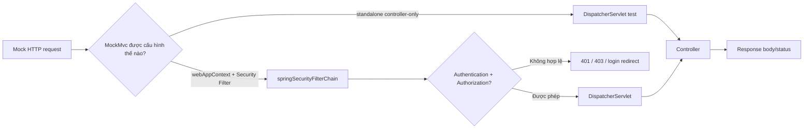

# MockMvc standalone thiếu hạ tầng bảo mật cần thiết

## 1. Tại sao test MockMvc trả 200 nhưng bảo mật vẫn có thể sai?

Một API Spring MVC có endpoint `GET /api/private/ping`. Theo thiết kế, chỉ người dùng đã xác thực và có role `READER` mới được xem nội dung. Bạn viết test:

```java
MockMvc mvc = MockMvcBuilders
    .standaloneSetup(new PingController())
    .build();

mvc.perform(get("/api/private/ping")
        .with(user("alice").roles("READER")))
    .andExpect(status().isOk());
```

Test **PASS**, nhưng điều này chưa chứng minh Spring Security bảo vệ endpoint. `standaloneSetup(...)` là công cụ dựng **hạ tầng Spring MVC tối thiểu** quanh controller được cung cấp, không tự khởi tạo toàn bộ Spring Boot application context, không tự tìm bean `SecurityFilterChain`, và **không mặc nhiên cài `springSecurityFilterChain`**.

Nếu controller không tự kiểm tra quyền, một request **anonymous** gửi qua cùng client standalone có thể vẫn trả 200. Ngược lại, test sử dụng `@WithMockUser` hoặc `with(user(...))` có thể tạo cảm giác authentication đã hoạt động, dù đường đi HTTP qua bộ lọc bảo mật thực **không được kiểm chứng**.

Đây là bài thuộc chương **Chẩn đoán sự cố** của module **SPRING_SECURITY_TESTING**. Phạm vi module là kiểm chứng xác thực, phân quyền và bảo vệ HTTP trên Servlet/Reactive với `spring-security-test`, `MockMvc`, `WebTestClient`, `@WithMockUser`, `SecurityContext` và JWT/OAuth2/OIDC giả lập. Trọng tâm bài này là **phân biệt controller unit test với security integration test**, xác định những phần hạ tầng bị thiếu khi dùng `MockMvcBuilders.standaloneSetup(...)`, và thiết kế các phép thử khiến cấu hình bảo mật sai phải bị phát hiện.

Sau bài học, bạn có thể:

1. Giải thích `standaloneSetup` tạo gì và **không** tạo gì.
2. Xác định vì sao `with(user(...))`, `@WithMockUser`, `jwt()` hoặc `csrf()` không tự làm một test standalone trở thành security integration test.
3. Dựng `MockMvc` từ `WebApplicationContext` với `springSecurity()`, hoặc dùng `@SpringBootTest` + `@AutoConfigureMockMvc`.
4. Viết ma trận **anonymous 401 / thiếu role 403 / đủ role 200** trên cùng endpoint.
5. Phân biệt 403 do CSRF với 403 do authorization, và 404 do mapping với từ chối truy cập.
6. Chẩn đoán test slice `@WebMvcTest`, `addFilters = false`, cấu hình security chain sai, và thiếu method security.
7. Nhận biết giới hạn của mock authentication so với login/JWT/OAuth2/OIDC thật.
8. Đưa negative controls và kiểm tra test discovery vào CI để tránh kết quả đạt sai.

## 2. Hai loại MockMvc và ranh giới kiểm thử

`MockMvc` mô phỏng Servlet request qua hệ thống Spring MVC **không cần khởi động TCP server**. Nhưng cách xây dựng client quyết định có những thành phần nào trong phép thử.

| Cách tạo | Thành phần có mặt | Không được tự giả định |
|---|---|---|
| `MockMvcBuilders.standaloneSetup(controller)` | Controller, MVC dispatcher và các resolver/adapter cần cho test controller, với cấu hình standalone | Security filter chain từ ứng dụng thật, các bean/security config khác, tất cả MVC customization của Boot |
| `MockMvcBuilders.webAppContextSetup(wac)` | MVC infrastructure và bean trong `WebApplicationContext` test | Bảo đảm filters đã được gắn nếu builder chưa cấu hình đúng |
| `webAppContextSetup(wac).apply(springSecurity())` | Spring web context **và** Spring Security test integration/filter được cấu hình | Network/TLS/proxy thật; JWT signature nếu test dùng mock |
| `@SpringBootTest` + `@AutoConfigureMockMvc` | Application context và MockMvc Boot auto-configure, thường đăng ký filters mặc định | E2E qua cổng HTTP; token thực nếu chỉ dùng `with(user(...))` |
| `@WebMvcTest` + `@AutoConfigureMockMvc` | MVC test slice, có thể có security auto-config tùy classpath/cấu hình | Toàn bộ custom application security, database, service và các chain đúng production |
| `MockMvcBuilders.standaloneSetup(...).addFilters(...)` | Những filter mà test **tự chỉ định** | Tự động tương đương full application context hoặc toàn bộ behavior production |

Đừng gom tất cả vào tên gọi “MockMvc test”. Test standalone rất hữu ích để kiểm tra mapping, binding, validation, serialization hoặc exception handler của một controller. Nhưng nếu mục tiêu là chứng minh `SecurityFilterChain` đã chặn anonymous, client phải **chạy đúng filter chain**.

### 2.1. Đường đi request khi có và không có Spring Security



Nếu controller luôn trả `"private-pong"`, đường đầu tiên ở sơ đồ sẽ trả nội dung đó cho mọi người, trừ khi bạn đã thêm một lớp kiểm tra riêng. **Không có filter** không có nghĩa “filter tự động coi mọi người là authenticated”; đúng hơn là **request chưa đi qua chốt chặn**.

### 2.2. Chỉ thêm Spring Security dependency chưa đủ

`spring-security-test` cung cấp request post-processors và integration helpers. Nhưng các helper không tự dựng lại toàn bộ security filter chain khi test đã chọn xây dựng controller-only standalone. Tương tự, `spring-boot-starter-security` có trên classpath không bảo đảm một `standaloneSetup(new Controller())` dùng `SecurityFilterChain` của Spring Boot.

**Ranh giới cần ghi rõ trong tên test:**

- `PingControllerMappingTest`: dùng standalone, kiểm tra JSON/mapping.
- `PingAuthorizationMvcTest`: dùng context thật và filters, kiểm tra 401/403/200.
- `PingBearerTokenIntegrationTest`: gửi bearer token thật qua decoder trong một phép thử tích hợp riêng.

## 3. Dấu hiệu thường gặp khi standalone thiếu security

| Hiện tượng | Nguyên nhân cần nghi ngờ | Điều cần kiểm tra |
|---|---|---|
| Anonymous GET private trả 200 | Không chạy security filters, hoặc rule đang `permitAll` | Client builder, filter chain, negative test trên cùng path |
| `@WithMockUser` test pass nhưng anonymous cũng 200 | Mock identity không chứng minh request filter | Thêm anonymous control và so sánh |
| `with(user(...))` không xuất hiện trong `SecurityContextHolder` ở controller | Không có Spring Security test/filter support đúng | Cấu hình `springSecurity()` và web context |
| `@AuthenticationPrincipal` là `null` | Resolver/principal type thiếu hoặc security context không được nạp | Loại principal, argument resolver, filter chain |
| `with(jwt())` không tạo `Jwt` ở handler standalone | Helper mock cần integration đúng | Dùng context+Spring Security; không giả định decoder đã chạy |
| CSRF test không token vẫn trả 200 | `CsrfFilter` không tham gia hoặc CSRF bị tắt | Chạy test với filter đúng và user đủ quyền |
| `@PreAuthorize` không có tác dụng | Service tự `new`, self-invocation hoặc thiếu method-security proxy | Gọi Spring-managed bean và bật method security |
| 404 trong standalone, 200 ở ứng dụng | Route, controller advice, custom MVC config khác nhau | So sánh mapping/context path, không quy thành lỗi quyền |
| 401/302 khác kỳ vọng | HTTP Basic/bearer vs form/OAuth2 entry point | Kiểm tra security config thực, không suy từ tên endpoint |
| Test CI xanh nhưng lọt `permitAll` | Chỉ test người đủ quyền | Thêm ca chưa xác thực và thiếu quyền |

Lưu ý `@WithMockUser` không “vô dụng” trong standalone: nó có thể đặt mock security context của **test thread** nhờ Spring Security Test listener. Nhưng việc một phần code nhìn thấy context đó **không chứng minh filter chain bảo vệ request đã chạy**. Cần tách bạch **danh tính giả lập** và **authorization qua HTTP filters**.

## 4. Một ứng dụng mẫu có security policy rõ ràng

Các ví dụ dùng Java 17+, Spring Boot 3 và Spring Security 6. API cụ thể có thể khác theo phiên bản; trong dự án thực tế, hãy dùng bộ dependency tương thích do Spring Boot quản lý.

### 4.1. Dependency

```kotlin
// build.gradle.kts - cấu hình minh họa
dependencies {
    implementation("org.springframework.boot:spring-boot-starter-web")
    implementation("org.springframework.boot:spring-boot-starter-security")

    testImplementation("org.springframework.boot:spring-boot-starter-test")
    testImplementation("org.springframework.security:spring-security-test")
}
```

Để test Bearer JWT/OAuth2 Resource Server thật ở các mục bổ sung, cần thêm starter OAuth2 Resource Server và decoder/khóa ký thử nghiệm tương ứng; không cần nó cho ví dụ HTTP Basic ở phần chính.

### 4.2. Controller không tự kiểm tra authentication

```java
record PingResponse(String message) {}

@RestController
class PingController {

    @GetMapping("/api/private/ping")
    PingResponse privatePing() {
        return new PingResponse("private-pong");
    }

    @GetMapping("/public/ping")
    PingResponse publicPing() {
        return new PingResponse("public-pong");
    }

    @PostMapping("/api/private/notes")
    ResponseEntity<PingResponse> createNote() {
        return ResponseEntity.status(HttpStatus.CREATED)
            .body(new PingResponse("note-created"));
    }
}
```

Controller cố ý không có `if (isAuthenticated)`, không tự truy cập `SecurityContextHolder` và không có `@PreAuthorize`. Chính `SecurityFilterChain` phải bảo vệ các đường riêng tư. Thiết kế này giúp tái hiện **false positive rõ ràng** nếu filter bị bỏ.

### 4.3. SecurityFilterChain Servlet

```java
@Configuration
@EnableWebSecurity
class PingSecurityConfig {

    @Bean
    SecurityFilterChain security(HttpSecurity http)
            throws Exception {

        return http
            .authorizeHttpRequests(auth -> auth
                .requestMatchers(
                    HttpMethod.GET, "/public/ping")
                    .permitAll()
                .requestMatchers(
                    HttpMethod.GET, "/api/private/ping")
                    .hasRole("READER")
                .requestMatchers(
                    HttpMethod.POST, "/api/private/notes")
                    .hasRole("EDITOR")
                .anyRequest().denyAll()
            )
            .httpBasic(Customizer.withDefaults())
            .formLogin(AbstractHttpConfigurer::disable)
            // CSRF được giữ bật để có thể kiểm thử POST.
            .build();
    }
}
```

Các import chính: `@Configuration`, `@EnableWebSecurity`, `@Bean`, `HttpSecurity`, `SecurityFilterChain`, `HttpMethod`, `Customizer` và `AbstractHttpConfigurer`.

Cấu hình cố ý dùng **HTTP Basic entry point** để anonymous truy cập đường riêng tư nhận **401** thay vì redirect tới form login. Nếu ứng dụng thật dùng form/OAuth2 login, anonymous có thể nhận **302**; phải assert theo entry point thực.

Lưu ý: `hasRole("READER")` kiểm tra authority `ROLE_READER`; `hasRole("EDITOR")` kiểm tra `ROLE_EDITOR`. CSRF vẫn bật cho POST; vì vậy một Editor có đủ role nhưng thiếu CSRF token sẽ bị 403.

## 5. Tái hiện lỗi: standaloneSetup khiến test “đủ quyền” PASS sai

Tạo một lớp test **chỉ dành cho MVC controller**:

```java
class PingControllerStandaloneTest {

    private final MockMvc mvc = MockMvcBuilders
        .standaloneSetup(new PingController())
        .build();

    @Test
    void positiveTestPassesEvenWithoutSecurity()
            throws Exception {
        mvc.perform(get("/api/private/ping")
                .with(user("alice").roles("READER")))
            .andExpect(status().isOk())
            .andExpect(jsonPath("$.message")
                .value("private-pong"));
    }

    @Test
    void anonymousAlsoGetsPrivateDataWithoutFilters()
            throws Exception {
        mvc.perform(get("/api/private/ping"))
            .andExpect(status().isOk())
            .andExpect(jsonPath("$.message")
                .value("private-pong"));
    }
}
```

Hai test trên **cố ý minh họa điểm yếu**: request đủ quyền và request anonymous cùng đi tới controller. Kết quả 200 cho anonymous là kết quả dự đoán được khi **không có Spring Security filter** trong standalone builder và controller tự nó không bảo vệ path.

Đây **không phải test authorization hợp lệ**. Nó là một **negative demonstration** để hiểu tại sao một test xanh chưa có giá trị chứng minh bảo mật. Không giữ một phép test mong đợi anonymous 200 như một yêu cầu của endpoint riêng tư trong production.

### 5.1. Vì sao .with(user(...)) không cứu được cấu hình standalone?

`SecurityMockMvcRequestPostProcessors.user(...)` có nhiệm vụ **đặt mock authentication vào request theo cơ chế Spring Security Test**, không tự xây dựng bộ `FilterChainProxy` cùng `SecurityContextHolderFilter`, `AuthorizationFilter` và các filter cần thiết.

Khi không có security filters, request `anonymous` không bị chặn. Do đó một controller không phụ thuộc principal sẽ trả nội dung bình thường bất kể bạn có gọi `with(user(...))` hay không.

Nếu controller đọc `@AuthenticationPrincipal` hoặc `SecurityContextHolder`, tác động cụ thể còn phụ thuộc các argument resolvers/listeners và hạ tầng được cài. Thiếu principal có thể gây `null` hoặc 500; **không được coi việc ném lỗi là một sự thay thế cho 401/403 đúng chính sách**.

### 5.2. Một phép thử có thể nhìn thấy User nhưng vẫn không có authorization

Giả sử bạn viết test có `@WithMockUser(username = "alice")`. Spring Security Test listener có thể đặt `SecurityContext` cho test method. Một service được gọi trực tiếp trên test thread có thể nhìn thấy Alice. Nhưng cùng lúc, `standaloneSetup` không có bộ lọc authorization cho `GET /api/private/ping`.

Kết luận phù hợp là:

- **Có dữ liệu mock principal** trong phạm vi test.
- **Chưa chứng minh** anonymous bị chặn ở HTTP.
- **Chưa chứng minh** filter chain/CSRF/session policy của production được áp dụng.

Một test bảo mật bắt buộc phải quan sát hành vi với **ít nhất một request không được phép** trên chính endpoint.

## 6. Cách sửa nên ưu tiên: @SpringBootTest + @AutoConfigureMockMvc

Trong Spring Boot, cách ngắn gọn để kiểm tra Servlet security chain ở mức tích hợp là:

```java
@SpringBootTest(
    webEnvironment = SpringBootTest.WebEnvironment.MOCK
)
@AutoConfigureMockMvc
class PingAuthorizationMvcTest {

    @Autowired
    MockMvc mvc;

    @Test
    void anonymousCannotReadPrivatePing() throws Exception {
        mvc.perform(get("/api/private/ping"))
            .andExpect(status().isUnauthorized());
    }

    @Test
    void userWithoutReaderRoleIsForbidden() throws Exception {
        mvc.perform(get("/api/private/ping")
                .with(user("bob").roles("USER")))
            .andExpect(status().isForbidden());
    }

    @Test
    void readerCanReadPrivatePing() throws Exception {
        mvc.perform(get("/api/private/ping")
                .with(user("alice").roles("READER")))
            .andExpect(status().isOk())
            .andExpect(jsonPath("$.message")
                .value("private-pong"));
    }

    @Test
    void publicPingRemainsPublic() throws Exception {
        mvc.perform(get("/public/ping"))
            .andExpect(status().isOk())
            .andExpect(jsonPath("$.message")
                .value("public-pong"));
    }
}
```

Để chạy ví dụ, test context phải nạp `PingController` và `PingSecurityConfig`. `@AutoConfigureMockMvc` mặc định đăng ký các filters từ application context (`addFilters = true`). Nếu cấu hình thực tế đã thay đổi điều này, phải kiểm tra lại.

| Request cùng endpoint | Authentication | Quyền | Kỳ vọng |
|---|---|---|---|
| Anonymous GET `/api/private/ping` | Không | Không | **401** |
| Bob GET `/api/private/ping` | `ROLE_USER` | Không đủ `ROLE_READER` | **403** |
| Alice GET `/api/private/ping` | `ROLE_READER` | Đủ | **200** + body đúng |
| Anonymous GET `/public/ping` | Không | Rule `permitAll` | **200** |

**Ba ca trên cùng URI/method** là biện pháp chống false positive quan trọng: nếu rule bị đổi thành `permitAll` hoặc filters bị tắt, ca anonymous và thiếu quyền phải đỏ.

### 6.1. Dùng @WithMockUser cũng được, nhưng phải có negative control

```java
@Test
@WithMockUser(username = "alice", roles = "READER")
void annotatedUserCanRead() throws Exception {
    mvc.perform(get("/api/private/ping"))
        .andExpect(status().isOk());
}
```

`@WithMockUser` thuận tiện khi một test chỉ có một persona. Với nhiều persona trong cùng lớp, `with(user(...))` theo request thường rõ hơn. **Annotation không thay thế filter chain**; vẫn cần test anonymous và user thiếu role.

### 6.2. Kiểm chứng CSRF riêng trên POST

Giả sử Editor đã có `ROLE_EDITOR`, các phép thử:

```java
@Test
void editorWithoutCsrfIsForbidden() throws Exception {
    mvc.perform(post("/api/private/notes")
            .with(user("alice").roles("EDITOR")))
        .andExpect(status().isForbidden());
}

@Test
void editorWithCsrfCanCreateNote() throws Exception {
    mvc.perform(post("/api/private/notes")
            .with(user("alice").roles("EDITOR"))
            .with(csrf()))
        .andExpect(status().isCreated())
        .andExpect(jsonPath("$.message")
            .value("note-created"));
}

@Test
void ordinaryUserWithCsrfIsStillForbidden()
        throws Exception {
    mvc.perform(post("/api/private/notes")
            .with(user("bob").roles("USER"))
            .with(csrf()))
        .andExpect(status().isForbidden());
}
```

Nếu chỉ chạy test có `with(csrf())` và mong đợi `201`, test vẫn có thể xanh khi `CsrfFilter` bị tắt. Ca đủ quyền **không có CSRF** giúp phát hiện filter bị mất. Ngược lại, ca thiếu role **có CSRF** giúp xác định 403 do authorization, không phải do CSRF.

Những test này đúng cho ví dụ **Servlet có CSRF bật**. Với API Bearer stateless không dùng cookie/session có thể chọn cấu hình CSRF khác theo threat model; không sao chép y nguyên kỳ vọng nếu dự án có policy khác.

## 7. Dựng MockMvc thủ công với WebApplicationContext và springSecurity()

Nếu không dùng `@AutoConfigureMockMvc`, có thể dựng builder từ Spring `WebApplicationContext` thật:

```java
@SpringBootTest
class ManualWebAppContextSecurityTest {

    @Autowired
    WebApplicationContext context;

    private MockMvc mvc;

    @BeforeEach
    void setUp() {
        mvc = MockMvcBuilders
            .webAppContextSetup(context)
            .apply(springSecurity())
            .build();
    }

    @Test
    void unauthenticatedRequestIsBlocked() throws Exception {
        mvc.perform(get("/api/private/ping"))
            .andExpect(status().isUnauthorized());
    }

    @Test
    void readerCanAccess() throws Exception {
        mvc.perform(get("/api/private/ping")
                .with(user("alice").roles("READER")))
            .andExpect(status().isOk());
    }
}
```

`springSecurity()` là static method từ `org.springframework.security.test.web.servlet.setup.SecurityMockMvcConfigurers`. Nó tích hợp Spring Security filter và các cơ chế hỗ trợ request post-processors vào MockMvc.

**Điểm quan trọng:** `webAppContextSetup(context)` đã dựng MockMvc theo application context; `apply(springSecurity())` nối hạ tầng Spring Security của context vào quá trình xử lý request. Đây là một lựa chọn rõ ràng hơn `standaloneSetup` khi mục tiêu là bảo vệ HTTP thực tế.

### 7.1. Khi nào có thể gắn filter tường minh vào standalone?

Nếu có nhu cầu đặc biệt giữ standalone controller nhưng cần kiểm tra một filter đã dựng riêng, builder có thể nhận filter được chỉ định hoặc một `springSecurity(Filter)` configurer tương ứng với phiên bản đang dùng:

```java
// Ví dụ minh họa khi test thực sự có FilterChainProxy
// được lấy từ một Spring test context đã cấu hình.
MockMvc standaloneWithSecurity = MockMvcBuilders
    .standaloneSetup(new PingController())
    .apply(springSecurity(filterChainProxy))
    .build();
```

Ở đây `filterChainProxy` phải là **FilterChainProxy thật đã chứa các SecurityFilterChain áp dụng**, không phải một filter giả luôn cho qua. Overload `springSecurity(Filter)` giúp nối filter được cung cấp vào MockMvc; không tự khởi tạo MVC configuration hay các application bean còn thiếu.

Những hạn chế còn lại:

- Standalone vẫn không có đầy đủ bean, MVC customization và proxy/method-security config của ứng dụng, trừ khi bạn chủ động đưa chúng vào.
- Custom argument resolvers, controller advice, bean validation, view resolvers hoặc handler mapping có thể khác production.
- Một filter chain có sẵn có thể tham chiếu bean, matcher và servlet path phụ thuộc application context.
- Một test standalone tự cấu hình filter tốt có thể là **filter integration test hữu ích**, nhưng không mặc nhiên là **full application security regression test**.

Với mục tiêu bài này, **ưu tiên `webAppContextSetup(...).apply(springSecurity())` hoặc Boot autoconfig**. Không nên nâng cấp một test controller-only thành “security test” chỉ bằng cách thêm `@WithMockUser`.

## 8. @WebMvcTest: có thể có security, nhưng có đúng security của ứng dụng?

`@WebMvcTest` chỉ nạp một phần application context (MVC slice). Tùy phiên bản, classpath, auto-configuration và các bean được import, Spring Security có thể **được tích hợp vào slice**, nhưng **custom SecurityFilterChain của dự án không nhất thiết được nạp tự động**.

Những tình huống thường gặp:

1. Slice có default security chain, nên anonymous nhận 401/302 nhưng role/matcher **khác production**.
2. Slice không nạp custom `SecurityFilterChain` mà test lại nghĩ đã kiểm tra policy `hasRole("READER")`.
3. Slice mock controller dependencies nhưng service-level `@PreAuthorize` không còn đường đi qua Spring bean proxy.
4. Test disable filters để giải quyết lỗi setup, khiến mọi negative controls mất tác dụng.

Ví dụ nếu muốn slice có policy đúng:

```java
@WebMvcTest(PingController.class)
@Import(PingSecurityConfig.class)
class PingControllerSecuritySliceTest {

    @Autowired
    MockMvc mvc;

    @Test
    void anonymousIsUnauthorized() throws Exception {
        mvc.perform(get("/api/private/ping"))
            .andExpect(status().isUnauthorized());
    }

    @Test
    void readerCanRead() throws Exception {
        mvc.perform(get("/api/private/ping")
                .with(user("alice").roles("READER")))
            .andExpect(status().isOk());
    }
}
```

Test slice trên cần config được import thực sự tạo filter chain và các dependency nó dùng; với ví dụ HTTP Basic đơn giản thì ít phụ thuộc. Nếu chain thực phụ thuộc `JwtDecoder`, repository hoặc custom authentication provider, cần cung cấp bean/test override phù hợp, không “sửa tạm” bằng `permitAll`.

**Quy tắc:** `@WebMvcTest` phù hợp khi muốn một slice có kiểm soát. Nếu cần xác nhận nhiều chain, method security, data isolation, filter và cấu hình production-like, `@SpringBootTest + @AutoConfigureMockMvc` thường dễ đưa ra bằng chứng đầy đủ hơn.

## 9. Sự khác nhau giữa with(user), @WithMockUser và httpBasic

| Công cụ | Cách hoạt động trong test | Không chứng minh |
|---|---|---|
| `with(user("alice").roles("READER"))` | Gắn mock authentication vào Servlet request theo Spring Security Test | Password đúng, AuthenticationManager xác thực credentials |
| `@WithMockUser(...)` | Spring Security Test listener thiết lập mock `SecurityContext` cho test | Request đã đi qua filter chain, đăng nhập HTTP thật |
| `with(authentication(auth))` | Gắn đối tượng `Authentication` được test dựng | AuthenticationProvider đã kiểm tra input |
| `with(jwt())` | Dựng `JwtAuthenticationToken` giả cho request | Chữ ký/issuer/audience/expiry/JWKS được decoder xác minh |
| `httpBasic("user","password")` | Gửi header Basic Authorization vào mock request | Thành công, trừ khi provider/UserDetailsService của test thật sự xử lý đúng |
| `with(csrf())` | Gắn CSRF token test phù hợp cơ chế Spring Security | Trình duyệt đã thực hiện đầy đủ quy trình token/cookie thật |
| `with(oauth2Login())` / `with(oidcLogin())` | Dựng principal OAuth2/OIDC đã login | Authorization Code callback, state, nonce, ID Token validation |

Một test `@WithMockUser` có thể dùng để kiểm tra rule authorization nhanh và chính xác **nếu filter chain đang chạy**. Khi muốn kiểm chứng login hoặc resource server decoder, cần test khác với **credentials thật trên request**. Không coi sự khác biệt phạm vi là lỗi của helper.

### 9.1. Test gửi HTTP Basic thật phải cấu hình user test

Trong ví dụ controller và security config ở trên, `.httpBasic(...)` bật Basic authentication. Nhưng để request như sau nhận 200, ứng dụng cần **AuthenticationProvider/UserDetailsService và password encoder** chấp nhận user thử nghiệm:

```java
mvc.perform(get("/api/private/ping")
        .with(httpBasic("alice", "test-password")))
    .andExpect(status().isOk());
```

Nếu không có user `alice` với mật khẩu phù hợp trong test configuration, kết quả thường là 401; đây không phải bằng chứng `hasRole` sai. Tách test **login credential thật** khỏi test **authorization với mock authentication**.

### 9.2. JWT, OAuth2 và OIDC có cùng nguy cơ chẩn đoán sai

Một controller dùng `@AuthenticationPrincipal Jwt` có thể nhận `null` khi test dùng `@WithMockUser`, vì principal kiểu `UserDetails` không phải `Jwt`. Ngược lại, khi dùng `with(jwt())` trong một MockMvc đã gắn security chain đúng, test controller có thể đọc JWT claims mà không cần chữ ký thật.

Tương tự, `oauth2Login()` và `oidcLogin()` dựng user sau login, nhưng không tạo redirect sang Authorization Server hay kiểm chứng `state`/`nonce`. Nếu test đang dùng standalone và không có filter, thay mock login helper **không** tự chữa lỗi thiếu security chain.

## 10. FilterChainProxy có mặt chưa chắc request đã được bảo vệ

Ngay cả khi sử dụng web context, có thể có một filter chain **đang chạy nhưng chính sách sai**.

Ví dụ cấu hình lỡ mở endpoint:

```java
.authorizeHttpRequests(auth -> auth
    .requestMatchers("/api/**").permitAll()
    .requestMatchers("/api/private/**")
        .hasRole("READER")
    .anyRequest().denyAll()
)
```

Request `GET /api/private/ping` có thể được cho phép ngay bởi matcher `/api/**` đứng trước. Test Alice đủ role vẫn có thể xanh; test anonymous cần phát hiện lỗi.

Hoặc ứng dụng có nhiều `SecurityFilterChain`, nhưng chain `@Order(1)` chứa `permitAll` khớp `/api/**` trước chain `@Order(2)` chứa rule bảo vệ. Spring Security chọn **chain khớp đầu tiên** cho request; nó không chạy mọi chain rồi ghép quyết định phân quyền.

### 10.1. Chẩn đoán FilterChainProxy ở test context

Có thể inspect bean:

```java
@Autowired
@Qualifier("springSecurityFilterChain")
FilterChainProxy filterChainProxy;

@Test
void filterChainExists() {
    assertThat(filterChainProxy.getFilterChains())
        .isNotEmpty();
}
```

Đây là **test hỗ trợ chẩn đoán**, không phải bằng chứng policy hoạt động: chain có thể chứa `AuthorizationFilter` nhưng rule là `permitAll`, hoặc request không khớp chain nào.

Một phép kiểm tra chain selection minh họa:

```java
MockHttpServletRequest request =
    new MockHttpServletRequest(
        "GET", "/api/private/ping");
request.setServletPath("/api/private/ping");

SecurityFilterChain selected =
    filterChainProxy.getFilterChains().stream()
        .filter(chain -> chain.matches(request))
        .findFirst()
        .orElseThrow();

assertThat(selected.getFilters()).isNotEmpty();
```

Cần mô phỏng `contextPath`, `servletPath`, `pathInfo` và MVC matcher chính xác theo ứng dụng. Với `MvcRequestMatcher` hoặc path pattern phức tạp, một `MockHttpServletRequest` dựng thủ công không phản ánh hoàn toàn request do `DispatcherServlet` nhận. **Negative controls qua MockMvc trên URI thực vẫn là phép kiểm tra quyết định.**

### 10.2. Logging trong test để xem security chain

Trong profile test, có thể tạm bật logging:

```properties
logging.level.org.springframework.security=DEBUG
```

Tìm các dấu hiệu Spring Security xử lý request, chọn chain hoặc từ chối authentication/authorization. Đối chiếu log với URI/method và exception thực. Việc không thấy log **chưa đủ** để kết luận filter vắng mặt do logger/handler có thể khác; hãy kết hợp kiểm tra builder, bean/filter registration và response.

Không bật debug security trên production không kiểm soát rồi ghi raw access token, Basic header, cookie, client secret hoặc dữ liệu cá nhân vào log. Khi dùng security debug mode, xem xét rủi ro thông tin nhạy cảm và chỉ bật trong môi trường thử nghiệm.

## 11. MockMvc không có security do @AutoConfigureMockMvc(addFilters = false)

Spring Boot cho phép:

```java
@AutoConfigureMockMvc(addFilters = false)
```

Tùy chọn này chủ ý **không đăng ký filter beans** từ application context vào MockMvc. Nó có thể phù hợp cho test controller thuần túy nhưng **không phù hợp** nếu test muốn chứng minh Spring Security kiểm tra request.

Nếu một bộ test security đã tồn tại mà người khác đổi thành `addFilters = false` để khắc phục lỗi setup, hậu quả dễ thấy:

- Anonymous GET private thay vì 401 lại nhận 200.
- Người thiếu role thay vì 403 lại nhận 200.
- POST thiếu CSRF thay vì 403 lại nhận 201.
- Positive test của người đủ quyền vẫn có thể PASS.

Đó là lý do cần cả positive và negative tests trên cùng endpoint, không chỉ inspect annotation.

**Cách xử lý:** tìm nguyên nhân khiến full context test fail (missing bean, encoder, mock dependency, custom config), sửa test context cho đúng, không vô hiệu hóa filters để “đạt xanh”.

## 12. False positive trong CSRF và method security

### 12.1. Một POST trả 403 chưa chắc là do thiếu role

Trong Spring MVC, `CsrfFilter` có thể từ chối POST thiếu CSRF token **trước khi** authorization matcher kiểm tra role. Vì vậy test chỉ viết:

```java
mvc.perform(post("/api/private/notes")
        .with(user("bob").roles("USER")))
    .andExpect(status().isForbidden());
```

không đủ chứng minh Bob thiếu `ROLE_EDITOR` bị từ chối. Dù role restriction bị xóa, request vẫn có thể 403 do CSRF.

Muốn test authorization:

```java
mvc.perform(post("/api/private/notes")
        .with(user("bob").roles("USER"))
        .with(csrf()))
    .andExpect(status().isForbidden());
```

Muốn test CSRF:

```java
mvc.perform(post("/api/private/notes")
        .with(user("alice").roles("EDITOR")))
    .andExpect(status().isForbidden());
```

Hai test cùng trả 403, nhưng **tiền điều kiện khác nhau** nên kiểm chứng được hai tầng riêng.

### 12.2. @PreAuthorize có thể mất tác dụng ngay cả khi HTTP có filter

Giả sử service:

```java
@Service
class ProtectedReportService {

    @PreAuthorize("hasRole('READER')")
    public String report() {
        return "private-service-data";
    }
}
```

Để annotation được thực thi trong Servlet, ứng dụng cần bật `@EnableMethodSecurity` và gọi method qua **Spring-managed proxy**. Test standalone dựng `new ProtectedReportService()` không có AOP proxy; gọi `report()` trả dữ liệu cho mọi user là điều có thể xảy ra.

Một test service đúng phạm vi:

```java
@SpringBootTest
class MethodSecurityTest {

    @Autowired
    ProtectedReportService service;

    @Test
    @WithMockUser(roles = "READER")
    void readerAllowed() {
        assertThat(service.report())
            .isEqualTo("private-service-data");
    }

    @Test
    @WithMockUser(roles = "USER")
    void readerRequired() {
        assertThatThrownBy(service::report)
            .isInstanceOf(AccessDeniedException.class);
    }
}
```

Điều kiện: `@EnableMethodSecurity` phải có trong test context và bean service phải thực sự được proxy. Nếu kết quả của Bob vẫn là `"private-service-data"`, không kết luận ngay HTTP filter sai; cần kiểm tra **method-security configuration** và lời gọi qua proxy.

### 12.3. Controller-only test không nên “mượn” 403 của filter khác

Một test controller-only có `@ControllerAdvice` chuyển mọi `IllegalStateException` thành 403 có thể nhận 403 khi principal null, dù authorization chưa từng chạy. Đừng dùng bất kỳ 403 nào làm bằng chứng role check; cần biết **filter/interceptor nào** tạo response và sử dụng positive control với user đủ quyền.

## 13. Phân tích 401, 403, 302 và 404 trong một MockMvc test

| Kết quả | Khả năng hợp lệ | Cách loại false positive |
|---|---|---|
| 401 với anonymous | HTTP Basic/Bearer entry point từ chối | Reader phải truy cập được cùng URI; xác định rule/chain thực |
| 403 với user thiếu quyền | `AuthorizationFilter`/method security từ chối | Có đủ authentication và, với POST, có CSRF hợp lệ |
| 403 với POST thiếu CSRF | `CsrfFilter` hoạt động | User đủ quyền; cùng POST có CSRF phải thành công |
| 302 với anonymous | Form/OAuth2 login entry point | Assert `Location` dẫn đến đúng login flow, không chỉ 3xx |
| 404 với anonymous | Route không tồn tại hoặc logic che giấu đối tượng | Positive control xác nhận route/tài nguyên tồn tại |
| 200 với reader | Controller hoạt động và người hợp lệ được phép | Anonymous và user thiếu quyền phải bị chặn |
| 200 với anonymous | Endpoint public hoặc thiếu authorization | Kiểm tra hợp đồng private/public, rule/chain, filters |
| 500/null principal | Sai loại principal, thiếu resolver, bug controller | Không diễn giải thành “đã chặn trái phép” |

**Nguyên tắc:** Nếu không có một ca được phép **và** một ca bị từ chối trên cùng path/method, test có nguy cơ kiểm tra nhầm route, nhầm nguyên nhân hoặc nhầm hạ tầng.

### 13.1. Positive control giúp ngăn 404 đánh lừa

Một anonymous test nhận 404 có thể PASS khi người viết kiểm tra kiểu “status khác 200”. Nhưng nếu URI test đánh nhầm `/api/private/pingg`, kết quả không nói lên gì về `/api/private/ping`. Hãy kiểm tra người có quyền trả đúng body ở chính URI cần bảo vệ.

### 13.2. Khi browser dùng form/OAuth2 login

Nếu security config dùng `formLogin()` hoặc `oauth2Login()` thay vì HTTP Basic, anonymous có thể bị redirect. Khi đó:

```java
mvc.perform(get("/api/private/ping"))
    .andExpect(status().is3xxRedirection())
    .andExpect(header().string(
        HttpHeaders.LOCATION,
        containsString("/login")));
```

Ví dụ có giá trị khi **hợp đồng thực** của ứng dụng đúng là redirect đến `/login`. Với OAuth2 Login, vị trí redirect có thể là `/oauth2/authorization/{registrationId}` hoặc route khác. Đừng sửa test 401 thành 302 chỉ để xanh mà không đối chiếu cấu hình login.

## 14. Chẩn đoán theo từng bước khi security test trả 200 bất ngờ

Giả sử test `anonymousCannotReadPrivatePing()` kỳ vọng 401 nhưng nhận 200. Hãy làm theo thứ tự:

1. **Xác nhận endpoint:** Controller thực sự map `GET /api/private/ping`; positive control reader trả `private-pong`.
2. **Kiểm tra builder:** Test dùng `standaloneSetup`, `webAppContextSetup`, Boot auto-config hay controller-only slice?
3. **Kiểm tra filter registration:** Có `@AutoConfigureMockMvc(addFilters = false)`, `MockMvcBuilders.standaloneSetup(...)` không có filters, hoặc custom builder thiếu `springSecurity()`?
4. **Kiểm tra application context:** `SecurityFilterChain`/`FilterChainProxy` có đúng bean và đúng config không?
5. **Kiểm tra chain selection:** Với nhiều chain, `securityMatcher` và `@Order` đã chọn chain nào?
6. **Kiểm tra authorization rules:** Có `permitAll` hoặc pattern tổng quát khớp trước `hasRole("READER")` không?
7. **Kiểm tra test identity:** Có `@WithMockUser` cấp lớp, global default request với `user("admin")`, hoặc `SecurityContext` không được clear giữa các test không?
8. **Kiểm tra method security:** Nếu policy nằm tại `@PreAuthorize`, bean có proxy và `@EnableMethodSecurity` không?
9. **Kiểm tra exception handling:** 401/403/302/404 có đến từ security hay controller/advice khác?
10. **Đối chiếu với live HTTP khi cần:** Nếu vấn đề chỉ xảy ra qua proxy/Servlet mapping hoặc JWT decoder, cần test HTTP thật ở `RANDOM_PORT`.

Tránh workaround như thêm `permitAll`, tắt CSRF hoặc bỏ filter để “giải quyết” test; các thay đổi đó có thể làm lỗ hổng trầm trọng hơn.

## 15. Tạo ma trận regression bắt buộc cho endpoint private

Một bộ test an toàn không chỉ có một case happy path. Dùng ma trận:

| Case | URI/method | Identity | CSRF | Mong đợi |
|---|---|---|---|---|
| A1 | GET `/api/private/ping` | Anonymous | Không cần cho GET | 401 |
| A2 | GET `/api/private/ping` | Bob `ROLE_USER` | Không cần | 403 |
| A3 | GET `/api/private/ping` | Alice `ROLE_READER` | Không cần | 200 + `private-pong` |
| A4 | GET `/public/ping` | Anonymous | Không cần | 200 |
| B1 | POST `/api/private/notes` | Editor `ROLE_EDITOR` | Thiếu | 403 (CSRF) |
| B2 | POST `/api/private/notes` | Editor `ROLE_EDITOR` | Có | 201 |
| B3 | POST `/api/private/notes` | User `ROLE_USER` | Có | 403 (authorization) |
| C1 | GET private cùng URI | Anonymous, filters bị tắt tạm | Không cần | **Phải làm test A1 đỏ** |
| C2 | GET private cùng URI | User thiếu quyền, rule đổi `permitAll` tạm | Không cần | **Phải làm test A2 đỏ** |

Các ca C1/C2 là **mutation checks có chủ đích**, không phải policy để giữ trong codebase. Chúng kiểm tra **sức phát hiện** của bộ test.

### 15.1. Mutation check: cố ý bỏ filter, test phải đỏ

Trong một nhánh thử nghiệm riêng, đổi annotation:

```java
@AutoConfigureMockMvc(addFilters = false)
```

Kỳ vọng: A1 và A2 **FAIL**, A3 vẫn có thể PASS, vì controller không tự kiểm tra quyền. Sau khi xác nhận, phải khôi phục về cấu hình có filters.

### 15.2. Mutation check: cố ý mở endpoint, test phải đỏ

Tạm đổi rule:

```java
.requestMatchers(
    HttpMethod.GET, "/api/private/ping")
.permitAll()
```

Kỳ vọng: A1/A2 **FAIL** dù filters vẫn tồn tại; A3 có thể PASS. Điều đó chứng minh **kiểm tra filter bean tồn tại** không thay thế được negative controls.

### 15.3. Khi test vẫn xanh dù đã cố ý bỏ quyền

Nếu cả A1/A2 vẫn xanh sau mutation, cần điều tra:

- Test có thực sự gọi cùng URI/method đã thay đổi không?
- Có chain khác đang bảo vệ route và mutation chưa tác động tới chain được chọn?
- Test kỳ vọng 403 nhưng bị CSRF hoặc handler khác chặn không?
- Annotation `@WithMockUser` cấp lớp hoặc test fixture đang cấp quyền mặc định không?
- CI có thật sự chạy các case đó không?
- Test đã sử dụng `status().isOk()` ở một request khác thay vì assert response của request cần kiểm tra?

Một phép mutation chưa ảnh hưởng route đích không chứng minh suite yếu; nó có thể là do tác động sai tầng. Cần xác nhận mutation thực sự mở đường truy cập để diễn giải kết quả chính xác.

## 16. Liên hệ Reactive WebFlux: lỗi tương tự nhưng công cụ khác

`MockMvc` dành cho **Servlet Spring MVC**. Trong WebFlux, `WebTestClient` có các cách bind khác nhau:

- `bindToController(controller)`: tập trung vào controller, không tự đảm bảo `SecurityWebFilterChain` production có mặt.
- `bindToApplicationContext(context).apply(springSecurity())`: gắn Reactive security hạ tầng của test context.
- Spring Boot `@AutoConfigureWebTestClient` trong Reactive test context: có thể chạy qua security filters của ứng dụng nếu context và auto-config đúng.
- `bindToServer()`: gửi HTTP thật; mock authentication trong JVM test không tự truyền qua TCP.

```java
WebTestClient client = WebTestClient
    .bindToApplicationContext(applicationContext)
    .apply(springSecurity())
    .build();
```

`springSecurity()` ở đây phải import từ **`SecurityMockServerConfigurers`**, không phải `SecurityMockMvcConfigurers`.

Ví dụ Reactive:

```java
@Test
void anonymousMustNotReadReactivePrivateEndpoint() {
    client.get()
        .uri("/api/private/ping")
        .exchange()
        .expectStatus().isUnauthorized();
}

@Test
void readerCanReadReactivePrivateEndpoint() {
    client.mutateWith(mockUser("alice").roles("READER"))
        .get()
        .uri("/api/private/ping")
        .exchange()
        .expectStatus().isOk();
}
```

Hai test Reactive giả định ứng dụng có `SecurityWebFilterChain` tương ứng dùng HTTP Basic/bearer entry point cho private URL và controller Reactive thích hợp. Không tái sử dụng Servlet `PingSecurityConfig` của ví dụ trước rồi giả định WebFlux sẽ hiểu `HttpSecurity`.

Nếu thiếu reactive security chain, test reader 200 cũng có thể xanh giả. Vì vậy các ca **anonymous/thiếu role** là cần thiết ở WebFlux tương tự Servlet.

## 17. Test JWT/OAuth2/OIDC không khắc phục lỗi thiếu security chain

Một số project thay `with(user(...))` bằng `with(jwt())`, `oauth2Login()` hoặc `oidcLogin()` khi chuyển sang Resource Server hay OAuth2 Client. Những helper có mục tiêu đúng, nhưng **không làm thay đổi nguyên tắc**:

| Loại test | Helper | Phần được giả lập | Cần bổ sung |
|---|---|---|---|
| Servlet role | `@WithMockUser` / `with(user(...))` | Username, roles, authentication | MockMvc có filter chain + negative tests |
| Servlet JWT | `with(jwt())` | JwtAuthenticationToken, claims/authorities | Chạy chain, test signed bearer qua decoder nếu cần |
| Servlet OAuth2 Login | `with(oauth2Login())` | OAuth2User đã authenticated | Test redirect/callback/state riêng |
| Servlet OIDC Login | `with(oidcLogin())` | OidcUser/ID Token/UserInfo giả lập | Test ID Token validation/nonce/issuer riêng |
| Reactive JWT | `mutateWith(mockJwt())` | Authentication trong mock WebFlux exchange | Test SecurityWebFilterChain và decoder thật riêng |
| Reactive OAuth2/OIDC | `mockOAuth2Login()` / `mockOidcLogin()` | Principal đã login | Không kết luận giao thức đã được thực thi |

Nếu application controller cần `@AuthenticationPrincipal Jwt`, `@WithMockUser` có thể cung cấp **sai principal type**. Tuy nhiên, chuyển sang `jwt()` mà vẫn dùng standalone không gắn security filters **không chứng minh authentication qua bearer token**. Hãy tách hai câu hỏi:

1. Authentication giả lập có đúng kiểu và claims cho controller không?
2. Filter chain có thực sự chặn request không đủ quyền không?

Với JWT thực, thêm test gửi `Authorization: Bearer <signed-test-token>` cùng `JwtDecoder` tin cậy khóa test. Với OAuth2/OIDC thực, cần test redirect, callback, `state`/`nonce`, code exchange và validation; các phần này nằm ngoài `standaloneSetup` đơn giản.

## 18. CI: đừng để test xanh vì chỉ chạy controller tests

CI có thể chạy `./gradlew test` và báo SUCCESS, nhưng security regression tests nằm trong source set khác, bị tag exclusion hoặc bị vô hiệu hóa. Một bộ test controller-only `standaloneSetup` xanh **không đủ** để công bố chính sách bảo vệ HTTP hoạt động.

### 18.1. Nhóm test theo mục tiêu

| Nhóm | Cách thực hiện | Có thể khẳng định |
|---|---|---|
| `controller-unit` | Standalone MockMvc | MVC binding/serialization/controller advice đã được nạp |
| `security-http` | Full/Slice context + Security filter | 401/403/200 theo matcher/chain đã test |
| `security-method` | Spring-managed bean + method interceptor | `@PreAuthorize`/`@PostAuthorize` thực thi |
| `security-csrf` | CSRF bật, positive + negative token cases | POST thiếu/sai token bị từ chối theo policy |
| `security-token` | Signed JWT/HTTP Basic/login thật trong test environment | AuthenticationManager/JwtDecoder/flow tương ứng |
| `security-live-http` | `RANDOM_PORT`, credential qua HTTP | Request qua server TCP, filter và HTTP behavior |
| `security-object` | Database fixture đúng tenant/owner | Quyền cấp đối tượng và dữ liệu không bị lộ |

Các nhãn là gợi ý phân nhóm, không tự trở thành Gradle tasks. Nếu dự án có `integrationTest` task riêng, pipeline phải gọi nó một cách tường minh.

### 18.2. Ba điều CI phải xác nhận

1. Có **test case bảo vệ endpoint** được thực thi: anonymous, thiếu authority, đủ authority, và CSRF khi áp dụng.
2. Có **kết quả assert thực**, không bị `@Disabled`, tag exclusion, `continue-on-error` hay script bỏ qua exit code.
3. Có báo cáo JUnit/Gradle để điều tra khi case từ chối bỗng thành 200.

Khi bị lỗi environment (ví dụ test DB, IdP giả lập hoặc container chưa sẵn sàng), phân biệt **BLOCKED/INCONCLUSIVE** với **FAIL ứng dụng**; không ghi PASS nếu test chưa được chạy.

### 18.3. Kiểm tra tên test để biết phạm vi

Tên `controllerReturnsPrivatePing()` không nên được hiểu là “security bảo vệ endpoint”. Tên `anonymousCannotReadPrivatePing()`, `userWithoutReaderRoleIsForbidden()`, `readerCanReadPrivatePing()` diễn đạt đúng hành vi cần bảo vệ.

Một quy trình review nên yêu cầu bất kỳ endpoint mới nào mang dữ liệu riêng tư phải có **ít nhất một ca không được phép**. Khi thay đổi cấu hình filter, role hoặc matcher, chạy lại các regression tests trước merge.

## 19. Bài thực hành: từ test standalone sai đến security test đáng tin

Dùng `PingController` và `PingSecurityConfig` đã giới thiệu, thực hiện lần lượt:

1. Dựng `MockMvcBuilders.standaloneSetup(new PingController())`.
2. Gửi GET `/api/private/ping` với Alice `ROLE_READER`; quan sát 200.
3. Gửi cùng URI anonymous; quan sát cũng 200, giải thích vì sao test đầu tiên là false positive về bảo mật.
4. Dùng `@SpringBootTest + @AutoConfigureMockMvc` hoặc `webAppContextSetup(...).apply(springSecurity())`.
5. Kiểm tra cùng endpoint: anonymous 401, Bob `ROLE_USER` 403, Alice `ROLE_READER` 200 và body đúng.
6. Dùng `@WithMockUser` cho một ca reader; chỉ ra giới hạn của annotation.
7. Bật POST `/api/private/notes`: Editor không có CSRF → 403; Editor có CSRF → 201; Bob có CSRF nhưng thiếu role → 403.
8. Dùng `@WebMvcTest(PingController.class)` và import chính xác security config để đối chiếu với full context.
9. Thử trong nhánh tạm `@AutoConfigureMockMvc(addFilters = false)`; xác nhận các ca từ chối bị đỏ.
10. Thử trong nhánh tạm rule `permitAll` trên private GET; xác nhận test anonymous và thiếu role bị đỏ.
11. Nếu policy chuyển vào `@PreAuthorize`, test service qua Spring proxy và kiểm tra thiếu `@EnableMethodSecurity`.
12. Viết một ví dụ WebFlux đối chứng với `WebTestClient.bindToApplicationContext(...).apply(springSecurity())`.
13. Đặt `MockMvc` từ `standaloneSetup` vào nhóm controller tests và bộ full-context vào nhóm security regression tests trong CI.
14. Nếu ứng dụng nhận JWT/OAuth2/OIDC, thêm test credential/token/flow thực riêng thay vì kết luận chỉ từ mock.

### 19.1. Checklist sửa lỗi nhanh

- [ ] Đã biết MockMvc đang dùng `standaloneSetup`, `webAppContextSetup` hay Boot autoconfig.
- [ ] Test Security thực sự nạp đúng `SecurityFilterChain` hoặc `FilterChainProxy`.
- [ ] Không có `@AutoConfigureMockMvc(addFilters = false)` trong bộ test cần kiểm tra filters.
- [ ] `springSecurity()` được dùng đúng với MockMvc thủ công từ web context.
- [ ] Anonymous bị chặn trên đúng private URI/method.
- [ ] Người đã xác thực nhưng thiếu quyền cũng bị chặn.
- [ ] Người đủ quyền truy cập đúng tài nguyên; không bị 404 do gọi sai route.
- [ ] CSRF được kiểm tra độc lập với role nếu có POST/PUT/PATCH/DELETE dùng cookie/session.
- [ ] `@WithMockUser`, `with(user(...))` hoặc `jwt()` phù hợp với loại principal controller cần.
- [ ] Các ca dùng OAuth2/OIDC mock không bị hiểu nhầm là login/validation thực.
- [ ] Method security chạy qua bean proxy, không phải object tạo bằng `new`.
- [ ] Test báo đỏ nếu tạm bỏ filters hoặc đổi private rule thành `permitAll`.
- [ ] CI thực thi đúng các negative tests và giữ kết quả có thể kiểm chứng.

**Tiêu chí hoàn thành:** Bạn phải phân biệt được một test `MockMvcBuilders.standaloneSetup(...)` chỉ chứng minh **hành vi controller** với một test có **Spring Security filter chain thực**. Một endpoint private chỉ được coi là đã kiểm chứng khi **người đủ quyền được phép**, **anonymous bị từ chối**, và **người đã xác thực nhưng thiếu quyền bị từ chối** trên đúng URI/method. Test thêm CSRF và method security theo nhu cầu, tránh dùng `@WithMockUser`/JWT/OAuth2/OIDC mock để che lấp bộ lọc vắng mặt. Bộ regression phải phát hiện được cả hai thay đổi sai: **bỏ filters** và **đặt private endpoint thành `permitAll`**.
