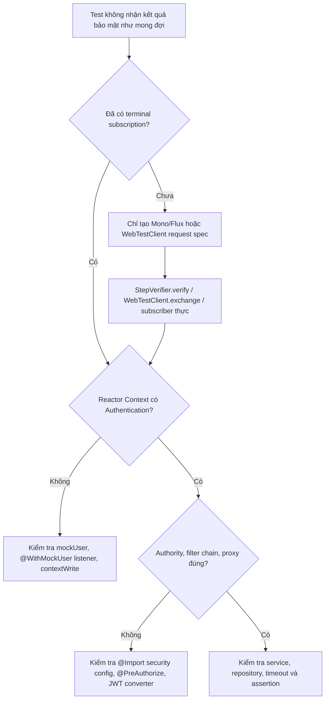
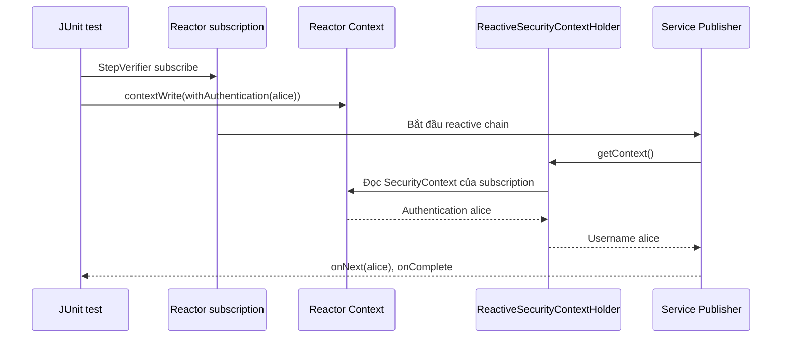

# Reactive test chưa subscribe hoặc thiếu Reactor Context

Trong kiểm thử Spring Security Reactive, có hai lỗi nhìn bề ngoài khá giống nhau: test không nhận được dữ liệu mong đợi, không thấy service/repository được gọi, hoặc một request đáng lẽ được phép lại bị từ chối. Nhưng nguyên nhân có thể hoàn toàn khác:

1. **Publisher chưa được subscribe:** code bên trong `Mono`/`Flux` chưa thực thi, nên assertion về side effect, bảo mật hay luồng lỗi chưa kiểm tra được điều gì.
2. **Publisher đã được subscribe nhưng thiếu hoặc sai Reactor Context:** luồng đã chạy, song `ReactiveSecurityContextHolder` không thấy `Authentication` của request/subscription. Kết quả có thể là `Mono.empty()`, một exception phân quyền, hoặc principal không đúng.

Đây là bài **“Reactive test chưa subscribe hoặc thiếu Reactor Context”** thuộc chương **Chẩn đoán sự cố** của module **SPRING_SECURITY_TESTING**. Mục tiêu của module là kiểm chứng xác thực, phân quyền và bảo vệ HTTP thực tế bằng `spring-security-test` trên Servlet và Reactive, qua `MockMvc`, `WebTestClient`, `@WithMockUser`, `SecurityContext` và các helper JWT/OAuth2/OIDC. Bài này tập trung vào WebFlux/Reactor nhưng cũng chỉ ra những thói quen từ Servlet dễ gây nhầm lẫn khi chuyển sang Reactive.

Sau khi học, bạn phải biết **publisher nào đã được subscribe**, **ngữ cảnh bảo mật nào được đưa vào subscription đó**, **filter/method security nào thực sự chạy**, và vì sao một test xanh với authentication giả không chứng minh được giao thức xác thực thực tế.

## 1. Chẩn đoán nhanh: chưa chạy hay chạy mà không có identity?



| Dấu hiệu | Nguyên nhân có thể | Bước kiểm tra đầu tiên |
| --- | --- | --- |
| `Mono` được tạo nhưng `doOnNext`/repository không chạy | Không subscribe, không có terminal operation | Dùng `StepVerifier.create(...).verify...` |
| `StepVerifier.create(...)` đã viết nhưng test kết thúc ngay | Chưa gọi `verifyComplete()`/`verify()`/terminal verification | Hoàn tất StepVerifier |
| `Mono.empty()` khi đọc username | `ReactiveSecurityContextHolder.getContext()` không có context | Gắn authentication bằng `contextWrite` đúng subscription |
| `@WithMockUser` có nhưng method security vẫn deny | Thiếu Spring Security Test Reactor listener, proxy hoặc context scope | Xem `@SpringJUnitConfig` và listeners |
| `WebTestClient` thiếu auth dù đã tạo `mockUser()` | Client chưa bind security, mutator đặt sai client hoặc không gọi `exchange()` | Kiểm tra client setup và request thực |
| `403` thay vì `200` | User có authentication nhưng thiếu authority; hoặc CSRF | Đọc rules và authority thực tế |
| `401` thay vì `200` | Authentication chưa có/không hợp lệ theo entry point | Kiểm tra request helper hoặc HTTP credential |
| `@PreAuthorize` không hề từ chối | Service bị mock, gọi qua `new`, thiếu proxy hoặc chưa subscribe | Test service bean thật qua Spring |
| `ReactiveSecurityContextHolder` đọc đúng ở bước đầu rồi mất ở một nhánh | Detached `subscribe()`, pipeline không compose hoặc context bị thay | Quan sát subscription và `contextWrite` |
| `Thread.sleep` khiến test lúc xanh lúc đỏ | Đồng bộ sai cách với async publisher | Dùng StepVerifier/scheduler test |

**Đừng chẩn đoán chỉ bằng status.** Một `403` do thiếu CSRF khác với `403` do thiếu authority; một request không có `Authentication` khác với request có identity nhưng scope sai. Tương tự, một `Mono.empty()` có thể do thiếu context, do repository không tìm thấy dữ liệu hoặc do publisher được lập trình trả empty.

## 2. Cold publisher: tạo Mono không đồng nghĩa code đã chạy

Phần lớn publisher Reactor dùng trong Spring WebFlux là **cold**: chúng mô tả công việc sẽ được thực thi khi có subscription. Nếu service trả `Mono<Void>` nhưng test không subscribe, phần việc bên trong `Mono.defer`, `Mono.fromRunnable`, `flatMap` hoặc các operator tương tự có thể chưa xảy ra.

Xét ví dụ:

```java
final class AuditService {

    private final AtomicInteger records = new AtomicInteger();

    Mono<Void> recordAudit() {
        return Mono.defer(() -> {
            records.incrementAndGet();
            return Mono.<Void>empty();
        });
    }

    int numberOfRecords() {
        return records.get();
    }
}
```

Test sai mục tiêu:

```java
@Test
void publisherWasOnlyCreated() {
    AuditService service = new AuditService();

    Mono<Void> result = service.recordAudit();

    assertThat(result).isNotNull();
    assertThat(service.numberOfRecords()).isZero();

    // Không có subscription, nên audit chưa được ghi.
}
```

Đây không phải bằng chứng cơ chế audit đã chạy hay đã bị chặn bởi authorization. Nó chỉ chứng minh một publisher được trả về.

Test có subscription thực:

```java
@Test
void publisherRunsWhenSubscribed() {
    AuditService service = new AuditService();

    Mono<Void> result = service.recordAudit();

    assertThat(service.numberOfRecords()).isZero();

    StepVerifier.create(result)
        .verifyComplete();

    assertThat(service.numberOfRecords()).isEqualTo(1);
}
```

`StepVerifier.verifyComplete()` **subscribe, chờ tín hiệu và kiểm tra kết thúc**. Sau đó mới assert tác dụng phụ. Nếu business operation trả giá trị, ưu tiên `expectNext(...)` hoặc `assertNext(...)` để vừa chứng minh publisher chạy vừa kiểm tra dữ liệu đúng.

### 2.1. Những thao tác nào thật sự subscribe?

| Cách dùng | Có bắt đầu subscription? | Lưu ý |
| --- | :---: | --- |
| `Mono<String> mono = service.call()` | Không nhất thiết | Method có thể chạy code eager khi tạo publisher; cần xét implementation |
| `StepVerifier.create(mono)` | Chưa cho đến khi verification bắt đầu | Cần `verify()` hoặc một phương thức `verify...()` |
| `StepVerifier.create(mono).expectNext("x").verifyComplete()` | Có | Tạo subscription và kiểm tra event |
| `mono.block()` | Có | Blocking; chỉ dùng ở ranh giới phù hợp, không trong Netty event loop |
| `mono.subscribe()` | Có | Tạo subscription riêng; khó kiểm soát assertion/lifecycle |
| `WebTestClient.get().uri(...)` | Chưa gửi request | Cần `exchange()` hoặc terminal request operation |
| `WebTestClient.get().uri(...).exchange()` | Có | Gửi HTTP request và nhận response spec |
| Controller WebFlux trả `Mono` cho runtime | Runtime subscribe | Kiểm thử HTTP phải thực sự `exchange()` |
| `Mono.just(expensiveCall())` | `expensiveCall()` chạy eager | Không được khái quát “mọi thứ chỉ chạy khi subscribe” |

Điểm cuối rất quan trọng: **Reactor là lazy theo contract của nhiều operator, nhưng Java code dựng publisher có thể eager**. `Mono.just(saveToDb())` thực thi `saveToDb()` trước khi tạo `Mono`; `Mono.defer(() -> saveToDbMono())` mới trì hoãn phần tạo nội dung đến subscription. Test phải hiểu đoạn nào eager, đoạn nào lazy.

## 3. Xác nhận subscription bằng PublisherProbe và tín hiệu Reactor

Khi `StepVerifier` báo thành công nhưng bạn nghi ngờ một nhánh không được gọi, `PublisherProbe` từ `reactor-test` cho phép kiểm tra có subscribe vào publisher được bọc hay không.

```java
@Test
void probeShowsSubscriptionHappened() {
    PublisherProbe<String> probe =
        PublisherProbe.of(Mono.just("report-ready"));

    Mono<String> result = probe.mono();

    probe.assertWasNotSubscribed();

    StepVerifier.create(result)
        .expectNext("report-ready")
        .verifyComplete();

    probe.assertWasSubscribed();
}
```

Bạn cũng có thể dùng `probe.assertWasRequested()` để kiểm tra upstream đã nhận demand. Phân biệt **subscription** với **request demand** và **phát tín hiệu**: có subscriber không có nghĩa publisher nhất định phát một phần tử, vì một `Mono.empty()` vẫn có thể hoàn thành hợp lệ.

Một cách nhẹ hơn là instrument đúng pipeline:

```java
Mono<String> traced = service.currentUsername()
    .doOnSubscribe(subscription ->
        log.debug("currentUsername subscribed"))
    .doOnNext(value ->
        log.debug("currentUsername emitted"))
    .doOnError(error ->
        log.debug("currentUsername failed: {}", error.getClass().getName()));
```

Chỉ log trạng thái và loại lỗi, **không log raw JWT, API key hoặc password**. `doOnSubscribe` giúp xác định subscription có xảy ra; `doOnNext` phân biệt kết quả có dữ liệu; `doOnError` giúp nhận ra error signal không được assert.

### 3.1. StepVerifier chỉ verifyComplete có thể chưa đủ

```java
StepVerifier.create(Mono.<String>empty())
    .verifyComplete();
```

Test trên xanh nhưng **không có giá trị nào được phát**. Nếu logic cần trả username của Alice, phải kiểm tra giá trị:

```java
StepVerifier.create(service.currentUsername())
    .expectNext("alice")
    .verifyComplete();
```

Nếu service trả `Mono.empty()` do thiếu Reactor Context, test thứ hai sẽ thất bại; test thứ nhất có thể bỏ sót lỗi. Khi kiểm tra `Mono<Void>`, hãy assert hiệu ứng/kết quả phụ tương ứng, chẳng hạn repository được gọi hoặc record không bị tạo khi bị từ chối.

## 4. Reactor Context khác SecurityContextHolder của Servlet như thế nào?

Trong Servlet, Spring Security thường dùng `SecurityContextHolder` dựa trên thread đang xử lý HTTP request. Trong WebFlux, một pipeline có thể chạy trên nhiều thread khi qua `publishOn`/`subscribeOn`. Spring Security Reactive sử dụng **Reactor Context được gắn với subscription** để cung cấp `SecurityContext` cho các operator tiếp theo.

Không nên dùng `SecurityContextHolder.getContext()` kiểu ThreadLocal để đọc authentication bên trong một reactive service và kỳ vọng nó luôn đúng khi đổi scheduler.



### 4.1. Service đọc identity đúng cách

```java
final class CurrentUserService {

    Mono<String> currentUsername() {
        return ReactiveSecurityContextHolder.getContext()
            .map(SecurityContext::getAuthentication)
            .map(Authentication::getName);
    }
}
```

`ReactiveSecurityContextHolder.getContext()` trả về `Mono<SecurityContext>`; nó không phải truy cập đồng bộ vào một thread-local toàn cục. Nếu subscription không chứa security context, publisher có thể **hoàn thành rỗng**. Vì thế test chỉ assert `verifyComplete()` mà không có `expectNext` dễ bỏ sót lỗi.

### 4.2. Đưa authentication vào đúng subscription với contextWrite

Không cần HTTP server để chứng minh Reactor Context hoạt động; có thể tạo authentication giả cho unit test:

```java
@Test
void eachSubscriptionCanHaveItsOwnAuthentication() {
    CurrentUserService service = new CurrentUserService();

    Authentication alice =
        UsernamePasswordAuthenticationToken.authenticated(
            "alice",
            "unused",
            List.of(new SimpleGrantedAuthority("ROLE_USER"))
        );

    Authentication bob =
        UsernamePasswordAuthenticationToken.authenticated(
            "bob",
            "unused",
            List.of(new SimpleGrantedAuthority("ROLE_USER"))
        );

    Mono<String> basePublisher = service.currentUsername();

    Mono<String> asAlice = basePublisher.contextWrite(
        ReactiveSecurityContextHolder.withAuthentication(alice)
    );

    Mono<String> asBob = basePublisher.contextWrite(
        ReactiveSecurityContextHolder.withAuthentication(bob)
    );

    StepVerifier.create(asAlice)
        .expectNext("alice")
        .verifyComplete();

    StepVerifier.create(asBob)
        .expectNext("bob")
        .verifyComplete();
}
```

`contextWrite(ReactiveSecurityContextHolder.withAuthentication(...))` gắn ngữ cảnh **vào subscription tương ứng**. Nó không làm đổi authentication toàn cục, không có nghĩa Bob sẽ thừa hưởng Alice, và không xác minh mật khẩu thật.

Một test **cố ý thiếu context**:

```java
@Test
void missingContextProducesNoUsername() {
    CurrentUserService service = new CurrentUserService();

    StepVerifier.create(service.currentUsername())
        .verifyComplete(); // Không có onNext nào.
}
```

Test này minh họa triệu chứng, không phải yêu cầu nghiệp vụ chuẩn. Với endpoint cần authentication, nên có một ca âm tính HTTP `401` hoặc method-security denial; không âm thầm coi việc thiếu authentication là username rỗng.

### 4.3. Không tự đặt Context key và mong Spring Security hiểu

Một key tùy biến:

```java
Mono<String> result = service.currentUsername()
    .contextWrite(Context.of("username", "alice"));
```

không tương đương với `ReactiveSecurityContextHolder.withAuthentication(alice)`. Spring Security không tự coi chuỗi `"username"` là một `Authentication` hợp lệ. Cần dùng API Spring Security hoặc context/cơ chế được cấu hình tương thích.

## 5. @WithMockUser: vì sao unit test Reactive có thể thiếu context?

`@WithMockUser` được thiết kế để Spring Security Test tạo `SecurityContext` giả cho một test. Với test React​ive, cần thêm bước **chuyển ngữ cảnh bảo mật của test sang Reactor Context** khi một reactive publisher được subscribe. Spring Security Test có các thành phần hỗ trợ, trong đó có `WithSecurityContextTestExecutionListener` và `ReactorContextTestExecutionListener`.

Những listener này thường được Spring Security Test tích hợp qua Spring TestContext. Nhưng nếu dự án tự cấu hình `@TestExecutionListeners` và **thay toàn bộ listeners mặc định**, hoặc tự dựng `Mono` ngoài Spring TestContext, authentication có thể không xuất hiện ở đúng nơi.

### 5.1. Test đúng với Spring-managed service và StepVerifier

Ví dụ method security:

```java
final class SecuredReportService {

    @PreAuthorize("hasAuthority('SCOPE_reports.read')")
    public Mono<String> readReport() {
        return ReactiveSecurityContextHolder.getContext()
            .map(SecurityContext::getAuthentication)
            .map(auth -> "report-for-" + auth.getName());
    }
}

@Configuration(proxyBeanMethods = false)
@EnableReactiveMethodSecurity
class ReactiveMethodTestConfig {

    @Bean
    SecuredReportService securedReportService() {
        return new SecuredReportService();
    }
}
```

Test dùng Spring TestContext thật:

```java
@SpringJUnitConfig(ReactiveMethodTestConfig.class)
class ReactiveMethodSecurityTest {

    @Autowired
    SecuredReportService service;

    @Test
    @WithMockUser(
        username = "alice",
        authorities = "SCOPE_reports.read"
    )
    void allowWhenScopeIsPresent() {
        StepVerifier.create(service.readReport())
            .expectNext("report-for-alice")
            .verifyComplete();
    }

    @Test
    @WithMockUser(
        username = "bob",
        authorities = "SCOPE_other.read"
    )
    void denyWhenScopeIsMissing() {
        StepVerifier.create(service.readReport())
            .expectError(AccessDeniedException.class)
            .verify();
    }
}
```

Trong ví dụ này:

- `@EnableReactiveMethodSecurity` kích hoạt method-security interceptor cho bean thật.
- `service` là bean do Spring quản lý, không phải `new SecuredReportService()` trực tiếp trong test.
- `@WithMockUser` tạo identity giả; Spring Security Test hỗ trợ ngữ cảnh cho subscription reactive.
- `StepVerifier` thực sự subscribe publisher, vì vậy method-security decision mới được đánh giá.
- Test thiếu scope kỳ vọng error signal khi method security từ chối.

Nếu test `denyWhenScopeIsMissing` trả value thay vì lỗi, hãy kiểm tra **service có đi qua proxy hay không**, annotation đang nằm ở đúng method, listeners có hoạt động và bạn có vô tình mock mất service hay không.

### 5.2. Test tự thay listeners có thể bỏ mất Reactor listener

Khi tự thêm `@TestExecutionListeners`, hãy cân nhắc `mergeMode = MERGE_WITH_DEFAULTS` thay vì thay toàn bộ danh sách. Nếu test infrastructure không nạp `ReactorContextTestExecutionListener`, `@WithMockUser` có thể hiện diện trên test thread nhưng không được gắn đúng vào subscriber context.

Đừng sửa symptom bằng cách gọi:

```java
SecurityContextHolder.getContext().setAuthentication(auth);
```

rồi hy vọng mọi reactive operator đều nhìn thấy `auth`. Đó là thao tác trên thread-local context và không phải cơ chế truyền identity chuẩn trong Reactor.

Một giải pháp rõ ràng trong unit test **không dùng annotation/listener** là `contextWrite(ReactiveSecurityContextHolder.withAuthentication(auth))` ngay trên publisher đang được verify, như mục 4.2.

## 6. Một lỗi khác: gọi service trực tiếp làm mất method security proxy

Xét:

```java
SecuredReportService service = new SecuredReportService();

StepVerifier.create(
        service.readReport().contextWrite(
            ReactiveSecurityContextHolder.withAuthentication(bob)
        )
    )
    .expectNext("report-for-bob")
    .verifyComplete();
```

Đoạn trên có thể chạy logic Java bình thường dù `@PreAuthorize` đã khai báo trong class, bởi đối tượng được tạo bằng `new` **không qua Spring AOP proxy**. Điều này không có nghĩa Spring Security bỏ qua policy ở runtime; nó chỉ có nghĩa test **không nạp cơ chế interceptor**.

Để test method security:

1. Bật `@EnableReactiveMethodSecurity` trong Spring context test.
2. Inject service bean thật từ context.
3. Dùng `@WithMockUser` với test listeners phù hợp hoặc `contextWrite(withAuthentication(...))`.
4. **Subscribe và assert** cả ca đủ quyền lẫn ca thiếu quyền.
5. Nếu service phụ thuộc repository, mock repository **bên dưới**, không mock service đang mang `@PreAuthorize`.

Cẩn thận với **self-invocation**: method trong cùng bean gọi trực tiếp một method khác của chính bean có thể không đi qua Spring proxy. Nếu một test chỉ gọi method không được proxy, annotation trên method nội bộ không phải lúc nào cũng được áp dụng.

## 7. WebTestClient: phải gửi request và phải gắn security đúng cách

Trong test WebFlux, việc tạo client hoặc request spec chưa đủ:

```java
// Chưa có HTTP exchange:
WebTestClient.RequestHeadersSpec<?> request =
    client.get().uri("/api/me");
```

Không có `.exchange()`, request chưa được gửi. Muốn kiểm thử security filter, phải thực hiện exchange và assert kết quả:

```java
client.get()
    .uri("/api/me")
    .exchange()
    .expectStatus().isUnauthorized();
```

### 7.1. Controller và chain mẫu cho 200/401/403

```java
@RestController
class WhoAmIController {

    @GetMapping("/api/me")
    Mono<Map<String, String>> whoAmI() {
        return ReactiveSecurityContextHolder.getContext()
            .map(SecurityContext::getAuthentication)
            .map(auth -> Map.of("username", auth.getName()));
    }
}

@Configuration(proxyBeanMethods = false)
@EnableWebFluxSecurity
class WhoAmISecurityConfig {

    @Bean
    SecurityWebFilterChain security(ServerHttpSecurity http) {
        return http
            .authorizeExchange(exchanges -> exchanges
                .pathMatchers(HttpMethod.GET, "/api/me")
                    .hasAuthority("SCOPE_profile.read")
                .anyExchange().denyAll()
            )
            .httpBasic(Customizer.withDefaults())
            .build();
    }
}
```

Chọn `httpBasic()` để entry point cho anonymous xác định rõ `401`. Endpoint yêu cầu `SCOPE_profile.read`, vì vậy user đã xác thực nhưng thiếu authority nhận `403`. Controller đọc principal từ Reactor Context sau khi security filter đã tạo authentication.

### 7.2. @WebFluxTest và WebTestClient auto-configured

```java
@WebFluxTest(controllers = WhoAmIController.class)
@Import(WhoAmISecurityConfig.class)
class WhoAmIWebFluxTest {

    @Autowired
    WebTestClient client;

    @Test
    void aliceWithScopeGets200() {
        client.mutateWith(
                mockUser("alice").authorities(
                    new SimpleGrantedAuthority("SCOPE_profile.read")
                )
            )
            .get()
            .uri("/api/me")
            .exchange()
            .expectStatus().isOk()
            .expectBody()
            .jsonPath("$.username").isEqualTo("alice");
    }

    @Test
    void bobWithoutScopeGets403() {
        client.mutateWith(
                mockUser("bob").authorities(
                    new SimpleGrantedAuthority("SCOPE_other.read")
                )
            )
            .get()
            .uri("/api/me")
            .exchange()
            .expectStatus().isForbidden();
    }

    @Test
    void anonymousGets401() {
        client.get()
            .uri("/api/me")
            .exchange()
            .expectStatus().isUnauthorized();
    }
}
```

`mockUser()` thuộc `SecurityMockServerConfigurers` của `spring-security-test`. Với `@WebFluxTest`, `WebTestClient` do Spring Boot auto-configure thường đã gắn với WebFlux application context và các filter tương ứng. `@Import` đảm bảo **security configuration của ví dụ** hiện diện trong slice, thay vì dựa vào policy mặc định.

Nếu bỏ `@Import(WhoAmISecurityConfig.class)` rồi chỉ kiểm tra anonymous nhận `401`, test có thể vẫn xanh do default security, nhưng không chứng minh rule `SCOPE_profile.read` thực sự được nạp. Giữ cả ba ca `200/401/403` để phân biệt authentication với authorization.

### 7.3. Tự tạo WebTestClient: cần springSecurity()

Khi tự bind client vào context:

```java
WebTestClient client = WebTestClient
    .bindToApplicationContext(applicationContext)
    .apply(springSecurity())
    .configureClient()
    .build();
```

`springSecurity()` nằm trong `SecurityMockServerConfigurers`; nó tích hợp WebTestClient với Spring Security WebFlux trong context để các mutator như `mockUser()` hoạt động đúng.

So sánh:

| Cách bind | Những gì test thực hiện | Rủi ro cần tránh |
| --- | --- | --- |
| `@Autowired WebTestClient` từ `@WebFluxTest` | Request vào WebFlux test context | Chưa chắc đã import security policy tùy biến |
| `bindToApplicationContext(ctx).apply(springSecurity())` | In-process, security test được gắn rõ | Phải bảo đảm context có `SecurityWebFilterChain` đúng |
| `bindToController(controller)` | Controller và web infrastructure tối thiểu | Không mặc nhiên có production security chain |
| `bindToServer().baseUrl("http://localhost:...")` | Gửi HTTP tới server thật | `mockUser()`/`mockJwt()` không phải credential gửi qua network |

Không trộn Servlet `MockMvc`/`SecurityContextHolder` với Reactive `WebTestClient`/`ReactiveSecurityContextHolder` khi chẩn đoán một bài test. Mỗi stack có cơ chế truyền authentication tương ứng.

## 8. Authentication giả có thể đúng nhưng credential thật vẫn sai

`@WithMockUser`, `mockUser()`, `mockJwt()`, `mockOpaqueToken()`, `mockOAuth2Login()` và `mockOidcLogin()` cho phép kiểm thử behavior **sau khi có authentication**. Các helper này không chứng minh password, chữ ký JWT, opaque introspection, OAuth2/OIDC callback hay HTTP token exchange đã được thực hiện.

Ví dụ với JWT Resource Server WebFlux, một test dùng:

```java
client.mutateWith(
        mockJwt()
            .jwt(jwt -> jwt.claim("sub", "alice"))
            .authorities(
                new SimpleGrantedAuthority("SCOPE_reports.read")
            )
    )
    .get().uri("/api/reports")
    .exchange()
    .expectStatus().isOk();
```

được thiết kế để test authorization khi principal đã có. Nó **không gửi compact JWT ký thực** vào decoder. Nếu test cần chứng minh `exp`, `iss`, `aud`, signature hay raw Bearer header, hãy tạo test riêng với `ReactiveJwtDecoder` thật và token phù hợp.

### 8.1. JWT helper và Reactor Context là hai ranh giới khác nhau

Một test có thể có `mockJwt()` áp dụng đúng client nhưng controller lại đọc identity bằng `SecurityContextHolder.getContext()`. Khi đó code ứng dụng đang dùng **sai cơ chế lấy context** cho WebFlux; đừng quy lỗi cho helper JWT. Sửa production code sang `ReactiveSecurityContextHolder` hoặc nhận `Principal`/`Authentication` qua reactive WebFlux argument resolver.

Ngược lại, một controller đọc Reactor Context đúng vẫn có thể nhận anonymous nếu WebTestClient không được gắn security test hoặc request không có authentication hợp lệ.

### 8.2. @WithMockUser ở test thread không đăng nhập cho server thật

`@SpringBootTest(webEnvironment = RANDOM_PORT)` chạy server HTTP trên thread/context xử lý request riêng. Annotation:

```java
@Test
@WithMockUser("alice")
void doesNotSendCredentialsToServer() {
    // Nếu dùng WebTestClient.bindToServer hoặc HTTP client thật
    // mà không gửi Authorization/cookie, server không tự nhận alice.
}
```

không tự biến thành Basic/Bearer header hay cookie. Muốn kiểm tra giao thức xác thực qua TCP, gửi credential HTTP thực và để server xử lý nó. Reactor Context **không thể được truyền qua mạng** chỉ bằng `contextWrite` ở phía client.

## 9. Vì sao publishOn thường không phải thủ phạm?

Một quan niệm sai phổ biến: “Reactor Context mất vì `publishOn` chuyển thread.” Trong luồng Reactor được compose đúng, Context thường **theo subscription qua các operator**, kể cả thay scheduler. ThreadLocal thông thường mới là thứ không tự đi cùng subscription khi đổi thread.

Ví dụ:

```java
@Test
void contextSurvivesPublishOn() {
    Authentication alice =
        UsernamePasswordAuthenticationToken.authenticated(
            "alice",
            "unused",
            List.of(new SimpleGrantedAuthority("ROLE_USER"))
        );

    Mono<String> name = ReactiveSecurityContextHolder.getContext()
        .map(SecurityContext::getAuthentication)
        .map(Authentication::getName)
        .publishOn(Schedulers.parallel())
        .contextWrite(
            ReactiveSecurityContextHolder.withAuthentication(alice)
        );

    StepVerifier.create(name)
        .expectNext("alice")
        .verifyComplete();
}
```

Vì vậy không nên “sửa” lỗi bằng cách ép mọi reactive operation về một thread. Khi context mất, ưu tiên tìm các **ranh giới subscription mới**, nguồn publisher không được compose, hoặc context bị tạo/thay sai chỗ.

### 9.1. Detached subscribe() tạo một vòng đời khác

Anti-pattern:

```java
Mono<Void> handle() {
    return Mono.just("start")
        .doOnNext(value -> {
            // Tạo subscription riêng, không compose vào pipeline gốc.
            currentUserService.currentUsername()
                .subscribe(username -> audit(username));
        })
        .then();
}
```

`subscribe()` trong `doOnNext` tạo một subscription tách khỏi request flow. Nó không có bảo đảm sẽ được quản lý cùng transaction, context, error propagation và cancellation của request. Kể cả khi một môi trường có hook tự động context propagation, thiết kế này vẫn khó kiểm soát và kiểm thử.

Cách làm rõ hơn:

```java
Mono<Void> handle() {
    return currentUserService.currentUsername()
        .flatMap(username -> saveAudit(username))
        .then();
}
```

Giả định `saveAudit(username)` trả `Mono<?>` phù hợp. Ở dạng compose, toàn bộ flow chung một subscription chain, Reactor Context và lỗi của audit được truyền theo publisher được trả về.

Nếu cần background queue/worker độc lập, truyền identity đã được xác minh dưới dạng **dữ liệu nghiệp vụ tối thiểu** qua message; đừng trông đợi HTTP Reactor Context của request tự tồn tại mãi ở worker khác.

### 9.2. Một publisher được cache có thể phát lại identity của người khác

Một lỗi nguy hiểm hơn thiếu context là **lưu username từ subscription đầu tiên rồi phát lại cho các request tiếp theo**:

```java
@Service
class UnsafeIdentityCache {

    private final Mono<String> username =
        ReactiveSecurityContextHolder.getContext()
            .map(ctx -> ctx.getAuthentication().getName())
            .cache();

    Mono<String> currentUsername() {
        return username;
    }
}
```

Nếu cache này nằm trong singleton, khi request Alice subscribe đầu tiên thì kết quả `alice` có thể bị cache, rồi request Bob được trả lại `alice`. Reactor Context của từng request vẫn có thể đúng; lỗi nằm ở **publisher kết quả bị cache không phân theo identity**.

Giải pháp là không cache giá trị phụ thuộc người dùng theo singleton:

```java
Mono<String> currentUsername() {
    return ReactiveSecurityContextHolder.getContext()
        .map(ctx -> ctx.getAuthentication().getName());
}
```

Nếu nghiệp vụ bắt buộc cache, key của cache phải bao gồm subject/tenant/scope phù hợp và có vòng đời thu hồi/expiration, đồng thời được kiểm tra bằng request Alice → Bob → Alice và cross-tenant.

## 10. contextWrite, deferContextual và vị trí đặt context

Context trong Reactor có ngữ nghĩa **gắn với subscriber/subscription**. `contextWrite` trả về một publisher mới; nó không phải lệnh cập nhật một biến toàn cục.

Ví dụ:

```java
Mono<String> source = currentUserService.currentUsername();

Mono<String> alice = source.contextWrite(
    ReactiveSecurityContextHolder.withAuthentication(aliceAuth)
);

Mono<String> bob = source.contextWrite(
    ReactiveSecurityContextHolder.withAuthentication(bobAuth)
);
```

Từng publisher dẫn xuất sẽ dùng context của chính subscription khi được verify. Gọi `source` nguyên bản vẫn không có authentication nếu không có nguồn context khác.

### 10.1. Context ghi “sau” một nhánh không tự quay ngược mọi chỗ

Với operator chaining, vị trí `contextWrite` ảnh hưởng phạm vi context mà các upstream operators nhìn thấy. Nên đặt context ở ranh giới bao toàn bộ publisher cần bảo vệ:

```java
Mono<String> secured =
    currentUserService.currentUsername()
        .flatMap(name -> loadProfile(name))
        .contextWrite(
            ReactiveSecurityContextHolder.withAuthentication(aliceAuth)
        );
```

Trong khi đó, một pipeline con bị subscribe riêng bằng `subscribe()` không tự động là một phần của cùng subscriber chain.

Nếu cần đọc thông tin từ Context trong một operator tùy biến, dùng `Mono.deferContextual(...)` hoặc `Flux.deferContextual(...)` thay vì cố truy cập global ThreadLocal. Với **security authentication**, hãy ưu tiên `ReactiveSecurityContextHolder` để tôn trọng abstraction của Spring Security.

### 10.2. Đọc context tại thời điểm lắp ráp publisher là sai ý nghĩa

Không làm:

```java
Authentication auth =
    SecurityContextHolder.getContext().getAuthentication();

Mono<String> name =
    Mono.just(auth.getName());
```

Đoạn này đọc ThreadLocal ngay khi code được gọi, có thể nhận `null` hoặc user không đúng request; `Mono.just(...)` còn yêu cầu giá trị không null. Hãy xây dựng publisher đọc authentication **trong subscription** bằng `ReactiveSecurityContextHolder.getContext()`.

## 11. Đối chiếu hai lỗi bằng một bài test tối giản

Chúng ta tạo hai test có cùng service, nhưng khác nguyên nhân.

### Test A — Không subscribe

```java
@Test
void testA_didNotSubscribe() {
    AtomicInteger calls = new AtomicInteger();

    Mono<String> publisher = Mono.defer(() -> {
        calls.incrementAndGet();
        return Mono.just("alice");
    });

    assertThat(publisher).isNotNull();
    assertThat(calls.get()).isZero(); // Chưa thực thi.

    // Dù test xanh, không có request/authentication nào được kiểm chứng.
}
```

### Test B — Subscribe nhưng thiếu security context

```java
@Test
void testB_subscribedButMissingContext() {
    CurrentUserService service = new CurrentUserService();

    StepVerifier.create(service.currentUsername())
        .expectNext("alice")
        .verifyComplete();

    // Test thất bại: không có onNext alice vì thiếu security context.
}
```

### Test C — Subscribe và có context đúng

```java
@Test
void testC_subscribedWithContext() {
    CurrentUserService service = new CurrentUserService();

    Authentication alice =
        UsernamePasswordAuthenticationToken.authenticated(
            "alice", "unused",
            List.of(new SimpleGrantedAuthority("ROLE_USER"))
        );

    StepVerifier.create(
            service.currentUsername().contextWrite(
                ReactiveSecurityContextHolder.withAuthentication(alice)
            )
        )
        .expectNext("alice")
        .verifyComplete();
}
```

Khi debug, cả ba ca có thể bị tóm tắt sai thành “Reactive security context lỗi”, nhưng:

- Test A chưa subscribe, nên không có cơ sở đánh giá context.
- Test B subscribe rồi, nhưng không cấp authentication.
- Test C subscribe với authentication đúng, chứng minh code đọc context hoạt động.

Đặt các ca cạnh nhau giúp tách vấn đề **lifecycle** khỏi **identity propagation**.

## 12. Phân biệt 401/403 với Mono.empty và exception của StepVerifier

`Mono.empty()`, `AccessDeniedException` và HTTP `401/403` thuộc những tầng khác nhau:

| Kết quả quan sát | Tầng phát sinh | Ý nghĩa có thể |
| --- | --- | --- |
| `Mono.empty()` từ `ReactiveSecurityContextHolder.getContext()` | Publisher đọc context | Context không có giá trị cho subscription |
| `AccessDeniedException` khi subscribe method `@PreAuthorize` | Reactive method security | Authority không phù hợp hoặc authentication thiếu |
| `401 Unauthorized` | HTTP authentication entry point | Không có authentication hợp lệ theo chain |
| `403 Forbidden` | HTTP authorization hoặc CSRF | Có identity nhưng thiếu quyền, hoặc request vi phạm CSRF |
| `StepVerifier.expectNext("alice")` thất bại vì complete | Test assertion | Publisher không phát giá trị như đã kỳ vọng |
| Timeout hoặc chưa có event | Reactive scheduling/IO | Upstream chậm, đang chờ scheduler hoặc publisher không hoàn tất |

Khi chẩn đoán, hãy kiểm tra **nguyên nhân chính xác** thay vì sửa production `permitAll()`, tắt CSRF hoặc ép test luôn trả `Mono.just(...)` để được màu xanh.

### 12.1. Dùng StepVerifier để xác minh error signal

Test chỉ viết:

```java
StepVerifier.create(securedService.readReport());
```

chưa đủ: không có terminal verification. Với service được method security bảo vệ:

```java
StepVerifier.create(securedService.readReport())
    .expectError(AccessDeniedException.class)
    .verify();
```

Nếu muốn kiểm tra chi tiết exception:

```java
StepVerifier.create(securedService.readReport())
    .expectErrorSatisfies(error -> {
        assertThat(error)
            .isInstanceOf(AccessDeniedException.class);
    })
    .verify();
```

Tránh assertion mơ hồ `expectError()` khi có thể, vì nó cho phép lỗi `NullPointerException` hoặc lỗi kết nối DB đi qua mà test vẫn xanh, trong khi mục tiêu là kiểm tra policy.

### 12.2. Virtual time không phải thuốc chữa thiếu Context

`StepVerifier.withVirtualTime(...)` giúp tăng tốc các operator `delay`, `timeout`, `retryWhen` bằng virtual scheduler. Nó **không tự cấp authentication**, không tạo HTTP session và không làm `@WithMockUser` truyền đúng qua một detached subscription.

Nếu cần virtual time và security context, phải kết hợp tường minh:

```java
StepVerifier.withVirtualTime(() ->
        Mono.delay(Duration.ofMinutes(10))
            .then(currentUserService.currentUsername())
            .contextWrite(
                ReactiveSecurityContextHolder.withAuthentication(aliceAuth)
            )
    )
    .expectSubscription()
    .thenAwait(Duration.ofMinutes(10))
    .expectNext("alice")
    .verifyComplete();
```

Publisher thời gian được tạo **bên trong supplier** sau khi virtual scheduler được thiết lập. Reactor scheduler ảo và Reactor Security Context là hai vấn đề độc lập.

## 13. Checklist kiểm tra khi @WebFluxTest hoặc @SpringBootTest thất bại

Khi thấy status sai hoặc identity trống, kiểm tra theo thứ tự:

1. **Test có subscribe không?** `StepVerifier.verify...()`/`WebTestClient.exchange()` đã được gọi?
2. **Publisher cold hay có side effect eager?** Dùng `doOnSubscribe`, `PublisherProbe`; không suy từ `Mono` non-null.
3. **Bảo mật chạy ở đâu?** Test Reactor unit, WebFlux in-process, hay HTTP server thật trên random port?
4. **Reactor Context có auth không?** Dùng `ReactiveSecurityContextHolder`, hoặc `contextWrite(withAuthentication(...))` trong unit test.
5. **Test listener có hoạt động không?** `@WithMockUser` trong Spring TestContext và `ReactorContextTestExecutionListener` có được giữ lại?
6. **Method security dùng bean thật?** `@EnableReactiveMethodSecurity`, proxy, không `new` thủ công hoặc mock service mất annotation?
7. **Client gắn đúng chain?** `@WebFluxTest` đã `@Import` security config thực chưa; custom WebTestClient có `springSecurity()`?
8. **Authority cấp đúng?** `ROLE_ADMIN` khác `SCOPE_reports.read`; test data phải trùng policy.
9. **Subscription có bị tách?** Có `subscribe()` lồng trong `doOnNext`, cache dùng chung hoặc thread-local giả không?
10. **401/403 có đúng nguyên nhân?** Anonymous, wrong scope, CSRF, decoder, session và entry point khác nhau.
11. **JWT/OIDC mutator có bị dùng nhầm mục tiêu?** `mockJwt()` và `mockOidcLogin()` không chạy xác thực mật mã/protocol thật.
12. **Test có assertion đủ mạnh?** Assert giá trị, loại lỗi và side effect, không chỉ `verifyComplete()` hoặc status.
13. **CI có chạy suite này không?** JUnit tags, Gradle task và integration test source set có bị bỏ qua?

Ghi lại kết luận theo **tầng chứng cứ**: “Mono đã được subscribe nhưng không có Reactor Context”, “SecurityWebFilterChain trong slice không đúng”, “method security service bị mock” hoặc “HTTP credential chưa gửi”, thay vì ghi chung “Spring Security trả sai 403”.

## 14. Bài thực hành

1. Tạo `AuditService` với `Mono.defer` như mục 2. Viết một test chỉ tạo publisher và một test dùng `StepVerifier.verifyComplete()`; giải thích vì sao counter khác nhau.
2. Bọc publisher bằng `PublisherProbe`. Chứng minh `assertWasNotSubscribed()` trước khi verify và `assertWasSubscribed()` sau verify.
3. Tạo `CurrentUserService.currentUsername()` đọc `ReactiveSecurityContextHolder.getContext()`. Viết test không có context nhận complete rỗng và test có `contextWrite(withAuthentication(alice))` phát `alice`.
4. Viết thêm test Alice/Bob dùng chung source publisher nhưng `contextWrite` khác nhau; kiểm tra không rò rỉ danh tính giữa subscription.
5. Tạo `SecuredReportService` với `@PreAuthorize` và `@EnableReactiveMethodSecurity`. Dùng `@SpringJUnitConfig`, `@WithMockUser` và `StepVerifier` kiểm tra đủ scope được phép, thiếu scope nhận `AccessDeniedException`.
6. Thử tạo service bằng `new` thay vì inject bean Spring; giải thích vì sao method-security proxy không chạy.
7. Tạo `@WebFluxTest`, `@Import(WhoAmISecurityConfig.class)` và `WebTestClient` theo mục 7. Chạy ba ca `200/401/403`; thử bỏ `exchange()` để xác nhận request chưa được thực thi.
8. Thử tạo một detached `subscribe()` bên trong operator và quan sát log từ `doOnSubscribe`; sửa bằng `flatMap`/`then` để compose lại pipeline.
9. Nếu module có JWT/OIDC, viết test mutator cho authorization và test HTTP credential/decoder/IdP thật ở cấp tích hợp; ghi rõ mỗi test chứng minh phạm vi nào.

**Tiêu chí hoàn thành:** khi reactive test thất bại, bạn xác định được subscription đã xảy ra hay chưa, authentication nằm trong Reactor Context của subscription nào, security filter/proxy nào đã chạy và kết quả `200/401/403` đến từ cơ chế nào. Test phải chứng minh đúng **danh tính, authority, giá trị/error signal và side effect** — không chỉ tạo một `Mono` hoặc làm annotation xuất hiện trong source.

## Tài liệu tham khảo

- [Project Reactor — Testing](https://projectreactor.io/docs/core/release/reference/testing.html): `StepVerifier`, virtual time và kiểm tra publisher.
- [Project Reactor — Context](https://projectreactor.io/docs/core/release/reference/advancedFeatures/context.html): Reactor Context, subscription và `contextWrite`.
- [Reactor Test — PublisherProbe API](https://projectreactor.io/docs/test/release/api/reactor/test/publisher/PublisherProbe.html): xác nhận subscription và request.
- [Spring Security — Reactive Method Security](https://docs.spring.io/spring-security/reference/reactive/authorization/method.html): `@EnableReactiveMethodSecurity` và security context trong Reactor.
- [Spring Security — Reactive Testing](https://docs.spring.io/spring-security/reference/reactive/test/index.html): security test context và reactive tests.
- [Spring Security — WebTestClient Setup](https://docs.spring.io/spring-security/reference/reactive/test/web/setup.html): `springSecurity()` khi bind WebTestClient.
- [Spring Security — WebTestClient Authentication](https://docs.spring.io/spring-security/reference/reactive/test/web/authentication.html): `mockUser()` và `@WithMockUser`.
- [Spring Security — WebTestClient OAuth2](https://docs.spring.io/spring-security/reference/reactive/test/web/oauth2.html): `mockJwt()`, `mockOidcLogin()` và giới hạn authentication helpers.
- [Spring Boot — Testing Spring Boot Applications](https://docs.spring.io/spring-boot/reference/testing/spring-boot-applications.html): `@WebFluxTest`, `@SpringBootTest`, server thực so với test in-process.
